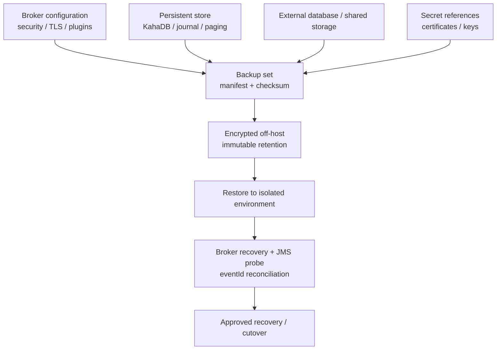
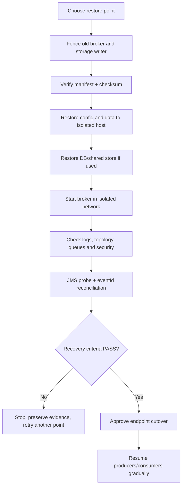

# Sao lưu cấu hình, dữ liệu và diễn tập phục hồi

> **Chương:** Vận hành  
> **Phạm vi:** Apache ActiveMQ Classic và ActiveMQ Artemis. Bài này tập trung vào inventory dữ liệu, tạo bản sao nhất quán của message store, bảo vệ cấu hình/secret và diễn tập restore có đối soát. Ví dụ dùng Linux, PostgreSQL và Java/Jakarta JMS; điều chỉnh đường dẫn, service name và version theo môi trường thực tế.

## 1. Backup broker phải chứa cả cấu hình và trạng thái message

Chỉ sao lưu **activemq.xml** hoặc **broker.xml** không thể khôi phục các message đang chờ. Chỉ copy journal/store mà thiếu cấu hình, credential, TLS material và plugin tương thích cũng có thể khiến broker không khởi động hoặc client không kết nối được.

Một bộ backup có thể phục hồi cần bao gồm:

1. **Broker configuration:** destination/address, persistence adapter, acceptor/connector, security, HA policy, limits, plugins và logging.
2. **Persistent message store:** queue/topic state, transaction state, bindings, paging và large messages tùy broker.
3. **External dependencies:** database, shared filesystem, mounted volume và các path nằm ngoài instance.
4. **Security material:** certificate, truststore, keystore, JAAS/users/roles và secret references.
5. **Runtime contract:** broker/client version, Java version, plugin, protocol, service unit, JVM options và đường dẫn data hiệu lực.
6. **Backup evidence:** timestamp, checksum, manifest, consistency point và kết quả kiểm tra archive.



### 1.1. Backup khác HA và replication

| Cơ chế | Mục đích | Điều nó không thay thế |
|---|---|---|
| **Backup/restore** | Khôi phục từ một điểm dữ liệu đã lưu khi có corruption, xóa nhầm, mất storage hoặc disaster | Không tự chuyển traffic tức thời |
| **HA primary/backup** | Duy trì dịch vụ khi một node lỗi trong fault model được hỗ trợ | Không phải bản sao lịch sử độc lập; lỗi/xóa nhầm có thể lan sang backup |
| **Replication** | Giữ dữ liệu ở node khác để hỗ trợ failover | Không thay thế backup bất biến |
| **Network of Brokers** | Chuyển tiếp message giữa broker có store riêng | Không phải một message store toàn cụm; cần backup từng broker/store |

Backup phải nằm **ngoài miền lỗi** của broker. Nếu bản backup nằm trên cùng ổ đĩa hoặc cùng account có quyền xóa như message store, nó có thể biến mất cùng sự cố hoặc thao tác sai.

### 1.2. RPO/RTO cho backup

- **Backup RPO:** khoảng thời gian dữ liệu được chấp nhận có thể mất giữa hai điểm backup có thể phục hồi.
- **Restore RTO:** thời gian từ quyết định phục hồi đến lúc broker và luồng nghiệp vụ đạt tiêu chí hoạt động.
- **Backlog recovery time:** thời gian xử lý backlog sau khi broker trở lại; nên là một SLO riêng.

Lên lịch backup mỗi 15 phút không tự chứng minh RPO 15 phút. Cần xác minh job thành công, bản sao đã off-host, checksum hợp lệ và có thể restore. RPO phải dựa trên **điểm dữ liệu cuối cùng thực sự phục hồi được**.

## 2. Xác định chính xác vị trí message store

Không giả định mọi broker lưu dưới cùng một thư mục. Trước backup, inventory các đường dẫn hiệu lực từ cấu hình runtime, kể cả path nằm ngoài thư mục cài đặt.

### 2.1. ActiveMQ Classic với KahaDB

Trong **activemq.xml**, cấu hình KahaDB thường có dạng:

```xml
<broker xmlns="http://activemq.apache.org/schema/core"
        brokerName="orders-classic"
        persistent="true"
        useJmx="true">

  <persistenceAdapter>
    <kahaDB directory="${activemq.data}/kahadb"/>
  </persistenceAdapter>

  <!-- transportConnectors, destinations, policies, security... -->
</broker>
```

Cần sao lưu **đúng giá trị đã resolve của activemq.data**, đặc biệt thư mục **kahadb**. Property có thể bị override bởi environment, service wrapper hoặc JVM option; không suy ra đường dẫn từ vị trí activemq.xml.

KahaDB dùng journal và metadata/index liên quan. Phương án dễ kiểm soát là **dừng broker sạch**, chờ process dừng hoàn toàn rồi copy toàn bộ thư mục persistence. Không copy một số journal file đang được ghi và bỏ qua phần còn lại.

Nếu Classic dùng persistence adapter khác, ví dụ JDBC, hãy backup tài nguyên mà adapter thực sự sử dụng; không sao lưu một thư mục KahaDB không tồn tại rồi coi là đã backup message store.

### 2.2. ActiveMQ Classic với JDBC persistence

Ví dụ adapter tham chiếu DataSource:

```xml
<broker xmlns="http://activemq.apache.org/schema/core"
        brokerName="orders-classic"
        persistent="true">

  <persistenceAdapter>
    <jdbcPersistenceAdapter
        dataSource="#brokerDataSource"
        useDatabaseLock="true"
        createTablesOnStartup="false"/>
  </persistenceAdapter>
</broker>
```

Message store nằm trong **database được brokerDataSource trỏ tới**. Backup phải bao gồm database/schema và thông tin phục hồi:

- DB engine/version, database name/schema, encoding và collation nếu có.
- Owner, roles, grants và quyền mà broker cần.
- DataSource/connection pool, JDBC driver và secret reference.
- Locking/failover mode và endpoint DB sau restore.

Không copy riêng các bảng broker nếu chưa hiểu quan hệ transaction và cách adapter quản lý chúng. Ưu tiên công cụ backup nhất quán của database engine.

### 2.3. ActiveMQ Artemis: backup đủ các thư mục store

Artemis thường tách dữ liệu persistent theo nhiều thư mục. Ví dụ fragment trong **broker.xml**:

```xml
<configuration xmlns="urn:activemq"
               xmlns:xsi="http://www.w3.org/2001/XMLSchema-instance">

  <bindings-directory>data/bindings</bindings-directory>
  <journal-directory>data/journal</journal-directory>
  <paging-directory>data/paging</paging-directory>
  <large-messages-directory>data/large-messages</large-messages-directory>

  <!-- acceptors, addresses, security, ha-policy, address-settings... -->
</configuration>
```

Đây là các thành phần cần inventory, không phải broker.xml hoàn chỉnh để thay thế file đang chạy. Path có thể relative theo broker instance hoặc đã được tùy chỉnh thành absolute path.

| Thành phần | Vai trò | Hậu quả nếu bỏ khỏi backup |
|---|---|---|
| **data/journal** | Message records và transaction journal | Có thể mất message/state đã persistent |
| **data/bindings** | Metadata address/queue/bindings | Store có thể không khôi phục đúng topology |
| **data/paging** | Message được paging ra đĩa khi address vượt ngưỡng | Có thể thiếu message đang nằm trong page files |
| **data/large-messages** | Payload lớn được lưu riêng | Message metadata có thể còn nhưng body không đầy đủ |

**Bốn nhóm dữ liệu phải được backup tại cùng một điểm nhất quán.** Sao lưu journal ở T1, paging ở T2 và large-messages ở T3 có thể tạo tập dữ liệu không khớp nhau.

Ngoài data directory, lưu **broker.xml**, **bootstrap.xml**, security/management config, logging, keystore/truststore, plugin và service/JVM configuration. Không bỏ qua các path tùy chỉnh khai báo trong config.

### 2.4. Shared store, replication và Network of Brokers

- **Shared-store HA:** primary và backup cùng dùng một store. Backup store theo quy trình storage nhất quán; bảo đảm chỉ một writer đang hoạt động và lock đã được giải phóng trước khi copy offline.
- **Replicated HA:** mỗi node có store riêng. Chọn snapshot của node authoritative ở thời điểm xác định; không trộn journal của primary với bindings/paging của replica tại thời điểm khác.
- **Network of Brokers:** mỗi broker thường có store riêng. Một event có thể đã forward sang broker khác; backup từng store theo ownership và đối soát bằng business eventId.

HA/replication không thay thế backup bất biến. Xóa nhầm queue hoặc corruption có thể được replicate sang node khác.

## 3. Cấu hình, certificate và secret phải đi cùng backup

### 3.1. Inventory cấu hình

| Nhóm | Classic | Artemis | Lý do |
|---|---|---|---|
| Broker core | activemq.xml | broker.xml, bootstrap.xml | Destination, persistence, transport, limits |
| Security | JAAS, users/roles, authorization plugin | security settings, login/role config | Client phải xác thực/ủy quyền đúng |
| TLS | Keystore, truststore, certificate chain | Keystore, truststore, certificate chain | TLS endpoint phải khôi phục đúng |
| Runtime | service unit, wrapper/JVM options, environment | service unit, JVM options, instance environment | Đúng Java/options/path |
| Extension | broker plugins, interceptors, JDBC driver | broker plugins, protocol modules | Tránh thiếu class khi startup |
| Observability | log config, JMX/exporter config | log config, metrics/plugin config | Duy trì chẩn đoán |
| External dependency | DB endpoint, shared store, DNS | DB/shared storage, DNS, HA discovery | Kết nối đúng dependency |

File config tham chiếu keystore nhưng backup không có keystore thì chưa phải backup phục hồi được. Ngược lại, không đưa password dạng plaintext vào archive có quyền truy cập rộng.

### 3.2. Lưu secret theo tham chiếu

Trong manifest, lưu **secret name/version/reference**, không lưu giá trị bí mật:

```yaml
backupId: orders-broker-2026-11-17T010000Z
broker:
  product: artemis
  version: "2.37.x"
  instance: orders-a
  persistenceMode: journal
  dataPaths:
    - data/bindings
    - data/journal
    - data/paging
    - data/large-messages
configuration:
  files:
    - etc/broker.xml
    - etc/bootstrap.xml
  secretReferences:
    - vault://messaging/orders-a/broker-user#version=12
    - vault://messaging/orders-a/tls-keystore-password#version=7
consistency:
  mode: clean-stop
  brokerStopped: true
  capturedAtUtc: "2026-11-17T01:00:00Z"
integrity:
  archiveSha256: "<sha256-from-backup-job>"
```

Manifest chỉ là ví dụ. Cần khôi phục được quyền truy cập secret và key-encryption key độc lập với broker host.

### 3.3. Bảo vệ backup

- Mã hóa trước khi chuyển ra kho off-host; quản lý khóa mã hóa riêng.
- Dùng quyền đọc/ghi tối thiểu và audit người tải, restore hoặc xóa backup.
- Nếu có thể, bật immutable retention/object lock để chống xóa nhầm hoặc ransomware.
- Không lưu backup duy nhất trên host broker hoặc cùng storage failure domain.
- Giữ checksum và manifest ở nơi độc lập; kiểm tra checksum sau upload và trước restore.
- Áp dụng retention theo yêu cầu pháp lý/nghiệp vụ; định kỳ kiểm tra khả năng đọc bản cũ.
- Certificate private key, database dump và message payload có thể chứa dữ liệu nhạy cảm; áp dụng phân loại dữ liệu phù hợp.

## 4. Tạo backup nhất quán

### 4.1. Quy trình offline

1. Thông báo maintenance window và xác định owner/backup point.
2. Chặn hoặc tạm dừng producer theo hợp đồng nghiệp vụ; ghi nhận event IDs đã được chấp nhận.
3. Đợi thao tác đang chạy hoàn tất trong thời gian cho phép; dừng consumer có kiểm soát nếu cần.
4. Dừng broker sạch để flush store và giải phóng lock.
5. Xác nhận process không còn ghi vào data directory hoặc shared store.
6. Copy toàn bộ configuration và persistence paths tại cùng thời điểm.
7. Backup database/shared storage theo công cụ phù hợp nếu nằm ngoài instance.
8. Tạo manifest, checksum, upload encrypted/off-host.
9. Kiểm tra archive đọc được và checksum khớp.
10. Khởi động lại broker, kiểm tra JMS connectivity và theo dõi backlog.

Nếu shutdown khi còn delivery chưa ACK, message có thể được giao lại sau recovery. Consumer phải idempotent nếu side effect DB đã commit trước khi ACK.

### 4.2. Dừng broker trước khi copy file store

Tên systemd unit tùy cách cài đặt. Ví dụ minh họa cho Classic:

```bash
BROKER_UNIT=activemq-classic

sudo systemctl stop "$BROKER_UNIT"
sudo systemctl status "$BROKER_UNIT" --no-pager

# Xác nhận process đã dừng và không còn writer khác
# truy cập persistence directory trước khi copy.
```

Với Artemis, thay BROKER_UNIT bằng service name thực tế của instance. Một số cài đặt chạy container/orchestrator thay vì systemd; dùng thao tác shutdown tương ứng và chờ broker process kết thúc sạch.

**Không dùng kill -9 như quy trình backup bình thường.** Kill cưỡng bức có thể buộc journal recovery khi startup; đó là fault test riêng, không phải clean-stop snapshot.

### 4.3. Archive một broker instance

Giả sử instance directory nằm dưới **/srv/activemq/orders-a**; data paths relative trong instance và không có volume ngoài. GNU tar minh họa:

```bash
BROKER_PARENT=/srv/activemq
INSTANCE_NAME=orders-a
BACKUP_ROOT=/srv/backup/activemq
STAMP=$(date -u +%Y%m%dT%H%M%SZ)
ARCHIVE="$BACKUP_ROOT/${INSTANCE_NAME}-${STAMP}.tar.gz"

sudo mkdir -p "$BACKUP_ROOT"

sudo tar --xattrs --acls --numeric-owner \
  -czf "$ARCHIVE" \
  -C "$BROKER_PARENT" "$INSTANCE_NAME"

sudo tar -tzf "$ARCHIVE" >/dev/null
sudo sha256sum "$ARCHIVE" | awk '{print $1}' > "$ARCHIVE.sha256"
```

Các cờ --xattrs, --acls và --numeric-owner phù hợp GNU tar; hệ điều hành/backup tool khác có cú pháp tương ứng. Nếu journal, large-messages hoặc TLS files nằm ngoài instance directory, archive này chưa đủ: backup chúng thành phần riêng và liên kết cùng backup ID/consistency point.

Không ghi archive vào chính thư mục đang được tar. Trong ví dụ, archive ở /srv/backup tách khỏi /srv/activemq.

### 4.4. Backup JDBC store bằng công cụ database

Nếu Classic sử dụng PostgreSQL làm JDBC store, dùng custom-format dump sau khi broker đã dừng sạch:

```bash
export PGHOST=db-broker.internal
export PGPORT=5432
export PGUSER=backup_operator
export PGDATABASE=activemq_store

pg_dump \
  --format=custom \
  --no-owner \
  --file=/srv/backup/activemq-store.dump \
  "$PGDATABASE"

pg_dumpall \
  --globals-only \
  --file=/srv/backup/postgres-globals.sql

sha256sum /srv/backup/activemq-store.dump \
  /srv/backup/postgres-globals.sql \
  > /srv/backup/postgres.sha256
```

File globals có thể chứa role metadata và password hash; bảo vệ chúng như secret. Dump database không tự backup broker config, TLS key hoặc database nghiệp vụ khác.

Khôi phục vào database mới/isolated để xác minh:

```bash
createdb \
  --host=db-restore.internal \
  --username=restore_operator \
  activemq_store_restore

pg_restore \
  --host=db-restore.internal \
  --username=restore_operator \
  --dbname=activemq_store_restore \
  --no-owner \
  /srv/backup/activemq-store.dump
```

Đây là ví dụ PostgreSQL; database engine khác cần công cụ native phù hợp. Restore roles/owners/grants và quyền lock phải được kiểm tra riêng. Chỉ đổi DataSource của broker sau khi DB restore được xác minh và cutover được phê duyệt.

Nếu broker vẫn ghi trong lúc dump, DB dump có thể nhất quán theo snapshot transaction của PostgreSQL nhưng không nhất thiết khớp thời điểm/config/backup file của broker. Với backup đồng bộ nhiều thành phần, **quiesce broker hoặc dùng snapshot phối hợp** để xác định consistency point.

### 4.5. Online snapshot cần phối hợp

Copy file store khi broker đang ghi có thể thu journal, paging và metadata ở những thời điểm khác nhau. Nếu yêu cầu backup online:

- Dùng storage snapshot atomic trên tất cả volume liên quan.
- Theo quy trình broker/storage được hỗ trợ; tạm dừng hoặc quiesce ghi nếu cần.
- Ghi lại thời điểm snapshot và trạng thái broker/HA.
- Với JDBC, dùng database-native snapshot/backup; phối hợp với config và các store khác.
- Thử restore từ chính loại snapshot này.

**Không copy thủ công file journal đang hoạt động bằng cp/tar rồi gọi đó là online backup nhất quán.** Nếu không có quy trình snapshot được xác minh, dùng clean-stop backup.

## 5. Restore khác nhau giữa Classic và Artemis

| Chủ đề | ActiveMQ Classic | ActiveMQ Artemis |
|---|---|---|
| File persistence phổ biến | KahaDB directory/journal | Journal, bindings, paging, large messages |
| JDBC store | jdbcPersistenceAdapter và DataSource | JDBC persistence store nếu được cấu hình |
| Config chính | activemq.xml và security/runtime files | broker.xml, bootstrap.xml và các file instance |
| Đường dẫn data | activemq.data hoặc adapter directory | Các directory cấu hình trong broker.xml |
| Shared-store HA | Shared KahaDB/file store hoặc JDBC tùy cấu hình/version | Shared-store HA với các directory dùng chung |
| Replication HA | Tùy mô hình Classic triển khai | Primary/backup replication với store riêng |
| Network of Brokers | Mỗi broker có store riêng; message được forward theo demand | Federation/cluster theo cơ chế Artemis |

### 5.1. Classic KahaDB restore

1. Fence instance cũ; bảo đảm không có broker khác mở cùng KahaDB directory.
2. Giải nén backup vào đúng instance path, giữ owner/permissions.
3. Đối chiếu activemq.xml, brokerName, activemq.data và plugin.
4. Nếu restore sang host mới, kiểm tra Java, Classic version và path permissions.
5. Khởi động trong network cô lập; theo dõi log journal recovery và persistence adapter.
6. Xác minh queue, message/event IDs và JMS probe trước khi mở traffic.

Không mở cùng KahaDB directory từ hai broker process. Khi chuyển host, old writer phải dừng/fenced và storage không còn được mount writable ở node cũ.

### 5.2. Artemis restore

Khôi phục **cùng consistency set** của bindings, journal, paging và large messages vào đúng path mà broker instance sử dụng. Giữ cấu hình phù hợp với version tạo backup; nâng broker version là thay đổi riêng, nên thử migration trên bản clone trước.

Khi broker start, theo dõi journal recovery, queue/address deployment, paging và large-message loading. Nếu message metadata còn nhưng large body directory thiếu, message có thể không đọc được dù queue vẫn hiện diện.

### 5.3. JDBC/shared-store restore

- Restore database hoặc shared storage về một điểm đã xác định.
- Chỉ cho phép một broker writer theo lock/fencing policy.
- Khôi phục DataSource/credentials và kiểm tra kết nối DB trước khi broker start.
- Không để primary cũ và restored broker cùng trỏ một store writable.
- Xác minh lock được giải phóng, schema tương thích và message store recovery hoàn tất.

## 6. Restore vào môi trường cô lập trước khi phục vụ lại

Restore trực tiếp vào network production có thể khiến broker clone nhận traffic thật, consumer xử lý lại message cũ, network connector forward duplicate hoặc hai broker cùng dùng identity/store.

### 6.1. Các bước phục hồi có kiểm soát



### 6.2. Verify checksum và giải nén bản restore

Giải nén vào thư mục restore riêng sau khi xác minh archive và checksum. Sidecar trong ví dụ backup ở mục 4.3 chỉ lưu giá trị SHA-256 nên có thể kiểm tra sau khi chuyển archive sang host khác:

```bash
set -eu
ARCHIVE=/srv/backup/activemq/orders-a-20261117T010000Z.tar.gz
RESTORE_PARENT=/srv/restore/activemq
EXPECTED_SHA=$(cat "$ARCHIVE.sha256")
ACTUAL_SHA=$(sha256sum "$ARCHIVE" | awk '{print $1}')

test "$EXPECTED_SHA" = "$ACTUAL_SHA"
sudo mkdir -p "$RESTORE_PARENT"
tar -tzf "$ARCHIVE" >/dev/null
sudo tar --xattrs --acls --numeric-owner -xzf "$ARCHIVE" -C "$RESTORE_PARENT"

# Điều chỉnh service account/group theo broker instance thực tế.
sudo chown -R activemq:activemq "$RESTORE_PARENT/orders-a"
```

Tên archive và service account ở trên là ví dụ. Nếu archive được mã hóa, giải mã vào vùng tạm có quyền hạn phù hợp sau khi lấy key từ secret manager; không ghi key vào command history. Sau giải nén, đối chiếu các external paths và mount riêng trước khi khởi động broker.

### 6.3. Fencing và network isolation

Trước khi start bản restore:

- Xác nhận old broker process đã dừng hoặc bị fence khỏi storage/network.
- Với shared store, xác minh không còn writer khác giữ/mở store.
- Với replication/HA, xác định node authoritative; không promote replica stale chỉ vì nó khởi động được.
- Cô lập network connectors, cluster discovery và outbound bridge trong bản restore test cho đến khi xác minh topology.
- Dùng endpoint/DNS/port riêng; không cho producer production tự động kết nối vào clone.
- Nếu brokerName, node ID, connector URI hoặc cluster identity cần thay đổi khi clone, làm theo hướng dẫn sản phẩm; không tự sửa persistent identity bên trong store.

Restore test phải dùng **bản copy độc lập** hoặc bảo đảm writer cũ đã fence. Không chạy clone cùng truy cập một shared store writable.

### 6.4. Kiểm tra config và security

- Đúng broker/client protocol và port.
- Destination/address/queue policy, auto-create, dead-letter và expiry settings.
- User/role, authorization, TLS certificate chain, hostname/SAN và truststore.
- Plugin/JDBC driver/classpath.
- File owner, directory permissions, disk capacity và mount options.
- DNS/service endpoint và outbound connector sau cutover.
- Metrics/logging/alerts hoạt động trên host phục hồi.

Không tắt security chỉ để smoke test pass rồi quên bật lại.

## 7. Đối soát dữ liệu sau restore

Broker start thành công chưa chứng minh backup đầy đủ. Cần kiểm tra **cấu trúc**, **message content** và **nghiệp vụ**.

### 7.1. Kiểm tra cấu trúc

| Kiểm tra | Classic | Artemis |
|---|---|---|
| Broker process/acceptor | Log startup, transport connector, JMX | Log startup, acceptor, management |
| Destinations | Queue/topic tồn tại theo config/store | Address/queue/binding tồn tại |
| Persistence | KahaDB/JDBC recovery không có lỗi nghiêm trọng | Journal/bindings/paging recovery |
| DLQ | Queue DLQ đúng cấu hình | Dead-letter-address và queue đích |
| Security | Authentication/authorization test | Authentication/role/address permissions |
| TLS | Client handshake và hostname verification | Client handshake và trust chain |

Không chỉ so tổng QueueSize: message có thể in-flight trước shutdown, được redeliver sau restart hoặc có expiry policy. Dùng business eventId và tập marker đã biết.

### 7.2. Lưu marker để kiểm tra backup

Trước khi tạo backup trong staging, gửi persistent messages có ID được ghi vào manifest/ledger bên ngoài:

```text
backupRunId = restore-drill-2026-11-17
expectedEventIds:
  - order-event-10021
  - order-event-10022
  - order-event-10023
queue: orders.pending
deliveryMode: PERSISTENT
producerCommit: confirmed
```

Ledger phải được lưu **ngoài broker store** để không biến mất cùng bản backup. Không tạo marker trong queue production nếu chưa có owner và kế hoạch dọn.

### 7.3. Java/Jakarta JMS: browse marker mà không consume

JUnit test sau dùng ConnectionFactory trỏ tới **broker restore cô lập**. Queue orders.pending phải tồn tại; QueueBrowser chỉ duyệt một số lượng giới hạn message và không ACK/consume chúng.

```java
import java.util.Enumeration;
import java.util.Set;
import java.util.HashSet;

import jakarta.jms.ConnectionFactory;
import jakarta.jms.JMSContext;
import jakarta.jms.Message;
import jakarta.jms.Queue;
import jakarta.jms.QueueBrowser;

import org.junit.jupiter.api.Test;
import org.springframework.beans.factory.annotation.Autowired;
import org.springframework.boot.test.context.SpringBootTest;

import static org.junit.jupiter.api.Assertions.assertTrue;

@SpringBootTest
class RestoredBrokerDataIT {

    @Autowired
    ConnectionFactory connectionFactory;

    @Test
    void restoredStoreContainsExpectedMarkers() throws Exception {
        Set<String> expected = Set.of(
            "order-event-10021",
            "order-event-10022",
            "order-event-10023"
        );

        try (JMSContext context =
                 connectionFactory.createContext(
                     JMSContext.AUTO_ACKNOWLEDGE)) {
            Queue queue = context.createQueue("orders.pending");
            context.start();

            QueueBrowser browser = context.createBrowser(queue);
            try {
                Enumeration<?> messages = browser.getEnumeration();
                Set<String> found = new HashSet<>();
                int inspected = 0;
                int maxToInspect = 10_000;

                while (messages.hasMoreElements()
                        && inspected < maxToInspect
                        && !found.containsAll(expected)) {
                    Message message = (Message) messages.nextElement();
                    inspected++;

                    String eventId =
                        message.getStringProperty("eventId");
                    if (eventId != null && expected.contains(eventId)) {
                        found.add(eventId);
                    }
                }

                Set<String> missing = new HashSet<>(expected);
                missing.removeAll(found);
                assertTrue(missing.isEmpty(),
                    "Missing restored event IDs: " + missing);
            } finally {
                browser.close();
            }
        }
    }
}
```

Đây là test minh họa cho Jakarta Messaging 2.x/3.x. Nếu ứng dụng Classic dùng client javax.jms cũ, đổi toàn bộ imports/dependency theo namespace tương thích; không trộn hai API trong cùng classpath. QueueBrowser không xóa message, nhưng duyệt queue lớn có thể tốn tài nguyên; dùng marker queue nhỏ hoặc giới hạn số message.

Nếu destination không hỗ trợ browsing hoặc broker policy không cho phép, dùng quy trình đối soát khác được broker hỗ trợ. Không consume/ACK message production chỉ để kiểm tra backup.

### 7.4. Smoke test send/receive trên broker restore

Sau khi marker được kiểm tra, gửi canary vào queue riêng để xác nhận producer/consumer path:

```java
import java.util.UUID;

import jakarta.jms.ConnectionFactory;
import jakarta.jms.DeliveryMode;
import jakarta.jms.JMSContext;
import jakarta.jms.Message;
import jakarta.jms.Queue;

import org.junit.jupiter.api.Test;
import org.springframework.beans.factory.annotation.Autowired;
import org.springframework.boot.test.context.SpringBootTest;

import static org.junit.jupiter.api.Assertions.*;

@SpringBootTest
class RestoredBrokerSmokeIT {

    @Autowired
    ConnectionFactory connectionFactory;

    @Test
    void restoredBrokerAcceptsAndDeliversCanary() throws Exception {
        try (JMSContext context =
                 connectionFactory.createContext(
                     JMSContext.SESSION_TRANSACTED)) {
            Queue queue = context.createQueue("ops.recovery.probe");
            String probeId = "restore-probe-" + UUID.randomUUID();

            context.createProducer()
                .setDeliveryMode(DeliveryMode.PERSISTENT)
                .send(queue, probeId);
            context.commit();

            context.start();
            Message received =
                context.createConsumer(queue).receive(5_000L);

            assertNotNull(received);
            assertEquals(probeId, received.getBody(String.class));
            context.commit();
        }
    }
}
```

Queue ops.recovery.probe cần được provision hoặc auto-create trong môi trường test. Canary chứng minh broker nhận và giao được persistent message theo client path; **không tự chứng minh** message cũ trong backup đã được phục hồi. Đó là lý do cần marker reconciliation riêng.

### 7.5. Đối chiếu với business database

Broker backup và database nghiệp vụ có thể được tạo ở các consistency point khác nhau. Nếu ứng dụng đã commit DB nhưng message chưa ACK, restore có thể redeliver; nếu broker backup cũ hơn DB, event có thể được xử lý lại.

- So sánh event IDs đã được producer xác nhận với marker/ledger có thể phục hồi.
- Kiểm tra inbox/idempotency table của consumer trước khi replay.
- Xác định side effect đã commit nhưng JMS ACK chưa hoàn tất.
- Không replay toàn bộ queue nếu chưa biết event nào đã xử lý.
- Nếu DB và broker cần cùng consistency point, thiết kế backup phối hợp hoặc reconciliation/outbox/inbox.

## 8. Diễn tập phục hồi định kỳ

Một bài diễn tập có giá trị phải kiểm tra từ **backup artifact** đến **nghiệp vụ thành công**, không chỉ chạy lệnh giải nén.

### 8.1. Kịch bản restore drill

| Bước | Hành động | Bằng chứng PASS |
|---|---|---|
| 1. Chọn restore point | Chọn backup ID và fault scenario | Manifest, RPO scope và owner được xác nhận |
| 2. Kiểm tra integrity | Verify checksum, decrypt, list archive | Archive đọc được, checksum khớp |
| 3. Chuẩn bị isolation | Host/network/storage riêng | Không có kết nối tới producer/consumer production |
| 4. Restore config/store | Khôi phục instance, database hoặc volume | Đủ file/path, owner và permission đúng |
| 5. Start broker | Khởi động theo version tương thích | Process ready, journal/store recovery hoàn tất |
| 6. Kiểm tra cấu trúc | Destination, queue, bindings, DLQ, security | Cấu trúc đúng với manifest |
| 7. Kiểm tra dữ liệu | Browse marker/event IDs | Không thiếu confirmed markers trong phạm vi backup |
| 8. JMS smoke test | Send/receive canary | Persistent send/receive thành công |
| 9. Business reconciliation | So sánh DB/inbox/outbox | Không tạo side effect trùng hoặc bỏ sót |
| 10. Đo thời gian | Ghi t0, t1 và các mốc trung gian | RTO/RPO observed được tính |
| 11. Dọn môi trường | Stop clone, giữ evidence, dọn test resources | Không còn clone kết nối nhầm production |
| 12. Cập nhật runbook | Ghi lỗi và hành động khắc phục | Owner, deadline và follow-up rõ ràng |

### 8.2. Đo RTO thực tế

Ghi các mốc UTC:

```text
t0 = incident declared / recovery decision
t1 = backup artifact available and verified
t2 = data/config restore complete
t3 = broker process ready
t4 = JMS client connected
t5 = first business transaction committed
t6 = backlog age returned to agreed SLO

Restore RTO = t5 - t0
Backlog recovery time = t6 - t5
```

Nếu mục tiêu nói “API nhận thanh toán trở lại”, t5 phải đo giao dịch test end-to-end đã commit DB, không dừng ở t3 broker process running.

### 8.3. Đo RPO thực tế

Đối chiếu **tập event IDs đã được xác nhận trước backup/sự cố** với tập có thể phục hồi:

```text
confirmedBeforeBackup = {E1001, E1002, E1003, E1004}
foundAfterRestore     = {E1001, E1002, E1003}

missingConfirmed = confirmedBeforeBackup - foundAfterRestore
lostConfirmedCount = size(missingConfirmed)
```

Nếu lostConfirmedCount > 0, backup point không đạt RPO=0 theo contract này. Nếu producer commit có kết quả unknown, phân loại riêng; không gộp vào tập confirmed hay tự kết luận mất dữ liệu.

Với queue rất lớn, không browse toàn bộ production queue chỉ để tạo phép đo. Dùng ledger/marker có kiểm soát, snapshot/database evidence hoặc công cụ reconciliation phù hợp.

### 8.4. Lịch diễn tập tham khảo

| Tần suất | Hoạt động |
|---|---|
| Mỗi backup job | Kiểm tra exit code, archive size, checksum và off-host upload |
| Hàng tuần | Restore bản gần nhất vào môi trường cô lập, kiểm tra startup và marker |
| Hàng tháng | Diễn tập broker + DB/store restore end-to-end, đo RTO/RPO |
| Hàng quý | Kiểm tra backup cũ hơn, credential/certificate recovery và quyền truy cập kho backup |
| Sau thay đổi lớn | Diễn tập lại khi đổi broker version, persistence adapter, path, HA topology hoặc encryption keys |

Tần suất thực tế theo RPO/RTO, tốc độ thay đổi dữ liệu, retention và audit. Lịch backup đều nhưng chưa từng restore **không chứng minh khả năng phục hồi**.

## 9. Lỗi restore thường gặp

| Triệu chứng | Nguyên nhân | Cách xử lý |
|---|---|---|
| Broker không mở được store | Sai path, owner/permission, thiếu file | So manifest với persistence config và file inventory |
| Artemis queue tồn tại nhưng message body lỗi | Thiếu large-messages hoặc snapshot không đồng thời | Restore đúng consistency set, kiểm tra journal/paging/large-message |
| Classic KahaDB báo journal recovery error | Copy live store không nhất quán hoặc version/path sai | Dùng backup clean-stop/valid snapshot, kiểm tra version và logs |
| JDBC broker không khởi động | DB/schema/roles/lock/DataSource không đúng | Restore DB riêng, xác minh grants/driver/lock trước startup |
| Hai broker cùng tranh store | Old writer chưa fence hoặc shared-store ownership sai | Dừng/fence writer cũ, xác minh lock trước khi start |
| Broker clone forward message production | Network connector/discovery còn mở | Cô lập network, tắt outbound path trong restore test |
| Client không kết nối sau restore | Hostname/port/certificate/user/role khác | Kiểm tra endpoint, SAN, truststore và credentials |
| Message count khác backup manifest | In-flight redelivery, expiry, DLQ hoặc snapshot point khác | Đối chiếu event IDs và policy, không chỉ queue count |
| Consumer xử lý trùng sau restore | DB đã commit trước ACK hoặc replay không idempotent | Đối soát inbox/business keys và replay có kiểm soát |
| Checksum đúng nhưng broker không chạy | Archive nguyên vẹn nhưng nội dung/config không tương thích | Restore test trên broker version/plugin tương ứng |
| Không giải mã được backup | Thiếu encryption key/secret version | Khôi phục key qua secret-management |
| Restore vượt RTO | Copy quá lớn, DNS/credential/DB chậm, thiếu automation | Đo từng bước, tối ưu transfer và chuẩn hóa runbook |

## 10. Checklist backup và restore trước khi nghiệm thu

### Trước backup

- [ ] Đã xác định persistence adapter và **đường dẫn data thực tế**.
- [ ] Đã inventory config, plugins, JDBC driver, TLS và security files.
- [ ] Đã phân biệt Classic KahaDB/JDBC hoặc Artemis journal/JDBC.
- [ ] Đã xác định shared-store/replication và node authoritative.
- [ ] Đã chọn consistency point; broker clean-stop hoặc snapshot theo quy trình được hỗ trợ.
- [ ] Không có writer khác sử dụng store khi copy offline.
- [ ] Backup database/shared storage cùng điểm hoặc có reconciliation plan.
- [ ] Archive, manifest, checksum và secret references được tạo.
- [ ] Bản sao được mã hóa và lưu off-host/immutable.
- [ ] Có owner và retention policy.

### Sau restore

- [ ] Old broker đã fence; clone ở network cô lập.
- [ ] Checksum và archive integrity đã được xác minh.
- [ ] Broker/client/plugin version và config tương thích.
- [ ] Owner, permissions, mount path và secret references đúng.
- [ ] Store/journal/paging/large-message recovery hoàn tất.
- [ ] Queue/address, DLQ, security và TLS được xác minh.
- [ ] Marker/event IDs đã đối soát; không chỉ so queue depth.
- [ ] JMS persistent send/receive probe thành công.
- [ ] Business DB/inbox/outbox đã đối soát trước replay.
- [ ] RTO/RPO observed được ghi lại và so với mục tiêu.
- [ ] Cutover được phê duyệt; clone test được dừng và dọn an toàn.

## 11. Bài tập vận dụng

1. Classic dùng KahaDB ở path tùy chỉnh ngoài thư mục cài đặt. Vì sao archive cả thư mục cài đặt vẫn có thể không chứa message store?
2. Artemis restore có journal và bindings nhưng thiếu paging hoặc large-messages. Những loại message nào có thể bị ảnh hưởng?
3. Broker dùng JDBC store PostgreSQL. Vì sao phải backup database bằng công cụ database-native thay vì chỉ tar thư mục broker?
4. Một bản backup được replicate sang region khác ngay lập tức. Vì sao điều đó vẫn không bảo vệ khỏi thao tác xóa nhầm queue?
5. Bạn cần restore clone để kiểm tra nhưng primary cũ vẫn hoạt động. Fencing và network isolation phải được thực hiện ra sao?
6. Producer đã nhận xác nhận commit, consumer DB đã commit nhưng JMS ACK chưa chắc chắn khi backup. Sau restore có thể xảy ra điều gì và cần đối soát nào?
7. Archive có checksum đúng nhưng broker không start do plugin/Java version không khớp. Manifest cần lưu thêm thông tin gì?
8. Thiết kế restore drill đo t0 đến business commit t5, và giải thích vì sao broker port open không phải RTO nghiệp vụ.
9. Khi dùng shared-store HA, vì sao không được start đồng thời hai broker process cùng mở một store?
10. Đề xuất retention/diễn tập cho hệ thống thanh toán có RPO=0 trong phạm vi lỗi một broker host, nhưng chấp nhận RPO khác cho telemetry.

## 12. Tài liệu tham khảo

- [ActiveMQ Classic — KahaDB](https://activemq.apache.org/components/classic/documentation/kahadb): cấu trúc và persistence adapter KahaDB.
- [ActiveMQ Classic — JDBC Persistence](https://activemq.apache.org/components/classic/documentation/jdbc-support): cấu hình JDBC store và database persistence.
- [ActiveMQ Classic — High Availability](https://activemq.apache.org/components/classic/documentation/high-availability): shared-store và các mô hình HA.
- [ActiveMQ Artemis — Persistence](https://artemis.apache.org/components/artemis/documentation/latest/persistence.html): journal, bindings, paging và large messages.
- [ActiveMQ Artemis — High Availability](https://artemis.apache.org/components/artemis/documentation/latest/ha.html): shared-store và replication primary/backup.
- [PostgreSQL — pg_dump](https://www.postgresql.org/docs/current/app-pgdump.html): logical backup và custom archive.
- [PostgreSQL — pg_restore](https://www.postgresql.org/docs/current/app-pgrestore.html): khôi phục archive vào database.
- [Jakarta Messaging Specification](https://jakarta.ee/specifications/messaging/): persistent delivery, QueueBrowser và transaction semantics.

**Ghi nhớ:** Backup broker phải là một **tập dữ liệu nhất quán** gồm cấu hình, persistent store và dependency bên ngoài; Classic KahaDB/JDBC và Artemis journal/bindings/paging/large-messages có phạm vi sao lưu khác nhau. Hãy clean-stop hoặc dùng snapshot được phối hợp, bảo vệ archive/secret off-host, restore vào môi trường cô lập, kiểm tra marker theo eventId, chạy JMS probe và đo RTO/RPO đến mức nghiệp vụ. **Backup chỉ có giá trị phục hồi sau khi đã restore và đối soát thành công.**
