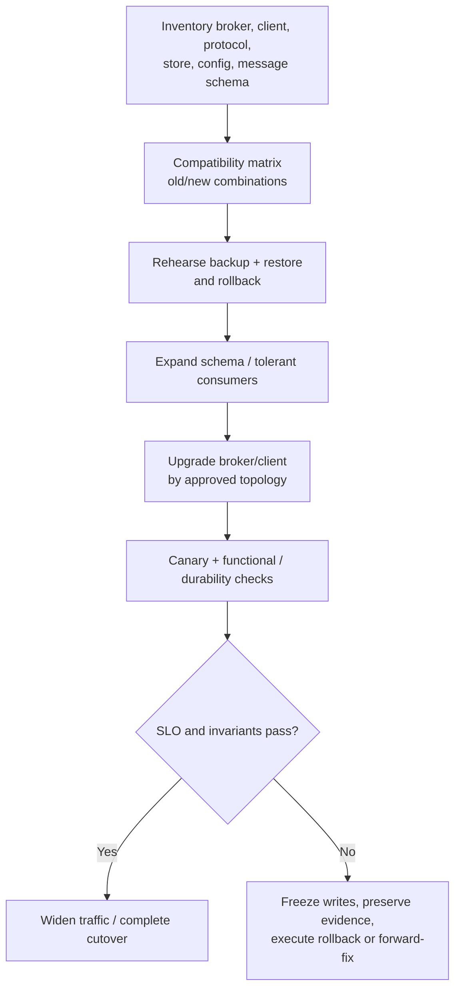
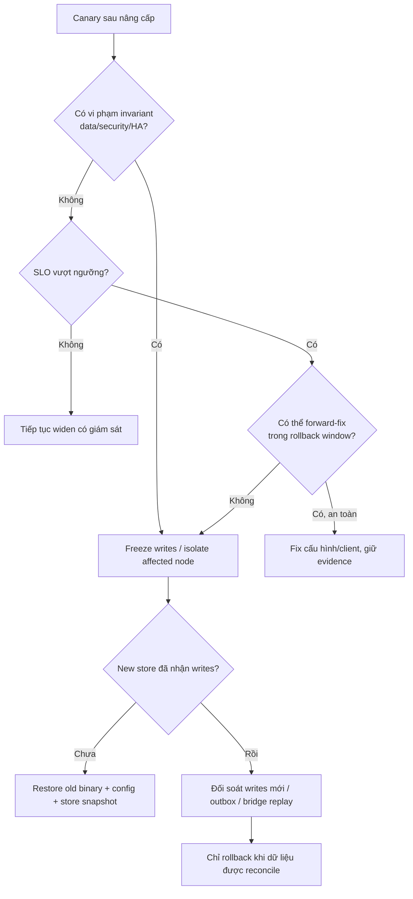

# Nâng cấp broker, client, schema cấu hình và kế hoạch rollback

> **Chương:** Vận hành  
> **Phạm vi:** Apache ActiveMQ Classic và Artemis trong hệ thống Java/JMS; nâng cấp phiên bản broker, thư viện client, protocol, cấu hình broker và schema payload; tổ chức cutover/rollback có kiểm soát.  
> **Mục tiêu:** Lập compatibility matrix trước khi nâng cấp; chọn in-place, rolling hoặc blue-green theo khả năng hỗ trợ; giữ tương thích producer/consumer trong thời gian chuyển đổi; bảo toàn message durable và transaction; có điểm dừng, tiêu chí rollback và cách phục hồi dữ liệu rõ ràng.

## 1. Nâng cấp messaging là thay đổi một hệ thống đang có trạng thái

Broker không chỉ là process có thể thay binary rồi khởi động lại. Nó quản lý journal/store, durable queues, subscriptions, scheduled messages, paging, in-flight deliveries, security identities, client connections và topology links. Một lần nâng cấp có thể làm thay đổi đồng thời:

- **Broker runtime:** phiên bản Java, broker binaries, protocol handlers, persistence implementation, HA/cluster behavior.
- **Client runtime:** JMS API namespace, provider client, connection factory, transport/protocol, failover/reconnect behavior.
- **Configuration schema:** tên option, default, giá trị hợp lệ, phần tử XML, plugin và cách nạp secret.
- **Message contract:** payload schema, application properties, event version, selector/filter và routing assumptions.
- **Operational behavior:** log/metrics, management API, startup scripts, service unit, container image và runbook.

Một nâng cấp thành công phải trả lời được bốn câu hỏi:

1. **Ai tương thích với ai?** Broker cũ/mới có thể phục vụ client cũ/mới theo protocol và JMS namespace nào?
2. **Dữ liệu nào đã thay đổi?** Broker mới có ghi store theo cách phiên bản cũ đọc được không?
3. **Ứng dụng nào có thể rollback độc lập?** Producer, consumer, broker và schema payload có cùng chiều rollback không?
4. **Điểm nào khiến ta dừng hoặc quay lui?** Phải có ngưỡng đo được trước khi mở rộng cutover.



**Nguyên tắc:** binary cũ, cấu hình cũ và data store cũ phải được giữ thành một **bộ phục hồi đã kiểm chứng**. Có bản backup mà chưa từng restore thử thì chưa có kế hoạch rollback đáng tin cậy.

## 2. Inventory trước khi chọn phương án nâng cấp

Không bắt đầu bằng việc thay version trong Maven hoặc container tag. Trước tiên lập inventory có owner và nguồn dữ liệu cho từng broker/service.

### 2.1. Inventory broker

| Nhóm | Cần ghi nhận | Vì sao ảnh hưởng nâng cấp |
|---|---|---|
| Product/version | Classic hay Artemis, exact version/build, Java runtime | Quy định upgrade path và module compatibility |
| Node/topology | Broker name/ID, primary/backup, cluster/network connectors, bridges | Quyết định rolling, maintenance order và fencing |
| Protocol | OpenWire, Core, AMQP, STOMP, MQTT, HTTP/Jolokia nếu có | Client cũ/mới có thể không hỗ trợ cùng tính năng |
| Persistence | KahaDB hoặc Artemis journal, paging, large messages, bindings | Quyết định backup, store compatibility và restore |
| Destinations | Queues, topics, anycast/multicast, durable subscriptions | Cần kiểm tra provisioning và routing sau nâng cấp |
| Delivery policy | Redelivery, DLQ, expiry, TTL, scheduled messages | Thay đổi default có thể đổi hành vi message |
| Security | JAAS, LDAP, users/roles, ACL, TLS, certificates | Có thể khởi động được nhưng client không connect/send |
| Extensions | Broker plugins, interceptors, transformers, custom login modules | Binary/API có thể thay đổi hoặc không còn tương thích |
| Runtime | Heap, GC, disk, file descriptors, ports, systemd/container args | Dễ gây sự cố sau nâng cấp dù cấu hình XML hợp lệ |
| Observability | JMX, management API, log format, exporter, alert rules | Dashboard/automation có thể hỏng do metric/API đổi |

### 2.2. Inventory client và workload

Với mỗi ứng dụng producer/consumer, ghi:

- Spring Boot và Spring Framework version; Java runtime.
- JMS namespace: `javax.jms` hay `jakarta.jms`.
- Provider artifact và version; protocol thực sự sử dụng.
- Broker endpoint, connection factory, credentials/secret source.
- Connection/session caching hoặc pooling, reconnect/failover options.
- Transaction model: local JMS, DB transaction riêng, JTA/XA nếu có.
- Message types: Text/Bytes/Map/Object, custom converter, headers và properties.
- Destination, selector, durable subscription, message groups và ordering requirement.
- Throughput, concurrency, message size, persistence mode, TTL và scheduled delivery.
- Business idempotency key, outbox/inbox và khả năng replay.

Không chỉ hỏi “ứng dụng đang dùng JMS”. Hai ứng dụng đều dùng JMS vẫn có thể khác namespace, provider, wire protocol, transaction semantics và extension properties.

### 2.3. Manifest triển khai có version

Ví dụ manifest **nội bộ do đội vận hành định nghĩa**, không phải Kubernetes API hay schema mặc định của ActiveMQ:

```yaml
service: billing-worker
environment: staging

messaging:
  brokerFamily: artemis
  brokerVersion: "2.x.y"
  clientArtifact: artemis-jakarta-client
  clientVersion: "2.x.y"
  jmsNamespace: jakarta.jms
  protocol: CORE
  destinations:
    - name: billing.commands
      type: ANYCAST
      durable: true
  delivery:
    transactionMode: transacted
    maxDeliveryAttempts: 5
    deadLetterAddress: DLQ
  messageContract:
    schemaName: BillingCommand
    schemaVersion: 3
    eventIdRequired: true

rollout:
  strategy: blue-green
  rollbackWindowMinutes: 30
```

Manifest giúp review **các thành phần phải tương thích cùng nhau**. Không đưa password, private key, LDAP bind secret hoặc truststore password vào file này; chỉ tham chiếu tên secret/version trong secret manager.

## 3. Compatibility matrix: kiểm tra trước khi thay đổi

### 3.1. Product, client và JMS namespace

Một lỗi nâng cấp dễ gặp là compile thành công nhưng runtime không nạp được provider vì namespace JMS không khớp.

| Ứng dụng/runtime | JMS API phổ biến | Điều cần kiểm tra |
|---|---|---|
| Spring Boot 2 / Spring Framework 5 | `javax.jms` | Dùng provider client cung cấp đúng `javax.jms.ConnectionFactory` |
| Spring Boot 3 / Spring Framework 6 | `jakarta.jms` | Dùng provider client tương thích Jakarta; không trộn client chỉ có `javax.jms` |
| ActiveMQ Classic 5.x legacy | Thường là `javax.jms` | Xác nhận đúng artifact/build và Java baseline |
| ActiveMQ Classic 6.x | Jakarta-based | Kiểm tra plugin/protocol compatibility và migration notes của đúng bản |
| Artemis client legacy | Có artifact/API `javax.jms` tùy dòng | Không suy ra chỉ từ broker version |
| Artemis Jakarta client | `jakarta.jms` | Chọn artifact được phát hành cùng dòng client/broker phù hợp |

Tên artifact và Java baseline có thể thay đổi giữa các bản phát hành. **Không dùng bảng trên để thay compatibility check theo exact version**; mở release notes/migration guide của hai đầu và compile/integration-test bằng dependency thực tế.

Ví dụ Spring Boot 3 với Artemis starter do Boot BOM quản lý:

```xml
<dependency>
    <groupId>org.springframework.boot</groupId>
    <artifactId>spring-boot-starter-artemis</artifactId>
</dependency>
```

Ví dụ Spring Boot với ActiveMQ Classic starter:

```xml
<dependency>
    <groupId>org.springframework.boot</groupId>
    <artifactId>spring-boot-starter-activemq</artifactId>
</dependency>
```

Khi dùng Spring Boot dependency management, để BOM quản lý version nếu có thể. Nếu override client version, cần kiểm tra dependency tree để chắc chỉ có **một JMS API namespace** và provider implementation đúng.

### 3.2. Broker/client matrix

Lập ma trận thực nghiệm, không chỉ dựa vào “cùng major version”:

| Broker | Client | Protocol | Trạng thái cần chứng minh |
|---|---|---|---|
| Broker cũ | Client cũ | Protocol hiện tại | Baseline trước thay đổi |
| Broker mới | Client cũ | Protocol được hỗ trợ | Khả năng giữ client cũ trong rollout |
| Broker cũ | Client mới | Protocol được hỗ trợ | Có thể deploy client trước hay không |
| Broker mới | Client mới | Protocol mới/chọn dùng | Đích cuối cùng |
| Broker mới | Client cũ | Protocol cũ/extension | Kiểm tra header, auth, transaction, failover |
| Broker cũ | Client mới | Protocol cũ/extension | Kiểm tra downgrade/compatibility trước cutover |

Mỗi ô cần kết quả cho **các luồng thực tế**: connect, authenticate, send persistent, receive, commit, rollback, redelivery, selector, TTL, scheduled, DLQ, reconnect và management. Một TCP connection thành công chỉ chứng minh transport handshake.

### 3.3. Mixed-version cluster không phải mặc định an toàn

Không tự ghép broker phiên bản khác nhau vào cùng cluster/replication pair vì một node “vẫn connect được”. Cần xác minh tài liệu đúng phiên bản về:

- Broker-to-broker protocol compatibility.
- Cluster topology and bridge compatibility.
- Replication journal compatibility.
- HA activation/failback behavior.
- Rolling upgrade support và giới hạn phiên bản được phép chạy đồng thời.

Nếu không có xác nhận rõ ràng, chọn **maintenance window có điều phối** hoặc **blue-green migration sang cluster mới**, không tạo mixed-version cluster production theo phỏng đoán.

## 4. Chọn chiến lược: in-place, rolling hay blue-green

| Chiến lược | Cách làm | Phù hợp khi | Rủi ro chính |
|---|---|---|---|
| **In-place** | Dừng broker, backup, thay binary/config rồi khởi động lại cùng instance/store | Một broker, maintenance window rõ, upgrade path hỗ trợ | Downtime; rollback store có thể khó nếu format đã thay đổi |
| **Rolling** | Nâng cấp từng node trong topology có hỗ trợ rolling và mixed-version window được tài liệu cho phép | Cluster/HA được xác nhận hỗ trợ upgrade từng node | Mixed-version incompatibility, client reconnect, topology changes |
| **Blue-green** | Dựng broker/cluster mới song song, đồng bộ hoặc cutover traffic theo kế hoạch | Major upgrade, thay product/protocol, thay data center hoặc schema lớn | Hai hệ thống cùng tồn tại; cần kiểm soát dual-write/replay |
| **Client-first** | Nâng cấp app/client trước broker | Chỉ khi client mới tương thích broker cũ và protocol cũ | Client mới có thể dùng feature broker cũ không hỗ trợ |
| **Broker-first** | Nâng broker trước, giữ client cũ | Chỉ khi broker mới tương thích ngược với toàn bộ client đang chạy | Runtime/feature differences và client reconnect |

### 4.1. Cây quyết định

- **Patch/minor cùng product, store format tương thích và có upgrade guide:** có thể chọn in-place/rolling theo HA support.
- **Major version hoặc config/store migration:** ưu tiên clone môi trường và rehearsal; cân nhắc blue-green.
- **Classic sang Artemis:** xem là **migration giữa hai broker products**, không coi là thay binary tại chỗ. Phải kiểm tra protocol, destination model, selectors, security, scheduler, DLQ, message properties và store migration.
- **Không xác định được mixed-version support:** không rolling; lên kế hoạch downtime có kiểm soát hoặc blue-green.
- **Không restore được backup:** chưa đủ điều kiện nâng cấp production.

## 5. Schema payload: dùng expand-and-contract

Schema payload của message thường sống lâu hơn một lần deploy. Consumer có thể đọc message cũ sau khi producer đã phát version mới; DLQ có thể giữ message hàng tuần; replay có thể chạy bằng phiên bản code khác.

### 5.1. Quy tắc tương thích khi mở rộng schema

Giả sử version 1:

```json
{
  "eventId": "evt-101",
  "orderId": "ORD-42",
  "amount": 125000
}
```

Version 2 thêm `currency` và `source`:

```json
{
  "eventId": "evt-101",
  "orderId": "ORD-42",
  "amount": 125000,
  "currency": "VND",
  "source": "mobile"
}
```

Cách rollout an toàn:

1. **Expand consumer trước:** consumer mới đọc schema v1 và v2; field mới có default/optional behavior rõ.
2. Deploy consumer mới lên toàn bộ instances, theo dõi unknown fields và conversion failures.
3. **Expand producer:** bắt đầu phát field mới; giữ các field cũ cho tới khi hết consumer cũ và message backlog cũ.
4. Quan sát DLQ, scheduled backlog, retry và replay; message cũ vẫn phải được đọc.
5. **Contract sau:** chỉ xóa field cũ hoặc đổi semantics khi không còn consumer/retention/replay path nào phụ thuộc.

### 5.2. Những thay đổi thường phá tương thích

| Thay đổi | Nguy cơ | Hướng xử lý |
|---|---|---|
| Thêm optional field | Thường tương thích nếu consumer bỏ qua unknown fields | Có default và test cả v1/v2 |
| Thêm required field | Consumer cũ không cung cấp/đọc được | Expand trước, sau đó mới bắt buộc |
| Đổi tên field | Consumer cũ không tìm thấy | Dual-read/dual-write trong giai đoạn chuyển |
| Đổi kiểu `amount` number sang string | Deserialization/conversion failure | Field mới/version mới, migration có kiểm soát |
| Đổi enum value | Consumer cũ có thể reject | Unknown enum fallback hoặc schema version |
| Thay nghĩa field nhưng giữ tên | Silent data corruption | Tạo field/version mới, không đổi semantics âm thầm |
| Xóa field cũ | Replay/DLQ cũ không còn parse được | Giữ backward reader trong retention window |

**Message schema version khác broker version.** Broker nâng cấp không tự chuyển payload JSON hoặc application properties; schema evolution thuộc hợp đồng producer/consumer.

### 5.3. Ví dụ consumer tolerant với Jackson

```java
import com.fasterxml.jackson.databind.DeserializationFeature;
import com.fasterxml.jackson.databind.ObjectMapper;

public final class EventCodec {
    private final ObjectMapper mapper = new ObjectMapper()
        .configure(
            DeserializationFeature.FAIL_ON_UNKNOWN_PROPERTIES,
            false
        );

    public OrderCreated decode(String json) throws Exception {
        return mapper.readValue(json, OrderCreated.class);
    }
}
```

Bỏ qua unknown fields giúp consumer cũ chịu được field mới, nhưng **không** giải quyết đổi kiểu hoặc đổi ý nghĩa. Với field bắt buộc, validate sau deserialize và phân loại lỗi schema permanent để tránh retry poison vô hạn.

## 6. Nâng cấp cấu hình broker như một migration có version

Cấu hình broker là một phần của release artifact, cần review và test độc lập với binary.

### 6.1. Tách cấu hình theo product và version

Ví dụ cách quản lý trong repository:

```text
messaging/
  classic/
    5.x/
      activemq.xml
      users.properties.template
    6.x/
      activemq.xml
      users.properties.template
  artemis/
    2.x/
      broker.xml
      bootstrap.xml
      login.config.template
  environments/
    staging/
    production/
  manifests/
    broker-release.yaml
  migrations/
    2026-11-add-expiry-address.md
```

Đây là layout đề xuất, không phải layout bắt buộc của broker. Mỗi release cần lưu:

- Binary/image digest và version.
- Config commit/hash đã triển khai.
- Secret reference/version, certificate fingerprint/expiry.
- Java runtime và JVM flags.
- Data directory/store snapshot identifier.
- Client artifact versions và schema contract version.
- Kết quả preflight/rollback rehearsal.

### 6.2. Thay đổi cấu hình có expand/contract riêng

Ví dụ thêm expiry address trong Artemis:

```xml
<!-- broker.xml: giai đoạn EXPAND -->
<address-settings>
    <address-setting match="orders.#">
        <expiry-address>ExpiryOrders</expiry-address>
        <max-delivery-attempts>5</max-delivery-attempts>
        <dead-letter-address>DLQ</dead-letter-address>
    </address-setting>
</address-settings>

<addresses>
    <address name="ExpiryOrders">
        <anycast>
            <queue name="ExpiryOrders" durable="true"/>
        </anycast>
    </address>
</addresses>
```

Thứ tự rollout:

1. Provision expiry address/queue và quyền truy cập cần thiết.
2. Deploy cấu hình mới trong staging, gửi một message TTL ngắn và xác minh expiry route.
3. Deploy broker config production theo cơ chế reload/restart được phiên bản hỗ trợ.
4. Bật producer TTL sau khi expiry path đã sẵn sàng.
5. Theo dõi expiry count/queue age và retention.
6. Chỉ xóa policy cũ sau khi không còn message phụ thuộc.

Không đổi đồng thời `max-delivery-attempts`, DLQ, expiry, scheduler và broker binary trong một lần nếu không có test phân biệt nguyên nhân. Mỗi thay đổi nên có config diff và acceptance criteria riêng.

### 6.3. Validate cấu hình trước khi start

Không có một lệnh validator chung cho mọi phiên bản Classic và Artemis. Thực hiện:

- Parse/validate XML bằng công cụ/schema được cung cấp cùng đúng broker version nếu có.
- Khởi động **instance staging với config mới và data copy an toàn**.
- Đọc toàn bộ startup logs để tìm unknown/deprecated options, plugin load failures, missing class và permission errors.
- Xác minh management view: acceptors, connectors, addresses, queues, security settings và HA/cluster status.
- Chạy send/receive/rollback/TTL/DLQ smoke tests.
- So sánh effective config/runtime state với config trong Git; không chỉ kiểm tra file text.

Một broker có thể bỏ qua hoặc dùng default cho option sai tên tùy parser/version. **Startup không lỗi không chứng minh cấu hình đã có hiệu lực.**

## 7. Nâng cấp client và dependency an toàn

### 7.1. Quản lý dependency bằng BOM

Ví dụ Maven dùng Spring Boot parent/BOM:

```xml
<parent>
    <groupId>org.springframework.boot</groupId>
    <artifactId>spring-boot-starter-parent</artifactId>
    <version>3.x.y</version>
    <relativePath/>
</parent>

<dependencies>
    <dependency>
        <groupId>org.springframework.boot</groupId>
        <artifactId>spring-boot-starter-artemis</artifactId>
    </dependency>
</dependencies>
```

Không copy literal `3.x.y` vào production; thay bằng phiên bản Spring Boot đã được duyệt. Tránh pin đồng thời `jakarta.jms-api`, provider client và transitive JMS API một cách mâu thuẫn.

Với Classic, thay starter bằng `spring-boot-starter-activemq` khi ứng dụng dùng provider Classic và version Boot đã chọn hỗ trợ nó. Nếu cần custom provider artifact, kiểm tra dependency tree và loại trừ API trùng đúng cách.

### 7.2. Kiểm tra dependency tree

Ví dụ Maven:

```bash
mvn -q dependency:tree
```

Rà soát:

- Chỉ có JMS namespace mà runtime mong đợi.
- Không có hai provider implementations cùng cạnh tranh auto-configuration.
- Không có client jar bị override ngoài BOM mà thiếu release notes.
- Logging/Netty/SSL libraries không bị version conflict.
- Custom broker plugins dùng đúng API version.

Gradle tương ứng có thể dùng `./gradlew dependencies` và `dependencyInsight` cho module JMS/provider. Chạy trong CI của ứng dụng, không phải trên broker host.

### 7.3. Không đổi namespace nửa chừng

Spring Boot 2 dùng `javax.jms`; Spring Boot 3 dùng `jakarta.jms`. Đây là thay đổi package ở compile/runtime boundary. Các imports như `javax.jms.Message` và `jakarta.jms.Message` là hai class khác nhau dù tên giống.

Một ứng dụng không thể “chỉ nâng broker” để tự biến bytecode client từ javax sang jakarta. Phải rebuild/recompile client với provider và framework tương thích, sau đó integration test.

### 7.4. Client config phải có thể quay lui

Ví dụ cấu hình Spring Boot Artemis với secret inject từ môi trường:

```yaml
spring:
  artemis:
    mode: native
    broker-url: tcp://mq.internal.example:61616
    user: ${JMS_USERNAME}
    password: ${JMS_PASSWORD}
```

Classic client dùng nhóm property riêng:

```yaml
spring:
  activemq:
    broker-url: tcp://mq.internal.example:61616
    user: ${JMS_USERNAME}
    password: ${JMS_PASSWORD}
```

Đừng đưa hai nhóm cấu hình vào cùng profile rồi để auto-configuration chọn provider ngoài ý muốn. Mỗi deployment profile cần một provider rõ ràng, và secret version phải được ghi nhận để rollback đúng.

## 8. Kế hoạch nâng cấp broker: các pha và gate

### Pha 0 — Chốt mục tiêu và phạm vi

Ghi rõ:

- Source/target product và exact versions.
- Lý do nâng cấp: security fixes, Java baseline, performance, protocol hoặc feature.
- Destination, producer/consumer và client nào bị ảnh hưởng.
- Downtime được phép, RTO/RPO, maintenance window.
- Tính năng đang dùng có migration note: persistence, HA, cluster, plugins, auth, DLQ, scheduler.
- Release owner, người có quyền dừng/rollback.

Không nâng cấp chỉ vì tag image mới hơn; phải có mục tiêu và release notes được review.

### Pha 1 — Baseline và backup

1. Ghi queue depth, in-flight/delivering, consumer count, DLQ/expiry depth và oldest message age.
2. Ghi throughput/latency p50/p95/p99, broker CPU/heap/GC, disk free/IOPS, network.
3. Lưu cấu hình broker/client, plugin artifacts, Java args, TLS certificates và secret references.
4. Tạo backup store theo quy trình broker/filesystem phù hợp.
5. Thử restore backup vào một instance cô lập, xác minh destinations và message inventory.
6. Đóng băng thay đổi cấu hình không liên quan.

### Pha 2 — Rehearsal trên staging

Dùng snapshot hoặc dataset tương đương production, nhưng credential và dữ liệu nhạy cảm phải được xử lý theo policy.

- Nâng broker theo đúng runbook dự kiến.
- Chạy old client/new client compatibility matrix.
- Gửi persistent messages, transaction commit/rollback, selectors, durable subscriptions.
- Test redelivery, DLQ, expiry, scheduled delivery, paging/large messages.
- Test security: valid/invalid credentials, send/consume ACL, TLS hostname/trust.
- Test HA/cluster/bridge/failover nếu topology đang dùng.
- Đo startup, initial recovery, catch-up và reconnect duration.
- Thực hiện rollback rehearsal từ broker mới về bộ binary/config/store cũ.

**Không đạt restore rehearsal thì không được đi production.**

### Pha 3 — Mở rộng tương thích ứng dụng

- Deploy consumer mới có thể đọc schema cũ và mới.
- Chờ toàn bộ consumer instances xác nhận healthy.
- Deploy producer mới ở chế độ chưa phát field/feature mới nếu cần.
- Kiểm tra outbox, event IDs, retry và idempotency.
- Chỉ sau đó mới bật message schema/feature mới.

### Pha 4 — Broker cutover

Tùy chiến lược đã duyệt:

- In-place: drain/stop theo maintenance plan, backup, thay binary/config, start, verify, mở traffic.
- Rolling: chỉ làm khi exact version pair và topology **được tài liệu hỗ trợ**; nâng theo thứ tự được chỉ định, xác minh một node trước khi tiếp tục.
- Blue-green: dựng cluster mới, xác minh security/destinations, đồng bộ/replay theo kế hoạch, chuyển producer/consumer theo từng nhóm, giữ cluster cũ read-only hoặc drained theo thiết kế.

### Pha 5 — Canary và widen

Chuyển một phần traffic hoặc một consumer group có thể đo:

- Connection/authentication success.
- Publish/consume rate và latency.
- Queue depth/oldest age.
- Redelivery/DLQ/expiry rate.
- DB duplicate/idempotency conflicts.
- Client reconnect và transaction failures.
- Broker CPU/heap/GC/disk/network.
- Cluster/HA state và persistence errors.

Chỉ mở rộng khi các chỉ số ổn định trong **cửa sổ quan sát đủ dài** để bao phủ peak load, scheduled messages và retry windows.

### Pha 6 — Hoàn tất và đóng rollback window

- Xác nhận không còn client cũ hoặc queue backlog cần xử lý bằng binary cũ.
- Chốt schema contract sau khi retention/replay window cho phép.
- Lưu snapshot/config hash, version, evidence và post-upgrade baseline.
- Giữ bộ rollback và store backup theo retention policy; không xóa ngay sau khi canary thành công.
- Cập nhật runbook, alert, dashboards và owner.

## 9. Blue-green broker migration: cutover mà không dual-consume ngoài ý muốn

Blue-green phù hợp khi đổi major version, thay Classic bằng Artemis, đổi protocol hoặc chuyển hạ tầng. Nhưng broker mới **không tự có** message đang pending ở broker cũ.

### 9.1. Chọn chiến lược chuyển dữ liệu

| Chiến lược | Cách chuyển | Dùng khi | Rủi ro |
|---|---|---|---|
| Drain and switch | Ngừng producer, chờ queue cũ drain, chuyển consumer/producers sang green | Có maintenance window và backlog có thể xử lý hết | Downtime/queue drain lâu |
| Bridge/forward | Chuyển message từ old broker sang new broker bằng bridge/connector được hỗ trợ | Cần cutover theo từng destination | Duplicate, ordering, loop và header mapping |
| Outbox replay | Phát lại logical events từ durable outbox/event store sang green | Có source of truth ngoài broker | Replay volume, duplicate và ordering |
| Dual publish | Producer gửi cả hai broker trong giai đoạn ngắn | Có dedupe và đối soát rõ | Hai consumer có thể tạo side effect kép |
| Snapshot/store migration | Chuyển data store theo công cụ và migration path chính thức | Chỉ khi product/version hỗ trợ rõ | Store format, downtime và consistency |

Không dùng dual publish chỉ để “đảm bảo không mất”. Nếu consumer cả blue và green cùng xử lý, nghiệp vụ có thể chạy hai lần. Dùng một consumer owner cho mỗi logical event, hoặc tách side effects bằng idempotency key và một chiến lược ownership rõ.

### 9.2. Trình tự drain-and-switch dễ kiểm chứng

1. Tạm dừng/giới hạn producer theo một control plane có thể xác nhận.
2. Đợi transaction producer đang mở kết thúc; ghi nhận publish outcome UNKNOWN.
3. Chờ old queues drain hoặc chuyển backlog bằng công cụ đã rehearsal.
4. Tắt old consumers sau khi chúng hoàn tất commit/ack.
5. Provision green destinations, ACL, DLQ, expiry, scheduler và subscriptions.
6. Chuyển một producer canary sang green, gửi event ID test, xác minh consumer green.
7. Mở consumer green, sau đó tăng dần producers.
8. Giữ old broker ở trạng thái không nhận write; không cho cả hai bên cùng là owner của cùng queue nghiệp vụ.
9. Đối chiếu event inventory, outbox và DB side effects trước khi đóng cutover.

### 9.3. Bridge cần chống loop và kiểm soát mapping

Nếu dùng broker bridge/network connector:

- Chỉ định rõ hướng source → target trong từng giai đoạn.
- Không vô tình tạo bridge hai chiều cho cùng destination mà không có loop prevention.
- Kiểm tra message properties, JMS headers, priority, expiration, scheduled metadata và transaction semantics.
- Giữ business `eventId`; không dựa vào provider `JMSMessageID` khi bridge/re-publish có thể tạo ID mới.
- Đo bridge pending queue, reconnect, duplicate và throughput.
- Có phương án dừng bridge và đối soát phần message đang in-flight.

Không tuyên bố bridge đảm bảo exactly-once. Một send được forward nhưng response bị mất vẫn có thể tạo duplicate khi retry; consumer phải idempotent.

## 10. Backup store và giới hạn rollback dữ liệu

### 10.1. Backup phải nhất quán

Broker store có thể gồm nhiều thư mục/segment. Với Artemis, các thành phần thường cần xét gồm journal, bindings, paging và large messages; với Classic, persistence adapter/store (ví dụ KahaDB) và cấu hình liên quan.

**Không copy thư mục store khi broker đang ghi** bằng lệnh filesystem tùy ý rồi coi đó là backup nhất quán. Dùng cơ chế backup/snapshot được hỗ trợ, hoặc dừng broker sạch và chụp toàn bộ dữ liệu cần thiết cùng config/identity theo runbook. Kiểm tra restore trên bản sao cô lập.

### 10.2. Rollback binary không đồng nghĩa rollback store

Một phiên bản mới có thể thay đổi metadata/store state hoặc ghi dữ liệu mà phiên bản cũ không hiểu. Vì vậy:

- Giữ **old binary + old config + old store snapshot** như một bộ.
- Không khởi động old binary trên data directory đã bị new version mutate trừ khi release notes xác nhận downgrade được hỗ trợ.
- Nếu phải quay lui sau khi green/new broker đã nhận writes, quyết định rõ xử lý writes mới: replay từ outbox, bridge ngược theo allowlist hoặc đối soát thủ công.
- Không restore snapshot cũ một cách mù quáng sau khi có giao dịch production mới; snapshot rollback có thể xóa message đã commit sau thời điểm backup.

### 10.3. Restore rehearsal

Một restore test có tiêu chí:

1. Khởi tạo instance cô lập với đúng broker version của snapshot.
2. Restore data và config/secret references phù hợp.
3. Khởi động, kiểm tra store recovery không có corruption.
4. Đếm destinations, durable subscriptions và message IDs/business IDs mẫu.
5. Consume một nhóm message test và xác minh properties/headers.
6. Kiểm tra security/ACL và protocol clients.
7. Ghi thời gian restore, lỗi và phần dữ liệu không thể phục hồi.

Nếu không thể xác minh message inventory, cần có outbox/source-of-truth đối soát trước khi tuyên bố RPO đạt yêu cầu.

## 11. Rollback: định nghĩa trigger trước khi deploy

Rollback không phải câu “nếu lỗi thì quay lại”. Phải có trigger, owner, hành động và hậu quả dữ liệu đã biết.

### 11.1. Ví dụ ngưỡng dừng/cutback

Các ngưỡng sau là **ví dụ để đội dự án đặt lại theo SLO**, không phải default ActiveMQ:

| Chỉ số | Ví dụ trigger | Hành động |
|---|---|---|
| Connection/auth failure | > 2% trong 5 phút sau canary | Dừng widen, kiểm tra credentials/TLS/client |
| Publish/commit error | Tăng gấp 3 baseline hoặc vượt error budget | Dừng producer rollout, phân loại outcome UNKNOWN |
| Consumer processing latency | p99 vượt SLO liên tục 10 phút | Dừng mở rộng, kiểm tra broker/DB/GC |
| Queue oldest age | Tăng liên tục, không drain sau cửa sổ dự kiến | Dừng cutover, kiểm tra consumers/bridges |
| DLQ/expiry rate | Tăng bất thường so với baseline | Giữ traffic, điều tra schema/TTL/redelivery |
| Broker store | Disk/IO error hoặc persistence warning | Dừng write theo runbook, bảo toàn store |
| HA/cluster | Hai active, replication/bridge state bất thường | Kích hoạt incident procedure, không tiếp tục rollout |

Đừng chờ đủ thời gian nếu phát hiện **split-brain, store corruption, unauthorized access hoặc data loss**. Đây là điều kiện dừng khẩn cấp.

### 11.2. Decision tree



### 11.3. Rollback ứng dụng và broker khác nhau

- **Client rollback:** đưa app image/library/config về bản trước, xác minh namespace và broker endpoint cũ còn hoạt động.
- **Broker config rollback:** restore config revision trước, nhưng chỉ khi schema option còn tương thích với binary đang chạy.
- **Broker binary rollback:** chỉ dùng khi store format cho phép hoặc restore store snapshot tương ứng.
- **Schema rollback:** consumer cũ phải đọc được payload đã phát; nếu producer mới đã phát field/enum bắt buộc thì cần dual-format/adapter hoặc giữ consumer mới.
- **Data rollback:** phải đối soát các message đã commit kể từ snapshot; không thể “undo” broker write chỉ bằng đổi container tag.

## 12. Runbook cutover mẫu

Một release ticket nên có checklist tuần tự, owner và evidence.

### Trước cửa sổ

- [ ] Compatibility matrix đã được sign-off cho broker/client/protocol/Java/JMS namespace.
- [ ] Release notes/migration notes của source và target versions đã được review.
- [ ] Store backup và restore rehearsal PASS.
- [ ] Old binary, config, secret refs, certs và deployment manifest đã được giữ.
- [ ] Client old/new integration tests PASS.
- [ ] Schema expand đã deploy và consumers tolerant với message cũ/mới.
- [ ] DLQ, expiry, scheduled messages và outbox/replay đã được kiểm thử.
- [ ] Rollback trigger, decision owner và maintenance communication đã rõ.

### Trong cửa sổ

1. Freeze các thay đổi không liên quan; ghi baseline metrics.
2. Thông báo producer pause/throttle theo control plane.
3. Kiểm tra active broker/HA/cluster/bridge state.
4. Tạo backup/snapshot theo runbook; ghi identifier và checksum.
5. Thực hiện đúng một chiến lược đã chọn (in-place, rolling được hỗ trợ hoặc blue-green).
6. Start broker mới, xác minh logs, store recovery, acceptors/connectors, auth và topology.
7. Chạy canary: persistent send, receive, commit, rollback/redelivery, TTL/DLQ/schedule.
8. Chuyển từng nhóm producer/consumer; theo dõi queue depth, commit errors và duplicate effects.
9. Nếu trigger xảy ra, freeze widen và theo decision tree.
10. Ghi timestamp và người xác nhận ở từng gate.

### Sau cửa sổ

- [ ] Đối chiếu `eventId`/outbox với consumer DB side effects.
- [ ] Queue depth, DLQ, expiry và scheduled backlog trong giới hạn.
- [ ] Không còn old clients ngoài danh sách được miễn trừ.
- [ ] Dashboards/alerts phản ánh broker version/config mới.
- [ ] Chốt release evidence và owner cho rollback window.
- [ ] Chỉ đóng rollback window khi retention/replay/schema constraints đã được đánh giá.

## 13. Bài kiểm chứng trước khi nâng production

### Bài A — Compatibility old/new

1. Tạo staging broker với source version và target version theo matrix.
2. Chạy client cũ với broker cũ để có baseline.
3. Thử client cũ với broker mới; kiểm tra connect/auth/send/receive/commit.
4. Thử client mới với broker cũ nếu rollout plan yêu cầu.
5. Thử client mới với broker mới; chạy toàn bộ messaging semantics đang dùng.

**PASS:** mỗi tổ hợp được phép trong rollout có bằng chứng; tổ hợp không hỗ trợ bị loại khỏi kế hoạch.

### Bài B — Namespace và dependency

1. Build Spring Boot application với đúng BOM và provider artifact.
2. Xuất dependency tree.
3. Kiểm tra không có `javax.jms`/`jakarta.jms` API conflict.
4. Start context và xác nhận đúng `ConnectionFactory` bean.
5. Gửi/nhận message qua broker target.

**PASS:** compile/runtime dùng đúng namespace, provider và protocol.

### Bài C — Config migration

1. Copy config source sang branch/release folder target version.
2. Validate schema/options bằng tool/documentation đúng target version.
3. Start broker target trên data copy cô lập.
4. So sánh acceptors, connectors, queues, ACL, redelivery, expiry và HA state.
5. Gửi test message cho từng policy đã thay đổi.

**PASS:** effective runtime state khớp config đã review, không chỉ XML parse thành công.

### Bài D — Restore và rollback store

1. Tạo backup từ source broker theo quy trình nhất quán.
2. Restore vào instance cô lập bằng source version.
3. Lặp lại bằng target version nếu upgrade path cho phép.
4. Thực hiện nâng cấp target trên bản copy.
5. Thử rollback theo đúng cách đã định: old binary với old store snapshot, không mở new store tùy tiện.
6. Ghi thời gian restore và số event IDs đối chiếu được.

**PASS:** có thể phục hồi bộ old binary/config/store theo RTO và chứng minh dữ liệu mẫu.

### Bài E — Schema expand-and-contract

1. Consumer mới đọc payload schema v1 và v2.
2. Producer cũ phát v1, producer mới phát v2.
3. Consumer cũ và mới cùng test trong môi trường riêng theo compatibility matrix.
4. Đưa một v1 message vào DLQ và replay sau khi consumer mới triển khai.
5. Chỉ thử contract (xóa field) sau khi chứng minh không còn reader phụ thuộc.

**PASS:** rollout không làm message backlog cũ trở thành poison message.

### Bài F — Redelivery, DLQ, TTL và scheduled

1. Rollback message transacted; đo redelivery delay/count.
2. Vượt retry limit; xác nhận DLQ đúng.
3. Gửi TTL ngắn; xác nhận expiry handling.
4. Gửi scheduled message; xác nhận không dispatch trước due time.
5. Restart broker theo failure model; kiểm tra scheduled/pending state.

**PASS:** policy trước/sau nâng cấp cho kết quả đúng như đã chốt, không có thay đổi default ngoài ý muốn.

### Bài G — Cutover blue-green không dual-process

1. Freeze producers và ghi inventory event IDs.
2. Drain hoặc bridge backlog theo một chiều đã thiết kế.
3. Chuyển consumers/producers theo canary.
4. Xác minh không có cùng logical event bị xử lý bởi blue và green đồng thời.
5. Đối chiếu outbox/DB và giữ blue read-only/drained.

**PASS:** một owner xử lý cho mỗi logical event; không mất hoặc nhân đôi business side effect trong test.

### Bài H — Rollback sau khi green đã nhận writes

1. Cho green nhận một batch event test và ghi DB effects.
2. Kích hoạt trigger giả lập (ví dụ commit errors vượt ngưỡng).
3. Freeze producer và xác định event nào đã commit/UNKNOWN.
4. Đối soát outbox/DB; quyết định replay hoặc forward-fix.
5. Chỉ quay về blue sau khi dữ liệu green đã được reconcile.

**PASS:** không restore snapshot cũ làm mất event mới đã commit; rollback decision có evidence và owner.

## 14. Những lỗi vận hành phổ biến

| Triệu chứng | Nguyên nhân thường gặp | Hướng xử lý |
|---|---|---|
| App compile được nhưng không start | JMS namespace hoặc provider client không khớp Spring/runtime | Kiểm tra imports, dependency tree, ConnectionFactory type |
| Client mới connect broker cũ nhưng gửi fail | Protocol feature/header/security khác | Kiểm tra wire protocol và feature matrix |
| Broker start nhưng không load plugin | Plugin jar/API không tương thích target | Build plugin theo target API, kiểm tra classpath/log |
| XML hợp lệ nhưng runtime dùng default | Option đổi tên/deprecated/đặt sai section | Đối chiếu effective config và startup warnings |
| Old broker không mở được store sau rollback | New version đã mutate/upgrade store format | Restore old store snapshot, không dùng new store với old binary |
| Queue trống sau cutover | Message còn ở broker cũ hoặc bridge/drain chưa xong | Inventory source/target, eventId reconciliation |
| Message bị xử lý hai lần | Dual consumers, dual publish, bridge retry hoặc unknown commit | Dedupe bền vững và một consumer owner |
| Scheduled message biến mất/đến sai giờ | Scheduler extension/config/clock hoặc persistence khác | Test provider-specific property, clock và restart |
| DLQ tăng mạnh sau nâng cấp | Schema/config default/exception behavior thay đổi | Phân loại poison/transient, so sánh delivery policy |
| Auth failure sau cutover | JAAS/LDAP/TLS/role mapping hoặc secret version lệch | Test login và send/consume ACL riêng |
| HA pair không in-sync | Mixed versions không hỗ trợ, network/credentials/disk | Kiểm tra upgrade matrix và HA pairing |
| Cluster link reconnect liên tục | Connector quảng bá sai, protocol/security mismatch | Kiểm tra topology endpoint, TLS, cluster credentials |
| Throughput giảm sau nâng cấp | JVM/GC, journal sync, paging, bridge/client pooling | So với baseline cùng workload, đo p95/p99 |
| Rollback app không hết lỗi | Broker/schema đã thay đổi không tương thích với client cũ | Rollback đồng bộ hoặc giữ compatibility adapter |

## 15. Checklist production và nguồn tham khảo

### Checklist

- [ ] Exact source/target versions và release notes đã được ghi nhận.
- [ ] Broker/client/protocol/JMS namespace matrix đã được chạy trên staging.
- [ ] Mixed-version cluster/replication chỉ dùng nếu tài liệu target xác nhận rõ.
- [ ] Backup nhất quán gồm store, config, plugin, secret references và certificates.
- [ ] Restore rehearsal PASS với event inventory kiểm chứng được.
- [ ] Old binary/config/store snapshot được giữ thành một bộ phục hồi.
- [ ] Client dependencies được quản lý bằng BOM và dependency tree không có JMS API conflict.
- [ ] Producer/consumer tương thích schema cũ/mới theo expand-and-contract.
- [ ] DLQ, redelivery, TTL, scheduled delivery, selectors, transactions và durable subscriptions đã được test.
- [ ] Config schema migration có diff, validate và runtime effective-state verification.
- [ ] Blue-green bridge/replay có chống loop, eventId idempotency và một owner xử lý.
- [ ] Rollback triggers, thresholds, decision owner và data reconciliation đã được chốt.
- [ ] Không khởi động old binary trên new store khi chưa có downgrade support rõ.
- [ ] Queue backlog, in-flight, UNKNOWN commits và outbox được đối soát sau cutover.
- [ ] Monitoring/alert/runbook đã cập nhật version, metric và management endpoint mới.
- [ ] Rollback window chỉ đóng sau khi replay/retention/schema compatibility được đánh giá.

### Nguồn tham khảo chính thức

1. [Apache ActiveMQ Classic — Upgrade Guide](https://activemq.apache.org/components/classic/documentation/upgrading): upgrade broker/client và các lưu ý tương thích theo version.
2. [Apache ActiveMQ Classic — Release Notes](https://activemq.apache.org/components/classic/documentation/): thay đổi, lỗi đã sửa và migration notes của từng bản phát hành.
3. [Apache ActiveMQ Artemis — Upgrading the Broker](https://artemis.apache.org/components/artemis/documentation/latest/upgrading.html): upgrade path, configuration/data considerations và compatibility.
4. [Apache ActiveMQ Artemis — Configuration Reference](https://artemis.apache.org/components/artemis/documentation/latest/configuration-index.html): cấu hình broker theo phiên bản.
5. [Spring Boot — Messaging](https://docs.spring.io/spring-boot/reference/messaging/index.html): starter, JMS configuration và dependency management.
6. [Jakarta Messaging Specification](https://jakarta.ee/specifications/messaging/3.1/): JMS API, headers, transaction và provider behavior.
7. [Apache ActiveMQ Artemis — Migration](https://artemis.apache.org/components/artemis/documentation/latest/migration.html): lưu ý khi chuyển từ broker/phiên bản khác sang Artemis.

> **Ghi nhớ:** nâng cấp broker, client và message schema là ba thay đổi liên quan nhưng có rollback boundary khác nhau. Trước khi triển khai, phải chứng minh **compatibility matrix**, **restore được store**, **consumer đọc được schema cũ/mới** và **cutover không dual-process**. Sau khi broker mới đã nhận writes, rollback binary đơn thuần có thể làm mất dữ liệu hoặc không đọc được store; hãy freeze writes, phân loại commit UNKNOWN, đối soát `eventId`/outbox rồi mới quyết định restore, replay hay forward-fix.
