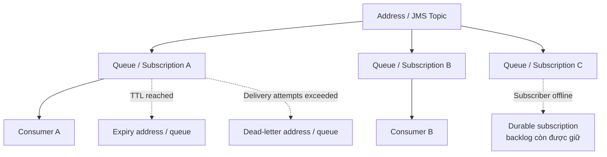
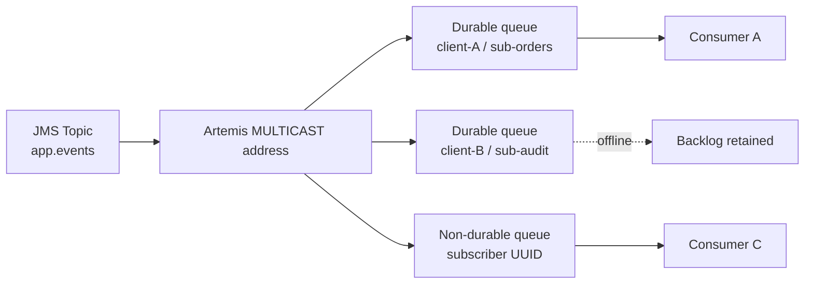
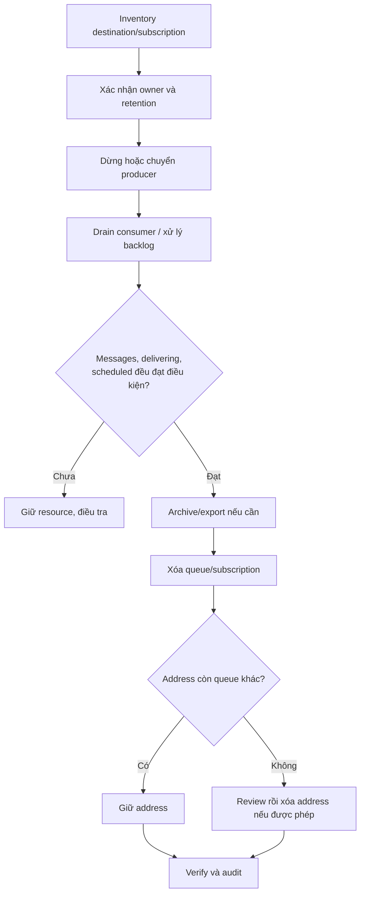

# Quản lý destination, subscription mồ côi và thời hạn lưu giữ

> **Chương:** Vận hành  
> **Mô-đun:** `INTEGRATION_MESSAGING_MESSAGE_BROKER_ACTIVEMQ` — tìm hiểu ActiveMQ Classic và Artemis trong giao tiếp bất đồng bộ bằng queue, topic, routing và JMS; thực hành producer/consumer Java, acknowledgment, transaction, redelivery, DLQ, bảo mật và vận hành broker đáng tin cậy.  
> **Trọng tâm:** Quản lý vòng đời address, queue, topic và durable subscription; nhận diện subscription thực sự mồ côi; đặt thời hạn lưu giữ cho message thường, message hết hạn và message lỗi; retire destination có kiểm soát để không xóa backlog hoặc làm mất sự kiện đang được nghiệp vụ sử dụng.

## 1. Destination có vòng đời, không chỉ là một cái tên

Một broker vận hành lâu ngày thường tích lũy destination do ứng dụng tự tạo, phiên bản cũ để lại, durable subscriber đã ngừng chạy, queue retry/DLQ và message quá hạn. Nếu không có inventory và chính sách vòng đời, những resource này tiếp tục giữ storage, metadata, journal records và message mà không còn consumer chịu trách nhiệm.

Trước khi dọn dẹp, cần phân biệt các khái niệm:

| Resource | Ý nghĩa | Điều cần quản lý |
| --- | --- | --- |
| **Address** (Artemis) | Điểm nhận message và áp dụng routing; có thể bind nhiều queue | Routing type, owner, auto-create, auto-delete |
| **Queue** | Nơi lưu message và phân phối tới consumer | Backlog, consumer, scheduled/delivering, retention, quyền xóa |
| **Topic** (JMS) | Mô hình publish/subscribe; trên Artemis ánh xạ thành address MULTICAST | Subscriber, durable subscription và vòng đời queue tương ứng |
| **Durable subscription** | Đăng ký topic có danh tính, broker giữ message khi subscriber offline | Client ID, subscription name, last activity, backlog và thời hạn tồn tại |
| **Expiry destination** | Nơi nhận message đã hết TTL để kiểm tra hoặc lưu vết | Retention riêng, quyền truy cập và quy trình dọn |
| **Dead-letter destination (DLQ/DLA)** | Nơi giữ message vượt quá số lần delivery thất bại | Điều tra, replay, thời hạn lưu giữ và xử lý poison message |

**Address không đồng nghĩa queue.** Một address Artemis có thể có nhiều queue; xóa một queue không nhất thiết xóa address, còn xóa address có thể ảnh hưởng mọi queue đang bind vào nó. Với Classic, queue/topic là destination được quản lý trực tiếp.



Một resource không có consumer chưa chắc là resource mồ côi. Durable subscription được thiết kế để sống qua thời gian subscriber offline. Xóa chỉ dựa vào consumer count bằng 0 có thể làm mất backlog mà subscriber sẽ cần khi quay lại.

## 2. Xây inventory trước khi xóa

### 2.1. Những thông tin cần có cho mỗi destination

Inventory tối thiểu nên ghi:

| Trường | Ví dụ | Mục đích |
| --- | --- | --- |
| Broker/cluster | broker-orders-prod | Xác định nơi resource tồn tại |
| Resource type | Address, queue, topic subscription, DLQ | Chọn đúng API và vòng đời |
| Tên đầy đủ | orders.created, billing-v2 | Tránh nhầm tên gần giống |
| Owner/service | order-service, billing-worker | Tìm người chịu trách nhiệm |
| Environment | dev, staging, prod | Tránh thao tác sai môi trường |
| Routing | ANYCAST, MULTICAST | Hiểu cách message được phân phối |
| Durable/temporary | Durable queue, temporary queue | Ước lượng khả năng tồn tại sau restart |
| Consumers | 0, 1, 8 | Phát hiện subscriber đang hoạt động |
| Message count | 0, 12.450 | Backlog có còn không |
| Delivering/scheduled | 3 / 20 | Có message đang xử lý hoặc chờ lịch không |
| Last producer/consumer activity | Timestamp | Nhận diện resource không còn được dùng |
| Retention class | 15 phút, 7 ngày, 90 ngày | Quyết định TTL và cleanup |
| Change owner / ticket | OPS-1234 | Audit và phê duyệt xóa |

Không phải broker nào cũng lưu mọi thông tin owner/last activity. Các trường đó có thể phải đến từ deployment manifest, service catalog, client ID, metrics và log. **Không tự suy owner chỉ từ prefix tên queue.**

### 2.2. Artemis: kiểm tra address và queue theo đúng cấp

Artemis có management API/JMX cho broker và từng queue:

- ActiveMQServerControl.getQueueNames() liệt kê queue được deploy.
- QueueControl.getConsumerCount() cho biết consumer của queue cụ thể.
- QueueControl.getMessageCount() cho biết số message còn trên queue.
- QueueControl.getDeliveringCount() cho biết số message đang delivering.
- QueueControl.getScheduledCount() cho biết số message được schedule.
- QueueControl.getMessagesAdded() và getMessagesAcknowledged() hỗ trợ đối chiếu hoạt động.

Có thể dùng Artemis CLI trong shell đã kết nối broker để chạy lệnh thống kê:

```text
Apache Artemis > queue stat
```

Bảng thống kê thường gồm queue name, address, consumer count, message count, messages added, delivering count, acknowledged count, scheduled count và routing type. Đây là snapshot; khi điều tra cần ghi timestamp và đọc lại sau khi workload dừng.

**Không chỉ nhìn message count bằng 0.** Queue có thể còn scheduled message, message đang delivering, transaction chưa hoàn tất hoặc producer vẫn tiếp tục gửi. Trước khi xóa, kiểm tra cả các trường này và xác minh producer đã dừng.

### 2.3. Classic: kiểm tra queue, topic và durable subscribers

ActiveMQ Classic cung cấp JMX MBeans:

- BrokerViewMBean liệt kê queue/topic, connection và durable subscribers.
- getDurableTopicSubscribers() cho danh sách durable subscribers đang hoạt động.
- getInactiveDurableTopicSubscribers() cho các durable subscribers hiện không có consumer.
- DestinationViewMBean/QueueViewMBean cung cấp QueueSize, ConsumerCount, InFlightCount, enqueue/dequeue và các thống kê destination.

Web Console/JConsole có thể dùng để duyệt queue, xem durable subscriptions và theo dõi backlog. Một durable subscription inactive vẫn có thể giữ message. Hãy kiểm tra **client ID + subscriber name + topic + backlog**, không chỉ nhìn subscriber đang offline.

### 2.4. Khi nào được gọi là subscription mồ côi?

Một durable subscription nên được đưa vào danh sách review khi có nhiều dấu hiệu cùng lúc:

1. Không có active consumer trong thời gian dài.
2. Không tìm được service/deployment owner đang sử dụng client ID và subscription name.
3. Ứng dụng đã được decommission hoặc migration sang subscription identity mới.
4. Backlog không còn giá trị nghiệp vụ, hoặc đã được export/replay theo quyết định của owner.
5. Hết thời hạn offline được quy định trong retention policy.
6. Không có change, DR, audit hoặc legal hold đang yêu cầu giữ subscription.

**Offline không đồng nghĩa orphan.** Một subscriber có thể chạy theo lịch, chờ đợt batch tiếp theo, hoặc đang trong quá trình DR. Chỉ cleanup khi owner và chính sách đã xác nhận.

## 3. Phân biệt auto-create và auto-delete trên Artemis

### 3.1. Các setting có phạm vi khác nhau

Artemis điều khiển việc tự tạo/xóa resource qua address-setting trong broker.xml. Các setting thường bị nhầm lẫn:

| Setting | Tác dụng |
| --- | --- |
| auto-create-addresses | Cho phép tự tạo address khi client gửi/consume vào resource chưa tồn tại |
| auto-create-queues | Cho phép tự tạo queue trong trường hợp protocol/client cần |
| auto-delete-queues | Tự xóa **auto-created queues** khi không còn consumer và message count đạt ngưỡng |
| auto-delete-created-queues | Chính sách auto-delete cho queue được tạo theo cách khác; mặc định là false |
| auto-delete-queues-delay | Thời gian chờ trước khi xóa queue đủ điều kiện, đơn vị ms |
| auto-delete-queues-message-count | Message count tối đa để queue đủ điều kiện auto-delete; mặc định 0 |
| auto-delete-addresses | Xóa auto-created address khi address không còn queue |
| auto-delete-addresses-delay | Thời gian chờ trước khi xóa address rỗng |
| address-queue-scan-period | Chu kỳ broker quét queue/address để xem có đủ điều kiện auto-delete |

Mặc định của một số auto-delete setting có thể khiến queue auto-created rỗng và không có consumer bị xóa sau scan. Đừng áp dụng mặc định đó cho namespace destination bền vững mà không review.

**Điểm đặc biệt với JMS topic:** Artemis tạo queue đại diện cho subscription khi consumer kết nối tới topic/address MULTICAST. Việc tạo subscription queue phục vụ ngữ nghĩa JMS có thể diễn ra ngay cả khi auto-create-queues=false; không dùng setting này để kết luận mọi durable subscription đều không thể xuất hiện tự động.

### 3.2. Cấu hình namespace nghiệp vụ không tự xóa

Ví dụ dưới đây giữ các destination đã provision trong namespace app.orders. Gộp các setting vào phần address-settings **đã có** trong core của broker.xml:

```xml
<address-settings>
    <address-setting match="app.orders.#">
        <auto-create-addresses>false</auto-create-addresses>
        <auto-create-queues>false</auto-create-queues>

        <!-- Destination nghiệp vụ do release quản lý -->
        <auto-delete-queues>false</auto-delete-queues>
        <auto-delete-created-queues>false</auto-delete-created-queues>
        <auto-delete-addresses>false</auto-delete-addresses>
    </address-setting>
</address-settings>
```

Đây là trích đoạn, không tạo thêm address-settings nếu broker đã có section này. Dấu # là wildcard cho nhiều segment trong cú pháp Artemis mặc định; kiểm tra các rule cụ thể hơn vì address settings có thể được áp dụng theo mức độ match.

**Vì sao tắt auto-delete ở namespace này?** Queue orders có thể tạm thời không có consumer trong lúc deploy, scale-to-zero hoặc DR nhưng vẫn giữ backlog cần xử lý. Việc xóa queue sẽ làm mất chính nơi lưu message.

### 3.3. Tách namespace ephemeral và durable

Không nên tắt auto-delete toàn broker chỉ vì một nhóm queue quan trọng. Có thể chia namespace:

| Namespace | Loại resource | Chính sách |
| --- | --- | --- |
| app.orders.# | Queue nghiệp vụ bền vững | Pre-provision, không auto-delete |
| app.reply.# | Reply/temporary hoặc request-response ngắn hạn | Cho phép cleanup theo delay và điều kiện |
| app.events.# | Subscription/event queue | Owner và retention rõ ràng |
| DLQ.# | Dead-letter | Không tự xóa khi chưa điều tra |
| EXP.# | Expiry | Có thời hạn lưu giữ và quy trình archive |

Nếu cho phép auto-delete queue ephemeral, cấu hình delay và ngưỡng message count cụ thể. Ví dụ một queue chỉ đủ điều kiện xóa khi không có consumer và đã rỗng trong ít nhất một khoảng thời gian:

```xml
<address-setting match="app.reply.#">
    <auto-delete-queues>true</auto-delete-queues>
    <auto-delete-queues-delay>300000</auto-delete-queues-delay>
    <auto-delete-queues-message-count>0</auto-delete-queues-message-count>
    <auto-delete-addresses>true</auto-delete-addresses>
    <auto-delete-addresses-delay>300000</auto-delete-addresses-delay>
</address-setting>
```

Giá trị 300000 là 5 phút, tính bằng milliseconds. Việc xóa còn phụ thuộc broker scan period và điều kiện resource đã được sử dụng. Với queue tạo rõ ràng, auto-delete-created-queues là setting riêng; không giả định auto-delete-queues=true sẽ xóa mọi queue.

**Không bật auto-delete-queues-skip-usage-check=true một cách tùy tiện.** Khi bỏ kiểm tra resource từng được sử dụng, delay phải lớn hơn 0; nếu không queue mới tạo có thể bị đánh giá xóa gần như ngay lập tức.

## 4. Thời hạn lưu giữ message: TTL, expiry và expiry queue

### 4.1. TTL là hạn sử dụng của message

JMS producer có thể đặt time-to-live (TTL) khi gửi. Broker chuyển TTL thành thời điểm hết hạn tuyệt đối của message (JMSExpiration). Ví dụ message chỉ còn giá trị trong 15 phút:

```java
long ttlMillis = java.util.concurrent.TimeUnit.MINUTES.toMillis(15);

try (jakarta.jms.Connection connection = connectionFactory.createConnection();
     jakarta.jms.Session session = connection.createSession(
         false, jakarta.jms.Session.AUTO_ACKNOWLEDGE)) {

    jakarta.jms.Queue queue = session.createQueue("app.orders.status");
    jakarta.jms.MessageProducer producer = session.createProducer(queue);

    producer.setTimeToLive(ttlMillis);

    jakarta.jms.TextMessage message =
        session.createTextMessage("{\"orderId\":\"O-1001\",\"status\":\"PENDING\"}");

    producer.send(message);
}
```

setTimeToLive(0) có nghĩa message không đặt TTL, tức không tự hết hạn theo TTL. Producer không nên tự đặt JMSExpiration trực tiếp; provider xác định giá trị khi send.

**Đồng bộ clock là điều kiện vận hành quan trọng.** TTL dùng thời gian tuyệt đối; clock lệch giữa producer và broker có thể làm message hết hạn sớm hoặc muộn. Dùng NTP/chrony và theo dõi clock drift trên các host.

### 4.2. Hết TTL không có nghĩa bị xóa đúng tại millisecond đó

Broker không nhất thiết scan toàn bộ queue liên tục. Message hết hạn có thể bị phát hiện khi broker xử lý/delivery hoặc khi expiry scanner quét queue. Vì vậy TTL là quy tắc không được giao message quá hạn, còn thời điểm reclaim storage có thể trễ theo chu kỳ scan và tải broker.

Artemis cấu hình chu kỳ expiry scan ở cấp broker trong core:

```xml
<core>
    <!-- Các cấu hình hiện có giữ nguyên -->
    <message-expiry-scan-period>30000</message-expiry-scan-period>
</core>
```

30000 ms là 30 giây; -1 tắt expiry reaper thread. Không tạo core thứ hai. Chọn scan period theo tải và yêu cầu vận hành; scan quá thường xuyên trên nhiều queue có thể tăng chi phí CPU/I/O.

### 4.3. Artemis: đưa expired message vào expiry address

Nếu không cấu hình expiry-address, message hết hạn sẽ bị loại khỏi queue. Nếu cần điều tra hoặc lưu dấu vết, cấu hình expiry address:

```xml
<address-settings>
    <address-setting match="app.orders.#">
        <expiry-address>EXP</expiry-address>
        <auto-create-expiry-resources>true</auto-create-expiry-resources>
        <expiry-queue-prefix>EXP.</expiry-queue-prefix>

        <!-- Áp TTL mặc định 24 giờ cho message producer không đặt TTL -->
        <expiry-delay>86400000</expiry-delay>
    </address-setting>
</address-settings>
```

Các điểm cần hiểu:

- expiry-address là nơi nhận message hết hạn.
- auto-create-expiry-resources=true cho phép broker tạo expiry address và các multicast queues phục vụ phân loại message theo address nguồn.
- Prefix mặc định của expiry queue là EXP.; tên queue và filter giúp phân biệt message từ address nguồn.
- expiry-delay tính bằng milliseconds. Nó áp dụng cho message đến với expiration mặc định bằng 0; message đã có TTL cụ thể vẫn giữ TTL đó.
- expiry-delay=-1 tắt tính năng đặt TTL mặc định.
- min-expiry-delay/max-expiry-delay có thể áp một khoảng TTL cho message; no-expiry=true ghi đè expiration để message không hết hạn.

**Expiry queue cũng cần retention.** Nếu giữ mọi expired message vô hạn, EXP sẽ trở thành backlog mới. Quy định ai được browse/replay, bao lâu được giữ, khi nào archive và cách cleanup. Nếu message trong expiry queue cũng được cấu hình expiry, hãy thiết kế rõ nơi kết thúc để tránh chuyển tiếp vòng lặp.

Artemis có thể thêm property _AMQ_ACTUAL_EXPIRY khi chuyển message hết hạn; các property nguồn như _AMQ_ORIG_ADDRESS và _AMQ_ORIG_QUEUE hỗ trợ truy vết. Dùng chúng để phân loại, không dựa duy nhất vào tên queue.

### 4.4. Classic: expiry scan và durable subscriber offline

Classic xử lý expiry theo TTL của message và destination policy. expireMessagesPeriod quy định chu kỳ kiểm tra message hết hạn trong queue/topic; mặc định là 30.000 ms trong tài liệu policy. Giá trị 0 tắt expiry scan.

Ví dụ trong destinationPolicy hiện có của activemq.xml:

```xml
<destinationPolicy>
    <policyMap>
        <policyEntries>
            <policyEntry queue=">" expireMessagesPeriod="30000"/>
            <policyEntry topic=">" expireMessagesPeriod="30000"/>
        </policyEntries>
    </policyMap>
</destinationPolicy>
```

Đây là ví dụ chính sách rộng; trong production nên thay wildcard bằng policy cụ thể theo namespace nếu các destination có retention khác nhau. Với durable topic subscription offline, broker vẫn cần kiểm tra TTL của message được giữ cho subscriber; nếu không, message hết hạn có thể tiếp tục chiếm store trong lúc subscriber không kết nối.

Classic có thể chuyển expired message sang DLQ nếu dead-letter strategy được cấu hình xử lý expired messages, nhưng **expiry và dead-letter là hai ý nghĩa khác nhau**. Nếu cần lưu message hết hạn để điều tra, thiết kế expiry destination riêng thay vì trộn mọi trường hợp vào DLQ.

## 5. DLQ là vùng cách ly lỗi, không phải kho lưu trữ vô hạn

### 5.1. Vì sao message vào DLQ?

Message có thể bị redeliver sau rollback, session recovery hoặc consumer crash. Khi vượt max-delivery-attempts, Artemis có thể chuyển message tới dead-letter address (DLA). Đây là cách ngăn poison message lặp vô hạn trên queue chính.

Ví dụ Artemis:

```xml
<address-settings>
    <address-setting match="app.orders.#">
        <dead-letter-address>DLQ</dead-letter-address>
        <auto-create-dead-letter-resources>true</auto-create-dead-letter-resources>
        <dead-letter-queue-prefix>DLQ.</dead-letter-queue-prefix>
        <max-delivery-attempts>5</max-delivery-attempts>
        <redelivery-delay>5000</redelivery-delay>
    </address-setting>
</address-settings>
```

Trong ví dụ:

- max-delivery-attempts=5: sau số lần delivery thất bại vượt ngưỡng, message được chuyển đến DLA.
- redelivery-delay=5000: chờ 5 giây trước lần redelivery tiếp theo.
- dead-letter-address=DLQ: địa chỉ đích cho message không thể xử lý.
- auto-create-dead-letter-resources=true: broker tự tạo resource DLQ tương ứng; prefix DLQ. giúp phân biệt queue theo address nguồn.

Nếu không cấu hình DLA, Artemis có thể loại bỏ message khi đã vượt số lần delivery được phép. Đừng để mặc định đó thành bất ngờ trong production: phải xác định rõ chính sách giữ lại, loại bỏ hoặc chuyển DLQ.

### 5.2. DLQ cần quy trình xử lý và retention riêng

DLQ không nên trở thành queue “để đó rồi tính”. Mỗi message cần có:

- Lý do lỗi, exception category hoặc error code.
- Original address/queue và message ID.
- Business event ID để deduplicate khi replay.
- Số lần delivery, timestamp vào DLQ và service owner.
- Trạng thái điều tra: NEW, TRIAGED, REPLAYED, DISCARDED hoặc ARCHIVED.

Quy trình vận hành:

1. Alert khi DLQ có message mới hoặc tốc độ tăng vượt baseline.
2. Browse metadata/payload với quyền hạn chế và audit.
3. Nhóm lỗi: lỗi tạm thời, dữ liệu không hợp lệ, schema incompatibility, bug consumer hoặc lỗi nghiệp vụ.
4. Sửa nguyên nhân trước khi replay; nếu replay vào queue cũ mà bug chưa sửa, message sẽ quay lại DLQ.
5. Replay bằng event ID ổn định và kiểm soát duplicate business effect.
6. Sau thời hạn lưu giữ, archive hoặc xóa theo policy đã duyệt.

### 5.3. Không dùng TTL chung để xóa DLQ mà không hiểu hậu quả

Message trong DLQ có thể là bằng chứng cho sự cố hoặc giao dịch cần đối soát. Nếu áp TTL ngắn cho toàn bộ DLQ.#, message quan trọng có thể biến mất trước khi đội vận hành điều tra.

Nếu có yêu cầu tự hết hạn DLQ, dùng policy chọn lọc theo loại lỗi/queue, ghi rõ thời gian lưu và có archive trước khi xóa. Classic từ một số phiên bản hỗ trợ expiration trong dead-letter strategy; tài liệu cảnh báo không áp dụng rộng trên wildcard vì message hết hạn ở DLQ có thể bị chuyển tiếp tạo vòng lặp nếu chiến lược audit không đủ.

## 6. Giới hạn dung lượng không phải retention

Một nhầm lẫn phổ biến là đặt max-size-bytes rồi nghĩ broker sẽ giữ message trong một khoảng thời gian nhất định. Thực tế đây là cơ chế giới hạn memory/address và kích hoạt chính sách khi address đầy, không phải TTL.

Artemis có các hành vi address-full thường gặp:

| Policy | Hành vi | Tác động |
| --- | --- | --- |
| PAGE | Chuyển message ra paging store khi vượt giới hạn memory | Message vẫn được giữ; disk có thể tăng |
| BLOCK | Block producer khi address đầy | Backpressure, producer send có thể chậm |
| DROP | Loại message theo semantics policy | Có nguy cơ mất dữ liệu |
| FAIL | Từ chối send khi address đầy | Ứng dụng nhận lỗi và phải xử lý |

Ví dụ cấu hình giới hạn memory và paging cho namespace:

```xml
<address-settings>
    <address-setting match="app.events.#">
        <max-size-bytes>256M</max-size-bytes>
        <address-full-policy>PAGE</address-full-policy>
        <page-size-bytes>10M</page-size-bytes>
    </address-setting>
</address-settings>
```

256M và 10M là giá trị minh họa; sizing theo payload, throughput, disk budget và thời gian consumer có thể offline. PAGE giúp broker tiếp tục nhận message bằng cách lưu ra disk; nó **không xóa message cũ theo tuổi**. Muốn retention theo thời gian vẫn phải cấu hình TTL/expiry.

Classic có memory/store/temp usage limits và cursor policy để block hoặc page message ra disk. Những giới hạn này bảo vệ tài nguyên, không thay thế retention policy. Tách riêng ba câu hỏi:

- **Retention:** Message được phép tồn tại bao lâu?
- **Capacity:** Broker có thể giữ bao nhiêu message/bytes?
- **Backpressure:** Khi gần đầy, producer bị block, reject hay message bị drop?

## 7. Durable topic subscription: quản lý identity và backlog

### 7.1. Identity của durable subscription

JMS durable subscription có danh tính từ cặp:

```text
(clientID, subscriptionName)
```

Topic name, selector và shared/non-shared subscription cũng ảnh hưởng cấu hình subscription. Với durable subscriber không shared, chỉ một consumer active được gắn vào một subscription identity tại một thời điểm. Khi client offline, broker tiếp tục giữ message phù hợp cho subscriber đó.

**Durable subscription và persistent delivery là hai thuộc tính riêng.** Durable subscription giữ đăng ký và backlog cho subscriber offline; delivery mode của từng message quyết định message có được ghi bền qua broker restart hay không. Nếu yêu cầu message còn nguyên sau khi broker/máy khởi động lại, producer phải gửi persistent message và broker phải bật persistence đúng cách. Chỉ tạo durable subscriber không biến non-persistent message thành dữ liệu bền vững.

**Không đổi clientID tùy tiện khi deploy.** Nếu version mới dùng client ID hoặc subscription name khác, broker có thể tạo subscription mới trong khi subscription cũ vẫn giữ backlog. Đây là nguồn phổ biến của orphaned subscription.

### 7.2. Artemis biểu diễn durable subscription bằng queue

Artemis dùng address MULTICAST cho pub/sub. Mỗi subscription có queue riêng để nhận bản sao message. Với JMS durable subscription, queue identity dựa trên client ID và subscription name theo mapping của protocol. Vì vậy:

- Một topic/address có thể có nhiều subscription queues.
- Subscriber offline có thể không có consumer nhưng queue vẫn giữ message.
- Xóa một subscription queue có thể xóa backlog chỉ thuộc subscriber đó.
- Không suy tên queue bằng cách tự ghép chuỗi nếu chưa xác nhận naming convention của client/protocol/version; hãy list queue, xem address và metadata.



### 7.3. Xóa subscription qua JMS API khi còn owner

Nếu ứng dụng còn sở hữu identity, cách rõ ràng nhất là gọi Session.unsubscribe(subscriptionName) sau khi bảo đảm không còn consumer đang dùng subscription đó.

Ví dụ Jakarta JMS:

```java
import jakarta.jms.Connection;
import jakarta.jms.ConnectionFactory;
import jakarta.jms.Session;

public final class DurableSubscriptionCleanup {
    private DurableSubscriptionCleanup() {}

    public static void unsubscribe(
            ConnectionFactory connectionFactory,
            String clientId,
            String subscriptionName) throws Exception {

        try (Connection connection = connectionFactory.createConnection()) {
            // Client ID phải được đặt trước khi start connection.
            connection.setClientID(clientId);

            try (Session session = connection.createSession(
                    false, Session.AUTO_ACKNOWLEDGE)) {
                // Subscription phải không có active consumer.
                session.unsubscribe(subscriptionName);
            }
        }
    }
}
```

Đây là ví dụ API chuẩn cho durable subscription không shared. Chạy với đúng clientId và subscriptionName đã tạo. Nếu subscriber vẫn active ở process khác, unsubscribe sẽ thất bại; dừng consumer trước, xác nhận process cũ đã thoát rồi mới thử lại.

### 7.4. Classic: tự động thu hồi inactive durable subscriber

Classic có hai broker properties:

- offlineDurableSubscriberTimeout: thời gian một durable subscriber được phép offline trước khi broker tự unsubscribe; mặc định -1 nghĩa là không tự xóa.
- offlineDurableSubscriberTaskSchedule: chu kỳ kiểm tra; mặc định 300.000 ms (5 phút).

Ví dụ broker chỉ giữ durable subscriber offline tối đa 30 ngày, quét mỗi giờ:

```xml
<broker
    brokerName="localhost"
    offlineDurableSubscriberTimeout="2592000000"
    offlineDurableSubscriberTaskSchedule="3600000">
    <!-- Các thành phần broker hiện có -->
</broker>
```

Đây là trích đoạn thuộc root broker hiện có, không tạo broker thứ hai. 2592000000 ms là 30 ngày; 3600000 ms là 1 giờ. Khi timeout được cấu hình, subscriber offline vượt hạn có thể bị xóa cùng backlog của nó.

**Không bật timeout chỉ để giảm disk usage.** Xác định subscription nào được phép offline lâu (DR, báo cáo cuối tháng, consumer chạy theo batch) và ngoại lệ cho các subscriber đó. Có thể chọn timeout khác nhau bằng quy trình quản lý thủ công nếu broker policy áp dụng toàn broker không đủ linh hoạt.

### 7.5. Classic: xóa inactive durable subscriber qua JMX

BrokerViewMBean có operation:

```java
brokerView.destroyDurableSubscriber(clientId, subscriberName);
```

Operation này hủy durable subscriber được xác định bằng client ID và subscriber name. Chỉ gọi sau khi đã:

1. Xác nhận subscriber không active.
2. Tìm owner và xác nhận subscription đã retire.
3. Ghi backlog count và quyết định archive/replay/discard.
4. Có change approval phù hợp.
5. Lưu audit về người thực hiện và kết quả.

Đừng nhầm destroyDurableSubscriber với removeTopic: một thao tác xóa subscription identity, thao tác kia xóa destination topic.

## 8. Quy trình retire destination an toàn

Xóa resource là thao tác quản trị có thể làm mất dữ liệu. Dùng runbook có bước kiểm tra và điều kiện dừng.

### 8.1. Trình tự đề xuất



**Bước 1 — Inventory:** Ghi broker, resource type, address/queue, routing type, owner, consumer count, message count, delivering/scheduled count và last activity.

**Bước 2 — Xác nhận owner:** Service owner xác nhận migration/decommission. Nếu không xác định được owner, mở incident/investigation và đặt thời hạn review; không xóa chỉ vì tên cũ.

**Bước 3 — Dừng producer:** Deploy cấu hình ngừng publish, chặn route cũ hoặc chuyển producer sang destination mới. Chờ message đang gửi và transaction in-flight hoàn tất.

**Bước 4 — Drain:** Consumer xử lý backlog theo logic nghiệp vụ. Theo dõi messageCount, deliveringCount, scheduledCount, ACK/dequeue và lỗi. Nếu cần chuyển message sang queue mới, dùng management move có filter và kiểm tra kết quả.

**Bước 5 — Kiểm tra trạng thái:** Xác nhận không còn producer, consumer hoặc scheduled message. Với queue yêu cầu rỗng, xác minh messageCount=0 và deliveringCount=0; kiểm tra cả prepared transaction và HA state nếu broker đang có sự cố.

**Bước 6 — Archive:** Export/browse message cần lưu theo quy định audit/legal hold. Không coi snapshot của thư mục journal là bản export nghiệp vụ dễ đọc; backup broker phải theo quy trình persistence/HA tương ứng.

**Bước 7 — Xóa đúng cấp:** Xóa subscription/queue trước. Chỉ xóa address nếu không còn queue/divert/binding khác và owner xác nhận.

**Bước 8 — Verify:** List resource lại, xác nhận destination không tự tạo lại bởi client cũ, metrics không còn backlog và producer không còn gửi vào tên cũ.

### 8.2. Artemis: thao tác management và khác biệt purge/delete

Artemis cung cấp management API qua JMX, Jolokia, Core management messages, JMS management client và Web Console. Một số thao tác quan trọng:

| Mục tiêu | Management operation | Ý nghĩa |
| --- | --- | --- |
| Liệt kê queue | ActiveMQServerControl.getQueueNames() | Inventory queue |
| Xem trạng thái queue | QueueControl | Message count, consumer, delivering, scheduled |
| Xóa queue | ActiveMQServerControl.destroyQueue(name) | Hủy queue resource |
| Xóa address | ActiveMQServerControl.deleteAddress(name) | Hủy address; cần xem queue/binding còn tồn tại |
| Expire có chọn lọc | QueueControl.expireMessages(filter) | Đánh dấu message hết hạn để xử lý theo expiry policy |
| Move có chọn lọc | QueueControl.moveMessages(filter, destination) | Chuyển message sang queue khác |
| Chuyển sang DLA | QueueControl.sendMessagesToDeadLetterAddress(filter) | Cách ly message theo DLQ policy |
| Xóa message | QueueControl.removeMessages(filter) | Xóa message khỏi queue, có thể dùng filter |

**Purge và delete là hai việc khác nhau:**

- Purge/remove message xóa nội dung nhưng queue vẫn còn.
- Destroy queue xóa resource và backlog gắn với queue.
- Delete address tác động tới điểm routing và có thể ảnh hưởng nhiều queue.

Trong Artemis management API, filter rỗng/null ở một số operation queue có nghĩa áp dụng cho **toàn bộ message**. Vì vậy không gọi removeMessages(""), expireMessages("") hay move không filter khi mục tiêu chỉ là một nhóm message cụ thể.

Với queue đang có consumer, destroyQueue(name) có thể từ chối hoặc cần xử lý consumer theo API/version. Không bật chế độ force/remove consumers như cách né quy trình drain. Nếu cần thao tác force trong tình huống sự cố, phải có runbook và đánh giá giao dịch đang chạy.

### 8.3. Classic: purge khác remove destination

Classic quản lý destination qua BrokerViewMBean:

```java
brokerView.removeQueue("app.orders.old");
brokerView.removeTopic("app.events.legacy");
```

Các operation trên xóa destination tương ứng. QueueViewMBean.purge() xóa message khỏi queue nhưng giữ queue lại. Hãy dùng đúng operation:

| Nhu cầu | Classic operation |
| --- | --- |
| Xem queue | QueueViewMBean |
| Xóa toàn bộ message nhưng giữ queue | QueueViewMBean.purge() |
| Xóa queue destination | BrokerViewMBean.removeQueue(name) |
| Xóa topic destination | BrokerViewMBean.removeTopic(name) |
| Xóa durable subscriber | BrokerViewMBean.destroyDurableSubscriber(clientId, subscriberName) |

purge() là thao tác hủy message hàng loạt; nó không phải bước “dọn nhẹ” vô hại. Ghi lại số message trước/sau và change ticket. Nếu cần giữ message để audit/replay, browse/export hoặc forward trước khi purge.

## 9. Retention policy theo loại dữ liệu

Không có một TTL chung phù hợp cho mọi message. Đặt chính sách theo ý nghĩa nghiệp vụ:

| Loại message | TTL/retention gợi ý | Hành vi khi hết hạn |
| --- | --- | --- |
| Typing indicator, presence, cache invalidation | Vài giây đến vài phút | Drop hoặc expiry metrics |
| Trạng thái tạm thời, notification có deadline | Vài phút đến vài giờ | Expiry queue ngắn hạn nếu cần điều tra |
| Command có deadline nghiệp vụ | TTL theo SLA/deadline | Expiry queue + alert nếu còn chưa xử lý |
| Event tích hợp cần audit | Theo retention nghiệp vụ và compliance | Archive trước khi broker cleanup |
| Retry/redelivery | Delay và số lần retry hữu hạn | Chuyển DLQ sau ngưỡng |
| DLQ | Theo thời gian điều tra/replay được duyệt | Archive rồi cleanup |
| Durable topic subscription | Theo owner, offline policy và giá trị backlog | Unsubscribe sau khi retire; không xóa chỉ vì offline |
| Expiry queue | Ngắn hơn hoặc bằng thời hạn lưu trữ điều tra | Archive/drop theo policy riêng |

**Retention của broker không phải kho lưu trữ compliance.** Nếu nghiệp vụ cần lưu audit nhiều năm, đưa event vào hệ lưu trữ phù hợp (data lake/object storage/audit store) với retention, encryption và access policy riêng. Queue broker nên giữ message đủ lâu để hệ thống xử lý/replay theo SLA, không nên gánh trách nhiệm lưu trữ pháp lý thay database/archive.

### 9.1. Phân biệt ba đồng hồ

1. **Message TTL:** Message này còn được phép giao trong bao lâu?
2. **Subscription offline timeout:** Subscription được phép không có consumer trong bao lâu trước khi thu hồi?
3. **Destination auto-delete delay:** Queue/address rỗng và không dùng phải chờ bao lâu trước khi xóa?

Ba đồng hồ tác động lên resource khác nhau. Một message TTL hết hạn không có nghĩa durable subscription bị xóa; một subscription timeout không tự đặt TTL cho mọi message; một auto-delete delay không phải message retention.

### 9.2. Không để expiry và DLQ tạo vòng lặp

Khi message expired được chuyển vào expiry address, hoặc message lỗi được chuyển vào DLA, resource đích có thể có address-setting riêng. Nếu expiry queue cũng được cấu hình chuyển mọi message hết hạn sang chính nó, có thể tạo vòng lặp. Với DLQ, nếu message hết hạn rồi forward sang DLQ khác mà policy lại áp dụng tương tự, message có thể di chuyển qua lại.

Thiết kế rõ điểm kết thúc:

- EXP có expiry policy cuối cùng là drop hoặc archive.
- DLQ được giữ đến khi triage/replay, có retention rõ.
- Không đặt wildcard expiry/dead-letter policy khiến destination hệ thống tự chuyển message vào chính nó.
- Kiểm tra metadata gốc _AMQ_ORIG_ADDRESS, _AMQ_ORIG_QUEUE, _AMQ_ORIG_MESSAGE_ID trên Artemis khi điều tra message đã được move/expire/DLQ.

## 10. Automation và audit

### 10.1. Lịch rà soát

Một lịch vận hành thực tế:

| Chu kỳ | Việc cần làm |
| --- | --- |
| Liên tục | Alert queue backlog, expiry rate, DLQ growth, disk usage và destination auto-created bất thường |
| Hàng ngày | Review DLQ mới, queue không có consumer nhưng backlog tăng, expiry spike |
| Hàng tuần | Inventory destination không hoạt động, subscription offline vượt ngưỡng review |
| Hàng tháng | Xác nhận owner, retention class, quyền create/delete và tài nguyên đã decommission |
| Sau release/migration | So sánh queue/subscription cũ và mới; xác nhận subscription cũ đã retire sau drain |

Không tự động xóa theo một truy vấn consumerCount=0 đơn lẻ. Automation nên tạo candidate report gồm resource, owner, age, counts và retention policy; việc xóa production phải tuân theo quy trình change được tổ chức quy định.

### 10.2. Audit record cho mỗi lần retire

Ghi lại:

- Broker/cluster và environment.
- Destination/address/queue hoặc cặp clientID + subscriptionName.
- Owner xác nhận và change/ticket ID.
- Message count, delivering count, scheduled count và consumer count trước thao tác.
- Export/archive location nếu có.
- Operation đã chạy: unsubscribe, destroyQueue, deleteAddress, removeQueue, removeTopic hay purge.
- Operator identity, timestamp, kết quả và resource state sau thao tác.
- Số message chuyển, archive, expire hoặc loại bỏ.

Không log payload nhạy cảm chỉ để chứng minh đã cleanup. Metadata định danh và số lượng thường đủ cho audit; payload cần được xử lý theo quyền riêng.

## 11. Tình huống vận hành mẫu

### Tình huống A — Queue cũ không có consumer nhưng vẫn còn message

orders.v1 không có consumer trong 12 ngày, message count là 3.200. Một service cũ đã được thay bằng orders.v2.

**Cách xử lý:**

1. Kiểm tra producer còn gửi orders.v1 hay không.
2. Xác định 3.200 message có cần migrate sang orders.v2, replay hoặc archive không.
3. Owner xác nhận phiên bản cũ đã decommission.
4. Nếu cần migrate, move theo filter hoặc consumer chuyển đổi có idempotency; so số lượng và business IDs.
5. Chờ queue cũ rỗng, không còn delivering/scheduled.
6. Xóa queue sau phê duyệt; chỉ xóa address nếu không còn queue khác bind vào.

**Không xóa ngay vì consumerCount=0.** Backlog chính là dữ liệu cần quyết định trước.

### Tình huống B — Durable subscription cũ giữ backlog lớn

Classic có clientID=analytics-v1, subscriber name daily-report-v1 offline 45 ngày, backlog tăng mạnh. Đội analytics đã chuyển sang analytics-v2.

**Cách xử lý:**

1. Kiểm tra getInactiveDurableTopicSubscribers() và xác nhận chính xác topic, client ID, subscriber name.
2. Xác nhận analytics-v1 không còn deployment hoặc lịch batch sẽ khởi động lại.
3. Quyết định có cần export backlog để đối soát không.
4. Nếu owner chấp thuận bỏ subscription cũ, gọi destroyDurableSubscriber("analytics-v1", "daily-report-v1") qua JMX.
5. Kiểm tra subscription biến mất và store/backlog giảm theo trạng thái thực tế.
6. Đặt offline timeout phù hợp cho nhóm subscriber tương lai; không áp một timeout ngắn cho mọi durable subscriber nếu có batch/DR.

### Tình huống C — Artemis expiry queue tăng liên tục

EXP.app.orders có 2 triệu message, nguồn app.orders gửi message TTL 24 giờ.

**Cách xử lý:**

1. Xem queue nguồn, expiry rate và tuổi message.
2. Xác minh producer có đặt TTL đúng không; message TTL=0 có thể nhận expiry-delay mặc định.
3. Kiểm tra consumer/archiver của expiry queue và quyền truy cập.
4. Xác định expired payload có giá trị điều tra/audit hay chỉ cần metrics.
5. Nếu cần lưu, archive theo batch và verify event IDs.
6. Nếu không cần lưu, áp dụng retention/drop ở expiry namespace; không thay TTL nguồn một cách mù quáng để giảm backlog.

### Tình huống D — DLQ tăng sau một lần release

DLQ.app.orders.created tăng từ 0 lên 18.000 sau deploy consumer mới.

**Cách xử lý:**

1. Kiểm tra exception, schema mismatch, deserialization và delivery count.
2. Dừng retry storm; sửa consumer trước khi replay.
3. Browse một mẫu message đại diện, không tải toàn bộ payload vào console.
4. Phân nhóm lỗi và quyết định replay, sửa dữ liệu hoặc loại bỏ có phê duyệt.
5. Replay bằng event ID ổn định; theo dõi duplicate business effects.
6. Đặt cảnh báo theo DLQ growth rate và tuổi message, không chỉ tổng count.

## 12. Bài tập kiểm chứng

### Bài tập A — Queue rỗng có thể xóa ngay?

Một Artemis queue có consumerCount=0, messageCount=0, nhưng scheduledCount=50. Producer đã dừng.

**Yêu cầu:** Có được xóa ngay không? Cần kiểm tra điều gì?

*Định hướng:* Chưa nên xóa. Xác định scheduled messages có deadline hoặc cần chạy lại không; xử lý/expire/archive theo quyết định nghiệp vụ rồi kiểm tra lại toàn bộ trạng thái.

### Bài tập B — Durable subscriber offline 60 ngày

Một subscriber không có consumer trong 60 ngày nhưng còn 500.000 message. Owner chưa xác nhận đã retire.

**Yêu cầu:** Vì sao chưa đủ điều kiện gọi orphan? Nêu bằng chứng cần thu.

*Định hướng:* Có thể là subscriber batch/DR; cần owner, deployment/lịch sử release, clientID/subscription name, backlog value, retention/legal hold và quyết định xử lý message.

### Bài tập C — Auto-delete và destination nghiệp vụ

Namespace app.orders.# có queue durable, consumer có thể scale về 0 khi deploy.

**Yêu cầu:** Setting nào phải review để tránh queue bị tự xóa? Phân biệt auto-delete-queues và auto-delete-created-queues.

*Định hướng:* Tắt auto-delete cho namespace durable; hai setting áp dụng nhóm queue được tạo theo cơ chế khác nhau. Không dựa vào tên auto-delete để suy tất cả queue cùng chịu một rule.

### Bài tập D — TTL không phải DLQ

Producer đặt TTL 10 phút. Consumer nhận message nhưng rollback 5 lần, sau đó message vào DLQ.

**Yêu cầu:** TTL và max-delivery-attempts giải quyết vấn đề nào? Nếu message hết hạn trước lần redelivery kế tiếp thì điều gì cần kiểm tra?

*Định hướng:* TTL giới hạn thời gian message còn hợp lệ; max-delivery-attempts giới hạn số lần delivery thất bại. Broker expiry policy và DLQ policy quyết định xử lý khi message đã quá hạn; không gộp hai cơ chế.

### Bài tập E — Xóa topic hay xóa subscription?

Một topic có ba durable subscriptions; một subscriber đã retire, hai subscriber vẫn hoạt động.

**Yêu cầu:** Resource nào cần xóa và resource nào phải giữ?

*Định hướng:* Chỉ unsubscribe/destroy subscription đã retire; giữ topic/address và hai subscription còn owner. Trên Artemis, xác định đúng queue đại diện subscription.

### Bài tập F — max-size-bytes có phải retention?

Một address đặt max-size-bytes=100M và address-full-policy=PAGE; queue vẫn giữ message 20 ngày.

**Yêu cầu:** Vì sao? Cần cấu hình gì nếu message chỉ có giá trị 7 ngày?

*Định hướng:* PAGE chuyển message ra paging store để giới hạn memory; không xóa theo tuổi. Đặt TTL/expiry policy 7 ngày và xác định expiry destination.

### Bài tập G — Classic offline timeout

Classic cấu hình offlineDurableSubscriberTimeout=86400000, offlineDurableSubscriberTaskSchedule=3600000.

**Yêu cầu:** Giải thích thời hạn và chu kỳ scan; rủi ro với subscriber chạy batch mỗi tuần.

*Định hướng:* Timeout 1 ngày, scan mỗi giờ; subscriber tuần có thể bị unsubscribe trước khi chạy. Cần ngoại lệ/chính sách dài hơn hoặc quản lý thủ công.

### Bài tập H — Runbook retire an toàn

Một queue legacy.invoice có 12 consumer, 8.000 message và đang nhận message mới.

**Yêu cầu:** Viết thứ tự thao tác từ xác định owner tới xóa destination; nêu điều kiện phải dừng runbook.

*Định hướng:* Xác nhận owner → dừng/chuyển producer → drain và xử lý backlog → kiểm tra consumer/delivering/scheduled/transactions → archive nếu cần → delete queue → review address → verify/audit. Dừng nếu producer còn gửi, backlog chưa được quyết định hoặc không có approval.

## 13. Checklist trước và sau cleanup

### Trước khi thao tác

- [ ] Đúng broker, cluster và environment.
- [ ] Xác định đúng resource type: address, queue, topic hoặc durable subscription.
- [ ] Có owner và retention class.
- [ ] Xác minh consumer active, producer activity và subscription identity.
- [ ] Ghi message count, delivering, scheduled, DLQ/expiry state.
- [ ] Đã dừng producer hoặc có kế hoạch chuyển traffic.
- [ ] Đã quyết định archive/replay/discard và có approval.
- [ ] Xác định thao tác là unsubscribe, purge, destroy queue hay delete address.

### Sau khi thao tác

- [ ] Resource mục tiêu đã biến mất hoặc còn đúng theo thiết kế.
- [ ] Queue/address khác không bị ảnh hưởng.
- [ ] Không có client cũ tự tạo lại resource ngoài ý muốn.
- [ ] Queue count, backlog, store usage và expiry/DLQ metrics được đối chiếu.
- [ ] Không còn subscription identity cũ trong danh sách management.
- [ ] Audit record có operator, thời gian, ticket, số message và kết quả.
- [ ] Alert/retention/auto-delete policy đã được cập nhật cho release tiếp theo.

## 14. Tài liệu tham khảo chính thức

1. Apache ActiveMQ Artemis — [Address Model](https://artemis.apache.org/components/artemis/documentation/latest/address-model.html): address, queue, ANYCAST/MULTICAST và subscription queues.
2. Apache ActiveMQ Artemis — [Address Settings](https://artemis.apache.org/components/artemis/documentation/latest/address-settings.html): auto-create/auto-delete, expiry, DLQ, max size và address-full policy.
3. Apache ActiveMQ Artemis — [Message Expiry](https://artemis.apache.org/components/artemis/documentation/latest/message-expiry.html): TTL, expiry address, expiry queue và expiry scan period.
4. Apache ActiveMQ Artemis — [Undelivered Messages](https://artemis.apache.org/components/artemis/documentation/latest/undelivered-messages.html): redelivery, max-delivery-attempts và dead-letter address.
5. Apache ActiveMQ Artemis — [Management API](https://artemis.apache.org/components/artemis/documentation/latest/management.html): list/create/destroy queue, move/expire message và QueueControl.
6. Apache ActiveMQ Artemis — [Command Line Interface](https://artemis.apache.org/components/artemis/documentation/latest/using-cli.html): shell và queue/address management.
7. Apache ActiveMQ Classic — [Manage Durable Subscribers](https://activemq.apache.org/components/classic/documentation/manage-durable-subscribers): inactive subscriber timeout, schedule và expiry.
8. Apache ActiveMQ Classic — [Per-destination Policies](https://activemq.apache.org/components/classic/documentation/per-destination-policies): expireMessagesPeriod và policy queue/topic.
9. Apache ActiveMQ Classic — [Message Expiry](https://activemq.apache.org/components/classic/documentation/message-expiry): TTL và broker expiry checks.
10. Apache ActiveMQ Classic — [Purge a Queue](https://activemq.apache.org/components/classic/documentation/how-do-i-purge-a-queue): Web Console, JMX purge và remove destination.
11. Apache ActiveMQ Classic — [BrokerViewMBean Javadoc](https://activemq.apache.org/components/classic/documentation/maven/apidocs/org/apache/activemq/broker/jmx/BrokerViewMBean.html): destroyDurableSubscriber, removeQueue, removeTopic.
12. Jakarta Messaging — [Jakarta Messaging 3.1](https://jakarta.ee/specifications/messaging/3.1/): durable subscription identity, unsubscribe, producer TTL và resource lifecycle.

> **Ghi nhớ:** Destination và durable subscription là resource có owner, dữ liệu và vòng đời riêng. Offline không tự động có nghĩa mồ côi; queue rỗng không tự động có nghĩa được phép xóa. Đặt TTL cho message, timeout cho subscription và auto-delete cho destination theo ba chính sách khác nhau. Trước khi retire, xác nhận owner, dừng producer, drain hoặc archive backlog, kiểm tra delivering/scheduled, xóa đúng cấp resource và lưu audit để có thể giải thích chính xác điều gì đã được giữ, chuyển hoặc loại bỏ.
