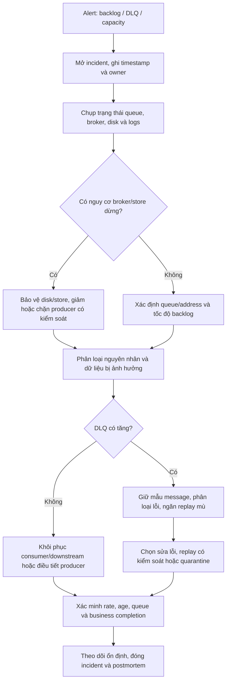
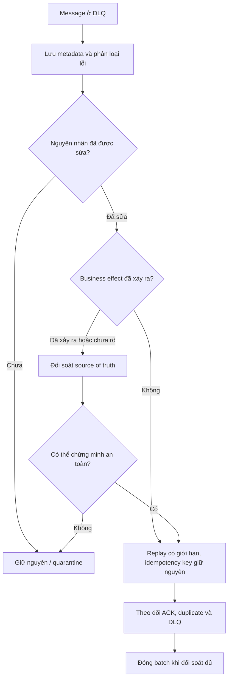

# Xây dựng quy trình ứng phó backlog, DLQ tăng và sự cố dung lượng

> **Chương:** Vận hành  
> **Phạm vi:** Xây dựng runbook ứng phó ba sự cố thường gặp khi vận hành Apache ActiveMQ Classic và Artemis: **queue backlog tăng**, **dead-letter queue (DLQ) tăng**, và **broker/store/disk chạm ngưỡng dung lượng**. Mục tiêu là khôi phục luồng xử lý có kiểm soát, bảo toàn message còn giá trị và xác minh hệ thống thực sự ổn định sau sự cố.

Khi queue tăng từ 10.000 lên 200.000 messages, phản xạ tăng consumer ngay có thể làm database quá tải. Khi DLQ tăng, purge DLQ để dashboard về 0 có thể xóa bằng chứng của lỗi nghiệp vụ. Khi disk gần đầy, restart broker không làm journal tự nhỏ lại và có thể khiến broker không khởi động được. Một quy trình ứng phó tốt phải xác định **message đang nằm ở đâu, tốc độ đến và tốc độ xử lý, nguyên nhân thất bại, tài nguyên nào sắp cạn và hành động nào an toàn**.

Ba nguyên tắc vận hành xuyên suốt:

1. **Giữ bằng chứng trước khi thay đổi trạng thái:** ghi nhận queue depth, in-flight, rate, DLQ, broker logs, disk/store usage và thời điểm sự cố.
2. **Ổn định luồng vào trước khi tăng năng lực xử lý:** kiểm soát producer/rate khi backlog tăng nhanh hoặc downstream đang quá tải.
3. **Chỉ replay hoặc loại bỏ message sau khi phân loại:** kiểm tra nguyên nhân, business ID, idempotency và quyền xử lý dữ liệu lỗi.

Runbook dưới đây áp dụng cho cả Classic và Artemis; tên metric, công cụ quản trị và policy được tách riêng theo broker.

## 1. Phân loại sự cố và mức độ ảnh hưởng

Không phải mọi queue depth cao đều là incident. Đánh giá dựa trên **xu hướng backlog, tuổi message, SLA nghiệp vụ, DLQ và headroom tài nguyên**.

| Mức độ | Tín hiệu điển hình | Ảnh hưởng | Hành động ban đầu |
|---|---|---|---|
| **SEV-1 — Critical** | Store/disk gần đầy có nguy cơ dừng broker; nhiều queue quan trọng không xử lý; DLQ tăng nhanh với luồng thanh toán/đơn hàng; producer bị block diện rộng. | Giao dịch chính bị gián đoạn hoặc có nguy cơ mất khả năng tiếp nhận. | Mở incident, gọi broker + ứng dụng + hạ tầng, kiểm soát producer, bảo vệ dữ liệu và dung lượng. |
| **SEV-2 — High** | Backlog tăng liên tục và oldest age vượt SLA; DLQ tăng trên một luồng quan trọng; store usage tăng nhanh nhưng còn headroom. | Một phần nghiệp vụ trễ, retry tăng hoặc nguy cơ lan rộng. | Chỉ định incident owner, xác định queue gây tải, điều chỉnh rate/capacity có kiểm soát. |
| **SEV-3 — Medium** | Một queue tăng chậm, DLQ có message mới nhưng tỷ lệ thấp, chưa vi phạm SLA; tài nguyên còn ổn định. | Tác động giới hạn hoặc có thể xử lý theo ca. | Tạo ticket, phân tích nguyên nhân và theo dõi trend. |
| **SEV-4 — Low** | Spike ngắn đã tự hồi phục, DLQ là dữ liệu test/đã biết, không ảnh hưởng SLA. | Không có ảnh hưởng đáng kể. | Ghi nhận, kiểm tra alert/noise và cải thiện ngưỡng. |

Các ngưỡng cụ thể phải lấy từ SLO và baseline của từng queue. Ví dụ queue giao dịch có thể cần cảnh báo khi oldest message age vượt 2 phút, trong khi queue báo cáo batch chấp nhận vài giờ. **Không dùng một ngưỡng depth chung cho mọi queue**.

### 1.1. Điều kiện mở incident ngay

- Disk filesystem chứa journal/store còn dưới headroom vận hành đã quy định hoặc tăng đầy nhanh đến mức không đủ thời gian xử lý.
- Broker báo store full, paging failure, journal write failure hoặc producer bị block diện rộng.
- Queue quan trọng có oldest age vượt giới hạn nghiệp vụ và tiếp tục tăng.
- DLQ nhận message lỗi từ nhiều queue/tenant hoặc một lỗi schema/dependency gây poison message hàng loạt.
- Có dấu hiệu mất message, duplicate business effect hoặc split-brain/replication không an toàn.

## 2. Quy trình phản ứng chung trong 15 phút đầu



### 2.1. Checklist thu thập bằng chứng trước khi can thiệp

Ghi lại các thông tin sau ở cùng mốc thời gian:

| Nhóm | Dữ liệu cần ghi |
|---|---|
| Định danh | Environment, broker name/ID, broker version, node, queue/address, tenant/business flow. |
| Queue | Pending/depth, delivering/in-flight, scheduled, consumer count, enqueue/dequeue hoặc added/acknowledged counters. |
| Tốc độ | Enqueue rate, ACK/dequeue rate, handler success/failure rate, backlog growth. |
| Tuổi message | Oldest pending age, p95/p99 queue wait, thời điểm message đầu tiên vi phạm SLA. |
| DLQ | Depth, tốc độ tăng, nguồn queue, delivery count, error class, business ID mẫu đã được bảo vệ dữ liệu. |
| Broker | Memory/store/temp usage, paging, journal health, connections, producer flow control, broker uptime. |
| Host/storage | Disk free bytes và inode, filesystem mount, I/O latency, throughput, JVM heap/GC, CPU, memory. |
| Thay đổi gần đây | Deploy ứng dụng, schema/config change, tăng producer rate, thay consumer concurrency, network/storage event. |

Không chỉ chụp một snapshot. Lưu ít nhất ba mốc: **lúc alert**, sau 5 phút và sau 10–15 phút. Nhờ đó biết backlog đang tăng, đứng yên hay đã bắt đầu drain.

### 2.2. Vai trò trong incident

- **Incident commander:** quyết định mức độ, điều phối người xử lý và giữ timeline.
- **Broker operator:** đọc queue/store/HA state, thực hiện thao tác broker được phê duyệt.
- **Application owner:** xác định consumer/producer/downstream, sửa lỗi handler và idempotency.
- **Platform/storage owner:** kiểm tra disk, filesystem, I/O, volume và capacity.
- **Business owner:** xác nhận SLA, ưu tiên luồng, quyết định quarantine/replay/drop theo chính sách nghiệp vụ.

Một người có thể đảm nhiệm nhiều vai trò ở môi trường nhỏ, nhưng phải có **một người giữ quyền điều phối và ghi lại quyết định**.

## 3. Chẩn đoán backlog: xác định queue đang tăng vì đâu

Đặt:

- `λin`: tốc độ message đến queue (messages/second).
- `λack`: tốc độ broker ghi nhận ACK/dequeue.
- `B`: backlog hiện tại, dùng đúng metric pending hoặc outstanding đã định nghĩa.

Nếu `λin > λack` kéo dài, backlog có xu hướng tăng. Tốc độ tăng gần đúng là `λin - λack` khi không có expiry, DLQ, purge, transfer hoặc counter accounting khác làm thay đổi phương trình.

### 3.1. Tính tốc độ tăng và thời gian drain

Ví dụ trong 5 phút:

| Chỉ số | Giá trị |
|---|---:|
| Enqueue rate | 120 msg/s |
| ACK rate | 70 msg/s |
| Backlog đầu cửa sổ | 30.000 |
| Net growth ước lượng | +50 msg/s |
| Backlog sau 5 phút | Khoảng 45.000 nếu điều kiện ổn định |

Nếu sau khi sửa consumer, enqueue giảm còn 40 msg/s và ACK đạt 100 msg/s, net drain là 60 msg/s. Với backlog 45.000:

\[
\text{Drain ETA} \approx \frac{45\,000}{100-40}=750\text{ giây}
\]

ETA 12,5 phút chỉ là ước lượng. Nếu handler throughput giảm theo tải DB, message có kích thước lớn, retry tăng hoặc consumer bị paging/disk bottleneck, thời gian thực tế sẽ dài hơn.

**Nếu ACK rate không lớn hơn enqueue rate, không có drain ETA hữu hạn theo mô hình tuyến tính.** Khi đó cần giảm arrival rate, khôi phục downstream hoặc tăng capacity sau khi xác nhận bottleneck có thể mở rộng.

### 3.2. Ma trận xác định nguyên nhân backlog

| Pending | Delivering | ACK rate | Consumer count | Nguyên nhân cần kiểm tra |
|---|---|---|---|---|
| Tăng nhanh | Thấp | Gần 0 | 0 | Listener dừng, sai destination, ACL/selector hoặc consumer không deploy. |
| Tăng | Thấp | Thấp | > 0 | Consumer tồn tại nhưng không dispatch: prefetch/flow control, selector, thread starvation hoặc queue binding. |
| Giảm/ổn định | Rất cao | Thấp | > 0 | Consumer đã nhận nhiều message nhưng handler/DB bị kẹt; transaction chưa commit. |
| Tăng | Tăng | Có nhưng thấp hơn arrival | > 0 | Hệ thống đang xử lý nhưng capacity không theo kịp producer. |
| Thấp | Thấp | Cao | > 0 | Queue có thể đang drain; xác minh oldest age và business success. |
| Tăng đột ngột sau deploy | Biến động | Giảm | Có | Consumer regression, schema/converter mismatch, dependency hoặc config thay đổi. |

### 3.3. Xác định bottleneck theo chuỗi xử lý

```text
Producer
   |
   v
Broker accept / persistence
   |
   v
Queue dispatch / prefetch
   |
   v
Consumer handler
   |
   v
Database / HTTP / downstream
   |
   v
JMS ACK / transaction commit
```

Đọc theo thứ tự:

1. **Producer → broker:** enqueue rate có tăng bất thường không? Producer send latency/exception có tăng? Có producer retry tạo duplicate không?
2. **Broker accept/persistence:** store usage, journal I/O, paging, memory usage hoặc producer flow control có bất thường không?
3. **Dispatch:** consumer count, delivering count, prefetch và queue bindings có hợp lý không?
4. **Handler:** p95/p99 duration, exception, thread pool, GC, lock contention.
5. **Downstream:** DB connection pool, query latency, HTTP 429/5xx, circuit breaker, rate limit.
6. **ACK/commit:** transaction duration, rollback, connection loss, redelivery và ACK rate.

Đừng tăng consumer concurrency nếu database đã ở mức connection saturation. Tăng consumer có thể chỉ chuyển backlog từ broker sang in-flight và làm downstream sập sâu hơn.

## 4. Ứng phó backlog tăng theo từng nhánh

### 4.1. Consumer dừng hoặc không còn nhận message

**Dấu hiệu:** pending tăng, delivering thấp, consumer count bằng 0 hoặc thấp hơn baseline.

Thực hiện:

1. Kiểm tra deployment/replica, health check, listener container state và broker connection.
2. Kiểm tra destination name, queue/address binding, routing type, selector và authorization.
3. Kiểm tra broker logs về authentication failure, connection reset, consumer closed hoặc address/queue không tồn tại.
4. Khôi phục đúng consumer version/config; chỉ tăng replica sau khi xác nhận downstream còn capacity.
5. Theo dõi consumer count, delivering, ACK rate và oldest age cho tới khi backlog bắt đầu giảm.

Không xóa/recreate queue để “làm mới” consumer; thao tác đó có thể làm mất hoặc đổi state của queue.

### 4.2. Consumer chạy nhưng xử lý chậm

**Dấu hiệu:** consumer count bình thường, handler p95/p99 tăng, ACK rate thấp, in-flight có thể cao.

Thực hiện:

- Kiểm tra thread dump, CPU/GC, executor queue và thời gian chờ lock.
- Kiểm tra database/HTTP dependency, pool exhaustion và rate limit.
- Giảm concurrency nếu nhiều consumer tranh chấp cùng tài nguyên.
- Giảm prefetch nếu một consumer giữ quá nhiều message trong khi handler bị chậm; thay đổi theo từng bước và đo lại fairness/throughput.
- Sửa query, batch size, timeout hoặc downstream bottleneck trước khi tăng replica.

### 4.3. Producer gửi nhanh hơn capacity

**Dấu hiệu:** enqueue rate tăng nhưng consumer/handler vẫn healthy; net backlog tăng ổn định.

Ưu tiên:

1. Áp dụng rate limit hoặc backpressure ở producer/API.
2. Tạm giảm batch/parallelism upstream nếu có thể.
3. Chỉ tăng consumer concurrency khi downstream có headroom.
4. Ưu tiên queue theo SLA/business criticality; tránh để batch workload chiếm toàn bộ capacity của giao dịch quan trọng.
5. Tính ETA drain và thông báo thời gian phục hồi dự kiến theo số đo thực tế.

### 4.4. Broker flow control đang chặn producer

Flow control có thể là cơ chế bảo vệ broker khi memory/store/address đầy. Khi producer send latency tăng hoặc send bị block:

- Xác định broker đang bảo vệ memory, persistent store, temp store hay address capacity.
- Kiểm tra disk free, journal I/O và consumer drain.
- Không tắt producer flow control chỉ để giảm latency; có thể làm broker cạn bộ nhớ/disk và dừng toàn bộ.
- Giảm tốc producer, xử lý backlog và khôi phục headroom trước khi tăng giới hạn.

## 5. Xử lý DLQ tăng: phân loại trước khi replay

DLQ tăng là **tín hiệu message không được xử lý theo luồng bình thường**. Nó có thể phản ánh poison message, lỗi schema, dependency outage, authorization, max delivery attempts hoặc message hết hạn được route sang expiry destination tùy cấu hình. DLQ không phải một queue “rác” có thể purge định kỳ mà không phân loại.

### 5.1. Phân loại message DLQ

| Nhóm | Dấu hiệu | Cách xử lý |
|---|---|---|
| **Transient dependency failure** | DB/HTTP timeout, 429/503, network reset; nhiều message cùng thời điểm. | Khôi phục dependency, xác nhận retry policy và replay có giới hạn. |
| **Poison message / data invalid** | Một payload hoặc schema cụ thể luôn thất bại, parse/validation exception. | Quarantine, sửa dữ liệu hoặc consumer compatibility; replay sau khi có test. |
| **Authorization/configuration** | Permission denied, destination mismatch, missing credentials. | Sửa ACL/config trước; không replay khi consumer vẫn bị từ chối. |
| **Business rejection** | Nghiệp vụ không hợp lệ theo rule; không nên retry tự động. | Giữ audit, chuyển business review hoặc workflow xử lý thủ công. |
| **Expired/too-late message** | Message age vượt TTL/SLA, expiry count tăng. | Xác định có thể xử lý muộn hay phải hủy/đối soát theo nghiệp vụ. |
| **Duplicate/idempotency conflict** | Business ID đã tồn tại hoặc side effect trước đó có thể đã commit. | Đối soát source of truth; không replay mù. |

### 5.2. Thu thập metadata tối thiểu

Trước khi replay, ghi nhận:

- Broker, source queue/address, DLQ name, timestamp vào DLQ.
- `JMSMessageID`, `JMSCorrelationID`, business request ID/event ID.
- Original destination/source metadata nếu broker cung cấp.
- `JMSRedelivered`, delivery count/provider-specific delivery attempt.
- Exception class/reason, stack trace đã loại bỏ secret/PII.
- Payload hash hoặc bản lưu payload theo chính sách dữ liệu.
- Kết quả đối soát nghiệp vụ: chưa chạy, đã chạy, hay chưa xác định.

Không đưa payload đầy đủ, token, thông tin thanh toán hoặc PII vào log/incident chat. Dùng message ID và payload hash để tham chiếu bản lưu có kiểm soát.

### 5.3. Quyết định replay, quarantine hay drop



**Replay chỉ được bắt đầu khi** nguyên nhân đã được sửa, destination đích sẵn sàng, consumer version tương thích, business ID giữ nguyên và có giới hạn tốc độ/batch. Nếu outcome trước đó không rõ, đối soát trước khi gửi lại.

### 5.4. Quy trình replay an toàn

1. Chọn một batch nhỏ theo source queue, lỗi và khoảng thời gian; không replay toàn bộ DLQ cùng lúc.
2. Lưu bản ghi metadata và số lượng trước replay.
3. Kiểm tra consumer đã xử lý đúng payload tương ứng trên staging hoặc test environment.
4. Giữ nguyên business idempotency key và correlation ID; không tạo ID mới để né deduplication.
5. Replay tới **source destination đã xác minh**, hoặc một recovery queue được thiết kế riêng; không gửi mọi message vào queue mặc định.
6. Giới hạn rate/concurrency để không tạo backlog thứ hai.
7. Theo dõi accepted, ACKed, failed, redelivered, duplicate business ID và DLQ recurrence.
8. Đối soát số message đã replay với kết quả nghiệp vụ; giữ lại các message vẫn lỗi.

Không dùng thao tác bulk move/purge không có audit. Nếu dùng broker management UI/CLI, xác minh lệnh là browse, move, retry hay delete trước khi chạy trên production; một số thao tác quản trị có thể không đảo ngược được.

## 6. Cấu hình DLQ và retry để giảm incident lặp lại

### 6.1. ActiveMQ Classic: individual dead-letter queue

Trong `activemq.xml`, policy entry có thể dùng `IndividualDeadLetterStrategy` để đưa message của mỗi queue sang DLQ riêng:

```xml
<destinationPolicy>
    <policyMap>
        <policyEntries>
            <policyEntry queue=">" producerFlowControl="true">
                <deadLetterStrategy>
                    <individualDeadLetterStrategy
                        queuePrefix="DLQ."
                        useQueueForQueueMessages="true"
                        processExpired="false"/>
                </deadLetterStrategy>
            </policyEntry>
        </policyEntries>
    </policyMap>
</destinationPolicy>
```

Ví dụ này đặt trong phần cấu hình broker Classic. Message từ `orders.in` có thể được chuyển vào `DLQ.orders.in` khi vượt retry/redelivery behavior đã cấu hình ở client/broker. `processExpired="false"` nghĩa là message hết hạn không được chuyển theo dead-letter strategy này; nếu muốn quan sát expired riêng, cấu hình expiry destination/policy phù hợp và giám sát riêng.

Classic client có `RedeliveryPolicy` để cấu hình delay và số lần redelivery. Broker cũng có thể dùng redelivery plugin trong các kiến trúc phù hợp; cần chọn **một cơ chế retry rõ ràng**, tránh client retry và broker retry chồng lặp không giới hạn.

Ví dụ client policy:

```java
import org.apache.activemq.ActiveMQConnectionFactory;
import org.apache.activemq.RedeliveryPolicy;

ActiveMQConnectionFactory factory =
        new ActiveMQConnectionFactory("tcp://broker-a:61616");

RedeliveryPolicy policy = new RedeliveryPolicy();
policy.setInitialRedeliveryDelay(1_000);
policy.setRedeliveryDelay(5_000);
policy.setUseExponentialBackOff(true);
policy.setBackOffMultiplier(2.0);
policy.setMaximumRedeliveries(5);
factory.setRedeliveryPolicy(policy);
```

Đây là **client-side policy**: mọi consumer dùng factory này nhận policy đó. Nếu consumer khác dùng factory riêng, cấu hình của nó có thể khác. Kiểm thử số lần delivery thực tế và destination DLQ với đúng client/broker versions.

### 6.2. Artemis: dead-letter address và delivery attempts

Trong `broker.xml`, có thể cấu hình address settings cho một nhóm address:

```xml
<address-settings>
    <address-setting match="orders.#">
        <dead-letter-address>DLQ</dead-letter-address>
        <expiry-address>ExpiryQueue</expiry-address>
        <redelivery-delay>1000</redelivery-delay>
        <redelivery-delay-multiplier>2.0</redelivery-delay-multiplier>
        <max-redelivery-delay>30000</max-redelivery-delay>
        <max-delivery-attempts>5</max-delivery-attempts>
    </address-setting>
</address-settings>
```

`orders.#` là wildcard match cho address có prefix `orders.` theo cú pháp Artemis. `max-delivery-attempts` giới hạn số lần delivery trước khi broker áp dụng dead-letter behavior; `redelivery-delay` và multiplier tạo khoảng chờ tăng dần, giới hạn bởi `max-redelivery-delay`. Đặt DLQ address và queue/binding phù hợp để message thực sự có nơi đến và có thể được operator tra cứu.

### 6.3. Retry phải có ngân sách thời gian

Nếu mỗi lần retry có delay tăng dần, tổng thời gian retry có thể vượt SLA. Ví dụ delay 1s, 2s, 4s, 8s, 16s đã kéo dài 31 giây, chưa tính thời gian handler và broker. Với payment/order, cần quyết định:

- Thời gian tối đa message được phép chờ retry.
- Số lần retry phù hợp với loại lỗi.
- Lỗi nào retry được, lỗi nào phải chuyển DLQ ngay.
- Khi nào circuit breaker dừng gọi downstream.
- Ai chịu trách nhiệm replay sau khi dependency hồi phục.

Không retry validation/business rejection như lỗi network. Retry một lỗi deterministic chỉ làm tăng tải và DLQ.

## 7. Ứng phó sự cố dung lượng ở ActiveMQ Classic

Classic có các ngưỡng `systemUsage` cho memory, persistent store và temporary store. Khi một usage đạt giới hạn, broker có thể kích hoạt producer flow control hoặc từ chối send tùy cấu hình. Phải phân biệt:

- **Memory usage:** bộ nhớ broker dùng để quản lý message/cursor; tăng nhanh có thể gây pressure lên heap.
- **Store usage:** không gian persistence adapter dùng cho persistent messages/journal.
- **Temp usage:** vùng lưu tạm cho cursor/spool hoặc message không persistent theo cơ chế broker.
- **Filesystem free space:** dung lượng thực tế còn lại trên volume; khác với logical limit của broker.

Logical usage còn thấp nhưng filesystem đã đầy vì log, snapshot hoặc file khác vẫn là sự cố dung lượng. Ngược lại, filesystem còn trống nhưng broker báo store limit đạt ngưỡng thì producer vẫn có thể bị flow control.

### 7.1. Cấu hình giới hạn `systemUsage`

Một đoạn cấu hình minh họa trong `activemq.xml`:

```xml
<systemUsage>
    <systemUsage>
        <memoryUsage>
            <memoryUsage percentOfJvmHeap="60"/>
        </memoryUsage>
        <storeUsage>
            <storeUsage limit="80 gb"/>
        </storeUsage>
        <tempUsage>
            <tempUsage limit="20 gb"/>
        </tempUsage>
    </systemUsage>
</systemUsage>
```

Đây là **giới hạn ví dụ**, không phải sizing mặc định. Giá trị store/temp phải nhỏ hơn dung lượng volume được phân bổ sau khi trừ journal recovery headroom, log, backup/snapshot và các file khác. `percentOfJvmHeap` không thay thế kiểm tra heap/GC thực tế. Trước khi thay đổi, kiểm tra persistence adapter, data directory và filesystem đang chứa các vùng đó.

### 7.2. Quy trình khi Classic store usage tăng

1. Xác định queue/destination tạo persistent backlog lớn nhất bằng JMX queue statistics và enqueue/dequeue trend.
2. Kiểm tra consumer count, ACK rate, oldest age và DLQ; store tăng có thể do consumer ngừng hoặc message bị giữ lâu.
3. Kiểm tra journal/data directory, disk free, inode, I/O latency và broker logs.
4. Giảm producer rate hoặc tạm dừng luồng ít ưu tiên nếu downstream/consumer không thể drain.
5. Khôi phục consumer hoặc dependency gây tắc; không xóa data directory/KahaDB files để lấy dung lượng.
6. Theo dõi store usage và filesystem free trong khi queue drain; xác nhận usage giảm theo cơ chế reclaim/cleanup của persistence adapter.

**Không xóa trực tiếp file journal/DB đang được broker quản lý.** Xóa thủ công có thể làm mất message, phá journal index hoặc khiến broker không thể recover. Nếu cần dọn dữ liệu cũ, phải dùng broker management theo đúng loại destination và có phê duyệt nghiệp vụ.

### 7.3. Producer flow control và send failure

`producerFlowControl="true"` giúp broker tạo backpressure khi destination/resource vượt giới hạn. Trong incident:

- Xác định producer đang block ở send hay nhận exception.
- Kiểm tra log broker về usage limit/flow control.
- Đọc send latency và timeout phía producer; không chỉ nhìn số connection.
- Điều tiết producer upstream trước khi tăng usage limit.

Không tắt flow control hoặc tăng store limit vượt dung lượng volume chỉ để producer tiếp tục gửi. Làm vậy có thể biến một queue backlog có thể phục hồi thành filesystem full và broker outage.

### 7.4. Kiểm tra Classic qua JMX

Đọc BrokerView và QueueView MBeans qua JMX đã được bảo vệ. Những thuộc tính thường hữu ích:

| MBean | Attribute | Mục đích |
|---|---|---|
| BrokerView | `MemoryPercentUsage` | Áp lực memory broker. |
| BrokerView | `StorePercentUsage` | Áp lực persistent store. |
| BrokerView | `TempPercentUsage` | Áp lực temporary store. |
| BrokerView | `CurrentConnectionsCount` | Số kết nối hiện tại. |
| QueueView | `QueueSize`, `InFlightCount` | Pending/in-flight theo semantics version. |
| QueueView | `EnqueueCount`, `DequeueCount`, `ExpiredCount` | Tốc độ nhận, ACK và expiry qua delta. |

Lưu ý các counter có thể reset khi broker restart hoặc statistics reset. So sánh metric với `Uptime` và filesystem metrics cùng thời điểm. Nếu JMX không truy cập được trong incident, không mở cổng JMX không xác thực ra mạng công cộng; dùng đường quản trị an toàn đã được cấu hình.

## 8. Ứng phó sự cố dung lượng ở Artemis

Artemis quản lý capacity theo address và toàn broker. Khi address đầy, `address-full-policy` quyết định broker sẽ page, block, drop hay fail send. Lựa chọn sai có thể gây mất message hoặc tạo backpressure dây chuyền.

### 8.1. Các chính sách address full

| Policy | Hành vi khi address đạt `max-size-bytes` | Rủi ro/vận hành |
|---|---|---|
| `PAGE` | Broker page message ra paging storage theo cơ chế paging. | Giảm áp lực memory nhưng vẫn tiêu thụ disk; phải giám sát paging volume. |
| `BLOCK` | Producer bị block/backpressure khi gửi tới address đầy. | Bảo toàn message tốt hơn nhưng latency có thể lan ngược upstream. |
| `FAIL` | Send bị từ chối khi address đầy. | Producer phải xử lý exception/retry; cần tránh retry storm. |
| `DROP` | Message mới có thể bị loại bỏ khi address đầy. | Có nguy cơ mất dữ liệu; chỉ dùng khi nghiệp vụ cho phép rõ ràng. |

### 8.2. Cấu hình address capacity

Ví dụ trong `broker.xml`:

```xml
<address-settings>
    <address-setting match="orders.#">
        <max-size-bytes>536870912</max-size-bytes>
        <page-size-bytes>10485760</page-size-bytes>
        <address-full-policy>PAGE</address-full-policy>
    </address-setting>
</address-settings>
```

Ở đây `max-size-bytes` là giới hạn dung lượng logic cho address match `orders.#`; `page-size-bytes` định kích thước page. Chọn `PAGE` chỉ chuyển một phần áp lực từ memory sang paging storage, **không tạo thêm dung lượng vật lý**. Phải đặt paging directory trên volume đủ capacity và giám sát filesystem thật.

Nếu nghiệp vụ yêu cầu producer chờ khi address đầy, có thể chọn `BLOCK`; nếu muốn send thất bại rõ ràng để producer áp dụng backoff, cân nhắc `FAIL`. Chỉ chọn `DROP` khi có yêu cầu nghiệp vụ chấp nhận mất message và đã có metric/audit phù hợp.

### 8.3. Quy trình khi Artemis paging/disk tăng

1. Xác định address nào đang page và queue nào giữ backlog; kiểm tra `MessageCount`, `DeliveringCount`, `MessagesAdded`, `MessagesAcknowledged`.
2. Đọc paging metrics, broker logs và filesystem chứa paging/journal directories.
3. Kiểm tra consumer demand, ACK rate, address routing và cluster redistribution; không giả định message đã được forward sang node khác.
4. Nếu producer bị block, kiểm tra downstream và quyết định rate limit upstream; không chuyển sang `DROP` để hết cảnh báo.
5. Khôi phục consumers hoặc dependency; tăng capacity chỉ khi volume/IOPS thực tế còn headroom.
6. Khi queue drain, theo dõi paging/store usage và xác nhận broker reclaim page files theo lifecycle của nó.

Không xóa file trong `paging` hoặc `journal` directory khi broker đang chạy. Không xóa queue/address chỉ để giải phóng disk trước khi xác định message ownership và retention.

### 8.4. Đọc queue stats bằng Artemis CLI

Từ thư mục cài đặt Artemis, lệnh quản trị có thể truy vấn thống kê queue:

```bash
./artemis queue stat \
  --url tcp://127.0.0.1:61616 \
  --user monitor \
  --password "$ARTEMIS_MONITOR_PASSWORD"
```

Đây là cú pháp ví dụ; xác nhận options của CLI ở đúng release và dùng tài khoản chỉ có quyền quản trị/đọc cần thiết. Không đưa password literal vào command history; dùng secret injection phù hợp môi trường. Đọc output theo từng queue/address và đối chiếu với JMX/management metrics, paging usage và filesystem.

### 8.5. Phân biệt address full với broker global resource pressure

Một address có thể đạt `max-size-bytes` trong khi các address khác vẫn hoạt động. Ngược lại, disk toàn broker có thể đầy do journal/paging của nhiều address, log hoặc snapshot dù một address riêng chưa đạt giới hạn. Trong incident phải kiểm tra cả:

- Address/queue backlog và address full policy.
- Broker global memory/store limits.
- Paging/journal directory usage.
- Filesystem free space, inode và I/O latency.
- Các broker khác nếu dùng cluster; không suy ra cluster-wide health từ một node.

## 9. Kế hoạch tăng capacity mà không làm incident lan rộng

Tăng capacity chỉ có ích nếu bottleneck nằm ở tài nguyên có thể mở rộng. Dùng bảng sau để chọn hành động:

| Bottleneck | Hành động có thể cân nhắc | Điều kiện trước khi tăng |
|---|---|---|
| Consumer CPU-bound | Tăng listener concurrency/replica hoặc scale consumer service. | CPU còn headroom, downstream không bị giới hạn, queue ordering cho phép song song. |
| Consumer DB-bound | Tối ưu query/index/batch; tăng DB pool có kiểm soát. | DB còn connection/IO capacity và transaction ngắn. |
| Producer burst | Rate limit, token bucket, upstream backpressure hoặc batch scheduling. | Xác định producer nào tạo phần lớn arrival. |
| Broker memory pressure | Giảm prefetch, giảm message size/batch, tăng heap chỉ sau profiling. | Host RAM và GC headroom đủ; không gây swapping. |
| Persistent store pressure | Drain backlog, tăng storage capacity/IOPS hoặc điều chỉnh retention theo policy. | Storage layout và recovery headroom đã được tính. |
| Paging pressure | Khôi phục consumer, kiểm soát producer, mở rộng paging volume nếu cần. | Paging directory nằm trên volume có capacity và I/O phù hợp. |
| Retry storm | Backoff, jitter, circuit breaker, giới hạn retry và phân loại lỗi deterministic. | Dependency được xác định và có cơ chế phục hồi. |

### 9.1. Quy tắc scale consumer an toàn

1. Tăng concurrency từng bước nhỏ, ví dụ 2 → 4 → 6, quan sát sau mỗi bước.
2. Theo dõi ACK rate, handler p95/p99, DB pool wait, downstream error rate và in-flight.
3. Nếu throughput không tăng nhưng downstream latency tăng, rollback concurrency về mức trước.
4. Nếu queue có ordering/grouping, kiểm tra tăng song song có làm thay đổi thứ tự theo business key.
5. Sau khi backlog giảm, hạ concurrency về baseline nếu mức cao chỉ cần cho drain tạm thời.

Không scale dựa trên consumer count đơn lẻ. **Năng lực thực tế là throughput hoàn tất**, không phải số listener thread đang chạy.

### 9.2. Tính capacity dựa trên arrival và drain target

Giả sử arrival bình thường 80 msg/s, backlog 72.000 và cần drain trong 20 phút. Drain rate tối thiểu cần có:

\[
\lambda_{ack,target}
= \lambda_{in} + \frac{B}{T}
= 80 + \frac{72\,000}{1\,200}
= 140\text{ msg/s}
\]

Consumer fleet cần đạt khoảng 140 ACK/s trong điều kiện thực tế để vừa xử lý arrival mới vừa drain backlog trong 20 phút. Nếu một consumer chỉ đạt 14 ACK/s ổn định, phép chia tuyến tính gợi ý 10 consumers, nhưng cần kiểm tra overhead, downstream capacity, prefetch và sự phân phối message trước khi áp dụng.

## 10. Khôi phục, xác minh và đóng incident

Không đóng incident ngay khi queue depth giảm. Cần xác nhận backlog đã được xử lý đúng, DLQ không tiếp tục tăng và broker còn headroom.

### 10.1. Tiêu chí phục hồi kỹ thuật

- Enqueue rate và ACK rate trở lại quan hệ phù hợp với tải bình thường.
- Pending giảm theo trend dự kiến; oldest age trở lại trong SLA.
- Delivering/in-flight ổn định, không tăng bất thường.
- Consumer count, handler duration và error rate trở lại baseline.
- DLQ rate không còn tăng ngoài mức đã biết; message mới không tiếp tục bị chuyển lỗi.
- Memory/store/temp hoặc Artemis paging usage có headroom và không tăng vô hạn.
- Filesystem free/inode/I/O latency ở mức an toàn; broker logs không còn báo store full/journal/paging errors.
- Producer send latency/exception và consumer reconnect/rollback ổn định.

### 10.2. Tiêu chí phục hồi nghiệp vụ

- Đối soát số business events đã nhận, đã hoàn tất, đang chờ và nằm trong DLQ.
- Kiểm tra duplicate business IDs và side effects bị thực thi lặp.
- Các message replay có kết quả cuối cùng; message chưa giải quyết còn được quarantine và có owner.
- Business owner xác nhận nghiệp vụ trễ đã được xử lý hoặc có kế hoạch bù.
- Không có message bị purge/drop ngoài quyết định đã được audit.

### 10.3. Mẫu timeline incident

| Thời điểm | Ghi nhận |
|---|---|
| T0 | Alert đầu tiên, queue/address và mức độ. |
| T+5m | Pending/in-flight, enqueue/ACK rate, DLQ rate, disk/store usage. |
| T+10m | Nguyên nhân giả định, bằng chứng, quyết định điều tiết producer/consumer. |
| T+15m | Thay đổi đã thực hiện, người phê duyệt, metric trước/sau. |
| T+30m | Backlog/oldest age/ETA, DLQ recurrence, tài nguyên còn headroom. |
| Recovery | Tiêu chí kỹ thuật và nghiệp vụ đạt, owner xác nhận. |

### 10.4. Postmortem không đổ lỗi

Sau incident, trả lời:

1. Điều kiện nào làm backlog/DLQ/capacity vượt ngưỡng?
2. Alert nào phát hiện sớm, alert nào quá muộn hoặc gây nhiễu?
3. Vì sao consumer/downstream không hấp thụ được arrival rate?
4. Retry/backoff có khuếch đại sự cố không?
5. DLQ có đủ metadata và quy trình replay chưa?
6. Disk/store headroom và paging/retention có được tính theo tải cực đại không?
7. Có thao tác thủ công nào rủi ro hoặc thiếu audit?
8. Action item nào có owner, due date và cách đo hoàn thành?

Mỗi action item cần gắn với một thay đổi có thể kiểm chứng: alert theo oldest age, runbook replay, capacity test, consumer idempotency, disk forecast hoặc giới hạn producer.

## 11. Kịch bản thực hành ứng phó

Thực hiện trong môi trường lab riêng với dữ liệu giả lập; không tạo backlog/DLQ hoặc lấp disk trên production.

### 11.1. Kịch bản A — producer nhanh hơn consumer

**Setup:** producer gửi 100 msg/s, consumer xử lý 60 msg/s.

**Thực hiện:** quan sát pending, delivering, enqueue rate, ACK rate và oldest age mỗi 30 giây. Sau 3 phút, giảm producer xuống 40 msg/s hoặc tăng consumer capacity nếu downstream còn headroom.

**Kết quả mong đợi:** trước điều chỉnh, backlog tăng khoảng 40 msg/s; sau điều chỉnh, ACK rate cao hơn arrival và backlog bắt đầu giảm. Tính ETA drain và so với thực đo.

### 11.2. Kịch bản B — poison message làm DLQ tăng

**Setup:** consumer ném lỗi deterministic với payload có schema không hợp lệ; cấu hình retry tối đa trong lab.

**Thực hiện:** gửi một batch nhỏ gồm message hợp lệ và poison messages. Theo dõi delivery attempts, redelivery, source queue và DLQ.

**Kết quả mong đợi:** message hợp lệ được ACK; poison message được retry theo policy rồi chuyển DLQ. Phân loại metadata và thử replay sau khi sửa parser/validation trên staging.

### 11.3. Kịch bản C — address/store gần đầy

**Setup:** giới hạn address/store thấp trong broker lab và gửi persistent messages với consumer dừng.

**Thực hiện:** quan sát memory/store/paging usage và producer send latency. Thử policy `PAGE` hoặc `BLOCK` trên Artemis; thử producer flow control trên Classic.

**Kết quả mong đợi:** hiểu sự khác nhau giữa page ra disk và block producer; xác định giới hạn logic không thay thế disk capacity. Sau test, khởi động consumer và xác nhận drain/reclaim.

### 11.4. Kịch bản D — downstream outage tạo retry storm

**Setup:** consumer gọi một HTTP service giả lập trả 503/timeout.

**Thực hiện:** quan sát handler failure, redelivery, DLQ rate, connection pool và enqueue/ACK gap. Áp dụng exponential backoff/jitter hoặc circuit breaker trong consumer.

**Kết quả mong đợi:** retry được giới hạn, downstream không bị gọi dồn dập, queue backlog không tiếp tục tăng vô hạn; khi dependency phục hồi, throughput trở lại có kiểm soát.

## 12. Mẫu checklist thao tác cho operator

### Khi backlog tăng

- [ ] Xác định broker, address/queue, business flow và SLA.
- [ ] Ghi pending, delivering, consumer count, enqueue/ACK rate và oldest age.
- [ ] Kiểm tra consumer health, handler latency và downstream capacity.
- [ ] Kiểm tra producer burst, duplicate retry và broker flow control.
- [ ] Chọn điều tiết producer hoặc tăng consumer theo bottleneck.
- [ ] Tính ETA drain và theo dõi sau mỗi thay đổi.

### Khi DLQ tăng

- [ ] Ghi DLQ depth/rate, source queue, error class và delivery attempts.
- [ ] Lưu metadata/payload hash theo chính sách bảo vệ dữ liệu.
- [ ] Phân loại transient, poison, auth/config, business rejection, expired và duplicate.
- [ ] Sửa nguyên nhân trước khi replay.
- [ ] Đối soát business effect và giữ nguyên idempotency key.
- [ ] Replay batch nhỏ, giới hạn rate, theo dõi recurrence và audit kết quả.

### Khi dung lượng tăng

- [ ] Xác định memory/store/temp/paging usage và filesystem thực tế.
- [ ] Kiểm tra disk free, inode, I/O latency, journal/paging/log directories.
- [ ] Xác định queue/address đóng góp backlog lớn nhất.
- [ ] Giảm arrival hoặc khôi phục drain; không xóa file store/journal thủ công.
- [ ] Không tắt flow control hoặc chọn `DROP` để che alert.
- [ ] Xác minh headroom và usage reclaim sau khi backlog giảm.

## 13. Câu hỏi tự kiểm tra

**1.** Queue backlog tăng, consumer count bằng 0. Có nên tăng prefetch?

**Đáp án:** Không. Không có consumer nhận message; kiểm tra listener deployment, connection, destination, ACL và selector trước.

**2.** Pending giảm nhưng delivering tăng mạnh và ACK rate gần 0. Có thể kết luận backlog đã xử lý?

**Đáp án:** Không. Message đã dispatch nhưng chưa ACK; consumer có thể đang giữ message mà không hoàn tất.

**3.** DLQ tăng do HTTP 503. Có nên replay toàn bộ ngay khi service trả 200 một lần?

**Đáp án:** Không. Kiểm tra dependency ổn định, sửa retry/backoff, replay batch nhỏ và theo dõi rate/error/duplicate.

**4.** Một message ở DLQ có business ID đã xuất hiện trong database nhưng JMS commit outcome không rõ. Hành động nào an toàn?

**Đáp án:** Đối soát source of truth và idempotency trước. Không tạo business ID mới hoặc replay mù.

**5.** Artemis address full đang dùng `PAGE`. Disk paging volume gần đầy. Tăng `max-size-bytes` có giải quyết được?

**Đáp án:** Không nếu volume vật lý thiếu headroom. `PAGE` chuyển áp lực sang disk; cần giảm arrival, drain backlog hoặc mở rộng storage phù hợp.

**6.** Classic `StorePercentUsage` thấp nhưng filesystem chứa KahaDB gần đầy. Có thể bỏ qua?

**Đáp án:** Không. Logical store usage và filesystem free là hai phép đo khác nhau; broker có thể gặp lỗi ghi journal dù usage metric chưa chạm giới hạn.

**7.** Có nên tắt producer flow control để send không bị block?

**Đáp án:** Không. Flow control là backpressure bảo vệ broker; tắt nó có thể dẫn tới memory/disk exhaustion và outage diện rộng.

**8.** DLQ depth về 0 sau purge có chứng minh incident đã giải quyết?

**Đáp án:** Không. Có thể message đã bị xóa mà nguyên nhân chưa sửa. Cần audit message bị tác động, kiểm tra producer/consumer và business reconciliation.

## 14. Ghi nhớ

Ứng phó backlog, DLQ và sự cố dung lượng là một quy trình thống nhất: **đo trạng thái → xác định nguyên nhân → ổn định arrival → phục hồi processing → xử lý message lỗi → xác minh nghiệp vụ và capacity**. Queue depth phải được đọc cùng delivering/in-flight, rate và oldest age. DLQ cần phân loại trước replay. Capacity phải được nhìn ở cả broker logical limits và filesystem thực tế.

Với **ActiveMQ Classic**, theo dõi `systemUsage`, memory/store/temp usage, producer flow control và JMX BrokerView/QueueView; không xóa thủ công KahaDB/journal. Với **Artemis**, theo dõi address settings, `max-size-bytes`, `address-full-policy`, paging/journal và filesystem; hiểu rõ `PAGE`, `BLOCK`, `FAIL`, `DROP` trước khi chọn. Chỉ đóng incident khi queue, DLQ, consumer, broker resource và business reconciliation đều đạt tiêu chí phục hồi.
