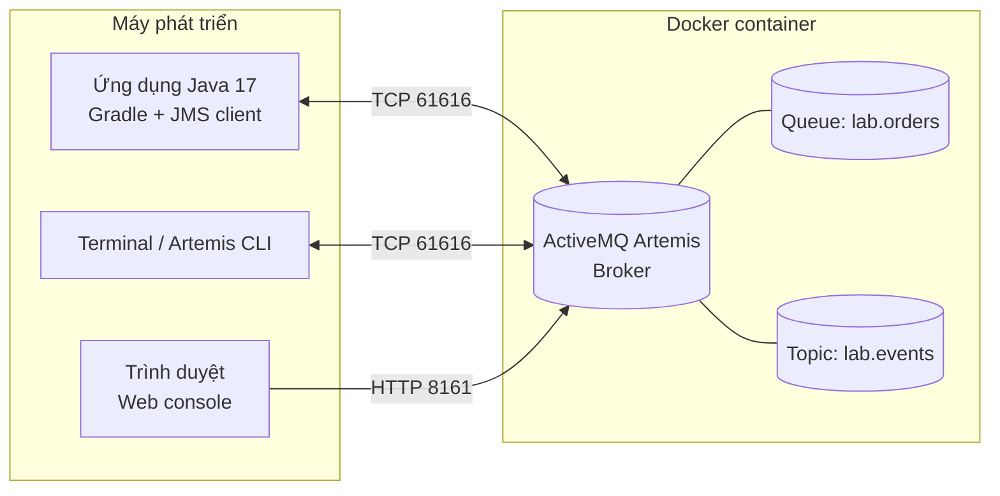

# Chuẩn bị JDK, Gradle, Docker và công cụ gửi nhận thông điệp

> **Chương:** Môi trường thực hành  
> **Phạm vi:** Apache ActiveMQ Classic và Apache ActiveMQ Artemis; thực hành giao tiếp bất đồng bộ bằng queue, topic và JMS trên Java.  
> **Kết quả mong đợi:** Máy phát triển chạy được broker trong Docker, gửi/nhận message bằng công cụ dòng lệnh, biên dịch và chạy một ứng dụng Java dùng Gradle, đọc được message trên console và biết cách xử lý những lỗi cài đặt phổ biến.

## 1. Bài lab sẽ xây dựng những gì?

Trong tích hợp bất đồng bộ, **producer** gửi message đến **message broker**, còn **consumer** nhận message và xử lý độc lập. Bài này chuẩn bị bộ công cụ để những bài thực hành tiếp theo có thể tập trung vào JMS, acknowledgment, transaction, redelivery, dead-letter queue (DLQ), bảo mật và vận hành, thay vì vướng cấu hình máy.



Trong sơ đồ, **61616** là cổng kết nối messaging, còn **8161** là cổng giao diện quản trị của cấu hình lab. Các cổng này khác mục đích: mở được web console không có nghĩa ứng dụng Java đã kết nối được đến broker.

Ta chọn **Artemis** làm broker chính để minh họa ứng dụng Java với `jakarta.jms`. Cuối bài có cách khởi chạy **ActiveMQ Classic** riêng để so sánh và bảng lựa chọn JMS client tương ứng. Hai broker có kiến trúc và cấu hình khác nhau; cần tránh suy luận rằng đổi container là tự động tương thích toàn bộ mã nguồn.

### 1.1 Yêu cầu tối thiểu và cách tổ chức

| Công cụ | Mục đích | Cách kiểm tra |
|---|---|---|
| JDK 17 | Biên dịch và chạy ứng dụng Java. | `java -version`, `javac -version` |
| Gradle 8.x | Tải thư viện JMS, biên dịch và chạy ứng dụng lab. | `gradle --version` hoặc Gradle Wrapper |
| Docker Engine / Docker Desktop | Chạy broker độc lập với máy phát triển. | `docker version`, `docker info` |
| Docker Compose plugin (khuyến nghị) | Khởi động cấu hình lab lặp lại dễ dàng. | `docker compose version` |
| Terminal | Chạy lệnh cài đặt, Docker, Gradle và CLI. | PowerShell hoặc Bash/Zsh |
| Trình duyệt | Kiểm tra broker qua web console. | Truy cập `http://localhost:8161/console` |

Đề xuất dùng **JDK 17 LTS** và Gradle **8.10.2** cho ví dụ trong bài; đây là bộ phiên bản minh họa để giữ hướng dẫn nhất quán, không phải yêu cầu rằng mọi dự án ActiveMQ phải dùng đúng các bản này. Nếu sử dụng Gradle Wrapper của dự án thực, ưu tiên phiên bản đã được dự án chốt. Bộ nhớ máy nên có đủ chỗ cho Docker và JVM; cần ít nhất vài GB RAM trống khi đồng thời chạy IDE, broker và ứng dụng thử nghiệm.

Để không phụ thuộc hệ điều hành, bài phân biệt:

- **Windows:** chạy lệnh trong **PowerShell**, dùng `gradlew.bat`.
- **Linux/macOS:** chạy trong **Bash/Zsh**, dùng `./gradlew`.
- **Docker:** cú pháp `docker ...` gần như giống nhau trên ba nền tảng.

## 2. Cài JDK và xác minh môi trường Java

**JDK (Java Development Kit)** chứa `javac` để biên dịch và `java` để chạy chương trình. Chỉ cài JRE là chưa đủ nếu cần biên dịch mã nguồn.

### 2.1 Cài JDK 17

Chọn một bản phân phối JDK 17 được duy trì, ví dụ **Eclipse Temurin**, Microsoft Build of OpenJDK hoặc gói OpenJDK của hệ điều hành. Có thể tải bộ cài tại [Eclipse Adoptium](https://adoptium.net/) rồi làm theo hướng dẫn cho Windows/macOS/Linux.

- Trên **Windows**, cài JDK và bảo đảm terminal mới nhận được `java` và `javac` qua `PATH`. Nếu IDE hoặc Gradle không tự nhận, cấu hình `JAVA_HOME` trỏ tới **thư mục gốc JDK**, không trỏ tới `bin`.
- Trên **macOS/Linux**, dùng bộ cài phù hợp hoặc package manager; sau đó đặt `JAVA_HOME` nếu môi trường có nhiều JDK. Không giả định đường dẫn cài đặt giống nhau trên mọi máy.

Mở **terminal mới** để tránh giữ biến môi trường cũ, rồi chạy:

```bash
java -version
javac -version
```

Kết quả hợp lệ khi hai lệnh đều thành công và hiển thị phiên bản chính là **17**. Trên PowerShell có thể kiểm tra thêm:

```powershell
$env:JAVA_HOME
Get-Command java
Get-Command javac
```

Trên Bash/Zsh:

```bash
echo "$JAVA_HOME"
command -v java
command -v javac
```

Nếu `java` và `javac` báo phiên bản khác nhau, máy có thể đang ưu tiên hai JDK khác nhau trong `PATH`. Cần sửa `JAVA_HOME`/`PATH` trước khi chuyển sang Gradle. Dòng `JAVA_HOME` in trống chưa chắc là lỗi nếu Gradle và `javac` vẫn chọn đúng JDK; trong dự án có nhiều JDK, nên cấu hình rõ.

## 3. Chuẩn bị Gradle và Gradle Wrapper

**Gradle** quản lý dependency, biên dịch, chạy test và đóng gói ứng dụng. **Gradle Wrapper** (`gradlew` / `gradlew.bat` và các file cấu hình đi kèm) khóa phiên bản Gradle cho từng dự án để các máy xây dựng đồng nhất.

### 3.1 Kiểm tra Gradle

Nếu chưa có Gradle, cài phiên bản tương thích JDK 17 theo [hướng dẫn chính thức](https://gradle.org/install/). Kiểm tra:

```bash
gradle --version
```

Trong kết quả, chú ý **Gradle version** và **JVM** đang chạy Gradle. Máy cần kết nối mạng trong lần đầu Gradle tải distribution và thư viện.

Đối với một dự án mới, sau khi có Gradle cài sẵn, tạo Gradle Wrapper:

```bash
gradle wrapper --gradle-version 8.10.2
```

Lệnh trên cần chạy **tại thư mục dự án Gradle đã có `settings.gradle` và `build.gradle`**. Wrapper sinh `gradlew`, `gradlew.bat` cùng các file trong `gradle/wrapper/`; hãy giữ chúng trong version control khi làm dự án thực.

Từ đó dùng lệnh theo hệ điều hành:

| Công việc | Windows PowerShell | Linux/macOS |
|---|---|---|
| Xem phiên bản | `.\gradlew.bat --version` | `./gradlew --version` |
| Biên dịch | `.\gradlew.bat classes` | `./gradlew classes` |
| Chạy ứng dụng | `.\gradlew.bat run --args="produce queue"` | `./gradlew run --args="produce queue"` |

Ở Linux/macOS, nếu `./gradlew` không có quyền thực thi, chạy `chmod +x gradlew` một lần tại thư mục dự án. Có thể dùng lệnh `gradle` thay wrapper để thử nhanh, nhưng wrapper thích hợp hơn khi chia sẻ hướng dẫn và mã nguồn.

## 4. Cài Docker và kiểm tra daemon

Docker giúp chạy broker và xóa môi trường thử nghiệm mà không cần cài broker trực tiếp lên hệ điều hành. Trên Windows/macOS, dùng Docker Desktop; trên Linux có thể dùng Docker Engine cùng Compose plugin. Với Windows, Docker Desktop thường dùng **WSL 2 backend**; bảo đảm WSL/virtualization đã được bật theo hướng dẫn hệ thống.

Tài liệu tham khảo: [Docker Engine](https://docs.docker.com/engine/) và [Docker Desktop](https://docs.docker.com/desktop/).

Chạy các lệnh:

```bash
docker --version
docker version
docker info
docker compose version
```

`docker --version` chỉ cho biết **Docker CLI** đã cài; `docker info` và phần **Server** trong `docker version` mới xác nhận daemon Docker đang hoạt động. Nếu terminal trả `Cannot connect to the Docker daemon`, hãy khởi động Docker Desktop/service trước khi tải image.

**Lưu ý môi trường doanh nghiệp:** mạng có proxy hoặc registry mirror có thể yêu cầu cấu hình Docker mới tải image và Gradle dependency được. Không bỏ qua chính sách xác thực proxy và registry của tổ chức.

## 5. Khởi động ActiveMQ Artemis bằng Docker

Để tránh lộ broker trên các giao diện mạng khác, ví dụ ánh xạ cổng vào **`127.0.0.1`**. Ta tạo tài khoản lab riêng, chỉ sử dụng trên máy phát triển:

| Tham số | Giá trị lab |
|---|---|
| Docker container | `amq-artemis-lab` |
| Broker trong container | TCP `61616` |
| Web console trong container | HTTP `8161` |
| Cổng máy phát triển | `127.0.0.1:61616`, `127.0.0.1:8161` |
| User lab | `labuser` |
| Password lab | `labpass123` |

Mật khẩu trên **chỉ để minh họa ở máy cá nhân**, không phải cấu hình an toàn cho môi trường production.

### 5.1 Chạy nhanh bằng `docker run`

Tạo volume để lưu instance và dữ liệu broker qua các lần **xóa/tạo lại container** nếu tương thích với image đang sử dụng:

```bash
docker volume create amq-artemis-lab-data
```

Chạy container:

```bash
docker run -d --name amq-artemis-lab -p 127.0.0.1:61616:61616 -p 127.0.0.1:8161:8161 -e ARTEMIS_USER=labuser -e ARTEMIS_PASSWORD=labpass123 -v amq-artemis-lab-data:/var/lib/artemis-instance apache/activemq-artemis:latest-alpine
```

Ý nghĩa các tùy chọn:

- `-d`: chạy nền;
- `--name`: đặt tên ổn định cho lệnh kiểm tra/log;
- `-p host:container`: xuất cổng TCP messaging và HTTP console ra máy phát triển;
- `-e`: cấp tài khoản ban đầu khi image khởi tạo broker;
- `-v`: gắn named volume để dữ liệu không phụ thuộc filesystem tạm của container.

`latest-alpine` giúp bắt đầu nhanh nhưng **không cố định phiên bản**; kết quả có thể thay đổi theo thời gian. Khi tái lập kết quả cho đội nhóm, thay bằng một tag/digest Artemis đã kiểm chứng với image và JMS client dự án đang dùng. Không thay đổi image hoặc xóa volume của lab đang chứa dữ liệu cần giữ mà chưa backup.

Kiểm tra container và log:

```bash
docker ps --filter name=amq-artemis-lab
docker logs --tail 100 amq-artemis-lab
```

Trong log, tìm dấu hiệu broker đã khởi động và các acceptor/listener. Đợi quá trình bootstrap hoàn tất trước khi thực hiện gửi/nhận; `docker ps` có container trạng thái **Up** chưa bảo đảm broker đã sẵn sàng nhận kết nối.

Truy cập:

- **Web console Artemis:** `http://localhost:8161/console`
- **Kết nối Java/CLI từ máy phát triển:** `tcp://localhost:61616`
- **Tài khoản lab:** `labuser` / `labpass123`

Trang console Artemis thường dùng giao diện quản trị **Hawtio**. Nếu đường dẫn giao diện thay đổi theo phiên bản image, xem log và hướng dẫn của chính image đang chạy. Đối với một máy dùng Docker từ xa, `localhost` trong ví dụ phải thay bằng địa chỉ Docker host có thể truy cập và cấu hình bảo mật tương ứng.

### 5.2 Tùy chọn cấu hình lặp lại bằng Compose

Nếu nhóm dùng Docker Compose, đặt nội dung dưới đây trong **`compose.yaml` tại thư mục lab của nhóm**:

```yaml
services:
  artemis:
    image: apache/activemq-artemis:latest-alpine
    container_name: amq-artemis-lab
    environment:
      ARTEMIS_USER: labuser
      ARTEMIS_PASSWORD: labpass123
    ports:
      - "127.0.0.1:61616:61616"
      - "127.0.0.1:8161:8161"
    volumes:
      - artemis-data:/var/lib/artemis-instance

volumes:
  artemis-data:
```

Chạy `docker compose up -d`, theo dõi bằng `docker compose logs -f artemis` và dừng bằng `docker compose down`. **Chọn một trong hai cách `docker run` hoặc Compose**, bởi cả hai ví dụ dùng cùng tên container/cổng. Volume Compose có thể có tên khác volume `docker run` do Compose thêm tiền tố tên project.

## 6. Công cụ gửi/nhận message không cần viết Java

Sau khi broker lên, có thể gửi/nhận vài message bằng **Artemis CLI** bên trong container. Đây là cách smoke test kết nối và queue trước khi kiểm tra Gradle.

### 6.1 Tạo message bằng Artemis CLI

Chạy từ terminal **của máy phát triển**; `docker exec` thực thi CLI **bên trong container**:

```bash
docker exec amq-artemis-lab /var/lib/artemis-instance/bin/artemis producer --url tcp://localhost:61616 --user labuser --password labpass123 --destination queue://lab.cli.orders --message-count 3
```

Sau đó nhận ba message:

```bash
docker exec amq-artemis-lab /var/lib/artemis-instance/bin/artemis consumer --url tcp://localhost:61616 --user labuser --password labpass123 --destination queue://lab.cli.orders --message-count 3
```

Với cấu hình Artemis mặc định cho phép **auto-create address/queue**, `lab.cli.orders` được tạo khi truy cập. Nếu chính sách broker tắt tự tạo, phải tạo address/queue trước bằng giao diện quản trị hoặc CLI admin. Một số tag image có thể tổ chức khác đường dẫn executable; nếu CLI không tồn tại ở đường dẫn trên, kiểm tra tài liệu image cụ thể. `--message-count` là số message công cụ sẽ gửi hoặc chờ nhận, không phải số message còn trong queue.

**Kiểm tra bằng console:** mở mục Addresses/Queues hoặc màn hình quản lý thích hợp, tìm `lab.cli.orders`, quan sát số message có sẵn trước/sau lệnh consumer. Tên menu console có thể khác theo phiên bản Artemis.

### 6.2 Kiểm thử đường đi khi lỗi kết nối

Trong PowerShell, kiểm tra cổng:

```powershell
Test-NetConnection 127.0.0.1 -Port 61616
Test-NetConnection 127.0.0.1 -Port 8161
```

Trên Linux/macOS có thể dùng `nc -vz 127.0.0.1 61616` và `nc -vz 127.0.0.1 8161` nếu đã cài `netcat`. Thành công ở kiểm tra TCP chỉ chứng minh có một listener trên cổng; còn phải kiểm tra giao thức, user/password và quyền gửi nhận.

## 7. Tạo dự án Gradle gửi/nhận JMS bằng Java

Ta xây dựng ứng dụng command-line nhỏ với hai lệnh **`produce`** và **`consume`**, mỗi lệnh hỗ trợ **`queue`** hoặc **`topic`**. Mẫu này dùng **Jakarta Messaging (`jakarta.jms`)** và client **Artemis Jakarta**; không dùng chung dependency `javax.jms` của ActiveMQ Classic 5.x.

### 7.1 Cấu trúc dự án

```text
activemq-lab/
├── settings.gradle
├── build.gradle
├── gradlew                # Được tạo bằng gradle wrapper
├── gradlew.bat            # Được tạo bằng gradle wrapper
├── gradle/
│   └── wrapper/           # Được tạo bằng gradle wrapper
└── src/
    └── main/
        └── java/
            └── lab/
                └── MessagingLab.java
```

Tạo thư mục, file nguồn và cấu hình bằng IDE/editor bất kỳ. Không tự tạo file `gradlew` rỗng; phải chạy lệnh `gradle wrapper` sau khi có cấu hình Gradle.

**`settings.gradle`:**

```groovy
rootProject.name = 'activemq-lab'
```

**`build.gradle`:**

```groovy
plugins {
    id 'java'
    id 'application'
}

repositories {
    mavenCentral()
}

java {
    toolchain {
        languageVersion = JavaLanguageVersion.of(17)
    }
}

dependencies {
    implementation 'jakarta.jms:jakarta.jms-api:3.1.0'
    implementation 'org.apache.activemq:artemis-jakarta-client:2.37.0'
    runtimeOnly 'org.slf4j:slf4j-simple:2.0.16'
}

application {
    mainClass = 'lab.MessagingLab'
}
```

**Giải thích dependency:** `jakarta.jms-api` cung cấp các interface chuẩn; `artemis-jakarta-client` cung cấp implementation kết nối Artemis; `slf4j-simple` cho ví dụ logging tối thiểu. Phiên bản client là mốc của **ví dụ**, khi nâng broker cần kiểm tra bảng tương thích và advisory bảo mật của bản phát hành hiện dùng. Gradle sẽ tải các thư viện lúc build lần đầu.

**`src/main/java/lab/MessagingLab.java`:**

```java
package lab;

import jakarta.jms.DeliveryMode;
import jakarta.jms.Destination;
import jakarta.jms.JMSContext;
import jakarta.jms.JMSProducer;
import jakarta.jms.Message;
import jakarta.jms.JMSConsumer;
import jakarta.jms.TextMessage;
import java.util.UUID;
import org.apache.activemq.artemis.jms.client.ActiveMQConnectionFactory;

public final class MessagingLab {
    private static final String QUEUE_NAME = "lab.orders";
    private static final String TOPIC_NAME = "lab.events";

    private MessagingLab() { }

    public static void main(String[] args) {
        if (args.length != 2 ||
                !("produce".equals(args[0]) || "consume".equals(args[0])) ||
                !("queue".equals(args[1]) || "topic".equals(args[1]))) {
            System.err.println("Usage: produce|consume queue|topic");
            System.exit(2);
        }

        String brokerUrl = env("BROKER_URL", "tcp://localhost:61616");
        String user = env("BROKER_USER", "labuser");
        String password = env("BROKER_PASSWORD", "labpass123");

        ActiveMQConnectionFactory connectionFactory =
                new ActiveMQConnectionFactory(brokerUrl);

        try (JMSContext context = connectionFactory.createContext(
                user, password, JMSContext.AUTO_ACKNOWLEDGE)) {
            Destination destination = "queue".equals(args[1])
                    ? context.createQueue(QUEUE_NAME)
                    : context.createTopic(TOPIC_NAME);

            if ("produce".equals(args[0])) {
                String eventId = UUID.randomUUID().toString();
                TextMessage message = context.createTextMessage(
                        "OrderCreated: ORD-101");
                message.setStringProperty("eventId", eventId);

                JMSProducer producer = context.createProducer()
                        .setDeliveryMode(DeliveryMode.PERSISTENT);
                producer.send(destination, message);
                System.out.println("SENT to " + args[1] + ": "
                        + message.getText() + " (eventId=" + eventId + ")");
            } else {
                JMSConsumer consumer = context.createConsumer(destination);
                System.out.println("Waiting up to 15 seconds on " + args[1]);
                Message incoming = consumer.receive(15_000);
                if (incoming == null) {
                    System.out.println("No message available.");
                } else if (incoming instanceof TextMessage) {
                    TextMessage text = (TextMessage) incoming;
                    System.out.println("RECEIVED: " + text.getText());
                    System.out.println("eventId="
                            + text.getStringProperty("eventId"));
                } else {
                    System.out.println("Received another message type: "
                            + incoming.getClass().getSimpleName());
                }
            }
        } catch (Exception error) {
            System.err.println("Messaging failed: " + error.getMessage());
            throw new RuntimeException(error);
        }
    }

    private static String env(String key, String fallback) {
        String value = System.getenv(key);
        return value == null || value.isBlank() ? fallback : value;
    }
}
```

Với Java 17, biểu thức `instanceof` trong ví dụ dùng kiểu truyền thống để thuận tiện đọc code. **`JMSContext`** là đối tượng quản lý kết nối và session theo JMS 2.x/Jakarta Messaging, có thể đóng bằng `try-with-resources`. **`createQueue`** và **`createTopic`** tạo đối tượng destination phía client; việc broker có tự tạo đích vật lý hay không phụ thuộc chính sách Artemis.

### 7.2 Khai báo kết nối qua biến môi trường

Có thể chạy demo ngay với ba giá trị mặc định trên máy cá nhân. Để tập thói quen cấu hình ngoài mã nguồn, hãy khai báo chúng trong terminal:

**Windows PowerShell:**

```powershell
$env:BROKER_URL = "tcp://localhost:61616"
$env:BROKER_USER = "labuser"
$env:BROKER_PASSWORD = "labpass123"
```

**Linux/macOS:**

```bash
export BROKER_URL="tcp://localhost:61616"
export BROKER_USER="labuser"
export BROKER_PASSWORD="labpass123"
```

Các biến môi trường chỉ được kế thừa từ **terminal đang chạy Gradle**. Nếu mở cửa sổ mới, phải đặt lại hoặc cấu hình trong công cụ chạy của IDE. Trong dự án thực, bỏ password mặc định khỏi mã nguồn, dùng secret manager hoặc cơ chế inject secret được cấp phép.

### 7.3 Biên dịch và thử với queue

Sau khi tạo `settings.gradle`, `build.gradle` và file Java, đứng tại thư mục `activemq-lab` rồi chạy `gradle wrapper --gradle-version 8.10.2` một lần.

**Windows PowerShell:**

```powershell
.\gradlew.bat classes
.\gradlew.bat run --args="produce queue"
.\gradlew.bat run --args="consume queue"
```

**Linux/macOS:**

```bash
./gradlew classes
./gradlew run --args="produce queue"
./gradlew run --args="consume queue"
```

Kết quả mẫu (ID phát sinh ngẫu nhiên nên thay đổi mỗi lần):

```text
SENT to queue: OrderCreated: ORD-101 (eventId=...)
Waiting up to 15 seconds on queue
RECEIVED: OrderCreated: ORD-101
eventId=...
```

Với **queue**, message gửi trước khi consumer chạy vẫn có thể được nhận sau đó khi broker giữ message theo cấu hình. Chạy `consume queue` lần nữa mà không gửi message mới, ứng dụng thường hiển thị `No message available.` sau tối đa 15 giây. Nếu queue đã có message từ lần thử trước, kết quả nhận có thể khác; dùng tên queue mới hoặc xóa đúng queue lab trong console để làm lại thí nghiệm.

### 7.4 Thử với topic: thứ tự thao tác khác queue

**Topic** minh họa phát sự kiện cho subscriber. Vì ví dụ dùng **non-durable consumer**, hãy mở **hai terminal** tại thư mục dự án:

1. **Terminal A:** chạy `run --args="consume topic"` và đợi dòng `Waiting up to 15 seconds on topic`.
2. **Terminal B:** trong lúc terminal A còn chờ, chạy `run --args="produce topic"`.
3. Quan sát terminal A hiển thị `RECEIVED`. Nếu subscriber đã timeout, chạy lại consumer trước khi gửi.

Lệnh tương ứng trên Windows:

```powershell
# Terminal A
.\gradlew.bat run --args="consume topic"

# Terminal B (mở terminal khác)
.\gradlew.bat run --args="produce topic"
```

Trên Linux/macOS, thay `.\gradlew.bat` bằng `./gradlew`.

Trong mô hình publish/subscribe, **mỗi subscription đang hoạt động** có thể nhận bản sao sự kiện. Nếu chạy hai consumer topic độc lập đồng thời, cả hai có thể nhận sự kiện cùng phát ra; nếu chạy hai competing consumers trên **cùng queue**, mỗi message thường do một consumer nhận. Durable subscription cần thêm client ID/định danh subscription và cấu hình lưu giữ, không nằm trong ví dụ nhận ngắn hạn này.

**Chú ý thời gian biên dịch:** lần đầu Gradle tải dependency có thể lâu hơn cửa sổ nhận 15 giây. Hãy chạy `classes` ở cả hai terminal nếu cần hoặc phát lại message ngay khi subscriber đã thực sự chờ.

## 8. So sánh môi trường ActiveMQ Classic

ActiveMQ **Classic** và **Artemis** đều có queue, topic và JMS, nhưng dùng **client và cấu hình riêng**. Bài lab chính dùng Artemis; có thể chạy Classic trong một container khác bằng **cổng máy phát triển 61617 và 8162** để tránh xung đột:

```bash
docker run -d --name amq-classic-lab -p 127.0.0.1:61617:61616 -p 127.0.0.1:8162:8161 apache/activemq-classic:latest
```

Kiểm tra log:

```bash
docker logs --tail 100 amq-classic-lab
```

Truy cập console Classic thường theo đường dẫn `http://localhost:8162/admin`. Địa chỉ TCP của Classic **từ máy phát triển** là `tcp://localhost:61617`. Thông tin đăng nhập và cách mở web console phụ thuộc tag/configuration của image; không mặc định lấy user/password Artemis để đăng nhập Classic. Nếu chỉ cần Artemis, không cần khởi chạy container Classic.

### 8.1 Chọn client Java đúng broker và API namespace

| Môi trường | Dependency minh họa | Namespace import |
|---|---|---|
| ActiveMQ Artemis với Jakarta Messaging | `org.apache.activemq:artemis-jakarta-client:2.37.0` | `jakarta.jms.*` |
| ActiveMQ Classic 5.x với JMS truyền thống | `org.apache.activemq:activemq-client:5.18.3` | `javax.jms.*` |

Ví dụ Java ở phần 7 dùng **Artemis Jakarta client** và không cam kết kết nối tương thích với broker Classic chỉ bằng thay URL. Nếu muốn thử ứng dụng với Classic, tạo cấu hình client Classic thích hợp, điều chỉnh import, `ConnectionFactory`, địa chỉ và thông tin đăng nhập; xác minh tương thích giao thức và phiên bản trước khi chạy. Cũng không nên kết luận rằng mọi phiên bản Classic đều chỉ hỗ trợ `javax.jms`: hãy kiểm tra bản Classic/client cụ thể và cách các biến thể client Jakarta được phân phối.

### 8.2 Vì sao cần hiểu address/queue trong Artemis?

Ở lớp JMS, ta gọi `Queue` và `Topic`. Bên trong Artemis, broker định tuyến message đến **address** rồi phân phối tới các **queue** được gắn với address:

- **ANYCAST:** thường tương ứng kiểu queue; message đến một queue phù hợp theo cấu hình routing.
- **MULTICAST:** tương ứng kiểu pub/sub; message có thể đến nhiều queue subscription.

Khái niệm này quan trọng khi bạn kiểm tra console: tên address và queue đôi khi trùng nhau nhưng **không phải một thực thể**. Không nên tự suy luận rằng tạo một JMS Topic sẽ luôn tự tạo durable queue cho mọi consumer trong tương lai.

## 9. Bài kiểm thử nhỏ về acknowledgment và độ bền

Mục tiêu của bài setup là **xác minh môi trường**, chưa triển khai nghiệp vụ xử lý giao dịch phức tạp. Tuy vậy, cần nắm ba khác biệt:

| Khái niệm | Ý nghĩa đối với lab |
|---|---|
| Persistent delivery | Producer yêu cầu broker lưu message bền vững; khả năng tồn tại sau restart còn phụ thuộc volume, storage và cấu hình broker. |
| Acknowledgment | Consumer xác nhận message đã được nhận theo ngữ nghĩa JMS; `AUTO_ACKNOWLEDGE` của demo là chế độ đơn giản. |
| Redelivery / DLQ | Nếu xử lý thất bại, broker/client có thể giao lại, rồi chuyển message sang dead-letter address/queue khi vượt chính sách. |

Thử nghiệm có kiểm soát với queue:

1. Chạy `produce queue` **một lần** nhưng chưa chạy consumer.
2. Xem queue `lab.orders` trong console, kiểm tra số message pending.
3. Khởi động lại **cùng container** bằng `docker restart amq-artemis-lab`, đợi broker sẵn sàng.
4. Chạy `consume queue`, quan sát message được nhận nếu cấu hình lưu trữ/persistence hoạt động như mong đợi.
5. Xem queue sau khi nhận để kiểm tra message pending giảm.

Đây là phép thử **khởi động lại có kiểm soát**, không chứng minh hệ thống sẽ không bao giờ mất message khi mất điện, hỏng volume hoặc crash đúng thời điểm ghi đĩa. **Không dùng `docker rm -v` hoặc xóa volume trước phép thử**, vì làm vậy có thể xóa dữ liệu cần kiểm tra.

Với `AUTO_ACKNOWLEDGE`, demo minh họa gửi/nhận đơn giản; để đạt xử lý nghiệp vụ tin cậy cần thực hành **transacted session**, retry/redelivery, idempotency và DLQ ở các bài tiếp theo. Không diễn giải log `RECEIVED` thành bảo đảm đã commit một giao dịch database độc lập.

## 10. Chẩn đoán lỗi thường gặp

| Triệu chứng | Nguyên nhân hay gặp | Cách kiểm tra và xử lý |
|---|---|---|
| `java` hoặc `javac` không được nhận diện | JDK chưa cài hoặc `PATH` sai | Mở terminal mới, kiểm tra JDK 17/`JAVA_HOME` và đường dẫn executable. |
| `gradle wrapper` không chạy | Gradle bootstrap chưa cài, gọi lệnh sai thư mục | Chạy trong thư mục có `build.gradle`/`settings.gradle`; cài Gradle tương thích. |
| Gradle tải dependency thất bại | DNS, proxy, repository hoặc chứng chỉ TLS | Kiểm tra mạng, `mavenCentral()`, cấu hình proxy công ty và thông báo lỗi cụ thể. |
| `docker info` không kết nối | Daemon chưa chạy, Docker Desktop/WSL lỗi hoặc permission | Khởi động service/desktop; kiểm tra context và quyền truy cập Docker socket. |
| `port is already allocated` | Port 61616/8161 đang do tiến trình/container khác chiếm | Xem `docker ps`; đổi **host port** và sửa `BROKER_URL` tương ứng. |
| Console truy cập được nhưng Java báo `connection refused` | Sai host/port TCP, broker chưa ready, mapping sai | Xem `docker ps`, `docker logs`, kiểm tra 61616; đừng dùng port HTTP 8161 cho JMS. |
| `JMSSecurityException` hoặc authorization error | Sai user/password hoặc không đủ quyền gửi/nhận | Kiểm tra biến môi trường, config auth/role trên broker, tên destination và log. |
| Consumer queue chờ hết 15 giây | Queue không có message, gửi nhầm queue hoặc consumer đã lấy | Gửi lại, đối chiếu tên `lab.orders` và số lượng message trong console. |
| Consumer topic không nhận | Subscriber chạy sau producer, timeout hoặc chọn nhầm topic | Khởi động subscriber trước, chạy `produce topic` khi subscriber còn kết nối. |
| Docker CLI `artemis` không tồn tại | Image thay đổi đường dẫn hoặc đang dùng Classic | Kiểm tra loại image/tag, đường dẫn CLI và hướng dẫn của image đang chạy. |
| Message đã xử lý nhưng xuất hiện lại | Acknowledgment, rollback hoặc reconnect/redelivery | Theo dõi `JMSRedelivered`, delivery count và xây dựng xử lý idempotent. |

### 10.1 Phân biệt địa chỉ từ host và từ container

Đây là lỗi thường gặp khi chuyển ứng dụng Java vào Docker:

- **Ứng dụng chạy trên máy phát triển:** `tcp://localhost:61616` trỏ tới cổng đã publish của broker.
- **CLI chạy bằng `docker exec` bên trong chính container Artemis:** `tcp://localhost:61616` trỏ tới broker trong container đó.
- **Ứng dụng chạy trong container khác trên cùng Docker network:** `localhost` trỏ tới **container ứng dụng**, không phải broker. Khi dùng Compose, kết nối bằng tên service, ví dụ `tcp://artemis:61616`, miễn hai container thuộc cùng network và broker đang lắng nghe địa chỉ phù hợp.

Để hạn chế lỗi bảo mật, cổng messaging và console trong lab được publish về `127.0.0.1`. Với hệ thống thật cần cấu hình **TLS**, xác thực, phân quyền theo address/queue, quản lý secret và giới hạn kết nối mạng; không mở `61616` hoặc `8161` rộng rãi ra Internet.

## 11. Dọn dẹp và khôi phục môi trường

Khi chỉ muốn tạm dừng lab, giữ lại container và volume:

```bash
docker stop amq-artemis-lab
docker start amq-artemis-lab
```

Khi kết thúc lab sử dụng `docker run` và **không còn cần container**, có thể xóa container:

```bash
docker rm -f amq-artemis-lab
```

Lệnh này **không tự xóa named volume** `amq-artemis-lab-data`. Chỉ khi chắc chắn dữ liệu lab không còn cần thiết mới xóa volume bằng `docker volume rm amq-artemis-lab-data`; hành động xóa volume không thể khôi phục dữ liệu nếu không có bản sao lưu.

Nếu đã chạy Classic tùy chọn, có thể dừng và xóa riêng container lab Classic bằng `docker rm -f amq-classic-lab`. Với Compose, dùng `docker compose down` để dừng và xóa container của project; tránh thêm `-v` khi muốn giữ dữ liệu volume.

## 12. Checklist nghiệm thu môi trường

Đánh dấu các tiêu chí sau trước khi chuyển sang bài JMS producer/consumer nâng cao:

- [ ] `java -version` và `javac -version` cho thấy JDK 17 khả dụng.
- [ ] Gradle/Wrapper chạy đúng JDK, `classes` biên dịch thành công.
- [ ] Docker daemon sẵn sàng và container Artemis khởi động không lỗi nghiêm trọng.
- [ ] Web console truy cập được qua `http://localhost:8161/console` với tài khoản lab.
- [ ] Artemis CLI gửi ba message rồi consumer CLI nhận đủ ba message trong queue lab.
- [ ] Java `produce queue` / `consume queue` hoạt động theo thứ tự.
- [ ] Java `consume topic` trước `produce topic` nhận được sự kiện khi subscription còn hoạt động.
- [ ] Phân biệt rõ broker URL của ứng dụng chạy trên host và ứng dụng chạy trong container khác.
- [ ] Hiểu rằng authentication, authorization, TLS, persistence, acknowledgment và retry/DLQ là các cấu hình cần kiểm chứng thêm khi đưa vào hệ thống thật.

### Bài tập mở rộng

1. Chạy **hai consumer queue** ở hai terminal rồi gửi lần lượt năm message; quan sát worker nào nhận từng message và giải thích vì sao không nên kỳ vọng phân phối luân phiên tuyệt đối.
2. Chạy **hai consumer topic** đồng thời rồi gửi một message; so sánh với hàng đợi và xác định điều kiện để một subscriber nhận được bản sao.
3. Dừng consumer trong một phút, gửi vài message queue rồi khởi động lại consumer; so sánh với trường hợp topic non-durable.
4. Đổi cổng host của Artemis từ 61616 sang 61618, cập nhật `BROKER_URL`, rồi kiểm tra đường kết nối. Chỉ thay mapping container khi đã dừng/xóa container lab cũ đúng cách.
5. Trong console, tìm address và queue được tạo bởi các ví dụ. Giải thích vì sao Artemis có thể biểu diễn một JMS topic bằng một multicast address với nhiều subscription queue.

**Tổng kết:** JDK cung cấp môi trường Java; Gradle/Wrapper bảo đảm build nhất quán; Docker khởi chạy ActiveMQ broker tách biệt; Artemis CLI, web console và ứng dụng Jakarta JMS giúp xác minh từng lớp từ mạng, xác thực đến queue/topic. Khi ba phép thử **CLI gửi/nhận**, **Java queue** và **Java topic** hoạt động, bạn đã có môi trường nền để nghiên cứu acknowledgment, transaction, redelivery, DLQ và vận hành broker đáng tin cậy.
