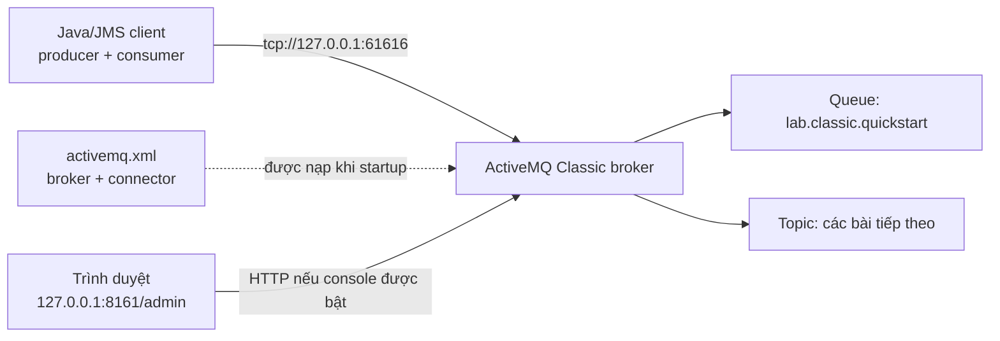

# Khởi chạy ActiveMQ Classic độc lập và xác định tệp `activemq.xml`

> **Chương:** Môi trường thực hành  
> **Phạm vi:** Apache ActiveMQ **Classic** chạy độc lập (*standalone broker*) và xác minh cấu hình đang có hiệu lực. Classic và Artemis là hai dòng broker khác nhau; `activemq.xml` ở bài này thuộc Classic, không phải `broker.xml` của Artemis.

ActiveMQ Classic là message broker trung gian để **producer** gửi thông điệp đến **queue/topic**, còn **consumer** kết nối nhận và xác nhận thông điệp. Trước khi thực hành acknowledgment, transaction, redelivery hay dead-letter queue (DLQ), bạn cần có một broker đang chạy và xác định chính xác **nó nạp tệp cấu hình nào**. Sự khác biệt giữa “trên đĩa có `conf/activemq.xml`” và “tiến trình Java đang dùng chính tệp đó” là trọng tâm của bài.

Bài thực hành sử dụng bản phân phối Apache ActiveMQ Classic dạng `.zip`/`.tar.gz` chạy trực tiếp trên máy, không cần Docker, và một Java/JMS client để kiểm tra từ đầu đến cuối.

## 1. Kết quả cần đạt

Sau bài này, bạn có thể:

1. Phân biệt `ACTIVEMQ_HOME` (thư mục cài đặt), `ACTIVEMQ_BASE` (thư mục instance, nếu cấu hình tách riêng) và `ACTIVEMQ_CONF` (thư mục chứa cấu hình mà launcher sử dụng).
2. Khởi động/dừng ActiveMQ Classic bằng chế độ `console`; hiểu sự khác biệt với `start` chạy nền.
3. Tìm `activemq.xml` và xác minh được **tệp mà broker thực tế nạp**.
4. Đối chiếu cổng **OpenWire/JMS** và cổng **web console** từ config, log và socket.
5. Chạy chương trình Java/JMS gửi message vào queue, nhận và acknowledge.
6. Xử lý các sự cố sai thư mục, cổng trùng, JVM không tương thích, tài khoản và kho dữ liệu bị khóa.

## 2. Sơ đồ môi trường lab



| Giá trị thường gặp | Vai trò | Nơi xác minh |
|---|---|---|
| `tcp://127.0.0.1:61616` | Endpoint **OpenWire** cho ActiveMQ Classic JMS client. | `transportConnectors` trong broker config đang chạy, log và socket. |
| `http://127.0.0.1:8161/admin/` | Web console nếu được cấu hình và bật. | Thành phần web/Jetty (thường là `conf/jetty.xml`), log và HTTP response. |
| `conf/activemq.xml` | Tệp broker config thường có sẵn trong bản phân phối Classic. | Phải đối chiếu với launcher/instance và log nạp cấu hình. |
| `data/` | Khu vực dữ liệu lưu trữ bền vững, log tùy phiên bản và cấu hình. | `dataDirectory`, persistence adapter, thư mục instance. |

**Hai cổng 61616 và 8161 không có chức năng giống nhau.** Một cổng có thể hoạt động trong khi cổng kia bị tắt. Giá trị cũng có thể khác nếu người vận hành đã chỉnh cấu hình.

## 3. Chuẩn bị môi trường

### 3.1. Yêu cầu

- **Java:** JDK tương thích với phiên bản ActiveMQ Classic đang sử dụng. Với ví dụ Maven/Java dưới đây, có thể dùng **JDK 17** cùng một bản Classic **5.18.x** tương thích. Hãy tra yêu cầu Java của **bản cụ thể** trước khi chạy.
- **Broker:** Bản nhị phân Apache ActiveMQ **Classic**, chẳng hạn nhánh 5.18.x cho lab. Sử dụng bản được vá và được hỗ trợ trong môi trường triển khai thực.
- **Maven:** Maven 3.x cho Java/JMS smoke test.
- **Network:** Chưa có tiến trình khác chiếm cổng mà `activemq.xml` định nghĩa, thường gồm 61616 và 8161.
- **Quyền ghi:** User chạy broker có quyền ghi vào data/log directory.

Kiểm tra Java và Maven trong terminal:

```bash
java -version
javac -version
mvn -version
```

Nếu `java` của launcher khác JVM mà Maven dùng, cần kiểm tra `JAVA_HOME` và `PATH`. Lỗi `UnsupportedClassVersionError` thường đến từ không tương thích phiên bản bytecode và runtime.

### 3.2. Tải và giải nén Classic

Tải archive từ [trang phân phối chính thức của Apache ActiveMQ Classic](https://activemq.apache.org/components/classic/download/). Chọn file `.zip` hoặc `.tar.gz` đúng với phiên bản mong muốn.

**Linux/macOS:**

```bash
# Thay tên file bằng archive đã tải thực tế.
tar -xzf apache-activemq-5.18.x-bin.tar.gz
cd apache-activemq-5.18.x
pwd
```

**Windows PowerShell:**

```powershell
# Thay tên archive và thư mục bằng phiên bản thực tế.
Expand-Archive -LiteralPath .\apache-activemq-5.18.x-bin.zip -DestinationPath .
Set-Location .\apache-activemq-5.18.x
Get-Location
```

`5.18.x` chỉ là **placeholder**: không dán nguyên tên này khi file thực có số phiên bản cụ thể như `5.18.4`. Từ đây, các lệnh dùng đường dẫn tương đối đều giả định terminal đang ở thư mục gốc của bản phân phối.

### 3.3. Cấu trúc cần nhận diện

Một bản phân phối Classic điển hình có cấu trúc tương tự:

```text
apache-activemq-<version>/
├── bin/
│   ├── activemq                   # launcher Unix-like
│   └── activemq.bat               # launcher Windows ở các bản có file này
├── conf/
│   ├── activemq.xml               # cấu hình broker mặc định
│   └── jetty.xml                  # cấu hình web console nếu có
├── data/                          # dữ liệu và log tùy cấu hình
├── lib/
└── webapps/                       # các ứng dụng web, tùy phiên bản
```

Một số phân phối Windows có thêm script trong `bin/win64`. Nếu không thấy `bin/activemq.bat`, kiểm tra launcher của đúng bản bạn đã tải; không dùng lệnh khởi động Artemis thay thế.

## 4. Khởi chạy broker độc lập trong console

Với bài lab, **foreground console** giúp nhìn rõ log khởi động, thông báo lỗi và quá trình dừng broker. Mở terminal tại thư mục gốc bản phân phối Classic.

**Linux/macOS:**

```bash
./bin/activemq console
```

**Windows PowerShell:**

```powershell
Test-Path .\bin\activemq.bat
.\bin\activemq.bat console
```

Nếu `Test-Path` trả `False`, tìm đúng launcher được đóng gói trước khi chạy. Khi khởi động thành công, console sẽ hiển thị thông tin broker, các transport connector được khởi tạo và thông báo tương đương **broker started**. Chuỗi log cụ thể thay đổi theo phiên bản; cần xem nội dung và exception, không phụ thuộc một câu chữ duy nhất.

Trong khi terminal này còn gắn với broker:

1. Giữ terminal console mở.
2. Mở terminal **khác** để kiểm tra cổng và chạy Java/JMS client.
3. Khi muốn dừng, quay lại terminal broker và nhấn **Ctrl+C**, chờ đóng broker và data store hoàn tất.

### 4.1. Chạy nền sau khi đã kiểm thử console

Launcher Classic trên Unix-like thường cung cấp:

```bash
./bin/activemq start
./bin/activemq status
./bin/activemq stop
```

Chế độ `start` chạy nền nên không hiển thị toàn bộ log theo thời gian thực như `console`. Trên Windows, cách chạy nền/cài service tùy script và Windows service wrapper của từng bản phát hành; trong bài này chỉ cần `console`. Không chạy một tiến trình console và một tiến trình background trùng cổng/dữ liệu.

Một thông báo “start invoked” chỉ chứng tỏ lệnh launcher đã được gọi; cần kiểm tra log và cổng trước khi xem broker đã sẵn sàng.

## 5. Xác định đúng `activemq.xml` đang có hiệu lực

Cần trả lời lần lượt ba câu hỏi: **Tệp nằm đâu? Launcher chọn thư mục cấu hình nào? Broker đã nạp chính xác tệp nào?**

### 5.1. Xem tệp cấu hình mặc định

**Linux/macOS:**

```bash
pwd
ls -l conf/activemq.xml
grep -nE 'brokerName|transportConnector|dataDirectory' conf/activemq.xml
```

**Windows PowerShell:**

```powershell
Get-Location
Get-Item .\conf\activemq.xml
Select-String -Path .\conf\activemq.xml `
    -Pattern 'brokerName|transportConnector|dataDirectory'
```

Lệnh trên xác nhận **tệp tồn tại** và cho thấy một số thẻ XML quan trọng. Nó **chưa đủ** để chứng minh JVM đang sử dụng tệp đó.

### 5.2. Phân biệt HOME, BASE và CONF

| Biến/thành phần | Ý nghĩa |
|---|---|
| `ACTIVEMQ_HOME` | Thư mục cài đặt Classic; thường chứa `bin` và `lib`. |
| `ACTIVEMQ_BASE` | Thư mục trạng thái riêng của instance khi tách khỏi HOME; có thể chứa `conf`/`data`. |
| `ACTIVEMQ_CONF` | Thư mục cấu hình mà script launcher dùng; có thể được xác định từ BASE. |
| `activemq.xml` | Tài nguyên XML cho broker qua Spring/XBean; có thể lấy từ thư mục mặc định hoặc URI tùy chỉnh. |

Kiểm tra biến môi trường hiện tại.

**Linux/macOS:**

```bash
printf 'ACTIVEMQ_HOME=%s\n' "$ACTIVEMQ_HOME"
printf 'ACTIVEMQ_BASE=%s\n' "$ACTIVEMQ_BASE"
printf 'ACTIVEMQ_CONF=%s\n' "$ACTIVEMQ_CONF"
```

**Windows PowerShell:**

```powershell
$env:ACTIVEMQ_HOME
$env:ACTIVEMQ_BASE
$env:ACTIVEMQ_CONF
```

**Không đồng nhất biến môi trường của terminal mới với cấu hình của Windows Service, unit `systemd` hoặc một broker đã chạy từ trước.** Dịch vụ có thể khởi động từ môi trường và thư mục làm việc khác.

### 5.3. Xác minh từ launcher và log thực tế

Thực hiện theo thứ tự:

1. Dừng instance của **riêng bài lab** nếu đã chạy trước đó, tránh nhầm sang một broker cũ.
2. Chạy lại `console` từ thư mục dự định sử dụng.
3. Quan sát phần đầu log, tìm thông báo tương đương `Loading message broker from ...`, URI `xbean:...` hoặc đường dẫn `conf` được launcher truyền vào.
4. Đối chiếu URI/đường dẫn với HOME, BASE, CONF, thư mục hiện tại và tên file `activemq.xml`.
5. Nếu log chỉ hiện đường dẫn tương đối như `xbean:activemq.xml`, xem cách launcher phân giải classpath/resource trong **đúng instance đó**; chưa kết luận từ tên file đơn lẻ.

Với cấu hình chỉ định riêng, các bản Classic có thể dùng URI XBean dạng:

```text
xbean:file:/absolute/path/to/custom-activemq.xml
```

Đây là **ví dụ định dạng URI cấu hình**, không phải dòng lệnh có thể chạy nguyên xi. Cách truyền URI vào launcher phụ thuộc script, service wrapper và version; bài nhập môn nên bắt đầu bằng file mặc định và log console.

### 5.4. Kiểm tra bằng thay đổi có thể quan sát

Khi đã xác nhận cấu hình đang dùng, có thể thực hiện thử nghiệm **trên bản lab được phép thay đổi**: sao lưu config, dừng broker, đổi thuộc tính `brokerName` của phần tử `broker` hiện hữu thành `classic-lab-002`, rồi restart. Quan sát tên mới trong log/JMX và hoàn nguyên sau bài tập. Không thêm một phần tử `broker` thứ hai.

Nếu thay đổi không có tác dụng, kiểm tra:

- Broker khác có đang giữ cổng hoặc đang chạy từ đường dẫn khác không?
- `ACTIVEMQ_BASE` có trỏ đến instance khác với thư mục vừa sửa không?
- Launcher có URI `xbean:...` tùy chỉnh không?
- Process có thực sự được restart và nạp lại XML không?
- XML có lỗi khiến startup mới thất bại trong khi log bạn đang đọc là log cũ không?

**Timestamp của file không thay thế được bằng chứng từ log và broker runtime.**

## 6. Đọc các phần quan trọng của `activemq.xml`

Classic thường sử dụng cấu hình XML theo **Spring/XBean**. File thực có thể chứa namespace, bean, import và nhiều nhóm thiết lập. Không xóa các phần không hiểu rồi thay toàn bộ bằng snippet rút gọn.

| Cấu hình | Vai trò | Điều cần quan sát |
|---|---|---|
| `broker` / `brokerName` | Khai báo instance và tên nhận diện. | Tên broker khớp với log/JMX. |
| `transportConnectors` / `transportConnector` | Endpoint và protocol để client kết nối. | URI `tcp://...`, tên connector và cổng đang bind. |
| `persistenceAdapter` | Bộ lưu trữ message. | Ví dụ KahaDB theo cấu hình cụ thể. |
| `dataDirectory` | Thư mục dữ liệu. | Có quyền ghi và không trùng với instance khác. |
| `destinationPolicy` / `policyEntry` | Chính sách queue/topic. | Pending limits, resource, redelivery/DLQ tùy cấu hình. |
| `plugins` / security settings | Authentication/authorization. | Quyền connect, send, consume; tránh phơi broker ra mạng. |
| `networkConnectors` | Kết nối giữa broker. | Không cần cho lab standalone cơ bản. |

Ví dụ **một đoạn con** có thể đặt bên trong broker hiện hữu:

```xml
<transportConnectors>
    <!-- OpenWire dành riêng cho client local -->
    <transportConnector name="openwire"
                        uri="tcp://127.0.0.1:61616"/>
</transportConnectors>
```

Đoạn này **không phải một file `activemq.xml` hoàn chỉnh**. Khi thử sửa, hãy thay đổi connector đã có trong tệp thực, không thêm connector thứ hai sử dụng cùng cổng, bởi điều đó có thể gây `Address already in use`.

### 6.1. Loopback và bind address

- `127.0.0.1:61616`: chỉ lắng nghe loopback IPv4 trên máy lab, thích hợp khi client chạy cùng máy.
- `0.0.0.0:61616`: lắng nghe tất cả giao diện IPv4, việc truy cập từ xa còn phụ thuộc firewall/route/security.
- `localhost:61616`: tên máy có thể phân giải thành IPv4/IPv6 tùy cấu hình OS.

Khi lab không có yêu cầu truy cập từ xa, ưu tiên loopback. Đối với môi trường dùng chung, cần tính đến TLS, xác thực, phân quyền và firewall.

### 6.2. Cổng 8161 là phần cấu hình web

Web console Classic thường vận hành nhờ Jetty, có thể dùng cấu hình `conf/jetty.xml` và được lắp vào broker qua cấu hình web. Vì vậy:

- Thấy `61616` trong `transportConnector` không chứng minh trang web `8161` hoạt động.
- Không thấy chuỗi `8161` trong `activemq.xml` không chứng minh web console đã bị loại bỏ.
- Web console lỗi chưa chắc khiến client JMS qua OpenWire lỗi.

JMS smoke test có thể thành công mà không cần truy cập giao diện web.

## 7. Xác minh broker đang thực sự lắng nghe

### 7.1. Kiểm tra socket và tiến trình

**Linux (nếu có `ss`):**

```bash
ss -ltn | grep -E ':(61616|8161)([[:space:]]|$)'
```

**macOS (nếu có `lsof`):**

```bash
lsof -nP -iTCP:61616 -sTCP:LISTEN
lsof -nP -iTCP:8161 -sTCP:LISTEN
```

**Windows PowerShell:**

```powershell
Get-NetTCPConnection -State Listen |
    Where-Object { $_.LocalPort -in 61616, 8161 } |
    Select-Object LocalAddress, LocalPort, OwningProcess
```

Khi nhìn thấy cổng ở trạng thái LISTEN, cần xác nhận **PID thực sự thuộc broker Classic của lab**. Trên Windows, dùng `Get-Process -Id <PID>` (thay `<PID>` bằng số thật). Trên Linux, có thể dùng `ss -ltnp` nếu user có quyền xem process. Một ứng dụng bất kỳ có thể chiếm cổng 61616; trạng thái LISTEN **không chứng minh protocol OpenWire hay đúng broker**.

### 7.2. Kiểm tra kết nối TCP/HTTP

**PowerShell:**

```powershell
Test-NetConnection 127.0.0.1 -Port 61616
Test-NetConnection 127.0.0.1 -Port 8161
```

**Linux/macOS nếu cài `nc`:**

```bash
nc -vz 127.0.0.1 61616
nc -vz 127.0.0.1 8161
```

Nếu web console được bật, mở `http://127.0.0.1:8161/admin/`. HTTP 401 hoặc biểu mẫu đăng nhập cho thấy **web server** đã trả lời, chưa cho thấy JMS thành công. Không suy rằng tài khoản/mật khẩu mẫu luôn được bật trên mọi bản phân phối; xác thực web và JMS có thể được cấu hình ở những lớp khác nhau.

Có ba mức kiểm chứng:

1. **Process:** JVM đang chạy, log cho biết broker startup.
2. **Socket:** Endpoint có listener và TCP handshake thành công.
3. **JMS round-trip:** Client gửi message, broker route, consumer nhận và ack.

Mức thứ ba là phép thử có ý nghĩa nhất cho luồng tích hợp cơ bản.

## 8. Viết một Java/JMS smoke test thực tế

Đoạn mã sau dùng ActiveMQ Classic **5.x** và API `javax.jms` phổ biến trên dòng client này. Nó sử dụng **queue**, tạo một thông điệp persistent, gửi vào broker standalone, nhận bằng selector theo `JMSCorrelationID` rồi gọi `acknowledge()`. Selector giúp các lần chạy dễ phân biệt message của mình với backlog cũ.

Đối với **Jakarta Messaging** hoặc client tương ứng với Artemis, cần chọn dependency/namespace phù hợp; không đổi riêng `import` trong khi giữ thư viện của API khác.

Tạo dự án Maven trên máy thực hành ở một thư mục **ngoài thư mục cài đặt broker**:

```text
classic-smoke-test/
├── pom.xml
└── src/main/java/lab/ClassicStandaloneSmokeTest.java
```

### 8.1. File `pom.xml`

```xml
<project xmlns="http://maven.apache.org/POM/4.0.0"
         xmlns:xsi="http://www.w3.org/2001/XMLSchema-instance"
         xsi:schemaLocation="http://maven.apache.org/POM/4.0.0
                             https://maven.apache.org/xsd/maven-4.0.0.xsd">
    <modelVersion>4.0.0</modelVersion>

    <groupId>lab.activemq</groupId>
    <artifactId>classic-smoke-test</artifactId>
    <version>1.0-SNAPSHOT</version>

    <properties>
        <maven.compiler.release>11</maven.compiler.release>
        <project.build.sourceEncoding>UTF-8</project.build.sourceEncoding>
    </properties>

    <dependencies>
        <dependency>
            <groupId>org.apache.activemq</groupId>
            <artifactId>activemq-client</artifactId>
            <version>5.18.4</version>
        </dependency>
    </dependencies>

    <build>
        <plugins>
            <plugin>
                <groupId>org.apache.maven.plugins</groupId>
                <artifactId>maven-compiler-plugin</artifactId>
                <version>3.11.0</version>
            </plugin>
            <plugin>
                <groupId>org.codehaus.mojo</groupId>
                <artifactId>exec-maven-plugin</artifactId>
                <version>3.2.0</version>
            </plugin>
        </plugins>
    </build>
</project>
```

`5.18.4` là **phiên bản client ví dụ để tái lập mã nguồn**, không phải tuyên bố đây là phiên bản mới nhất hay thích hợp cho production. Khi đổi version broker, kiểm tra ma trận tương thích và cập nhật thư viện client tương ứng. Thuộc tính `maven.compiler.release=11` là mức ngôn ngữ sinh bytecode; bản JDK thực để chạy Maven vẫn phải có khả năng hỗ trợ mức này.

### 8.2. File `ClassicStandaloneSmokeTest.java`

```java
package lab;

import java.util.UUID;
import javax.jms.Connection;
import javax.jms.DeliveryMode;
import javax.jms.Message;
import javax.jms.MessageConsumer;
import javax.jms.MessageProducer;
import javax.jms.Queue;
import javax.jms.Session;
import javax.jms.TextMessage;
import org.apache.activemq.ActiveMQConnectionFactory;

public final class ClassicStandaloneSmokeTest {
    private ClassicStandaloneSmokeTest() {
    }

    public static void main(String[] args) throws Exception {
        String brokerUrl = System.getenv("ACTIVEMQ_BROKER_URL");
        if (brokerUrl == null || brokerUrl.trim().isEmpty()) {
            brokerUrl = "tcp://127.0.0.1:61616";
        }

        // Authentication tùy thuộc cấu hình broker lab.
        // Không hardcode tài khoản/mật khẩu vào source code.
        String username = System.getenv("ACTIVEMQ_USER");
        String password = System.getenv("ACTIVEMQ_PASSWORD");
        ActiveMQConnectionFactory factory =
                new ActiveMQConnectionFactory(brokerUrl);

        Connection connection = null;
        try {
            connection = (username == null || username.isEmpty())
                    ? factory.createConnection()
                    : factory.createConnection(username, password);

            Session session = connection.createSession(
                    false, Session.CLIENT_ACKNOWLEDGE);
            Queue destination =
                    session.createQueue("lab.classic.quickstart");

            // Mỗi lần chạy có token riêng để tránh nhận nhầm message cũ.
            String correlationId = UUID.randomUUID().toString();
            String selector =
                    "JMSCorrelationID = '" + correlationId + "'";
            MessageConsumer consumer =
                    session.createConsumer(destination, selector);

            MessageProducer producer = session.createProducer(destination);
            producer.setDeliveryMode(DeliveryMode.PERSISTENT);
            connection.start();

            TextMessage outgoing = session.createTextMessage(
                    "Hello from ActiveMQ Classic standalone");
            outgoing.setJMSCorrelationID(correlationId);
            outgoing.setStringProperty("lab", "setup-002");
            producer.send(outgoing);
            System.out.println("SENT: " + outgoing.getText());

            Message incoming = consumer.receive(10000);
            if (!(incoming instanceof TextMessage)) {
                throw new IllegalStateException(
                        "Không nhận được TextMessage trong 10 giây");
            }
            if (!correlationId.equals(incoming.getJMSCorrelationID())) {
                throw new IllegalStateException(
                        "JMSCorrelationID không đúng lượt chạy");
            }

            System.out.println("RECEIVED: "
                    + ((TextMessage) incoming).getText());
            System.out.println("JMSMessageID: "
                    + incoming.getJMSMessageID());

            // Giả lập xử lý nghiệp vụ hoàn tất; sau đó mới ack.
            incoming.acknowledge();
            System.out.println("ACKNOWLEDGED");

            producer.close();
            consumer.close();
            session.close();
        } finally {
            if (connection != null) {
                connection.close();
            }
        }
    }
}
```

Chạy từ thư mục dự án `classic-smoke-test` khi broker vẫn đang hoạt động:

**Linux/macOS:**

```bash
mvn -q compile exec:java -Dexec.mainClass=lab.ClassicStandaloneSmokeTest
```

**Windows PowerShell:**

```powershell
mvn -q compile exec:java "-Dexec.mainClass=lab.ClassicStandaloneSmokeTest"
```

Kết quả mong đợi tương tự:

```text
SENT: Hello from ActiveMQ Classic standalone
RECEIVED: Hello from ActiveMQ Classic standalone
JMSMessageID: ID:...
ACKNOWLEDGED
```

`JMSMessageID` thực tế do JMS provider gán. Nếu broker yêu cầu authentication, đặt biến môi trường `ACTIVEMQ_USER`/`ACTIVEMQ_PASSWORD` trong phiên terminal test theo quy trình an toàn của môi trường; nếu broker dùng TLS, URL và cấu hình truststore/client phải tương ứng.

**Giải thích kết quả:**

- `factory.createConnection` và `connection.start()` chứng tỏ đường kết nối JMS đã thiết lập và bắt đầu nhận.
- `producer.send` gửi message lên queue qua broker; mặc dù gửi persistent, thời hạn lưu còn phụ thuộc các chính sách TTL/quota/storage.
- `receive(10000)` chờ tối đa 10 giây; khi không có message đúng selector thì trả `null`.
- `incoming.acknowledge()` xác nhận message đã tiêu thụ trong **session** theo ngữ nghĩa `CLIENT_ACKNOWLEDGE`. Nếu một session đã nhận nhiều message, lệnh này có thể xác nhận toàn bộ message đã tiêu thụ trước đó trên session, không chỉ một message.
- Nếu client lỗi sau khi nhận nhưng trước ack, message có thể được giao lại. Những bài về transaction/redelivery sẽ đi sâu hơn vào điểm này.

Selector riêng theo `JMSCorrelationID` không ngăn message của lần test lỗi nằm lại queue. Khi luyện tập nhiều lần, hãy kiểm tra backlog và dead-letter policy; không purge queue chung của ứng dụng khác. Một consumer khác trên cùng queue cũng có thể cạnh tranh nhận message nếu không dùng selector tương thích; hãy giữ lab độc lập.

## 9. Thử nghiệm xác định cấu hình bằng dấu hiệu quan sát được

Sau khi Java/JMS smoke test PASS:

1. Ghi nhận đường dẫn đầy đủ tới `activemq.xml` đã xác minh ở mục 5 và giá trị `brokerName` hiện tại.
2. Dừng broker `console` bằng Ctrl+C và chờ shutdown.
3. **Sao lưu file** của instance lab để có thể phục hồi.
4. Thay đổi **thuộc tính `brokerName` của phần tử broker hiện hữu** thành `classic-lab-002`, không xóa các bean/namespace khác.
5. Khởi động lại `console`, xác nhận tên broker mới xuất hiện đúng trong log/JMX.
6. Chạy lại Java smoke test. Nếu OpenWire vẫn dùng đúng endpoint, kết quả phải tiếp tục có `SENT`, `RECEIVED` và `ACKNOWLEDGED`.
7. Dừng broker, hoàn nguyên cấu hình rồi khởi động lại nếu cần.

Nếu `brokerName` không đổi sau restart, có thể bạn đang sửa **khác tệp runtime** hoặc đang quan sát process cũ. Kiểm tra lại URI XBean, BASE/CONF, PID và log. Thử nghiệm này chỉ thay đổi **broker lab** mà người học có quyền quản lý, không áp dụng vào broker production hoặc của nhóm khác.

## 10. Lỗi cổng trùng và thư mục dữ liệu bị khóa

Nếu broker báo:

```text
java.net.BindException: Address already in use
```

thì một trong các cổng mà broker muốn bind đã có tiến trình sử dụng. Không chỉ kiểm tra 61616: nếu config bật connector khác hoặc web 8161, cổng bị trùng có thể nằm ở đó.

**Linux:**

```bash
ss -ltnp | grep ':61616'
```

**Windows PowerShell:**

```powershell
Get-NetTCPConnection -State Listen |
    Where-Object { $_.LocalPort -eq 61616 } |
    Select-Object LocalAddress, LocalPort, OwningProcess
```

Không kết thúc một PID khi chưa biết đó là dịch vụ nào. Nếu đúng là instance lab cũ, dừng nó bằng cách dừng launcher/service tương ứng.

Một lỗi khác xuất phát từ **KahaDB/store lock**: hai broker khác cổng nhưng trỏ cùng `dataDirectory` vẫn có thể tranh chấp khóa dữ liệu. Nếu muốn tạo hai instance độc lập, cần tách **cổng, tên broker và thư mục data**. Không xóa file journal/lock tùy tiện để “ép” broker khởi động khi một process khác còn giữ store.

## 11. Bảng chẩn đoán nhanh

| Triệu chứng | Khả năng | Cách xác minh |
|---|---|---|
| `java` không tìm thấy | `PATH`/`JAVA_HOME` chưa đúng. | `java -version`, `javac -version`, biến môi trường. |
| `UnsupportedClassVersionError` | JDK runtime không phù hợp bytecode của broker/client. | So sánh yêu cầu Java của bản Classic/JMS client và JVM thực tế. |
| Không có `bin/activemq.bat` | Sai thư mục hoặc bản phân phối có script Windows ở vị trí khác. | Tìm launcher trong `bin` của đúng bản đã tải. |
| Broker thoát ngay sau khi chạy | Lỗi XML, quyền ghi, Java, port, store hoặc plugin. | Xem exception đầu tiên trong log console, đừng chỉ đọc dòng cuối. |
| `Address already in use` | Một connector trùng với process khác. | Đối chiếu các port trong config với PID đang LISTEN. |
| Lỗi KahaDB lock | Hai broker dùng cùng kho dữ liệu. | Kiểm tra dataDirectory và instance còn chạy. |
| TCP 61616 mở nhưng JMS client lỗi | Sai broker/protocol, authentication hoặc TLS. | Đối chiếu transport URI, client stack trace, server log. |
| Java báo `not authorized` | Client không có quyền connect/send/consume. | Kiểm tra security plugin, user và quyền destination. |
| `receive` timeout | Sai queue, selector, có consumer cạnh tranh hoặc message không được lưu/route. | Kiểm tra queue count, selector, producer log và destination. |
| Sửa XML nhưng không có tác dụng | Sai BASE/CONF, URI override hoặc chưa restart. | Đối chiếu process, URI cấu hình được nạp và brokerName sau khởi động. |
| Không mở được web 8161 nhưng JMS chạy | Web console bị tắt, đổi port hoặc firewall chặn. | Kiểm tra web/Jetty riêng; OpenWire không phụ thuộc cổng HTTP. |
| Message xuất hiện lần nữa | Chưa ack/commit, mất kết nối hoặc redelivery. | Kiểm tra quy tắc acknowledgment, log và `JMSRedelivered`. |

Khi gặp lỗi, nên lưu lại **thời điểm**, **PID**, **brokerName**, **URI connector**, **đường dẫn cấu hình runtime**, **tên queue/topic** và **stack trace**. Những dữ kiện này giúp tránh sửa nhầm file hoặc chẩn đoán nhầm một process khác.

## 12. Những nguyên tắc an toàn và vận hành khi làm lab

- **Chỉ mở cổng cần thiết:** Trong lab một máy, bind OpenWire về `127.0.0.1` nếu không cần client từ máy khác. Trên môi trường dùng chung, cần firewall, TLS và phân quyền.
- **Không tin credential mặc định:** Một số bản mẫu có tài khoản demo; không dùng mặc định trong môi trường công khai. Không ghi mật khẩu vào source code hoặc commit lên repository.
- **Không nhầm cơ chế persistence:** `DeliveryMode.PERSISTENT` không có nghĩa dữ liệu được lưu vô thời hạn; TTL, quota, store và DLQ policy vẫn áp dụng.
- **Không dùng chung data directory:** Tách store của các instance để tránh lock và hỏng giả định dữ liệu.
- **Dừng đúng cách:** Dừng broker qua console/launcher và chờ store shutdown trước khi thay hoặc di chuyển thư mục data.
- **Phân biệt sản phẩm:** Classic dùng `activemq.xml` theo Spring/XBean; Artemis có mô hình address/routing type/queue và cấu hình broker riêng. Lệnh `activemq console` ở đây là launcher của Classic.

## 13. Checklist hoàn thành lab

- [ ] Ghi nhận phiên bản Java, Maven và Apache ActiveMQ Classic.
- [ ] Xác định thư mục cài đặt và đường dẫn tuyệt đối tới tệp `activemq.xml`.
- [ ] Khởi động `console` và quan sát broker started không có lỗi fatal.
- [ ] Xác minh cấu hình **đang nạp**, không chỉ file tồn tại trên ổ đĩa.
- [ ] Kiểm tra cổng OpenWire từ file, log và listener thực tế.
- [ ] Phân biệt được port JMS 61616 và web console 8161.
- [ ] Chạy được Java/JMS smoke test `SENT` → `RECEIVED` → `ACKNOWLEDGED`.
- [ ] Dừng/restart broker và có thể nhận biết thay đổi `brokerName` trong bản lab.

### Câu hỏi tự kiểm tra

**1. Có hai bản Classic A và B, mỗi bản đều có `conf/activemq.xml`. Sửa A nhưng broker chạy từ B thì sao?**  
Broker B không tự đọc file của A. Phải xác nhận launcher, BASE/CONF và log XBean để tìm đúng tệp runtime.

**2. TCP 61616 đang LISTEN có đủ để kết luận Java/JMS hoạt động?**  
Chưa. Cần xác nhận PID của broker, protocol OpenWire, quyền kết nối và làm phép thử gửi/nhận message.

**3. Đổi OpenWire sang port 8161 thì có biến nó thành web console?**  
Không. OpenWire là transport JMS, còn web console dùng HTTP/Jetty. Cùng số cổng không làm hai giao thức thay thế nhau.

**4. Hai broker khác port nhưng dùng chung KahaDB có thể coi là hai instance độc lập?**  
Không. Store lock và trạng thái persistence có thể xung đột. Tách data directory cho các instance độc lập, trừ khi thiết kế một kiến trúc shared-store HA có kiểm soát.

## 14. Ghi nhớ

Quy trình làm việc vững chắc với ActiveMQ Classic standalone là: **kiểm tra JDK và bản phân phối → chạy đúng launcher → xác định tệp `activemq.xml` đang nạp → xác minh connector và port → gửi/nhận/acknowledge bằng Java/JMS**. File `conf/activemq.xml` là điểm bắt đầu thường gặp, nhưng chỉ đường dẫn runtime và bằng chứng khởi động mới khẳng định nó có hiệu lực. Khi nền tảng này ổn định, các bài queue/topic, acknowledgment, transaction, redelivery, DLQ và bảo mật sẽ có môi trường thực hành dễ quan sát và gỡ lỗi.
