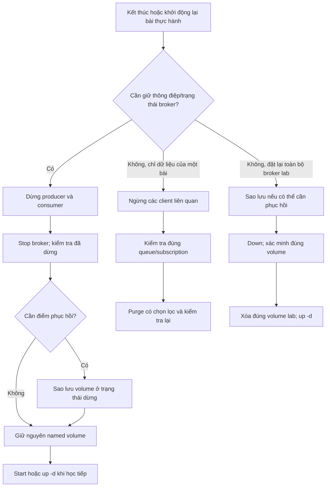

# Dừng môi trường, bảo toàn dữ liệu và đặt lại bài thực hành có chủ đích

> **Chương:** Môi trường thực hành  
> **Phạm vi:** Apache ActiveMQ Artemis và ActiveMQ Classic, thực hành local bằng Docker Compose hoặc broker cài trực tiếp.  
> **Mục tiêu:** Có thể tạm dừng lab, khởi động lại mà giữ dữ liệu cần thiết, sao lưu nhất quán, xóa có chọn lọc hoặc tạo lại môi trường sạch mà không xóa nhầm thông điệp.

Trong quá trình học ActiveMQ, không ít lỗi bị chẩn đoán nhầm là lỗi producer/consumer: gửi thông điệp xong khởi động lại thì queue trống, lần chạy sau xuất hiện thông điệp cũ, DLQ chứa sự kiện của bài trước, hoặc consumer nhận lại một đơn hàng đã xử lý. Trước khi sửa code Java, cần phân biệt **đang dừng tiến trình**, **đang thay container**, **đang xóa tài nguyên broker** hay **đang xóa nơi lưu dữ liệu**.

Bài này xây dựng một quy trình có thể lặp lại và kiểm tra được cho hệ thống bất đồng bộ: producer gửi sự kiện, broker giữ queue/topic, consumer xác nhận hoặc rollback, và broker có thể redeliver hoặc đưa thông điệp vào dead-letter queue (DLQ). Với mỗi lần kết thúc buổi học, người thực hành phải **chọn mục tiêu dữ liệu trước**, sau đó mới chọn lệnh.

## 1. Sau bài này bạn làm được gì?

1. Giải thích chính xác sự khác biệt giữa `docker compose stop`, `down`, `down -v`, xóa queue, xóa volume và dựng lại container.
2. Tạo môi trường Artemis dùng **named volume**, quan sát thông điệp persistent sống qua lần broker khởi động lại.
3. Dừng broker đúng trình tự, kiểm tra tiến trình đã thoát, tạo bản sao lưu khi dữ liệu không còn bị ghi và kiểm chứng bản sao lưu.
4. Chọn một trong ba hướng: **tạm dừng giữ nguyên**, **đặt lại một bài/queue**, hoặc **đặt lại toàn bộ môi trường**.
5. Khôi phục từ bản sao lưu và nhận diện các tình huống dữ liệu “mất”, “còn sót” hoặc “xuất hiện lại” sau restart.
6. Áp dụng nguyên tắc tương tự khi sử dụng ActiveMQ Classic, với chú ý về KahaDB, durable subscription, redelivery và DLQ.

## 2. Xác định cái gì phải được giữ lại

Trong lab nhắn tin bất đồng bộ, trạng thái không chỉ tồn tại ở source code:

| Thành phần | Ví dụ | Có tồn tại sau khi container bị xóa không? |
|---|---|---|
| **Tiến trình broker** | JVM đang chạy Artemis/Classic, socket, connection | Không. Khi tiến trình dừng, các kết nối mất. |
| **Trạng thái trong bộ nhớ** | Consumer đang kết nối, message chưa bền vững, cache | Không bảo đảm còn sau restart. |
| **Dữ liệu broker đã lưu bền vững** | Journal/store, bindings, dữ liệu queue, durable subscription, trạng thái paging | Có, nếu thực sự nằm trên storage bền vững được giữ lại và broker phục hồi thành công. |
| **Cấu hình broker** | Address/queue, routing type, security, dead-letter policy, redelivery-delay | Có, nếu file cấu hình được lưu trong thư mục bền vững hoặc được khai báo lại bằng cấu hình quản lý bên ngoài. |
| **Dữ liệu của ứng dụng khác** | Database của consumer, file kết quả, bảng deduplication/idempotency | Theo vòng đời storage riêng của ứng dụng đó; xóa volume broker không xóa database. |
| **Ảnh container và định nghĩa môi trường** | Docker image, `compose.yaml`, biến môi trường | Khác với dữ liệu broker; có image không đồng nghĩa còn message. |

Một message **đã được consumer nhận và xác nhận thành công** thường không còn trong queue để khôi phục. Một message gửi `NON_PERSISTENT` cũng không được hứa hẹn tồn tại qua lần broker tắt. Ngay cả với `PERSISTENT`, còn phải xét broker đã nhận/ghi thông điệp theo chính sách durability nào, transaction đã commit chưa, message có hết TTL chưa, queue có còn hay không và nơi lưu dữ liệu có được giữ lại không.

Đối với **topic**, cần hỏi thêm: subscription có durable không, đã được tạo trước khi producer phát sự kiện chưa, có đang shared không? Không thể đợi topic nhận lại toàn bộ sự kiện quá khứ nếu subscription chưa từng được tạo.

### 2.1. Những lệnh Docker dễ nhầm

| Thao tác | Ảnh hưởng đến container | Ảnh hưởng đến named volume | Dùng khi nào? |
|---|---|---|---|
| `docker compose stop` | Dừng các service, giữ định nghĩa container | **Giữ** | Tạm ngưng lab, tạo điểm dừng để sao lưu |
| `docker compose start` | Chạy lại container đã có | **Giữ** | Tiếp tục lab sau `stop` |
| `docker compose down` | Dừng và xóa container/network thuộc Compose project | **Giữ named volume theo mặc định** | Dựng lại container mà vẫn giữ dữ liệu |
| `docker compose up -d --force-recreate` | Tạo lại container | **Giữ named volume** | Áp dụng thay đổi container/config đã xác nhận |
| `docker compose down -v` | Xóa container/network và các volume liên quan theo phạm vi Compose | **Có thể xóa dữ liệu lab** | Chỉ khi chủ đích xóa volume, đã xác minh phạm vi |
| `docker volume rm <volume>` | Không tự xóa container đang dùng volume | **Xóa đúng volume được chỉ định** nếu không còn được sử dụng | Đặt lại dữ liệu của một broker sau khi dừng/xóa container |
| Broker UI: **Purge messages** | Giữ container | Giữ volume, nhưng **xóa message trong queue mục tiêu** | Đặt lại một bài thực hành riêng |

`docker compose down -v` tác động cả named volume **khai báo trong Compose** và anonymous volume gắn với container; volume được khai báo `external: true` không bị Compose xóa theo cách này. Vì vậy không nên dùng nó như một lệnh “thoát lab” thông thường. Anonymous volume thường không tự gắn lại khi container bị tạo mới: dữ liệu có thể vẫn còn trên host nhưng lab không còn nhìn thấy. **Named volume** giúp chủ động giữ và định danh dữ liệu.

### 2.2. Cây quyết định trước khi tắt



**Nguyên tắc thực hành:** thao tác phá hủy phải có phạm vi xác định bằng tên thật (queue, subscription hoặc volume), kèm số liệu trước/sau; không dùng các lệnh dọn dẹp toàn Docker host như một bước reset bài học.

## 3. Môi trường minh họa: Artemis với Docker Compose

Mẫu dưới đây dùng một container Artemis, một volume chứa broker instance và chỉ xuất cổng về loopback của máy học. Hãy dùng Docker Engine và Docker Compose V2. Để có kết quả ổn định giữa các buổi, trong môi trường thực tế nên **ghim tag image đã kiểm thử** thay cho `latest`; ở lab này `latest` giúp ví dụ dễ đọc nhưng có thể đổi phiên bản vào lần pull sau.

Lưu nội dung sau thành `compose.yaml` trong **thư mục lab riêng do người học quản lý**:

```yaml
services:
  artemis:
    image: apache/artemis:latest
    environment:
      ARTEMIS_USER: lab
      ARTEMIS_PASSWORD: ${ARTEMIS_PASSWORD:?Set ARTEMIS_PASSWORD before starting}
    ports:
      - "127.0.0.1:61616:61616"
      - "127.0.0.1:8161:8161"
    volumes:
      - broker-data:/var/lib/artemis-instance
    stop_grace_period: 90s
    restart: "no"

volumes:
  broker-data:
```

**Ý nghĩa từng cấu hình:**

- `apache/artemis` là broker **Artemis**, không phải ActiveMQ Classic; ví dụ về đường dẫn volume và biến môi trường thuộc image này.
- `/var/lib/artemis-instance` là nơi broker instance đặt cấu hình và dữ liệu trong cách đóng gói image nêu trên. Nếu thay image hoặc tự xây image, **xác minh lại đường dẫn** và file cấu hình lưu trữ của broker.
- `broker-data` là **named volume**. Với tên project cố định `activemq-lab`, tên volume Docker thường là `activemq-lab_broker-data`.
- Cổng 61616 là endpoint messaging và 8161 dành cho giao diện quản trị trong cấu hình image tương ứng. Cổng không tự xác định giao thức, vì một acceptor có thể nhận nhiều protocol tùy broker config.
- Cú pháp `${ARTEMIS_PASSWORD:?...}` yêu cầu biến môi trường phải được cung cấp; không hardcode mật khẩu vào Git. Chỉ bind `127.0.0.1` để hạn chế truy cập mạng ngoài trong lab.
- `restart: "no"` giúp buổi học diễn ra có chủ đích; `stop_grace_period` cho broker khoảng thời gian dừng sạch.

Đặt biến môi trường **trong phiên terminal thực hành**. Với Bash/WSL:

```bash
export ARTEMIS_PASSWORD='replace-with-a-local-lab-secret'
docker compose -p activemq-lab up -d
docker compose -p activemq-lab ps
docker compose -p activemq-lab logs --tail=100 artemis
```

Với PowerShell:

```powershell
$env:ARTEMIS_PASSWORD = 'replace-with-a-local-lab-secret'
docker compose -p activemq-lab up -d
docker compose -p activemq-lab ps
docker compose -p activemq-lab logs --tail=100 artemis
```

Các lệnh tiếp theo giả định đang đứng trong **đúng thư mục có `compose.yaml`** và dùng cùng cờ `-p activemq-lab`. Tên project là một phần của danh tính tài nguyên: thay project có thể tạo **một volume khác** rồi gây hiểu nhầm rằng message đã biến mất.

Trên Docker Desktop, vào `http://localhost:8161` (hoặc đường dẫn console mà image đang cung cấp) và đăng nhập bằng `lab` cùng mật khẩu đã đặt. Dùng console để kiểm tra queue, số lượng message, consumer và DLQ; giao diện cụ thể thay đổi theo phiên bản Artemis.

> **Điều kiện riêng của lab:** nếu đang có broker hoặc dịch vụ khác dùng 61616/8161, đổi **host port** ở vế trái, chẳng hạn `127.0.0.1:61626:61616`; khi đó client chạy trên host phải kết nối `localhost:61626`. Không đổi port container ở vế phải nếu chưa đổi listener trong broker.

## 4. Tạo dữ liệu kiểm chứng trước khi thử dừng

Để việc “giữ dữ liệu” có bằng chứng, hãy gửi **một message persistent** đến queue lab rồi để nó chưa được consumer xác nhận. Sau khi dừng/khởi động broker, đối chiếu queue depth hoặc nhận thông điệp bằng consumer có transaction.

Ví dụ Java sau dùng **Jakarta Messaging API** với client Artemis. Dự án Java cần dependency `org.apache.activemq:artemis-jakarta-client` ở phiên bản tương thích với JDK/broker đã chọn; cần chọn phiên bản client cụ thể trong build. Broker phải có queue `lab.recovery` hoặc bật chế độ auto-create phù hợp.

```java
import jakarta.jms.ConnectionFactory;
import jakarta.jms.DeliveryMode;
import jakarta.jms.JMSContext;
import jakarta.jms.Message;
import jakarta.jms.Queue;
import jakarta.jms.TextMessage;
import org.apache.activemq.artemis.jms.client.ActiveMQConnectionFactory;

import java.util.UUID;

public class RecoveryProbe {
    public static void main(String[] args) throws Exception {
        if (args.length != 1 ||
            (!"send".equals(args[0]) && !"receive".equals(args[0]))) {
            throw new IllegalArgumentException("Usage: send | receive");
        }

        String url = System.getenv().getOrDefault(
                "BROKER_URL", "tcp://localhost:61616");
        String user = System.getenv().getOrDefault("BROKER_USER", "lab");
        String password = System.getenv("ARTEMIS_PASSWORD");
        if (password == null || password.isBlank()) {
            throw new IllegalStateException("ARTEMIS_PASSWORD is required");
        }

        ConnectionFactory factory = new ActiveMQConnectionFactory(url);

        if ("send".equals(args[0])) {
            String id = UUID.randomUUID().toString();
            try (JMSContext ctx = factory.createContext(user, password)) {
                Queue queue = ctx.createQueue("lab.recovery");
                TextMessage message = ctx.createTextMessage("checkpoint:" + id);
                message.setStringProperty("labId", id);
                ctx.createProducer()
                        .setDeliveryMode(DeliveryMode.PERSISTENT)
                        .send(queue, message);
                System.out.println("SENT=" + id);
            }
        } else {
            try (JMSContext ctx = factory.createContext(
                    user, password, JMSContext.SESSION_TRANSACTED)) {
                Queue queue = ctx.createQueue("lab.recovery");
                Message message = ctx.createConsumer(queue).receive(5_000L);
                if (message == null) {
                    System.out.println("QUEUE_EMPTY_OR_TIMEOUT");
                } else if (message instanceof TextMessage) {
                    System.out.println("RECEIVED=" +
                            ((TextMessage) message).getText());
                    // Chỉ commit sau khi xác minh thông điệp.
                    ctx.commit();
                } else {
                    ctx.rollback();
                    throw new IllegalStateException("Unexpected message type");
                }
            }
        }
    }
}
```

Thực hiện lần lượt:

1. Chạy `RecoveryProbe send`, ghi lại `SENT=<id>`.
2. **Chưa chạy** `RecoveryProbe receive`; mở broker console, xác định queue `lab.recovery` và số message sẵn sàng/đang được giữ. Nếu queue chưa có, kiểm tra quyền tạo destination và chế độ auto-create.
3. Chụp/ghi lại timestamp, ID và queue depth. Việc xác minh đúng nội dung quan trọng hơn chỉ nhìn bộ đếm.
4. Dừng broker theo mục 5, khởi động lại rồi chạy `RecoveryProbe receive`. Quan sát `RECEIVED=checkpoint:<id>` trùng ID đã gửi; chương trình commit nên message đó được xác nhận và không còn chờ xử lý.

**Giới hạn phép thử:** trong lab, một thông điệp nhỏ persistent và một named volume là đủ để xác minh quy trình restart. Kết quả này **không** chứng minh hệ thống đạt exactly-once, không thay thế kiểm thử mất điện/corruption/HA, và không bảo đảm message chưa commit hoặc không persistent sống qua mọi loại crash.

## 5. Quy trình dừng an toàn, giữ nguyên dữ liệu

Khi dừng môi trường cần bảo toàn dữ liệu, thứ tự thao tác quan trọng:

1. **Dừng nguồn phát mới:** tắt producer, cron/job gửi sự kiện, gateway hoặc client thử nghiệm; tránh tiếp tục phát message trong lúc broker đang shutdown.
2. **Đưa consumer về trạng thái ổn định:** cho phép tác vụ đang chạy kết thúc và ack/commit khi thành công. Nếu xử lý lỗi, rollback hoặc đóng session theo thiết kế để broker quản lý redelivery. Không được ack một job mà nghiệp vụ chưa hoàn tất chỉ để queue trống.
3. **Ghi mốc quan sát:** lưu số queue đang tồn tại, message count, delivering count, DLQ, durable subscription và các ID thử nghiệm. Kiểm tra còn transaction đang mở hoặc client vẫn kết nối không.
4. **Dừng broker bằng cách graceful:** yêu cầu container/supervisor dừng tiến trình, không kill cưỡng bức ngay từ đầu.
5. **Kiểm tra broker đã thoát thật:** chỉ khi process đã dừng mới bắt đầu thao tác sao chép journal/store kiểu *cold backup*.

Với Compose:

```bash
docker compose -p activemq-lab stop -t 90 artemis
docker compose -p activemq-lab ps -a
```

`ps -a` cần hiển thị service broker ở trạng thái **Exited/Stopped**, không còn trạng thái running. Thời gian 90 giây là ví dụ; nếu broker còn đang flush/paging hoặc hệ thống lab chịu tải lớn, cần theo dõi log và điều chỉnh timeout. Khi hết thời gian chờ, Docker có thể buộc dừng tiến trình; đây không tương đương một shutdown sạch.

Để học tiếp mà giữ nguyên container và volume:

```bash
docker compose -p activemq-lab start artemis
docker compose -p activemq-lab ps
docker compose -p activemq-lab logs --tail=100 artemis
```

Nếu muốn **xóa và tạo mới container** nhưng giữ named volume:

```bash
docker compose -p activemq-lab down
docker compose -p activemq-lab up -d
```

Không thêm `-v`. Việc phục hồi thành công cần image vẫn trỏ đúng instance directory, quyền truy cập file đúng và broker version tương thích với format dữ liệu đã lưu.

### 5.1. Ngừng một consumer có transaction chưa commit thì sao?

Giả sử consumer đọc `OrderCreated(O-1001)`, đã trừ tồn kho vào database nhưng chưa commit session JMS. Sau khi broker hoặc consumer restart, message **có thể được giao lại**, vì broker chưa có bằng chứng transaction nhận đã hoàn tất. Consumer phải **idempotent** theo khóa nghiệp vụ, ví dụ `orderId`, hoặc dùng quy trình inbox/outbox/transaction phân tán được thiết kế rõ ràng. Dừng broker một cách graceful **không** tự làm hai transaction của JMS và database trở thành nguyên tử.

Ngược lại, nếu consumer đã commit JMS thì việc restart không được coi là lý do để message xuất hiện lại trong queue. Nếu sau restart thấy message ở DLQ hoặc queue khác, hãy kiểm tra redelivery, move/copy, routing và cách đối chiếu ID trước khi kết luận “broker nhân đôi thông điệp”.

## 6. Sao lưu dữ liệu broker khi đã dừng (*cold backup*)

Để một buổi học có điểm quay lại, tạo bản sao lưu **trước thao tác xóa**. Trong ví dụ này, backup toàn bộ nội dung named volume của Artemis thay vì tự chọn riêng file journal. Cách này giảm nguy cơ thiếu bindings, paging data, large messages và cấu hình instance liên quan.

### 6.1. Xác nhận đúng volume

```bash
docker compose -p activemq-lab config --volumes
docker volume ls --filter label=com.docker.compose.project=activemq-lab
docker volume inspect activemq-lab_broker-data
```

Trong cấu hình lab hiện tại, `broker-data` là tên logic trong Compose, còn `activemq-lab_broker-data` là tên volume thực tế được Docker quản lý. Nếu dùng `name:` hoặc `external: true` hay đổi tên project, tên thực tế **có thể khác**; dừng tại đây và xác minh bằng `docker volume inspect` trước khi tiếp tục. Không xóa/sao lưu một volume chỉ vì tên của nó “gần giống”.

### 6.2. Đóng băng ghi và xuất một bản tar

Các lệnh dưới đây dùng **Bash trên Linux/macOS/WSL**, chạy tại thư mục chứa `compose.yaml`. Thư mục `backup` là thư mục trên host; hãy bảo đảm ổ đĩa đủ chỗ và đặt tên file bản sao lưu **duy nhất cho từng checkpoint**, tránh ghi đè bản cũ.

```bash
# Xac minh broker da dung truoc khi chay.
docker compose -p activemq-lab ps -a

mkdir -p backup
docker run --rm \
  --mount type=volume,source=activemq-lab_broker-data,target=/data,readonly \
  --mount type=bind,source="$(pwd)/backup",target=/backup \
  alpine:3.20 \
  sh -c 'cd /data && tar -czf /backup/artemis-before-reset-01.tar.gz .'

# Bao dam file archive mo duoc va ghi lai checksum.
tar -tzf backup/artemis-before-reset-01.tar.gz > /dev/null
sha256sum backup/artemis-before-reset-01.tar.gz
```

Trong PowerShell, có thể tạo thư mục bằng `New-Item -ItemType Directory -Force backup` và dùng đường dẫn tuyệt đối của thư mục đó trong `--mount type=bind,source=...,target=/backup`. Để kiểm tra checksum trên Windows:

```powershell
Get-FileHash .\backup\artemis-before-reset-01.tar.gz -Algorithm SHA256
```

**Vì sao backup khi broker đã dừng?** Copy trực tiếp các file dữ liệu khi journal đang thay đổi có thể lấy các phần ở thời điểm khác nhau, khiến snapshot không nhất quán. Với bài thực hành local, cold backup đơn giản và đáng tin cậy hơn; hệ production muốn backup online phải dùng giải pháp đã được nhà cung cấp hỗ trợ và kiểm thử recovery.

**Sao lưu không chỉ có file tar:** ghi lại tag/image digest đang chạy, `compose.yaml`, project name, đường dẫn mount, cấu hình broker ngoài volume nếu có, cấu hình security/credential và phiên bản client. Lưu mật khẩu/secret trong kho quản lý bí mật phù hợp; không đưa credential vào bản hướng dẫn hoặc commit lên Git.

Đọc được bảng nội dung file tar **chưa** đồng nghĩa khôi phục được broker. Một bản sao lưu đạt yêu cầu còn phải được **restore thử** vào môi trường lab độc lập và kiểm tra message, destination, transaction state, security và log recovery.

## 7. Đặt lại bài thực hành theo phạm vi đã chọn

Có ba cấp đặt lại. Quyết định đúng cấp giúp tránh “sửa được bài này nhưng phá bài khác”.

### 7.1. Cấp A — Khởi động lại chương trình, giữ dữ liệu broker

Áp dụng khi muốn thử lại một đoạn code consumer, thay JVM flags hoặc quan sát redelivery mà **không** xóa backlog:

1. Dừng riêng producer/consumer Java.
2. Kiểm tra transaction cuối đã commit/rollback chưa; ghi nhận một message ID mẫu.
3. Chạy lại ứng dụng, **không** purge queue hoặc tạo lại volume.
4. Nếu message đến lần nữa, kiểm tra acknowledgment, redelivery count và idempotency.

Trong cấp A, không cần dừng broker. Việc restart ứng dụng không đồng nghĩa với restart broker và không bảo đảm reset số lần giao lại của một message.

### 7.2. Cấp B — Xóa dữ liệu một queue/subscription, giữ broker

Áp dụng khi lab `lab.recovery` có các message cũ khiến kết quả thực hành sai lệch, nhưng cần giữ queue của bài khác hoặc cần giữ cấu hình người dùng, address và policy.

**Các bước kiểm soát:**

1. Dừng producer/consumer **đang dùng queue mục tiêu**; nếu không, queue có thể nhận message mới trong lúc purge.
2. Trên broker console, xác minh đầy đủ **address, queue name, routing type**, số message ready/delivering và ID mẫu; không chỉ dựa vào một tên hiển thị.
3. Nếu muốn giữ dữ liệu trước khi xóa, thực hiện backup/snapshot phù hợp hoặc xuất message qua công cụ quản trị được hỗ trợ.
4. Dùng thao tác **Purge/Remove messages** trên **đúng queue**; tuyệt đối phân biệt với **Delete queue/address** vì thao tác xóa tài nguyên có thể làm mất binding/subscription.
5. Xác minh message count và delivering count sau khi purge; nếu một consumer vẫn giữ message chưa ack, cần cho client đóng/rollback rồi kiểm tra lại.
6. Ghi biên bản: queue nào đã purge, ai thực hiện, thời điểm, số message trước/sau và cách tạo lại dữ liệu.

Tên nút, lệnh quản trị và API cụ thể của Classic/Artemis khác nhau theo phiên bản. Nếu bài thực hành yêu cầu tự động hóa việc làm rỗng queue, có thể dùng **một consumer riêng** với transaction để nhận và commit từng message; nhưng đây là **tiêu thụ và xác nhận**, không phải backup:

```java
// CHI DUNG TRONG LAB DA XAC MINH DUNG QUEUE; cac bien da khai bao.
try (JMSContext ctx = factory.createContext(
        user, password, JMSContext.SESSION_TRANSACTED)) {
    Queue queue = ctx.createQueue("lab.recovery");
    var consumer = ctx.createConsumer(queue);
    int removed = 0;

    for (Message message = consumer.receiveNoWait();
            message != null;
            message = consumer.receiveNoWait()) {
        // Chi commit khi da xac minh day la du lieu thu nghiem can xoa.
        ctx.commit();
        removed++;
    }
    System.out.println("REMOVED=" + removed);
}
```

Đoạn code trên **cố ý xóa** message bằng cách commit sau khi nhận. Chỉ chạy khi không còn producer/consumer khác can thiệp, có quyền trên queue và đã xác nhận phạm vi. Với queue lớn, tốt hơn dùng thao tác quản trị/purge được broker hỗ trợ; nếu dùng consumer, cần kiểm soát batch, lỗi giữa chừng và audit.

**Với topic:** queue của một durable subscription có thể mang dữ liệu lưu riêng. Xóa toàn bộ topic/address để “làm sạch” một subscriber có thể ảnh hưởng subscriber khác. Hãy xác định subscription ID, client ID, shared/durable semantics và broker-specific subscription queue trước khi xóa.

**Với DLQ:** purge queue gốc **không có nghĩa** DLQ đã sạch; ngược lại purge DLQ làm mất bằng chứng lỗi. Hãy coi DLQ là một nguồn dữ liệu cần quyết định riêng: giữ để điều tra, replay có chọn lọc, hay xóa message thử nghiệm có chủ đích.

### 7.3. Cấp C — Đặt lại toàn bộ broker lab về trạng thái sạch

Áp dụng khi cần bắt đầu lại từ broker instance mới hoàn toàn: xóa dữ liệu journal/store, queue/subscription được lưu động, DLQ, message cũ và trạng thái lab phát sinh trong volume. **Đây là thao tác phá hủy dữ liệu đã lưu trong named volume của ví dụ.** Chỉ thực hiện trong project lab đúng tên và sau khi đã lưu bản sao nếu còn khả năng cần phục hồi.

**Trình tự chính xác cho Compose ví dụ:**

```bash
# 1. Dung producer/consumer truoc; sau do dung broker.
docker compose -p activemq-lab stop -t 90 artemis
docker compose -p activemq-lab ps -a

# 2. Xoa container cua dung Compose project, GIU volume.
docker compose -p activemq-lab down

# 3. Xac minh ten volume, chi xoa khi dung volume cua lab nay.
docker volume inspect activemq-lab_broker-data
docker volume rm activemq-lab_broker-data

# 4. Tao lai instance va named volume sach.
docker compose -p activemq-lab up -d
docker compose -p activemq-lab ps
docker compose -p activemq-lab logs --tail=100 artemis
```

Điểm cần nhớ: `down` một mình vẫn giữ named volume; chính `docker volume rm activemq-lab_broker-data` làm mất dữ liệu bền vững của broker trong ví dụ. Cách xóa **đúng một volume đã xác minh** dễ kiểm soát hơn `down -v` nếu Compose project có nhiều service/volume. Nếu volume bị báo “in use”, dừng và tìm container còn gắn nó; không dùng lệnh dọn dẹp hàng loạt để ép xóa.

Sau khi tạo lại, kiểm tra danh sách queue/addresses và message count. Nếu broker tự tạo queue hoặc bootstrap cấu hình khai báo sẵn, một số destination có thể xuất hiện lại ngay từ đầu. **“Instance sạch” không nhất thiết có danh sách destination rỗng**: cấu hình khởi tạo có thể tái tạo tài nguyên.

Đồng thời cần quyết định dữ liệu ứng dụng: database của consumer, bảng chống trùng lặp, file event và cache có thể vẫn tồn tại. Reset broker nhưng giữ database là một **kịch bản có chủ đích** để kiểm thử idempotency; reset tất cả là kịch bản khác, nằm ngoài volume broker này.

## 8. Khôi phục lại checkpoint đã sao lưu

Khôi phục không giống “chạy lại container”. Ta phải đưa **dữ liệu broker từ bản backup** về volume mà container Artemis thực sự gắn. Thực hiện trong môi trường lab tách biệt hoặc khi đã dừng toàn bộ writer; dùng **cùng image/tag đã tạo backup**, trừ khi có kế hoạch migration đã được kiểm thử.

Quy trình dưới đây giả định file `backup/artemis-before-reset-01.tar.gz` do mục 6 tạo ra, tên project và đường dẫn volume vẫn giữ nguyên, và bạn **cho phép thay toàn bộ dữ liệu broker hiện có**:

```bash
# 1. Dung va bo container, khong de broker ghi du lieu.
docker compose -p activemq-lab stop -t 90 artemis
docker compose -p activemq-lab down

# 2. Thay volume lab hien tai bang volume rong.
docker volume inspect activemq-lab_broker-data
docker volume rm activemq-lab_broker-data

# 3. Tao container (CHUA CHAY) de Compose tao volume dung metadata.
docker compose -p activemq-lab create artemis

# 4. Giai nen backup vao volume khi broker chua chay.
docker run --rm \
  --mount type=volume,source=activemq-lab_broker-data,target=/data \
  --mount type=bind,source="$(pwd)/backup",target=/backup,readonly \
  alpine:3.20 \
  sh -c 'cd /data && tar -xzf /backup/artemis-before-reset-01.tar.gz'

# 5. Khoi dong broker voi du lieu da phuc hoi.
docker compose -p activemq-lab up -d
docker compose -p activemq-lab logs --tail=100 artemis
```

**Trước khi restore:** kiểm tra checksum và archive; tránh giải nén một file không rõ nguồn gốc. Đây là thao tác **thay thế** dữ liệu hiện tại: nếu còn message cần giữ từ lần chạy sau bản backup, hãy backup lần nữa dưới tên khác trước khi xóa volume. Sau khi restore, xác nhận ownership/permission của dữ liệu, broker khởi động không báo lỗi journal, queue/address hiện đúng, ID message kiểm thử có thể đọc được và thông tin security vẫn hoạt động.

Không nên coi việc khởi động thành công là đầy đủ. Hãy chạy lại phép thử `RecoveryProbe receive` hoặc xem message ID/queue depth so với checkpoint để chứng minh **dữ liệu có thể sử dụng được**, không chỉ là có file trên volume.

### 8.1. Lưu ý về mật khẩu, image và phiên bản

Một broker instance đã tồn tại có thể chứa cấu hình user/role trong volume. Thay `ARTEMIS_PASSWORD` ở môi trường shell rồi restart **không mặc nhiên cập nhật** credential đã khởi tạo trong instance. Khi restore, dùng cấu hình bảo mật cùng phiên bản/phương thức khởi tạo và kiểm tra tài khoản thực tế; đừng đặt lại mật khẩu bằng cách xóa volume ngoài ý muốn.

Không dùng snapshot từ một phiên bản broker mới để “downgrade” sang bản cũ mà không có hướng dẫn tương thích. Nếu muốn nâng cấp, thử trên **bản sao độc lập**, giữ bản gốc và ghi lại version/format để có đường lui.

## 9. Nếu dùng ActiveMQ Classic hoặc cài broker trực tiếp

Các nguyên tắc “dừng sạch → xác định storage → sao lưu nhất quán → chỉ xóa đúng phạm vi → phục hồi kiểm chứng” vẫn áp dụng, nhưng **đường dẫn dữ liệu và công cụ quản trị không giống Artemis**.

| Đặc điểm | ActiveMQ Artemis | ActiveMQ Classic |
|---|---|---|
| Kho dữ liệu điển hình | Journal/bindings/paging/large-messages của Artemis, phụ thuộc `broker.xml` và instance directory | Thường dùng persistence adapter **KahaDB** trong data directory; đường dẫn thay đổi theo cấu hình broker |
| Vị trí cần kiểm tra | `broker.xml`, cấu hình journal, paging và volume/container mount | `activemq.xml`, persistence adapter, data directory và mount |
| Đối tượng routing | Address, queue, anycast/multicast, JMS queue/topic mapping | Queue, topic và các cấu hình broker/durable subscription riêng |
| Lệnh quản trị | CLI/console/JMX/management operation tùy phiên bản Artemis | CLI/console/JMX tùy phiên bản Classic |
| Thao tác xóa an toàn | Purge đúng queue hoặc reset đúng **instance volume** | Purge đúng destination hoặc reset đúng **data store** sau shutdown |

### 9.1. Khi broker chạy bằng service hoặc script trên host

Quy trình tổng quát:

1. Xác định chính xác **instance đang chạy**, PID/service name, cổng và file cấu hình được load.
2. Ngừng producer/consumer, hoàn tất hoặc rollback các transaction đang mở.
3. Dừng qua đúng process supervisor (ví dụ systemd/service manager, script service do bản phân phối cài đặt); đợi tiến trình thực sự thoát.
4. Xác định mọi thư mục persistence thực dùng trong `broker.xml` hoặc `activemq.xml`. **Không suy đoán đường dẫn từ tài liệu của bản khác.**
5. Sao lưu cả storage và cấu hình liên quan, lưu cùng phiên bản broker; xác minh backup rồi mới sửa/xóa.
6. Khởi động qua supervisor, đọc log recovery và kiểm tra message/subscription.

Với Classic, ví dụ một cài đặt từ bộ phân phối có thể dùng `bin/activemq stop`, nhưng dịch vụ được quản lý bởi hệ điều hành có thể cần lệnh của supervisor thay thế. Với Artemis, tên script quản lý service phụ thuộc cách tạo instance và nền tảng; không dùng lệnh của Classic để điều khiển Artemis.

**Không xóa chọn lọc** một file KahaDB, một segment journal, riêng thư mục bindings hoặc paging chỉ vì muốn dọn message. Các thành phần store có liên hệ với nhau và có thể mang metadata/transaction cần thiết cho recovery. Khi muốn reset toàn bộ instance cục bộ, thực hiện sau khi dừng và backup rồi xóa **đúng data directory đã xác nhận** theo hướng dẫn của broker; khi chỉ muốn reset một queue, dùng management API/console.

### 9.2. Docker bind mount khác named volume ở điểm nào?

Nếu Compose dùng bind mount như `./broker-data:/var/lib/artemis-instance`, dữ liệu nằm trong thư mục host `./broker-data`. `docker compose down -v` **không tự xóa nội dung bind mount**, nhưng xóa thư mục host hoặc lệnh cleanup bên ngoài vẫn có thể làm mất dữ liệu. Đường dẫn tương đối còn phụ thuộc nơi Compose resolve file; chạy Compose từ thư mục khác hoặc đổi file có thể vô tình dùng data directory khác.

Với named volume, Docker quản lý location vật lý; dùng `docker volume inspect` và thao tác volume thay vì tìm thư mục nội bộ của Docker Desktop. Trong cả hai trường hợp, chỉ sao chép dữ liệu store kiểu cold backup sau khi broker dừng hoặc dùng cơ chế snapshot nhất quán đã được hỗ trợ.

## 10. Kịch bản kiểm thử sau dừng, reset và phục hồi

Mỗi kịch bản cần có **điều kiện ban đầu, thao tác, kết quả kỳ vọng và bằng chứng**. Dùng queue riêng `lab.recovery` và message ID để tránh nhiễu bài khác.

| Kịch bản | Chuẩn bị | Thao tác | Kết quả mong đợi |
|---|---|---|---|
| **Dừng và mở lại** | Gửi 1 persistent message, chưa consume | `stop` → `start` | Vẫn nhận được message có ID đã ghi |
| **Tạo mới container giữ data** | Tương tự | `down` → `up -d`, không `-v` | Message vẫn tồn tại nếu storage/config tương thích |
| **Consume có commit** | Có 1 message | Consumer nhận và `commit()`; restart broker | Message đã ack không còn chờ nhận lại |
| **Consumer rollback** | Có 1 message | Consumer nhận rồi `rollback()` | Message có thể được redeliver theo chính sách; không mặc định xuất hiện ngay |
| **Selective purge** | Queue lab có dữ liệu; queue khác có dữ liệu | Purge chỉ `lab.recovery` | Queue lab sạch; queue khác và DLQ không bị tác động ngoài dự tính |
| **Full reset** | Có dữ liệu và bản backup | `down` → xóa đúng volume → `up -d` | Broker được tạo lại từ config/image; dữ liệu cũ trên volume đã mất |
| **Restore checkpoint** | Có file archive trước reset | Dừng, tạo volume rỗng, giải nén backup, khởi động | Message và queue state khớp checkpoint (trừ khác biệt do thời điểm snapshot/transaction) |
| **Durable topic subscription** | Đã tạo durable subscriber trước khi offline | Gửi khi subscriber offline, restart broker | Subscription phù hợp có thể nhận sự kiện khi trở lại, theo retention/config |

### 10.1. Mẫu sổ theo dõi tối thiểu

Nên ghi lại sau mỗi lần kết thúc lab, ngay cả khi chỉ một người làm:

```text
Lab ID: artemis-recovery-01
Broker: Artemis (ghi image tag/digest)
Compose project: activemq-lab
Volume: activemq-lab_broker-data
Destination: lab.recovery
Message ID / business key: <gia-tri-thuc-te>
Ready / delivering / DLQ truoc: <so-lieu-thuc-te>
Action: stop | restart | selective-purge | full-reset | restore
Backup: backup/artemis-before-reset-01.tar.gz (SHA-256: ...)
Ready / delivering / DLQ sau: <so-lieu-thuc-te>
Ket qua nhan message: <ID khop/khong khop>
```

Đừng chỉ ghi “đã chạy thành công”: thông tin trên giúp phân biệt message đang ở queue gốc, đã ack, hết hạn, bị chuyển DLQ, đang delivering hay nằm trên volume khác.

## 11. Xử lý sự cố thường gặp

### 11.1. Restart xong queue trống

Kiểm tra theo thứ tự:

1. Client có gửi `PERSISTENT` và transaction producer có commit không? Có phải consumer đã ack trước khi dừng?
2. Message có TTL/expiration hoặc chính sách dọn dẹp khiến nó hết hạn không?
3. `docker compose -p ...` có dùng **cùng project** không? `docker volume ls`/`inspect` có cho thấy đúng named volume đang mount vào broker không?
4. Broker có đọc đúng journal/store hay tạo một instance mới tại đường dẫn khác? Có thay image, quyền file hoặc cấu hình persistence không?
5. Queue/address/routing type có đúng không? Message có được chuyển DLQ, expiry address hoặc một queue subscription khác không?

Không vội khôi phục backup hoặc xóa thêm dữ liệu trước khi xác nhận nguyên nhân, vì thao tác đó có thể che mất bằng chứng.

### 11.2. Stop mãi chưa xong hoặc journal báo lỗi lúc start

Theo dõi `docker compose ... logs`, trạng thái process và khả năng flush; tránh vội dùng `docker kill` nếu broker còn đang shutdown bình thường. Nếu đã bị dừng cưỡng bức, broker có thể phải recovery khi khởi động; để recovery hoàn thành, kiểm tra log, disk full, permission, mount và image/version trước khi xử lý dữ liệu. **Không tự xóa segment journal** để “thông lỗi”.

### 11.3. Mất dữ liệu sau `down -v`

Kiểm tra ngay loại mount và danh sách volume còn tồn tại. Nếu named volume thật sự đã bị xóa, Docker không tự phục hồi dữ liệu từ image. Khôi phục từ bản backup độc lập nếu có. Nếu chỉ đổi tên project, có thể volume cũ còn tồn tại nhưng container mới gắn volume khác; xác minh volume bằng `docker volume ls` và `inspect`, không kết luận mất dữ liệu trước khi tra cứu.

### 11.4. Gửi được nhưng không thấy message, hoặc số lượng tăng lại

Một queue có consumer đang hoạt động có thể đưa message sang trạng thái **delivering/in-flight**, nên chỉ nhìn số **ready** là chưa đủ. Một producer vẫn chạy có thể làm queue tăng lại sau purge. Một consumer rollback liên tục có thể làm tăng delivery count và cuối cùng chuyển message sang DLQ. Khi debug, dừng các client không liên quan và so sánh **message ID, ready, delivering, consumer count, DLQ, log** trong cùng một khoảng thời gian.

### 11.5. Restore xong đăng nhập thất bại hoặc broker không lên

Kiểm tra bản sao có bao gồm config/security hay không, file owner/permission, image version và việc environment variable chỉ được áp dụng khi khởi tạo instance lần đầu. Nếu restore từ bản khác broker/version, không xóa dữ liệu để thử ngẫu nhiên; tạo lab tách biệt với image tương ứng bản backup và kiểm tra kết quả ở đó.

## 12. Checklist kết thúc buổi thực hành

- [ ] Đã xác định **mục tiêu**: giữ dữ liệu, purge một bài hay reset toàn bộ.
- [ ] Đã dừng producer; consumer không còn transaction nghiệp vụ dở dang không rõ kết quả.
- [ ] Đã ghi queue/address, message ID, ready/delivering, DLQ, durable subscription cần giữ.
- [ ] Đã xác minh project/container/volume hoặc data directory đúng môi trường lab.
- [ ] Nếu cần checkpoint, đã dừng broker, tạo backup, kiểm chứng archive/checksum và lưu version/config.
- [ ] Chỉ thực thi lệnh xóa sau khi xác nhận phạm vi; không dùng `down -v` như thao tác thoát thông thường.
- [ ] Đã start lại, xem log recovery, kiểm tra dữ liệu và đối chiếu message ID với kết quả kỳ vọng.
- [ ] Đã phân biệt kết quả của broker với dữ liệu database/idempotency của consumer.

## 13. Bài tập tự kiểm tra

**Tình huống 1:** Bạn gửi `OrderCreated` ở chế độ persistent, chưa có consumer. Bạn chạy `docker compose down` rồi `up -d` với **cùng project và cùng named volume**, nhưng queue trống. Hãy nêu ít nhất bốn điều phải kiểm tra **trước** khi kết luận broker làm mất message.

**Tình huống 2:** Ba bài thực hành dùng queue `lab.orders`, `lab.payments` và `lab.recovery`. Chỉ bài `lab.recovery` cần làm lại từ đầu. Hãy chọn cấp reset, những số liệu phải chụp trước/sau, và giải thích vì sao xóa toàn bộ volume là sai phạm vi.

**Tình huống 3:** Consumer xử lý xong đơn trong database rồi JVM chết trước khi commit JMS. Sau restart, đơn được nhận lại. Hãy chỉ ra vì sao snapshot volume/`stop` không loại bỏ được tình huống này và đề xuất khóa idempotency.

**Tình huống 4:** Một người học có file backup volume nhưng không ghi phiên bản image, path mount hay mật khẩu khởi tạo. Hãy lập kế hoạch restore thử an toàn và những bằng chứng cần có trước khi coi backup đáng tin cậy.

**Tiêu chí đạt bài:** người học có thể thực hiện trọn chu trình **gửi persistent message → ghi ID → stop broker → sao lưu → start và kiểm chứng → selective purge hoặc full reset có chủ đích → restore và kiểm chứng**, đồng thời giải thích được vì sao acknowledgment, redelivery, DLQ và dữ liệu của ứng dụng là các trạng thái phải quản lý riêng.
