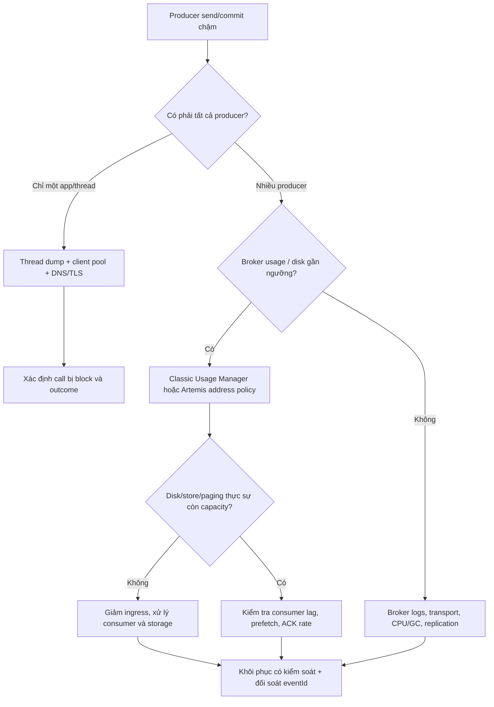

# Producer bị treo do flow control, bộ lưu trữ đầy hoặc mất xác nhận

> **Chương:** Chẩn đoán sự cố  
> **Phạm vi:** Điều tra producer JMS bị block hoặc timeout khi gửi tới **Apache ActiveMQ Classic** và **ActiveMQ Artemis**. Bài tập trung phân biệt broker flow control, memory/store/paging/disk saturation, nghẽn transport và trường hợp broker đã nhận message nhưng client mất confirmation. Các cấu hình và code dùng cho lab; khi xử lý production cần giữ nguyên bằng chứng, kiểm tra phiên bản broker/client và tuân thủ runbook của hệ thống.

## 1. Nhận diện đúng kiểu “producer bị treo”

Một lệnh `MessageProducer.send()` chạy lâu không tự chứng minh broker chết. Producer có thể đang bị broker **backpressure** vì queue/address đầy; broker có thể chờ consumer giải phóng tài nguyên; persistent store có thể bị chậm; hoặc message đã được broker chấp nhận nhưng phản hồi bị mất trên đường truyền.

Trước khi restart broker, phân loại triệu chứng theo quan sát:

| Triệu chứng | Khả năng cần kiểm tra đầu tiên |
|---|---|
| Nhiều producer cùng block ở `send()`, queue backlog tăng | Flow control, address full, consumer không theo kịp |
| Chỉ một destination bị block, destination khác vẫn gửi được | Destination/address memory policy hoặc queue riêng bị nghẽn |
| Store/paging usage tăng, disk free giảm nhanh | Persistent backlog, paging, DLQ, durable subscription hoặc disk saturation |
| Memory usage cao, send latency tăng, GC pause dài | Heap pressure, cursor/buffer pressure, consumer lag |
| `send()` trả về nhưng `Session.commit()` treo | Transaction commit, broker persistence/replication hoặc confirmation path |
| Client timeout/mất kết nối đúng lúc send/commit | **Unknown outcome**: broker có thể đã nhận message nhưng client chưa nhận phản hồi |
| Chỉ một JVM có thread `BLOCKED/WAITING`, các producer khác bình thường | Lock/thread pool/client-side serialization hoặc downstream code |
| Broker vẫn healthy nhưng producer reconnect liên tục | DNS/TLS/firewall, heartbeat, failover URI hoặc broker acceptor |

Phân biệt ba mốc:

1. **Producer call bắt đầu:** ứng dụng gọi `send`.
2. **Broker nhận/commit message:** phụ thuộc protocol, delivery mode, transaction và cấu hình confirmation.
3. **Ứng dụng nhận confirmation:** lời gọi trả thành công hoặc `Session.commit()` trả thành công.

Nếu kết nối đứt giữa mốc 2 và 3, ứng dụng không thể suy ra message chắc chắn chưa tồn tại. Retry thiếu idempotency có thể tạo duplicate.

## 2. Luồng chẩn đoán trong 5 phút đầu



**Thu thập trước khi thay đổi:** timestamp UTC, broker node, destination/address, producer identity, `eventId`, call đang chờ (`send` hay `commit`), delivery mode, transaction mode, client/broker version, exception/root cause, queue metrics và filesystem metrics. Không purge queue, xóa journal hoặc tắt flow control để thử “làm thông”.

### 2.1 Phân biệt block thật với timeout của ứng dụng

- **Block:** thread vẫn nằm trong lời gọi provider, không có exception; thời gian chờ tăng. Có thể do flow control hoặc transport/persistence wait.
- **Timeout:** ứng dụng/provider kết thúc lời gọi bằng exception hoặc wrapper timeout. Timeout chỉ nói caller không nhận được kết quả đúng hạn; không khẳng định broker đã rollback.
- **Connection failure:** socket/heartbeat/TLS error; lời gọi đang thực hiện có thể có unknown outcome.
- **Slow success:** call cuối cùng trả thành công; cần đo latency distribution, không gọi là deadlock.

Một `Future.get(timeout)` ở lớp ứng dụng chỉ giới hạn thời gian chờ của caller. Nó **không bảo đảm** hủy được lời gọi JMS đang block; nếu bỏ Future rồi tạo thêm producer task, các thread cũ vẫn có thể chiếm pool và tiếp tục gửi. Dùng bounded executor, giới hạn số outstanding sends và cơ chế admission control; xử lý call đang chạy theo semantics của provider.

## 3. ActiveMQ Classic: flow control và Usage Manager

### 3.1 Vì sao `send()` có thể chờ?

Classic quản lý tài nguyên broker qua `SystemUsage`, gồm:

- `memoryUsage`: ngân sách memory logic cho message/cursor và cấu trúc liên quan.
- `storeUsage`: giới hạn usage của persistent store (ví dụ KahaDB).
- `tempUsage`: temporary store, thường liên quan dữ liệu non-persistent/cursor khi cần lưu tạm.

Destination policy có `memoryLimit` và `producerFlowControl`. Khi destination hoặc broker usage đạt ngưỡng, producer flow control có thể khiến producer chờ cho tới khi tài nguyên được giải phóng. Consumer ACK/dequeue, cursor cleanup và store cleanup mới giúp usage giảm; tăng số producer trong lúc đó làm backlog lớn hơn.

Đoạn cấu hình minh họa cho broker Classic:

```xml
<!-- Hợp nhất vào <broker> / destinationPolicy hiện có. -->
<systemUsage>
    <systemUsage>
        <memoryUsage>
            <memoryUsage limit="512 mb"/>
        </memoryUsage>
        <storeUsage>
            <storeUsage limit="80 gb"/>
        </storeUsage>
        <tempUsage>
            <tempUsage limit="20 gb"/>
        </tempUsage>
    </systemUsage>
</systemUsage>

<destinationPolicy>
    <policyMap>
        <policyEntries>
            <policyEntry queue="orders.>"
                         producerFlowControl="true"
                         memoryLimit="64 mb"/>
        </policyEntries>
    </policyMap>
</destinationPolicy>
```

Các con số chỉ minh họa. Không tạo thêm `systemUsage` hoặc `destinationPolicy` trùng với cấu hình hiện có. `memoryLimit` theo destination không thay thế giới hạn store/disk của broker; `storeUsage limit` cũng không phải quota filesystem.

### 3.2 Đọc đúng JMX metrics

Trên Classic, BrokerView thường cung cấp:

| Metric | Ý nghĩa | Không được nhầm với |
|---|---|---|
| `MemoryPercentUsage` | % của broker memory usage manager | JVM heap % hoặc host RAM % |
| `StorePercentUsage` | % của store usage manager | Disk free % của filesystem |
| `TempPercentUsage` | % của temporary usage manager | Số JMS TemporaryQueue |
| `CurrentConnectionsCount` | Kết nối client hiện tại | Số producer thread |

QueueView thường có `QueueSize`, `InFlightCount`, `EnqueueCount`, `DequeueCount`, `ConsumerCount`. Tính rate từ delta counter chia thời gian; không đọc `EnqueueCount` như msg/s.

Đọc cùng lúc:

1. Broker usage manager (memory/store/temp).
2. Queue pending và in-flight của destination producer đang gửi.
3. Consumer count, enqueue/dequeue rate và oldest message age.
4. KahaDB directory size, filesystem free bytes/inodes, disk write latency.
5. Producer send latency và thread dump của JVM producer.

Ví dụ: `StorePercentUsage=99%` nhưng disk còn nhiều byte có thể là `storeUsage limit` quá thấp so với volume. Ngược lại, `StorePercentUsage=55%` nhưng disk free gần 0 có thể do log, backup, page/temp path hoặc file khác cùng volume.

### 3.3 Producer flow control theo destination

`producerFlowControl="true"` là cơ chế backpressure có ích khi broker thiếu capacity. Không tắt nó chỉ để làm `send()` trả nhanh. Khi tắt flow control ở destination, broker có thể nhận nhiều message hơn khả năng giữ/dispatch; hệ quả có thể là heap pressure, OOM hoặc disk đầy tùy loại message và persistence.

Nếu chỉ một queue bị block:

- Kiểm tra policy wildcard có match đúng queue không.
- So `memoryLimit` với message size, backlog và số consumer.
- Kiểm tra consumer có bị stop, slow handler, transaction dài hoặc prefetch cao không.
- Kiểm tra DLQ/durable topic subscriptions và các destination khác cùng broker có dùng chung store không.

### 3.4 Persistent send, async send và producer window

Classic client có các mode gửi đồng bộ/bất đồng bộ. Hành vi confirmation phụ thuộc delivery mode, transaction và client configuration. Với transacted session, `send()` đưa message vào transaction; **`Session.commit()` mới chốt transaction JMS**. Với async send, ứng dụng có thể nhận quyền điều khiển trước khi broker xác nhận theo semantics của mode đó.

`producerWindowSize` là cơ chế giới hạn dữ liệu producer gửi chưa được broker xác nhận trong các trường hợp client/protocol hỗ trợ producer flow control window. Nó không tăng sức chứa broker; window quá lớn có thể làm nhiều dữ liệu outstanding và tăng memory/in-flight. Trước khi chỉnh:

- Xác định client đang dùng OpenWire hay protocol khác.
- Kiểm tra `producerWindowSize`, async-send settings và số message chưa được confirm.
- Đo send latency/ack latency; không tăng window chỉ để che broker chậm.
- Nếu cần confirmation rõ, chọn send/transaction mode phù hợp và test failure window khi connection bị cắt.

Không áp tham số URL của Classic cho Artemis; hai client có flow control và confirmation configuration riêng.

## 4. ActiveMQ Artemis: address full policy và paging

### 4.1 Phân biệt BLOCK, PAGE, FAIL và DROP

Artemis có thể đặt memory threshold theo address bằng `max-size-bytes`, và quyết định hành vi khi address đầy bằng `address-full-policy`:

| Policy | Khi đạt ngưỡng | Producer quan sát | Hệ quả cần kiểm |
|---|---|---|---|
| `BLOCK` | Broker block producer cho tới khi có capacity | `send()` có thể chờ lâu | Backpressure, producer thread pool và timeout |
| `PAGE` | Message được chuyển sang paging store | Send có thể tiếp tục khi page được ghi | Disk/page growth, I/O latency và disk full |
| `FAIL` | Broker từ chối send | Exception/failure rõ hơn | Retry/backoff và handling exception |
| `DROP` | Broker bỏ message theo policy | Có thể không có hành vi retry như mong muốn | Mất message; chỉ dùng khi business chấp nhận |

Ví dụ address policy:

```xml
<address-settings>
    <address-setting match="orders.#">
        <max-size-bytes>67108864</max-size-bytes>
        <page-size-bytes>10485760</page-size-bytes>
        <address-full-policy>BLOCK</address-full-policy>
    </address-setting>
</address-settings>
```

Ghép vào `broker.xml` Artemis hiện hữu, kiểm pattern match và address/queue mapping. `max-size-bytes` là ngưỡng memory/address policy, **không phải quota filesystem**. Với `PAGE`, page files vẫn tiêu thụ disk; khi volume đầy, broker có thể gặp lỗi ghi và producer không thể tiếp tục an toàn.

### 4.2 Global memory và address memory

`global-max-size` kiểm soát memory budget toàn broker; `max-size-bytes` áp cho address match. Một address có thể chạm giới hạn riêng trước khi broker-wide memory đạt ngưỡng. Ngược lại, nhiều address cùng tăng có thể làm global memory pressure xuất hiện dù mỗi address riêng lẻ chưa chạm max.

Ví dụ cấu hình lab:

```xml
<core>
    <global-max-size>536870912</global-max-size>
    <address-settings>
        <address-setting match="orders.#">
            <max-size-bytes>67108864</max-size-bytes>
            <page-size-bytes>10485760</page-size-bytes>
            <address-full-policy>BLOCK</address-full-policy>
        </address-setting>
    </address-settings>
</core>
```

Không nâng `global-max-size` khi JVM/container không có headroom. Không chuyển `BLOCK` sang `PAGE` nếu paging volume không đủ capacity. Không chuyển `BLOCK` sang `DROP` để né block trong queue nghiệp vụ.

### 4.3 Kiểm tra paging và journal

Artemis tách các thành phần lưu trữ:

- `journal`: persistent records, transaction và ACK metadata.
- `paging`: message của address đã chuyển sang page files.
- `large-messages`: payload lớn được lưu riêng theo cấu hình.
- `bindings`: metadata address/queue.

Nếu `PAGE` đang hoạt động, xem page count/bytes và depage progress cùng filesystem free. Nếu producer vẫn gửi nhanh hơn consumer, page store tiếp tục tăng. Nếu journal/page volume cùng một filesystem, một loại workload có thể làm cạn dung lượng của loại kia.

Không xóa thủ công journal/page/large-message files để giải phóng dung lượng. Hãy xác định mount, tăng volume theo runbook hoặc giảm ingress và drain backlog đúng lifecycle.

## 5. Mất confirmation: message có thể đã được broker nhận

### 5.1 Hai kiểu kết quả khác nhau

**Failure trước khi broker nhận message:** ví dụ DNS/TLS/connect fail trước khi request được gửi. Có thể retry sau khi xử lý nguyên nhân.

**Failure sau khi broker nhận nhưng trước khi client nhận confirmation:** broker có thể đã lưu message hoặc commit transaction, nhưng socket bị reset trước khi client nhận response. Client nhìn thấy timeout/exception, song kết quả thực tế là **unknown**.

Với transacted JMS session:

- `send()` thành công chưa đồng nghĩa transaction đã commit.
- `Session.commit()` trả thành công là confirmation ở phía JMS client theo semantics provider.
- Nếu `commit()` ném exception do connection bị đứt, không thể tự kết luận broker chưa commit.

Với non-transacted send, confirmation semantics còn phụ thuộc delivery mode, provider/client settings và protocol. Ghi rõ mode đang dùng khi điều tra.

### 5.2 Không retry bằng event ID mới

Nếu send outcome unknown, retry bằng event ID mới có thể tạo hai message đại diện cùng một nghiệp vụ. Dùng event ID do nghiệp vụ tạo và giữ nguyên qua mọi retry:

```text
eventId = payment-2026-00042

Attempt 1:
  send(eventId)
  broker may accept
  client loses confirmation -> UNKNOWN

Attempt 2:
  send(the same eventId)
  consumer inbox unique(eventId) prevents duplicate business effect
```

Broker không tự deduplicate mọi message JMS chỉ vì hai payload có cùng property `eventId`. Idempotency phải được thực thi ở consumer (inbox/unique key) hoặc một cơ chế deduplication được cấu hình và hiểu rõ. Với producer outbox, relay retry cùng event ID; consumer vẫn cần inbox để bảo vệ business effect.

### 5.3 Retry có backoff và giới hạn

Retry nên có:

- Exponential backoff và jitter để nhiều producer không reconnect đồng loạt.
- Số lần thử/total retry budget hữu hạn; sau đó chuyển sang trạng thái chờ operator hoặc outbox pending.
- Giữ nguyên event ID và payload identity qua retry.
- Circuit breaker/admission control để không tạo thêm outstanding calls khi broker đang block.
- Đối soát trạng thái event sau unknown outcome, đặc biệt với payment/order side effects.

Không dùng `Thread.sleep()` retry liên tục trong thread request chính; không tạo thread mới cho mỗi timeout. Không bỏ một lời gọi JMS đang block rồi giả định nó đã bị hủy.

## 6. Thu thập bằng chứng ở client và broker

### 6.1 Thread dump của producer

Khi producer còn sống nhưng `send()` không trả về, lấy ít nhất hai thread dump cách nhau 10–20 giây để xem thread có tiến triển không. Với JVM có quyền attach:

```bash
jcmd <PID> Thread.print
```

Hoặc:

```bash
jstack -l <PID>
```

Tìm:

- Thread đang nằm trong call stack của JMS provider/transport và có lặp lại giữa các dump không.
- Nhiều thread cùng chờ một monitor/lock hoặc chờ response từ transport không.
- Thread pool producer có cạn worker không; request thread có đang chờ Future trong khi JMS worker vẫn bị block không.
- Có deadlock được JVM phát hiện hay chỉ là thread đang chờ flow control bình thường.

Tên class/method thay đổi theo provider version và protocol. Với Classic OpenWire, stack có thể đi qua `ActiveMQMessageProducer`, `ActiveMQConnection`, transport/request-response hoặc usage wait; với Artemis client có thể thấy core client/session/channel và producer credits. **Không kết luận nguyên nhân chỉ bằng một tên method**; đối chiếu broker metrics và logs cùng thời điểm.

### 6.2 Broker-side evidence

| Nguồn | Cần lấy | Câu hỏi trả lời |
|---|---|---|
| Broker logs | Usage limit, store/paging error, transport disconnect, journal I/O, HA state | Broker đang chặn vì tài nguyên hay lỗi nội bộ? |
| Classic JMX | Memory/Store/Temp usage, QueueSize, InFlight, ConsumerCount | Destination nào gây pressure? |
| Artemis management | Address size, queue message/delivering, page count/bytes, consumer count | Address nào đang full/paging? |
| OS/container | Disk free/inode, I/O latency, RSS/cgroup, OOM events | Broker có còn capacity vật lý không? |
| Network | TCP resets, retransmits, RTT, TLS handshake, firewall idle timeout | Confirmation có thể mất trên đường truyền không? |
| Application traces | eventId, send start/end, commit start/end, exception | Call bị treo ở send hay commit? |

Đồng bộ clock giữa producer, broker, database và proxy. Ghi `eventId` cùng timestamp để đối chiếu. Không bật wire/body logging toàn bộ trên production nếu payload chứa secret hoặc PII.

### 6.3 Ma trận phân biệt nguyên nhân

| Broker usage | Disk/I/O | Queue/consumer | Client symptom | Chẩn đoán ưu tiên |
|---|---|---|---|---|
| Classic memory cao | Bình thường | Pending tăng, ACK thấp | Nhiều send block | Consumer lag / memory flow control |
| Classic store cao | Disk free còn nhưng store limit đạt | Persistent backlog tăng | Persistent send block | `storeUsage`/KahaDB capacity policy |
| Classic temp cao | Temp volume gần đầy | Non-persistent backlog/cursor | Send block hoặc resource error | `tempUsage` và cursor policy |
| Artemis address đạt max | Disk còn | Address backlog tăng | Với BLOCK: send chờ | `address-full-policy=BLOCK` |
| Artemis paging tăng | Disk gần đầy hoặc I/O latency cao | Pending/page bytes tăng | Send chậm/lỗi ghi | PAGE đã chuyển áp lực sang storage |
| Usage thấp | Disk bình thường | Consumer khỏe | Chỉ một producer lỗi | Client thread pool, DNS/TLS, connection hoặc lock |
| Usage thấp | Network reset/RTT cao | Broker vẫn xử lý | Commit timeout | Unknown confirmation |
| Usage thấp | Journal I/O chậm | ACK/commit rate giảm | Send/commit latency tăng | Storage latency/transaction persistence |

## 7. Producer code: transaction rõ ràng và admission control

### 7.1 Gửi một event với ID ổn định

Ví dụ dùng **ActiveMQ Classic 5.x, Java 17 và `javax.jms`**. Producer transacted gửi persistent message, gắn `eventId`, rồi commit. Khi `send()` hoặc `commit()` ném exception, code ghi nhận outcome là chưa xác định; caller không tạo event ID mới để retry.

```java
package lab;

import javax.jms.Connection;
import javax.jms.DeliveryMode;
import javax.jms.JMSException;
import javax.jms.MessageProducer;
import javax.jms.Queue;
import javax.jms.Session;
import javax.jms.TextMessage;
import org.apache.activemq.ActiveMQConnectionFactory;

public final class SafeProducer {
    private SafeProducer() { }

    public static void sendOnce(
            String brokerUrl,
            String username,
            String password,
            String eventId,
            String payload) throws JMSException {
        if (eventId == null || eventId.isBlank()) {
            throw new IllegalArgumentException("eventId is required");
        }

        ActiveMQConnectionFactory factory =
                new ActiveMQConnectionFactory(brokerUrl);
        Connection connection = username == null || username.isBlank()
                ? factory.createConnection()
                : factory.createConnection(username, password);

        try {
            Session session = connection.createSession(
                    true, Session.SESSION_TRANSACTED);
            try {
                Queue queue = session.createQueue("orders.incoming");
                MessageProducer producer = session.createProducer(queue);
                try {
                    producer.setDeliveryMode(DeliveryMode.PERSISTENT);
                    TextMessage message = session.createTextMessage(payload);
                    message.setStringProperty("eventId", eventId);

                    try {
                        producer.send(message);
                        session.commit();
                        System.out.println(
                                "SEND_COMMITTED eventId=" + eventId);
                    } catch (JMSException uncertain) {
                        System.err.println(
                                "SEND_OUTCOME_UNKNOWN eventId=" + eventId
                                + " exception="
                                + uncertain.getClass().getSimpleName());
                        // Không tự tạo ID mới hoặc kết luận broker chưa nhận.
                        throw uncertain;
                    }
                } finally {
                    producer.close();
                }
            } finally {
                session.close();
            }
        } finally {
            connection.close();
        }
    }
}
```

Đây là minh họa ranh giới send/commit, không phải retry loop hoàn chỉnh. Trong ứng dụng thật, `eventId` phải được tạo và lưu trước khi gọi broker (thường từ outbox/business transaction). Khi kết quả unknown, lưu trạng thái cần đối soát hoặc retry cùng event ID theo policy; consumer phải deduplicate bằng inbox/unique constraint.

### 7.2 Giới hạn số lời gọi đang chờ

Flow control là backpressure từ broker; ứng dụng cũng cần admission control để không biến một broker đang block thành hàng nghìn thread bị treo. Ví dụ giới hạn số send đồng thời bằng semaphore:

```java
import java.util.concurrent.Semaphore;
import java.util.concurrent.TimeUnit;
import javax.jms.JMSException;

public final class ProducerAdmission {
    private final Semaphore permits = new Semaphore(32);

    public void publish(ThrowingSend sendOperation)
            throws InterruptedException, JMSException {
        if (!permits.tryAcquire(100, TimeUnit.MILLISECONDS)) {
            throw new IllegalStateException(
                    "Producer admission limit reached");
        }
        try {
            sendOperation.run();
        } finally {
            permits.release();
        }
    }

    @FunctionalInterface
    public interface ThrowingSend {
        void run() throws JMSException;
    }
}
```

Semaphore chỉ giới hạn số caller đi vào send; nó **không đặt timeout cho JMS send** và không hủy call đang block. Kết hợp bounded worker pool, request deadline, circuit breaker và trạng thái outbox pending. Khi permit hết, trả backpressure cho upstream thay vì tạo thêm thread.

### 7.3 Những cấu hình client cần xem trước khi đổi

| Cấu hình/đặc tính | Cần xác minh | Rủi ro nếu chỉnh mù |
|---|---|---|
| Classic synchronous/async send | Persistent/non-persistent, transacted hay không | Thay đổi thời điểm nhận confirmation |
| Classic `producerWindowSize` | OpenWire flow control và outstanding bytes | Window lớn giữ nhiều message chưa confirm |
| Classic failover transport | URI list, reconnect delay, timeout, transport health | Retry/reconnect che unknown outcome hoặc gây burst |
| Artemis address policy | BLOCK/PAGE/FAIL/DROP, address match | Đổi semantics khi address đầy |
| Artemis client confirmation/credits | Protocol và client version | Tăng outstanding messages hoặc memory |
| JMS transaction batch | Số message/transaction và commit latency | Batch lớn tăng thời gian in-flight và unknown outcome |

Không tăng batch/window chỉ vì send đang chậm. Đo p95/p99 send/commit latency, số outstanding bytes, heap/RSS và broker ACK/commit rate trước và sau thay đổi.

## 8. Runbook xử lý producer bị block

### 8.1 Bước 1 — khoanh vùng call và blast radius

1. Xác định broker node, product/version, protocol, destination/address và producer identity.
2. Xác định call đang treo là **send()**, **Session.commit()**, connection start hay reconnect.
3. Kiểm tra phạm vi: một producer, một service, một destination hay toàn bộ broker.
4. Thu thread dump producer và broker metrics/logs trước khi restart.
5. Ghi event ID và phân loại call outcome: success, definite failure hay unknown.

Không xóa queue hoặc restart ngay khi chưa biết producer đang block ở bước nào. Nếu nhiều producer cùng block trên một address, ưu tiên kiểm tra broker policy và consumer progress; nếu chỉ một process lỗi, điều tra client/network trước.

### 8.2 Bước 2 — nếu do flow control

- **Classic:** xem MemoryPercentUsage, StorePercentUsage, TempPercentUsage, destination QueueSize, InFlightCount và ConsumerCount.
- **Artemis:** xem global/address memory, address size, queue delivering/message count và address-full-policy.
- Kiểm consumer lag, downstream DB/API latency, prefetch, transaction duration và ACK rate.
- Giảm producer ingress/burst hoặc dừng nguồn không thiết yếu theo ưu tiên nghiệp vụ.
- Khôi phục consumer/downstream; scale consumer từng bước, không vượt capacity DB.
- Chờ broker usage giảm và xác nhận send latency phục hồi.

Không tắt flow control hoặc chuyển sang DROP để che backlog.

### 8.3 Bước 3 — nếu store hoặc disk đầy

1. Kiểm đúng filesystem mount chứa KahaDB, Artemis journal, paging, large messages, temp, logs và backup.
2. So broker store limit với disk free bytes; hai chỉ số có thể lệch nhau.
3. Kiểm filesystem read-only, inode exhaustion, permission và I/O latency/error.
4. Giảm ingress; khôi phục consumer hoặc mở rộng volume theo quy trình hạ tầng.
5. Xử lý DLQ/retention/durable subscriptions theo owner dữ liệu.
6. Chờ broker cleanup/depage/journal lifecycle; không xóa file store đang được broker quản lý.

Nếu volume đã full hoặc journal write lỗi, tránh restart lặp. Một lần restart có thể cần recovery và lại cần dung lượng tạm; bảo toàn store và gọi người phụ trách storage/broker.

### 8.4 Bước 4 — nếu nghi mất confirmation

- Không gửi lại bằng event ID mới.
- Lưu event ID, payload hash, thời điểm send/commit, exception và broker node.
- Kiểm outbox state và inbox/business record nếu có.
- Tra broker queue/destination counters, message browser hoặc audit theo quy trình có kiểm soát; không browse payload nhạy cảm tùy tiện.
- Nếu không xác định được message đã được nhận hay chưa, retry **cùng event ID** và dựa vào consumer idempotency.
- Đối soát kết quả cuối cùng ở DB/business state trước khi đóng incident.

### 8.5 Bước 5 — chỉ khởi động lại khi có điều kiện

Restart broker chỉ sau khi đã xác định nguyên nhân, có kế hoạch HA/ownership và xác nhận storage có thể recovery. Trước restart:

- Ghi lại queue/store/page metrics và broker logs.
- Xác định node active/standby và shared-store lock/quorum nếu HA.
- Xác định transaction in-doubt và message in-flight.
- Giảm hoặc dừng ingress theo kế hoạch.
- Xác minh disk headroom, quyền filesystem và backup.

Sau restart, kiểm tra broker role, journal recovery, producer send/commit, consumer ACK, redelivery/DLQ và đối soát event IDs. Broker mở port không có nghĩa producer đã gửi thành công.

## 9. Fault tests để tái hiện và phân biệt ba nguyên nhân

Chạy các thử nghiệm sau trong broker lab riêng, với destination không chứa dữ liệu thật và volume có giới hạn giám sát. Mỗi test cần ghi timestamp, eventId, queue metrics, broker logs, send/commit latency và disk free.

### 9.1 Classic: tạo flow control có chủ đích

1. Dùng queue lab riêng, đặt memoryLimit nhỏ và producerFlowControl=true.
2. Không bật consumer; gửi một lô message persistent hoặc payload đủ lớn để chạm destination/broker usage limit.
3. Chạy producer ở thread riêng và ghi thời điểm bắt đầu/kết thúc mỗi send.
4. Quan sát MemoryPercentUsage, StorePercentUsage, QueueSize, InFlightCount và broker logs.
5. Bật consumer để drain; quan sát usage giảm và producer send tiếp tục.

**Kỳ vọng:** producer bị backpressure trong khi broker chạm ngưỡng, sau khi consumer giải phóng capacity thì send tiếp tục. Nếu disk/store usage mới là ngưỡng đạt trước memory, ghi nhận đúng resource đó; không kết luận mọi flow control đều do heap.

### 9.2 Artemis: đối chiếu BLOCK và PAGE

1. Dùng address lab.flow.# với max-size-bytes thấp.
2. Chạy producer, chưa chạy consumer; chọn BLOCK, ghi send latency và broker address metrics.
3. Trong lab sạch khác, đổi policy sang PAGE, chạy cùng tải và quan sát page count/bytes, disk growth.
4. Bật consumer, drain backlog và đo thời gian depage.
5. Không chạy DROP trên message có giá trị; nếu cần kiểm semantics DROP, chỉ dùng event giả và lưu bằng chứng message bị loại.

**Kỳ vọng:** BLOCK tạo backpressure ở producer; PAGE chuyển áp lực sang storage và có thể cho phép producer tiếp tục tới khi capacity khác bị chạm. Nếu page volume cạn, ghi rõ storage failure thay vì coi PAGE là giải pháp vô hạn.

### 9.3 Mất confirmation: kiểm unknown outcome

Đây là test khó hơn vì cần làm đứt đường phản hồi tại thời điểm có kiểm soát. Dùng proxy/network fault injection trong lab:

1. Producer gửi persistent message trong transacted session với event ID duy nhất.
2. Ghi send-start, commit-start và broker-side enqueue/transaction evidence.
3. Cắt kết nối client↔broker ở cửa sổ sau khi broker có thể đã nhận request nhưng trước khi client nhận confirmation.
4. Ghi exception/timeout ở client và giữ nguyên event ID.
5. Reconnect, đối soát broker destination và consumer inbox/business state.
6. Retry cùng event ID theo policy; xác nhận duplicate delivery không tạo duplicate business effect.

Không khẳng định test đã tạo unknown outcome chỉ vì client thấy timeout. Cần bằng chứng broker đã nhận hoặc transaction state không xác định. Nếu proxy cắt trước khi request tới broker, đó là failure-before-acceptance; nếu cắt sau khi commit response về client, đó là success.

### 9.4 Ma trận test và tiêu chí

| Mã | Fault | Client quan sát | Broker/storage quan sát | Tiêu chí PASS |
|---|---|---|---|---|
| P1 | Classic memory usage đạt limit | send() chờ | Memory usage cao, queue pending tăng | Drain làm send tiếp tục |
| P2 | Classic store usage đạt limit | Persistent send bị block/fail theo cấu hình | Store usage gần limit | Ingress được điều tiết; không xóa journal |
| P3 | Classic temp usage đạt limit | Non-persistent send chịu backpressure | Temp usage tăng | Xác định đúng temp path và drain |
| P4 | Artemis address policy BLOCK | send() chờ | Address size đạt threshold | Consumer drain giải phóng block |
| P5 | Artemis PAGE và disk tăng | Send có thể tiếp tục | Paging bytes tăng, disk free giảm | Cảnh báo trước khi volume cạn |
| P6 | Disk read-only/full | Send/commit chậm hoặc exception | I/O error/write failure | Incident được xử lý, store được bảo toàn |
| P7 | DNS/TLS/socket failure trước broker accept | Connection/send exception | Không có enqueue tương ứng | Retry có backoff sau khi kết nối ổn |
| P8 | Response mất sau broker accept | Client timeout/unknown | Có thể có enqueue/commit | Retry cùng event ID, không duplicate effect |
| P9 | Producer window/outstanding quá lớn | Client memory/thread pressure | Nhiều request chưa confirm | Bounded concurrency và window phù hợp |
| P10 | Consumer downstream chậm | Producer bị block | Pending/in-flight tăng, ACK rate giảm | Khôi phục downstream và net drain dương |

## 10. Bảng chẩn đoán nhanh theo dấu hiệu

| Dấu hiệu | Kiểm tra tiếp | Hành động đầu tiên |
|---|---|---|
| send() block, Classic MemoryPercentUsage cao | Destination memory limit, cursor, prefetch, consumer | Giảm ingress; khôi phục consumer |
| send() block, Classic StorePercentUsage cao | KahaDB path, store limit, persistent backlog | Kiểm disk và drain; không xóa segment |
| send() block, Classic TempPercentUsage cao | Non-persistent cursor/temp path | Kiểm temp volume và consumer |
| Artemis BLOCK, address size chạm ngưỡng | Address pattern, consumer/ACK rate | Giữ BLOCK, điều tiết ingress, tăng capacity có kiểm soát |
| Artemis PAGE, page bytes tăng liên tục | Disk free, page I/O, depage rate | Giảm ingress hoặc mở rộng paging volume |
| Disk free thấp nhưng broker usage thấp | Log, backup, snapshot, mount sai | Tìm đúng thư mục chiếm volume |
| send() trả nhưng commit timeout | Transaction state, broker log, connection reset | Đánh dấu unknown, giữ eventId |
| Timeout rồi retry tạo hai message | Event ID mới hoặc consumer thiếu inbox | Dedupe ở business boundary |
| Một producer thread bị treo | Thread dump, lock, client connection/pool | Khoanh vùng process/client |
| Tất cả producer cùng treo | Broker usage, storage, consumer lag, HA | Incident broker/storage |

## 11. Những thao tác dễ làm sự cố nặng hơn

- **Tắt flow control** khi broker thiếu memory/store: có thể chuyển backpressure thành OOM hoặc disk full.
- **Đổi Artemis BLOCK thành DROP** trên queue nghiệp vụ: producer hết block nhưng message có thể bị mất.
- **Đổi BLOCK thành PAGE** mà không có disk headroom: chỉ chuyển điểm nghẽn sang filesystem.
- **Tăng producer window hoặc thread count** khi broker đã bão hòa: tăng outstanding work và làm recovery khó hơn.
- **Retry đồng loạt không jitter:** tạo reconnect storm và burst mới sau khi broker vừa hồi phục.
- **Tạo event ID mới sau timeout:** có thể nhân đôi business effect.
- **Purge queue/DLQ hoặc xóa journal/page files:** làm mất dữ liệu và bằng chứng.
- **Restart cả HA pair cùng lúc:** có thể làm mất khả năng phục vụ và gây recovery phức tạp.

## 12. Checklist đóng incident

- [ ] Xác định rõ broker product/version, protocol, node và destination/address.
- [ ] Biết chính xác lời gọi bị block: send, commit, connect hay reconnect.
- [ ] Đã thu thread dump, broker logs, JMX/management metrics và OS/filesystem metrics.
- [ ] Phân biệt Classic memory/store/temp với Artemis address policy/paging.
- [ ] Xác định consumer ACK rate, pending, in-flight/delivering và oldest message age.
- [ ] Đã xác minh disk free/inodes và đúng mount của store/page/temp/journal.
- [ ] Không tắt flow control hoặc đổi sang DROP để né backpressure.
- [ ] Unknown confirmation được lưu riêng, không retry bằng event ID mới.
- [ ] Consumer inbox/idempotency bảo vệ business effect khi redelivery.
- [ ] Đã xác nhận producer send/commit trở lại, consumer drain và backlog ổn định.
- [ ] DLQ, duplicate, expired message và transaction in-doubt đã được đối soát.
- [ ] Có nguyên nhân gốc, hành động phòng ngừa, owner và ngưỡng cảnh báo cập nhật.

**Kết luận:** Producer bị treo thường là biểu hiện của backpressure hoặc chờ confirmation, không đủ để kết luận broker đã chết. Với **Classic**, đối chiếu SystemUsage memory/store/temp, destination producerFlowControl, KahaDB và consumer progress. Với **Artemis**, xác định address BLOCK/PAGE/FAIL/DROP, global/address memory và paging filesystem. Nếu kết nối mất lúc send/commit, coi kết quả là **unknown outcome** cho tới khi đối soát; giữ event ID ổn định và dùng consumer inbox để ngăn duplicate business effect. Khôi phục đúng nguyên nhân bằng giảm ingress, tăng năng lực consumer hoặc xử lý storage; bảo toàn journal và dữ liệu broker trong suốt incident.
