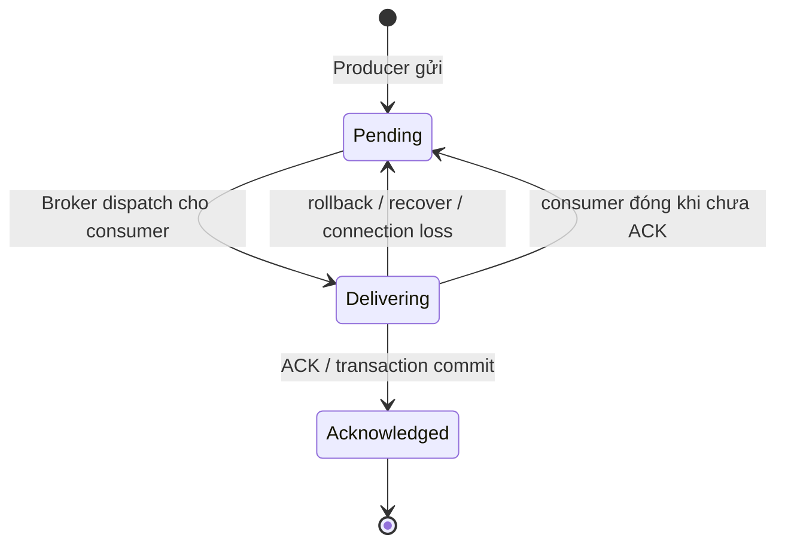

# Thông điệp vẫn đang giao do prefetch, giao dịch chưa đóng hoặc consumer chậm

> **Chương:** Chẩn đoán sự cố  
> **Phạm vi:** Điều tra message đã được broker dispatch nhưng chưa được xác nhận trong ActiveMQ Classic và Artemis. Bài tập trung phân biệt **prefetch/client buffer**, **JMS transaction chưa commit** và **handler xử lý chậm**; chọn cách giảm buffer, kết thúc giao dịch hoặc khôi phục năng lực consumer mà không tạo duplicate hay mất message.

## 1. Hiểu chính xác trạng thái “đang giao”

Một queue có thể có hàng nghìn message nhưng chỉ một phần đang chờ broker dispatch. Khi broker gửi message cho consumer, message rời trạng thái chờ và trở thành **in-flight/delivering** cho đến khi broker nhận được ACK/commit tương ứng.



Trong tình huống bình thường, consumer nhận, xử lý và ACK đủ nhanh nên số delivering dao động quanh một mức ổn định. Sự cố xuất hiện khi:

- Broker đã dispatch trước nhiều message vào **prefetch/window buffer** của client.
- Consumer đã nhận message nhưng **transaction vẫn mở**, chưa commit hoặc ACK.
- Handler đang chờ DB/API, giữ lock, bị GC pause hoặc xử lý CPU lâu.
- Một consumer nhận nhiều message hơn khả năng hoàn thành; các consumer khác rảnh nhưng broker đã giữ message trong buffer của consumer chậm.

**Đang giao không đồng nghĩa đang chạy code xử lý.** Một message có thể đã nằm trong buffer client nhưng listener chưa bắt đầu xử lý. Cũng có thể listener đã xử lý xong body nhưng transaction chưa commit. Phải ghép số liệu broker với trạng thái session/transaction và thời gian xử lý ở ứng dụng.

### 1.1. Ba nguyên nhân có dấu hiệu khác nhau

| Nguyên nhân | Dấu hiệu ở broker | Dấu hiệu ở ứng dụng | Hướng kiểm tra đầu tiên |
| --- | --- | --- | --- |
| Prefetch/window quá lớn | Pending giảm nhanh, delivering tăng; consumer khác ít được giao | Client buffer lớn; handler có thể chưa xử lý hết message | Đọc cấu hình prefetch/window, giảm thử trên queue lab |
| Transaction chưa commit | Delivering giữ lâu; ACK/dequeue không tăng tương ứng | Session transacted đang giữ message; thiếu commit hoặc callback chưa kết thúc | Tìm transaction owner, thời điểm receive và commit/rollback |
| Consumer chậm | Delivering cao kéo dài, ACK rate thấp | Handler latency cao, thread chờ DB/API/lock hoặc CPU/GC bão hòa | Đo thời gian từng bước, thread dump, downstream pool |
| Consumer chết/mất kết nối | Delivering có thể giảm sau khi broker phát hiện disconnect; message có thể redeliver | Socket lỗi, heartbeat timeout, process restart | Kiểm tra reconnect, redelivery và duplicate theo event ID |

Không kết luận từ một snapshot. Lấy ít nhất vài mẫu có timestamp, ví dụ mỗi 5–10 giây trong một khoảng đủ dài để thấy xu hướng. Với workload burst, so sánh thêm queue age và tốc độ ingress/ACK.

## 2. Đọc đúng các counter của Classic và Artemis

### 2.1. ActiveMQ Classic

Destination MBean của Classic cung cấp các thuộc tính thường dùng:

| Attribute | Ý nghĩa |
| --- | --- |
| `QueueSize` | Số message còn trong queue/store chưa được consumer xác nhận |
| `InFlightCount` | Message đã dispatch tới consumer session nhưng chưa nhận ACK |
| `DispatchCount` | Tổng số message đã dispatch |
| `DequeueCount` | Tổng số message đã dequeue/ACK |
| `ConsumerCount` | Số consumer đang subscribe destination |
| `EnqueueCount` | Tổng message được enqueue trong khoảng thống kê của broker |

`InFlightCount` là tín hiệu quan trọng cho trạng thái đang giao. Nếu `QueueSize` giảm trong khi `InFlightCount` tăng, broker đang chuyển backlog sang consumer sessions. Đây có thể là prefetch bình thường; nếu số in-flight không giảm sau thời gian xử lý kỳ vọng, kiểm tra ACK/transaction/handler.

Có thể quan sát qua JMX destination MBean, ví dụ ObjectName dạng:

```text
org.apache.activemq:
  type=Broker,
  brokerName=broker-a,
  destinationType=Queue,
  destinationName=orders.work
```

Trong JConsole/JMX client, đọc `QueueSize`, `InFlightCount`, `ConsumerCount`, `DispatchCount` và `DequeueCount`. ObjectName phải khớp broker name và queue name thật; nếu tên có ký tự đặc biệt, escape/quote theo quy tắc JMX.

**Không cộng QueueSize và InFlightCount rồi gọi đó là “tổng backlog” mà không hiểu semantics/version.** Các MBean counters có mục đích và vòng đời riêng; dùng xu hướng và đối chiếu message IDs thay vì giả định mọi counter là một snapshot nguyên tử.

### 2.2. ActiveMQ Artemis

Artemis `QueueControl` có các attributes:

| Attribute | Ý nghĩa |
| --- | --- |
| `MessageCount` | Số message hiện đang nằm trong queue |
| `DeliveringCount` | Số message queue đang giao cho consumers |
| `ConsumerCount` | Số consumer đang consume queue |
| `MessagesAdded` | Tổng message được thêm vào queue kể từ khi queue được tạo |
| `MessagesAcknowledged` | Tổng message đã được acknowledge kể từ khi queue được tạo |
| `FirstMessageAge` | Tuổi của message đầu tiên trong queue, tính bằng mili giây |
| `DeliveringSize` | Dung lượng persistent của message đang delivering |

`DeliveringCount` có thể gồm message đã được broker gửi vào client-side buffer nhưng listener chưa bắt đầu xử lý. Vì thế, số này cao không đủ để kết luận code handler bị treo.

Ví dụ đọc từ Console hoặc JMX/management API:

```text
Queue: orders.work
MessageCount:       120
DeliveringCount:    480
ConsumerCount:        4
MessagesAdded:   150000
MessagesAcknowledged: 149400
```

Đây là snapshot minh họa. Nếu 4 consumers mỗi consumer có window đủ lớn, 480 delivering có thể phản ánh buffer đã nhận trước. Nếu các message vẫn nằm ở delivering trong thời gian dài hơn nhiều so với p99 handler latency, hãy điều tra transaction và consumer thread.

### 2.3. Counter tích lũy và counter hiện tại

- `MessageCount`, `QueueSize`, `InFlightCount`, `DeliveringCount` mô tả trạng thái hiện tại hoặc gần hiện tại.
- `MessagesAdded`, `MessagesAcknowledged`, `DispatchCount`, `DequeueCount` là counters tích lũy theo vòng đời thống kê/queue/broker.
- Tính rate bằng delta giữa hai mẫu có cùng queue identity và cùng lifecycle: `ackRate = (acknowledged₂ - acknowledged₁) / Δt`.
- Nếu broker restart, queue bị recreate hoặc statistics bị reset, bắt đầu chuỗi đo mới; không tính delta xuyên qua điểm reset.
- Expiry, move, purge, DLQ, scheduled messages và routing nhiều queue có thể làm quan hệ giữa counters phức tạp hơn phép trừ đơn giản.

**Đọc cả count và age/rate.** DeliveringCount = 0 nhưng MessageCount tăng đều là consumer không nhận hoặc dispatch bị dừng. DeliveringCount cao, ACK rate bằng 0 và consumer thread không hoạt động là một tình huống khác.

## 3. Prefetch/window: message đã rời broker nhưng chưa được xử lý

### 3.1. ActiveMQ Classic: prefetch tính bằng số message

Classic OpenWire đẩy trước một lượng message vào consumer session để tránh round-trip broker cho từng lần receive. Với queue consumer, prefetch mặc định phổ biến là **1000 messages**; các loại topic/durable subscription có giá trị khác.

Ví dụ:

```text
tcp://broker:61616?jms.prefetchPolicy.queuePrefetch=10
```

Hoặc cấu hình qua Classic `ActiveMQConnectionFactory`:

```java
import org.apache.activemq.ActiveMQConnectionFactory;

ActiveMQConnectionFactory factory =
        new ActiveMQConnectionFactory("tcp://broker:61616");

factory.getPrefetchPolicy().setQueuePrefetch(10);
```

Đặt prefetch theo **đúng client protocol/provider**. `jms.prefetchPolicy.queuePrefetch` là tùy chọn của ActiveMQ Classic client; không áp dụng cho Artemis CORE client.

Prefetch lớn có lợi khi consumer rất nhanh và message nhỏ: broker giảm số lần điều phối, consumer luôn có việc. Nhưng với handler chậm hoặc nhiều consumers không đồng đều, consumer chậm có thể giữ nhiều message trong buffer. Consumer nhanh không nhận được chúng dù đang rảnh.

Classic có cơ chế top-up buffer sau khi nhận ACK cho một phần prefetch. Vì vậy, khi ACK không đến (ví dụ transaction chưa commit), broker có thể ngừng cấp thêm message cho consumer đó trong khi các message đã dispatch vẫn in-flight.

**Cách thử có kiểm soát:**

- Queue handler chậm: thử prefetch `1`, sau đó `5` hoặc `10`.
- Handler nhanh, message nhỏ: so sánh `50`, `100`, `500` hoặc giá trị baseline.
- Đo `InFlightCount`, queue age, throughput và p95/p99; không chỉ nhìn queue size.
- Với Classic prefetch `0`, client dùng pull/poll từng message thay vì push buffer; độ trễ/round-trip có thể tăng.

### 3.2. Artemis CORE: consumerWindowSize tính bằng byte

Artemis CORE dùng **window-based consumer flow control**. Client buffer messages theo tổng dung lượng byte của window, không theo số lượng message. Mặc định thường là **1 MiB mỗi consumer**, trừ khi client URI hoặc address setting override.

Ví dụ client URI:

```text
tcp://broker:61616?consumerWindowSize=65536
```

`65536` tương đương 64 KiB. Giá trị:

| Giá trị | Hành vi |
| --- | --- |
| `-1` | Buffer không giới hạn; có nguy cơ chiếm hết heap nếu consumer không xử lý kịp |
| `0` | Không buffer message phía client; broker chỉ dispatch theo nhu cầu/credit |
| `>0` | Giới hạn window theo byte |

Khi có nhiều consumer, tổng ngân sách buffer thô có thể ước lượng bằng:

```text
approxClientBuffer = consumerCount × consumerWindowSize
```

Ví dụ 20 consumers với window 1 MiB có thể giữ lượng dữ liệu buffer cỡ 20 MiB, chưa tính object overhead, protocol structures, message body expansion và các queue khác. Đây là **ước lượng**, không phải hard heap cap.

Với slow consumer, đặt window `0` có thể giúp message ở broker chờ consumer nhanh khác thay vì bị consumer chậm giữ trong buffer. Trade-off là nhiều round-trip/credit flow hơn và throughput có thể giảm. Nếu đa số consumers có tốc độ trung bình, hãy benchmark các mức 64 KiB, 256 KiB và 1 MiB.

Artemis có thể đặt default consumer window theo address:

```xml
<address-settings>
    <address-setting match="orders.#">
        <default-consumer-window-size>65536</default-consumer-window-size>
    </address-setting>
</address-settings>
```

Cấu hình này là default cho CORE consumer thuộc address match; client có thể có cấu hình riêng. `orders.#` phải khớp **address**, không nhất thiết bằng queue name. Kiểm tra version và cấu hình thực tế trước khi áp dụng.

### 3.3. Prefetch không phải transaction timeout

Prefetch/window quyết định broker có thể **dispatch trước bao nhiêu**. Transaction quyết định message đã nhận **được xác nhận khi nào**. Hai yếu tố tương tác nhưng không thay thế nhau:

- Window lớn + transaction ngắn: throughput có thể cao, buffer nhiều.
- Window lớn + transaction dài: nhiều message có thể bị giữ in-flight trong lúc chờ commit.
- Window nhỏ + transaction dài: ít message bị giữ trước, nhưng các message đã nhận vẫn chưa được ACK.
- Window nhỏ + handler chậm: fairness có thể tốt hơn, nhưng consumer capacity không tự tăng.

Nếu transaction không bao giờ commit, giảm prefetch chỉ giảm số message bị giữ; nó **không sửa lỗi transaction**.

## 4. Transaction chưa đóng: message được nhận nhưng ACK còn nằm trong session

### 4.1. Transacted session

Với JMS transacted session, `receive()` không đồng nghĩa broker đã xác nhận message. Message chỉ được xác nhận khi session `commit()`; `rollback()` làm các message nhận trong transaction đủ điều kiện redelivery.

```java
Session session = connection.createSession(
        true, Session.SESSION_TRANSACTED);

MessageConsumer consumer = session.createConsumer(queue);

connection.start();

Message message = consumer.receive(1_000L);
if (message != null) {
    process(message);

    // Chỉ sau khi xử lý thành công:
    session.commit();
}
```

Nếu code nhận nhiều messages nhưng không gọi `commit()`/`rollback()`, chúng có thể tiếp tục ở trạng thái delivering. Một session transacted có thể gom nhiều receive vào cùng transaction; số message in-flight tăng cho tới khi transaction kết thúc hoặc broker/client buộc phải giải phóng session.

**Không giữ transaction mở trong khi chờ thao tác ngoài broker kéo dài** nếu có thể tránh. Ví dụ gọi HTTP chậm, chờ người dùng, hoặc thực hiện batch lớn trong cùng một transaction làm message ở trạng thái delivering lâu hơn và giữ resource broker.

### 4.2. Đừng dùng recover() thay rollback()

| Session mode | Thao tác kết thúc delivery chưa xác nhận |
| --- | --- |
| Transacted (`SESSION_TRANSACTED`) | `commit()` hoặc `rollback()` |
| Non-transacted `CLIENT_ACKNOWLEDGE` | `message.acknowledge()`; `session.recover()` để redeliver phần chưa ACK |
| Non-transacted `AUTO_ACKNOWLEDGE` | Provider ACK theo quy tắc synchronous receive/listener callback |
| `DUPS_OK_ACKNOWLEDGE` | Provider có thể xác nhận lazy; phải chấp nhận duplicate |

`Session.recover()` dành cho non-transacted session. Gọi nó trên transacted session là sai mô hình; dùng `rollback()` để kết thúc transaction.

`CLIENT_ACKNOWLEDGE` có phạm vi tích lũy: gọi `acknowledge()` trên một message xác nhận tất cả messages đã được session đó nhận kể từ lần ACK trước. Nếu muốn ACK theo batch, phải hiểu rõ ranh giới batch và không share session giữa threads.

### 4.3. Failure window quanh commit

Có thể gặp tình huống broker đã commit nhưng client mất kết nối trước khi nhận response. Ứng dụng thấy timeout/exception, nhưng outcome thực tế có thể **không rõ**. Nếu retry bằng event ID mới, có thể tạo side effect duplicate.

- Dùng event ID ổn định qua retry.
- Consumer ghi nhận idempotency key cùng business result.
- Khi commit timeout, đối soát theo event ID hoặc transaction manager state trước khi gửi lại bằng ID mới.
- Đừng tự động gọi rollback sau khi connection đã hỏng rồi khẳng định chắc chắn broker chưa commit.

### 4.4. XA/JTA và transaction bị treo

Nếu session được enlist trong XA/JTA, transaction manager quyết định prepare/commit/rollback. Một transaction ở trạng thái `prepared` có thể được lưu như in-doubt transaction và cần XA recovery sau restart.

Đây không phải prefetch. Khi queue có delivering messages nhưng worker không có callback đang chạy, cần kiểm tra transaction manager logs, active transaction age, XID và resource recovery. Không dùng `Session.recover()` để xử lý XA in-doubt transaction.

## 5. Consumer chậm: message đang được xử lý nhưng ACK đến muộn

### 5.1. Các nguồn chậm thường gặp

| Nguồn chậm | Dấu hiệu | Bằng chứng |
| --- | --- | --- |
| DB pool cạn | Thread chờ lấy connection, latency tăng theo burst | Pool active/pending, wait time, DB sessions |
| SQL/lock chậm | Handler dừng tại truy vấn hoặc lock | Slow query log, DB lock graph |
| HTTP/API downstream | Thread chờ socket/response | Client latency, timeout, connection pool |
| CPU-bound transform | Thread runnable, CPU cao | CPU profile, hot methods |
| JVM GC pause | Nhiều consumer cùng dừng trong một khoảng | GC logs, pause time, heap occupancy |
| Lock contention trong ứng dụng | Thread BLOCKED hoặc WAITING | Thread dump, lock owner |
| Message body lớn/deserialize chậm | CPU/allocations tăng theo payload size | Payload size histogram, allocation profile |
| Logging đồng bộ | Handler chờ appender/disk/network | Logging queue, I/O latency |

**Đo từng đoạn**, không chỉ đo tổng thời gian listener:

```java
long started = System.nanoTime();

validate(message);
long validated = System.nanoTime();

Order order = parse(message);
long parsed = System.nanoTime();

repository.save(order);
long persisted = System.nanoTime();

publishFollowUp(order);
long published = System.nanoTime();

log.info(
    "eventId={} validateMs={} parseMs={} dbMs={} publishMs={} totalMs={}",
    eventId,
    millis(validated - started),
    millis(parsed - validated),
    millis(persisted - parsed),
    millis(published - persisted),
    millis(published - started));
```

Đoạn này minh họa instrumentation; production nên ghi metric histogram/timer theo event type và không log payload. Dùng monotonic clock `System.nanoTime()` để đo duration, không dùng wall-clock `currentTimeMillis()` cho elapsed time.

### 5.2. Consumer chậm và consumer bị treo không giống nhau

- **Chậm:** handler vẫn tiến triển, ACK rate thấp nhưng khác 0, latency có phân bố dài.
- **Treo:** thread không tiến triển, cùng stack/lock/wait kéo dài; ACK rate về 0.
- **Prefetch giữ message:** consumer có nhiều in-flight nhưng số handler đang chạy ít hơn; phần còn lại có thể nằm trong client buffer.
- **Transaction mở:** handler có thể đã xử lý xong một phần công việc nhưng session chưa commit; broker vẫn coi message chưa xác nhận.

Lấy thread dump ở nhiều thời điểm cách nhau vài giây. Một thread WAITING trong lần dump đơn lẻ có thể chỉ đang đợi queue; nhiều dump cùng stack và không tiến triển mới là bằng chứng mạnh hơn.

### 5.3. Đừng tạo thêm consumers vượt downstream capacity

Nếu mỗi message cần một DB connection trong suốt handler và DB pool chỉ có 12 connections, cấu hình 50 consumers có thể tạo 38 threads chờ DB. Điều này làm tăng delivering count và heap/thread pressure nhưng không tăng throughput.

Tính concurrency từ khả năng thực tế:

```text
consumer capacity <= min(
  CPU capacity,
  DB connection capacity,
  downstream API quota,
  broker queue max-consumers,
  application thread budget
)
```

Đây là mô hình ngân sách, không phải công thức số học tuyệt đối. Với handler I/O-bound, số threads có thể cao hơn số CPU cores, nhưng phải đo pool waits và latency.

## 6. Spring JMS: transaction boundary và lỗi async handoff

Spring `DefaultMessageListenerContainer` có thể dùng transacted JMS session cho mỗi listener invoker. Khi callback hoàn tất bình thường, container commit; khi callback ném exception, container rollback theo cấu hình.

```java
import jakarta.jms.ConnectionFactory;

import org.springframework.context.annotation.Bean;
import org.springframework.context.annotation.Configuration;
import org.springframework.jms.config.DefaultJmsListenerContainerFactory;

@Configuration
class JmsListenerConfiguration {

    @Bean
    DefaultJmsListenerContainerFactory transactedListenerFactory(
            ConnectionFactory connectionFactory) {
        DefaultJmsListenerContainerFactory factory =
                new DefaultJmsListenerContainerFactory();

        factory.setConnectionFactory(connectionFactory);
        factory.setSessionTransacted(true);
        factory.setConcurrency("2-6");

        return factory;
    }
}
```

Listener:

```java
import org.springframework.jms.annotation.JmsListener;
import org.springframework.stereotype.Component;

@Component
class OrderConsumer {

    @JmsListener(
        destination = "orders.work",
        containerFactory = "transactedListenerFactory")
    public void onMessage(OrderEvent event) {
        long started = System.nanoTime();

        validate(event);
        orderService.process(event);

        long elapsedMs =
                (System.nanoTime() - started) / 1_000_000L;

        metrics.recordHandlerDuration(elapsedMs);
        // Method return normally -> listener transaction can commit.
        // Exception escaping -> container rolls back the JMS session.
    }
}
```

### 6.1. Lỗi async handoff làm ACK quá sớm

Mẫu nguy hiểm:

```java
@JmsListener(destination = "orders.work")
public void onMessage(OrderEvent event) {
    executor.submit(() -> orderService.process(event));
    // Listener return ngay; container có thể ACK/commit.
}
```

Nếu background task thất bại sau khi listener đã return, broker có thể đã xác nhận message. Không còn transaction nào để redeliver công việc đó.

Các cách sửa:

- Chờ task hoàn thành trong callback (có timeout) để exception còn nằm trong listener transaction.
- Dùng một queue/workflow khác làm durable handoff; chỉ ACK message gốc sau khi handoff đã được commit.
- Dùng outbox/inbox và idempotency khi cần atomicity giữa database và broker.

Không dùng `executor.submit()` rồi return như một cách tăng consumer throughput nếu chưa thiết kế durable handoff.

## 7. Quy trình chẩn đoán theo thứ tự

### Bước 1 — Xác định đúng queue và phạm vi

Ghi lại broker/node, queue/address, routing type, consumer identities, client protocol và thời điểm bắt đầu. Kiểm tra có nhiều queue subscription hoặc network bridge làm số liệu phân tán hay không.

### Bước 2 — Chụp snapshot nhiều lần

Thu thập:

- Classic: `QueueSize`, `InFlightCount`, `ConsumerCount`, `DispatchCount`, `DequeueCount`.
- Artemis: `MessageCount`, `DeliveringCount`, `ConsumerCount`, `MessagesAdded`, `MessagesAcknowledged`, `FirstMessageAge`.
- Ứng dụng: active listener threads, handler latency p50/p95/p99, ACK/commit rate, DB/API pool wait, exception count.
- JVM: heap, GC pause, CPU, thread state và connection pool.

Tính delta counters và ghi timestamp. Không chỉ chụp ảnh màn hình một lần.

### Bước 3 — So sánh buffer với concurrency

Tính tổng buffer dự kiến:

- Classic: `consumerCount × queuePrefetch` messages (ước lượng; số thực tế chịu ảnh hưởng ACK/top-up, selectors và message dispatch).
- Artemis CORE: `consumerCount × consumerWindowSize` bytes (ước lượng; không gồm object/protocol overhead).

Nếu delivering cao tương đương tổng prefetch/window và handler threads không bận tương ứng, ưu tiên kiểm tra buffer. Giảm window/prefetch trên một consumer canary rồi quan sát phân phối message.

### Bước 4 — Xác định transaction có kết thúc không

- Kiểm tra code có gọi `commit()`/`rollback()` đúng nhánh không.
- Với Spring listener, xác nhận callback có return/throw không; transaction manager có bị chờ không.
- Đo thời gian từ receive đến commit; tìm transaction age bất thường.
- Nếu rollback liên tục, kiểm tra redelivery count và DLQ policy để tránh poison loop.
- Nếu XA/JTA, kiểm tra transaction manager và in-doubt XIDs.

### Bước 5 — Đo handler và downstream

Lấy thread dump, DB pool stats, slow query/API logs và GC pause. Nếu handler đang xử lý bình thường nhưng lâu, giảm concurrency/prefetch để tránh giữ quá nhiều message ở client; đồng thời sửa bottleneck gốc.

### Bước 6 — Thay đổi nhỏ, đo lại

Mỗi lần chỉ đổi một biến: prefetch/window, concurrency, batch size hoặc downstream pool. Giữ cùng workload/payload, so sánh throughput, p95/p99, queue age, delivering/in-flight và error rate.

### Bước 7 — Khôi phục và đối soát

Nếu phải restart consumer/connection để giải phóng transaction treo, ghi event IDs đang in-flight và chuẩn bị duplicate-safe processing. Sau reconnect, xác nhận message được redeliver hoặc ACK đúng, không chỉ thấy delivering count giảm.

## 8. Cấu hình giảm prefetch/window theo loại broker

### 8.1. Classic OpenWire

URI cho queue prefetch nhỏ:

```text
tcp://classic-broker:61616?jms.prefetchPolicy.queuePrefetch=10
```

Hoặc cấu hình factory:

```java
ActiveMQConnectionFactory factory =
        new ActiveMQConnectionFactory(
                "tcp://classic-broker:61616");
factory.getPrefetchPolicy().setQueuePrefetch(10);
```

Không đặt queue prefetch = 1 cho toàn bộ workload chỉ vì một consumer chậm. Với message nhỏ và consumer nhanh, giá trị thấp có thể làm giảm throughput đáng kể. Dùng factory/profile riêng cho nhóm consumer chậm hoặc destination cần fairness.

### 8.2. Artemis CORE

URI với window 64 KiB:

```text
tcp://artemis-broker:61616?consumerWindowSize=65536
```

URI không buffer client:

```text
tcp://artemis-broker:61616?consumerWindowSize=0
```

Nếu chỉ queue có consumer chậm cần window thấp, có thể dùng address setting `default-consumer-window-size` cho address đó. Hãy kiểm tra client override và protocol: đây là tham số của Artemis CORE consumer, không phải cấu hình chung cho AMQP/OpenWire mọi trường hợp.

### 8.3. Không dùng prefetch để che transaction leak

Nếu `DeliveringCount` vẫn cao và không giảm sau khi window được giảm, kiểm tra session transaction. Nếu message được ACK sau khi commit nhưng handler latency vẫn cao, cần xử lý downstream. Cấu hình buffer chỉ điều chỉnh **nơi message chờ**, không tăng tốc code nghiệp vụ.

## 9. Bài kiểm tra tái hiện ba nguyên nhân

**Môi trường:** broker lab, queue riêng `diag.delivering`, producer gửi message có property `eventId`; một consumer test; quyền xem metrics. Dùng số lượng hữu hạn (ví dụ 100 messages) và dọn queue sau khi hoàn thành. Không chạy trên queue production.

### Lab A — Prefetch giữ message trong consumer

1. Classic: cấu hình queue prefetch = 100, mở một consumer và chỉ xử lý chậm 1 message mỗi lần.
2. Gửi 100 messages; quan sát `QueueSize` và `InFlightCount`.
3. Mở consumer thứ hai; kiểm tra consumer mới có ít message hơn kỳ vọng vì consumer đầu đã prefetch.
4. Đóng consumers một cách có kiểm soát; message chưa ACK được redeliver.
5. Lặp lại với prefetch = 1 hoặc 10 và so sánh fairness/throughput.

Artemis CORE:

1. Chạy với `consumerWindowSize=1048576`.
2. Gửi messages có body đủ lớn để window có thể chứa nhiều messages.
3. Mở consumer chậm và quan sát `DeliveringCount`.
4. Lặp lại với `consumerWindowSize=0`, so sánh phân phối tới consumer thứ hai.
5. Ghi cả throughput và p99; window 0 có thể công bằng hơn nhưng chậm hơn.

**PASS:** nhận diện được message đã dispatch nhưng chưa xử lý và giải thích được sự khác nhau giữa prefetch count và byte window.

### Lab B — Transaction chưa commit

1. Tạo transacted session, nhận một message.
2. Cố ý chờ 10 giây **trước commit**, không xử lý side effect bên ngoài.
3. Trong lúc chờ, đọc `InFlightCount`/`DeliveringCount`; message vẫn đang giao.
4. Gọi `commit()`, xác nhận delivering giảm và ACK counter tăng.
5. Lặp lại nhưng gọi `rollback()`; xác nhận message được redeliver và `JMSRedelivered=true`.

**PASS:** chứng minh message có thể được xử lý body xong nhưng vẫn in-flight cho đến khi transaction kết thúc.

### Lab C — Consumer chậm do downstream

1. Consumer xử lý mỗi message bằng một bước giả lập `Thread.sleep(500)` hoặc gọi endpoint test có latency 500 ms.
2. Chạy 1 consumer, đo ACK/s và p95 handler latency.
3. Tăng lên 2 rồi 4 consumers, giữ downstream quota cố định.
4. Cố ý giới hạn DB/API pool nhỏ hơn số consumers; quan sát pool wait và delivering count.
5. Giảm concurrency về mức downstream chịu được, xác minh latency/throughput ổn định hơn.

**PASS:** phân biệt handler chậm với prefetch và chứng minh tăng consumer không tự giải quyết bottleneck downstream.

### Lab D — Spring listener return quá sớm

1. Dùng listener transacted và gửi message có event ID.
2. Thử anti-pattern submit task async rồi return; làm task fail sau khi listener return.
3. Xác nhận message có thể đã được ACK dù task thất bại.
4. Sửa thành xử lý đồng bộ trong callback hoặc durable handoff đã commit.
5. Lặp lại; exception phải làm listener transaction rollback theo cấu hình.

**PASS:** không ACK trước khi công việc được hoàn tất hoặc handoff bền vững.

## 10. Chẩn đoán theo triệu chứng

| Triệu chứng | Khả năng | Kiểm tra tiếp theo |
| --- | --- | --- |
| Queue pending giảm nhanh, delivering tăng gần bằng prefetch | Client buffer đã nhận trước | Hạ prefetch/window canary, so sánh consumer distribution |
| Delivering cao, handler thread đang chờ DB | Consumer chậm do downstream | DB pool wait, query latency, transaction duration |
| Delivering cao, listener method không return | Handler bị treo hoặc call ngoài broker timeout vô hạn | Thread dump, timeout, circuit breaker |
| Delivering cao, listener đã return nhưng ACK không tăng | Transaction chưa commit hoặc transaction manager đang chờ | Session transaction, JTA logs, listener container |
| Queue pending cao, delivering thấp, consumer count = 0 | Consumer chưa kết nối hoặc queue không dispatch | Connection/auth, listener startup, queue pause/disable |
| Consumer count cao nhưng ACK/s thấp | Prefetch, handler chậm, consumers không thực sự xử lý | Per-consumer dispatch, thread state, pool waits |
| Sau restart delivering giảm nhưng queue tăng | In-flight được redeliver | Duplicate handling, event IDs, redelivery policy |
| ACK/s tăng nhưng business DB không tăng | ACK xảy ra trước business commit hoặc metrics không cùng phạm vi | Transaction boundary, DB commit metric |
| Một consumer giữ nhiều message, consumer khác rảnh | Prefetch/window không công bằng hoặc message group affinity | Giảm buffer, kiểm tra message group/selector |
| `JMSRedelivered=true` tăng sau rollback | Transaction rollback hoặc consumer disconnect | Exception/rollback cause, idempotency và retry budget |

## 11. Những cách xử lý dễ làm sự cố nặng hơn

- **Tăng prefetch để “queue giảm nhanh”:** chỉ chuyển thêm message sang client buffer, không làm handler nhanh hơn.
- **Tăng consumer vô hạn:** có thể làm DB pool cạn, thread contention và delivering tăng.
- **Kill consumer ngay:** message chưa ACK sẽ redeliver; side effect trước đó có thể đã xảy ra, tạo duplicate.
- **Commit trước khi xử lý xong:** làm message mất khỏi broker dù business operation thất bại.
- **ACK sau khi submit async task:** listener return có thể commit trước khi task hoàn thành.
- **Giữ transaction mở qua HTTP/DB chậm:** giữ message in-flight, lock và resource lâu.
- **Dùng recover() trên transacted session:** sai API; dùng rollback().
- **Đặt Artemis consumerWindowSize = -1 cho mọi consumer:** client buffer không giới hạn, có thể cạn heap.
- **Chỉ nhìn queue size:** không thấy message đã dispatch và đang in-flight.
- **Chỉ nhìn delivering count:** không biết message nằm trong buffer, transaction hay handler.
- **Bỏ qua event ID/idempotency:** reconnect/rollback có thể redeliver sau khi side effect đã xảy ra.

## 12. Checklist khôi phục queue đang có delivering cao

- [ ] Xác nhận đúng broker, queue/address, protocol và consumer group.
- [ ] Lấy nhiều snapshot có timestamp, không kết luận từ một lần đọc.
- [ ] Đọc pending count, delivering/in-flight, consumer count và ACK/dequeue rate.
- [ ] Đối chiếu Classic prefetch hoặc Artemis CORE consumer window theo đúng đơn vị.
- [ ] Xác định số message trong client buffer có thể giữ bởi toàn bộ consumers.
- [ ] Kiểm tra session transacted, commit/rollback và transaction age.
- [ ] Kiểm tra listener callback có return/throw; không ACK trước async work hoàn tất.
- [ ] Lấy thread dump và đo DB/API/lock/CPU/GC để xác định handler chậm.
- [ ] Điều chỉnh một biến trên consumer canary; so sánh throughput, fairness, p95/p99 và queue age.
- [ ] Không kill/restart hàng loạt nếu chưa chuẩn bị xử lý redelivery và duplicate.
- [ ] Dùng stable event ID và idempotency để đối soát side effects.
- [ ] Sau khôi phục, xác nhận delivering giảm, ACK tăng và business result hoàn tất.

## Tài liệu tham khảo

1. [ActiveMQ Classic — Performance Tuning](https://activemq.apache.org/components/classic/documentation/performance-tuning): prefetch mặc định, dispatch và trade-off hiệu năng/buffer.
2. [ActiveMQ Classic — What Is the Prefetch Limit For?](https://activemq.apache.org/components/classic/documentation/what-is-the-prefetch-limit-for): prefetch buffer, ACK top-up và slow consumers.
3. [ActiveMQ Classic — JMX](https://activemq.apache.org/components/classic/documentation/jmx): QueueSize, InFlightCount, DispatchCount và DequeueCount.
4. [ActiveMQ Artemis — Flow Control](https://artemis.apache.org/components/artemis/documentation/latest/flow-control.html): consumerWindowSize, client buffering và slow-consumer behavior.
5. [ActiveMQ Artemis — Address Settings](https://artemis.apache.org/components/artemis/documentation/latest/address-settings.html): default-consumer-window-size.
6. [ActiveMQ Artemis 2.57 — QueueControl Javadoc](https://artemis.apache.org/components/artemis/documentation/javadocs/javadoc-latest/org/apache/activemq/artemis/api/core/management/QueueControl.html): MessageCount, DeliveringCount, ConsumerCount và queue counters.
7. [Jakarta Messaging 3.1 Specification](https://jakarta.ee/specifications/messaging/3.1/jakarta-messaging-spec-3.1.html): acknowledgment modes, local transactions, commit, rollback và recover.
8. [Spring Framework — JMS Receiving](https://docs.spring.io/spring-framework/reference/integration/jms/receiving.html): listener container concurrency và transaction handling.
