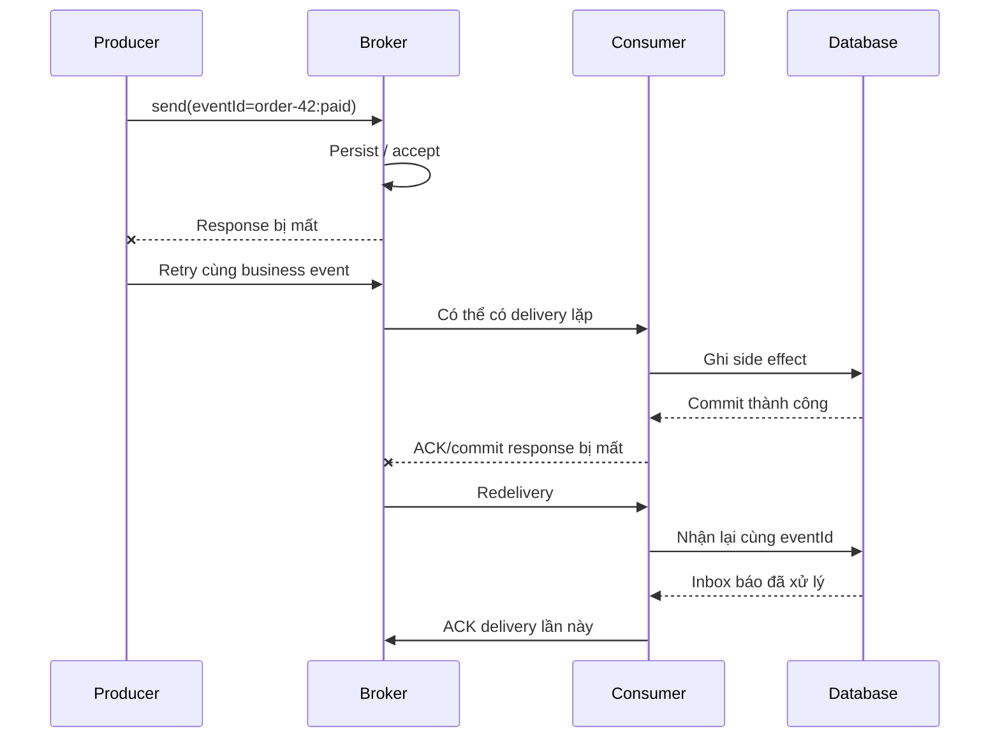
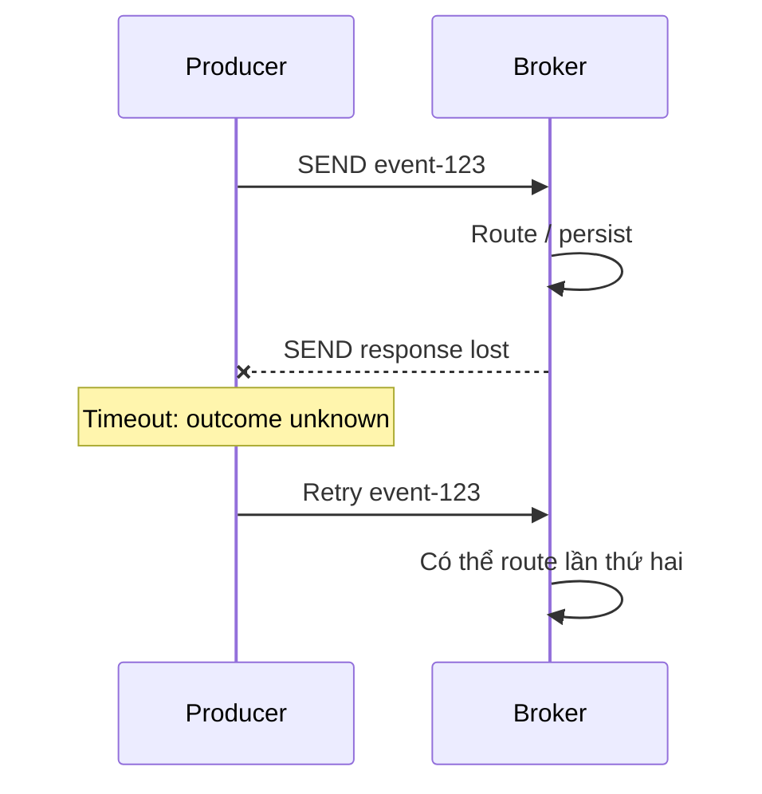
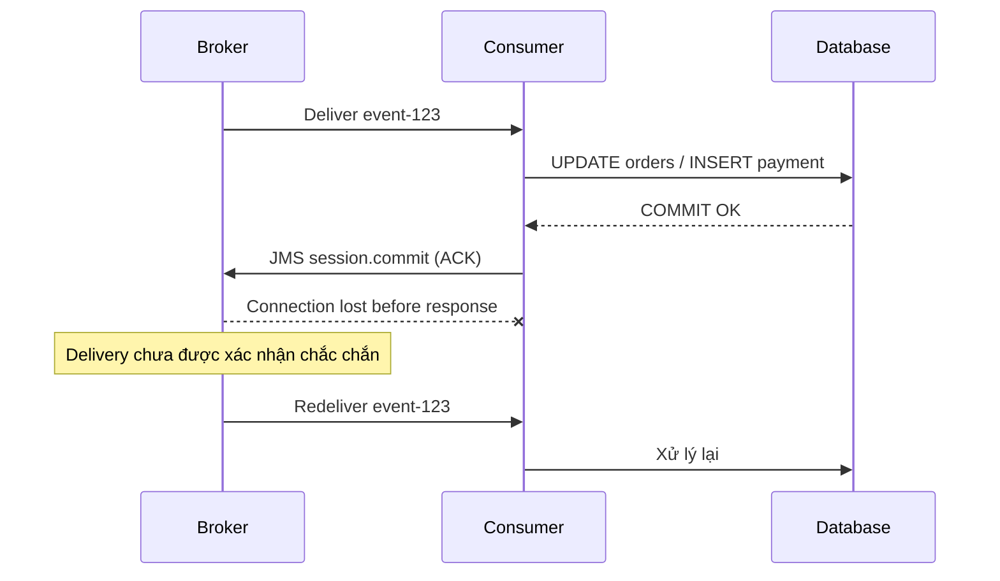
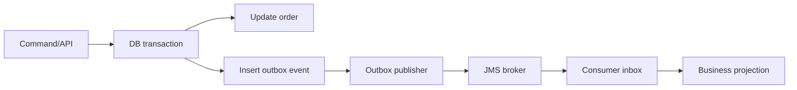

# Thông điệp lặp do timeout, reconnect, rollback hoặc thiếu chống lặp nghiệp vụ

> **Chương:** Chẩn đoán sự cố  
> **Phạm vi:** Apache ActiveMQ Classic và Artemis; producer send/commit, consumer acknowledgment, transaction rollback, reconnect/failover, redelivery, duplicate detection và idempotency ở tầng nghiệp vụ.  
> **Mục tiêu:** Phân biệt message redelivery với producer gửi trùng; nhận diện các cửa sổ kết quả không xác định sau timeout; dùng event ID ổn định, broker duplicate detection khi phù hợp và database inbox/outbox để bảo vệ side effect.

## 1. Vì sao một message có thể xuất hiện nhiều lần?

“Message bị lặp” thường được dùng để chỉ nhiều tình huống khác nhau. Cần xác định **cùng một business event** đã được tạo một lần nhưng broker giao nhiều lần, hay producer thực sự đã tạo và gửi nhiều message khác nhau cho cùng một nghiệp vụ.

Bốn nguyên nhân thường gặp:

1. **Producer timeout sau khi broker đã nhận message:** broker đã ghi nhận send/commit nhưng response bị mất. Producer không biết kết quả, retry có thể tạo message thứ hai.
2. **Consumer xử lý xong nhưng ACK chưa được broker ghi nhận:** broker thấy delivery chưa hoàn tất và redeliver. Side effect bên ngoài có thể đã xảy ra lần đầu.
3. **Transaction rollback hoặc session mất trước commit:** message nhận chưa ACK được trả về queue để giao lại.
4. **Reconnect/failover làm operation có kết quả không xác định:** kết nối mất đúng lúc send, commit hoặc ACK đang bay; client phục hồi connection nhưng ứng dụng phải xử lý trạng thái in-doubt.



Một hệ thống messaging thường phải chấp nhận **at-least-once processing** ở các cửa sổ lỗi. Mục tiêu thực tế là làm cho xử lý lặp trở thành an toàn bằng idempotency, thay vì giả định message chỉ có thể xuất hiện một lần trong mọi tình huống.

## 2. Phân biệt các dạng duplicate

| Hiện tượng | Điều thực sự xảy ra | Dấu hiệu cần kiểm tra |
| --- | --- | --- |
| Redelivery | Cùng một message broker giao lại sau khi chưa ACK/commit | Cùng business eventId, JMSRedelivered=true, delivery count tăng |
| Duplicate production | Producer gửi lại cùng business event sau timeout/unknown commit | Có thể có hai JMSMessageID khác nhau nhưng cùng eventId |
| Consumer side-effect duplicate | Consumer chạy cùng nghiệp vụ nhiều lần trước khi ACK thành công | Log/DB/API có cùng idempotency key |
| Retry tạo event mới sai cách | Mỗi lần retry sinh UUID mới dù là cùng một nghiệp vụ | Payload gần giống nhau nhưng eventId khác |
| Bridge/forward duplicate | Message được gửi lại khi bridge/reconnect không biết target đã nhận hay chưa | Duplicate ở destination đích; kiểm tra bridge và duplicate detection |
| Replay có chủ đích | Outbox, operator hoặc replay tool phát lại event lịch sử | Cùng event ID được phát trong một replay window |

**Không dùng số lượng message trong queue để kết luận ngay producer gửi trùng.** Một message có thể được giao lại nhiều lần nhưng vẫn chỉ là một record đang pending. Ngược lại, hai message được producer gửi riêng có thể có hai provider message ID nhưng cùng business event.

### 2.1. JMSMessageID không phải business idempotency key

JMSMessageID do provider gán cho một message đã được gửi. Khi ứng dụng retry cùng nghiệp vụ bằng một lần send mới, provider có thể cấp một JMSMessageID mới. Vì vậy không nên dùng nó làm khóa chống lặp nghiệp vụ.

JMSCorrelationID phục vụ tương quan request/reply hoặc liên kết message. Nó chỉ có thể làm idempotency key nếu ứng dụng chủ động định nghĩa contract như vậy; JMS không tự đảm bảo correlation ID duy nhất.

Tạo business event ID **một lần**, tại thời điểm nghiệp vụ được xác nhận, rồi giữ nguyên qua mọi retry:

```text
eventId          = order-42:payment-authorized:v1
aggregateId      = order-42
aggregateVersion = 7
producerId       = payment-service
correlationId    = checkout-request-991
```

Nếu retry lại payment event, eventId vẫn là order-42:payment-authorized:v1. Không sinh UUID mới mỗi lần gọi send.

## 3. Các cửa sổ lỗi ở producer: timeout không chứng minh broker chưa nhận

### 3.1. Send timeout sau khi broker đã nhận



Từ phía producer, timeout chỉ cho biết **client không nhận được kết quả trong deadline**. Nó không phân biệt được:
- Broker chưa nhận request.
- Broker nhận nhưng chưa xử lý xong.
- Broker xử lý thành công nhưng response mất trên network.
- Broker xử lý thành công, sau đó connection reset trước khi client đọc response.

Do đó, retry ngay bằng một message mới không có idempotency key có thể tạo duplicate.

### 3.2. Commit response bị mất

Với transacted JMS session, send đưa message vào transaction. session.commit() là mốc yêu cầu commit transaction. Nếu connection mất trong lúc commit:
- Commit có thể chưa đến broker.
- Broker có thể đã commit nhưng response bị mất.
- Client có thể nhận exception/timeout mà không biết chắc transaction đã được ghi nhận hay chưa.

Đây là **unknown outcome**, không được tự động diễn giải thành “commit chắc chắn rollback”. Retry an toàn cần một event ID ổn định và cơ chế dedup ở broker hoặc consumer.

### 3.3. ActiveMQ Classic Failover Transport

Classic Failover Transport cung cấp reconnect trên danh sách URI. Ví dụ:

```text
failover:(tcp://broker-a:61616,tcp://broker-b:61616)?randomize=false&initialReconnectDelay=100&maxReconnectDelay=5000&useExponentialBackOff=true&timeout=3000
```

- randomize=false: ưu tiên thử theo thứ tự URI đã khai báo.
- initialReconnectDelay, maxReconnectDelay, useExponentialBackOff: điều khiển nhịp reconnect.
- timeout=3000: send operation có thể fail sau 3 giây chờ; timeout không có nghĩa connection đã bị hủy hoặc broker chắc chắn chưa xử lý message.
- maxReconnectAttempts: giới hạn reconnect sau khi kết nối trước đó đã thành công; startupMaxReconnectAttempts điều khiển riêng giai đoạn startup.
- trackMessages=true: Failover Transport giữ cache message in-flight để flush lại khi reconnect. Đây là cơ chế phục hồi transport, không thay thế business idempotency; nếu broker đã nhận nhưng response mất, resend vẫn phải được xử lý an toàn.

Classic Failover Transport theo dõi transaction và replay transaction khi reconnect trong các tình huống hỗ trợ. Nếu failover xảy ra khi commit đang in-flight, transaction có thể ở trạng thái **in-doubt**. Tài liệu Classic mô tả trường hợp commit thất bại bằng TransactionRolledBackException để ứng dụng biết transaction cần được xử lý lại; với nhiều consumer/connection, thứ tự redelivery và ACK outstanding cần được kiểm thử riêng.

### 3.4. Artemis client reconnect cũng không giải quyết side effect nghiệp vụ

Artemis Core client có reconnect/failover options để kết nối lại và tái tạo session/consumer theo cấu hình. Dù client phục hồi thành công:
- Send/commit đang in-flight vẫn có thể có kết quả không xác định ở phía ứng dụng.
- Consumer có thể nhận lại message chưa ACK.
- Database hoặc HTTP call đã thực hiện không tự rollback chỉ vì JMS connection bị mất.

Phân biệt **client reconnect** với **business transaction recovery**. Reconnect làm transport tiếp tục hoạt động; idempotency xử lý trường hợp cùng event được thực thi lại.

## 4. Các cửa sổ lỗi ở consumer: DB commit và JMS ACK không phải một transaction mặc định

### 4.1. DB commit xong nhưng JMS ACK chưa commit

Đây là nguyên nhân phổ biến nhất của side effect lặp:



Database và broker có hai transaction manager độc lập. session.commit() chỉ commit JMS session; nó không tự commit/rollback JDBC transaction.

Nếu consumer chỉ làm:
1. Ghi DB.
2. Gọi session.commit().

thì crash giữa hai bước có thể khiến DB đã thay đổi nhưng message được redeliver. Consumer phải nhận diện event đã được xử lý.

### 4.2. ACK trước DB commit tạo nguy cơ mất nghiệp vụ

Đảo thứ tự cũng không an toàn:

1. ACK/commit JMS.
2. Ghi DB.
3. DB transaction thất bại hoặc process crash.

Broker đã coi message hoàn tất và không redeliver; business update có thể bị mất. Với side effect trong database, thường chọn **DB commit trước, JMS ACK sau**, đồng thời dùng inbox để làm redelivery an toàn.

### 4.3. AUTO_ACKNOWLEDGE, CLIENT_ACKNOWLEDGE và transacted session

| Mode | Mốc xác nhận | Rủi ro khi xử lý nghiệp vụ |
| --- | --- | --- |
| AUTO_ACKNOWLEDGE | Provider tự ACK theo semantics của receive()/listener callback | Với synchronous receive, ACK có thể xảy ra khi receive trả về trước khi business code hoàn tất |
| CLIENT_ACKNOWLEDGE | Ứng dụng gọi Message.acknowledge() | Trong một session, acknowledge có thể xác nhận tất cả message đã được session giao; cần hiểu batch/session scope |
| Transacted session | session.commit() xác nhận các receive trong transaction; rollback() redeliver | Dễ đặt ACK sau xử lý, nhưng transaction JMS không bao gồm JDBC mặc định |
| XA/JTA | Transaction manager phối hợp XA resources | Có thêm chi phí và quy trình recovery/in-doubt; không bao gồm side effect HTTP tùy ý |

Đối với consumer cần xử lý DB rồi ACK, transacted session thường giúp điều khiển rõ ràng:

```java
Session session = connection.createSession(
        true, Session.SESSION_TRANSACTED);

Message message = consumer.receive(5000);
if (message != null) {
    // Business work + DB transaction
    // Chỉ sau DB commit mới commit JMS ACK.
    session.commit();
}
```

Nếu DB transaction thất bại, rollback DB và gọi session.rollback() để broker giao lại. Nếu DB đã commit nhưng JMS commit lỗi, inbox sẽ nhận diện duplicate ở lần redelivery.

## 5. Quan sát redelivery mà không nhầm nó với idempotency

JMS cung cấp JMSRedelivered để báo message có đang được giao lại hay không. Jakarta Messaging cũng định nghĩa JMSXDeliveryCount: lần giao đầu có giá trị 1, từ 2 trở lên thể hiện đã redeliver. Provider không bắt buộc phải lưu chính xác giá trị này qua mọi failure/restart; dùng nó để chẩn đoán, không dùng làm business identity.

Ví dụ log:

```java
String eventId = message.getStringProperty("eventId");
boolean redelivered = message.getJMSRedelivered();

int deliveryCount = 1;
if (message.propertyExists("JMSXDeliveryCount")) {
    deliveryCount = message.getIntProperty("JMSXDeliveryCount");
}

log.warn("eventId={} redelivered={} deliveryCount={}",
        eventId, redelivered, deliveryCount);
```

Các trường này trả lời “broker có thể đã giao message trước đó không?”, không trả lời “business side effect đã commit chưa?”. Consumer vẫn phải tra inbox theo eventId.

## 6. Chống lặp ở consumer bằng transactional inbox

### 6.1. Bảng inbox có unique key

Một bảng PostgreSQL đơn giản:

```sql
CREATE TABLE consumer_inbox (
    consumer_name  varchar(120) NOT NULL,
    event_id       varchar(200) NOT NULL,
    processed_at   timestamptz NOT NULL DEFAULT now(),
    PRIMARY KEY (consumer_name, event_id)
);
```

consumer_name nằm trong khóa để cùng event có thể được xử lý độc lập bởi các logical consumer khác nhau. Nếu một event chỉ được xử lý một lần toàn hệ thống, contract có thể dùng event_id làm primary key; cần chọn scope phù hợp với nghiệp vụ.

### 6.2. Quy trình xử lý

Trong một DB transaction:
1. Thử insert (consumer_name, event_id).
2. Nếu insert thành công, thực hiện business update trong **cùng DB transaction**.
3. Nếu unique key đã tồn tại, event đã được xử lý; không chạy side effect lần nữa.
4. Commit DB transaction.
5. Chỉ sau đó commit JMS transaction để ACK.

Nếu process crash sau bước 4 trước bước 5, broker redeliver. Lần sau insert bị conflict, consumer bỏ qua business update và ACK message. Side effect trong DB chỉ được áp dụng một lần cho khóa inbox đó.

### 6.3. Java/Jakarta JMS + JDBC với PostgreSQL

Ví dụ dùng Jakarta Messaging và DataSource đã cấu hình sẵn. businessHandler phải dùng **cùng JDBC connection** được truyền vào để các thay đổi domain và inbox commit/rollback cùng nhau.

```java
import jakarta.jms.Connection;
import jakarta.jms.Message;
import jakarta.jms.MessageConsumer;
import jakarta.jms.Queue;
import jakarta.jms.Session;
import jakarta.jms.TextMessage;

import javax.sql.DataSource;
import java.sql.PreparedStatement;
import java.sql.SQLException;

public final class IdempotentConsumer {

    private final DataSource dataSource;
    private final BusinessHandler businessHandler;

    public IdempotentConsumer(
            DataSource dataSource,
            BusinessHandler businessHandler) {
        this.dataSource = dataSource;
        this.businessHandler = businessHandler;
    }

    public void run(Connection connection, String queueName)
            throws Exception {

        Session session = connection.createSession(
                true, Session.SESSION_TRANSACTED);
        Queue queue = session.createQueue(queueName);
        MessageConsumer consumer = session.createConsumer(queue);

        connection.start();

        try {
            while (!Thread.currentThread().isInterrupted()) {
                Message message = consumer.receive(1000);
                if (message == null) {
                    continue;
                }

                try {
                    String eventId =
                            message.getStringProperty("eventId");
                    String eventType =
                            message.getStringProperty("eventType");

                    if (!(message instanceof TextMessage)) {
                        throw new IllegalArgumentException(
                                "Expected TextMessage");
                    }
                    if (eventId == null || eventId.isBlank()) {
                        throw new IllegalArgumentException(
                                "Missing eventId");
                    }

                    String body = ((TextMessage) message).getText();

                    processOnce(eventId, eventType, body);

                    // DB đã commit. JMS ACK chỉ commit sau đó.
                    session.commit();

                } catch (Exception failure) {
                    try {
                        session.rollback();
                    } catch (Exception rollbackFailure) {
                        failure.addSuppressed(rollbackFailure);
                    }
                    throw failure;
                }
            }
        } finally {
            consumer.close();
            session.close();
        }
    }

    private void processOnce(
            String eventId,
            String eventType,
            String body) throws Exception {

        try (java.sql.Connection db = dataSource.getConnection()) {
            db.setAutoCommit(false);

            try {
                int inserted;
                String sql = """
                    INSERT INTO consumer_inbox
                        (consumer_name, event_id)
                    VALUES (?, ?)
                    ON CONFLICT (consumer_name, event_id) DO NOTHING
                    """;

                try (PreparedStatement ps =
                             db.prepareStatement(sql)) {
                    ps.setString(1, "order-projection-v1");
                    ps.setString(2, eventId);
                    inserted = ps.executeUpdate();
                }

                if (inserted == 1) {
                    // Tất cả thay đổi nghiệp vụ phải dùng db này.
                    businessHandler.apply(
                            db, eventType, eventId, body);
                } else {
                    // Event đã commit trước đó: no-op có chủ đích.
                    System.out.println(
                            "DUPLICATE_SKIPPED eventId=" + eventId);
                }

                db.commit();

            } catch (Exception failure) {
                try {
                    db.rollback();
                } catch (SQLException rollbackFailure) {
                    failure.addSuppressed(rollbackFailure);
                }
                throw failure;
            }
        }
    }

    public interface BusinessHandler {
        void apply(
                java.sql.Connection db,
                String eventType,
                String eventId,
                String body) throws Exception;
    }
}
```

**Điểm quan trọng của ví dụ:**

- INSERT ... ON CONFLICT DO NOTHING là cú pháp PostgreSQL. Với database khác, dùng cơ chế unique constraint/upsert tương ứng.
- Inbox insert và domain update nằm trong **cùng DB transaction**; không gọi một DataSource khác bên trong businessHandler.
- DB commit xong mới session.commit() để ACK. Nếu JMS commit lỗi, message có thể redeliver nhưng inbox ngăn update lần hai.
- Nếu businessHandler gọi HTTP/payment service, side effect HTTP không nằm trong JDBC transaction. Phải truyền idempotency key tới dịch vụ đó hoặc dùng workflow/outbox/saga có trạng thái riêng.
- consumer_name phải ổn định theo logical handler/version. Nếu đổi tên tùy tiện sau deploy, cùng event có thể bị xử lý lại trong inbox scope mới.

### 6.4. Inbox retention là một phần của correctness

Không xóa inbox record quá sớm. Retention cần lớn hơn:
- Thời gian retry tối đa của producer.
- Redelivery window và DLQ replay window.
- Thời gian operator có thể replay event lịch sử.
- Khoảng thời gian disaster recovery có thể khôi phục broker/store từ backup cũ.

Nếu inbox record đã bị xóa nhưng message cũ được replay, side effect có thể chạy lại. Với nghiệp vụ tài chính, có thể cần lưu idempotency key lâu dài hoặc lưu ledger business key độc lập với retention của message broker.

## 7. Chống duplicate ở producer bằng transactional outbox

Inbox bảo vệ consumer. Outbox bảo vệ ranh giới **database business transaction → message publish**.

### 7.1. Vì sao cần outbox?

Nếu ứng dụng:
1. Commit order trong DB.
2. Gửi OrderCreated tới broker.

thì crash giữa hai bước có thể tạo order nhưng không có event. Đảo thứ tự send trước DB commit có thể phát event cho order cuối cùng rollback.

Outbox ghi business change và event row trong **cùng một DB transaction**:



### 7.2. Schema outbox tối thiểu

```sql
CREATE TABLE outbox_event (
    event_id       varchar(200) PRIMARY KEY,
    aggregate_id   varchar(200) NOT NULL,
    event_type     varchar(160) NOT NULL,
    payload        jsonb NOT NULL,
    created_at     timestamptz NOT NULL DEFAULT now(),
    published_at   timestamptz,
    attempts       integer NOT NULL DEFAULT 0,
    locked_by      varchar(120),
    locked_until   timestamptz
);

CREATE INDEX outbox_unpublished_idx
    ON outbox_event (created_at)
    WHERE published_at IS NULL;
```

Transaction tạo order đồng thời insert outbox:

```sql
BEGIN;

INSERT INTO orders(order_id, status)
VALUES ('order-42', 'PAID');

INSERT INTO outbox_event(
    event_id, aggregate_id, event_type, payload
) VALUES (
    'order-42:paid:v1',
    'order-42',
    'OrderPaid',
    '{"orderId":"order-42","version":7}'::jsonb
);

COMMIT;
```

Publisher đọc các row chưa publish, gửi message có cùng event_id, đợi broker send/commit thành công rồi cập nhật published_at.

**Publisher vẫn có thể gửi trùng:** broker đã nhận message nhưng process crash trước khi cập nhật published_at. Khi restart, row vẫn pending và được gửi lại. Đây là lý do outbox phải kết hợp consumer inbox hoặc broker duplicate detection, chứ outbox không tự đảm bảo exactly-once delivery.

### 7.3. Claim row khi có nhiều publisher

Với PostgreSQL, nhiều publisher có thể claim batch bằng FOR UPDATE SKIP LOCKED trong transaction ngắn, sau đó gửi message ngoài transaction DB. Cần lưu lease/claim owner và thời điểm hết lease để worker chết không giữ row vĩnh viễn.

Không giữ DB row lock trong lúc chờ network send lâu; nó làm transaction kéo dài và gây contention. Một thiết kế thường dùng:
1. Claim rows và ghi locked_by, locked_until.
2. Commit claim.
3. Publish theo event ID.
4. Mark published sau broker confirmation.
5. Lease hết hạn thì worker khác có thể claim lại; duplicate được xử lý bằng event ID.

Nếu cần bảo toàn thứ tự theo aggregate, claim/dispatch phải giữ aggregateVersion tuần tự cho cùng aggregate_id; nhiều publisher có thể publish version 8 trước version 7 nếu không có partition/locking policy.

## 8. Artemis duplicate detection ở broker

Artemis hỗ trợ duplicate detection bằng message property đặc biệt **_AMQ_DUPL_ID**. Với JMS, giá trị property phải là String.

Ví dụ producer:

```java
TextMessage message = session.createTextMessage(payload);

message.setStringProperty("eventId", eventId);
message.setStringProperty("_AMQ_DUPL_ID", eventId);

producer.send(message);
```

Broker duy trì cache ID vòng (circular cache) **riêng cho từng address**:
- Nếu ID đã có trong cache của address, message duplicate sẽ không được route vào queue.
- Nếu ID chưa có, broker ghi nhận ID rồi route message.
- Cache có kích thước hữu hạn; khi đầy, ID mới ghi đè entry cũ.
- Message đã ACK hoặc expire không tự xóa ID khỏi cache.
- Mặc định hiện hành trong tài liệu Artemis là id-cache-size=20000; persist-id-cache=true mặc định và cache được lưu để có thể khôi phục sau restart.

### 8.1. Cấu hình cache

Fragment trong core:

```xml
<core>
    <id-cache-size>100000</id-cache-size>
    <persist-id-cache>true</persist-id-cache>

    <address-settings>
        <address-setting match="orders">
            <id-cache-size>100000</id-cache-size>
        </address-setting>
    </address-settings>
</core>
```

id-cache-size có thể đặt global hoặc per-address; cấu hình per-address ghi đè global cho address match. Chọn size theo **số unique IDs có thể xuất hiện trong cửa sổ retry/replay**, không chọn theo số message đang nằm trong queue.

Nếu hệ thống gửi 10.000 event/giây và có thể replay một event sau 30 phút, cửa sổ đó có thể chứa 18 triệu ID. Cache 20.000 không đủ để nhận diện duplicate sau 30 phút; ID cũ đã bị ghi đè. Đây là phép tính capacity cho cache, không phải khuyến nghị đặt một con số cố định cho mọi broker.

### 8.2. Giới hạn của broker duplicate detection

- Cache là **per address**: cùng ID gửi tới address khác không được coi là duplicate chung toàn broker.
- Cache hữu hạn: duplicate đến sau khi ID bị eviction có thể được route lại.
- Duplicate detection chỉ ngăn broker route message lặp ở address nhận; nó không bảo vệ side effect DB/HTTP đã chạy ở consumer.
- Nếu producer sinh ID mới ở mỗi retry, broker không nhận ra đó là cùng business event.
- Nếu nhiều queue được route từ một address, detection xảy ra trước routing tới các queue của address đó theo cơ chế broker.
- Cấu hình persist-id-cache=true có chi phí ghi/persist ID; đánh giá performance cùng workload thật.

### 8.3. Duplicate detection trong transaction

Khi producer gửi message theo transaction, ID phải đại diện cho từng business event và được giữ ổn định qua retry. Tài liệu Artemis mô tả nếu broker phát hiện duplicate ID trong transaction thì transaction đó có thể bị bỏ qua theo duplicate-detection semantics; vì vậy cần test batch/transaction boundary cụ thể, đặc biệt khi một transaction chứa nhiều message và có một ID trùng.

**Broker duplicate detection là lớp tối ưu chống duplicate trên đường gửi. Consumer inbox vẫn là hàng rào cuối cho side effect nghiệp vụ.**

## 9. ActiveMQ Classic: redelivery policy và chống lặp ở tầng ứng dụng

Classic cung cấp redelivery policy ở client/broker để điều khiển delay, exponential backoff và số lần giao lại. Đây là **retry policy**, không phải dedup theo business event ID.

Ví dụ Java với Classic client:

```java
import org.apache.activemq.ActiveMQConnectionFactory;
import org.apache.activemq.RedeliveryPolicy;

ActiveMQConnectionFactory factory =
        new ActiveMQConnectionFactory(
            "failover:(tcp://broker-a:61616,tcp://broker-b:61616)"
            + "?randomize=false&timeout=3000");

RedeliveryPolicy policy = factory.getRedeliveryPolicy();
policy.setInitialRedeliveryDelay(1000);
policy.setUseExponentialBackOff(true);
policy.setBackOffMultiplier(2.0);
policy.setMaximumRedeliveryDelay(30000);
policy.setMaximumRedeliveries(5);
```

Với cấu hình trên, consumer retry có delay tăng dần, tối đa 30 giây và tối đa 5 redeliveries trước khi message được coi là poison theo policy. Cần đối chiếu cách đếm initial delivery và redelivery attempts trong dashboard/runbook; không cộng số lần receive một cách tùy tiện.

Ví dụ Artemis address setting:

```xml
<address-settings>
    <address-setting match="orders">
        <redelivery-delay>1000</redelivery-delay>
        <redelivery-delay-multiplier>2.0</redelivery-delay-multiplier>
        <max-redelivery-delay>30000</max-redelivery-delay>
        <max-delivery-attempts>6</max-delivery-attempts>
        <dead-letter-address>DLQ</dead-letter-address>
    </address-setting>
</address-settings>
```

Artemis max-delivery-attempts tính delivery attempts theo semantics broker; giá trị 6 thường có nghĩa cho phép tổng số lần giao theo giới hạn đó trước khi chuyển DLQ. Xác minh bằng test trên đúng version để thống nhất cách hiển thị giữa broker và application logs.

**Không dùng retry vô hạn với lỗi nghiệp vụ không thể tự hồi phục.** Retry nhanh làm broker thrash, chiếm CPU/network và có thể giữ một message lỗi đầu queue. Dùng delay/backoff, giới hạn attempts, DLQ/quarantine và quy trình sửa/replay.

## 10. Vì sao JMSRedelivered và delivery count không thể thay inbox?

Giả sử consumer nhận event-42, commit DB, sau đó ACK chưa tới broker. Lần sau broker redeliver, JMSRedelivered=true giúp log biết có redelivery. Nhưng nếu consumer bỏ qua message chỉ vì JMSRedelivered=true, nó có thể bỏ một message mà DB **chưa từng commit** lần đầu.

Ngược lại, duplicate production có thể tạo message mới với JMSRedelivered=false nhưng eventId trùng message cũ. Vì vậy:

- JMSRedelivered và JMSXDeliveryCount: **delivery diagnostics**.
- eventId: **business identity**.
- Inbox unique constraint: **business deduplication**.
- _AMQ_DUPL_ID: **Artemis broker-side send deduplication**.
- DLQ: **cách ly message retry thất bại**, không phải idempotency.

## 11. Những lỗi idempotency thường gặp

| Sai lầm | Vì sao không an toàn | Cách sửa |
| --- | --- | --- |
| Tạo UUID mới mỗi lần retry | Broker/consumer thấy các event khác nhau | Sinh eventId một lần và lưu bền vững |
| Dùng JMSMessageID làm business key | Provider có thể cấp ID mới khi send lại | Dùng domain event ID |
| Chỉ kiểm tra JMSRedelivered | Producer duplicate có thể không mang redelivered flag | Dedup bằng event ID |
| Ghi inbox rồi commit DB, nhưng domain update ở transaction khác | Inbox có thể commit mà side effect thất bại hoặc ngược lại | Cùng một DB transaction |
| ACK JMS trước DB commit | Crash sau ACK có thể mất business update | DB commit rồi JMS ACK, kèm inbox |
| Gọi payment API rồi mới ghi inbox | Crash có thể gọi payment lần hai | Truyền idempotency key tới payment API |
| Inbox retention quá ngắn | Replay cũ đến sau khi record bị xóa | Retention vượt replay/recovery window |
| Cache Artemis quá nhỏ | ID bị eviction trước khi producer retry | Capacity theo peak unique ID rate × retry window |
| Retry commit timeout vô hạn | Unknown outcome tạo duplicate liên tục | Deadline, backoff, stable ID, reconciliation |
| Dùng DLQ như nơi xóa duplicate | Message hợp lệ có thể bị chuyển DLQ nhầm | Dedup trước business side effect |

## 12. Chẩn đoán duplicate theo timeline

Khi có phản ánh “đơn hàng bị xử lý hai lần”, thu thập bằng chứng theo một eventId cụ thể:

1. **Producer:** thời điểm tạo event, event ID, số lần send attempt, commit result/timeout, connection URI và reconnect count.
2. **Broker:** broker/address/queue, JMSMessageID, enqueue/dequeue, redelivery count/flag, duplicate-detection warning, transaction outcome và DLQ.
3. **Consumer:** consumer instance, delivery timestamp, JMSRedelivered, delivery count, inbox insert result, DB commit, JMS commit/rollback.
4. **Downstream:** idempotency key gửi tới HTTP/payment API, response, request ID và side effect đã commit.
5. **Replay/retry:** operator replay, outbox retry, scheduler, application retry policy và deployment/restart timestamp.

### 12.1. Ma trận chẩn đoán nhanh

| Dấu hiệu | Nguyên nhân có khả năng | Bằng chứng xác nhận |
| --- | --- | --- |
| Cùng eventId, hai JMSMessageID, cả hai JMSRedelivered=false | Producer gửi lại sau timeout hoặc outbox retry | Producer send log, broker enqueue count |
| Cùng eventId, JMSRedelivered=true | Consumer ACK/transaction chưa hoàn tất | Consumer rollback, connection loss, delivery count |
| Một JMSMessageID, nhiều lần consumer receive | Redelivery của cùng message | Broker delivery/ack logs, consumer instance restart |
| DB có hai row side effect cùng event | Thiếu unique business constraint/inbox hoặc side effect ngoài transaction | DB audit, transaction boundaries |
| Duplicate chỉ sau broker restart/replay dài | Artemis duplicate cache eviction/ID cache not persisted hoặc replay window vượt cache | id-cache-size, persist-id-cache, broker logs |
| Duplicate xuất hiện khi failover Classic | Send/commit in-flight hoặc client retry | Failover transport logs, TransactionRolledBackException |
| Duplicate sau DLQ replay | Replay tạo ID mới hoặc inbox retention hết hạn | DLQ operator log, event ID và inbox retention |
| Message redelivered nhưng không có DB effect | Consumer rollback trước DB commit hoặc validation failure | DB audit và exception stack |

### 12.2. Log structured để đối chiếu

Mỗi log xử lý message nên có tối thiểu:

```json
{
  "eventId": "order-42:payment-authorized:v1",
  "aggregateId": "order-42",
  "aggregateVersion": 7,
  "jmsMessageId": "ID:broker-1-12345-678:1:1:1",
  "jmsRedelivered": true,
  "jmsxDeliveryCount": 2,
  "consumerName": "payment-projection-v1",
  "consumerInstance": "pod-3",
  "inboxInserted": false,
  "dbCommitted": true,
  "jmsCommitted": true
}
```

Không log toàn bộ payload nhạy cảm. eventId, broker/queue, message ID, delivery flag, consumer instance và commit outcome thường đủ để dựng timeline; log token/payment details phải tuân theo chính sách dữ liệu.

## 13. Test lab: tái tạo bốn cửa sổ duplicate

Dùng queue lab riêng và event ID cố định lab-order-42:paid:v1. Không dùng side effect thật như charge thẻ; thay bằng bảng counter trong database test.

### Test A — Producer response mất sau khi broker nhận

1. Gửi persistent message với event ID cố định.
2. Dùng proxy/fault injection ngắt response path sau khi broker đã nhận request.
3. Producer timeout và retry cùng event ID.
4. Không bật broker duplicate detection trước tiên để quan sát khả năng duplicate production.
5. Kiểm tra queue có thể chứa hai message với hai provider IDs nhưng cùng event ID.
6. Bật Artemis _AMQ_DUPL_ID hoặc consumer inbox, chạy lại và xác nhận chỉ một business side effect.

### Test B — Consumer DB commit xong, JMS ACK chưa commit

1. Consumer nhận message bằng transacted session.
2. Inbox insert và business update trong một DB transaction, commit DB.
3. Dừng process trước session.commit().
4. Khởi động consumer lại.
5. Broker redeliver message; inbox insert conflict và business update không chạy lần hai.
6. Consumer commit JMS transaction để ACK.

### Test C — Rollback liên tục

1. Consumer nhận message.
2. Cố ý throw exception trước DB commit.
3. Rollback DB và JMS session.
4. Quan sát JMSRedelivered/JMSXDeliveryCount, redelivery delay và số attempt.
5. Sau giới hạn, kiểm tra message chuyển DLQ theo broker policy.
6. Sửa nguyên nhân, replay từ DLQ bằng cùng event ID; inbox xử lý no-op nếu event đã hoàn tất trước đó.

### Test D — Commit response mất trong failover

1. Gửi/nhận theo transaction.
2. Fault-inject broker/network trong lúc commit() đang chờ.
3. Ghi nhận exception và phân loại transaction outcome unknown/in-doubt.
4. Reconnect và kiểm tra event ID trong broker/inbox.
5. Retry chỉ với event ID ổn định.
6. Xác nhận không tạo side effect thứ hai.

### 13.1. Điều kiện PASS

- Một business event có cùng eventId qua mọi lần retry/replay.
- Producer timeout không bị diễn giải thành chắc chắn send thất bại.
- Consumer DB update và inbox insert nằm cùng transaction.
- DB commit trước JMS ACK; ACK lỗi dẫn tới redelivery nhưng không chạy side effect lần hai.
- JMSRedelivered/delivery count được ghi log nhưng không dùng làm idempotency key.
- Artemis duplicate cache được kiểm tra cả eviction và restart behavior.
- Classic failover/transaction replay được kiểm thử với client version đang triển khai.
- DLQ replay giữ nguyên event ID và có audit trail.
- Side effect HTTP/payment có idempotency key hoặc cơ chế reconciliation riêng.

## 14. Checklist thiết kế và vận hành

- [ ] Business event ID được sinh một lần và lưu bền vững trước publish.
- [ ] Retry producer dùng lại cùng event ID, không tạo UUID mới.
- [ ] JMSMessageID chỉ dùng để trace provider message, không dùng làm business key.
- [ ] Producer timeout/commit timeout được coi là unknown outcome cho tới khi reconcile.
- [ ] Consumer có unique inbox constraint theo đúng logical consumer scope.
- [ ] Inbox insert và DB domain update cùng một DB transaction.
- [ ] DB commit xảy ra trước JMS ACK/commit.
- [ ] Consumer redelivery an toàn và có idempotent handler.
- [ ] HTTP/payment side effect nhận idempotency key hoặc có reconciliation workflow.
- [ ] Artemis _AMQ_DUPL_ID dùng ID ổn định; id-cache-size đủ lớn cho retry/replay window.
- [ ] Artemis persist-id-cache được quyết định theo durability/performance yêu cầu.
- [ ] Classic Failover Transport, timeout, trackMessages và transaction behavior được cấu hình/test theo version.
- [ ] Redelivery delay/backoff và maximum attempts có giới hạn.
- [ ] DLQ có alert, retention, audit và quy trình replay.
- [ ] Inbox retention vượt thời gian retry, redelivery, DLQ replay và disaster recovery.
- [ ] Log có event ID, provider message ID, redelivery flag/count, consumer instance và commit result.
- [ ] Đã fault-inject producer response loss, consumer ACK loss, rollback và broker reconnect.

## 15. Câu hỏi tự kiểm tra

1. Vì sao producer timeout không chứng minh broker chưa nhận message?
2. Tại sao retry cùng business event với UUID mới làm dedup thất bại?
3. JMSMessageID khác eventId như thế nào?
4. Consumer DB commit xong nhưng JMS ACK chưa commit có thể gây điều gì?
5. Vì sao ACK trước DB commit có nguy cơ mất business update?
6. JMSRedelivered và JMSXDeliveryCount có thể thay inbox không?
7. Inbox insert và business update phải nằm trong cùng transaction nào?
8. Nếu business handler gọi payment HTTP API, JDBC inbox có tự bảo vệ side effect HTTP không?
9. Artemis _AMQ_DUPL_ID được cache theo phạm vi nào?
10. Vì sao id-cache-size quá nhỏ làm duplicate detection mất tác dụng sau một khoảng thời gian?
11. Classic Failover Transport timeout có nghĩa connection bị đóng ngay không?
12. trackMessages=true có thay thế idempotency ở consumer không?
13. Outbox vẫn có thể publish trùng trong cửa sổ lỗi nào?
14. Vì sao phải giữ inbox record đủ lâu để bao phủ DLQ replay/disaster recovery?

**Gợi ý:** (1) response có thể mất sau khi broker đã commit; (2) mỗi lần retry trở thành identity mới; (3) provider ID vs business identity; (4) redelivery và side effect lặp; (5) ACK rồi crash trước DB commit làm mất event; (6) không; (7) DB transaction chứa cả inbox và domain update; (8) không, API cần idempotency key/reconciliation; (9) per address; (10) cache vòng ghi đè ID cũ; (11) không, timeout chỉ làm send operation fail, connection có thể còn; (12) không; (13) broker đã nhận nhưng publisher crash trước khi đánh dấu outbox published; (14) replay cũ không được chạy side effect lần nữa.

## 16. Tài liệu tham khảo

- [Jakarta Messaging 3.1 — Duplicate delivery, JMSRedelivered, JMSXDeliveryCount và acknowledgment](https://jakarta.ee/specifications/messaging/3.1/jakarta-messaging-spec-3.1.html): semantics giao lại và xác nhận message.
- [Apache ActiveMQ Artemis — Duplicate Message Detection](https://artemis.apache.org/components/artemis/documentation/latest/duplicate-detection.html): _AMQ_DUPL_ID, cache per-address, id-cache-size, persistence và giới hạn cache vòng.
- [Apache ActiveMQ Artemis — Message Redelivery and Undelivered Messages](https://artemis.apache.org/components/artemis/documentation/latest/undelivered-messages.html): delayed redelivery, delivery attempts và dead-letter address.
- [Apache ActiveMQ Classic — Failover Transport Reference](https://activemq.apache.org/components/classic/documentation/failover-transport-reference): reconnect, send timeout, message tracking và transaction replay.
- [Apache ActiveMQ Classic — Redelivery Policy](https://activemq.apache.org/components/classic/documentation/redelivery-policy): delay, exponential backoff và maximum redeliveries.
- [Apache ActiveMQ Classic — Message Redelivery and DLQ Handling](https://activemq.apache.org/components/classic/documentation/message-redelivery-and-dlq-handling): rollback, recover, connection timeout và DLQ.
- [Transactional Outbox pattern — microservices.io](https://microservices.io/patterns/data/transactional-outbox.html): ghi business state và outbox event trong cùng transaction.
- [Idempotent Consumer pattern — microservices.io](https://microservices.io/post/microservices/patterns/2020/10/16/idempotent-consumer.html): unique message ID và transactional inbox.

> **Ghi nhớ:** Reconnect, timeout và rollback có thể làm cùng business event xuất hiện lại. Hãy giữ eventId ổn định từ producer, coi timeout/commit interruption là kết quả chưa chắc chắn, xử lý DB bằng transactional inbox rồi mới ACK JMS. Artemis _AMQ_DUPL_ID và Classic failover/redelivery policy hỗ trợ ở tầng broker/client; **idempotency của side effect nghiệp vụ vẫn phải được thực hiện ở ứng dụng và hệ thống đích**.
