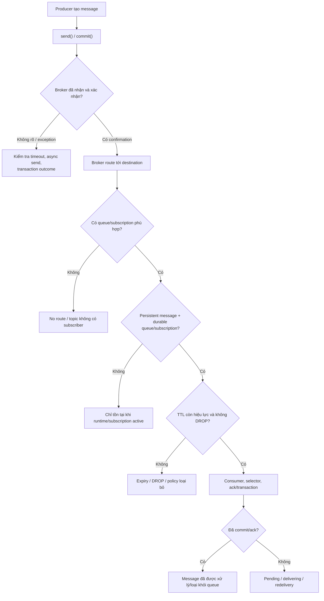

# Thông điệp mất hoặc hết hạn do delivery mode, subscription hay chính sách DROP

> **Chương:** Chẩn đoán sự cố  
> **Phạm vi:** Apache ActiveMQ Classic và Artemis trong Java/JMS; điều tra message không tới consumer, biến mất sau restart, không được route do subscription, bị loại bởi resource policy hoặc hết hạn trước dispatch.  
> **Mục tiêu:** Lần theo logical event từ producer tới broker, queue/subscription và consumer; phân biệt non-persistent delivery, non-durable topic subscription, selector/no-route, TTL expiration và các chính sách DROP; kết luận bằng event ID và trạng thái broker.

## 1. “Producer gửi thành công nhưng consumer không thấy” chưa đủ để kết luận broker làm mất message

Các nguyên nhân thường gặp:

- Producer gửi **NON_PERSISTENT**; broker không cam kết khôi phục message sau crash/restart.
- Producer gửi vào topic nhưng subscriber là **non-durable** hoặc offline; topic không giữ bản sao cho subscriber chưa tồn tại.
- Durable subscription được tạo với **clientID**, subscription name hoặc selector khác lần trước.
- Artemis topic address không có multicast queue/subscription phù hợp; message không có queue đích để route.
- Queue/address có **purge-on-no-consumers**, auto-delete hoặc lifecycle policy làm xóa dữ liệu khi consumer disconnect.
- Message đã hết **JMSExpiration**; broker loại bỏ hoặc chuyển tới expiry destination.
- Artemis address đầy và **address-full-policy=DROP**, **page-full-policy=DROP** hoặc **disk-full-policy=DROP** đang có hiệu lực.
- Classic producer flow control, async send, store/memory/temp usage làm producer block, timeout hoặc không nhận confirmation như ứng dụng giả định.
- Message vẫn tồn tại nhưng selector, **noLocal**, acknowledgment, transaction hoặc destination name khiến consumer không nhận được nó.

Điều tra theo chuỗi:



Một lần send không phải bằng chứng consumer đã xử lý. Producer không nhận exception cũng chưa chứng minh message đã route tới **subscription mong muốn**, còn hạn và vẫn nằm trong queue.

## 2. Thu thập bằng chứng trước khi thay cấu hình

Chọn một message đại diện và thu thập các trường ở producer, broker và consumer:

| Trường | Nguồn | Câu hỏi cần trả lời |
|---|---|---|
| **eventId** | Application property | Logical event nào đang được điều tra? |
| **JMSMessageID** | JMS provider sau send | Provider đã gán ID cho lần gửi nào? |
| **JMSCorrelationID** | JMS header | Message thuộc request/workflow nào? |
| Destination | Producer và broker | Đã gửi đúng queue/topic/address chưa? |
| **JMSDeliveryMode** | Producer/consumer | Persistent hay non-persistent? |
| **JMSExpiration** | JMS header | Message còn hạn tại thời điểm điều tra không? |
| **JMSRedelivered**, **JMSXDeliveryCount** | Consumer/provider | Có delivery trước đó hoặc rollback không? |
| Client ID + subscription name | Subscriber | Có đang attach đúng durable subscription không? |
| Selector, **noLocal** | Consumer config | Message có đủ điều kiện lọt qua filter không? |
| Send/commit result | Producer | Send đã commit hay outcome còn UNKNOWN? |
| Queue depth, delivering, expiry/DLQ counts | Broker | Message đang pending, in-flight, expired hay đã route nơi khác? |

**Dùng eventId làm khóa đối soát nghiệp vụ.** JMSMessageID có thể thay đổi khi producer gửi lại hoặc bridge/redrive tạo message mới. Đừng chỉ tìm theo message ID rồi kết luận event chưa từng được gửi.

### 2.1. Xác định chính xác broker, client và protocol

Ghi lại broker/product/version, client artifact/version, JMS namespace (javax.jms hay jakarta.jms), protocol, destination type, routing type, persistence store, delivery mode, TTL, transaction mode, async-send options và subscription identity. Không áp cấu hình Classic sang Artemis chỉ vì cả hai đều cung cấp JMS API.

## 3. Delivery mode: persistent và non-persistent

JMS định nghĩa hai delivery modes:

| Delivery mode | Ý nghĩa | Sau broker restart/crash |
|---|---|---|
| **PERSISTENT** | Provider phải lưu message bền vững theo semantics của broker/store | Có thể phục hồi nếu destination/store và broker persistence đúng, send/transaction đã được xác nhận |
| **NON_PERSISTENT** | Không yêu cầu provider lưu bền vững | Không có cam kết message còn sau broker failure/restart |

JMS producer mặc định dùng PERSISTENT nếu ứng dụng không đổi delivery mode. Tuy nhiên, delivery mode có thể được thay ở cấp producer hoặc từng lần send:

```java
producer.setDeliveryMode(jakarta.jms.DeliveryMode.NON_PERSISTENT);

// Override cho riêng message:
producer.send(
    message,
    jakarta.jms.DeliveryMode.NON_PERSISTENT,
    jakarta.jms.Message.DEFAULT_PRIORITY,
    0L
);
```

Nếu producer/framework có cấu hình ở nơi khác, đọc message.getJMSDeliveryMode() ở consumer hoặc message browser để xác nhận mode thực tế; đừng suy từ tên method hay default.

### 3.1. Persistent vẫn cần destination bền vững và broker store

Để kỳ vọng message sống qua restart, phải đồng thời kiểm tra:

1. Producer gửi PERSISTENT.
2. Queue đích là durable, hoặc topic có durable subscription đang tồn tại.
3. Broker persistence/store được bật và hoạt động bình thường.
4. Transaction producer đã commit nếu dùng transacted Session.
5. Broker đã xử lý send theo confirmation semantics mà ứng dụng dựa vào.
6. Message chưa bị expire, purge, DROP, ack hoặc quản trị viên xóa.

PERSISTENT không thể biến một non-durable topic subscription thành durable subscription. Nó cũng không tự tạo queue/subscription để lưu bản sao cho subscriber sẽ được tạo trong tương lai.

### 3.2. Producer gửi persistent và commit rõ ràng

```java
import jakarta.jms.Connection;
import jakarta.jms.ConnectionFactory;
import jakarta.jms.DeliveryMode;
import jakarta.jms.MessageProducer;
import jakarta.jms.Queue;
import jakarta.jms.Session;
import jakarta.jms.TextMessage;

public final class ReliablePublisher {

    public static void publish(
            ConnectionFactory factory,
            String eventId,
            String payload) throws Exception {

        Connection connection = factory.createConnection();
        try {
            Session session = connection.createSession(
                true, Session.SESSION_TRANSACTED);
            try {
                Queue queue = session.createQueue("orders.commands");
                MessageProducer producer = session.createProducer(queue);
                try {
                    producer.setDeliveryMode(DeliveryMode.PERSISTENT);
                    TextMessage message = session.createTextMessage(payload);
                    message.setStringProperty("eventId", eventId);
                    message.setStringProperty("eventType", "OrderCreated");

                    producer.send(message);
                    session.commit();
                } catch (Exception failure) {
                    try {
                        session.rollback();
                    } catch (Exception rollbackFailure) {
                        failure.addSuppressed(rollbackFailure);
                    }
                    throw failure;
                } finally {
                    producer.close();
                }
            } finally {
                session.close();
            }
        } finally {
            connection.close();
        }
    }
}
```

Nếu commit ném exception vì kết nối đứt, outcome có thể là **UNKNOWN**: broker có thể đã commit nhưng confirmation không về producer. Retry cùng logical event phải giữ eventId và consumer phải idempotent. Không tạo eventId mới mỗi lần retry rồi đếm thành event khác.

### 3.3. Classic: async send có thể làm producer không nhận được feedback

ActiveMQ Classic thường gửi non-persistent messages theo đường asynchronous. Producer có thể return mà không đợi broker acknowledgment cho từng message; khi resource limit bị vượt, producer không nhất thiết nhận được lỗi ngay. Classic cung cấp ProducerWindowSize hoặc alwaysSyncSend để kiểm soát feedback của async producer.

Với persistent messages, synchronous send thường chờ producer acknowledgment từ broker; nhưng useAsyncSend có thể thay đổi hành vi. Khi điều tra:

- Kiểm tra connection factory có useAsyncSend hay không.
- Kiểm tra ProducerWindowSize hoặc alwaysSyncSend nếu cần feedback.
- Đối chiếu thời điểm send return với broker log/store/queue state.
- Xác nhận producer transaction đã commit hay bị rollback.
- Phân loại send timeout thành FAILED hoặc UNKNOWN; không tự coi timeout là chắc chắn chưa được gửi.

### 3.4. Artemis: message durable và queue durable

Artemis map JMS Queue sang address với một Anycast queue. Đối với durable recovery, message cần durable/persistent và queue cần durable. Nếu queue được cấu hình durable="false", không thể dựa vào persistent delivery mode để biến queue thành durable.

```xml
<addresses>
    <address name="orders.commands">
        <anycast>
            <queue name="orders.commands" durable="true"/>
        </anycast>
    </address>
</addresses>
```

Đây là fragment trong broker.xml; ghép vào phần addresses hiện có. Kiểm tra queue thực tế qua management API, vì auto-create hoặc deployment có thể tạo queue với thuộc tính khác dự kiến.

## 4. Topic subscription: persistent message không cứu được subscriber non-durable

### 4.1. Queue và Topic có quy tắc lưu giữ khác nhau

| Mô hình | Khi consumer offline | Ai nhận message? |
|---|---|---|
| Durable Queue | Message vẫn pending trong durable queue nếu persistent và chưa hết hạn | Consumer phù hợp kế tiếp |
| Non-durable Topic subscription | Không giữ bản sao cho subscriber khi subscriber không active | Chỉ subscriber active tại thời điểm publish |
| Durable Topic subscription | Giữ một bản sao cho subscription khi subscriber offline, nếu message persistent | Đúng subscription identity khi reconnect |
| Artemis Topic address không có subscription queue | Không có queue multicast để route | Message có thể bị drop vì không có route |

Với Topic, mỗi subscription có một bản sao logic riêng. Nếu có ba durable subscribers thì broker cần giữ message cho từng subscription tới khi từng subscriber xử lý/ack hoặc message hết hạn.

### 4.2. Classic durable topic subscription cần client ID và subscription name ổn định

Trong JMS, durable subscription được nhận diện bằng cặp client ID của Connection và subscription name. Khi ứng dụng restart, phải reconnect bằng cùng hai giá trị để gắn lại đúng subscription. Nếu đổi một trong hai, ứng dụng có thể tạo subscription khác và nhìn thấy queue trống, trong khi message cũ vẫn nằm ở subscription cũ.

Subscription phải được tạo trước khi publisher phát các message cần giữ. Durable subscription mới tạo không nhận lại những topic messages đã được publish trước thời điểm subscription tồn tại.

Ví dụ JMS 2.0:

```java
import jakarta.jms.Connection;
import jakarta.jms.ConnectionFactory;
import jakarta.jms.MessageConsumer;
import jakarta.jms.Session;
import jakarta.jms.Topic;

public final class DurableTopicReader {

    public static void start(ConnectionFactory factory) throws Exception {
        Connection connection = factory.createConnection();
        try {
            connection.setClientID("billing-projection-v1");

            Session session = connection.createSession(
                false, Session.AUTO_ACKNOWLEDGE);
            Topic topic = session.createTopic("orders.events");
            MessageConsumer consumer =
                session.createDurableConsumer(topic, "billing-projection");

            connection.start();
            jakarta.jms.Message message = consumer.receive(5_000L);
            if (message != null) {
                System.out.println(message.getJMSMessageID());
            }
            consumer.close();
            session.close();
            // close() detach consumer nhưng vẫn giữ durable subscription.
            // Chỉ unsubscribe khi chủ đích xóa backlog/subscription.
            connection.close();
        } catch (Exception failure) {
            try {
                connection.close();
            } catch (Exception closeFailure) {
                failure.addSuppressed(closeFailure);
            }
            throw failure;
        }
    }
}
```

Trong ứng dụng thật, listener container quản lý lifecycle và reconnect. Khi cần xóa durable subscription, thao tác unsubscribe sẽ xóa trạng thái broker giữ cho subscription đó; không dùng trong routine shutdown nếu muốn nhận lại message offline.

### 4.3. Message gửi tới durable subscriber phải là persistent

```java
Topic topic = session.createTopic("orders.events");
MessageProducer producer = session.createProducer(topic);
producer.setDeliveryMode(DeliveryMode.PERSISTENT);

TextMessage event = session.createTextMessage("{\"orderId\":\"ORD-42\"}");
event.setStringProperty("eventId", "order-created:ORD-42:v1");
producer.send(event);
```

Nếu subscriber offline và publisher gửi NON_PERSISTENT, không kỳ vọng broker lưu bản sao để subscriber nhận sau khi reconnect.

### 4.4. Artemis: mỗi subscription là một multicast queue

Artemis map JMS Topic thành address cùng tên; mỗi subscription được biểu diễn bằng một multicast queue gắn vào address. Tên queue subscription dựa trên durability, client ID và subscription name.

- Có durable subscription queue và persistent message: broker có nơi giữ message cho subscriber offline.
- Subscription non-durable thường dùng temporary queue; queue bị xóa khi subscription kết thúc.
- Nếu address không có queue nào gắn vào, message gửi tới topic address không có nơi route và có thể bị drop.
- Nhiều durable subscribers nhận các bản sao riêng, không tranh nhau một bản như consumer group trên queue.

```xml
<addresses>
    <address name="orders.events">
        <multicast>
            <queue name="orders-events-billing" durable="true"/>
        </multicast>
    </address>
</addresses>
```

Đây là queue multicast được cấu hình tĩnh; nếu dùng JMS durable subscription, ưu tiên tạo/reattach qua JMS API để broker quản lý identity theo client ID và subscription name. Không tự đặt queue name tùy ý rồi cho rằng JMS client sẽ tự nhận đó là durable subscription của mình.

### 4.5. purge-on-no-consumers có thể xóa message khi consumer cuối disconnect

Artemis hỗ trợ purge-on-no-consumers cho queue. Khi đặt true, queue bị purge khi consumer cuối detach và không nhận message mới tới khi consumer mới attach. Đây là hành vi phù hợp với queue muốn mô phỏng non-durable subscription, nhưng sẽ gây mất backlog nếu áp nhầm cho queue cần giữ message offline.

```xml
<addresses>
    <address name="orders.events.ephemeral">
        <multicast>
            <queue name="orders-events-live-only"
                   durable="true"
                   purge-on-no-consumers="true"/>
        </multicast>
    </address>
</addresses>
```

Kiểm tra cấu hình thực tế và default override (default-purge-on-no-consumers) ở address-settings. Không bật thuộc tính này cho durable subscription/queue nghiệp vụ nếu yêu cầu là giữ message khi không có consumer.

### 4.6. Classic có thể tự xóa durable subscriber không hoạt động nếu được cấu hình

Classic hỗ trợ offlineDurableSubscriberTimeout và offlineDurableSubscriberTaskSchedule. Nếu đội vận hành cấu hình timeout dương, broker có thể xóa durable subscription offline quá thời gian đó; mặc định timeout -1 nghĩa là không tự xóa.

```xml
<broker brokerName="classic-prod"
        offlineDurableSubscriberTimeout="86400000"
        offlineDurableSubscriberTaskSchedule="3600000">
    <!-- persistenceAdapter, transportConnectors, destinationPolicy... -->
</broker>
```

Nếu message chỉ mất với subscriber offline lâu ngày, kiểm tra hai thuộc tính này, management view của durable subscribers và broker logs. Không nhầm subscriber bị cleanup với persistence store làm mất message.

### 4.7. Selector và noLocal cũng có thể làm message biến mất khỏi subscriber

JMS selector chỉ giao message có property thỏa điều kiện:

```java
MessageConsumer consumer =
    session.createDurableConsumer(
        topic,
        "billing-projection",
        "eventType = 'InvoiceCreated'",
        false
    );
```

Nếu producer gửi eventType="OrderCreated", subscriber này không nhận message. Với durable subscription, message không match selector không trở thành backlog chờ selector khác. Classic cũng xem việc thay selector của durable subscription như thay đổi subscription; kiểm tra identity/selector khi reconnect.

Tham số noLocal=true yêu cầu subscriber không nhận messages được publish từ cùng connection theo semantics JMS. Khi điều tra, so sánh selector, noLocal, producer connection và application properties, không chỉ queue depth.

## 5. Artemis DROP policy: phân biệt ba giới hạn khác nhau

### 5.1. address-full-policy

Khi max-size-bytes hoặc max-size-messages của address đạt giới hạn:

| Policy | Hành vi | Producer quan sát |
|---|---|---|
| PAGE | Page thêm message xuống disk | Send có thể tiếp tục; backlog dùng paging store |
| DROP | Âm thầm bỏ message mới khi address full | Có thể không nhận exception |
| FAIL | Bỏ message và báo lỗi | Producer nhận exception |
| BLOCK | Chặn producer tới khi có capacity | send() có thể chờ |

PAGE là lựa chọn mặc định phổ biến của Artemis. Chỉ thấy queue depth không tăng chưa đủ để kết luận DROP; kiểm tra cả page files, address size và effective address settings.

```xml
<address-settings>
    <address-setting match="orders.#">
        <max-size-bytes>104857600</max-size-bytes>
        <address-full-policy>DROP</address-full-policy>
    </address-setting>
</address-settings>
```

Đây là cấu hình có thể làm message biến mất mà producer không thấy lỗi. Trên production, chỉ dùng nếu business contract chấp nhận mất message và có metric/alert rõ. Với command/event cần độ tin cậy, cân nhắc BLOCK, FAIL hoặc PAGE tùy capacity và flow-control design.

### 5.2. page-full-policy khi paging đã chạm page limit

Có thể dùng PAGE để chuyển backlog ra disk, nhưng nếu đặt page-limit-bytes hoặc page-limit-messages, paging cũng có giới hạn. Từ Artemis 2.28.0, page-full-policy cho biết điều gì xảy ra khi page limit bị chạm; giá trị hợp lệ là DROP hoặc FAIL.

```xml
<address-settings>
    <address-setting match="orders.#">
        <max-size-bytes>104857600</max-size-bytes>
        <address-full-policy>PAGE</address-full-policy>
        <page-size-bytes>10485760</page-size-bytes>
        <page-limit-bytes>1073741824</page-limit-bytes>
        <page-full-policy>DROP</page-full-policy>
    </address-setting>
</address-settings>
```

Trong cấu hình này, address bắt đầu paging khi vượt ngưỡng memory; khi page limit đạt, message mới có thể bị DROP âm thầm. Nếu phiên bản broker cũ hơn 2.28.0, xác minh option có được hỗ trợ trước khi triển khai.

### 5.3. disk-full-policy là giới hạn dung lượng disk

disk-full-policy có thể là BLOCK, FAIL hoặc DROP, tùy cấu hình address settings và disk monitoring. Nó xử lý tình huống broker chạm ngưỡng disk usage được cấu hình; không đồng nghĩa với address-full-policy.

```xml
<address-settings>
    <address-setting match="orders.#">
        <disk-full-policy>BLOCK</disk-full-policy>
    </address-setting>
</address-settings>
```

Kiểm tra cả ngưỡng max-disk-usage/min-disk-free, filesystem free space, paging directory và journal directory. Nếu filesystem thực sự hết dung lượng, broker có thể gặp lỗi persistence hoặc tự dừng theo cơ chế bảo vệ; đừng coi BLOCK là thay thế cho capacity planning.

### 5.4. Address đầy do queue chậm không giống disk đầy

- max-size-bytes là giới hạn address và có thể kích hoạt PAGE, DROP, FAIL hoặc BLOCK.
- page-limit-bytes giới hạn lượng dữ liệu được phép paging; page-full-policy xử lý khi chạm giới hạn này.
- disk-full-policy áp khi broker đạt ngưỡng disk usage.
- global-max-size/global-max-messages có thể tác động nhiều addresses cùng lúc.
- Consumer chậm có thể khiến address đi vào paging dù disk vẫn còn nhiều dung lượng.

Ghi nhận đúng loại limit đã chạm trước khi đổi policy. Nếu chỉ tăng max-size-bytes trong khi disk sắp đầy, sự cố có thể chuyển từ backlog sang disk exhaustion.

## 6. Classic: producer flow control không giống Artemis DROP

ActiveMQ Classic có cơ chế **Producer Flow Control**. Khi destination memory limit hoặc broker temp/store usage limit bị vượt, broker thường throttle producer bằng cách giữ send/producer ACK hoặc trả JMSException tùy cấu hình.

- producerFlowControl=true là cơ chế điều tiết mặc định thường gặp.
- sendFailIfNoSpace=true có thể khiến send fail với ResourceAllocationException.
- sendFailIfNoSpaceAfterTimeout cho phép chờ một khoảng rồi trả exception.
- producerFlowControl=false làm thay đổi hành vi throttling; không nên tắt chỉ để tránh producer bị block.
- Async non-persistent sends có thể không đợi broker acknowledgment; dùng ProducerWindowSize hoặc alwaysSyncSend nếu ứng dụng cần feedback.

```xml
<systemUsage>
    <systemUsage sendFailIfNoSpaceAfterTimeout="3000">
        <memoryUsage>
            <memoryUsage limit="20 mb"/>
        </memoryUsage>
        <storeUsage>
            <storeUsage limit="100 gb"/>
        </storeUsage>
        <tempUsage>
            <tempUsage limit="10 gb"/>
        </tempUsage>
    </systemUsage>
</systemUsage>
```

Đây là fragment systemUsage cho activemq.xml; giá trị chỉ là ví dụ. Khi broker hết resource, producer có thể block hoặc nhận exception, chứ không nên mặc định Classic âm thầm DROP như Artemis address-full-policy=DROP.

### 6.1. Producer bị block có thể bị hiểu nhầm là message mất

Nếu send() chưa return, message có thể đang chờ broker capacity. Hãy kiểm tra thread dump, producer flow-control logs, store/memory/temp usage và destination policy trước khi retry bằng một event ID mới.

Nếu send timeout hoặc connection mất, kết quả có thể UNKNOWN. Retry phải giữ eventId và xử lý idempotent; nếu không, lần send đầu có thể đã được broker nhận trước khi response bị mất.

## 7. TTL và expiry: message có thể đã hết hạn trước khi consumer đọc

JMS producer đặt TTL theo milliseconds. Provider chuyển TTL thành thời điểm tuyệt đối JMSExpiration; TTL 0 nghĩa là không hết hạn theo JMS API.

```java
long ttlMs = 60_000L;

producer.send(
    message,
    jakarta.jms.DeliveryMode.PERSISTENT,
    jakarta.jms.Message.DEFAULT_PRIORITY,
    ttlMs
);

long expiration = message.getJMSExpiration();
System.out.println("JMSExpiration=" + expiration);
```

Không dùng Message.setJMSExpiration() để sửa header provider quản lý. Đọc getJMSExpiration() sau send hoặc từ message được browse/consume tùy provider.

### 7.1. Đồng hồ producer và broker phải đồng bộ

JMSExpiration là timestamp dựa trên thời điểm gửi. Nếu clock producer nhanh hơn broker, message có thể bị xem là hết hạn sớm; nếu chậm, message có thể sống lâu hơn dự kiến. Đồng bộ UTC clock giữa producer, broker và consumer; log publishedAt, JMSExpiration, receivedAt để tính tuổi message.

### 7.2. Artemis: không có expiry address thì expired message bị loại bỏ

Artemis có thể route expired messages tới expiry-address. Nếu không cấu hình expiry address (hoặc cấu hình unset), message hết hạn sẽ bị loại khỏi queue và drop.

```xml
<address-settings>
    <address-setting match="orders.#">
        <expiry-address>ExpiryOrders</expiry-address>
        <auto-create-expiry-resources>false</auto-create-expiry-resources>
    </address-setting>
</address-settings>

<addresses>
    <address name="ExpiryOrders">
        <anycast>
            <queue name="ExpiryOrders" durable="true"/>
        </anycast>
    </address>
</addresses>
```

Provision expiry address/queue và ACL trước khi bật TTL cho producer. Nếu auto-create-expiry-resources=false, tài nguyên phải tồn tại đúng như cấu hình. Monitor expiry queue; message chuyển sang đây không còn nằm trong queue gốc.

### 7.3. Classic: expired message không mặc định đi vào poison DLQ

Classic có policy processExpired trong dead-letter strategy. Nếu không bật xử lý expired message, message hết hạn có thể bị loại bỏ thay vì xuất hiện trong DLQ. Vì vậy, queue DLQ rỗng không chứng minh không có message hết hạn.

Tách hai câu hỏi khi điều tra:

1. Message có bị consumer xử lý thất bại vượt retry limit không?
2. Message có hết TTL trước khi được dispatch không?

DLQ phục vụ poison/undelivered handling; expiry destination/policy phục vụ message quá hạn.

## 8. Phân biệt no-route, DROP, expiry và ack bằng trạng thái broker

Dùng management/JMX/API của đúng phiên bản để lấy các trạng thái:

| Trạng thái | Dấu hiệu | Cách xác minh |
|---|---|---|
| Message chưa được broker xác nhận | Producer timeout, exception, async send | Producer logs, send/commit outcome, broker ingress logs |
| Message đã route tới queue | Queue message count tăng hoặc có message browse được | Queue management/browse |
| Message đang paging | Page files/address paging state tăng | Paging directory, address metrics |
| Message bị DROP | Ingress/send có thể không exception nhưng queue không tăng khi limit chạm | Effective DROP settings, limit metrics/logs |
| Message hết hạn | JMSExpiration ở quá khứ, expiry counter/queue tăng | Expiry destination và broker expiry metrics |
| Topic không có subscriber | Artemis address không có multicast queue; Classic không có durable/active subscriber phù hợp | Subscription topology, clientID/subscriptionName |
| Message bị selector loại khỏi subscriber | Property không match selector | Consumer selector và message properties |
| Message đã được ack/commit | Queue depth giảm, consumer success | Consumer logs, transaction outcome, business DB |
| Message còn in-flight | Delivering count tăng, consumer chưa ack | Consumer connection/session và transaction state |
| Message vào DLQ | Source giảm, dead-letter destination tăng | DLQ browse và original destination metadata |

Không giả định mọi broker đều có một counter duy nhất tên droppedMessages. Nếu không có metric riêng, kết hợp broker log, effective configuration, queue/address counts và producer confirmation để kết luận.

### 8.1. Artemis no-route có thể drop ngay cả khi address tồn tại

JMS Topic được map thành address + multicast queues. Nếu address orders.events tồn tại nhưng không có queue subscription nào bind vào, message không có queue đích và có thể bị drop.

Có thể cấu hình send-to-dla-on-no-route để chuyển message không route được tới dead-letter address; option này khác với address-full-policy:

```xml
<address-settings>
    <address-setting match="orders.#">
        <send-to-dla-on-no-route>true</send-to-dla-on-no-route>
        <dead-letter-address>UnroutedMessages</dead-letter-address>
    </address-setting>
</address-settings>
```

Dùng khi muốn giữ bằng chứng no-route; phải provision DLA queue và kiểm soát vòng lặp. Không dùng DLA thay cho durable subscription: message được chuyển vào queue điều tra, không tự tạo lại bản sao cho subscriber offline.

## 9. Runbook điều tra một event cụ thể

### Bước 1 — Xác định producer outcome

- Tìm eventId, destination, delivery mode và TTL.
- Xác nhận send() có return không, có exception/timeout không.
- Nếu dùng transacted Session, xác nhận commit() đã hoàn tất.
- Nếu dùng async send, ghi rõ producer có chờ broker confirmation không.
- Nếu outcome UNKNOWN, giữ nguyên eventId cho retry và kiểm tra duplicate trước khi tạo event mới.

### Bước 2 — Kiểm tra destination và subscription

- Với Queue: xác nhận đúng queue name, durable flag và routing type.
- Với Topic: xác nhận subscription tồn tại **trước thời điểm publish**.
- Với durable topic: xác nhận clientID, subscription name, selector và durable identity giống lúc trước.
- Với Artemis: kiểm tra multicast subscription queues và purge-on-no-consumers.
- Với Classic: kiểm tra durable subscriber inventory và offline subscriber timeout.
- Kiểm tra selector, noLocal, consumer count và destination auto-delete.

### Bước 3 — Kiểm tra persistence và resource policy

- Message là PERSISTENT hay NON_PERSISTENT?
- Broker persistence/store có enabled và healthy không?
- Artemis address-full-policy, page-full-policy, disk-full-policy đang là gì?
- max-size-bytes, page-limit-bytes, global limits và disk free có bị chạm không?
- Classic producerFlowControl, systemUsage, memoryUsage, storeUsage, tempUsage có đang throttle producer không?
- Có broker restart/crash trong khoảng message được gửi không?

### Bước 4 — Kiểm tra expiry và dead-letter paths

- Đọc JMSExpiration, so với broker clock.
- Kiểm tra Artemis expiry-address hoặc Classic processExpired.
- Browse expiry queue và DLQ.
- Kiểm tra scheduled delivery: message có đang chờ tới due time không?
- Kiểm tra redelivery/poison policy có chuyển message khỏi source queue không.

### Bước 5 — Đối soát consumer và business state

- Consumer đã nhận chưa? Log JMSMessageID, eventId, delivery count.
- Transaction đã commit/ack chưa? Có exception bị nuốt làm container commit nhầm không?
- DB có business effect tương ứng không?
- Nếu message redeliver, consumer idempotency có giữ một side effect duy nhất không?
- Nếu message nằm ở expiry/DLQ/no-route queue, xác định có được phép redrive hay cần quarantine.

## 10. Bộ kiểm thử tái hiện nguyên nhân mất message

Chạy trên broker staging cô lập, dùng destination/event ID riêng cho mỗi test. Không cố tình đặt DROP, purge hoặc disk limit trên production.

### Bài A — Persistent và non-persistent qua broker restart

1. Gửi một persistent message và một non-persistent message vào durable queue.
2. Xác nhận queue depth và JMSDeliveryMode.
3. Dừng broker theo failure scenario test, restart đúng store.
4. Browse/consume queue sau restart.
5. So sánh event IDs còn lại.

**PASS:** persistent message được phục hồi theo store/destination contract; non-persistent message không được giả định sống qua restart. Ghi nhận provider/version và send confirmation.

### Bài B — Durable Topic subscriber offline

1. Tạo durable subscription với clientID=billing-projection-v1, name billing-projection.
2. Disconnect subscriber nhưng giữ durable subscription.
3. Publish persistent messages vào topic.
4. Reconnect bằng đúng client ID/name và consume.
5. Đối chiếu từng event ID.

**PASS:** subscriber nhận persistent messages được publish trong thời gian offline, miễn chưa hết TTL và subscription chưa bị unsubscribe/cleanup.

### Bài C — Non-durable Topic subscriber offline

1. Tạo non-durable consumer và nhận một message khi active.
2. Disconnect consumer.
3. Publish messages khi không có subscriber.
4. Reconnect một non-durable consumer mới.
5. Kiểm tra messages được publish lúc offline.

**PASS:** consumer mới không nhận backlog của khoảng thời gian nó không active. Đây là semantics pub/sub, không phải broker storage corruption.

### Bài D — Sai client ID hoặc subscription name

1. Tạo durable subscription clientID=A, name billing-v1.
2. Disconnect, publish messages persistent.
3. Reconnect với clientID=B hoặc name billing-v2.
4. Quan sát subscription mới không có backlog cũ.
5. Reconnect lại bằng identity ban đầu và đối chiếu.

**PASS:** durable subscription là identity cụ thể; đổi ID/name không tự tiếp quản backlog của subscription cũ.

### Bài E — Selector và noLocal

1. Tạo durable subscriber selector eventType = 'InvoiceCreated'.
2. Publish OrderCreated, rồi InvoiceCreated.
3. Kiểm tra subscriber chỉ nhận message match.
4. Test noLocal=true với publisher cùng connection.
5. Xác minh message không match được giải thích bằng filter, không gắn nhãn broker loss.

**PASS:** selector/noLocal có thể giải thích message không xuất hiện ở subscriber cụ thể.

### Bài F — Artemis purge-on-no-consumers

1. Provision test multicast queue với purge-on-no-consumers=true.
2. Attach consumer, gửi messages và kiểm tra queue.
3. Detach consumer cuối.
4. Attach lại consumer và browse queue.
5. So sánh với queue không bật purge.

**PASS:** thấy rõ queue bị purge khi consumer cuối detach; không áp setting này vào queue cần giữ offline backlog.

### Bài G — Artemis address-full-policy

1. Dừng consumer để address tích backlog.
2. Đặt max-size-bytes nhỏ trong staging và address-full-policy=DROP.
3. Gửi messages mang event IDs liên tiếp tới khi chạm limit.
4. Kiểm tra producer outcome, queue count, address size và broker logs.
5. Lặp lại với FAIL, BLOCK, PAGE trong các test riêng.

**PASS:** phân biệt silent drop, exception, producer blocking và paging. Không dùng “producer không báo lỗi” làm tiêu chí duy nhất.

### Bài H — Artemis page-full-policy và disk policy

1. Dùng Artemis version hỗ trợ page-limit-bytes/page-full-policy (2.28.0 trở lên).
2. Cấu hình address PAGE với page limit nhỏ và page-full-policy=DROP.
3. Gửi message đến khi page limit đạt.
4. Xác nhận message sau ngưỡng bị xử lý theo page-full policy.
5. Test disk-full-policy riêng trong môi trường có disk quota giới hạn an toàn.

**PASS:** không nhầm address memory threshold, page limit và filesystem disk threshold.

### Bài I — TTL và expiry route

1. Gửi persistent message với TTL 2 giây.
2. Không attach consumer tới khi message hết hạn.
3. Với Artemis, cấu hình expiry-address và queue tương ứng; với Classic, kiểm tra processExpired.
4. Browse source và expiry destinations sau thời gian tolerance.
5. So sánh JMSExpiration, broker clock và event IDs.

**PASS:** expired message được giải thích qua expiry policy, không bị nhầm với DLQ hoặc DROP.

### Bài J — Classic flow control và async producer

1. Trong staging, cấu hình systemUsage nhỏ và producerFlowControl=true.
2. Dừng consumer, gửi persistent messages để chạm resource limit.
3. Quan sát producer block hoặc nhận ResourceAllocationException theo config.
4. Test non-persistent async producer; so sánh ProducerWindowSize/alwaysSyncSend.
5. Khôi phục limits và xác minh producer tiếp tục gửi.

**PASS:** hiểu producer bị block/không có confirmation khác với broker silent DROP.

### Bảng kết quả test

| Case | Delivery mode | Destination/subscription | Policy | Broker state | Event IDs | Kết quả |
|---|---|---|---|---|---|---|
| A | Persistent / Non-persistent | Durable queue | Restart | Store recovered | | |
| B | Persistent | Durable topic | Subscriber offline | Subscription retained | | |
| C | Persistent | Non-durable topic | Subscriber offline | No offline queue | | |
| D | Persistent | Durable topic | Client ID/name changed | Different subscription | | |
| E | Persistent | Durable topic | Selector/noLocal | Filtered | | |
| F | Persistent | Multicast queue | Purge on no consumers | Queue purged | | |
| G | Persistent | Artemis address | address-full DROP | Address full | | |
| H | Persistent | Artemis paging | page-full DROP | Page limit reached | | |
| I | Persistent | Queue/address | TTL + expiry | Expired | | |
| J | Persistent/Non-persistent | Classic destination | Producer flow control | Resource limit | | |

## 11. Những triệu chứng thường gặp và hướng xử lý

| Triệu chứng | Nguyên nhân có khả năng | Bằng chứng cần tìm |
|---|---|---|
| Message mất sau broker restart | Non-persistent delivery hoặc queue/store không durable | JMSDeliveryMode, queue durable, persistence store |
| Durable topic subscriber không nhận message gửi khi offline | Producer gửi non-persistent hoặc durable identity không khớp | Delivery mode, client ID, subscription name |
| Topic subscriber mới không thấy message cũ | Non-durable subscription hoặc durable subscription được tạo sau thời điểm publish | Subscription inventory và thời điểm tạo |
| Durable subscription backlog biến mất sau thời gian dài | Classic offline durable subscriber timeout/cleanup hoặc unsubscribe | Broker config, management view, audit |
| Artemis topic publish nhưng không subscriber nào nhận | Không có multicast subscription queue/no route | Address bindings, queue count, send-to-dla-on-no-route |
| Artemis queue bị trống khi consumer disconnect | purge-on-no-consumers=true hoặc queue auto-delete lifecycle | Queue attributes và address settings |
| Producer không lỗi nhưng queue không tăng | Artemis DROP policy hoặc async send không có confirmation | Effective DROP settings, producer send mode, broker metrics |
| Producer bị treo khi gửi | Classic flow control hoặc Artemis BLOCK/backpressure | Thread dump, resource usage, producer ACK, broker logs |
| Producer nhận ResourceAllocationException | Classic sendFailIfNoSpace hoặc provider resource limit | systemUsage, destination policy, exception cause |
| Message không tới một durable subscriber nhưng subscriber khác nhận | Selector khác nhau hoặc durable identity khác nhau | Selector expression, clientID/subscriptionName |
| Message biến mất sau một khoảng thời gian | TTL/JMSExpiration hoặc expiry policy | JMSExpiration, clock sync, expiry queue |
| DLQ trống dù message đã hết hạn | Expired message không được cấu hình đi DLQ | Classic processExpired, Artemis expiry-address |
| Message vẫn pending nhưng consumer không nhận | Selector, noLocal, consumer disconnected hoặc destination mismatch | Queue browse, consumer count, selector |
| Queue depth giảm nhưng nghiệp vụ không hoàn tất | Consumer ack/commit trước side effect hoặc lỗi business bị nuốt | Transaction boundary, application audit |
| Chỉ mất một phần batch khi address đầy | Limit bị chạm giữa batch, DROP/FAIL policy hoặc async send | Per-event IDs, address size, send confirmations |
| Message không còn ở source queue | Có thể đã được ack, dead-letter, expire, divert hoặc bridge | DLQ/expiry/target queue, audit và broker topology |

## 12. Biện pháp phòng ngừa và checklist production

### Producer

- [ ] Chọn PERSISTENT tường minh cho command/event cần lưu bền.
- [ ] Ghi eventId ổn định và lưu outbox trước khi publish nếu cần bảo đảm phát lại.
- [ ] Xác định TTL theo business deadline; không đặt TTL ngắn chỉ để “dọn queue”.
- [ ] Biết send() có synchronous confirmation hay async; phân loại outcome UNKNOWN.
- [ ] Dùng transaction commit rõ ràng; không log “published” trước khi commit.
- [ ] Không retry với event ID mới khi outcome của lần gửi trước chưa rõ.

### Queue/Topic/Subscription

- [ ] Queue cần giữ offline backlog phải durable và nhận persistent messages.
- [ ] Topic cần subscriber offline phải dùng durable subscription.
- [ ] clientID và subscription name ổn định; có quy trình unsubscribe/retention rõ.
- [ ] Selector/noLocal được review như một phần contract routing.
- [ ] Artemis topic address có multicast queues phù hợp; không để address không có queue đích.
- [ ] Không bật purge-on-no-consumers cho queue cần giữ backlog.
- [ ] Classic durable subscriber timeout được đặt có chủ đích và có cảnh báo trước cleanup.

### Broker/resource policy

- [ ] Artemis address-full-policy được đặt rõ theo business semantics; tránh DROP cho command/event cần tin cậy.
- [ ] Nếu dùng PAGE, giám sát page limit và page-full-policy.
- [ ] Disk usage policy và filesystem free space được cảnh báo trước ngưỡng nguy hiểm.
- [ ] Expiry address/queue được provision và giám sát; phân biệt expiry với DLQ.
- [ ] Classic producerFlowControl, memory/store/temp usage và async send được đo.
- [ ] Có alert cho producer blocked, resource allocation exceptions, address full, paging, disk usage và dropped/expired messages.
- [ ] Có test restart, subscriber offline, DROP, TTL và broker failover trong staging.

### Consumer và nghiệp vụ

- [ ] Consumer log eventId, destination, delivery mode, expiration và delivery attempt.
- [ ] Consumer chỉ ack/commit sau khi side effect nghiệp vụ bền vững.
- [ ] DB có unique constraint/inbox table để xử lý duplicate idempotently.
- [ ] DLQ và expiry queue có owner, retention, access control và quy trình redrive.
- [ ] Không xóa durable subscription hoặc purge queue bằng thao tác vận hành chưa được phê duyệt.
- [ ] Đối soát broker queue state với outbox/DB khi có incident.

## 13. Tài liệu tham khảo chính thức

1. [ActiveMQ Classic — Persistent and Non-persistent Delivery](https://activemq.apache.org/components/classic/documentation/what-is-the-difference-between-persistent-and-non-persistent-delivery): semantics của delivery mode và khả năng tồn tại qua broker restart.
2. [ActiveMQ Classic — Durable Queues and Topics](https://activemq.apache.org/components/classic/documentation/how-do-durable-queues-and-topics-work): durable topic identity, client ID, subscription name và offline subscriber.
3. [ActiveMQ Classic — Producer Flow Control](https://activemq.apache.org/components/classic/documentation/producer-flow-control): memory/store/temp limits, producer blocking, async sends và exception.
4. [ActiveMQ Classic — Manage Durable Subscribers](https://activemq.apache.org/components/classic/documentation/manage-durable-subscribers): offline durable subscriber timeout và expiry handling.
5. [ActiveMQ Artemis — Address Settings](https://artemis.apache.org/components/artemis/documentation/latest/address-settings.html): address-full, disk-full, expiry, no-route và queue lifecycle settings.
6. [ActiveMQ Artemis — Paging](https://artemis.apache.org/components/artemis/documentation/latest/paging.html): PAGE/DROP/FAIL/BLOCK, page limits và page-full policy.
7. [ActiveMQ Artemis — JMS/Core Mapping](https://artemis.apache.org/components/artemis/documentation/latest/jms-core-mapping.html): Topic → address/multicast queues; Queue → address/anycast queue.
8. [ActiveMQ Artemis — Message Expiry](https://artemis.apache.org/components/artemis/documentation/latest/message-expiry.html): TTL, expiry address và xử lý expired messages.
9. [Jakarta Messaging Specification](https://jakarta.ee/specifications/messaging/3.1/): delivery modes, destinations, durable subscriptions, selectors, headers và transaction semantics.

> **Ghi nhớ:** Khi một message không tới consumer, hãy chứng minh lần lượt **producer đã gửi/commit**, **broker đã route**, **queue/subscription có tồn tại**, **delivery mode và durability phù hợp**, **message còn TTL**, và **không có DROP/purge/filter policy**. PERSISTENT không cứu được non-durable topic subscription; durable subscription không giữ non-persistent messages qua restart; Artemis DROP có thể âm thầm bỏ message khi address/page/disk limit đạt. Chỉ sau khi đối chiếu event IDs, broker state và consumer transaction mới kết luận được message thực sự bị mất ở đâu.
