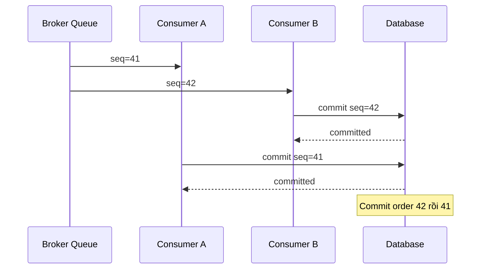

# Thông điệp sai thứ tự khi tăng concurrency, gửi lại hoặc failover

> **Chương:** Chẩn đoán sự cố  
> **Phạm vi:** Điều tra và khắc phục tình trạng message được xử lý sai thứ tự trong Apache ActiveMQ Classic và Artemis khi tăng số consumer, xảy ra rollback/redelivery, chuyển DLQ/replay hoặc broker/client failover. Trọng tâm là xác định **thứ tự bị thay đổi ở producer, broker dispatch, consumer xử lý hay commit nghiệp vụ**, sau đó chọn mức bảo đảm phù hợp: toàn queue, từng nhóm nghiệp vụ hoặc từng aggregate.

Một queue có thể nhận message theo thứ tự `A-1, A-2, A-3`, nhưng log ứng dụng lại ghi `A-2 completed` trước `A-1`. Điều đó chưa đủ để kết luận broker đã đảo message. Có thể broker dispatch theo thứ tự nhưng hai consumer xử lý song song; `A-1` bị rollback rồi redeliver sau `A-2`; hoặc client mất kết nối sau khi gửi khiến producer retry và tạo duplicate. Khi tăng concurrency, các trường hợp này xuất hiện thường xuyên hơn nếu hệ thống đang dựa vào một giả định ngầm rằng “FIFO của queue đồng nghĩa với thứ tự hoàn tất nghiệp vụ”.

**FIFO ở broker, thứ tự dispatch, thứ tự handler bắt đầu và thứ tự commit database là bốn điều khác nhau.** Runbook phải đo riêng từng mốc và chỉ ra hợp đồng thứ tự mà nghiệp vụ thực sự cần.

## 1. Xác định chính xác “sai thứ tự” ở tầng nào

Trước khi chỉnh prefetch hoặc giảm concurrency, cần thống nhất thứ tự nào bị vi phạm:

| Tầng | Ví dụ quan sát | Ý nghĩa |
|---|---|---|
| **Publish order** | Producer phát sequence 101, 102, 103 nhưng broker nhận 102, 101, 103. | Producer nhiều thread/session, retry hoặc upstream đã gửi khác thứ tự. |
| **Broker enqueue order** | Broker nhận 101 trước 102 nhưng queue browse/dispatch cho thấy 102 trước 101. | Kiểm tra priority, scheduled delivery, expiration, redelivery, routing và provider semantics. |
| **Dispatch order** | Broker giao 101 cho consumer A, 102 cho consumer B. | Dispatch có thể đúng thứ tự; chưa nói được consumer nào hoàn tất trước. |
| **Handler start order** | B bắt đầu xử lý 102 trước khi A bắt đầu 101. | Prefetch/buffer, callback scheduling hoặc nhiều consumer làm thay đổi thứ tự bắt đầu. |
| **Business commit order** | Database commit 102 trước 101. | Xử lý song song, transaction duration hoặc downstream concurrency làm đảo thứ tự nghiệp vụ. |
| **Observed/log order** | Log collector hiển thị 102 trước 101. | Clock skew, log buffering hoặc thứ tự ingest có thể khác thứ tự thực tế. |

Một sự cố chỉ được gọi là **broker ordering defect** sau khi có bằng chứng message đã được enqueue theo đúng thứ tự, không có priority/scheduled/expiry/selector/retry làm thay đổi tập message, và broker thực sự dispatch sai theo hợp đồng đã cấu hình.

### 1.1. Dùng sequence theo business key

Mỗi sự kiện cần có tối thiểu:

- `aggregateId` hoặc business key: ví dụ `order-4821`.
- `aggregateSequence`: số tăng đơn điệu trong phạm vi aggregate đó.
- `eventId`: định danh bất biến để deduplicate.
- `producerId`/source và thời điểm tạo event.
- `JMSMessageID`, `JMSCorrelationID`, `JMSRedelivered` và consumer instance ở phía nhận.

Sequence phải được cấp tại source of truth (ví dụ transaction database/outbox), không lấy timestamp của nhiều máy làm thứ tự tuyệt đối. Hai event có timestamp gần nhau có thể bị clock skew; sequence theo aggregate mới thể hiện quan hệ trước/sau do nghiệp vụ xác định.

### 1.2. Ghi log đủ mốc để dựng lại timeline

| Trường | Ghi ở đâu | Dùng để |
|---|---|---|
| `eventId`, `aggregateId`, `aggregateSequence` | Producer, consumer và database | Ghép một business event qua toàn luồng. |
| `JMSMessageID`, `JMSCorrelationID` | Sau send và khi receive | Theo dõi một lần gửi/delivery của broker. |
| `producerSessionId`, `producerInstance` | Producer | Phát hiện nhiều session/instance cùng phát một key. |
| `consumerInstance`, `consumerThread` | Consumer | Xác định concurrency và nơi thực thi. |
| `deliveryAttempt`, `JMSRedelivered` | Consumer | Phân biệt lần giao đầu với redelivery. |
| `publishedAt`, `handlerStartedAt`, `handlerCompletedAt`, `dbCommittedAt` | Ứng dụng | So sánh các mốc xử lý. |
| `brokerName`, `connectionId`, `failoverEpoch` | Client/broker logs nếu có | Nhận biết reconnect hoặc chuyển broker. |

Không ghi payload nhạy cảm vào log. Dùng event ID, aggregate key đã được bảo vệ, sequence và hash để điều tra.

## 2. Vì sao tăng concurrency làm lộ lỗi thứ tự?

Với một consumer xử lý tuần tự, handler thường hoàn tất message trước khi bắt đầu message tiếp theo. Khi có nhiều consumers, broker có thể dispatch message kế tiếp trong lúc consumer trước vẫn đang xử lý. Vì vậy:



Broker có thể đã dispatch đúng `41` rồi `42`, nhưng business state bị cập nhật sai thứ tự. Ví dụ `seq=41` đặt trạng thái đơn hàng thành `PAID`, còn `seq=42` đặt thành `SHIPPED`; nếu 42 commit trước rồi 41 commit sau, trạng thái cuối có thể quay lùi về `PAID`.

### 2.1. Các nguồn đảo thứ tự thường gặp

1. **Nhiều producer sessions:** các thread/instances phát cùng aggregate qua nhiều session, không có một sequencer chung.
2. **Competing consumers:** message kế tiếp được giao cho consumer khác trong khi message trước còn xử lý.
3. **Prefetch/client buffer:** broker đã dispatch trước nhiều message; client có thể xử lý callback hoặc công việc downstream theo lịch khác.
4. **Handler bất đồng bộ:** listener đưa công việc vào executor rồi return; JMS callback order không còn là business completion order.
5. **Transaction duration:** message trước gọi downstream chậm, message sau commit nhanh hơn.
6. **Rollback/redelivery:** message chưa ACK được giao lại sau các message đã được xử lý.
7. **Retry queue hoặc scheduled redelivery:** message lỗi quay lại muộn hơn các message tiếp theo.
8. **Priority/expiration/selectors:** broker có thể dispatch message ưu tiên cao trước hoặc loại message hết hạn; đây là policy chứ không nhất thiết là lỗi FIFO.
9. **Failover/reconnect:** delivery in-flight có thể được giao lại; producer có thể không biết send/commit trước reconnect đã thành công hay chưa.
10. **DLQ replay:** message cũ được gửi lại sau khi các message mới hơn đã hoàn tất.

### 2.2. Thứ tự toàn cục hay thứ tự theo aggregate?

Nhiều hệ thống không cần mọi message trong queue có thứ tự toàn cục. Ví dụ đơn hàng `A` cần tuần tự, đơn hàng `B` cũng cần tuần tự, nhưng A và B có thể xử lý song song:

```text
order-A: 1 -> 2 -> 3 -> 4
order-B: 1 -> 2 -> 3

Có thể xử lý đồng thời:
  Consumer-1: order-A
  Consumer-2: order-B
```

Nếu ép một consumer cho toàn queue, throughput của mọi aggregate bị giới hạn bởi một luồng. Nếu dùng **message grouping theo business key**, mỗi group được gán cho một consumer tại một thời điểm; nhiều group khác nhau vẫn có thể chạy song song. Đây thường là điểm cân bằng phù hợp hơn giữa throughput và thứ tự.

## 3. Kiểm tra producer trước khi chỉnh broker

JMS ordering guarantee gắn với session/producer semantics; nó không tự sắp xếp các event được phát đồng thời từ nhiều session theo business sequence. Nếu hai thread dùng hai session độc lập, message của aggregate `order-4821` có thể đến broker theo thứ tự khác với thứ tự event được tạo ở database.

### 3.1. Các lỗi producer thường gặp

- Dùng một shared JMS session/context từ nhiều threads dù session không thread-safe.
- Mỗi thread tự tạo producer/session rồi gửi event cùng aggregate mà không serialize theo sequence.
- Gửi event sau khi commit database nhưng outbox poller chạy nhiều worker không partition theo aggregate.
- Retry send sau timeout mà không giữ `eventId`, tạo bản sao với message ID mới.
- Gửi event từ hai application instances mà không có cơ chế phân vùng key hoặc sequence authoritative.

### 3.2. Giải pháp ở producer

1. Cấp `aggregateSequence` trong cùng transaction cập nhật aggregate/outbox.
2. Dùng `eventId` ổn định qua mọi lần retry.
3. Partition outbox publisher theo aggregate key, hoặc serialize send cho từng key.
4. Không chia sẻ `Session`/`JMSContext` giữa threads; dùng session/context riêng cho từng worker.
5. Khi publish đồng thời, chỉ yêu cầu thứ tự theo key nếu hệ thống có thể giữ mọi event của key đó đi qua cùng logical lane.

Ví dụ schema outbox tối thiểu:

```sql
CREATE TABLE outbox_event (
    event_id            VARCHAR(100) PRIMARY KEY,
    aggregate_id        VARCHAR(100) NOT NULL,
    aggregate_sequence  BIGINT NOT NULL,
    event_type          VARCHAR(100) NOT NULL,
    payload             TEXT NOT NULL,
    published_at        TIMESTAMP NULL,
    UNIQUE (aggregate_id, aggregate_sequence)
);
```

Unique constraint ngăn hai event của cùng aggregate dùng chung sequence. Publisher phải lấy event theo `aggregate_id, aggregate_sequence` và không phát sequence kế tiếp khi sequence trước chưa được gửi theo policy đã chọn. Nếu publisher chạy nhiều instances, cần khóa/partition lease để tránh hai worker cùng phát một aggregate.

### 3.3. Java: gửi message có group ID và sequence

Với Jakarta JMS, có thể gắn `JMSXGroupID` cùng sequence nghiệp vụ:

```java
import jakarta.jms.JMSContext;
import jakarta.jms.Queue;
import jakarta.jms.TextMessage;

public final class GroupedOrderPublisher {
    private GroupedOrderPublisher() {}

    public static void publish(
            JMSContext context,
            String orderId,
            long sequence,
            String eventId,
            String payload) throws Exception {

        Queue queue = context.createQueue("orders.ordered");
        TextMessage message = context.createTextMessage(payload);
        message.setStringProperty("JMSXGroupID", orderId);
        message.setLongProperty("aggregateSequence", sequence);
        message.setStringProperty("eventId", eventId);

        context.createProducer().send(queue, message);
    }
}
```

`JMSXGroupID` yêu cầu broker hỗ trợ message grouping. `aggregateSequence` và `eventId` là application properties; broker không tự kiểm tra sequence hoặc loại event trùng. Producer phải giữ sequence đúng và consumer vẫn phải kiểm tra thứ tự ở business layer.

## 4. Chọn đúng cơ chế giữ thứ tự

| Cơ chế | Mức bảo đảm | Throughput | Dùng khi |
|---|---|---|---|
| Một consumer cho queue | Tuần tự ở consumer đó nếu handler đồng bộ và không offload công việc. | Thấp hơn khi handler chậm. | Queue nhỏ, cần thứ tự toàn cục hoặc dễ vận hành. |
| Exclusive/single-active consumer | Một consumer active nhận queue; consumer khác standby/không cạnh tranh tùy broker. | Một lane xử lý. | Không thể thay đổi producer/message grouping và cần thứ tự queue-wide. |
| Message groups (`JMSXGroupID`) | Tuần tự theo group/key, các group có thể song song. | Cao hơn một consumer khi có nhiều key. | Order theo orderId/customerId/accountId. |
| Partitioned queues | Mỗi partition có consumer tuần tự riêng; key luôn vào cùng partition. | Scale theo số partition. | Lưu lượng lớn và có thể thiết kế routing theo key. |
| Application sequence guard | Từ chối/stage event đến sai sequence; kiểm soát state tại database. | Phụ thuộc transaction/database. | Cần bảo vệ business state kể cả khi broker redelivery/failover. |

Không có một cài đặt broker nào bảo đảm **thứ tự business commit end-to-end** khi handler tạo side effect bất đồng bộ hoặc database transaction độc lập. Với nghiệp vụ quan trọng, kết hợp grouping/partitioning với sequence validation và idempotency.

## 5. ActiveMQ Classic: exclusive consumer và message groups

Classic hỗ trợ hai cách phổ biến để kiểm soát dispatch:

- **Exclusive consumer:** broker chọn một consumer active cho queue; consumer khác không cùng nhận message bình thường trong thời gian exclusive consumer hoạt động. Khi consumer active mất kết nối, broker có thể chọn consumer khác.
- **Message groups:** các message có cùng `JMSXGroupID` được gán cho cùng consumer để xử lý tuần tự trong group; group khác có thể đi tới consumer khác.

### 5.1. Exclusive consumer khi cần một lane queue-wide

Có thể khai báo policy cho một queue trong `activemq.xml`:

```xml
<destinationPolicy>
    <policyMap>
        <policyEntries>
            <policyEntry queue="orders.ordered"
                         exclusiveConsumer="true"/>
        </policyEntries>
    </policyMap>
</destinationPolicy>
```

Hoặc dùng destination option `consumer.exclusive=true` khi tạo destination theo cú pháp Classic tương ứng. Chọn một cách cấu hình nhất quán và kiểm tra log broker để xác nhận consumer thực sự được chọn làm exclusive. Policy này làm giảm concurrency của **toàn queue**; nếu cần scale theo order ID, message groups phù hợp hơn.

Exclusive consumer không ngăn producer gửi cùng một event hai lần, không ngăn handler offload việc xử lý sang executor và không tạo atomic transaction với database. Nó chỉ giới hạn consumer dispatch lane của queue.

### 5.2. Gửi message group trong Classic

Classic JMS client dùng `javax.jms` trong nhiều bản 5.x. Message producer gắn group ID và sequence:

```java
import javax.jms.JMSException;
import javax.jms.Message;
import javax.jms.Session;
import javax.jms.TextMessage;

public final class ClassicGroupedMessage {
    private ClassicGroupedMessage() {}

    public static Message create(
            Session session,
            String orderId,
            long sequence,
            String eventId,
            String body) throws JMSException {
        TextMessage message = session.createTextMessage(body);
        message.setStringProperty("JMSXGroupID", orderId);
        message.setLongProperty("aggregateSequence", sequence);
        message.setStringProperty("eventId", eventId);
        return message;
    }
}
```

Gửi các message cùng `orderId` qua cùng một queue có hỗ trợ message grouping. Không tạo group ID ngẫu nhiên cho từng message; khi group ID thay đổi, broker không còn lý do giữ các message đó trên cùng consumer.

### 5.3. Khi nào dùng `JMSXGroupSeq`?

Một số provider hỗ trợ `JMSXGroupSeq` để biểu thị sequence trong group và tín hiệu đóng group (ví dụ giá trị âm đặc biệt theo provider). Đây là hành vi cần xác minh theo **đúng broker/version**. Không dùng `JMSXGroupSeq` thay cho business sequence authoritative; ứng dụng vẫn nên mang `aggregateSequence` riêng để kiểm tra nghiệp vụ và replay.

## 6. Artemis: exclusive queue và message grouping

Artemis hỗ trợ queue exclusive và message grouping. Exclusive queue chỉ có một consumer active tại một thời điểm theo cấu hình; message grouping phân phối các group tới consumers để xử lý song song giữa các group.

### 6.1. Exclusive queue

Ví dụ cấu hình queue durable cho address `orders.ordered`:

```xml
<addresses>
    <address name="orders.ordered">
        <anycast>
            <queue name="orders.ordered" durable="true">
                <exclusive>true</exclusive>
            </queue>
        </anycast>
    </address>
</addresses>
```

Đây là một phần tử trong `broker.xml`, không phải toàn bộ file cấu hình. Queue phải được provision đúng trên broker; kiểm tra schema của release đang chạy nếu cú pháp queue/address khác. Exclusive queue ưu tiên thứ tự dispatch đơn giản, đổi lại chỉ một consumer xử lý queue tại một thời điểm.

### 6.2. Group ID trên Artemis

JMS client đặt property `JMSXGroupID` như ví dụ Jakarta ở mục 3.3. Artemis dùng group ID để gắn các message cùng group vào một consumer trong thời gian group ownership còn hiệu lực. Nhiều group có thể phân phối cho nhiều consumers; một group không nên bị xử lý song song bởi nhiều consumers nếu broker đang duy trì ownership đúng.

Điều này không đảm bảo completion order nếu listener tự đẩy message vào executor hoặc gọi downstream bất đồng bộ rồi return. Giữ việc xử lý từng group tuần tự trong cùng consumer lane, hoặc dùng application sequencer/sequence guard.

### 6.3. So sánh cấu hình

| Mục tiêu | ActiveMQ Classic | Artemis |
|---|---|---|
| Một consumer active cho queue | `exclusiveConsumer="true"` trong destination policy hoặc destination option phù hợp. | `<exclusive>true</exclusive>` trên queue. |
| Tuần tự theo key | `JMSXGroupID` message groups. | `JMSXGroupID` message grouping. |
| Nhiều key xử lý song song | Nhiều groups được phân cho consumers. | Nhiều groups được phân cho consumers. |
| Giới hạn prefetch/buffer | `ActiveMQPrefetchPolicy`, `queuePrefetch`. | `consumerWindowSize` của client. |
| Bảo vệ thứ tự business | Sequence/version check ở ứng dụng. | Sequence/version check ở ứng dụng. |

## 7. Prefetch và client buffer: giảm lượng message đang bay

Prefetch giúp broker tận dụng network và consumer throughput, nhưng giá trị lớn làm một consumer giữ nhiều message chưa hoàn tất. Nếu nhiều consumers cùng chạy, message đã dispatch cho consumer A có thể được xử lý chậm trong khi consumer B hoàn tất message đến sau. Khi rollback, message của A có thể được redeliver sau.

### 7.1. Classic: điều chỉnh queue prefetch

Ví dụ đặt prefetch thấp cho consumer queue:

```java
import org.apache.activemq.ActiveMQConnectionFactory;
import org.apache.activemq.ActiveMQPrefetchPolicy;

ActiveMQConnectionFactory factory =
        new ActiveMQConnectionFactory("tcp://broker-a:61616");

ActiveMQPrefetchPolicy prefetch = new ActiveMQPrefetchPolicy();
prefetch.setQueuePrefetch(1);
factory.setPrefetchPolicy(prefetch);
```

`queuePrefetch=1` làm mỗi consumer chỉ giữ một message chưa ACK theo cơ chế prefetch của Classic; nó giảm lượng in-flight nhưng có thể làm giảm throughput khi network/handler latency cao. Không coi prefetch 1 là cách bảo đảm toàn queue order nếu vẫn có nhiều consumers.

### 7.2. Artemis: điều chỉnh consumer window

Artemis client dùng `consumerWindowSize` để giới hạn lượng message được buffer phía client. Có thể đặt thấp hoặc 0 trong một số workload cần giảm client-side buffering:

```java
import org.apache.activemq.artemis.jms.client.ActiveMQConnectionFactory;

ActiveMQConnectionFactory factory =
        new ActiveMQConnectionFactory("tcp://broker-a:61616");
factory.setConsumerWindowSize(0);
```

Giá trị 0 tắt consumer-side buffering theo cơ chế Artemis; mỗi lần nhận có thể cần trao đổi với broker nhiều hơn và throughput có thể giảm. Kiểm tra API/client version cụ thể, đo ACK rate và latency trước/sau, không áp dụng đại trà cho mọi queue.

### 7.3. Khi nào giảm prefetch/window size?

- In-flight cao bất thường so với số consumer.
- Một consumer giữ message lâu trong khi consumer khác rảnh.
- Redelivery sau consumer crash làm một lượng lớn message bị giao lại.
- Cần giảm số message đã dispatch nhưng chưa được xử lý khi failover.

Giảm prefetch không thay thế message grouping hoặc sequence guard. Nó giới hạn số message đang được buffer, không tạo transaction end-to-end và không làm nhiều consumer trở thành một consumer tuần tự.

## 8. Redelivery và retry có thể làm thứ tự quan sát thay đổi

Khi consumer nhận message rồi rollback hoặc mất kết nối trước ACK, broker có thể giao message đó lại. Trong thời gian message chờ redelivery, các message khác có thể đã được xử lý. Vì vậy:

```text
Queue ban đầu:       E-41 -> E-42 -> E-43
Consumer nhận:       E-41 (rollback)
Consumer khác xử lý: E-42, E-43
Redelivery:          E-41

Completion:          E-42 -> E-43 -> E-41
```

Đây là một lý do phổ biến khiến log business completion không còn FIFO dù broker đã nhận đúng thứ tự. Chính sách redelivery có thể delay/requeue message theo provider; không giả định vị trí redelivery giống nhau ở Classic và Artemis hoặc mọi version.

### 8.1. Nhận diện redelivery

Ở consumer, ghi:

- `JMSRedelivered`.
- `JMSMessageID` và business `eventId`.
- `aggregateId`/`aggregateSequence`.
- Delivery count nếu provider expose.
- Exception/rollback reason và timestamp lần nhận.

`JMSRedelivered=true` là bằng chứng message đã được giao trước đó theo provider flag, không cho biết toàn bộ lịch sử xử lý nghiệp vụ. Một message có thể đã tạo side effect trước khi transaction rollback hoặc ACK response bị mất.

### 8.2. Retry queue làm phá vỡ thứ tự nếu không phân vùng theo key

Giả sử `order-42` có event 10 lỗi và được gửi sang retry queue với delay 30 giây. Trong lúc đó event 11, 12 ở source queue vẫn được xử lý. Khi event 10 quay lại, business sequence bị đảo.

Các lựa chọn:

1. **Block group khi có lỗi:** không xử lý sequence kế tiếp của cùng key cho tới khi sequence lỗi được giải quyết.
2. **Retry theo partition:** chuyển toàn bộ key/partition sang retry lane, giữ thứ tự bên trong lane.
3. **Stage gap:** lưu event đến sau vào inbox/buffer, chờ sequence còn thiếu rồi áp dụng lần lượt.
4. **Cho phép out-of-order có kiểm soát:** chỉ khi nghiệp vụ dùng version/conditional update và xác định event cũ có thể bỏ qua.

Không gửi riêng một message lỗi sang retry queue chung nếu các event tiếp theo cùng aggregate vẫn được xử lý bình thường, trừ khi business contract cho phép.

### 8.3. Phân biệt retry application với broker redelivery

| Cơ chế | Message ID | Queue/route | Tác động thứ tự |
|---|---|---|---|
| JMS rollback/redelivery | Thường là cùng logical broker message; provider giữ identity khi giao lại. | Message trở lại khả dụng theo redelivery semantics. | Có thể hoàn tất sau message đến sau. |
| Application gửi retry message mới | Thường có JMSMessageID mới; giữ `eventId`/correlation gốc ở property. | Retry queue hoặc source queue. | Có thể đến muộn và chen sau event mới. |
| DLQ replay | Có thể tạo message mới khi republish; metadata nguồn cần được giữ. | DLQ → source/recovery queue. | Message cũ có thể xuất hiện sau event mới. |

Giữ nguyên business `eventId` qua mọi kiểu retry/replay. JMSMessageID là identity của message broker, không thay thế idempotency key của nghiệp vụ.

## 9. Failover: phân biệt redelivery, duplicate và đảo thứ tự

Failover khôi phục khả năng kết nối hoặc quyền phục vụ của broker; nó không biến một workflow JMS + database thành exactly-once. Khi connection đứt đúng lúc send/commit/ACK, client có thể không biết thao tác đã được broker ghi nhận hay chưa.

### 9.1. Các cửa sổ kết quả không xác định

| Điểm lỗi | Điều client có thể quan sát | Hệ quả |
|---|---|---|
| Producer send trước khi broker xác nhận | Timeout/connection exception. | Message có thể chưa được nhận hoặc đã được nhận nhưng response mất; retry có thể tạo duplicate. |
| Producer transaction commit | Commit exception hoặc connection lost. | Transaction có thể đã commit hoặc rollback; cần giữ event ID và đối soát. |
| Consumer đã xử lý DB nhưng chưa JMS ACK/commit | Connection lost. | Message có thể redeliver dù business side effect đã commit. |
| Consumer đang giữ nhiều prefetched messages | Consumer connection bị đóng. | In-flight messages có thể quay lại delivery pool và được consumer khác nhận. |
| Primary broker chết, backup takeover | Client reconnect, session/consumer recovery tùy provider và transaction. | Message chưa ACK có thể redeliver; thứ tự completion có thể thay đổi. |

### 9.2. Classic failover transport

Classic client có thể dùng failover transport để thử lại các broker URI:

```java
import org.apache.activemq.ActiveMQConnectionFactory;

String brokerUrl =
    "failover:(tcp://broker-a:61616,tcp://broker-b:61616)"
    + "?initialReconnectDelay=100&maxReconnectAttempts=-1";

ActiveMQConnectionFactory factory =
        new ActiveMQConnectionFactory(brokerUrl);
```

URI này giúp client reconnect theo cấu hình; nó không chứng minh hai brokers có cùng queue store hoặc broker B sở hữu message state của A. Nếu A/B là hai broker độc lập hoặc network-of-brokers với store riêng, failover URI chỉ thay endpoint client. HA shared-store/replication phải được cấu hình ở broker layer.

Trong lúc failover, không tự tạo event ID mới cho lần send lại. Giữ cùng `eventId`/aggregate sequence và để consumer deduplicate. Đối với transaction đang in-flight, kiểm tra kết quả commit thay vì giả định exception đồng nghĩa rollback.

### 9.3. Artemis reconnect và HA pair

Artemis client có cơ chế reconnect/topology discovery và HA-aware connection factory tùy cấu hình. Client reconnect tới node khác không tự chứng minh message state của queue đã được replicate. Cần xác định:

- Broker đang dùng primary/backup replication hay shared store.
- Backup đã synchronized và đủ điều kiện activation chưa.
- Client đang reconnect tới backup của cùng logical broker hay một active broker khác trong cluster.
- Message đã được ACK/commit trước failure hay còn in-flight.
- Consumer group ownership có được khôi phục/rebalance và có khoảng thời gian message redelivery không.

Cluster routing/load balancing và broker HA là hai chức năng khác nhau. Nếu failover sang một active node độc lập, queue cùng tên không đồng nghĩa queue state được sao chép.

### 9.4. Duplicate sau failover không phải lúc nào cũng là đảo thứ tự

Ví dụ:

```text
Producer gửi eventId=evt-501, sequence=51
Broker nhận message, nhưng ACK của send bị mất khi connection đứt
Producer retry cùng eventId=evt-501
Broker có thể nhận thêm một bản nếu không có duplicate detection phù hợp

Consumer xử lý một bản, commit DB
Consumer mất connection trước JMS ACK
Message được redeliver và consumer chạy lại
```

Nếu hai bản có cùng sequence 51, consumer phải nhận ra duplicate và không áp dụng business side effect lần thứ hai. Nếu event sequence 52 đã được áp dụng trước một bản 51 được redeliver, sequence guard phải phân loại bản 51 là duplicate/stale chứ không ghi đè state mới hơn.

## 10. Bảo vệ thứ tự ở consumer bằng idempotency và sequence guard

Message grouping giữ các message cùng key trên một consumer lane, nhưng redelivery/failover/replay vẫn có thể làm cùng event xuất hiện lại hoặc đến muộn. Consumer cần kiểm tra sequence ở nơi cập nhật business state.

### 10.1. Ba trường hợp khi nhận một event

Giả sử database đang có `last_sequence=41`, consumer nhận event:

| Sequence nhận | Diễn giải | Hành động |
|---:|---|---|
| 41 | Bằng sequence đã áp dụng. | Duplicate; xác minh `eventId` rồi ACK mà không lặp side effect. |
| 42 | Đúng sequence kế tiếp. | Áp dụng transaction, cập nhật state và `last_sequence=42`. |
| 44 | Thiếu sequence 42 hoặc 43. | Không áp dụng ngay; stage/retry/quarantine theo policy gap. |
| 40 | Event cũ đến muộn. | Stale/duplicate; không ghi đè state mới hơn. |

Sequence không thay thế event ID: hai event khác nhau không được dùng cùng sequence. Unique constraint trên `(aggregate_id, aggregate_sequence)` giúp phát hiện producer bug.

### 10.2. Pseudocode transaction với inbox

Một cách phổ biến là ghi event ID vào inbox và cập nhật aggregate trong **cùng transaction database**:

```sql
BEGIN;

SELECT last_sequence
FROM orders
WHERE order_id = :aggregate_id
FOR UPDATE;

-- Ứng dụng kiểm tra inbox theo event_id trong cùng transaction.
-- Nếu event_id đã tồn tại: COMMIT read-only và trả DUPLICATE.
-- Nếu sequence không bằng last_sequence + 1: ROLLBACK và trả GAP.
-- Chỉ insert inbox sau khi sequence đã được xác nhận là kế tiếp.
INSERT INTO inbox_event(event_id, aggregate_id, aggregate_sequence)
VALUES (:event_id, :aggregate_id, :sequence);

UPDATE orders
SET status = :new_status,
    last_sequence = :sequence
WHERE order_id = :aggregate_id
  AND last_sequence = :sequence - 1;

COMMIT;
```

Đây là SQL/pseudocode minh họa theo PostgreSQL. Ứng dụng phải kiểm tra duplicate và sequence trước khi insert inbox; nếu phát hiện gap thì **rollback transaction để không lưu inbox record như thể event đã được xử lý**. `SELECT ... FOR UPDATE` khóa aggregate row để hai consumers không cùng áp dụng sequence kế tiếp; có thể dùng optimistic compare-and-set thay thế nếu xử lý conflict/retry đúng cách. Unique constraints trên event ID và aggregate sequence vẫn là lớp bảo vệ cuối cùng.

Nếu update ảnh hưởng 0 dòng:

- Đọc `last_sequence` hiện tại trong transaction.
- Nếu `last_sequence >= incoming sequence`, xác minh event đã được áp dụng hoặc stale; không chạy side effect lần nữa.
- Nếu `last_sequence < incoming sequence - 1`, đang thiếu sequence; không đánh dấu event như đã xử lý thành công nếu cần giữ thứ tự.
- Rollback hoặc ghi event vào một **inbox staging table** rồi ACK chỉ khi staging đã bền vững, tùy thiết kế.

Khi database commit thành công nhưng JMS ACK thất bại, message redeliver; inbox unique key giúp consumer nhận diện và ACK duplicate mà không lặp side effect. Đây là idempotency ở business boundary, không phải exactly-once do broker cung cấp.

### 10.3. Gap handling: rollback hay stage?

**Rollback ngay khi thiếu sequence** có thể làm một group bị redeliver liên tục và chặn các event khác. Với workload cần thứ tự chặt, có thể:

1. Lưu event đến sau vào inbox staging với trạng thái `WAITING_FOR_PREDECESSOR`.
2. ACK JMS sau khi event đã được ghi bền vững vào staging database.
3. Worker theo aggregate lấy event theo sequence và chỉ áp dụng event kế tiếp.
4. Khi sequence còn thiếu đến hoặc được xử lý thủ công, tiếp tục drain staging theo thứ tự.

Cách này cần một workflow phục hồi gap và alert cho event chờ quá lâu. Nếu staging không bền vững hoặc worker có thể chạy song song cùng aggregate, vẫn có thể đảo thứ tự ở tầng business.

### 10.4. Không ACK event gap rồi bỏ quên

Nếu consumer ACK sequence 44 trong khi 42/43 chưa đến và không ghi event 44 vào một nơi bền vững, broker sẽ không giao lại event đó. Sau này sequence 42/43 đến, state có thể không bao giờ áp dụng 44. Vì vậy chỉ ACK event đến sau khi:

- Event được áp dụng thành công; hoặc
- Event được lưu durable trong inbox/staging và có worker phục hồi; hoặc
- Business owner quyết định bỏ qua event đó theo quy tắc versioning rõ ràng.

## 11. Runbook điều tra message sai thứ tự

### 11.1. Thu thập evidence

1. Chọn một aggregate/business key cụ thể; không bắt đầu bằng việc so tất cả message toàn queue.
2. Lấy 10–50 event IDs/sequence liên tiếp trước và sau thời điểm lỗi.
3. Ghép producer log, broker enqueue/dispatch log, consumer log và DB commit record.
4. Đánh dấu message bị redeliver, retry queue, DLQ hoặc replay.
5. Ghi consumer count, prefetch/window size, message group ID, transaction mode và failover timeline.
6. Xác định lỗi xảy ra ở publish order, dispatch order, handler start hay business commit.

### 11.2. Ma trận triệu chứng và nguyên nhân

| Triệu chứng | Nguyên nhân có thể | Kiểm tra tiếp |
|---|---|---|
| Sequence đã đảo trước khi broker nhận | Nhiều producer sessions/instances, outbox publisher không partition. | So sequence với send timestamp/session/producer instance. |
| Broker nhận đúng thứ tự, consumer completion đảo | Competing consumers, prefetch hoặc handler chạy song song. | Consumer ID, dispatch/start/complete timestamps, prefetch. |
| Chỉ đảo sau rollback | Redelivery xảy ra sau khi message mới hơn đã được ACK. | `JMSRedelivered`, delivery count, rollback reason, retry delay. |
| Chỉ đảo sau khi bật retry queue | Message lỗi quay lại muộn, message mới tiếp tục được xử lý. | Original destination, retry timestamp, aggregate sequence. |
| Chỉ đảo sau failover | In-flight delivery redeliver, send/commit outcome không xác định hoặc consumer group rebalance. | HA logs, connection recovery, transaction outcome và duplicate event IDs. |
| Chỉ một số key bị đảo | Group ID không ổn định, key partition sai hoặc hai producer phát cùng aggregate. | `JMSXGroupID`, aggregate ID, producer ownership/lease. |
| Log cho thấy đảo nhưng DB đúng | Log collector ingest order/clock skew. | DB sequence, monotonic clock trong process, event timestamps. |
| DB state bị lùi version | Consumer áp dụng stale event sau event mới. | Optimistic locking/sequence guard, transaction commit timeline. |
| DLQ replay tạo event cũ sau event mới | Replay không partition theo key hoặc không kiểm tra sequence. | Replay batch, event source metadata, last applied sequence. |

### 11.3. Các bước khôi phục

1. Nếu business state đang bị ghi sai, tạm dừng **partition/key bị ảnh hưởng** nếu có thể; tránh dừng toàn hệ thống khi chỉ một key lỗi.
2. Ngăn producer phát sequence không nhất quán; sửa outbox partition/serialization hoặc producer ownership.
3. Giảm concurrency/prefetch tạm thời cho queue liên quan để ổn định in-flight.
4. Bật grouping/exclusive lane phù hợp với yêu cầu thứ tự.
5. Sửa retry/DLQ flow để event lỗi không bị vượt qua bởi event sau cùng key, hoặc stage gap.
6. Triển khai idempotency và sequence guard trước khi replay.
7. Replay từng batch theo aggregate sequence, kiểm tra business state sau mỗi batch.
8. Tăng concurrency dần và theo dõi sequence violation, duplicate, redelivery và throughput.

Không xóa queue hoặc reset journal để “sắp lại thứ tự”. Broker không thể suy ra thứ tự nghiệp vụ đúng nếu producer không cung cấp sequence authoritative.

## 12. Ví dụ consumer kiểm tra sequence trước khi cập nhật state

Một consumer xử lý đúng thứ tự theo aggregate cần kết hợp:

1. `eventId` duy nhất để nhận diện duplicate.
2. `aggregateSequence` để phát hiện gap/stale event.
3. Inbox và aggregate update trong cùng transaction database.
4. ACK JMS sau khi transaction database đã commit, hoặc ghi durable staging trước khi ACK.

### 12.1. Mô hình kết quả xử lý

```java
public enum ApplyResult {
    APPLIED,
    DUPLICATE,
    STALE,
    GAP
}
```

`APPLIED` nghĩa là event kế tiếp đã được áp dụng. `DUPLICATE` nghĩa event ID đã được xử lý trước đó. `STALE` nghĩa sequence không mới hơn state hiện tại và business rule cho phép bỏ qua. `GAP` nghĩa còn thiếu sequence đứng trước; không được áp dụng event này như thể đã thành công.

### 12.2. Pseudocode service trong transaction database

```java
public ApplyResult apply(OrderEvent event) {
    return transactionTemplate.execute(status -> {
        long last = orderRepository.lastSequenceForUpdate(event.orderId());

        if (inboxRepository.exists(event.eventId())) {
            return ApplyResult.DUPLICATE;
        }

        if (event.sequence() <= last) {
            // Event cũ chưa có inbox record, nhưng state đã vượt qua nó.
            inboxRepository.insert(event.eventId(),
                    event.orderId(), event.sequence(), "STALE");
            return ApplyResult.STALE;
        }

        if (event.sequence() != last + 1) {
            // Không đánh dấu đã xử lý nếu chưa lưu event vào staging.
            return ApplyResult.GAP;
        }

        inboxRepository.insert(event.eventId(),
                event.orderId(), event.sequence(), "APPLIED");
        orderRepository.apply(event.orderId(),
                event.newStatus(), event.sequence());
        return ApplyResult.APPLIED;
    });
}
```

Đây là pseudocode dựa trên `transactionTemplate` và repository của ứng dụng; `lastSequenceForUpdate` phải khóa aggregate row (ví dụ `SELECT ... FOR UPDATE`) trong cùng transaction trước khi kiểm tra inbox và cập nhật state. Các thao tác `exists`, `insert`, đọc sequence và cập nhật aggregate phải dùng **cùng transaction/connection**. Unique constraint trên `inbox_event.event_id` và `(aggregate_id, aggregate_sequence)` vẫn cần thiết để chống duplicate/producer conflict giữa các consumers.

### 12.3. ACK sau khi business transaction commit

Ví dụ synchronous receive với `CLIENT_ACKNOWLEDGE`:

```java
import jakarta.jms.JMSContext;
import jakarta.jms.JMSConsumer;
import jakarta.jms.Message;
import jakarta.jms.Queue;

try (JMSContext context =
             connectionFactory.createContext(
                     JMSContext.CLIENT_ACKNOWLEDGE)) {
    Queue queue = context.createQueue("orders.ordered");
    try (JMSConsumer consumer = context.createConsumer(queue)) {
        Message message = consumer.receive(2_000);
        if (message != null) {
            OrderEvent event = decoder.decode(message);
            ApplyResult result = orderService.apply(event);

            switch (result) {
                case APPLIED:
                case DUPLICATE:
                case STALE:
                    // Database transaction đã hoàn tất trước khi ACK.
                    message.acknowledge();
                    break;
                case GAP:
                    // Không ACK. Đưa vào gap workflow hoặc để provider
                    // redeliver theo retry policy đã được thiết kế.
                    context.recover();
                    break;
            }
        }
    }
}
```

Ví dụ chỉ minh họa một lần nhận; `connectionFactory`, `decoder` và `orderService` do ứng dụng cung cấp. `CLIENT_ACKNOWLEDGE` có phạm vi acknowledge theo session, vì vậy nếu một session có nhiều consumers hoặc nhiều messages outstanding, cần thiết kế batch/ACK boundary cẩn thận. Với workload strict order, dùng một consumer/session riêng cho ordered lane hoặc transaction mode phù hợp.

Nếu `GAP` lặp lại, `recover()` có thể tạo redelivery loop. Khi đó nên ghi event vào inbox staging trong transaction database, ACK sau khi staging commit và để worker xử lý gap; không giữ một message lỗi chiếm lane vô thời hạn nếu hệ thống cần tiếp tục nhận event khác.

### 12.4. Xử lý duplicate sau khi DB commit nhưng ACK thất bại

Giả sử DB đã commit event 42, nhưng consumer mất kết nối trước `message.acknowledge()`. Broker có thể giao lại event 42:

1. Consumer tra inbox theo `eventId`.
2. Record đã tồn tại nên kết quả là `DUPLICATE`.
3. Không chạy lại side effect.
4. ACK message redelivery.

Đây là lý do `eventId` phải ổn định qua retry/failover và inbox phải bền vững. Chỉ kiểm tra `JMSRedelivered` không đủ để chống duplicate business effect.

## 13. Kiểm thử tái hiện và xác minh thứ tự

Không dùng test chỉ gửi 3 message rồi assert chúng được nhận theo thứ tự một lần. Test cần tái hiện concurrency, rollback, failover và replay với sequence quan sát được.

### 13.1. Test cơ sở: một consumer, handler đồng bộ

- Gửi sequence 1..N qua cùng producer/session.
- Một consumer nhận và xử lý đồng bộ.
- Ghi `aggregateSequence` lúc receive và lúc commit.
- Assert sequence commit đúng 1..N.

Test này xác lập baseline; nó không chứng minh hệ thống vẫn đúng khi tăng concurrency.

### 13.2. Test competing consumers

- Tạo 2–4 consumers trên cùng queue.
- Gửi nhiều aggregate IDs, mỗi aggregate có sequence 1..N và group ID bằng aggregate ID.
- Cố ý làm chậm một số event để tăng khả năng completion order thay đổi.
- Assert từng aggregate có sequence commit liên tục; không assert thứ tự giữa các aggregate.
- Ghi consumer instance để xác nhận các group có thể phân phối song song.

Nếu không dùng message grouping, test có thể tái hiện event cùng aggregate được xử lý bởi nhiều consumers. Đó là bằng chứng concurrency đang vượt quá hợp đồng thứ tự hiện có.

### 13.3. Test rollback và redelivery

1. Consumer nhận sequence 10 rồi cố ý rollback.
2. Consumer tiếp tục nhận sequence 11 nếu policy cho phép dispatch.
3. Quan sát sequence 10 được redeliver.
4. Xác minh sequence guard không cho event 10 ghi đè state đã áp dụng từ 11.
5. Nếu yêu cầu strict order, kiểm tra group/partition có chặn sequence 11 cho tới khi 10 được giải quyết hay không.

Không khẳng định vị trí redelivery trong queue giống nhau giữa broker/version. Test phải xác minh **business state cuối cùng** và message delivery attempts, không dựa vào một thứ tự retry nội bộ chưa được cam kết.

### 13.4. Test failover khi message đang in-flight

- Dùng broker HA pair đúng cấu hình và một queue test persistent.
- Gửi sequence 20, 21, 22; để consumer nhận 20 nhưng chưa ACK.
- Gây failover có kiểm soát trong lab.
- Reconnect consumer và ghi nhận message nào được redeliver.
- Xác minh inbox/event ID ngăn duplicate side effect.
- Xác minh sequence guard không cho stale event ghi lùi aggregate.
- Chạy lại với producer send/commit xảy ra đúng thời điểm failover để kiểm tra duplicate/unknown outcome.

Test này phải chạy trên topology HA thực tế; chỉ đổi client URI sang broker thứ hai không mô phỏng state takeover nếu hai broker có store độc lập.

### 13.5. Test DLQ replay

- Tạo event sequence 30 bị lỗi và chuyển DLQ.
- Cho sequence 31 được xử lý theo policy hiện tại.
- Sửa nguyên nhân, replay event 30.
- Xác minh consumer phân loại 30 là stale hoặc gap theo business state; không ghi đè sequence 31.
- Nếu cần strict order, chạy replay trong recovery lane theo key trước khi cho phép sequence tiếp theo.

### 13.6. Bảng kết quả test

| Kịch bản | Concurrency | Grouping | Failure | Assertion chính |
|---|---:|---|---|---|
| Baseline | 1 | Không cần | Không | Commit order 1..N. |
| Competing consumers | 4 | Không | Không | Phát hiện completion đảo nếu cùng key bị phân tán. |
| Message groups | 4 | Theo aggregate | Không | Mỗi aggregate giữ sequence; các aggregate khác chạy song song. |
| Redelivery | 2 | Theo aggregate hoặc không | Rollback | Duplicate/stale không làm lùi state. |
| Failover | 2 | Theo aggregate | Primary takeover | In-flight có thể redeliver; inbox ngăn side effect lặp. |
| DLQ replay | 2 | Theo aggregate | Replay event cũ | Replay không ghi đè version mới hơn. |

## 14. Chỉ số và cảnh báo cho lỗi ordering

Broker metrics cho biết queue depth/dispatch/redelivery; application metrics mới chứng minh sequence violation và business completion order. Nên theo dõi:

| Metric | Loại | Ý nghĩa |
|---|---|---|
| `consumer_redelivered_total` | Counter | Số lần nhận lại message. |
| `consumer_sequence_gap_total` | Counter | Event đến sau khi còn thiếu predecessor. |
| `consumer_stale_event_total` | Counter | Event cũ/đã áp dụng được bỏ qua. |
| `consumer_duplicate_event_total` | Counter | Event ID đã tồn tại trong inbox. |
| `consumer_order_violation_total` | Counter | Sequence không đúng kỳ vọng theo aggregate. |
| `consumer_inflight_messages` | Gauge | Số message đang được xử lý/chờ ACK. |
| `consumer_handler_duration_seconds` | Histogram | Độ trễ handler, giúp phát hiện consumer chậm làm completion đảo. |
| `consumer_group_reassignment_total` | Counter nếu provider expose | Số lần ownership group thay đổi. |
| `dlq_replay_total` | Counter ứng dụng | Số event được replay và kết quả. |

Không đưa `aggregateId`, `eventId` hoặc `JMSMessageID` làm label metric vì cardinality có thể tăng không giới hạn. Đưa các ID này vào structured logs/traces; metric chỉ gắn queue, service, broker, event type hoặc partition có tập giá trị hữu hạn.

### 14.1. Alert gợi ý

- `consumer_sequence_gap_total` tăng liên tục trên một queue/business flow.
- `consumer_order_violation_total` lớn hơn 0 cho aggregate cần strict ordering.
- Redelivery rate tăng cùng lúc ACK rate giảm.
- DLQ replay xuất hiện nhưng stale/duplicate rate tăng đột biến.
- Group reassignment tăng sau failover cùng với in-flight backlog.
- Handler p99 tăng và in-flight age vượt ngưỡng, đặc biệt khi concurrency vừa được nâng.

Một sequence violation trong nghiệp vụ tài chính có thể nghiêm trọng dù chỉ có một event; không chỉ alert theo tỷ lệ phần trăm. Ngược lại, stale event được bỏ qua có chủ đích không nhất thiết là incident nếu policy đã định nghĩa rõ.

## 15. Những sai lầm thường gặp khi xử lý ordering

| Cách xử lý sai | Vì sao không giải quyết gốc rễ | Cách làm phù hợp |
|---|---|---|
| Chỉ giảm concurrency về 1 rồi đóng incident. | Có thể che lỗi producer multi-session, retry duplicate hoặc replay sai thứ tự. | Giữ sequence validation và test lại khi tăng concurrency. |
| Chỉ đặt prefetch = 1. | Nhiều consumers vẫn có thể hoàn tất khác thứ tự; prefetch không phải per-key serialization. | Dùng grouping/exclusive lane theo yêu cầu và sequence guard. |
| Dùng timestamp để sắp xếp event. | Clock skew, timestamp trùng và producer khác máy làm thứ tự không đáng tin cậy. | Cấp aggregate sequence từ source of truth. |
| Dùng JMSMessageID làm idempotency key. | Retry publish có thể tạo JMSMessageID mới cho cùng business event. | Giữ eventId bất biến qua retry/failover/replay. |
| ACK event có sequence gap rồi bỏ qua. | Broker không giao lại; event có thể mất khỏi workflow. | Rollback hoặc ghi durable inbox staging trước ACK. |
| Replay toàn bộ DLQ vào source queue. | Event cũ có thể chen sau event mới, gây stale update hoặc duplicate side effect. | Replay theo aggregate/partition, kiểm tra sequence và idempotency. |
| Tin rằng failover URI tự bảo đảm order. | URI chỉ hỗ trợ reconnect; không tạo shared/replicated queue state. | Kiểm tra HA state, in-flight redelivery và application sequence. |
| Dùng một exclusive consumer cho mọi queue. | Giảm throughput và có thể tạo bottleneck toàn hệ thống. | Chỉ serial hóa key/partition cần thứ tự. |
| Xem log hoàn tất như thứ tự broker dispatch. | Handler và log pipeline có thể chạy bất đồng bộ. | Ghi timestamp/sequence tại enqueue, receive, start và DB commit. |
| Retry lỗi deterministic vô hạn. | Retry storm làm event cũ quay lại liên tục và phá SLA. | Giới hạn attempts, backoff, DLQ và gap recovery. |

## 16. Checklist vận hành khi phát hiện message sai thứ tự

### Chẩn đoán

- [ ] Xác định business key/aggregate và sequence cụ thể bị đảo.
- [ ] Phân biệt publish, enqueue, dispatch, handler start và DB commit order.
- [ ] Ghép event ID, JMSMessageID, group ID, consumer ID và failover timeline.
- [ ] Kiểm tra producer có nhiều session/instance phát cùng key không.
- [ ] Kiểm tra số consumers, prefetch/window size, priority, selector, scheduled delivery và retry.
- [ ] Kiểm tra rollback, redelivery, DLQ replay và duplicate send.

### Khôi phục

- [ ] Chọn phạm vi pause theo queue/partition/key bị ảnh hưởng.
- [ ] Giảm concurrency/prefetch tạm thời nếu in-flight làm tăng sai thứ tự.
- [ ] Bật exclusive consumer hoặc message grouping phù hợp.
- [ ] Bảo đảm producer giữ sequence và event ID ổn định.
- [ ] Triển khai inbox/idempotency và sequence guard ở business transaction.
- [ ] Replay event cũ theo aggregate sequence; không replay mù.

### Xác minh

- [ ] Test một consumer baseline và competing consumers.
- [ ] Test group ordering với nhiều aggregate.
- [ ] Test rollback/redelivery và failover khi có in-flight messages.
- [ ] Test DLQ replay sau khi sequence mới hơn đã được áp dụng.
- [ ] Xác nhận business state không lùi sequence và duplicate không tạo side effect lặp.
- [ ] Tăng concurrency từng bước; đo throughput, sequence gap, stale, duplicate và redelivery.

## 17. Câu hỏi tự kiểm tra

**1.** Broker enqueue 101 trước 102, dispatch 101 cho consumer A và 102 cho consumer B. B commit trước A. Đây có phải broker đảo thứ tự?

**Đáp án:** Chưa. Broker có thể dispatch đúng; business completion bị đảo do xử lý song song.

**2.** Queue chỉ có một consumer nhưng event 10 bị rollback, event 11 đã hoàn tất rồi event 10 redeliver. Có thể xảy ra không?

**Đáp án:** Có, tùy redelivery/requeue semantics. Phải kiểm tra broker/version và bảo vệ state bằng sequence guard.

**3.** Muốn xử lý song song nhiều đơn hàng nhưng giữ thứ tự event của từng đơn. Cơ chế nào phù hợp?

**Đáp án:** Message grouping theo `JMSXGroupID=orderId` hoặc partition theo key, kết hợp sequence validation.

**4.** Đặt prefetch bằng 1 có bảo đảm mọi message trong queue được commit theo FIFO khi có bốn consumers?

**Đáp án:** Không. Mỗi consumer có ít message in-flight hơn, nhưng bốn handler vẫn có thể hoàn tất khác thứ tự.

**5.** Consumer đã commit database nhưng mất kết nối trước JMS ACK. Khi message redeliver, làm sao tránh áp dụng lại?

**Đáp án:** Tra inbox theo eventId bất biến; nếu đã xử lý thì ACK duplicate mà không lặp side effect.

**6.** DLQ chứa sequence 20, source queue đã xử lý sequence 21. Có nên replay sequence 20 trực tiếp?

**Đáp án:** Không trước khi đối soát. Sequence guard phải phân loại 20 là stale hoặc cần recovery theo business rule; replay mù có thể ghi lùi state.

**7.** Client reconnect thành công sang broker B. Điều đó có chứng minh B sở hữu đúng backlog của A?

**Đáp án:** Không. Phải xác minh shared-store/replication HA và trạng thái activation; failover transport chỉ xử lý kết nối client.

**8.** Vì sao không dùng timestamp làm sequence?

**Đáp án:** Clock skew, timestamp trùng và nhiều producer khiến timestamp không thể hiện thứ tự authoritative. Dùng sequence cấp tại source of truth theo aggregate.

## 18. Ghi nhớ

Khi tăng concurrency, broker có thể dispatch nhiều message cùng lúc và consumer có thể hoàn tất chúng khác thứ tự. Rollback/redelivery, retry queue, DLQ replay và failover tiếp tục làm message cũ xuất hiện muộn. Vì vậy phải xác định **thứ tự publish/enqueue/dispatch/commit** thay vì nhìn một dòng log rồi kết luận broker lỗi.

Với **ActiveMQ Classic**, có thể dùng exclusive consumer, `JMSXGroupID` message groups và điều chỉnh `ActiveMQPrefetchPolicy`. Với **Artemis**, dùng exclusive queue, message grouping và `consumerWindowSize` phù hợp. Nếu yêu cầu thứ tự theo order/account/customer key, ưu tiên grouping hoặc partition để giữ song song giữa các key; nếu yêu cầu queue-wide order, cân nhắc single-active consumer và chấp nhận throughput thấp hơn.

Ở tầng ứng dụng, giữ `aggregateSequence` và `eventId` ổn định, dùng inbox/idempotency, kiểm tra sequence trong transaction database và ACK sau khi business state đã được bảo vệ. Sau failover hoặc DLQ replay, xác minh duplicate/stale/gap trước khi áp dụng event. Đây là cách giữ state nghiệp vụ đúng ngay cả khi broker phải redeliver hoặc client reconnect.
