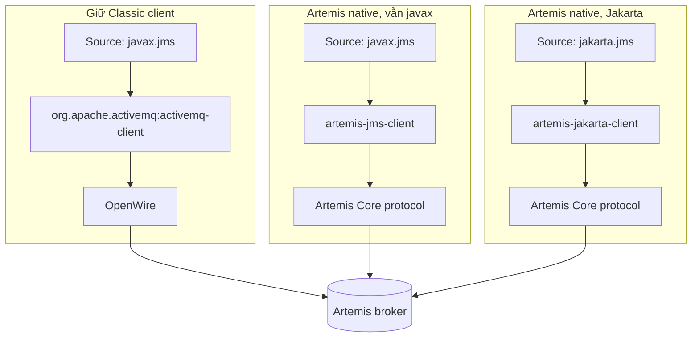

# Lựa chọn giữ OpenWire hoặc đổi sang Artemis client

> **Chương:** Di chuyển broker  
> **Module:** `INTEGRATION_MESSAGING_MESSAGE_BROKER_ACTIVEMQ` — tìm hiểu Apache ActiveMQ Classic và Artemis trong giao tiếp bất đồng bộ với queue, topic, routing và JMS; thực hành Java producer/consumer, acknowledgment, transaction, redelivery, DLQ, bảo mật và vận hành broker đáng tin cậy.  
> **Trọng tâm:** Quyết định giữ ActiveMQ Classic JMS client nói **OpenWire** với Artemis broker hay chuyển sang **Artemis native client**. Phân biệt API `javax.jms`/`jakarta.jms` với wire protocol OpenWire/Core, hiểu các vùng tương thích, cấu hình acceptor, thay dependency/URI, kiểm thử và triển khai chuyển đổi có rollback.

## 1. Quyết định này thực chất gồm hai trục độc lập

Khi chuyển ActiveMQ Classic broker sang Artemis, nhiều đội nghĩ phải đổi cả dependency và source code của mọi ứng dụng ngay lập tức. Thực tế, **Artemis hỗ trợ OpenWire**, nên ứng dụng đang dùng ActiveMQ Classic JMS client có thể kết nối trực tiếp tới Artemis broker qua OpenWire. Có thể chuyển broker trước, giữ nguyên client cũ, rồi di chuyển từng ứng dụng sang native Artemis client ở một đợt riêng. Tài liệu Artemis xác nhận các ứng dụng dùng OpenWire JMS client từ ActiveMQ 5.12.x trở lên có thể kết nối tới Artemis. [1]

Để chọn đúng, phải tách:

1. **API mà source code biên dịch:** `javax.jms`, `jakarta.jms`, Artemis Core API hay API riêng của Classic.
2. **Protocol trên mạng:** OpenWire hoặc Artemis Core (ngoài ra Artemis còn hỗ trợ AMQP, MQTT, STOMP).

JMS/Jakarta Messaging là API lập trình. Bản thân JMS không định nghĩa một wire protocol. Với Artemis native JMS/Jakarta client, JMS facade chuyển các thao tác API thành Core client operations rồi truyền qua mạng bằng **Artemis Core protocol**. Với Classic client, API JMS được triển khai bởi Classic provider và dữ liệu truyền tới broker bằng **OpenWire**. [2]



**Hệ quả quan trọng:** chuyển broker không bắt buộc phải đổi client cùng lúc. Và đổi namespace từ `javax.jms` sang `jakarta.jms` cũng không phải điều kiện để dùng Artemis native client: có client Artemis native cho cả JMS 2.0 (`javax.jms`) và Jakarta Messaging 3.x (`jakarta.jms`). [2][3]

## 2. Ba lựa chọn client cần so sánh

| Lựa chọn | API trong source | Dependency tiêu biểu | Wire protocol tới Artemis | Thay đổi ứng dụng |
|---|---|---|---|---|
| A. Classic client giữ OpenWire | `javax.jms` | `org.apache.activemq:activemq-client` | OpenWire | Thấp: đổi endpoint và kiểm chứng tương thích |
| B. Artemis native JMS 2.0 | `javax.jms` | `org.apache.artemis:artemis-jms-client` | Artemis Core | Trung bình: đổi provider factory/dependency/config |
| C. Artemis native Jakarta | `jakarta.jms` | `org.apache.artemis:artemis-jakarta-client` | Artemis Core | Cao hơn: đổi provider và namespace API |

### 2.1. Lựa chọn A — giữ OpenWire

Chọn khi:

- Cần chuyển broker trước để giảm rủi ro và giữ binary ứng dụng hiện có.
- Ứng dụng đang phụ thuộc `javax.jms`, Classic connection URI, JNDI hoặc các extension của Classic.
- Có nhiều ứng dụng/consumer cũ, chưa thể nâng cấp đồng thời.
- Cần một giai đoạn tương thích để đo hành vi thực tế trên Artemis trước khi sửa code.

Ưu điểm là thay đổi ứng dụng nhỏ. Nhược điểm là ứng dụng vẫn phụ thuộc Classic client library và OpenWire compatibility layer của Artemis. Việc chạy được kết nối không chứng minh toàn bộ hành vi provider-specific đã tương đương.

### 2.2. Lựa chọn B — Artemis native JMS 2.0

Chọn khi muốn dùng native Core transport nhưng ứng dụng vẫn phải biên dịch với `javax.jms`, ví dụ do framework hoặc application server hiện tại chưa chuyển sang Jakarta.

Đây là bước chuyển đổi hữu ích vì:

- Giữ package JMS mà source code đang sử dụng.
- Bỏ dependency Classic client khỏi ứng dụng.
- Dùng Artemis native JMS provider và Core protocol.
- Cho phép chuyển namespace Jakarta ở một đợt nâng cấp framework riêng.

**Không nhầm lựa chọn B với OpenWire:** cả hai cùng có thể import `javax.jms.*`, nhưng provider factory và wire protocol khác nhau.

### 2.3. Lựa chọn C — Artemis native Jakarta Messaging

Chọn khi ứng dụng đã sẵn sàng dùng `jakarta.jms`, thường đi cùng đợt nâng cấp framework/application server tương thích Jakarta.

Đây là hướng phù hợp cho ứng dụng mới hoặc đã chuyển sang Jakarta. Nó đòi hỏi cập nhật import, dependency, JNDI và integration test. Không thể thay jar rồi kỳ vọng class `javax.jms.Connection` tự trở thành `jakarta.jms.Connection`; hai namespace là hai kiểu Java khác nhau.

### 2.4. Đừng đặt cả hai Artemis client vào cùng một module

`artemis-jms-client` và `artemis-jakarta-client` là hai lựa chọn classpath khác nhau. Một module ứng dụng chỉ nên chọn đúng artifact theo namespace API. Nếu cần kiểm chứng cả hai, tạo hai Maven module hoặc hai profile/build riêng để tránh xung đột dependency và nhầm classpath.

## 3. Khi nào nên giữ OpenWire, khi nào nên chuyển native?

| Tiêu chí | Giữ OpenWire | Chuyển Artemis native |
|---|---|---|
| Thời gian chuyển broker | Phù hợp chuyển broker trước | Cần thêm thời gian sửa và phát hành app |
| Ứng dụng cũ chỉ có binary | Thường thuận lợi nếu tương thích protocol/features | Không thể đổi nếu không có source/build pipeline phù hợp |
| `javax.jms` hiện hữu | Giữ nguyên | Có thể dùng `artemis-jms-client` để giữ namespace |
| `jakarta.jms` | Không phải namespace của Classic 5.x client | Dùng `artemis-jakarta-client` |
| ActiveMQ-specific client API | Có thể tiếp tục phụ thuộc Classic extension | Phải thay bằng API chuẩn hoặc Artemis API tương ứng |
| Artemis Core API / tính năng native | Không truy cập trực tiếp qua JMS Classic API | Có thể dùng Artemis JMS hoặc Core API |
| Provider JNDI, connection URI | Có thể giữ một phần cấu hình Classic; phải kiểm thử | Thường phải đổi provider class và URI/property |
| Quản trị/metrics | Cần thích nghi với broker Artemis dù client là OpenWire | Cần thích nghi với broker Artemis |
| Tối ưu hiệu năng | Đo OpenWire compatibility path | Đo Core native path |
| Chi phí bảo trì lâu dài | Giữ thêm lớp tương thích và Classic dependency | Thống nhất client với broker đích |

**Khuyến nghị thực tế:** dùng OpenWire làm **cầu chuyển broker** nếu cần giảm thay đổi đồng thời; chuyển native client theo từng ứng dụng khi có đủ thời gian kiểm thử. Nếu ứng dụng mới hoặc đã ở Jakarta, ưu tiên Artemis native client. Không quyết định chỉ dựa trên giả định “native luôn nhanh hơn”; hãy benchmark cùng payload, durability, transaction, concurrency, TLS và workload.

## 4. Cấu hình Artemis acceptor cho hai loại client

Artemis dùng khái niệm **acceptor** thay cho ActiveMQ Classic `transportConnector`. Một acceptor có thể bật một hoặc nhiều protocol. Khi `protocols` bị bỏ qua, cấu hình mặc định có thể chấp nhận mọi protocol được broker hỗ trợ. Để migration có kiểm soát, nên khai báo rõ protocol và port trong môi trường triển khai. [1][4]

Ví dụ `etc/broker.xml` với hai cổng riêng:

```xml
<configuration xmlns="urn:activemq"
               xmlns:xsi="http://www.w3.org/2001/XMLSchema-instance">
  <!-- Đây là fragment minh họa: giữ các phần cấu hình
       broker hiện có và hợp nhất vào <acceptors>. -->
  <core xmlns="urn:activemq:core">
    <acceptors>
      <!-- Classic ActiveMQ JMS client nói OpenWire -->
      <acceptor name="openwire">
        tcp://0.0.0.0:61616?protocols=OPENWIRE
      </acceptor>

      <!-- Artemis native JMS/Jakarta client nói Core -->
      <acceptor name="core">
        tcp://0.0.0.0:61617?protocols=CORE
      </acceptor>
    </acceptors>
  </core>
</configuration>
```

Nếu dùng một cổng duy nhất và muốn chấp nhận cả hai:

```xml
<acceptor name="mixed">
  tcp://0.0.0.0:61616?protocols=OPENWIRE,CORE
</acceptor>
```

Port và tên acceptor chỉ là ví dụ. Nếu broker đã có acceptor chiếm cổng đó, phải sửa acceptor hiện hữu hoặc chọn cổng khác; không tạo hai listener cùng bind một địa chỉ/port.

Tách cổng giúp:

- Quan sát số connection theo protocol.
- Firewall/network policy chỉ mở protocol cần thiết.
- Chuyển dần một nhóm ứng dụng sang Core mà vẫn giữ OpenWire cho nhóm còn lại.
- Có thể tắt OpenWire sau khi đã xác minh không còn client nào sử dụng.

### 4.1. Kiểm tra acceptor trước khi chuyển ứng dụng

Trước khi thay endpoint:

1. Xác nhận broker khởi động thành công với cấu hình acceptor.
2. Kiểm tra listener bind đúng IP/port.
3. Xác minh `protocols=OPENWIRE` cho client Classic.
4. Xác minh `protocols=CORE` cho native Artemis client.
5. Kiểm tra TLS/authentication trên cả hai acceptor.
6. Dùng một client probe riêng cho mỗi protocol; đừng dùng một kết nối thành công làm bằng chứng cho protocol còn lại.

### 4.2. OpenWire-specific acceptor options

Artemis OpenWire acceptor có một số tùy chọn phục vụ compatibility và quản trị:

| Option | Ý nghĩa |
|---|---|
| `supportAdvisory` | Bật/tắt advisory messages tương thích ActiveMQ |
| `suppressInternalManagementObjects` | Quyết định advisory address/queue có đăng ký vào management registry hay không |
| `openWireDestinationCacheSize` | Kích thước cache destination; mặc định 16 và phải là lũy thừa của 2 |
| `maxInactivityDuration` | Thời gian inactivity theo millisecond trước khi broker đóng connection nếu không nhận dữ liệu |

Ví dụ:

```xml
<acceptor name="openwire">
  tcp://0.0.0.0:61616?protocols=OPENWIRE;supportAdvisory=true;suppressInternalManagementObjects=false;openWireDestinationCacheSize=64
</acceptor>
```

Tài liệu Artemis nêu `supportAdvisory` mặc định là `true`, `suppressInternalManagementObjects` mặc định là `true`, và destination cache mặc định có 16 entries. Nếu có nhiều destination khác nhau, có thể cân nhắc tăng cache; giá trị phải là lũy thừa của 2 như 16, 64 hoặc 128. Chỉ thay đổi sau khi đo số destination và memory/performance. [5]

Không copy nguyên mọi URI option của Classic vào acceptor Artemis. Một số option thuộc **client transport**, một số thuộc **OpenWire wire format**, một số là Artemis acceptor parameter. Chúng có tên và semantics khác nhau.

## 5. Lựa chọn A: giữ ActiveMQ Classic client và OpenWire

### 5.1. Maven dependency

Ví dụ ứng dụng đang dùng Classic 5.x client:

```xml
<dependency>
  <groupId>org.apache.activemq</groupId>
  <artifactId>activemq-client</artifactId>
  <version>5.19.12</version>
</dependency>
```

Version ở đây là ví dụ cho project dùng Classic 5.x. Trong production, chọn bản Classic client đã được tổ chức phê duyệt và kiểm thử với broker Artemis version mục tiêu; không tự nâng dependency cùng lúc với broker migration nếu chưa có regression test.

### 5.2. Connection URI

Với một Artemis OpenWire acceptor:

```java
import org.apache.activemq.ActiveMQConnectionFactory;

ActiveMQConnectionFactory factory =
        new ActiveMQConnectionFactory(
                "tcp://artemis-host:61616");
```

Nếu cần cấu hình OpenWire wire format, Classic client URI dùng prefix `wireFormat.`:

```java
ActiveMQConnectionFactory factory =
        new ActiveMQConnectionFactory(
                "tcp://artemis-host:61616"
                + "?wireFormat.maxInactivityDuration=30000"
                + "&wireFormat.tightEncodingEnabled=true");
```

`wireFormat.` là prefix bắt buộc cho wire-format options trong Classic connection URI. Ví dụ `wireFormat.maxInactivityDuration` điều khiển inactivity duration phía OpenWire. Đừng bỏ prefix và kỳ vọng broker hiểu option. [6]

Trong môi trường thật, URL nên lấy từ config/secret injection; credentials không được hard-code trong source hoặc log.

### 5.3. Code JMS hiện tại gần như giữ nguyên

Ví dụ producer transacted dùng `javax.jms`:

```java
import org.apache.activemq.ActiveMQConnectionFactory;

import javax.jms.Connection;
import javax.jms.DeliveryMode;
import javax.jms.MessageProducer;
import javax.jms.Queue;
import javax.jms.Session;
import javax.jms.TextMessage;

public final class ClassicOpenWireProducer {
    public static void main(String[] args) throws Exception {
        String url = System.getenv().getOrDefault(
                "BROKER_URL", "tcp://127.0.0.1:61616");

        ActiveMQConnectionFactory factory =
                new ActiveMQConnectionFactory(url);

        String user = System.getenv("BROKER_USER");
        String password = System.getenv("BROKER_PASSWORD");

        Connection connection = user == null || user.isBlank()
                ? factory.createConnection()
                : factory.createConnection(user, password);

        Session session = connection.createSession(
                true, Session.SESSION_TRANSACTED);
        MessageProducer producer = null;

        try {
            Queue queue = session.createQueue("migration.orders");
            producer = session.createProducer(queue);
            producer.setDeliveryMode(DeliveryMode.PERSISTENT);

            TextMessage message =
                    session.createTextMessage("{\"orderId\":\"O-501\"}");
            message.setStringProperty("eventId", "migration-O-501");

            producer.send(message);
            session.commit();

            System.out.println("COMMITTED " + message.getJMSMessageID());
        } catch (Exception failure) {
            try {
                session.rollback();
            } catch (Exception rollbackFailure) {
                failure.addSuppressed(rollbackFailure);
            }
            throw failure;
        } finally {
            if (producer != null) {
                producer.close();
            }
            session.close();
            connection.close();
        }
    }
}
```

Khi broker endpoint trỏ tới Artemis OpenWire acceptor, class factory vẫn là `org.apache.activemq.ActiveMQConnectionFactory` và API vẫn là `javax.jms`. Đây là cách chuyển broker ít thay đổi nhất. Tuy nhiên, phải kiểm tra destination mapping, message semantics, advisory, selectors, transactions, failover và các extension mà ứng dụng đang sử dụng.

### 5.4. Giữ OpenWire không có nghĩa giữ toàn bộ Classic broker semantics

Artemis là broker khác, có address/queue model, management API, persistence, HA và policy riêng. OpenWire là compatibility protocol giúp client giao tiếp; nó không biến Artemis thành ActiveMQ Classic ở phía server.

Những phần sau phải được inventory và kiểm thử riêng:

- Classic Virtual Topics và cách tạo consumer queues.
- Advisory topics và ứng dụng lắng nghe advisory.
- Message groups, selectors, priority, expiration, scheduled delivery.
- Temporary destinations và request/reply.
- Local/XA transactions, rollback và redelivery.
- DLQ/expiry routing, destination policies và broker plugins.
- Client failover URI, reconnect, discovery và broker topology.
- JMX MBeans, management scripts và monitoring exporter.
- Các class `org.apache.activemq.*` nằm ngoài JMS API chuẩn.

Đặc biệt, không suy ra một tính năng được hỗ trợ chỉ vì connection OpenWire bắt tay thành công.

## 6. Những điểm tương thích OpenWire cần cấu hình và kiểm thử

### 6.1. Advisory messages

Một số ứng dụng Classic lắng nghe advisory để phát hiện consumer/producer/destination lifecycle. Artemis OpenWire hỗ trợ advisory. Hai option `supportAdvisory` và `suppressInternalManagementObjects` kiểm soát việc tạo advisory và việc đăng ký các object nội bộ vào management registry. [5]

Ví dụ acceptor:

```xml
<acceptor name="openwire">
  tcp://0.0.0.0:61616?protocols=OPENWIRE;supportAdvisory=true;suppressInternalManagementObjects=false
</acceptor>
```

Nếu ứng dụng không dùng advisory, đánh giá chi phí và nhu cầu trước khi tắt. Nếu dùng, xác minh nội dung advisory và consumer behavior trong môi trường mục tiêu; không chỉ kiểm tra queue/advisory address xuất hiện trong console.

### 6.2. Virtual Topics

Classic Virtual Topic thường tạo một topic logic và các queue riêng theo consumer group. Artemis OpenWire có tùy chọn `virtualTopicConsumerWildcards` để chuyển destination kiểu Virtual Topic consumer thành Fully Qualified Queue Name (FQQN) gắn với multicast binding.

Ví dụ mapping mặc định phổ biến với prefix `Consumer.*` có cấu hình:

```xml
<acceptor name="openwire">
  tcp://0.0.0.0:61616?protocols=OPENWIRE;virtualTopicConsumerWildcards=Consumer.*.%3E%3B2
</acceptor>
```

Trong URL, `>` và `;` được percent-encode thành `%3E` và `%3B`. Theo ví dụ tài liệu, destination `Consumer.A.VirtualTopic.Orders` được ánh xạ tới FQQN tương ứng với address `VirtualTopic.Orders` và queue consumer `Consumer.A.VirtualTopic.Orders`. Mapping thực tế phải khớp wildcard/prefix đang dùng trong Classic deployment. [5]

Nếu consumer dùng selector, kiểm tra tùy chọn `selectorAware` trong mapping để selector được chuyển thành filter trên subscription queue được auto-create. Đừng bật mapping mặc định rồi cho rằng mọi biến thể Virtual Topic custom đều tự động đúng.

### 6.3. Destination cache

OpenWire acceptor cache các destination được dùng gần đây để tránh lookup lặp. Mặc định là 16; tăng lên 64 nếu workload có nhiều destination và profiling chứng minh lookup/cache churn đáng kể:

```xml
<acceptor name="openwire">
  tcp://0.0.0.0:61616?protocols=OPENWIRE;openWireDestinationCacheSize=64
</acceptor>
```

Giá trị phải là lũy thừa của 2. Đây là tối ưu cho OpenWire path, không phải giới hạn số queue/address broker có thể tạo. [5]

### 6.4. Connection inactivity

OpenWire inactivity monitor dùng heartbeat/keepalive và thời gian không nhận dữ liệu để phát hiện connection chết. Tài liệu Artemis mô tả `maxInactivityDuration` mặc định 30.000 ms và initial delay mặc định 10.000 ms. Khi client và broker thương lượng, thời gian ngắn hơn có thể được chọn. [5]

Kiểm thử với:

- Network idle qua firewall/NAT.
- GC pause dài.
- Broker overload hoặc connection storm.
- Client reconnect sau khi network partition.
- Heartbeat timeout và duplicate/recover transaction.

Không đặt inactivity timeout quá thấp chỉ để phát hiện lỗi nhanh; nó có thể biến pause ngắn/GC thành disconnect storm.

## 7. Lựa chọn B: chuyển sang Artemis native JMS 2.0 nhưng giữ javax.jms

Đây là lựa chọn trung gian quan trọng nếu ứng dụng chưa chuyển sang Jakarta.

### 7.1. Maven dependency

```xml
<dependency>
  <groupId>org.apache.artemis</groupId>
  <artifactId>artemis-jms-client</artifactId>
  <version>2.57.0</version>
</dependency>
```

Artemis 2.57.0 tài liệu hóa `org.apache.artemis:artemis-jms-client` cho JMS 2.0. [3]

### 7.2. Đổi provider factory, giữ JMS namespace

Code sẽ import factory Artemis:

```java
import org.apache.activemq.artemis.jms.client.ActiveMQConnectionFactory;
import javax.jms.Connection;
import javax.jms.ConnectionFactory;
import javax.jms.Session;

ConnectionFactory factory =
        new ActiveMQConnectionFactory(
                "tcp://artemis-host:61617");

Connection connection = factory.createConnection();
Session session = connection.createSession(
        true, Session.SESSION_TRANSACTED);
```

So với OpenWire:

| Thành phần | OpenWire | Artemis native JMS 2.0 |
|---|---|---|
| Factory class | `org.apache.activemq.ActiveMQConnectionFactory` | `org.apache.activemq.artemis.jms.client.ActiveMQConnectionFactory` |
| API import | `javax.jms.*` | `javax.jms.*` |
| Maven group/artifact | `org.apache.activemq:activemq-client` | `org.apache.artemis:artemis-jms-client` |
| Protocol | OpenWire | Core |
| Client URL | Classic transport URI | Artemis client URI |

JMS business code như `createSession`, `createProducer`, `createConsumer`, `commit`, `rollback` có thể gần như giữ nguyên. Phần cần thay thường là factory, dependency, connection options, JNDI và các extension riêng của Classic.

### 7.3. Không cần đổi source namespace chỉ để bỏ OpenWire

Nếu app đang dùng `javax.jms`, Artemis native JMS 2.0 là một bước chuyển provider/protocol độc lập. Sau khi app chạy ổn định trên native client, có thể lên kế hoạch đổi sang Jakarta trong một release riêng. Tách hai thay đổi giúp rollback và tìm nguyên nhân lỗi dễ hơn.

## 8. Lựa chọn C: Artemis native Jakarta Messaging

### 8.1. Maven dependency

```xml
<dependency>
  <groupId>org.apache.artemis</groupId>
  <artifactId>artemis-jakarta-client</artifactId>
  <version>2.57.0</version>
</dependency>
```

Tài liệu Artemis 2.57.0 khuyến nghị artifact này cho Jakarta Messaging 3.x. [3]

### 8.2. Factory và API namespace

```java
import org.apache.activemq.artemis.jms.client.ActiveMQConnectionFactory;

import jakarta.jms.Connection;
import jakarta.jms.ConnectionFactory;
import jakarta.jms.Session;

ConnectionFactory factory =
        new ActiveMQConnectionFactory(
                "tcp://artemis-host:61617");

Connection connection = factory.createConnection();
Session session = connection.createSession(
        true, Session.SESSION_TRANSACTED);
```

Các import `javax.jms.*` trong source phải chuyển thành `jakarta.jms.*`. Cùng tên interface không làm hai package tương thích nhị phân.

### 8.3. Framework/application server phải cùng namespace

Trước khi chọn Jakarta client, kiểm tra:

- Spring Framework/Spring Boot version có dùng `jakarta.jms` hay không.
- Application server có cung cấp Jakarta Messaging API phù hợp không.
- JNDI resource factory có đúng class Artemis không.
- JMS connection factory do container quản lý hay ứng dụng tự tạo.
- Transaction manager có enlist JMS resource đúng cách không.
- Các thư viện tích hợp cũ có còn tham chiếu `javax.jms` không.

Không thêm cả hai JMS API chỉ để “cho compile”. Nếu một framework dùng `javax.jms` nhưng provider bean thực thi `jakarta.jms.ConnectionFactory`, chúng không thể thay thế trực tiếp cho nhau.

## 9. Một phép thử producer/consumer để so sánh ba lựa chọn

Cùng một nghiệp vụ nên dùng payload, destination, transaction và acknowledgment giống nhau. Chỉ thay provider client/protocol.

### 9.1. Mẫu consumer transacted

Phần nghiệp vụ sau có thể giữ cấu trúc gần như giống nhau cho cả ba lựa chọn. Ví dụ namespace `javax.jms`:

```java
import javax.jms.Connection;
import javax.jms.ConnectionFactory;
import javax.jms.Message;
import javax.jms.MessageConsumer;
import javax.jms.Queue;
import javax.jms.Session;
import javax.jms.TextMessage;

public final class TransactedConsumer {
    public static void consumeOne(ConnectionFactory factory)
            throws Exception {

        Connection connection = factory.createConnection();
        Session session = connection.createSession(
                true, Session.SESSION_TRANSACTED);
        MessageConsumer consumer = null;

        try {
            Queue queue = session.createQueue("migration.orders");
            consumer = session.createConsumer(queue);
            connection.start();

            Message message = consumer.receive(5000L);
            if (message == null) {
                session.rollback();
                return;
            }

            if (!(message instanceof TextMessage text)) {
                throw new IllegalArgumentException(
                        "Expected TextMessage");
            }

            String eventId = message.getStringProperty("eventId");
            if (eventId == null || eventId.isBlank()) {
                throw new IllegalArgumentException("Missing eventId");
            }

            processIdempotently(eventId, text.getText());
            session.commit();
        } catch (Exception failure) {
            try {
                session.rollback();
            } catch (Exception rollbackFailure) {
                failure.addSuppressed(rollbackFailure);
            }
            throw failure;
        } finally {
            if (consumer != null) {
                consumer.close();
            }
            session.close();
            connection.close();
        }
    }

    private static void processIdempotently(
            String eventId, String body) {
        // Demo placeholder: production dùng inbox/unique key
        // và commit business side effect theo eventId.
        System.out.println("PROCESS " + eventId + " " + body);
    }
}
```

Để dùng native Jakarta, đổi import thành `jakarta.jms.*` và compile trong module dùng `artemis-jakarta-client`. Factory được truyền vào qua `ConnectionFactory`, nên phần xử lý không phụ thuộc class factory cụ thể.

### 9.2. Không benchmark bằng cách tạo connection cho từng message

Ví dụ trên tạo một connection/session để dễ minh họa lifecycle, nhưng benchmark throughput phải tái sử dụng connection/session/producer/consumer theo mô hình concurrency phù hợp. Tạo connection cho mỗi message sẽ đo connection handshake/resource churn nhiều hơn là năng lực xử lý message.

### 9.3. Gắn event ID ổn định

Mỗi message nên mang `eventId` bất biến. Dùng cùng event IDs khi chạy lại các test có rollback/failover để đối chiếu:

- Message được gửi thành công chưa?
- Có bị nhận hai lần không?
- Consumer commit transaction chưa?
- Business side effect có bị duplicate không?
- Sau broker restart, event nào được recover/replay?

Không dùng JMSMessageID làm business idempotency key nếu ứng dụng có thể republish cùng event với JMSMessageID mới.

## 10. Các khác biệt cần inventory trước khi bỏ OpenWire

OpenWire compatibility giảm thay đổi, nhưng không thay thế một compatibility audit. Hãy lập danh mục mọi API và feature mà ứng dụng đang dùng.

| Nhóm | Câu hỏi kiểm thử | Rủi ro khi chuyển native |
|---|---|---|
| API namespace | `javax.jms` hay `jakarta.jms`? | Compile/runtime mismatch |
| Factory extensions | Có gọi `ActiveMQConnectionFactory` methods riêng Classic không? | Không tồn tại hoặc tên/property khác |
| URI options | Có `failover:`, `wireFormat.*`, `jms.*` options không? | Artemis native URI dùng bộ options khác |
| Destination | Queue/topic physical name có được map tự động không? | Address/queue/routing-type có thể khác |
| Virtual Topic | Có consumer queue prefix hoặc wildcard custom không? | Phải cấu hình mapping/queue binding |
| Advisory | App lắng nghe `ActiveMQ.Advisory.*` không? | Cần xác minh advisory support/behavior |
| Message groups | Có `JMSXGroupID`/group close semantics không? | Test grouping, reassignment và ordering |
| Selectors | Có SQL selector phức tạp/property type đặc biệt không? | Test parse/evaluation và subscription filter |
| Body type | `ObjectMessage`, `MapMessage`, `BytesMessage`, custom serialization? | Class compatibility/deserialization policy |
| Delivery | Priority, TTL, scheduled delivery, redelivery delay? | Policy và timing khác provider |
| Transaction | Local transaction, XA, transacted session? | Enlistment/recovery/config khác |
| Destinations tạm | Temporary queue/topic và request/reply? | Lifetime và cleanup khác |
| Durable subscription | Client ID, subscription name, shared durable? | Subscription identity/migration backlog |
| Failover | Classic failover URI, discovery, reconnect? | Topology/reconnect behavior khác |
| Management | JMX MBean names, advisory, management scripts? | Công cụ Classic không còn dùng nguyên trạng |
| Security | TLS, truststore, credentials, authorization? | Acceptor/role/permission mapping khác |
| Performance | Prefetch, producer window, flow control? | Option cùng tên có thể khác semantics |

### 10.1. ObjectMessage và Java serialization

Nếu hệ thống dùng `ObjectMessage` với class Java riêng, đừng giả định mọi client và broker version đều có classpath/deserialization policy giống nhau. Native client có thể áp dụng deserialization allow/deny list; message body cũng gắn chặt với class version.

Đối với migration dài hạn, ưu tiên contract dữ liệu versioned như JSON, Avro hoặc Protobuf trong `TextMessage`/`BytesMessage`, có schema compatibility test. Nếu bắt buộc giữ `ObjectMessage`, kiểm tra classpath, classloader, serialization filter và security policy trên cả producer/consumer.

### 10.2. XA và transaction manager

Nếu ứng dụng dùng XA/JTA, không dừng ở test local transacted session. Kiểm thử:

- Enlistment của JMS resource vào transaction manager.
- Prepare/commit/rollback.
- Broker restart giữa prepare và commit.
- Recovery scan sau khi application restart.
- Heuristic outcome và transaction log retention.
- Connection factory XA tương ứng với provider native.

Không kết luận XA hoạt động chỉ vì `Session.commit()` chạy thành công trong một bài smoke test. XA là một compatibility gate riêng.

### 10.3. JNDI

Classic và Artemis dùng JNDI initial context factory khác nhau. Nếu app dùng JNDI, inventory `java.naming.factory.initial`, tên binding `connectionFactory.*`, `queue.*` và `topic.*`.

Artemis có client-side JNDI factory riêng; tài liệu mô tả `org.apache.activemq.artemis.jndi.ActiveMQInitialContextFactory`. [7]

Không chỉ thay URL trong file properties mà bỏ qua provider factory, destination binding hoặc naming convention.

## 11. Destination model: Queue/Topic JMS và Artemis address/queue

Classic thường để ứng dụng nhìn thấy queue và topic theo destination name. Artemis có mô hình address, queue và routing type:

- JMS Queue thường được ánh xạ thành address/queue theo anycast.
- JMS Topic thường được ánh xạ thành address multicast cùng các subscription queues.
- Một address có thể có nhiều queues/bindings.
- Tên address/queue và routing type cần được provision đúng khi không dùng auto-create.

Do đó, test producer gửi vào `migration.orders` chưa đủ. Cần xác minh consumer đang gắn vào đúng queue, routing type và durable subscription.

### 11.1. Tạo destination trước khi chuyển traffic

Trong staging, provision address/queue/topic bằng cơ chế quản trị được phê duyệt hoặc policy auto-create có giới hạn. Kiểm tra:

- Address tồn tại.
- Routing type đúng (anycast hoặc multicast).
- Queue binding đúng tên.
- Durability, filter và dead-letter/expiry policy đúng.
- Producer và consumer nhìn cùng logical destination.
- Authorization cho send/consume được cấu hình riêng.

Không bật auto-create rộng cho mọi address production nếu không có quota/permission rõ; typo destination có thể tạo queue/address rác mà không báo lỗi ngay.

### 11.2. Message group và ordering

Nếu dùng `JMSXGroupID`, test message cùng group được pin tới cùng consumer theo semantics mong đợi, consumer đóng/mất kết nối thì group được reassigned như thế nào, và ordering được giữ trong phạm vi nào. Artemis hỗ trợ message grouping qua group identifier; nhưng cần test qua protocol/client path thực tế đang chọn. [8]

### 11.3. Topic subscriptions

Với durable/shared durable subscription, giữ nguyên:

- Client ID (nếu loại subscription yêu cầu).
- Subscription name.
- Durable/shared mode.
- Selector.
- Topic/address mapping.
- Backlog của subscription.

Không xóa durable subscription để “làm sạch” trong lúc migration; thao tác đó có thể xóa backlog cần xử lý.

## 12. Quy trình migration theo từng giai đoạn

### Giai đoạn 0 — Inventory và baseline

Lập danh sách producer, consumer, application version, client dependency, API namespace, broker URL, destination và feature usage. Chụp baseline:

- Producer accepted/commit rate.
- Consumer completed rate.
- p50/p95/p99 latency.
- Queue depth và oldest outstanding age.
- Redelivery, DLQ, expiry.
- Memory, disk/store, journal/page, CPU.
- Failover/reconnect time.
- Business event count/unique IDs.

Không chuyển production khi chưa có baseline đủ để so sánh.

### Giai đoạn 1 — Chuyển broker, giữ OpenWire

1. Cài Artemis và cấu hình OpenWire acceptor.
2. Giữ client dependency Classic ở đúng version đã kiểm thử.
3. Tạo destination và security policy trên Artemis.
4. Chuyển một producer/consumer canary qua OpenWire.
5. Chạy compatibility test matrix.
6. Đo latency/throughput/resource pressure.
7. Mở rộng theo nhóm ứng dụng.

Mục tiêu giai đoạn này là kiểm chứng **Artemis broker với OpenWire clients**. Không thay đồng thời provider library, API namespace và broker policy.

### Giai đoạn 2 — Chuyển một ứng dụng sang Artemis native JMS

1. Tạo branch/build profile hoặc module riêng cho native client.
2. Thay dependency bằng `artemis-jms-client` nếu giữ `javax.jms`.
3. Thay provider factory/connection URI/JNDI.
4. Chạy lại functional, transaction, failure và performance tests.
5. Canary một instance/consumer group có thể rollback.
6. So sánh metrics với OpenWire baseline.
7. Mở rộng theo ứng dụng, không thay toàn bộ fleet cùng lúc.

### Giai đoạn 3 — Chuyển javax.jms sang jakarta.jms nếu cần

Đây là một thay đổi source/framework riêng:

1. Nâng framework/application server tương thích Jakarta.
2. Thay import và dependency sang `artemis-jakarta-client`.
3. Sửa JNDI/provider wiring.
4. Chạy compile + integration tests.
5. Test transaction manager, MDB/listener container và shutdown lifecycle.
6. Canary và rollout.

Không bắt buộc mọi ứng dụng phải chuyển Jakarta cùng lúc. Ứng dụng vẫn dùng `javax.jms` có thể tiếp tục dùng Artemis native JMS 2.0 nếu phù hợp dependency/framework.

### Giai đoạn 4 — Loại bỏ OpenWire khi không còn client

Chỉ tắt OpenWire acceptor khi:

- Không còn application connection dùng OpenWire.
- Không còn job/script/bridge/legacy service dùng Classic client.
- Metrics/log broker cho thấy không còn connection OpenWire trong cửa sổ quan sát đủ dài.
- Rollback plan đã hết hiệu lực hoặc đã có phương án tương đương.
- Security/firewall đã được cập nhật.
- Performance và business SLO ổn định trên native clients.

Không xóa acceptor chỉ vì một vài service mới đã chuyển native.

## 13. Cutover và rollback không được làm mất message

### 13.1. Một logical queue không phải hai broker queue đồng bộ tự động

Classic broker và Artemis broker có persistence store riêng. Nếu producer gửi một phần message vào Classic và phần khác vào Artemis, hai queue không tự hợp nhất. Nếu consumer chạy ở cả hai broker, hệ thống có thể phân tán công việc giữa hai backlog độc lập.

Trước cutover, quyết định rõ ownership:

- Broker cũ là owner cho đến thời điểm freeze.
- Sau cutover, broker mới là owner.
- Event nào đã được accepted/committed ở broker nào?
- Backlog cũ sẽ drain, bridge hay replay thế nào?
- Rollback có cần chuyển message ngược về broker cũ không?

### 13.2. Quy trình cutover một queue

1. Đặt producer vào maintenance/admission control để ngừng phát event mới trong cửa sổ cutover.
2. Đợi producer transaction/send đang mở kết thúc.
3. Chụp số lượng và danh sách business IDs còn pending/in-flight ở broker cũ theo cách read-only.
4. Drain consumer cũ hoặc chuyển backlog bằng bridge/replay đã kiểm thử.
5. Xác minh broker cũ không còn message chưa xử lý thuộc phạm vi chuyển.
6. Chuyển producer endpoint sang Artemis.
7. Khởi động consumer native/OpenWire đã chọn.
8. Gửi canary event có ID xác định và xác minh một business completion.
9. Mở lại ingress.
10. Theo dõi accepted/completed, oldest age, redelivery, DLQ và duplicate IDs.

Nếu không thể drain hết backlog trước cutover, phải có quy trình bridge/replay được thiết kế rõ và có idempotency. Không copy file journal trực tiếp giữa hai broker implementation.

### 13.3. Rollback khi đã có message trên Artemis

Rollback không chỉ là đổi `BROKER_URL` về Classic:

- Dừng producer mới để không tiếp tục tạo backlog trên Artemis.
- Xác định message nào đã được Artemis nhận và message nào đã hoàn tất business.
- Drain Artemis hoặc chuyển/replay phần còn lại về Classic bằng cơ chế có kiểm soát.
- Dùng stable `eventId`/inbox để tránh duplicate.
- Chỉ mở lại producer/consumer trên Classic khi ownership của backlog đã rõ.
- Đối soát số lượng accepted, completed, failed, DLQ và outstanding sau rollback.

Nếu cả hai broker cùng nhận traffic mà không có idempotency/reconciliation, duplicate hoặc mất event có thể xuất hiện dù từng broker hoạt động bình thường.

## 14. Test matrix bắt buộc trước production

| Nhóm test | Kịch bản | Điều kiện đạt |
|---|---|---|
| Connectivity | Mỗi client kết nối đúng acceptor | Đúng protocol, auth, TLS |
| Queue | Persistent producer, competing consumers | Không mất event; completion đúng |
| Topic | Non-durable/durable/shared durable | Subscription/backlog đúng |
| Selector | Property type và selector phức tạp | Cùng tập message được chọn |
| Priority/TTL | Priority, expiration, scheduled delivery | Thứ tự/expiry theo contract |
| Transactions | Commit, rollback, crash trước commit | Recover/redelivery đúng |
| XA | Prepare, broker restart, recovery scan | Transaction manager recover đúng |
| Redelivery | Consumer crash và retry | Delivery count/DLQ policy đúng |
| Message groups | Nhiều group, consumer restart | Ordering/group reassignment đúng |
| Virtual Topic | Producer topic, nhiều consumer groups | Mỗi group nhận đúng bản sao |
| Advisory | Producer/consumer create-close | App nhận advisory cần thiết |
| Temporary destination | Request/reply và connection close | Temporary resource được cleanup |
| ObjectMessage | Class/version/serialization filter | Không lỗi class hoặc vi phạm security |
| Failover | Broker restart/network partition | Reconnect trong RTO, không mất business event |
| Security | TLS, credentials, role/permission | Least privilege và cert validation |
| Performance | Steady, burst, sustained overload | SLO latency/throughput/resource đạt |
| Management | Metrics, JMX, alerts, scripts | Runbook dùng được trên Artemis |

### 14.1. Điều kiện pass không chỉ là “client connected”

Một migration test pass khi:

- Producer send/commit được xác nhận theo đúng semantics.
- Consumer nhận đúng event và commit.
- Không có duplicate business effect.
- Rollback/redelivery hoạt động theo policy.
- Destination và subscription được ánh xạ đúng.
- Metrics/alerts phản ánh broker đích.
- Broker restart/failover không vượt RTO/RPO đã thống nhất.
- Security và authorization được xác minh.
- Performance không vi phạm SLO trong cả ba hình dạng tải.

## 15. Observability và vận hành sau khi đổi client

Sau khi chuyển sang Artemis, công cụ quản trị Classic không còn là nguồn sự thật duy nhất. Chuẩn hóa dashboard theo business metrics và Artemis management:

- Connection count theo protocol (OpenWire/Core).
- Producer/consumer count theo address/queue.
- Queue depth, delivering, scheduled, DLQ, expiry.
- Accepted/acknowledged/completed rate.
- Oldest outstanding age và E2E latency.
- Redelivery/rollback.
- Memory, journal/store, paging/disk.
- Reconnect/failover và connection churn.
- Client version, app version, broker version.

OpenWire có thể được trace bằng logger `org.apache.activemq.artemis.core.protocol.openwire.OpenWireConnection` khi cần điều tra command exchange; chỉ bật TRACE ngắn hạn và có kiểm soát vì log có thể rất lớn. [5]

Đừng chỉ giữ metric Classic JMX names rồi ánh xạ cơ học sang Artemis. Định nghĩa SLI theo business semantics trước, sau đó map từng broker metric tương ứng.

## 16. Các lỗi migration thường gặp

| Triệu chứng | Nguyên nhân thường gặp | Hướng xử lý |
|---|---|---|
| `ClassNotFoundException: javax.jms...` | JMS API/client dependency không có trên classpath | Kiểm tra dependency tree và namespace |
| `ClassCastException` giữa `javax.jms` và `jakarta.jms` | Trộn hai API namespace | Chọn đúng client artifact và framework namespace |
| OpenWire client timeout khi kết nối | Acceptor không bật `OPENWIRE`, port/firewall/TLS sai | Kiểm tra acceptor và protocol |
| Artemis native client bị protocol mismatch | Kết nối nhầm OpenWire-only acceptor | Bật `CORE` hoặc dùng acceptor phù hợp |
| Producer gửi được nhưng consumer không thấy | Destination/routing type/binding sai | Kiểm tra address, queue, anycast/multicast |
| Virtual Topic consumer không nhận | Mapping wildcard/prefix chưa khớp | Cấu hình `virtualTopicConsumerWildcards`, selector mapping |
| Advisory app không hoạt động | Advisory support hoặc management visibility khác | Kiểm tra `supportAdvisory` và `suppressInternalManagementObjects` |
| Failover không giống Classic | URI/topology/discovery khác | Test reconnect/HA riêng theo protocol/client |
| Duplicate sau rollback | Side effect DB đã commit trước JMS ack | Inbox/idempotency theo eventId |
| Performance giảm | Khác persistence, transaction, prefetch/window, payload | Benchmark cùng semantics và tune từng biến |
| JMX scripts lỗi | MBean names/operations khác broker | Chuyển sang Artemis management API/JMX |
| Rollback làm mất backlog | Chỉ đổi endpoint, bỏ message trên Artemis | Drain/bridge/replay và reconcile ownership |

## 17. Checklist ra quyết định

- [ ] Đã tách API namespace khỏi wire protocol.
- [ ] Biết app đang dùng Classic `javax.jms`, Artemis JMS 2.0 hay Jakarta Messaging 3.x.
- [ ] Đã xác nhận Classic OpenWire client version tối thiểu/phiên bản thực tế với Artemis mục tiêu.
- [ ] Đã quyết định giữ OpenWire, Artemis native JMS 2.0 hay Artemis Jakarta client cho từng ứng dụng.
- [ ] Đã cấu hình đúng `OPENWIRE` hoặc `CORE` trên Artemis acceptor.
- [ ] Không đưa hai Artemis JMS client artifacts vào cùng module classpath.
- [ ] Đã inventory provider-specific APIs, JNDI, URI options và destination semantics.
- [ ] Đã kiểm tra Virtual Topics/advisory/message groups/selectors/temporary destinations nếu có sử dụng.
- [ ] Đã test local transaction, XA nếu có, rollback, redelivery và DLQ.
- [ ] Đã benchmark cùng delivery mode, transaction, payload và concurrency.
- [ ] Đã có cutover ownership và rollback/replay plan cho backlog.
- [ ] Đã kiểm tra TLS, authentication, authorization và observability trên broker mới.
- [ ] Chỉ loại bỏ OpenWire sau khi xác nhận không còn client phụ thuộc.

## 18. Kết luận

**Giữ OpenWire** là lựa chọn chuyển broker ít thay đổi ứng dụng nhất: Classic JMS client vẫn dùng `javax.jms`, Artemis nhận protocol OpenWire. Đây là con đường phù hợp cho migration theo giai đoạn, nhưng phải kiểm thử các extension/semantics Classic mà app phụ thuộc.

**Artemis native JMS 2.0** cho phép đổi provider và protocol sang Core mà vẫn giữ `javax.jms`. **Artemis native Jakarta** dùng `jakarta.jms` và phù hợp khi framework/application đã sẵn sàng Jakarta. Hai lựa chọn native có dependency riêng và không nên trộn vào cùng module.

Một lộ trình giảm rủi ro thường là:

1. Chuyển broker, giữ OpenWire cho các ứng dụng cũ.
2. Chuyển từng ứng dụng sang Artemis native JMS 2.0 hoặc Jakarta theo khả năng tương thích.
3. Chỉ tắt OpenWire khi connection inventory xác nhận không còn client dùng protocol này.
4. Dùng stable event IDs, idempotency, drain và reconciliation để cutover/rollback không mất hoặc nhân đôi business work.

## 19. Tài liệu tham khảo chính thức

1. [Apache Artemis — Protocols and Interoperability](https://artemis.apache.org/components/artemis/documentation/latest/protocols-interoperability.html) — OpenWire client compatibility, Core protocol và cấu hình acceptor.
2. [Apache Artemis — Core Architecture](https://artemis.apache.org/components/artemis/documentation/latest/architecture.html) — JMS/Jakarta facade được chuyển thành Core operations; phân biệt JMS API và wire protocol.
3. [Apache Artemis — The Client Classpath](https://artemis.apache.org/components/artemis/documentation/latest/client-classpath) — Maven artifacts `artemis-jms-client` và `artemis-jakarta-client` cho Artemis 2.57.0.
4. [Apache Artemis — Migration: Connectors](https://artemis.apache.org/components/artemis/migration-documentation/connectors.html) — mapping Classic transport connectors sang Artemis acceptors.
5. [Apache Artemis — OpenWire](https://artemis.apache.org/components/artemis/documentation/latest/openwire.html) — advisory, inactivity monitoring, destination cache và Virtual Topic consumer mapping.
6. [ActiveMQ Classic — Configuring Wire Formats](https://activemq.apache.org/components/classic/documentation/configuring-wire-formats) — OpenWire URI options và prefix `wireFormat.`.
7. [Apache Artemis — Using JMS or Jakarta Messaging](https://artemis.apache.org/components/artemis/documentation/latest/using-jms) — Artemis JNDI factory và client connection configuration.
8. [Apache Artemis — Message Grouping](https://artemis.apache.org/components/artemis/documentation/latest/message-grouping.html) — group identifier và consumer pinning semantics.
