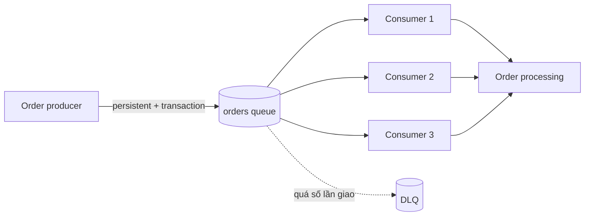

# Xây dựng hàng đợi xử lý đơn hàng với producer và nhiều consumer

> **Chương:** Bài tập tổng hợp  
> **Phạm vi:** Pipeline xử lý đơn hàng bằng queue, một producer và nhiều competing consumers; persistent message, transaction, rollback, redelivery và Dead Letter Queue (DLQ) trên ActiveMQ Artemis. Phần cuối chỉ ra cách chuyển mô hình sang ActiveMQ Classic.  
> **Kết quả:** Một lần chạy tạo queue riêng, gửi order events theo batch, phân phối cho nhiều worker, retry một đơn lỗi tạm thời và chuyển poison message vào DLQ sau số lần giao giới hạn.

## 1. Bài toán và kiến trúc

API nhận đơn cần xác nhận nhanh rằng lệnh đã được đưa vào hàng đợi; worker xử lý đơn ở nền và có thể tăng số consumer khi lưu lượng tăng.



**Một queue có nhiều competing consumers** nghĩa là broker phân phối mỗi message cho một consumer trong nhóm đăng ký queue đó. Các consumer cùng làm việc trên một backlog; một message không được broadcast cho tất cả worker như topic.

Bài tập thực hiện:

- Producer tạo order ID, event ID, số tiền và payload.
- Producer gửi persistent message vào queue `orders.<runId>`, commit theo batch.
- Bốn consumer độc lập cùng subscribe queue; mỗi consumer có `JMSContext`/session riêng.
- Worker xử lý đơn hợp lệ rồi commit transaction để ACK.
- Một order lỗi tạm thời ở lần giao đầu; sau rollback sẽ được giao lại và xử lý thành công.
- Một order poison luôn lỗi; sau ba lần giao Artemis chuyển nó sang `DLQ`.
- Mỗi run có `runId` riêng; DLQ dùng selector để chỉ đọc poison message của run hiện tại.

Bài lab mô phỏng xử lý nghiệp vụ bằng Java. Phần mở rộng production hướng dẫn đưa DB transaction và inbox vào đúng vị trí; JMS commit không tự bao trùm database.

## 2. Điều kiện và công cụ

- Java 17, Maven 3.9 trở lên.
- Apache ActiveMQ Artemis 2.50.x chạy local.
- Artemis Jakarta JMS client cùng phiên bản broker.
- Terminal và quyền chỉnh sửa broker instance.
- Không cần database cho bước lab đầu tiên; xử lý order được mô phỏng bằng hàm Java.

Bài chính dùng namespace `jakarta.jms`. ActiveMQ Classic 5.x thường dùng `javax.jms`; không trộn hai namespace trong cùng source set. Khi chạy Classic, dùng client artifact và API namespace đúng phiên bản broker.

## 3. Khởi tạo broker Artemis cho lab

Từ thư mục cài đặt Artemis, tạo một broker instance riêng:

```bash
./bin/artemis create ./order-broker --user labadmin --password 'replace-with-a-local-lab-password' --require-login
```

Trên Windows PowerShell, dùng script `artemis.cmd` trong thư mục cài đặt:

```powershell
& "$env:ARTEMIS_HOME\bin\artemis.cmd" create ".\order-broker" --user labadmin --password "replace-with-a-local-lab-password" --require-login
```

Mật khẩu chỉ dùng cho broker local của bài tập; không commit vào source control. Broker tạo user/role khi khởi tạo. Dùng credentials tương ứng trong biến môi trường của ứng dụng.

Mở file `order-broker/etc/broker.xml`. Trong phần `<core>`, bổ sung cấu hình địa chỉ và queue DLQ; merge các phần tử vào section tương ứng nếu chúng đã tồn tại, không tạo hai phần tử `<addresses>` hoặc `<address-settings>` cùng cấp.

```xml
<addresses>
    <!-- Queue work được tạo động theo orders.<runId>. -->
    <address name="DLQ">
        <anycast>
            <queue name="DLQ" durable="true"/>
        </anycast>
    </address>
</addresses>

<address-settings>
    <address-setting match="orders.#">
        <auto-create-addresses>true</auto-create-addresses>
        <auto-create-queues>true</auto-create-queues>
        <default-queue-routing-type>ANYCAST</default-queue-routing-type>

        <redelivery-delay>1000</redelivery-delay>
        <redelivery-delay-multiplier>2.0</redelivery-delay-multiplier>
        <max-redelivery-delay>5000</max-redelivery-delay>

        <max-delivery-attempts>3</max-delivery-attempts>
        <dead-letter-address>DLQ</dead-letter-address>
    </address-setting>
</address-settings>
```

Ý nghĩa:

- `orders.#` match các address có prefix `orders.`; mỗi lần chạy dùng queue riêng như `orders.run-001`.
- `ANYCAST` tạo semantics queue work distribution: một message được giao cho một consumer trong nhóm.
- `auto-create-addresses` và `auto-create-queues` cho phép broker tạo queue lab khi JMS client sử dụng destination lần đầu. Production nên provision destination theo quy trình triển khai và tắt auto-create nếu cần kiểm soát chặt.
- `redelivery-delay=1000` trì hoãn lần giao lại đầu tiên một giây; multiplier 2 tăng delay cho lần tiếp theo, với trần 5 giây.
- `max-delivery-attempts=3` giới hạn số lần broker thử giao trước khi dead-letter theo semantics Artemis.
- `dead-letter-address=DLQ` chuyển poison message đến address DLQ; queue durable `DLQ` nhận các message đó.

Khởi động broker:

```bash
./order-broker/bin/artemis run
```

Trên Windows:

```powershell
.\order-broker\bin\artemis.cmd run
```

Ứng dụng dùng **Artemis Core protocol** qua acceptor mặc định TCP `61616`. Kiểm tra `broker.xml` của instance có acceptor Core đang lắng nghe cổng này; không dùng OpenWire URI của ActiveMQ Classic để kết nối Artemis Core client.

## 4. Tạo Maven project

Cấu trúc:

```text
order-queue-lab/
  pom.xml
  src/
    main/
      java/
        lab/
          OrderQueueLab.java
```

File `pom.xml`:

```xml
<project xmlns="http://maven.apache.org/POM/4.0.0"
         xmlns:xsi="http://www.w3.org/2001/XMLSchema-instance"
         xsi:schemaLocation="http://maven.apache.org/POM/4.0.0
         https://maven.apache.org/xsd/maven-4.0.0.xsd">
    <modelVersion>4.0.0</modelVersion>
    <groupId>lab.messaging</groupId>
    <artifactId>order-queue-lab</artifactId>
    <version>1.0.0</version>

    <properties>
        <maven.compiler.release>17</maven.compiler.release>
        <project.build.sourceEncoding>UTF-8</project.build.sourceEncoding>
        <artemis.version>2.50.0</artemis.version>
    </properties>

    <dependencies>
        <dependency>
            <groupId>org.apache.artemis</groupId>
            <artifactId>artemis-jakarta-client</artifactId>
            <version>${artemis.version}</version>
        </dependency>
    </dependencies>

    <build>
        <plugins>
            <plugin>
                <groupId>org.apache.maven.plugins</groupId>
                <artifactId>maven-compiler-plugin</artifactId>
                <version>3.14.1</version>
                <configuration><release>17</release></configuration>
            </plugin>
            <plugin>
                <groupId>org.codehaus.mojo</groupId>
                <artifactId>exec-maven-plugin</artifactId>
                <version>3.5.0</version>
                <configuration>
                    <mainClass>lab.OrderQueueLab</mainClass>
                </configuration>
            </plugin>
        </plugins>
    </build>
</project>
```

Nếu môi trường đang dùng Artemis patch release khác, khóa `artemis.version` theo phiên bản client tương thích với broker và dùng cùng dependency trong mọi lần chạy.

## 5. Mã Java: producer và nhiều competing consumers

Tạo file `src/main/java/lab/OrderQueueLab.java`:

```java
package lab;

import jakarta.jms.DeliveryMode;
import jakarta.jms.JMSConsumer;
import jakarta.jms.JMSContext;
import jakarta.jms.JMSProducer;
import jakarta.jms.Message;
import jakarta.jms.Queue;
import jakarta.jms.QueueBrowser;
import jakarta.jms.Session;
import jakarta.jms.TextMessage;

import org.apache.activemq.artemis.jms.client.ActiveMQConnectionFactory;

import java.util.Locale;
import java.util.Enumeration;
import java.util.Map;
import java.util.concurrent.ConcurrentHashMap;
import java.util.concurrent.CountDownLatch;
import java.util.concurrent.ExecutorService;
import java.util.concurrent.Executors;
import java.util.concurrent.TimeUnit;
import java.util.concurrent.atomic.AtomicBoolean;
import java.util.concurrent.atomic.AtomicInteger;
import java.util.concurrent.atomic.AtomicReference;

public final class OrderQueueLab {

    private static final String DLQ_NAME = "DLQ";
    private static final int PRODUCER_BATCH_SIZE = 10;

    private OrderQueueLab() {
    }

    public static void main(String[] args) throws Exception {
        if (args.length != 3) {
            throw new IllegalArgumentException(
                    "Usage: <runId> <consumerCount> <orderCount>");
        }

        String runId = args[0];
        int consumerCount = Integer.parseInt(args[1]);
        int orderCount = Integer.parseInt(args[2]);

        require(runId.matches("[A-Za-z0-9_-]{1,24}"),
                "runId must contain only letters, digits, '_' or '-'");
        require(consumerCount >= 2 && consumerCount <= 32,
                "consumerCount must be between 2 and 32");
        require(orderCount >= 3 && orderCount <= 10000,
                "orderCount must be between 3 and 10000");

        String brokerUrl = requiredEnv("BROKER_URL");
        String username = requiredEnv("ARTEMIS_USER");
        String password = requiredEnv("ARTEMIS_PASSWORD");

        String queueName = "orders." + runId;
        String transientOrderId = orderId(1);
        String poisonOrderId = orderId(Math.max(2, orderCount / 2));

        CountDownLatch consumersReady =
                new CountDownLatch(consumerCount);
        CountDownLatch successfulOrders =
                new CountDownLatch(orderCount - 1);

        AtomicBoolean running = new AtomicBoolean(true);
        AtomicReference<Throwable> fatalFailure =
                new AtomicReference<>();

        Map<String, AtomicInteger> processedByWorker =
                new ConcurrentHashMap<>();

        ActiveMQConnectionFactory factory =
                new ActiveMQConnectionFactory(
                        brokerUrl, username, password);

        ExecutorService workers =
                Executors.newFixedThreadPool(consumerCount);

        try {
            for (int i = 1; i <= consumerCount; i++) {
                String workerId = "consumer-" + i;
                workers.submit(new ConsumerWorker(
                        factory, queueName, runId, workerId,
                        transientOrderId, poisonOrderId,
                        consumersReady, successfulOrders,
                        running, fatalFailure, processedByWorker));
            }

            require(consumersReady.await(20, TimeUnit.SECONDS),
                    "Consumers did not become ready");
            throwIfFatal(fatalFailure);

            publishOrders(factory, queueName, runId, orderCount,
                    transientOrderId, poisonOrderId);

            long deadline = System.nanoTime()
                    + TimeUnit.SECONDS.toNanos(90);

            while (successfulOrders.getCount() > 0
                    && System.nanoTime() < deadline) {
                throwIfFatal(fatalFailure);
                successfulOrders.await(250, TimeUnit.MILLISECONDS);
            }

            throwIfFatal(fatalFailure);
            require(successfulOrders.getCount() == 0,
                    "Timed out waiting for successful orders");

            DeadLetterInfo deadLetter =
                    browseDeadLetter(factory, runId, 20_000);

            require(poisonOrderId.equals(deadLetter.orderId()),
                    "Unexpected DLQ order: " + deadLetter.orderId());

            System.out.println();
            System.out.println("=== RUN RESULT ===");
            System.out.println("runId=" + runId);
            System.out.println("queue=" + queueName);
            System.out.println("consumers=" + consumerCount);
            System.out.println("published=" + orderCount);
            System.out.println("businessCompleted=" + (orderCount - 1));
            System.out.println("transientRetryOrder=" + transientOrderId);
            System.out.println("deadLetteredOrder=" + deadLetter.orderId());
            System.out.println("deadLetterEventId=" + deadLetter.eventId());

            processedByWorker.forEach((worker, count) ->
                    System.out.println(worker + " completed="
                            + count.get()));

        } finally {
            running.set(false);
            workers.shutdown();

            if (!workers.awaitTermination(10, TimeUnit.SECONDS)) {
                workers.shutdownNow();
                workers.awaitTermination(10, TimeUnit.SECONDS);
            }

            factory.close();
        }
    }

    private static void publishOrders(
            ActiveMQConnectionFactory factory,
            String queueName,
            String runId,
            int orderCount,
            String transientOrderId,
            String poisonOrderId) throws Exception {

        try (JMSContext context =
                     factory.createContext(Session.SESSION_TRANSACTED)) {

            Queue queue = context.createQueue(queueName);
            JMSProducer producer = context.createProducer()
                    .setDeliveryMode(DeliveryMode.PERSISTENT);

            try {
                for (int number = 1; number <= orderCount; number++) {
                    String id = orderId(number);
                    long amountMinor = 125_000L + number * 1_000L;
                    String eventId = runId + ":" + id + ":created:v1";

                    String body = "{"
                            + "\"orderId\":\"" + id + "\","
                            + "\"amountMinor\":" + amountMinor + ","
                            + "\"currency\":\"VND\""
                            + "}";

                    TextMessage message =
                            context.createTextMessage(body);
                    message.setStringProperty("runId", runId);
                    message.setStringProperty("eventId", eventId);
                    message.setStringProperty("orderId", id);
                    message.setLongProperty("amountMinor", amountMinor);

                    if (id.equals(transientOrderId)) {
                        message.setStringProperty(
                                "labScenario", "fail-once");
                    } else if (id.equals(poisonOrderId)) {
                        message.setStringProperty(
                                "labScenario", "always-fail");
                    } else {
                        message.setStringProperty(
                                "labScenario", "normal");
                    }

                    producer.send(queue, message);

                    if (number % PRODUCER_BATCH_SIZE == 0
                            || number == orderCount) {
                        context.commit();
                        System.out.println(
                                "PRODUCER_COMMIT throughOrder=" + id);
                    }
                }
            } catch (Exception failure) {
                try {
                    context.rollback();
                } catch (RuntimeException rollbackFailure) {
                    failure.addSuppressed(rollbackFailure);
                }
                throw failure;
            }
        }
    }

    private static DeadLetterInfo browseDeadLetter(
            ActiveMQConnectionFactory factory,
            String runId,
            long timeoutMillis) throws Exception {

        try (JMSContext context = factory.createContext()) {
            Queue dlq = context.createQueue(DLQ_NAME);
            String selector = "runId = '" + runId + "'";
            QueueBrowser browser = context.createBrowser(dlq, selector);
            context.start();
            long deadline = System.nanoTime()
                    + TimeUnit.MILLISECONDS.toNanos(timeoutMillis);

            while (System.nanoTime() < deadline) {
                Enumeration<?> messages = browser.getEnumeration();
                if (messages.hasMoreElements()) {
                    Message message = (Message) messages.nextElement();
                    return new DeadLetterInfo(
                            message.getStringProperty("eventId"),
                            message.getStringProperty("orderId"),
                            message.getJMSMessageID());
                }
                Thread.sleep(250);
            }

            throw new IllegalStateException(
                    "No matching message arrived in DLQ");
        }
    }

    private static final class ConsumerWorker implements Runnable {

        private final ActiveMQConnectionFactory factory;
        private final String queueName;
        private final String runId;
        private final String workerId;
        private final String transientOrderId;
        private final String poisonOrderId;
        private final CountDownLatch ready;
        private final CountDownLatch successfulOrders;
        private final AtomicBoolean running;
        private final AtomicReference<Throwable> fatalFailure;
        private final Map<String, AtomicInteger> processedByWorker;

        private ConsumerWorker(
                ActiveMQConnectionFactory factory,
                String queueName,
                String runId,
                String workerId,
                String transientOrderId,
                String poisonOrderId,
                CountDownLatch ready,
                CountDownLatch successfulOrders,
                AtomicBoolean running,
                AtomicReference<Throwable> fatalFailure,
                Map<String, AtomicInteger> processedByWorker) {
            this.factory = factory;
            this.queueName = queueName;
            this.runId = runId;
            this.workerId = workerId;
            this.transientOrderId = transientOrderId;
            this.poisonOrderId = poisonOrderId;
            this.ready = ready;
            this.successfulOrders = successfulOrders;
            this.running = running;
            this.fatalFailure = fatalFailure;
            this.processedByWorker = processedByWorker;
        }

        @Override
        public void run() {
            try (JMSContext context =
                         factory.createContext(Session.SESSION_TRANSACTED)) {

                Queue queue = context.createQueue(queueName);
                JMSConsumer consumer = context.createConsumer(queue);
                context.start();
                ready.countDown();

                while (running.get()) {
                    Message message = consumer.receive(1000);
                    if (message == null) {
                        continue;
                    }

                    String eventId = message.getStringProperty("eventId");
                    String orderId = message.getStringProperty("orderId");
                    String messageRunId =
                            message.getStringProperty("runId");

                    int deliveryCount = message.propertyExists(
                            "JMSXDeliveryCount")
                            ? message.getIntProperty("JMSXDeliveryCount")
                            : 1;
                    boolean redelivered = message.getJMSRedelivered();

                    try {
                        require(runId.equals(messageRunId),
                                "runId mismatch");
                        require(eventId != null && !eventId.isBlank(),
                                "eventId is required");
                        require(orderId != null && !orderId.isBlank(),
                                "orderId is required");
                        require(message instanceof TextMessage,
                                "Expected TextMessage");

                        if (orderId.equals(transientOrderId)
                                && deliveryCount == 1) {
                            throw new IllegalStateException(
                                    "Injected transient failure on first delivery");
                        }
                        if (orderId.equals(poisonOrderId)) {
                            throw new IllegalStateException(
                                    "Injected permanent failure for DLQ test");
                        }

                        processOrder(
                                (TextMessage) message, orderId, eventId);

                        // ACK các message trong transacted session.
                        context.commit();

                        processedByWorker
                                .computeIfAbsent(workerId,
                                        ignored -> new AtomicInteger())
                                .incrementAndGet();
                        successfulOrders.countDown();

                        System.out.printf(
                                "COMMITTED worker=%s order=%s "
                                + "eventId=%s delivery=%d redelivered=%s%n",
                                workerId, orderId, eventId,
                                deliveryCount, redelivered);

                    } catch (Exception processingFailure) {
                        System.err.printf(
                                "ROLLBACK worker=%s order=%s "
                                + "delivery=%d redelivered=%s reason=%s%n",
                                workerId, orderId, deliveryCount,
                                redelivered,
                                processingFailure.getMessage());

                        try {
                            context.rollback();
                        } catch (RuntimeException rollbackFailure) {
                            rollbackFailure.addSuppressed(
                                    processingFailure);
                            throw rollbackFailure;
                        }
                    }
                }

            } catch (Throwable failure) {
                fatalFailure.compareAndSet(null, failure);
                running.set(false);
            } finally {
                ready.countDown();
            }
        }
    }

    private static void processOrder(
            TextMessage message,
            String orderId,
            String eventId) throws Exception {

        String body = message.getText();
        long amountMinor = message.getLongProperty("amountMinor");

        require(body != null && body.contains(
                        "\"orderId\":\"" + orderId + "\""),
                "Payload orderId does not match property");
        require(amountMinor > 0, "Order amount must be positive");

        // Mô phỏng validate, reserve inventory và ghi nhận order.
        Thread.sleep(25);

        System.out.printf("PROCESSED order=%s amountMinor=%d eventId=%s%n",
                orderId, amountMinor, eventId);
    }

    private static String orderId(int number) {
        return String.format(Locale.ROOT, "ORD-%04d", number);
    }

    private static String requiredEnv(String name) {
        String value = System.getenv(name);
        if (value == null || value.isBlank()) {
            throw new IllegalStateException(
                    "Environment variable is required: " + name);
        }
        return value;
    }

    private static void throwIfFatal(
            AtomicReference<Throwable> fatalFailure) {
        Throwable failure = fatalFailure.get();
        if (failure != null) {
            throw new IllegalStateException(
                    "A consumer worker stopped unexpectedly", failure);
        }
    }

    private static void require(boolean condition, String reason) {
        if (!condition) {
            throw new IllegalStateException(reason);
        }
    }

    private record DeadLetterInfo(
            String eventId,
            String orderId,
            String jmsMessageId) {
    }
}
```

### 5.1. Vì sao mỗi consumer có context riêng?

JMS `Session`/`JMSContext` không phải đối tượng chia sẻ tùy ý giữa nhiều thread. Mỗi worker tạo một transacted `JMSContext` và `JMSConsumer` riêng. Broker dispatch cho các worker độc lập mà không buộc ứng dụng đồng bộ nhiều thread trên cùng session.

Factory được chia sẻ để tạo context; connection/session consumer là tài nguyên riêng theo worker. Một message được một consumer nhận và xử lý trong lần delivery đó. Broker không cam kết chia đều chính xác số message cho từng worker.

### 5.2. Vì sao producer commit theo batch?

Producer gửi persistent messages trong transacted context. `send()` chưa phải ranh giới commit; `context.commit()` hoàn tất batch hiện tại.

Batch size 10 giúp giảm số commit round trips. Đổi batch size sẽ thay đổi throughput, độ trễ chờ commit và lượng message có thể rollback cùng lúc. Khi commit thất bại do mất kết nối, outcome có thể không xác định; production cần giữ event ID ổn định để reconcile/retry an toàn.

### 5.3. Vì sao consumer commit sau xử lý?

Consumer dùng transacted context. Khi xử lý thành công, `context.commit()` xác nhận receive và ACK trong transaction. Khi xử lý lỗi, `context.rollback()` hủy ACK để broker có thể redeliver theo policy.

Nếu process DB xong nhưng JMS commit bị lỗi, message có thể được giao lại. Bài lab mô phỏng processing trong memory nên không chứng minh tính bền vững của business side effect. Production phải dùng transactional inbox/idempotency key khi ghi DB hoặc gọi hệ thống ngoài.

## 6. Chạy bài tập

Đặt biến môi trường trỏ tới broker:

```powershell
$env:BROKER_URL = "tcp://localhost:61616"
$env:ARTEMIS_USER = "labadmin"
$env:ARTEMIS_PASSWORD = "replace-with-a-local-lab-password"

mvn -q compile exec:java -Dexec.args="run-001 4 20"
```

Trên Bash:

```bash
export BROKER_URL="tcp://localhost:61616"
export ARTEMIS_USER="labadmin"
export ARTEMIS_PASSWORD="replace-with-a-local-lab-password"

mvn -q compile exec:java -Dexec.args="run-001 4 20"
```

Đối số:
- `run-001`: ID lần chạy; chỉ dùng chữ, số, dấu gạch ngang và gạch dưới.
- `4`: số consumer worker.
- `20`: số order được gửi.

Ứng dụng tạo queue `orders.run-001`. Lần chạy tiếp theo dùng `run-002` để tạo queue mới. DLQ dùng selector `runId`, nên kết quả được tách khỏi message DLQ cũ.

## 7. Kết quả mong đợi và cách đọc

Output có thể thay đổi thứ tự vì bốn consumer chạy song song. Một kết quả điển hình:

```text
PRODUCER_COMMIT throughOrder=ORD-0010
ROLLBACK worker=consumer-2 order=ORD-0001 delivery=1 redelivered=false reason=Injected transient failure on first delivery
COMMITTED worker=consumer-3 order=ORD-0002 delivery=1 redelivered=false
...
COMMITTED worker=consumer-1 order=ORD-0001 delivery=2 redelivered=true
ROLLBACK worker=consumer-4 order=ORD-0010 delivery=1 redelivered=false reason=Injected permanent failure for DLQ test
ROLLBACK worker=consumer-2 order=ORD-0010 delivery=2 redelivered=true reason=Injected permanent failure for DLQ test
ROLLBACK worker=consumer-3 order=ORD-0010 delivery=3 redelivered=true reason=Injected permanent failure for DLQ test

=== RUN RESULT ===
runId=run-001
queue=orders.run-001
consumers=4
published=20
businessCompleted=19
transientRetryOrder=ORD-0001
deadLetteredOrder=ORD-0010
deadLetterEventId=run-001:ORD-0010:created:v1
consumer-1 completed=...
consumer-2 completed=...
```

Các dòng log được xen kẽ tùy scheduler, prefetch và tốc độ xử lý:

- `ORD-0001` rollback lần đầu, nhận lại với delivery count lớn hơn và cuối cùng commit thành công.
- `ORD-0010` lỗi ở mọi lần xử lý, rollback ba lần rồi chuyển DLQ theo cấu hình broker.
- 19 order hợp lệ được commit; một poison order nằm trong DLQ.
- Mỗi consumer có thể xử lý số lượng khác nhau. Đây không phải lỗi nếu tổng business completion đúng.

**Không kỳ vọng thứ tự xử lý toàn cục.** Với nhiều consumer, message sau có thể hoàn tất trước message trước. Nếu nghiệp vụ cần thứ tự theo `orderId` hoặc aggregate key, hãy phân vùng queue/consumer theo key hoặc dùng message grouping có kiểm soát; không dựa vào thứ tự console log.

## 8. Kiểm chứng trên Artemis Console/JMX

Trong management console hoặc management API, kiểm tra:

| Đối tượng | Điều cần xác nhận |
| --- | --- |
| `orders.run-001` | Address/queue được tạo đúng, routing type ANYCAST |
| Consumer connections | Có bốn consumer registrations trong thời gian chạy |
| Message count | Queue giảm về 0 sau khi các message hoàn tất hoặc poison được chuyển đi |
| Delivering count | Message đang được giao nhưng chưa commit; có thể khác 0 khi worker đang xử lý |
| DLQ | Có poison message của `run-001` với `orderId=ORD-0010` |
| Redelivery | Log có delivery count tăng và `JMSRedelivered=true` sau rollback |
| Persistent store | Message persistent được lưu theo broker journal; không nhầm memory-only send với durability |

Queue depth có thể tạm thời bằng 0 trong khi message đang delivering/prefetched. Đối chiếu message count, delivering count và consumer log; không chỉ nhìn một con số.

## 9. Thử nghiệm mở rộng

### 9.1. Tăng số consumer

Chạy các lượt riêng với 2, 4, 8 consumer; giữ số order, payload và broker config giống nhau. Ghi thời gian xử lý toàn bộ order, số order mỗi worker, queue depth, delivering count, CPU broker/consumer và tỷ lệ rollback/redelivery.

Throughput không nhất thiết tăng tuyến tính. Consumer có thể tranh chấp CPU, disk, DB connection pool hoặc downstream API quota. Với workload nhỏ, overhead tạo thêm connection/thread có thể lớn hơn lợi ích song song.

### 9.2. Thay batch producer

Thử batch size 1, 10, 50 và 100. Quan sát số lần producer commit, send/commit latency, queue backlog và lượng message có thể rollback khi transaction lỗi.

Batch lớn giảm commit overhead nhưng tăng lượng message trong một transaction và thời gian message đầu batch chờ commit. Không chọn batch chỉ theo producer throughput.

### 9.3. Tăng thời gian xử lý consumer

Thay `Thread.sleep(25)` bằng 100 ms hoặc 500 ms. Producer có thể gửi nhanh hơn consumer hoàn tất, khiến backlog tăng. Đo ingress và ACK/dequeue rate; nếu backlog tăng liên tục thì cần scale worker hoặc áp dụng admission control ở producer.

### 9.4. Kiểm tra redelivery và DLQ

- Để `ORD-0001` lỗi một lần rồi thành công: kiểm tra rollback, delay và lần delivery tiếp theo.
- Để `ORD-0010` lỗi liên tục: kiểm tra `JMSXDeliveryCount`, `JMSRedelivered` và DLQ.
- Thay `max-delivery-attempts` trong lab, khởi động lại broker và xác nhận hành vi.
- Dùng queue/DLQ lab riêng; không thử poison message trên queue production.

## 10. Chuyển mô hình sang ActiveMQ Classic

Mô hình producer + competing consumers vẫn giống nhau: nhiều consumer đăng ký cùng queue và broker dispatch mỗi message cho một worker. Khác biệt chính nằm ở client API namespace, transport và cấu hình redelivery/DLQ.

Với ActiveMQ Classic, destination `orders.<runId>` có thể được match bằng destination policy:

```xml
<destinationPolicy>
    <policyMap>
        <policyEntries>
            <policyEntry queue="orders.>"
                         producerFlowControl="true">
                <deadLetterStrategy>
                    <individualDeadLetterStrategy
                        queuePrefix="DLQ."
                        useQueueForQueueMessages="true"/>
                </deadLetterStrategy>
            </policyEntry>
        </policyEntries>
    </policyMap>
</destinationPolicy>
```

Với individual dead-letter strategy, message từ `orders.run-001` được chuyển tới queue DLQ tương ứng theo prefix, ví dụ `DLQ.orders.run-001`. Cần quan sát đúng destination DLQ mà policy tạo ra.

Ví dụ cấu hình client Classic:

```java
import org.apache.activemq.ActiveMQConnectionFactory;
import org.apache.activemq.RedeliveryPolicy;

ActiveMQConnectionFactory factory =
        new ActiveMQConnectionFactory(
                "tcp://localhost:61616");

RedeliveryPolicy policy = factory.getRedeliveryPolicy();
policy.setInitialRedeliveryDelay(1000);
policy.setUseExponentialBackOff(true);
policy.setBackOffMultiplier(2.0);
policy.setMaximumRedeliveryDelay(5000);
policy.setMaximumRedeliveries(3);
```

Classic redelivery policy thường được đặt trên client connection factory; broker dùng poison ACK/DLQ strategy để cách ly message vượt số lần giao lại. Kiểm thử số lần delivery thực tế trên đúng Classic version và client namespace đang dùng.

Với Classic 5.x, source dùng `javax.jms` và artifact `org.apache.activemq:activemq-client` cùng phiên bản tương thích broker. Khi dùng Classic release có Jakarta API, chọn artifact/namespace theo release đó. Không copy import `jakarta.jms` của Artemis vào project Classic 5.x.

## 11. Nâng lab thành xử lý đơn hàng an toàn với database

Bài lab chỉ mô phỏng `processOrder()` bằng sleep và log. Nếu thay bằng DB update, có một cửa sổ lỗi:

1. Consumer ghi order vào DB và commit.
2. Process chết trước khi JMS transaction commit.
3. Broker redeliver message.
4. Consumer chạy lại và có thể ghi order lần thứ hai.

Giải pháp là transactional inbox:

```sql
CREATE TABLE processed_order_event (
    consumer_name varchar(120) NOT NULL,
    event_id varchar(200) NOT NULL,
    processed_at timestamptz NOT NULL DEFAULT now(),
    PRIMARY KEY (consumer_name, event_id)
);
```

Trong cùng một DB transaction:
- Insert `(consumer_name, event_id)`.
- Nếu insert mới, thực hiện thay đổi order trong cùng transaction.
- Nếu unique key đã tồn tại, bỏ qua side effect vì event đã được xử lý.
- Commit DB.
- Sau đó commit JMS transaction để ACK.

Nếu JMS commit lỗi sau DB commit, lần redelivery tiếp theo gặp unique key và không cập nhật order lần hai. Side effect gọi HTTP/payment phải có idempotency key riêng; JDBC inbox không tự rollback một HTTP request.

Producer thực tế cũng nên ghi order và outbox event trong cùng DB transaction. Outbox publisher có thể gửi lại event nếu broker đã nhận nhưng publisher chết trước khi đánh dấu row published; consumer inbox xử lý lần gửi lặp đó an toàn.

## 12. Quy tắc thiết kế khi đưa nhiều consumer vào production

- **Một consumer context/session cho mỗi worker thread.** Không chia sẻ JMS session giữa threads.
- **Giữ handler idempotent.** Reconnect, rollback, consumer crash hoặc ACK mất có thể tạo redelivery.
- **Đặt transaction boundary rõ.** Producer commit theo batch; consumer commit sau business work; DB cần inbox hoặc XA khi thực sự cần phối hợp resource.
- **Giới hạn retry.** Dùng backoff, maximum delivery attempts và DLQ. Không retry vô hạn một poison message.
- **Giám sát backlog và in-flight.** Queue depth thấp không có nghĩa không còn message đang delivering.
- **Không mặc định chia đều.** Prefetch, dispatch, tốc độ xử lý và thời điểm consumer đăng ký ảnh hưởng phân phối.
- **Không mặc định FIFO toàn cục.** Nhiều worker hoàn tất không theo thứ tự nhận; dùng partition/group theo business key khi cần thứ tự trong phạm vi key.
- **Quản lý DLQ như một queue nghiệp vụ.** Có owner, alert, retention, audit, phân loại nguyên nhân và quy trình replay.
- **Dùng persistent delivery cho order events.** Persistent delivery bảo vệ message theo durability configuration của broker; không thay backup/HA và không bao gồm DB side effect.
- **Đặt giới hạn resource.** Producer flow control, address memory/page limits và disk headroom phải đủ để backlog không lấp đầy broker.

## 13. Ma trận nghiệm thu

| ID | Thử nghiệm | Tiêu chí PASS |
| --- | --- | --- |
| H1 | Một producer gửi 20 order persistent | Producer commit đủ 20 message |
| H2 | Hai hoặc nhiều consumer cùng queue | Nhiều worker nhận và xử lý message; mỗi delivery thuộc một worker |
| H3 | Consumer xử lý thành công | Chỉ giảm successful latch sau JMS commit |
| H4 | Một lỗi tạm thời lần đầu | Rollback, redelivery count tăng, lần sau commit thành công |
| H5 | Một poison order | Sau giới hạn delivery, message xuất hiện trong DLQ |
| H6 | Run ID mới | Queue name và DLQ selector tách biệt giữa các lần chạy |
| H7 | Tăng consumer count | Không mất message; throughput và phân phối được đo thay vì giả định |
| H8 | Consumer dừng khi đang xử lý | Message chưa commit được giao lại khi consumer/broker phục hồi |
| H9 | DB update rồi JMS ACK lỗi | Inbox ngăn side effect DB lặp |
| H10 | Broker restart | Persistent messages còn pending được khôi phục theo store/config |
| H11 | Queue cuối run | Phân biệt pending, delivering, completed và dead-lettered |
| H12 | Classic variant | Client namespace, redelivery policy và individual DLQ được xác nhận theo phiên bản |

## 14. Câu hỏi tự kiểm tra

1. Queue có nhiều competing consumers khác topic có nhiều subscribers ở điểm nào?
2. Vì sao mỗi worker cần `JMSContext`/session riêng?
3. `send()` khác producer transaction `commit()` như thế nào?
4. Consumer rollback tạo ra hành vi gì ở broker?
5. `JMSRedelivered` và `JMSXDeliveryCount` giúp chẩn đoán điều gì?
6. Vì sao một poison message cần giới hạn delivery attempts và DLQ?
7. Vì sao không thể kỳ vọng số message chia đều cho bốn consumer?
8. Vì sao nhiều consumer không bảo đảm thứ tự xử lý toàn cục?
9. Nếu DB commit thành công nhưng JMS ACK chưa commit, điều gì xảy ra?
10. Transactional inbox ngăn side effect DB lặp bằng cách nào?
11. Artemis `dead-letter-address` liên kết queue chính với DLQ ra sao?
12. Khi chuyển sang Classic 5.x, vì sao phải đổi namespace `jakarta.jms` sang `javax.jms`?

**Gợi ý:** (1) queue chia work cho một consumer mỗi delivery, topic fan-out theo subscription; (2) session/context không thread-safe; (3) send thuộc transaction, commit xác nhận batch; (4) delivery chưa ACK được redeliver; (5) nhận diện lần giao lại; (6) tránh retry vô hạn; (7) prefetch/timing/processing time khác nhau; (8) các worker chạy song song; (9) redelivery có thể xảy ra; (10) unique event key và DB transaction; (11) message vượt delivery attempts được route tới dead-letter address; (12) khác API namespace/client generation.

## 15. Tài liệu tham khảo

- [Apache ActiveMQ Artemis — Getting Started](https://artemis.apache.org/components/artemis/documentation/latest/using-server.html): tạo broker instance, chạy server và kết nối client.
- [Apache ActiveMQ Artemis — JMS](https://artemis.apache.org/components/artemis/documentation/latest/using-jms.html): JMS queues, producers, consumers và Jakarta client.
- [Apache ActiveMQ Artemis — Address Model](https://artemis.apache.org/components/artemis/documentation/latest/address-model.html): address, ANYCAST, MULTICAST và queue routing.
- [Apache ActiveMQ Artemis — Message Redelivery and Undelivered Messages](https://artemis.apache.org/components/artemis/documentation/latest/undelivered-messages.html): delivery attempts, delayed redelivery và dead-letter address.
- [Apache ActiveMQ Classic — Message Redelivery and DLQ Handling](https://activemq.apache.org/components/classic/documentation/message-redelivery-and-dlq-handling): rollback, redelivery policy và DLQ.
- [Apache ActiveMQ Classic — Per Destination Policies](https://activemq.apache.org/components/classic/documentation/per-destination-policies): queue-specific policy, flow control và dead-letter strategy.
- [Jakarta Messaging Specification](https://jakarta.ee/specifications/messaging/): transaction, acknowledgment, message properties và consumer semantics.

> **Kết quả mong đợi:** Producer commit 20 persistent order events; nhiều consumer cùng queue chia nhau xử lý; order lỗi tạm thời được redeliver và hoàn tất; poison order được chuyển vào DLQ sau giới hạn delivery. Bài tập cho thấy cách queue scale worker, cách transaction kiểm soát ACK và vì sao hệ thống đơn hàng production vẫn cần idempotency/inbox/outbox cho side effect nghiệp vụ.
