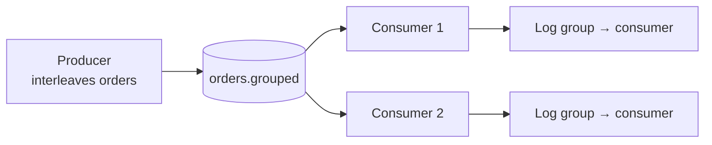

# Thực hành message group để giữ thứ tự theo đơn hàng

> **Chương:** Bài tập tổng hợp  
> **Mục tiêu:** Dùng message grouping để nhiều consumer xử lý song song nhiều đơn hàng nhưng các sự kiện của **cùng một đơn hàng** vẫn được giao cho cùng một consumer theo thứ tự. Lab sử dụng JMS property `JMSXGroupID`, một queue và hai consumer; ví dụ chạy trực tiếp với ActiveMQ Classic 5.x (`javax.jms`). Phần cuối chỉ ra các điểm cần kiểm chứng khi chạy Artemis (`jakarta.jms`) và khi broker nằm trong cluster.

## 1. Bài toán và hợp đồng thứ tự

Một hệ thống order phát ra nhiều sự kiện cho từng đơn hàng:

- `OrderCreated`
- `PaymentAuthorized`
- `InventoryReserved`
- `OrderPacked`
- `OrderShipped`

Các order khác nhau có thể được xử lý song song. Nhưng với cùng một order, `OrderShipped` không được xử lý trước `PaymentAuthorized`, và `InventoryReserved` không được ghi nhận sau `OrderPacked`.

Ví dụ có ba order A, B, C. Producer gửi xen kẽ:

| Thứ tự enqueue toàn queue | Order | Sequence | Event |
|---:|---|---:|---|
| 1 | A | 1 | OrderCreated |
| 2 | B | 1 | OrderCreated |
| 3 | C | 1 | OrderCreated |
| 4 | A | 2 | PaymentAuthorized |
| 5 | B | 2 | PaymentAuthorized |
| 6 | C | 2 | PaymentAuthorized |
| 7 | A | 3 | InventoryReserved |
| 8 | B | 3 | InventoryReserved |
| 9 | C | 3 | InventoryReserved |

Broker có thể phân phối A cho consumer-1, B cho consumer-2 và C cho một trong hai. Điều kiện cần giữ là:

1. Sequence của từng order tăng đúng `1, 2, 3, ...`.
2. Tại một thời điểm, các message thuộc cùng một group được gán cho cùng consumer đang sở hữu group đó.
3. Các group khác nhau vẫn có thể chạy đồng thời trên nhiều consumer.
4. Khi consumer mất kết nối, message chưa được ACK có thể redeliver; group có thể được gán lại cho consumer còn sống.

**Message group không tạo global FIFO giữa các order.** Nó tạo affinity và thứ tự theo group. Thứ tự giữa A và B không phải một hợp đồng nghiệp vụ trong bài này.

## 2. JMSXGroupID hoạt động thế nào?

Producer gắn một property ổn định vào mỗi message:

```java
message.setStringProperty("JMSXGroupID", orderId);
```

Broker dùng giá trị `JMSXGroupID` để chọn consumer sở hữu group. Các message tiếp theo có cùng group ID được gửi tới consumer đó, trong khi group ID khác có thể được phân phối cho consumer khác. Tên property là `JMSXGroupID`; không tự đổi thành `groupId`, `orderId` hoặc header tùy ý nếu muốn broker nhận diện message group.

Ví dụ:

| Message | `JMSXGroupID` | `orderSequence` |
|---|---|---:|
| `OrderCreated(A)` | `order-A` | 1 |
| `PaymentAuthorized(A)` | `order-A` | 2 |
| `InventoryReserved(A)` | `order-A` | 3 |
| `OrderCreated(B)` | `order-B` | 1 |
| `PaymentAuthorized(B)` | `order-B` | 2 |

`orderSequence` trong ví dụ là property nghiệp vụ do ứng dụng tự định nghĩa. Nó giúp consumer phát hiện gap hoặc đảo thứ tự; broker không tự tăng giá trị này. `JMSXGroupID` xác định group, còn sequence number xác định thứ tự nghiệp vụ bên trong group.

### 2.1 Group ID phải ổn định và có cardinality hợp lý

- Dùng order ID hoặc một khóa partition ổn định, không dùng random UUID mới cho mỗi event.
- Mọi producer phải chuẩn hóa cùng một cách viết: `order-123` và `ORDER-123` là hai group khác nhau nếu broker so sánh chuỗi phân biệt hoa/thường.
- Không dùng customer ID nếu mục tiêu là xử lý độc lập theo từng order; làm vậy sẽ gom tất cả order của một khách hàng vào một group và giảm song song.
- Tránh group ID rỗng/null; message không có group ID không có affinity theo order.
- Không dùng dữ liệu nhạy cảm trực tiếp làm group ID nếu broker console/log có thể hiển thị; dùng opaque key.

Một group quá nóng có thể trở thành bottleneck. Nếu một order phát ra hàng nghìn event mỗi giây, tăng consumer count không làm các event của order đó chạy song song mà vẫn giữ thứ tự. Muốn tăng throughput cho một entity nóng, cần thay đổi mô hình partition/ordering hoặc chia aggregate theo business key phù hợp.

### 2.2 Broker affinity không tự bảo đảm business completion order

Broker có thể giao các message của một group cho cùng consumer theo thứ tự. Nhưng ứng dụng vẫn có thể tự phá thứ tự nếu callback nhận message rồi đẩy từng message vào một thread pool không có serialization theo group:

```text
JMS listener receives sequence 1 -> submits worker A
JMS listener receives sequence 2 -> submits worker B
worker B finishes before worker A
```

Vì vậy:

- Xử lý đồng bộ trong callback/consumer loop là cách đơn giản nhất cho lab.
- Nếu cần async processing, dùng keyed serial executor: cùng `JMSXGroupID` vào cùng một lane tuần tự; group khác có lane khác.
- Chỉ commit/ACK sau khi business processing của message hoàn tất.
- Nếu DB update phải theo thứ tự, dùng transaction/locking hoặc optimistic version check ở DB.

## 3. Thiết kế lab



**Cấu hình lab**

| Thành phần | Giá trị |
|---|---|
| Broker | ActiveMQ Classic 5.x local |
| Protocol | OpenWire TCP |
| Java | 17 |
| JMS API | `javax.jms` |
| Queue | `lab.orders.grouped` |
| Group key | `JMSXGroupID = orderId` |
| Sequence property | `orderSequence` |
| Producer | Một session transacted, gửi message xen kẽ nhiều order |
| Consumers | Hai process độc lập, mỗi process một transacted session |

Chạy trên broker lab riêng. Tạo queue hoặc cho phép auto-create theo policy lab; không dùng queue production. Bắt đầu bằng queue rỗng để sequence assertion có baseline rõ ràng.

## 4. Tạo project Java

### 4.1 Cấu trúc thư mục

```text
message-group-lab/
├── settings.gradle
├── build.gradle
└── src/
    └── main/
        └── java/
            └── lab/
                └── MessageGroupLab.java
```

`settings.gradle`:

```groovy
rootProject.name = 'message-group-lab'
```

`build.gradle`:

```groovy
plugins {
    id 'java'
    id 'application'
}

repositories {
    mavenCentral()
}

java {
    toolchain {
        languageVersion = JavaLanguageVersion.of(17)
    }
}

dependencies {
    implementation 'org.apache.activemq:activemq-client:5.18.3'
    runtimeOnly 'org.slf4j:slf4j-simple:1.7.36'
}

application {
    mainClass = 'lab.MessageGroupLab'
}
```

Dependency `activemq-client` ở đây là Classic OpenWire client và dùng `javax.jms`. Đây là mốc phiên bản cho lab, không phải khẳng định bản mới nhất hoặc khuyến nghị production.

## 5. Producer gửi xen kẽ message của nhiều order

Tạo `src/main/java/lab/MessageGroupLab.java`:

```java
package lab;

import java.util.Arrays;
import java.util.HashMap;
import java.util.List;
import java.util.Map;
import javax.jms.Connection;
import javax.jms.DeliveryMode;
import javax.jms.JMSException;
import javax.jms.Message;
import javax.jms.MessageConsumer;
import javax.jms.MessageProducer;
import javax.jms.Queue;
import javax.jms.Session;
import javax.jms.TextMessage;
import org.apache.activemq.ActiveMQConnectionFactory;

public final class MessageGroupLab {
    private static final String QUEUE = "lab.orders.grouped";
    private static final List<String> ORDERS =
            Arrays.asList("order-A", "order-B", "order-C", "order-D");
    private static final int EVENTS_PER_ORDER = 6;

    private MessageGroupLab() { }

    public static void main(String[] args) throws Exception {
        if (args.length < 1) {
            usage();
            return;
        }

        switch (args[0]) {
            case "produce":
                produce();
                break;
            case "consume":
                if (args.length != 2) {
                    usage();
                    return;
                }
                consume(args[1]);
                break;
            default:
                usage();
        }
    }

    private static ActiveMQConnectionFactory connectionFactory() {
        String url = env("BROKER_URL", "tcp://127.0.0.1:61616");
        ActiveMQConnectionFactory factory =
                new ActiveMQConnectionFactory(url);
        // Giữ prefetch nhỏ để quan sát dispatch và failover trong lab.
        factory.getPrefetchPolicy().setQueuePrefetch(1);
        return factory;
    }

    private static Connection connect() throws JMSException {
        ActiveMQConnectionFactory factory = connectionFactory();
        String username = System.getenv("BROKER_USER");
        String password = System.getenv("BROKER_PASSWORD");
        return username == null || username.isBlank()
                ? factory.createConnection()
                : factory.createConnection(username, password);
    }

    private static void produce() throws Exception {
        Connection connection = connect();
        try {
            Session session = connection.createSession(
                    true, Session.SESSION_TRANSACTED);
            try {
                Queue queue = session.createQueue(QUEUE);
                MessageProducer producer = session.createProducer(queue);
                try {
                    producer.setDeliveryMode(DeliveryMode.PERSISTENT);

                    // Gửi xen kẽ: sequence 1 của mọi order, rồi sequence 2...
                    for (int sequence = 1;
                         sequence <= EVENTS_PER_ORDER; sequence++) {
                        for (String orderId : ORDERS) {
                            String eventType = eventType(sequence);
                            TextMessage message = session.createTextMessage(
                                    eventType + ":" + orderId
                                    + ":sequence-" + sequence);
                            message.setStringProperty(
                                    "JMSXGroupID", orderId);
                            message.setStringProperty("orderId", orderId);
                            message.setIntProperty(
                                    "orderSequence", sequence);
                            message.setStringProperty(
                                    "eventType", eventType);
                            producer.send(message);
                            System.out.printf(
                                    "ENQUEUED order=%s sequence=%d%n",
                                    orderId, sequence);
                        }
                    }

                    session.commit();
                    System.out.printf(
                            "PRODUCER_COMMITTED orders=%d eventsPerOrder=%d"
                            + " total=%d%n",
                            ORDERS.size(), EVENTS_PER_ORDER,
                            ORDERS.size() * EVENTS_PER_ORDER);
                } catch (Exception failure) {
                    session.rollback();
                    throw failure;
                } finally {
                    producer.close();
                }
            } finally {
                session.close();
            }
        } finally {
            connection.close();
        }
    }

    private static void consume(String consumerId) throws Exception {
        Connection connection = connect();
        try {
            connection.setClientID("group-lab-" + consumerId);
            connection.start();
            Session session = connection.createSession(
                    true, Session.SESSION_TRANSACTED);
            try {
                Queue queue = session.createQueue(QUEUE);
                MessageConsumer consumer = session.createConsumer(queue);
                Map<String, Integer> lastSequenceByOrder = new HashMap<>();
                int received = 0;
                System.out.printf("CONSUMER_READY id=%s%n", consumerId);
                try {
                    while (true) {
                        // Chạy hai consumer trước, sau đó mới chạy producer.
                        Message message = consumer.receive(30000);
                        if (message == null) {
                            break;
                        }

                        String groupId = message.getStringProperty(
                                "JMSXGroupID");
                        String orderId = message.getStringProperty("orderId");
                        int sequence = message.getIntProperty(
                                "orderSequence");
                        String eventType = message.getStringProperty(
                                "eventType");

                        if (groupId == null || !groupId.equals(orderId)) {
                            session.rollback();
                            throw new IllegalStateException(
                                    "Missing/mismatched JMSXGroupID");
                        }

                        Integer previous = lastSequenceByOrder.get(orderId);
                        if (previous != null && sequence != previous + 1) {
                            session.rollback();
                            throw new IllegalStateException(
                                    "Out-of-order group=" + orderId
                                    + " previous=" + previous
                                    + " current=" + sequence);
                        }

                        // Xử lý đồng bộ: không dispatch message cùng group
                        // sang thread pool song song.
                        try {
                            processOrderEvent(
                                    consumerId, orderId, sequence, eventType);
                            session.commit();
                            lastSequenceByOrder.put(orderId, sequence);
                        } catch (Exception failure) {
                            session.rollback();
                            throw failure;
                        }
                        received++;
                    }
                } finally {
                    consumer.close();
                }
                System.out.printf(
                        "CONSUMER_IDLE id=%s received=%d%n",
                        consumerId, received);
            } finally {
                session.close();
            }
        } finally {
            connection.close();
        }
    }

    private static void processOrderEvent(
            String consumerId, String orderId,
            int sequence, String eventType) throws Exception {
        if (sequence < 1 || sequence > EVENTS_PER_ORDER) {
            throw new IllegalArgumentException(
                    "Invalid sequence " + sequence);
        }
        System.out.printf(
                "PROCESSED consumer=%s group=%s sequence=%d event=%s%n",
                consumerId, orderId, sequence, eventType);

        // Mô phỏng công việc có thời gian; mỗi consumer vẫn xử lý tuần tự.
        Thread.sleep(100);
    }

    private static String eventType(int sequence) {
        switch (sequence) {
            case 1: return "OrderCreated";
            case 2: return "PaymentAuthorized";
            case 3: return "InventoryReserved";
            case 4: return "OrderPacked";
            case 5: return "OrderShipped";
            default: return "OrderStatusRecorded";
        }
    }

    private static String env(String name, String fallback) {
        String value = System.getenv(name);
        return value == null || value.isBlank() ? fallback : value;
    }

    private static void usage() {
        System.out.println("produce");
        System.out.println("consume <consumer-id>");
    }
}
```

Producer dùng một transacted session để thứ tự gửi trong từng order được xác định rõ. Vòng lặp ngoài là sequence, vòng lặp trong là order, nên queue nhận message xen kẽ giữa các order nhưng sequence của từng order vẫn tăng dần. Mỗi message đặt cùng `JMSXGroupID` cho một order.

Consumer xử lý đồng bộ và commit từng message. `connection.setClientID()` ở đây chỉ giúp nhận diện connection trong log/management; nó **không** tạo message group và cũng không phải durable subscription.

## 6. Chạy lab với hai consumer

### 6.1 Build và chuẩn bị queue

Tại thư mục project:

```bash
gradle wrapper --gradle-version 8.10.2
./gradlew clean installDist
```

Trên Windows PowerShell:

```powershell
.\gradlew.bat clean installDist
```

Xác nhận broker Classic đang chạy tại `tcp://127.0.0.1:61616`. Queue `lab.orders.grouped` cần rỗng trước mỗi lần chạy baseline. Nếu broker yêu cầu authentication, đặt `BROKER_USER` và `BROKER_PASSWORD` trong environment; không ghi mật khẩu vào source code.

### 6.2 Khởi động hai consumer trước producer

Mở hai terminal độc lập, chạy:

```powershell
.\build\install\message-group-lab\bin\message-group-lab.bat consume consumer-1
```

```powershell
.\build\install\message-group-lab\bin\message-group-lab.bat consume consumer-2
```

Đợi cả hai terminal in `CONSUMER_READY`. Consumer đợi tối đa 30 giây cho message đầu tiên; vì vậy chạy producer ngay sau khi cả hai consumer sẵn sàng. Khi queue idle đủ 30 giây, consumer thoát.

Sau đó chạy producer trong terminal thứ ba:

```powershell
.\build\install\message-group-lab\bin\message-group-lab.bat produce
```

Producer gửi 4 order × 6 event = 24 message trong một JMS transaction. Consumer nhận, xử lý đồng bộ và commit từng message.

### 6.3 Kết quả cần quan sát

Log có dạng:

```text
PROCESSED consumer=consumer-1 group=order-A sequence=1 event=OrderCreated
PROCESSED consumer=consumer-2 group=order-B sequence=1 event=OrderCreated
PROCESSED consumer=consumer-1 group=order-A sequence=2 event=PaymentAuthorized
PROCESSED consumer=consumer-2 group=order-B sequence=2 event=PaymentAuthorized
```

Phân công thực tế có thể khác: broker có thể gán A/B/C/D cho consumer khác tùy thời điểm consumer đăng ký và dispatch. Điều cần xác minh là:

- Tất cả message của `order-A` trong một lần chạy được xử lý bởi cùng consumer.
- Tất cả message của `order-B` trong một lần chạy được xử lý bởi cùng consumer.
- Với mỗi order, sequence quan sát được là 1 → 2 → 3 → 4 → 5 → 6.
- Có ít nhất hai consumer thực sự nhận message nếu số group và tải đủ để broker phân phối; không yêu cầu mỗi consumer nhận đúng một nửa.
- Queue cuối cùng không còn pending message.

Consumer giữ `lastSequenceByOrder` trong memory để phát hiện sequence nhảy lùi/nhảy cóc trong một lần chạy. Đây là assertion của lab, **không phải cơ chế idempotency bền vững**: map mất khi process restart. Production cần lưu version/sequence đã áp dụng ở DB hoặc state store.

### 6.4 Kiểm tra log bằng cách gom theo group

Copy log `PROCESSED` của cả hai consumer vào một file rồi nhóm theo `group`:

```text
group=order-A:
  consumer-1: 1, 2, 3, 4, 5, 6

group=order-B:
  consumer-2: 1, 2, 3, 4, 5, 6

group=order-C:
  consumer-1: 1, 2, 3, 4, 5, 6
```

Không đánh giá bằng thứ tự dòng khi ghép log hai terminal: đồng hồ/flush của hai process có thể làm dòng log xuất hiện lệch. Dùng timestamp, event ID, order ID và sequence để tái dựng thứ tự trong từng group.

## 7. Thử nghiệm đối chứng: bỏ group ID và gom mọi order vào một group

Mục tiêu là hiểu chính xác message grouping mang lại điều gì.

### 7.1 Đối chứng A — không đặt JMSXGroupID

Trong nhánh lab riêng, bỏ dòng:

```java
message.setStringProperty("JMSXGroupID", orderId);
```

Gửi cùng chuỗi event xen kẽ và chạy hai consumer. Broker có thể phân phối message theo dispatch/prefetch thông thường; một order có thể được giao cho consumer-1 ở sequence 1 rồi consumer-2 ở sequence 2. Kết quả có thể khác theo tốc độ và prefetch, vì vậy chạy nhiều lần để quan sát.

**Kết luận cần rút ra:** không có group ID thì broker không có thông tin để giữ affinity theo order. Không nên yêu cầu một lần chạy duy nhất phải tạo ra đảo thứ tự; cần quan sát đủ lần hoặc thêm tải xử lý để làm rõ khả năng phân tán.

### 7.2 Đối chứng B — dùng cùng một group ID cho tất cả order

Thay:

```java
message.setStringProperty("JMSXGroupID", orderId);
```

bằng:

```java
message.setStringProperty("JMSXGroupID", "all-orders");
```

Tất cả message được gom vào một group. Broker sẽ giữ affinity về một consumer, vì thế throughput gần với một consumer xử lý tuần tự. Đây là lỗi partition key thường gặp: group ID không đủ chi tiết làm mất song song giữa các order.

### 7.3 Bảng so sánh

| Cấu hình | Affinity theo order | Song song giữa order | Thứ tự trong order |
|---|---|---|---|
| Không có group ID | Không | Có thể cao | Không được bảo đảm bởi grouping |
| `JMSXGroupID = orderId` | Có | Có, theo số group và consumer | Broker giữ thứ tự dispatch trong group |
| Cùng group ID cho mọi order | Có nhưng quá rộng | Gần như một lane | Có thứ tự trong lane, throughput bị giới hạn |

## 8. Thử nghiệm consumer failure và group reassignment

Message group không phải một lease nghiệp vụ vĩnh viễn. Khi consumer mất kết nối, broker có thể giải phóng ownership và gán group cho consumer khác. Message đã giao nhưng chưa commit có thể redeliver.

Thực hiện trong lab:

1. Tăng `EVENTS_PER_ORDER` lên 100 và tăng số order lên 20.
2. Chạy hai consumer, sau đó chạy producer.
3. Khi một consumer đang xử lý, dừng process đó đột ngột (kill process, không đóng graceful).
4. Quan sát consumer còn sống tiếp tục nhận các group được reassigned; message chưa ACK có thể redeliver.
5. Kiểm tra sequence và business state của các order liên quan.

Kỳ vọng:

- Group đang do consumer bị dừng sở hữu có thể chuyển sang consumer còn sống.
- Message chưa commit có thể xuất hiện lại; consumer phải idempotent.
- Không được giả định `consumerId` của một order bất biến qua toàn bộ vòng đời hệ thống.
- Sau khi reconnect, group ownership có thể thay đổi; kiểm tra lại log và thứ tự theo order.

**Giới hạn của map trong lab:** `lastSequenceByOrder` chỉ lưu trong process. Khi group chuyển sang consumer khác, consumer mới không biết sequence trước đó. Để kiểm tra failover nghiêm túc, thêm bảng trạng thái:

```sql
CREATE TABLE order_consumer_state (
    order_id VARCHAR(100) PRIMARY KEY,
    last_applied_sequence BIGINT NOT NULL
);
```

Trong một DB transaction, consumer kiểm tra sequence kế tiếp phải bằng `last_applied_sequence + 1`, áp dụng business update và cập nhật sequence. Unique constraint/row lock hoặc optimistic version bảo vệ khi consumer cũ và consumer mới có xử lý chồng lấn trong cửa sổ failure detection.

## 9. Giới hạn producer ordering và nhiều producer

Message grouping chỉ có thể giữ thứ tự theo thứ tự message broker nhận/dispatch trong group. Nó không tự sắp xếp theo timestamp nghiệp vụ.

Ví dụ hai producer gửi đồng thời cho cùng order:

```text
Producer A: OrderSequence=10
Producer B: OrderSequence=11

Network scheduling:
  broker receives sequence 11 first
  broker receives sequence 10 second
```

Broker không thể biết sequence 10 đáng lẽ phải đến trước chỉ từ `JMSXGroupID`. Nếu cùng order có nhiều producer:

- Serialize publish theo order ở một producer partition hoặc một outbox relay có ordering key.
- Giữ `orderSequence` tăng đơn điệu và duy nhất trong aggregate.
- Consumer kiểm tra gap/duplicate/out-of-order theo sequence bền vững.
- Nếu nhận sequence 11 khi đang chờ 10, giữ lại/retry theo workflow thay vì áp dụng sai thứ tự.
- Không dùng `JMSPriority` như một cách thay thế sequence ordering.

Một queue có message group cũng không bảo đảm business transaction hoàn tất đúng thứ tự nếu consumer đẩy xử lý sang thread khác, hoặc side effect ở DB/API có thời gian hoàn tất khác nhau.

## 10. Classic và Artemis: điểm tương đồng và khác biệt

### 10.1 ActiveMQ Classic

Classic dùng property `JMSXGroupID` để gắn message vào group. Broker giữ group affinity tới một consumer và có thể thêm property `JMSXGroupFirstForConsumer` trên message đầu tiên của group được giao cho consumer, giúp ứng dụng nhận biết group vừa được gán cho mình.

Classic cũng hỗ trợ cơ chế đóng group bằng message có cùng `JMSXGroupID` và `JMSXGroupSeq = -1`:

```java
TextMessage closeGroup = session.createTextMessage("close order group");
closeGroup.setStringProperty("JMSXGroupID", "order-A");
closeGroup.setIntProperty("JMSXGroupSeq", -1);
producer.send(closeGroup);
```

Đây là thao tác provider-specific cần test trên đúng Classic version và client. Chỉ gửi close marker khi producer chắc chắn không còn event hợp lệ cho group; nếu gửi sớm, message tiếp theo có thể được gán cho consumer khác.

### 10.2 ActiveMQ Artemis

Artemis hỗ trợ message grouping qua `JMSXGroupID`. Khi chạy một broker đơn, dùng cùng group ID cho các message của một order và kiểm tra các message được phân phối cùng consumer theo thứ tự.

Khi triển khai Artemis cluster, cần kiểm tra **group ownership xuyên node**. Message có thể được load-balance tới node/consumer khác; cấu hình grouping handler của cluster connection là cơ chế để các node thống nhất quyết định group owner. Nếu cluster có nhiều broker mà chỉ test một node, chưa chứng minh được ordering ở production topology.

JMS client namespace tùy loại client:

- Classic 5.x client thường dùng `javax.jms`.
- Artemis Jakarta client dùng `jakarta.jms`.

Giữ nguyên property `JMSXGroupID` khi chuyển API namespace. Tuy vậy, phải test message group, reconnect, consumer failover và cluster grouping trên đúng Artemis version/client; không suy ra chỉ từ việc code compile.

### 10.3 Những điều message group không giải quyết

- Không tạo exactly-once delivery; message chưa ACK vẫn có thể redeliver.
- Không tự deduplicate event ID.
- Không sắp xếp message đến từ nhiều producer theo sequence nghiệp vụ.
- Không giữ ownership cố định khi consumer/broker failover.
- Không bảo vệ thứ tự nếu ứng dụng tự chạy xử lý song song trong cùng group.
- Không tự cân bằng tải một group nóng sang nhiều consumer mà vẫn tuần tự.

## 11. Mở rộng lab: thêm kiểm tra sequence và idempotency ở database

Trong bài tập nâng cao, chuyển `lastSequenceByOrder` từ memory sang database. Bảng gợi ý:

```sql
CREATE TABLE order_events (
    event_id VARCHAR(120) PRIMARY KEY,
    order_id VARCHAR(100) NOT NULL,
    sequence_no BIGINT NOT NULL,
    event_type VARCHAR(80) NOT NULL,
    applied_at TIMESTAMPTZ NOT NULL DEFAULT CURRENT_TIMESTAMP,
    UNIQUE (order_id, sequence_no)
);

CREATE TABLE orders (
    order_id VARCHAR(100) PRIMARY KEY,
    last_sequence BIGINT NOT NULL,
    status VARCHAR(40) NOT NULL
);
```

Consumer transaction:

1. Bắt đầu DB transaction và khóa row order (`SELECT ... FOR UPDATE`) hoặc dùng optimistic version.
2. Kiểm tra `event_id` đã tồn tại chưa; nếu có thì xác minh payload và bỏ qua duplicate.
3. Yêu cầu `sequence_no = last_sequence + 1`.
4. Ghi event và cập nhật trạng thái order trong cùng transaction.
5. Commit DB, sau đó commit JMS session.

Nếu sequence bị gap, rollback JMS để retry sau khi event trước đến hoặc route vào workflow điều tra. Không ACK sequence 12 rồi bỏ sequence 11; điều đó làm mất khả năng phục hồi đúng thứ tự. Khi retry lâu dài, cần delay/backoff và DLQ để tránh queue bị một poison event chặn mãi.

## 12. Checklist nghiệm thu

- [ ] Queue lab rỗng trước khi chạy baseline.
- [ ] Producer đặt `JMSXGroupID` bằng order ID ổn định trên mọi event.
- [ ] Mỗi message có `orderSequence` tăng dần theo order.
- [ ] Producer gửi xen kẽ nhiều order bằng một session có thứ tự xác định.
- [ ] Hai consumer đã sẵn sàng trước khi producer gửi.
- [ ] Cùng một group được xử lý bởi cùng consumer trong một ownership period.
- [ ] Sequence của từng order không giảm hoặc nhảy cóc trong baseline.
- [ ] Các order khác nhau được phân phối song song khi có đủ consumer/group.
- [ ] Xử lý trong mỗi consumer tuần tự; ACK/commit sau khi xử lý xong.
- [ ] Consumer failure tạo redelivery/reassignment được quan sát và đối soát.
- [ ] Duplicate event không tạo duplicate business effect.
- [ ] Nhiều producer cùng order được serialize hoặc kiểm sequence ở consumer.
- [ ] Nếu Artemis cluster, đã test grouping handler xuyên node.
- [ ] Không coi message group là exactly-once hoặc global FIFO.

## 13. Bài tập tự đánh giá

1. Nếu gửi 100 order với 2 consumer và `JMSXGroupID=orderId`, broker có thể xử lý bao nhiêu order song song?
2. Nếu tất cả message dùng `JMSXGroupID=customerId`, điều gì xảy ra với throughput khi một khách hàng có nhiều order?
3. Vì sao cần thêm `orderSequence` dù đã có `JMSXGroupID`?
4. Nếu producer A gửi sequence 5 và producer B gửi sequence 6 đồng thời, broker có thể bảo đảm sequence 5 đến trước bằng cách nào?
5. Điều gì xảy ra với message chưa commit khi consumer sở hữu group bị kill?
6. Vì sao local map `lastSequenceByOrder` không đủ cho production failover?
7. Khi nào cần serialize async worker theo group dù broker đã dispatch group tới cùng consumer?
8. Classic `JMSXGroupSeq=-1` dùng để làm gì và vì sao cần thận trọng?
9. Vì sao Artemis cluster cần kiểm tra grouping handler trong khi single broker lab có thể chạy đúng?
10. Message grouping khác durable subscription và consumer priority ở điểm nào?

**Kết luận:** Để giữ thứ tự theo đơn hàng, producer phải gắn **cùng `JMSXGroupID` cho mọi event của một order**, đồng thời phát event theo sequence nghiệp vụ ổn định. Broker dùng group ID để giữ affinity và dispatch tuần tự trong group, nhờ đó các order khác nhau vẫn có thể chạy song song. Ứng dụng phải xử lý đồng bộ theo group, commit sau business processing, chống duplicate khi redelivery và kiểm sequence bền vững khi consumer failover. Với nhiều producer hoặc Artemis cluster, cần thêm serialization/grouping coordination và test trên đúng topology; `JMSXGroupID` không tự tạo global ordering hay exactly-once.
