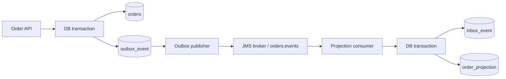

# Thực hành outbox và inbox để xử lý lỗi giữa dữ liệu và JMS

> **Chương:** Bài tập tổng hợp  
> **Phạm vi:** Xây dựng một luồng đặt hàng có transactional outbox ở producer và transactional inbox ở consumer bằng Java, JDBC, PostgreSQL và JMS. Bài thực hành tập trung vào các cửa sổ lỗi khi database và broker không cùng một transaction, cách chấp nhận at-least-once delivery, chống duplicate ở business boundary và giữ thứ tự event theo aggregate.

Một ứng dụng thường cần cập nhật database rồi phát message JMS. Nếu commit database trước, tiến trình có thể chết trước khi send; dữ liệu đã đổi nhưng consumer không bao giờ nhận event. Nếu send trước rồi database rollback, consumer có thể xử lý một event cho giao dịch chưa tồn tại. Gọi hai thao tác liên tiếp không tạo thành một transaction nguyên tử.

**Transactional outbox** ghi thay đổi nghiệp vụ và event cần phát vào cùng transaction database. Một publisher riêng đọc outbox và gửi JMS sau khi transaction đã commit. **Transactional inbox** ghi nhận event đã xử lý cùng transaction với business side effect của consumer. Nếu broker giao lại event sau khi consumer mất kết nối, inbox giúp nhận ra duplicate và tránh lặp side effect.

Luồng này cung cấp khả năng phục hồi theo mô hình **at-least-once**: event không bị bỏ quên sau commit database, nhưng có thể được gửi/giao nhiều lần. Inbox/idempotency làm cho business effect có thể lặp an toàn. Không gọi đây là exactly-once end-to-end.

## 1. Mục tiêu và kiến trúc bài lab

Xây dựng luồng `Create Order → Outbox Publisher → JMS Queue → Order Projection Consumer`:



| Thành phần | Trách nhiệm | Transaction sở hữu |
|---|---|---|
| Order API | Cập nhật order và ghi event cần phát. | Một transaction PostgreSQL ghi `orders` + `outbox_event`. |
| Outbox publisher | Claim event, gửi JMS persistent, đánh dấu đã publish. | DB lease transaction và JMS local transaction riêng biệt. |
| Broker | Lưu, dispatch, redeliver message theo queue/ACK policy. | JMS transaction của producer/consumer. |
| Projection consumer | Deduplicate event, kiểm tra sequence, cập nhật projection. | Một transaction PostgreSQL ghi `inbox_event` + `order_projection`. |

### 1.1. Công nghệ và giả định

- Java 17.
- PostgreSQL 15 trở lên.
- Jakarta JMS 2.0 client cho Artemis 2.x.
- ActiveMQ Artemis broker chạy riêng trong môi trường lab.
- Maven và JUnit 5 cho phần kiểm thử.

Bài lab dùng Artemis Jakarta JMS làm đường chạy chính để có `JMSContext`. Với ActiveMQ Classic 5.x dùng `javax.jms`/JMS 1.1, kiến trúc outbox/inbox và ranh giới transaction không đổi; API kết nối được chuyển sang `Connection`/`Session` như ghi chú ở mục 12. Không trộn `javax.jms` và `jakarta.jms` trong cùng source set.

### 1.2. Destination và broker test

Tạo address/queue anycast `orders.events` trên Artemis test broker. Một phần cấu hình `broker.xml`:

```xml
<addresses>
    <address name="orders.events">
        <anycast>
            <queue name="orders.events" durable="true"/>
        </anycast>
    </address>
</addresses>
```

Producer sẽ gửi persistent message tới queue này. Dùng broker riêng cho lab; không dùng queue production. Tạo user có quyền send/consume đúng destination và đưa thông tin kết nối vào biến môi trường hoặc secret store.

## 2. Tạo schema database

Schema dưới đây lưu order, outbox và inbox. `aggregate_sequence` tạo thứ tự event trong một order; unique constraints phát hiện publisher tạo sequence trùng.

```sql
CREATE TABLE orders (
    order_id       UUID PRIMARY KEY,
    status         VARCHAR(40) NOT NULL,
    last_sequence  BIGINT NOT NULL DEFAULT 0,
    updated_at     TIMESTAMPTZ NOT NULL DEFAULT now()
);

CREATE TABLE outbox_event (
    id                  BIGSERIAL PRIMARY KEY,
    event_id            UUID NOT NULL UNIQUE,
    aggregate_id        UUID NOT NULL,
    aggregate_sequence  BIGINT NOT NULL,
    event_type          VARCHAR(100) NOT NULL,
    destination         VARCHAR(200) NOT NULL,
    payload             JSONB NOT NULL,
    status              VARCHAR(20) NOT NULL DEFAULT 'NEW'
                        CHECK (status IN
                          ('NEW', 'IN_FLIGHT', 'PUBLISHED', 'DEAD')),
    attempts            INTEGER NOT NULL DEFAULT 0,
    next_attempt_at     TIMESTAMPTZ NOT NULL DEFAULT now(),
    lease_owner         VARCHAR(120),
    lease_until         TIMESTAMPTZ,
    created_at          TIMESTAMPTZ NOT NULL DEFAULT now(),
    published_at        TIMESTAMPTZ,
    last_error          TEXT,
    UNIQUE (aggregate_id, aggregate_sequence)
);

CREATE INDEX outbox_ready_idx
    ON outbox_event(status, next_attempt_at, created_at);

CREATE INDEX outbox_aggregate_idx
    ON outbox_event(aggregate_id, aggregate_sequence, status);

CREATE TABLE inbox_event (
    consumer_name       VARCHAR(120) NOT NULL,
    event_id            UUID NOT NULL,
    aggregate_id        UUID NOT NULL,
    aggregate_sequence  BIGINT NOT NULL,
    outcome             VARCHAR(20) NOT NULL,
    processed_at        TIMESTAMPTZ NOT NULL DEFAULT now(),
    PRIMARY KEY (consumer_name, event_id),
    UNIQUE (consumer_name, aggregate_id, aggregate_sequence)
);

CREATE TABLE order_projection (
    order_id       UUID PRIMARY KEY,
    status         VARCHAR(40) NOT NULL,
    last_sequence  BIGINT NOT NULL,
    updated_at     TIMESTAMPTZ NOT NULL DEFAULT now()
);
```

Giải thích các cột vận hành:

- `NEW`: event đã commit cùng dữ liệu nghiệp vụ, chờ publisher.
- `IN_FLIGHT`: publisher đã claim bằng lease; publisher khác không được claim lại trước khi lease hết hạn.
- `PUBLISHED`: JMS producer transaction đã commit và publisher đã ghi nhận trạng thái trong database.
- `DEAD`: publisher đã vượt retry policy; event cần operator xử lý. Trạng thái này cố ý chặn event sequence kế tiếp của cùng aggregate.
- `lease_owner`, `lease_until`: cho phép worker khác thu hồi công việc nếu publisher chết.
- `event_id`: business identity bất biến qua retry; không dùng `JMSMessageID` thay thế.

`inbox_event` có unique key theo consumer và event ID để deduplicate. Unique key theo aggregate/sequence giúp phát hiện hai event khác nhau cùng chiếm một sequence. Nếu có nhiều loại consumer độc lập, mỗi loại dùng `consumer_name` riêng vì cùng event có thể hợp lệ khi được xử lý bởi nhiều projections.

## 3. Producer: cập nhật nghiệp vụ và outbox trong cùng transaction

Không làm như sau:

```java
// SAI: database và JMS commit độc lập, có cửa sổ mất event.
orderRepository.save(order);
jmsTemplate.convertAndSend("orders.events", event);
```

Nếu process dừng sau `save()` nhưng trước `convertAndSend()`, order đã commit nhưng event không được gửi. Nếu send trước và DB rollback, consumer có thể nhìn thấy event không có order tương ứng.

### 3.1. SQL transaction của Order API

Trong một transaction database:

1. Tạo hoặc cập nhật order.
2. Tăng `last_sequence` cho aggregate.
3. Tạo `event_id` một lần.
4. Insert event vào outbox.
5. Commit cả hai thay đổi.

Ví dụ SQL tạo order:

```sql
BEGIN;

INSERT INTO orders(order_id, status, last_sequence)
VALUES (:order_id, 'CREATED', 1);

INSERT INTO outbox_event(
    event_id, aggregate_id, aggregate_sequence,
    event_type, destination, payload
)
VALUES (
    :event_id, :order_id, 1,
    'OrderCreated', 'orders.events',
    jsonb_build_object(
        'eventId', :event_id,
        'orderId', :order_id,
        'sequence', 1,
        'status', 'CREATED'
    )
);

COMMIT;
```

Nếu bất kỳ câu lệnh nào thất bại, rollback sẽ xóa cả order mới lẫn outbox event. Nếu commit thành công, event luôn còn trong outbox dù ứng dụng chết ngay sau đó.

### 3.2. Java JDBC service

Đoạn sau minh họa ranh giới transaction; `DataSource` được cấu hình bằng pool của ứng dụng. UUID và sequence phải được tạo/đọc trong transaction, không tái tạo event ID khi client retry cùng một yêu cầu.

```java
import com.fasterxml.jackson.databind.ObjectMapper;
import javax.sql.DataSource;
import java.sql.Connection;
import java.sql.PreparedStatement;
import java.util.Map;
import java.util.UUID;

public final class OrderCommandService {
    private final DataSource dataSource;
    private final ObjectMapper json;

    public OrderCommandService(DataSource dataSource, ObjectMapper json) {
        this.dataSource = dataSource;
        this.json = json;
    }

    public UUID createOrder(UUID orderId) throws Exception {
        UUID eventId = UUID.randomUUID();
        String payload = json.writeValueAsString(Map.of(
                "eventId", eventId,
                "orderId", orderId,
                "sequence", 1,
                "status", "CREATED"));

        try (Connection connection = dataSource.getConnection()) {
            connection.setAutoCommit(false);
            try {
                try (PreparedStatement order = connection.prepareStatement(
                        """
                        INSERT INTO orders(order_id, status, last_sequence)
                        VALUES (?, 'CREATED', 1)
                        """)) {
                    order.setObject(1, orderId);
                    order.executeUpdate();
                }

                try (PreparedStatement outbox = connection.prepareStatement(
                        """
                        INSERT INTO outbox_event(
                            event_id, aggregate_id, aggregate_sequence,
                            event_type, destination, payload
                        )
                        VALUES (?, ?, 1, 'OrderCreated', 'orders.events',
                                CAST(? AS jsonb))
                        """)) {
                    outbox.setObject(1, eventId);
                    outbox.setObject(2, orderId);
                    outbox.setString(3, payload);
                    outbox.executeUpdate();
                }

                connection.commit();
                return eventId;
            } catch (Exception error) {
                connection.rollback();
                throw error;
            }
        }
    }
}
```

Trong hệ thống thực, API nên có idempotency key cho lệnh tạo order. Nếu client timeout sau khi database commit rồi gửi lại request, service cần trả lại kết quả order/event đã tạo thay vì sinh order và event mới. Outbox giải quyết dual-write database/JMS; nó không tự deduplicate request HTTP.

## 4. Outbox publisher: claim bằng lease, gửi JMS, rồi đánh dấu published

Publisher không giữ database row lock trong suốt thời gian gọi broker. Thay vào đó:

1. Claim một batch nhỏ trong transaction DB và đặt lease.
2. Commit lease transaction.
3. Gửi batch bằng một JMS transacted session/context và commit broker transaction.
4. Sau khi JMS commit thành công, mở transaction DB khác để đánh dấu `PUBLISHED`.

Giữa bước 3 và bước 4 vẫn có cửa sổ lỗi: broker đã commit nhưng process chết trước khi update outbox. Lease hết hạn và worker khác gửi lại cùng event. Đây là duplicate có chủ đích trong mô hình at-least-once; consumer inbox phải xử lý an toàn.

### 4.1. Claim event theo thứ tự aggregate

PostgreSQL query sau claim tối đa một event chưa publish cho mỗi aggregate trong một batch. Event sequence kế tiếp chỉ được claim sau khi sequence trước có status `PUBLISHED`:

```sql
WITH candidates AS (
    SELECT current_event.id
    FROM outbox_event AS current_event
    WHERE (
        current_event.status = 'NEW'
        OR (
            current_event.status = 'IN_FLIGHT'
            AND current_event.lease_until < now()
        )
    )
      AND current_event.next_attempt_at <= now()
      AND NOT EXISTS (
          SELECT 1
          FROM outbox_event AS previous_event
          WHERE previous_event.aggregate_id = current_event.aggregate_id
            AND previous_event.aggregate_sequence
                < current_event.aggregate_sequence
            AND previous_event.status <> 'PUBLISHED'
      )
    ORDER BY current_event.created_at, current_event.id
    LIMIT :batch_size
    FOR UPDATE OF current_event SKIP LOCKED
)
UPDATE outbox_event AS event
SET status = 'IN_FLIGHT',
    lease_owner = :worker_id,
    lease_until = now() + interval '30 seconds',
    attempts = attempts + 1
FROM candidates
WHERE event.id = candidates.id
RETURNING event.*;
```

`SKIP LOCKED` cho phép nhiều publisher worker claim các aggregate khác nhau mà không đợi nhau. Điều kiện `NOT EXISTS` ngăn sequence sau vượt qua sequence trước còn `NEW`, `IN_FLIGHT` hoặc `DEAD`. Nếu event trước ở `DEAD`, operator phải xử lý/reconcile nó trước khi mở khóa sequence tiếp theo. `:batch_size` và các tham số dạng `:name` trong SQL là named placeholders minh họa; khi dùng JDBC thuần, thay bằng `?` và bind theo thứ tự.

Lease phải dài hơn thời gian gửi batch dự kiến và cần gia hạn nếu batch xử lý lâu. Nếu lease hết hạn trong khi worker cũ vẫn chạy, worker mới có thể gửi lại event. Trong trường hợp worker cũ gửi muộn sau khi event sequence kế tiếp đã được publish, broker có thể nhận duplicate cũ sau event mới; sequence guard ở consumer phải phân loại bản cũ là duplicate/stale. Inbox bảo vệ side effect; muốn giảm tình huống này, giữ batch nhỏ, renew lease và không để hai worker cùng publish một aggregate.

### 4.2. Maven dependencies

Ví dụ dependencies cho publisher/consumer Artemis và PostgreSQL:

```xml
<dependencies>
    <dependency>
        <groupId>org.apache.activemq</groupId>
        <artifactId>artemis-jakarta-client</artifactId>
        <version>2.38.0</version>
    </dependency>
    <dependency>
        <groupId>org.postgresql</groupId>
        <artifactId>postgresql</artifactId>
        <version>42.7.4</version>
    </dependency>
    <dependency>
        <groupId>com.fasterxml.jackson.core</groupId>
        <artifactId>jackson-databind</artifactId>
        <version>2.17.2</version>
    </dependency>
    <dependency>
        <groupId>org.junit.jupiter</groupId>
        <artifactId>junit-jupiter</artifactId>
        <version>5.10.5</version>
        <scope>test</scope>
    </dependency>
</dependencies>
```

Đây là bộ version minh họa cho lab; dùng dependency management/BOM của ứng dụng khi tích hợp vào dự án hiện có và cập nhật patch release phù hợp.

### 4.3. Artemis connection factory

```java
import org.apache.activemq.artemis.jms.client.ActiveMQConnectionFactory;

String brokerUrl = System.getenv().getOrDefault(
        "ARTEMIS_URL", "tcp://127.0.0.1:61616");
String user = System.getenv("ARTEMIS_USER");
String password = System.getenv("ARTEMIS_PASSWORD");

ActiveMQConnectionFactory connectionFactory =
        new ActiveMQConnectionFactory(brokerUrl, user, password);
```

Trong production, quản lý lifecycle của connection factory và đóng nó khi ứng dụng shutdown. Không log password hoặc URI chứa credential.

### 4.4. Gửi batch bằng JMS local transaction

Publisher dùng một transacted JMSContext cho batch. Mỗi message mang event ID và aggregate metadata để consumer có thể deduplicate và kiểm tra thứ tự:

```java
import jakarta.jms.DeliveryMode;
import jakarta.jms.JMSContext;
import jakarta.jms.Queue;
import jakarta.jms.TextMessage;
import org.apache.activemq.artemis.jms.client.ActiveMQConnectionFactory;
import java.util.List;

import java.util.UUID;

record OutboxRecord(
        long id,
        UUID eventId,
        UUID aggregateId,
        long aggregateSequence,
        String eventType,
        String destination,
        String payload) {}

public final class JmsOutboxSender {
    private final ActiveMQConnectionFactory factory;

    public JmsOutboxSender(ActiveMQConnectionFactory factory) {
        this.factory = factory;
    }

    public void sendBatch(List<OutboxRecord> records) throws Exception {
        try (JMSContext context =
                     factory.createContext(JMSContext.SESSION_TRANSACTED)) {
            try {
                for (OutboxRecord record : records) {
                    Queue destination =
                            context.createQueue(record.destination());
                    TextMessage message =
                            context.createTextMessage(record.payload());
                    message.setStringProperty(
                            "eventId", record.eventId().toString());
                    message.setStringProperty(
                            "aggregateId", record.aggregateId().toString());
                    message.setLongProperty(
                            "aggregateSequence", record.aggregateSequence());
                    message.setStringProperty("eventType", record.eventType());
                    message.setStringProperty(
                            "JMSXGroupID", record.aggregateId().toString());

                    context.createProducer()
                            .setDeliveryMode(DeliveryMode.PERSISTENT)
                            .send(destination, message);
                }
                context.commit();
            } catch (Exception error) {
                try {
                    context.rollback();
                } catch (RuntimeException rollbackFailure) {
                    error.addSuppressed(rollbackFailure);
                }
                throw error;
            }
        }
    }
}
```

`OutboxRecord` là DTO ánh xạ các cột đã claim. Chỉ cho phép destination nằm trong allowlist cấu hình của ứng dụng; không lấy một destination tùy ý từ dữ liệu không tin cậy. `commit()` xác nhận tất cả sends trong JMS transaction; nếu send/commit thất bại, publisher gọi rollback khi session còn hoạt động và không đánh dấu outbox là `PUBLISHED`. Nếu commit response bị mất, kết quả broker có thể không xác định; để lease hết hạn và gửi lại cùng event ID.

### 4.5. Đánh dấu published sau broker commit

Sau khi `sendBatch` trả về thành công, cập nhật trạng thái trong một DB transaction:

```sql
UPDATE outbox_event
SET status = 'PUBLISHED',
    published_at = now(),
    lease_owner = NULL,
    lease_until = NULL,
    last_error = NULL
WHERE id = :id
  AND status = 'IN_FLIGHT'
  AND lease_owner = :worker_id;
```

Đối với batch, chạy các update tương ứng trong **một DB transaction** và kiểm tra số row được cập nhật đúng bằng số event đã claim; có thể dùng `WHERE id = ANY(:ids)` với driver hỗ trợ array. Nếu update count bằng 0 hoặc thiếu row, lease đã bị thu hồi hoặc worker không còn sở hữu đủ batch. Không tự ghi đè trạng thái của worker khác. Message có thể đã được broker nhận; duplicate sẽ được inbox xử lý.

### 4.6. Điều phối một vòng publisher

Pseudo-code mô tả thứ tự gọi các repository và sender:

```java
public void publishOnce(String workerId, int batchSize) {
    List<OutboxRecord> batch =
            outboxRepository.claim(workerId, batchSize);
    if (batch.isEmpty()) {
        return;
    }

    try {
        jmsOutboxSender.sendBatch(batch);
    } catch (Exception sendFailure) {
        outboxRepository.scheduleRetry(
                batch, workerId, sendFailure.getMessage());
        return;
    }

    try {
        outboxRepository.markPublished(batch, workerId);
    } catch (Exception databaseFailure) {
        // Broker đã commit; để lease hết hạn rồi retry cùng event IDs.
        // Consumer inbox phải deduplicate bản gửi lại.
        logger.error("JMS committed but outbox status update failed",
                databaseFailure);
    }
}
```

Đây là pseudo-code; repository phải commit claim trước khi trả batch và commit status update riêng sau khi JMS commit. Nếu database update thất bại sau khi broker đã commit, không thể rollback transaction JMS đã hoàn tất. Để lease hết hạn sẽ tạo cơ hội retry at-least-once; inbox là lớp bảo vệ bắt buộc.

### 4.7. Retry và dead-letter của outbox publisher

Khi JMS send/commit thất bại rõ ràng, publisher đặt lịch thử lại:

```sql
UPDATE outbox_event
SET status = CASE WHEN attempts >= 10 THEN 'DEAD' ELSE 'NEW' END,
    next_attempt_at = now()
        + make_interval(secs =>
            LEAST(300, power(2, LEAST(attempts, 8)))::double precision),
    lease_owner = NULL,
    lease_until = NULL,
    last_error = left(:error_message, 4000)
WHERE id = :id
  AND status = 'IN_FLIGHT'
  AND lease_owner = :worker_id;
```

Thêm jitter khi triển khai nhiều publisher để tránh retry đồng loạt. `DEAD` không được tự chuyển lại `NEW` nếu chưa có thao tác operator hoặc recovery workflow. Cảnh báo theo số row `DEAD`, tuổi event cũ nhất và số lần retry; không chỉ theo tổng outbox depth.

## 5. Consumer: inbox và business update trong cùng transaction

Consumer nhận JMS message, sau đó ghi inbox và cập nhật projection trong **một transaction PostgreSQL**. Chỉ sau khi database commit thành công mới commit JMS transaction để ACK message.

Thứ tự thao tác:

1. Receive message trong JMS transacted context.
2. Parse event ID, aggregate ID, sequence và payload.
3. Bắt đầu DB transaction; khóa row projection của aggregate.
4. Nếu event ID đã có trong inbox, kết luận duplicate.
5. Nếu sequence là sequence kế tiếp, insert inbox và cập nhật projection.
6. Nếu sequence có gap, lưu event vào staging bền vững hoặc rollback theo policy; không được ACK rồi bỏ quên.
7. Commit DB.
8. Commit JMS transaction để xác nhận delivery.

### 5.1. Bổ sung bảng staging cho sequence gap

Để không giữ một message trong vòng redelivery vô hạn khi predecessor bị chậm, lab có thể lưu event đến sau vào bảng staging:

```sql
CREATE TABLE inbox_staging (
    consumer_name       VARCHAR(120) NOT NULL,
    event_id            UUID NOT NULL,
    aggregate_id        UUID NOT NULL,
    aggregate_sequence  BIGINT NOT NULL,
    payload             JSONB NOT NULL,
    status              VARCHAR(20) NOT NULL DEFAULT 'WAITING',
    received_at         TIMESTAMPTZ NOT NULL DEFAULT now(),
    PRIMARY KEY (consumer_name, event_id),
    UNIQUE (consumer_name, aggregate_id, aggregate_sequence)
);
```

Khi gap xuất hiện, consumer commit staging row rồi commit JMS transaction. Một worker sequencer đọc staging theo aggregate sequence và chỉ áp dụng event khi sequence kế tiếp đã sẵn sàng. Staging phải có alert theo oldest age, số gap và trạng thái `WAITING`; đây là queue nghiệp vụ thứ hai cần vận hành.

### 5.2. Java: transaction service của inbox

Đoạn sau thể hiện logic trong một transaction database. `lastSequenceForUpdate()` phải dùng `SELECT ... FOR UPDATE` để serialize cập nhật cùng order; các repository phải dùng cùng JDBC connection/transaction:

```java
public ApplyResult apply(OrderEvent event) throws Exception {
    try (Connection connection = dataSource.getConnection()) {
        connection.setAutoCommit(false);
        try {
            projectionRepository.ensureRow(connection, event.orderId());
            long last = projectionRepository.lastSequenceForUpdate(
                    connection, event.orderId());

            if (inboxRepository.exists(
                    connection, CONSUMER_NAME, event.eventId())) {
                connection.commit();
                return ApplyResult.DUPLICATE;
            }

            UUID sequenceOwner = inboxRepository.findEventIdForSequence(
                    connection, CONSUMER_NAME,
                    event.orderId(), event.sequence());
            if (sequenceOwner != null
                    && !sequenceOwner.equals(event.eventId())) {
                throw new SequenceConflictException(
                        "Two event IDs use the same aggregate sequence");
            }

            if (event.sequence() <= last) {
                // Event cũ: không thay đổi projection.
                stagingRepository.markStaleIfPresent(
                        connection, CONSUMER_NAME, event.eventId());
                connection.commit();
                return ApplyResult.STALE;
            }

            if (event.sequence() > last + 1) {
                stagingRepository.insertIfAbsent(connection, event);
                connection.commit();
                return ApplyResult.STAGED;
            }

            inboxRepository.insert(
                    connection, CONSUMER_NAME, event);
            projectionRepository.apply(
                    connection, event.orderId(),
                    event.status(), event.sequence());
            stagingRepository.markAppliedIfPresent(
                    connection, CONSUMER_NAME, event.eventId());

            connection.commit();
            return ApplyResult.APPLIED;
        } catch (Exception error) {
            connection.rollback();
            throw error;
        }
    }
}
```

Các thao tác `ensureRow`, `lastSequenceForUpdate`, `exists`, `findEventIdForSequence`, `insert`, `apply`, `insertIfAbsent`, `markAppliedIfPresent` và `markStaleIfPresent` là repository methods cần triển khai. `ensureRow` tạo projection với `last_sequence=0` bằng `INSERT ... ON CONFLICT DO NOTHING`; sau đó `lastSequenceForUpdate` khóa row. `findEventIdForSequence` phát hiện một event ID khác đã chiếm cùng aggregate sequence trong inbox. `insertIfAbsent` phải phân biệt duplicate cùng event ID với conflict khác event ID nhưng cùng aggregate sequence; không dùng `ON CONFLICT DO NOTHING` chung khiến conflict nghiệp vụ bị che mất. Khi message đã được stage trước đó nhưng nay trở thành sequence kế tiếp, consumer đánh dấu staging row `APPLIED` trong cùng transaction; nếu projection đã vượt qua sequence, đánh dấu `STALE` để không để lại row chờ vĩnh viễn.

`findEventIdForSequence` nên kiểm tra cả `inbox_event` và staging row đang `WAITING`. Nếu một event ID khác đã chiếm sequence đó ở một trong hai bảng, ném conflict; nếu cùng event ID đã được stage, cho phép nó tiếp tục qua nhánh `STAGED` hoặc được áp dụng khi đã thành sequence kế tiếp.

SQL minh họa cho các thao tác khóa/kiểm tra:

```sql
INSERT INTO order_projection(order_id, status, last_sequence)
VALUES (:order_id, 'UNKNOWN', 0)
ON CONFLICT (order_id) DO NOTHING;

SELECT last_sequence
FROM order_projection
WHERE order_id = :order_id
FOR UPDATE;

SELECT event_id
FROM inbox_event
WHERE consumer_name = :consumer_name
  AND aggregate_id = :aggregate_id
  AND aggregate_sequence = :sequence
UNION ALL
SELECT event_id
FROM inbox_staging
WHERE consumer_name = :consumer_name
  AND aggregate_id = :aggregate_id
  AND aggregate_sequence = :sequence
  AND status = 'WAITING';

UPDATE inbox_staging
SET status = 'APPLIED'
WHERE consumer_name = :consumer_name
  AND event_id = :event_id
  AND status = 'WAITING';
```

Trong repository thật, bind tham số bằng `PreparedStatement`; đọc mọi event ID mà query trả về và nếu có bất kỳ ID nào khác event hiện tại, raise sequence conflict và quarantine. Chỉ update staging status trong cùng transaction đã cập nhật projection.

Nếu event sequence nhỏ hơn hoặc bằng `last` nhưng event ID chưa có trong inbox và không còn sequence owner record, log/audit là stale event theo retention policy. Nếu sequence đã được một event ID khác chiếm, ném `SequenceConflictException` và đưa event vào quarantine/điều tra producer thay vì coi là duplicate hợp lệ.

### 5.3. JMS consumer: commit DB trước, ACK broker sau

```java
import jakarta.jms.JMSConsumer;
import jakarta.jms.JMSContext;
import jakarta.jms.Message;
import jakarta.jms.Queue;
import jakarta.jms.TextMessage;
import org.apache.activemq.artemis.jms.client.ActiveMQConnectionFactory;

public final class OrderProjectionConsumer {
    private final ActiveMQConnectionFactory factory;
    private final OrderEventDecoder decoder;
    private final OrderProjectionService projection;

    public OrderProjectionConsumer(
            ActiveMQConnectionFactory factory,
            OrderEventDecoder decoder,
            OrderProjectionService projection) {
        this.factory = factory;
        this.decoder = decoder;
        this.projection = projection;
    }

    public void receiveOne() throws Exception {
        try (JMSContext context =
                     factory.createContext(JMSContext.SESSION_TRANSACTED)) {
            Queue queue = context.createQueue("orders.events");
            try (JMSConsumer consumer = context.createConsumer(queue)) {
                Message message = consumer.receive(2_000);
                if (message == null) {
                    context.commit();
                    return;
                }

                try {
                    OrderEvent event = decoder.decode((TextMessage) message);
                    projection.apply(event); // DB commit xảy ra bên trong.
                    context.commit();         // Sau đó mới ACK JMS.
                } catch (Exception failure) {
                    context.rollback();
                    throw failure;
                }
            }
        }
    }
}
```

Với kết quả `APPLIED`, `DUPLICATE`, `STALE` hoặc `STAGED`, service đã commit DB; consumer có thể commit JMS transaction. Nếu DB transaction thất bại, rollback JMS để broker giao lại. Nếu DB commit thành công nhưng JMS commit response mất, broker có thể redeliver; inbox/staging bảo vệ side effect. Trong ứng dụng thật, giữ một consumer/context sống lâu trong listener loop thay vì tạo lại connection cho mỗi message như ví dụ ngắn này.

### 5.4. Sequencer xử lý event đã stage

Worker staging chỉ lấy event có sequence bằng `last_sequence + 1`. Nó khóa projection row trước để hai worker không cùng áp dụng một aggregate:

```sql
BEGIN;

SELECT last_sequence
FROM order_projection
WHERE order_id = :order_id
FOR UPDATE;

SELECT event_id, aggregate_sequence, payload
FROM inbox_staging
WHERE consumer_name = :consumer_name
  AND aggregate_id = :order_id
  AND status = 'WAITING'
  AND aggregate_sequence = :last_sequence + 1
FOR UPDATE;

-- Nếu có đúng predecessor kế tiếp:
-- 1. Insert inbox_event.
-- 2. Apply projection và last_sequence.
-- 3. Đánh dấu staging row APPLIED.
-- Tất cả cùng transaction.

COMMIT;
```

Nếu không có row đúng sequence kế tiếp, worker kết thúc transaction và đợi event còn thiếu hoặc recovery. Không lấy event sequence lớn nhất rồi áp dụng trước. Có thể chạy nhiều sequencer worker nếu mỗi worker khóa projection row và claim staging row trong cùng transaction.

### 5.5. DTO và kết quả xử lý

```java
import java.util.UUID;

public record OrderEvent(
        UUID eventId,
        UUID orderId,
        long sequence,
        String status) {}

public enum ApplyResult {
    APPLIED,
    DUPLICATE,
    STALE,
    STAGED
}
```

`GAP` không phải kết quả đã hoàn tất nếu event chưa được lưu bền vững. Trong bài lab, event có gap được ghi vào `inbox_staging` và trả `STAGED`; khi staging insert thất bại, DB transaction rollback và JMS transaction cũng phải rollback.

## 6. Các cửa sổ lỗi phải thử nghiệm

Hai transaction DB và JMS không commit nguyên tử cùng nhau. Hãy cố ý dừng process ở các ranh giới sau và quan sát database/broker:

| Điểm dừng | Trạng thái có thể có | Hành vi phục hồi đúng |
|---|---|---|
| Trước khi DB transaction của API commit | Order và outbox đều rollback. | Không có event nào được publish. |
| Sau DB commit, trước publisher send | Outbox row còn `NEW`. | Publisher lần sau claim và gửi event. |
| Sau JMS commit, trước update outbox thành `PUBLISHED` | Broker đã nhận message, outbox còn `IN_FLIGHT`. | Lease hết hạn, publisher gửi lại cùng event ID; consumer inbox deduplicate bản gửi lại. |
| JMS send/commit bị timeout | Kết quả broker có thể chưa rõ. | Không tự đánh dấu published; retry cùng event ID. |
| Consumer DB transaction lỗi trước commit | Inbox/projection rollback. | JMS rollback; broker redeliver. |
| Consumer DB commit xong, trước JMS commit | Inbox/projection đã cập nhật, message chưa chắc đã ACK. | Broker có thể redeliver; consumer thấy inbox event ID và ACK duplicate. |
| Consumer JMS commit thành công | DB đã commit trước đó. | Message được ACK; không cần chạy lại business effect. |
| Outbox row chuyển `DEAD` | Event chưa publish và event sau cùng aggregate bị chặn. | Operator sửa nguyên nhân, replay/requeue có audit rồi mở sequence. |

### 6.1. Vì sao không đánh dấu outbox trước khi gửi?

Nếu đổi status thành `PUBLISHED` trước rồi process chết trước send, publisher sẽ bỏ qua row đã đánh dấu và event không bao giờ được gửi. Vì vậy thứ tự đúng là:

```text
Claim outbox (DB commit)
    -> JMS send + JMS commit
        -> Mark PUBLISHED (DB commit)
```

Khoảng giữa JMS commit và DB update tạo duplicate có thể xảy ra; khoảng giữa DB commit của API và publisher send không làm mất event vì row outbox vẫn còn.

### 6.2. Vì sao inbox phải cùng transaction với business effect?

Nếu ghi inbox trước rồi cập nhật projection ở transaction khác, process có thể chết giữa hai bước. Message redeliver sẽ bị inbox đánh dấu duplicate trong khi business effect chưa từng xảy ra. Ngược lại, nếu update projection trước rồi ghi inbox sau bằng transaction khác, redelivery có thể chạy side effect lần hai.

Đặt inbox insert, sequence validation và business update trong **cùng transaction database**. JMS ACK chỉ commit sau khi transaction database đó hoàn tất.

## 7. Chạy bài lab theo từng chặng

### Chặng A — xác nhận outbox atomic với dữ liệu

1. Khởi động PostgreSQL và Artemis test broker.
2. Chạy schema ở mục 2.
3. Gọi `createOrder(orderId)` một lần.
4. Query `orders` và `outbox_event`; xác nhận mỗi order có một event sequence 1.
5. Tạo lỗi SQL có chủ đích trước commit và gọi lại; xác nhận cả order lẫn outbox đều không tồn tại.

Kết quả cần đạt: không xuất hiện order đã commit mà thiếu outbox event tương ứng.

### Chặng B — gửi outbox tới JMS

1. Chạy publisher với batch size nhỏ, ví dụ 10.
2. Browse/consume queue `orders.events` bằng một consumer lab.
3. Xác nhận payload có event ID, aggregate ID, sequence và event type.
4. Ghi nhận outbox status chuyển `NEW → IN_FLIGHT → PUBLISHED`.
5. Dừng publisher sau JMS commit nhưng trước mark-published; đợi lease hết hạn và chạy lại.
6. Xác nhận có thể xuất hiện hai bản cùng business event ID; đây là tình huống inbox phải xử lý.

### Chặng C — consumer inbox và projection

1. Chạy projection consumer.
2. Gửi một event hợp lệ; xác nhận projection sequence tăng và inbox có một row.
3. Gửi lại cùng event ID; xác nhận kết quả `DUPLICATE`, projection không đổi.
4. Gửi sequence kế tiếp; xác nhận projection cập nhật đúng.
5. Gửi sequence nhảy cóc; xác nhận event được lưu staging và JMS ACK chỉ sau staging commit.
6. Gửi predecessor còn thiếu; chạy sequencer và xác nhận staging event được áp dụng theo thứ tự.

### Chặng D — fault injection ở consumer

1. Làm DB transaction fail trước commit; xác nhận JMS rollback và redelivery.
2. Cho DB commit thành công rồi cố ý làm JMS commit thất bại/đóng connection; xác nhận redelivery không lặp business effect.
3. Gửi cùng event ID từ hai lần publish; xác nhận inbox chỉ lưu một event.
4. Gửi hai event ID khác nhau cùng aggregate sequence; xác nhận conflict được phát hiện và đưa vào quarantine.

## 8. Kiểm tra kết quả bằng SQL

### 8.1. Outbox backlog theo trạng thái

```sql
SELECT status,
       count(*) AS event_count,
       min(created_at) AS oldest_created_at,
       max(attempts) AS max_attempts
FROM outbox_event
GROUP BY status
ORDER BY status;
```

### 8.2. Event đang giữ lease quá lâu

```sql
SELECT id, event_id, aggregate_id, aggregate_sequence,
       lease_owner, lease_until, attempts
FROM outbox_event
WHERE status = 'IN_FLIGHT'
  AND lease_until < now()
ORDER BY lease_until;
```

### 8.3. Staging gap đang chờ

```sql
SELECT aggregate_id,
       count(*) AS waiting_events,
       min(received_at) AS oldest_waiting_at,
       min(aggregate_sequence) AS first_waiting_sequence
FROM inbox_staging
WHERE status = 'WAITING'
GROUP BY aggregate_id
ORDER BY oldest_waiting_at;
```

### 8.4. Đối soát projection và inbox

Kiểm tra event mới nhất đã áp dụng cho mỗi order:

```sql
SELECT p.order_id,
       p.last_sequence,
       max(i.aggregate_sequence) AS inbox_max_sequence
FROM order_projection AS p
LEFT JOIN inbox_event AS i
  ON i.aggregate_id = p.order_id
 AND i.consumer_name = 'order-projection-v1'
GROUP BY p.order_id, p.last_sequence
HAVING p.last_sequence <> coalesce(max(i.aggregate_sequence), 0);
```

Query này là kiểm tra nhanh cho lab; nếu inbox có retention/cleanup hoặc event stale được ghi theo policy riêng, cần điều chỉnh phép đối soát theo dữ liệu còn giữ.

## 9. Cấu hình và lưu ý với ActiveMQ Classic

Classic 5.x dùng namespace `javax.jms` thay vì `jakarta.jms.JMSContext`; JMS API level cụ thể phụ thuộc client release. Outbox/inbox vẫn dùng cùng schema và transaction boundaries; chỉ cách tạo connection/session và send/receive khác.

### 9.1. Producer transacted session

```java
import javax.jms.Connection;
import javax.jms.DeliveryMode;
import javax.jms.JMSException;
import javax.jms.MessageProducer;
import javax.jms.Queue;
import javax.jms.Session;
import javax.jms.TextMessage;
import org.apache.activemq.ActiveMQConnectionFactory;

ActiveMQConnectionFactory factory =
        new ActiveMQConnectionFactory("tcp://127.0.0.1:61616");
Connection connection = factory.createConnection();
try {
    Session session = connection.createSession(
            true, Session.SESSION_TRANSACTED);
    MessageProducer producer = null;
    try {
        Queue queue = session.createQueue("orders.events");
        producer = session.createProducer(queue);
        producer.setDeliveryMode(DeliveryMode.PERSISTENT);

        TextMessage message = session.createTextMessage(payload);
        message.setStringProperty("eventId", eventId.toString());
        message.setStringProperty("aggregateId", aggregateId.toString());
        message.setLongProperty("aggregateSequence", sequence);
        message.setStringProperty("JMSXGroupID", aggregateId.toString());
        producer.send(message);
        session.commit();

    } catch (Exception error) {
        try {
            session.rollback();
        } catch (JMSException rollbackFailure) {
            error.addSuppressed(rollbackFailure);
        }
        throw error;
    } finally {
        if (producer != null) {
            producer.close();
        }
        session.close();
    }
} finally {
    connection.close();
}
```

Đây là API Classic namespace `javax.jms`; API level cụ thể phụ thuộc client release. Ví dụ dùng `Connection`/`Session` transacted API. Trong code production, nếu `rollback()` hoặc close resource có thể ném lỗi, giữ lỗi gốc và gắn cleanup failure làm suppressed exception. `Session.SESSION_TRANSACTED` xác nhận các send trong JMS session; sau `session.commit()` mới đánh dấu outbox row `PUBLISHED`.

### 9.2. Consumer transacted session

```java
import javax.jms.Connection;
import javax.jms.Message;
import javax.jms.MessageConsumer;
import javax.jms.Queue;
import javax.jms.Session;
import javax.jms.TextMessage;

Connection connection = factory.createConnection();
Session session = connection.createSession(
        true, Session.SESSION_TRANSACTED);
Queue queue = session.createQueue("orders.events");
MessageConsumer consumer = session.createConsumer(queue);
connection.start();

try {
    Message message = consumer.receive(2_000);
    if (message != null) {
        OrderEvent event = decoder.decode((TextMessage) message);
        projectionService.apply(event); // Commit DB trước.
        session.commit();               // ACK JMS sau.
    }
} catch (Exception failure) {
    session.rollback();
    throw failure;
} finally {
    consumer.close();
    session.close();
    connection.close();
}
```

Khi DB commit xong nhưng `session.commit()` không nhận được response, message có thể redeliver; inbox phải deduplicate. Không gọi `session.commit()` trước business transaction.

### 9.3. Điểm cần xác minh theo broker/client version

- Client artifact và JMS namespace phải khớp: Classic 5.x `javax.jms`; Artemis Jakarta client `jakarta.jms`.
- Queue phải durable/provision đúng và producer gửi `PERSISTENT`.
- JMS transacted session commit chỉ bao trùm thao tác JMS trong session; không tự bao trùm JDBC transaction.
- Nếu dùng XA/JTA, cần XA-capable datasource và JMS resource, transaction manager, recovery logs và cấu hình broker phù hợp. XA là lựa chọn kiến trúc riêng, không phải điều kiện để chạy outbox/inbox.

## 10. Monitoring và vận hành

Outbox/inbox là các bảng vận hành lâu dài, cần giám sát như queue:

| Metric | Ý nghĩa | Alert gợi ý |
|---|---|---|
| `outbox_new_count` | Số event chờ publish. | Tăng liên tục hoặc oldest age vượt SLO. |
| `outbox_inflight_expired_count` | Lease hết hạn nhưng chưa publish xong. | Lớn hơn 0 kéo dài hoặc tăng nhanh. |
| `outbox_dead_count` | Event publisher đã hết retry. | Lớn hơn 0 cần owner xử lý. |
| `outbox_publish_attempts_total` | Số lần thử gửi. | Tăng đột biến so với baseline. |
| `outbox_publish_latency_seconds` | Thời gian từ outbox creation đến JMS commit. | p95/p99 vượt SLO. |
| `inbox_duplicate_total` | Số duplicate được loại bỏ. | Spike sau failover/reconnect hoặc publisher retry. |
| `inbox_sequence_gap_total` | Event đến sau khi thiếu predecessor. | Tăng liên tục theo aggregate/consumer. |
| `inbox_staging_waiting_count` | Event gap chờ sequencer. | Oldest waiting age vượt ngưỡng. |

Không gắn `event_id` hoặc `aggregate_id` làm metric label vì cardinality cao. Đưa ID vào structured log/trace; metric label chỉ dùng service, destination, consumer name và event type có tập giá trị hữu hạn.

### 10.1. Retention và cleanup

- Chỉ cleanup outbox row `PUBLISHED` sau khoảng audit/replay retention đã thống nhất.
- Không xóa `NEW`, `IN_FLIGHT` hoặc `DEAD` để giảm bảng.
- Không xóa inbox quá sớm hơn khoảng thời gian có thể redelivery/replay; nếu inbox bị xóa rồi event cũ replay, side effect có thể chạy lại.
- `inbox_staging` chỉ xóa/đánh dấu hoàn tất sau khi event đã được áp dụng hoặc quyết định quarantine được audit.
- Partition bảng lớn theo thời gian nếu cần, nhưng retention phải tính cả thời gian replay và điều tra.

## 11. Tiêu chí hoàn thành bài lab

Hoàn thành khi chứng minh được tất cả điều sau:

- [ ] Order và outbox event được commit/rollback cùng transaction.
- [ ] Publisher claim row bằng lease; nhiều worker không claim đồng thời cùng row.
- [ ] Publisher gửi persistent JMS message trong transacted context/session.
- [ ] Outbox chỉ được đánh dấu `PUBLISHED` sau khi JMS commit thành công.
- [ ] Publisher retry cùng event ID khi kết quả send/commit không xác định.
- [ ] Consumer ghi inbox và business projection trong cùng DB transaction.
- [ ] Consumer ACK JMS sau DB commit; DB failure dẫn tới JMS rollback/redelivery.
- [ ] Duplicate event ID không lặp side effect.
- [ ] Sequence gap được stage bền vững hoặc rollback theo policy; không ACK rồi bỏ quên.
- [ ] Event khác ID nhưng trùng aggregate sequence bị phát hiện.
- [ ] Fault injection chứng minh duplicate có thể xảy ra nhưng business effect vẫn idempotent.
- [ ] Monitoring có oldest age, expired lease, DEAD, duplicate và staging gap.

## 12. Câu hỏi và mở rộng

**1.** Vì sao outbox publisher phải gửi JMS trước khi đánh dấu row `PUBLISHED`?

**Đáp án:** Nếu đánh dấu trước rồi process chết trước send, event bị bỏ qua vĩnh viễn. Gửi trước rồi mark có thể tạo duplicate, nhưng inbox có thể xử lý an toàn.

**2.** Broker commit thành công nhưng publisher không cập nhật được outbox. Điều gì xảy ra?

**Đáp án:** Lease hết hạn và event có thể được gửi lại. Giữ nguyên `event_id`; consumer inbox loại duplicate.

**3.** Vì sao inbox insert và projection update phải cùng transaction?

**Đáp án:** Để không có trạng thái inbox ghi nhận đã xử lý nhưng business effect chưa commit, hoặc business effect đã commit nhưng inbox chưa ghi.

**4.** Có thể dùng `JMSMessageID` làm khóa deduplication không?

**Đáp án:** Không nên. Retry publish có thể tạo message mới với JMSMessageID khác; dùng business event ID bất biến.

**5.** Outbox/inbox có cung cấp exactly-once end-to-end không?

**Đáp án:** Không. Nó cung cấp at-least-once delivery kết hợp idempotent business processing; duplicate vẫn có thể xuất hiện ở transport.

### Bài mở rộng

1. Thay polling publisher bằng CDC đọc transaction log, nhưng vẫn giữ cùng contract event ID/inbox.
2. Thêm optimistic locking hoặc `SELECT ... FOR UPDATE` để bảo vệ sequence theo aggregate.
3. Thử chạy hai publisher workers và hai consumer instances; chứng minh không mất event và duplicate không lặp side effect.
4. Thêm operator command để đưa row `DEAD` trở lại `NEW` sau khi lưu audit reason và xác nhận event sequence.
5. Thử failover broker giữa producer JMS commit và outbox DB update, rồi đối soát số business events.

## 13. Ghi nhớ

Transactional outbox giải quyết cửa sổ **database đã commit nhưng JMS chưa gửi** bằng cách ghi event trong cùng transaction với dữ liệu nghiệp vụ. Publisher gửi event sau commit và đánh dấu `PUBLISHED` sau broker commit; khoảng giữa hai thao tác có thể tạo duplicate. Transactional inbox giải quyết cửa sổ **database consumer đã commit nhưng JMS ACK chưa hoàn tất** bằng cách lưu event ID cùng business effect trong một transaction database.

Outbox/inbox không tạo một transaction phân tán nguyên tử giữa PostgreSQL và broker. Thiết kế đúng là chấp nhận at-least-once, giữ business event ID ổn định, deduplicate ở consumer, kiểm tra sequence theo aggregate, stage gap bền vững và vận hành retry/DEAD/retention có audit. Khi các fault-injection tests ở bài lab đều đạt, hệ thống có thể phục hồi qua process crash, broker reconnect và message redelivery mà không bỏ quên event hoặc lặp business side effect.
