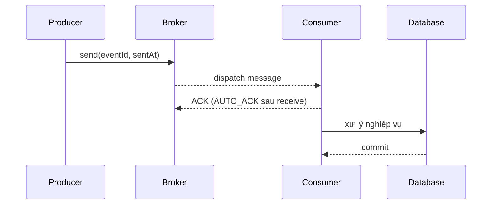

# Đo thông lượng và độ trễ trước, sau khi điều chỉnh cấu hình

> **Chương:** Bài tập tổng hợp  
> **Phạm vi:** Đo hiệu năng producer/consumer JMS trên ActiveMQ Classic và Artemis. Bài thực hành tạo workload có thể lặp lại, ghi baseline, thay từng tham số cấu hình, đo lại và quyết định dựa trên throughput, latency, backlog cùng yêu cầu durability. Ví dụ Java dùng ActiveMQ Classic OpenWire client để chạy với Classic và Artemis OpenWire acceptor; phần Artemis-native được tách riêng khi cần so sánh protocol.

## 1. Mục tiêu và nguyên tắc

Sau bài thực hành, bạn có thể:

- Tạo workload JMS cố định về số message, kích thước payload, delivery mode và thời gian chạy.
- Đo **producer send rate**, **consumer completion throughput** và latency p50/p95/p99.
- Phân biệt thời gian gửi, thời gian broker giữ message và thời gian consumer nhận/ACK.
- Thử ảnh hưởng của prefetch, số consumer, transaction batch, payload size và paging.
- So sánh Classic với Artemis bằng cùng workload và ghi lại khác biệt client/protocol.
- Chứng minh cấu hình mới cải thiện mục tiêu mà không làm giảm durability hoặc tạo backlog/DLQ ngoài ý muốn.

Không có một tham số “tăng performance” đúng cho mọi hệ thống. Prefetch cao có thể tăng throughput nhưng giữ nhiều message in-flight; transaction batch lớn giảm số lần commit nhưng tăng latency và số message phải retry khi rollback; paging giúp broker chịu backlog lớn nhưng tăng chi phí disk I/O. Mọi thay đổi phải được đánh giá cùng SLO nghiệp vụ.

## 2. Xác định metric cần đo

### 2.1. Ba số throughput không được đánh đồng

| Metric | Công thức | Trả lời câu hỏi |
|---|---|---|
| **Producer send rate** | Số lần `send()` hoàn tất / thời gian producer gửi | Client đẩy message vào broker nhanh đến đâu? |
| **Consumer completion throughput** | Số message đã được xác nhận / thời gian từ lúc bắt đầu gửi đến ACK cuối | Toàn luồng gửi → nhận/ACK hoàn tất bao nhiêu message/giây? |
| **Business throughput** | Số nghiệp vụ commit thành công / thời gian đo | Hệ thống thực sự hoàn tất bao nhiêu đơn hàng/giao dịch mỗi giây? |

Với `AUTO_ACKNOWLEDGE` và synchronous `receive()`, JMS session tự xác nhận message khi thao tác receive trả về thành công. Harness bên dưới đếm message sau khi nhận. Nó đo **client receive/ACK completion**, chưa đo transaction DB hoặc side effect của ứng dụng.

Nếu listener thực hiện xử lý DB, hãy thêm metric business commit riêng. Không lấy `DequeueCount` của broker làm bằng chứng tuyệt đối rằng DB đã commit.

### 2.2. Định nghĩa latency

Mỗi message mang timestamp `System.nanoTime()` được ghi ngay trước lệnh gửi. Consumer đo thời gian từ timestamp đó đến lúc nhận message:

\[
L_i = t_{\mathrm{receive},i} - t_{\mathrm{send},i}
\]

Báo cáo ít nhất:

- **p50:** độ trễ điển hình của một nửa số message.
- **p95:** 95% message có latency không vượt giá trị này.
- **p99:** tail latency; nhạy với GC, disk flush, queue backlog và scheduling.
- **max:** hữu ích khi tìm outlier, nhưng dễ bị một lần pause làm méo.

Không chỉ báo cáo latency trung bình. Hai cấu hình có cùng mean nhưng p99 rất khác có thể tạo trải nghiệm nghiệp vụ rất khác.

**Giới hạn đồng hồ:** `System.nanoTime()` chỉ có ý nghĩa so sánh trong cùng JVM. Harness dùng một JVM cho cả producer và consumer nên timestamp monotonic so sánh an toàn giữa các thread. Nếu producer và consumer chạy trên host/JVM khác nhau, không truyền `nanoTime` giữa chúng; dùng clock đồng bộ có đánh giá sai số hoặc distributed tracing với timestamp/clock discipline phù hợp.

### 2.3. Tách latency nhận message và latency xử lý nghiệp vụ



Harness đo từ `sendAt` tới `receive()`; nếu muốn đo business latency, ghi thêm timestamp ở đầu handler và sau DB commit, dùng `eventId` để nối hai điểm. Tùy transaction design, DB commit có thể diễn ra trước hoặc sau ACK.

## 3. Chuẩn hóa workload trước khi chạy

Một phép so sánh có ý nghĩa phải giữ cố định các yếu tố không phải biến thử nghiệm.

| Yếu tố | Giá trị lab khởi đầu | Lưu ý |
|---|---:|---|
| Destination | Queue riêng `bench.measure` | Provision queue hoặc bật auto-create ở staging |
| Producer | 1 thread | Tăng producer riêng trong lượt sau |
| Consumer | 1 thread | Không tăng đồng thời với prefetch |
| Message count | 100.000 | Đủ lớn để loại ảnh hưởng startup |
| Payload | 1 KiB UTF-8 | Thử thêm 256 B, 4 KiB, 64 KiB |
| Delivery mode | Persistent | Giữ nguyên khi so sánh durability |
| Acknowledgement | AUTO_ACKNOWLEDGE | Thử transacted batch ở lượt riêng |
| Warm-up | 1 lượt không lấy số | Tạo connection và làm nóng JIT/cache |
| Measured run | 5 lượt, cùng message count | So median và p95/p99 giữa các lượt |
| Timeout | 180 giây | Thất bại rõ nếu consumer không nhận đủ |

Để so sánh công bằng:

1. Dùng cùng broker version, JVM, heap, storage class và client library trong mỗi cặp A/B.
2. Chạy broker lần lượt hoặc bảo đảm chúng không tranh CPU/disk/network.
3. Không chạy backup, compaction, antivirus scan hay batch job trên storage trong một bên đo.
4. Dùng cùng message size, persistence, producer/consumer count và destination policy.
5. Chờ backlog về 0 và broker ổn định trước mỗi lượt.
6. Chạy warm-up, sau đó ít nhất 5 measured runs; ghi từng lượt, không chỉ ghi kết quả tốt nhất.
7. Đổi một tham số mỗi lần. Nếu thay nhiều tham số, không thể quy cải thiện cho nguyên nhân nào.

**Tách hai loại bài đo:** steady-state throughput với backlog nhỏ và paging/backlog stress test. Không để một bên đo chưa paging còn bên kia đang paging rồi kết luận broker nào nhanh hơn trong cùng điều kiện.

## 4. Chuẩn bị client và broker

### 4.1. Client OpenWire dùng chung cho phép so sánh Classic và Artemis

Để giảm số biến trong lần so sánh đầu, dùng cùng ActiveMQ Classic OpenWire client cho cả hai broker. Artemis cần có OpenWire acceptor bật. Cách này so sánh hai broker trên cùng client/protocol path; nó **không** đại diện cho hiệu năng Artemis Core/Jakarta client.

Ví dụ Maven dependency:

```xml
<dependency>
  <groupId>org.apache.activemq</groupId>
  <artifactId>activemq-client</artifactId>
  <version>5.18.5</version>
</dependency>
```

Đây là version ví dụ có thể pin trong lab; khi chạy thực tế, dùng đúng client version được hỗ trợ trong môi trường và ghi version vào kết quả. Ứng dụng Spring Boot 3/Jakarta có thể cần client/API khác; không trộn `javax.jms` và `jakarta.jms` trong cùng dependency graph.

Tạo factory trỏ tới một broker mỗi lần:

```java
import org.apache.activemq.ActiveMQConnectionFactory;

String brokerUrl =
    "tcp://classic-lab.internal:61616"
    + "?jms.prefetchPolicy.queuePrefetch=100";

ActiveMQConnectionFactory factory =
    new ActiveMQConnectionFactory(brokerUrl);

String user = System.getenv("BROKER_USER");
String password = System.getenv("BROKER_PASSWORD");
if (user != null && password != null) {
    factory.setUserName(user);
    factory.setPassword(password);
}
```

Đổi URL thành endpoint Artemis OpenWire trong lượt đo Artemis. Không truyền password trực tiếp qua command line hoặc commit vào source. Nếu dùng TLS, thêm cùng trust/hostname policy tương ứng cho hai môi trường.

### 4.2. Xác nhận broker sẵn sàng

Trước benchmark:

- Tạo queue test hoặc xác minh policy auto-create.
- Xác minh producer và consumer có quyền trên destination.
- Kiểm tra persistent store và disk còn đủ dung lượng.
- Xác minh không có consumer/producer cũ còn kết nối vào queue.
- Kiểm tra broker metrics/JMX để xác nhận enqueue/dequeue/in-flight.
- Đảm bảo DLQ và expiry destination được cấu hình nếu stress test có thể kích hoạt retry/expiry.

Không benchmark qua management console đang chạy nhiều truy vấn hoặc qua remote network không ổn định. Nếu đo qua mạng thật, ghi latency mạng baseline và giữ cùng vị trí client cho mọi lần chạy.

## 5. Java benchmark harness: một producer, một consumer

Harness sau dùng JMS 1.1 API (`javax.jms`) để tương thích với Classic OpenWire client trong ví dụ. Nó tạo queue theo tên caller truyền, gửi message persistent, nhận bằng `AUTO_ACKNOWLEDGE`, lưu latency từng message và báo cáo throughput/percentile.

```java
import java.util.ArrayList;
import java.util.BitSet;
import java.util.Collections;
import java.util.List;
import java.util.Locale;
import java.util.concurrent.ConcurrentLinkedQueue;
import java.util.concurrent.CountDownLatch;
import java.util.concurrent.ExecutorService;
import java.util.concurrent.Executors;
import java.util.concurrent.TimeUnit;
import java.util.concurrent.atomic.AtomicReference;

import javax.jms.Connection;
import javax.jms.ConnectionFactory;
import javax.jms.DeliveryMode;
import javax.jms.Message;
import javax.jms.MessageConsumer;
import javax.jms.MessageProducer;
import javax.jms.Queue;
import javax.jms.Session;
import javax.jms.TextMessage;

import org.apache.activemq.ActiveMQConnectionFactory;

public final class JmsBenchmark {

    private static final int RECEIVE_TIMEOUT_MS = 1000;

    private JmsBenchmark() {
    }

    public static Result run(
            ConnectionFactory factory,
            String queueName,
            int messageCount,
            int payloadChars,
            long timeoutSeconds) throws Exception {

        if (messageCount <= 0 || payloadChars <= 0) {
            throw new IllegalArgumentException(
                "messageCount and payloadChars must be positive");
        }

        String payload = "x".repeat(payloadChars);
        CountDownLatch consumerReady = new CountDownLatch(1);
        CountDownLatch remaining = new CountDownLatch(messageCount);
        ConcurrentLinkedQueue<Long> latencySamples =
            new ConcurrentLinkedQueue<>();
        AtomicReference<Throwable> consumerFailure =
            new AtomicReference<>();

        ExecutorService executor = Executors.newSingleThreadExecutor();
        Connection producerConnection = null;

        try {
            producerConnection = factory.createConnection();
            Session producerSession = producerConnection.createSession(
                false, Session.AUTO_ACKNOWLEDGE);
            Queue producerQueue = producerSession.createQueue(queueName);
            MessageProducer producer =
                producerSession.createProducer(producerQueue);
            producer.setDeliveryMode(DeliveryMode.PERSISTENT);

            executor.submit(() -> {
                Connection consumerConnection = null;
                try {
                    consumerConnection = factory.createConnection();
                    Session consumerSession =
                        consumerConnection.createSession(
                            false, Session.AUTO_ACKNOWLEDGE);
                    Queue consumerQueue =
                        consumerSession.createQueue(queueName);
                    MessageConsumer consumer =
                        consumerSession.createConsumer(consumerQueue);

                    consumerConnection.start();
                    consumerReady.countDown();
                    BitSet seenSequence = new BitSet(messageCount);

                    while (remaining.getCount() > 0) {
                        Message message =
                            consumer.receive(RECEIVE_TIMEOUT_MS);

                        if (message == null) {
                            continue;
                        }

                        int sequence =
                            message.getIntProperty("benchSequence");
                        if (sequence < 0 || sequence >= messageCount
                                || seenSequence.get(sequence)) {
                            throw new IllegalStateException(
                                "Duplicate or invalid sequence: " + sequence);
                        }
                        seenSequence.set(sequence);

                        long sentNanos =
                            message.getLongProperty("benchSentNanos");
                        latencySamples.add(
                            System.nanoTime() - sentNanos);
                        remaining.countDown();
                    }

                    consumer.close();
                    consumerSession.close();
                } catch (Throwable failure) {
                    consumerFailure.compareAndSet(null, failure);
                    consumerReady.countDown();
                } finally {
                    if (consumerConnection != null) {
                        try {
                            consumerConnection.close();
                        } catch (Exception ignored) {
                            // Preserve the original benchmark failure.
                        }
                    }
                }
            });

            if (!consumerReady.await(30, TimeUnit.SECONDS)) {
                throw new IllegalStateException(
                    "Consumer did not become ready within 30 seconds");
            }

            if (consumerFailure.get() != null) {
                throw new IllegalStateException(
                    "Consumer failed during startup",
                    consumerFailure.get());
            }

            long startNanos = System.nanoTime();

            for (int i = 0; i < messageCount; i++) {
                TextMessage message =
                    producerSession.createTextMessage(payload);
                message.setIntProperty("benchSequence", i);
                message.setLongProperty(
                    "benchSentNanos", System.nanoTime());
                producer.send(message);
            }

            long sendFinishedNanos = System.nanoTime();
            long deadlineNanos = System.nanoTime()
                + TimeUnit.SECONDS.toNanos(timeoutSeconds);
            while (remaining.getCount() > 0
                    && consumerFailure.get() == null
                    && System.nanoTime() < deadlineNanos) {
                remaining.await(200, TimeUnit.MILLISECONDS);
            }
            boolean completed = remaining.getCount() == 0;
            long finishedNanos = System.nanoTime();

            if (consumerFailure.get() != null) {
                throw new IllegalStateException(
                    "Consumer failed during measurement",
                    consumerFailure.get());
            }

            if (!completed) {
                throw new IllegalStateException(
                    "Timed out: received "
                    + (messageCount - remaining.getCount())
                    + " of " + messageCount + " messages");
            }

            producer.close();
            producerSession.close();

            if (latencySamples.size() != messageCount) {
                throw new IllegalStateException(
                    "Latency sample count does not match received count");
            }

            return Result.from(
                messageCount,
                startNanos,
                sendFinishedNanos,
                finishedNanos,
                latencySamples);

        } finally {
            if (producerConnection != null) {
                producerConnection.close();
            }
            executor.shutdownNow();
            executor.awaitTermination(5, TimeUnit.SECONDS);
        }
    }

    public static final class Result {
        public final int messages;
        public final double producerSendRate;
        public final double completionThroughput;
        public final double p50Millis;
        public final double p95Millis;
        public final double p99Millis;
        public final double maxMillis;

        private Result(
                int messages,
                double producerSendRate,
                double completionThroughput,
                double p50Millis,
                double p95Millis,
                double p99Millis,
                double maxMillis) {
            this.messages = messages;
            this.producerSendRate = producerSendRate;
            this.completionThroughput = completionThroughput;
            this.p50Millis = p50Millis;
            this.p95Millis = p95Millis;
            this.p99Millis = p99Millis;
            this.maxMillis = maxMillis;
        }

        static Result from(
                int messages,
                long start,
                long sendFinished,
                long finished,
                ConcurrentLinkedQueue<Long> samples) {

            double sendSeconds = (sendFinished - start) / 1_000_000_000.0;
            double totalSeconds = (finished - start) / 1_000_000_000.0;

            List<Long> sorted = new ArrayList<>(samples);
            Collections.sort(sorted);

            return new Result(
                messages,
                messages / sendSeconds,
                messages / totalSeconds,
                percentileMillis(sorted, 0.50),
                percentileMillis(sorted, 0.95),
                percentileMillis(sorted, 0.99),
                sorted.get(sorted.size() - 1) / 1_000_000.0);
        }

        private static double percentileMillis(
                List<Long> sorted, double percentile) {
            int index = (int) Math.ceil(percentile * sorted.size()) - 1;
            index = Math.max(0, Math.min(index, sorted.size() - 1));
            return sorted.get(index) / 1_000_000.0;
        }

        public void print() {
            System.out.printf(
                Locale.ROOT,
                "messages=%d producer_send_msg_s=%.1f "
                + "completion_msg_s=%.1f p50_ms=%.3f "
                + "p95_ms=%.3f p99_ms=%.3f max_ms=%.3f%n",
                messages,
                producerSendRate,
                completionThroughput,
                p50Millis,
                p95Millis,
                p99Millis,
                maxMillis);
        }
    }

    public static void main(String[] args) throws Exception {
        if (args.length != 4) {
            throw new IllegalArgumentException(
                "Usage: JmsBenchmark <brokerUrl> <queueName> "
                + "<messageCount> <payloadChars>");
        }

        ActiveMQConnectionFactory factory =
            new ActiveMQConnectionFactory(args[0]);

        String user = System.getenv("BROKER_USER");
        String password = System.getenv("BROKER_PASSWORD");
        if (user != null && password != null) {
            factory.setUserName(user);
            factory.setPassword(password);
        }

        Result result = run(
            factory,
            args[1],
            Integer.parseInt(args[2]),
            Integer.parseInt(args[3]),
            180);

        result.print();
    }
}
```

**Điều kiện chạy:**

- Class cần dependency `activemq-client` như mục 4.1; import `ActiveMQConnectionFactory` đã có trong code.
- Queue phải được tạo sẵn hoặc broker cho phép auto-create; mỗi lượt nên dùng tên queue riêng, ví dụ `bench.run01`.
- Chạy trên một JVM để timestamp monotonic so sánh được. Producer và consumer dùng connection/session riêng.
- Harness dùng `String.repeat`, vì vậy cần JDK 11 trở lên.
- Harness lưu một latency sample cho mỗi message; phù hợp lab khoảng 100.000 message. Với hàng triệu message, thay `ConcurrentLinkedQueue` bằng HDR Histogram hoặc histogram có giới hạn bộ nhớ.
- Mỗi `benchSequence` chỉ được nhận một lần; harness dừng và báo lỗi nếu gặp sequence trùng hoặc ngoài phạm vi.
- `AUTO_ACKNOWLEDGE` xác nhận delivery sau khi synchronous receive trả về. Harness không đo DB commit và không đo XA.
- `send()` completion là thời gian client send call hoàn tất theo cấu hình client/protocol. Nó không phải bằng chứng độc lập rằng dữ liệu đã fsync xuống thiết bị lưu trữ.

Ví dụ gọi từ chương trình:

```java
JmsBenchmark.Result result = JmsBenchmark.run(
    factory,
    "bench.run01",
    100_000,
    1024,
    180);
result.print();
```

Chạy ít nhất một lượt warm-up với queue riêng và bỏ kết quả đó. Sau đó chạy 5 lượt đo trên queue riêng hoặc queue đã được làm sạch, ghi kết quả từng lượt.

## 6. Kiểm tra tính hợp lệ của phép đo

### 6.1. Không đo lẫn startup và warm-up

Một lần chạy đầu có thể bao gồm class loading, JIT compilation, DNS lookup, TCP/TLS handshake, broker destination creation và page/journal initialization. Những chi phí này không phản ánh steady-state throughput.

Quy trình:

1. Tạo connection, session và consumer.
2. Chờ consumer ready.
3. Gửi warm-up messages và nhận hết.
4. Chờ queue depth về 0, in-flight về 0.
5. Tạo queue mới hoặc reset destination test.
6. Chạy measured workload.
7. Lặp ít nhất 5 lần.

Nếu mục tiêu là đo cold start hoặc failover, đó là bài đo riêng với thời gian bắt đầu/ready được định nghĩa rõ; không trộn với steady-state benchmark.

### 6.2. Kiểm tra số message trước khi tin kết quả

Sau một lượt đo, đối chiếu:

- Producer đã gọi send đúng N lần.
- Consumer đã nhận đủ N message.
- Không có message thừa từ lượt chạy trước.
- Queue backlog sau run bằng 0 theo trạng thái mong đợi.
- In-flight không còn tăng.
- DLQ/expiry không tăng ngoài dự kiến.
- Không có exception, reconnect hoặc redelivery bất thường.

Nếu consumer timeout, không tính throughput bằng N / elapsed; chỉ ghi run **FAILED/INCOMPLETE** và điều tra message còn lại.

### 6.3. Tác động của vị trí client

Chạy producer/consumer trên cùng host với broker có thể che chi phí network. Nếu production dùng client ở nhiều subnet hoặc region, lặp benchmark từ vị trí gần production. Giữ cùng route, TLS, DNS và network policy trong cặp A/B.

Không so sánh một run localhost với một run qua VPN rồi quy chênh lệch cho broker config.

## 7. Lập baseline trước khi tuning

### 7.1. Baseline cần ghi đủ ngữ cảnh

Tạo bản ghi cho mỗi lần chạy:

```yaml
runId: classic-baseline-01
broker:
  product: ActiveMQ Classic
  version: "5.18.x"
  persistence: KahaDB
  jvm: "17"
  heap: "4g"
client:
  library: "activemq-client 5.18.x"
  protocol: OpenWire
  prefetch: 100
workload:
  producers: 1
  consumers: 1
  messages: 100000
  payloadBytes: 1024
  deliveryMode: PERSISTENT
  acknowledgement: AUTO_ACKNOWLEDGE
  warmupRuns: 1
  measuredRuns: 5
results:
  producerSendMsgPerSec: null
  completionMsgPerSec: null
  p50Millis: null
  p95Millis: null
  p99Millis: null
  maxMillis: null
  missingMessages: null
  dlqMessages: null
```

Các trường null được điền bằng số đo thực tế; không lấy ví dụ hay số liệu giả để báo cáo kết quả. Lưu thêm OS, CPU, disk type/IOPS, memory, broker config checksum, client URL options, thời điểm chạy và commit SHA của harness.

### 7.2. Tính throughput và cải thiện phần trăm

Giả sử baseline đo được `T0` message/s và cấu hình mới đo được `T1` message/s:

\[
\text{Throughput gain} =
\frac{T_1-T_0}{T_0}\times100\%
\]

Với latency p95 baseline `L0` và sau tuning `L1`:

\[
\text{Latency reduction} =
\frac{L_0-L_1}{L_0}\times100\%
\]

Throughput gain dương không tự động là thành công. Nếu p99 tăng mạnh, DLQ tăng hoặc persistent delivery bị đổi sang non-persistent, cấu hình mới có thể không đáp ứng SLA.

### 7.3. Bảng kết quả so sánh

| Chỉ số | Baseline | Sau tuning | Mục tiêu/SLO | Đạt? |
|---|---:|---:|---:|---|
| Producer send rate (msg/s) | Điền số đo | Điền số đo | Theo workload | |
| Completion throughput (msg/s) | Điền số đo | Điền số đo | Theo workload | |
| Latency p50 (ms) | Điền số đo | Điền số đo | Theo SLO | |
| Latency p95 (ms) | Điền số đo | Điền số đo | Theo SLO | |
| Latency p99 (ms) | Điền số đo | Điền số đo | Theo SLO | |
| Max latency (ms) | Điền số đo | Điền số đo | Quan sát outlier | |
| Queue depth cuối run | Điền số đo | Điền số đo | 0 hoặc ngưỡng định nghĩa | |
| DLQ arrival | Điền số đo | Điền số đo | Không tăng ngoài dự kiến | |
| CPU / disk / GC | Điền số đo | Điền số đo | Trong capacity budget | |

Ghi cả median của 5 lượt và độ phân tán. Nếu một lượt bất thường, không xóa âm thầm; ghi nguyên nhân và chạy lại theo quy trình.

## 8. Thử nghiệm 1: điều chỉnh prefetch của ActiveMQ Classic

Prefetch quyết định số message broker có thể dispatch trước cho một consumer. Prefetch quá thấp có thể làm consumer chờ round-trip thường xuyên; quá cao có thể giữ nhiều message in-flight, tăng memory và giảm fairness giữa các consumer.

### 8.1. Thay prefetch trong client URL

Baseline:

```java
ActiveMQConnectionFactory factory =
    new ActiveMQConnectionFactory(
        "tcp://classic-lab.internal:61616"
        + "?jms.prefetchPolicy.queuePrefetch=100");
```

Thử mức cao hơn:

```java
ActiveMQConnectionFactory factory =
    new ActiveMQConnectionFactory(
        "tcp://classic-lab.internal:61616"
        + "?jms.prefetchPolicy.queuePrefetch=1000");
```

Giữ nguyên broker, message count, payload, delivery mode, số producer/consumer và mọi tham số khác. Chạy lại 5 lượt cho mỗi mức.

### 8.2. Diễn giải kết quả

| Quan sát | Diễn giải có thể có | Hành động |
|---|---|---|
| Throughput tăng, p95 ổn định | Consumer giảm thời gian chờ dispatch | Giữ mức mới nếu memory/in-flight an toàn |
| Throughput tăng, p99 tăng | Consumer nhận batch lớn, tail wait hoặc xử lý không đều | Thử mức trung gian, quan sát queue age |
| In-flight tăng mạnh | Nhiều message đã dispatch nhưng chưa hoàn tất | Đánh giá memory và fairness |
| Consumer nhanh nhận hết prefetch rồi xử lý chậm | Message bị giữ ở một consumer, consumer khác thiếu việc | Giảm prefetch hoặc tăng consumer có kiểm soát |
| Không cải thiện | Bottleneck có thể ở disk, network, producer hoặc DB | Không tiếp tục tăng prefetch vô hạn |

`jms.prefetchPolicy.queuePrefetch` là tùy chọn của Classic OpenWire client. Khi dùng Artemis Core client, điều chỉnh consumer window theo client API/parameter của Artemis; không coi hai tham số này là cùng đại lượng chỉ vì đều ảnh hưởng buffering.

## 9. Thử nghiệm 2: thay đổi số consumer và producer

Tăng consumer có thể cải thiện throughput khi queue có đủ message và handler chạy song song. Nhưng nó không giúp nếu bottleneck là disk, database connection pool, lock contention hoặc broker CPU.

Dùng ma trận từng bước:

| Run | Producers | Consumers | Payload | Prefetch |
|---|---:|---:|---:|---:|
| C1 | 1 | 1 | 1 KiB | 100 |
| C2 | 1 | 2 | 1 KiB | 100 |
| C3 | 1 | 4 | 1 KiB | 100 |
| C4 | 2 | 4 | 1 KiB | 100 |
| C5 | 4 | 4 | 1 KiB | 100 |
| C6 | 4 | 8 | 1 KiB | 100 |

Với nhiều producer/consumer, **mỗi thread phải sở hữu Connection/Session/Producer hoặc Consumer riêng** theo cách dùng thread-safe của JMS. Không dùng chung một `Session` cho nhiều thread; JMS Session không được thiết kế để truy cập đồng thời.

Khi tăng consumer, theo dõi:

- Consumer count, in-flight, dequeue/ACK rate.
- CPU, GC, disk I/O và network.
- Database pool active/idle, lock wait và business latency nếu handler ghi DB.
- Queue depth và oldest message age.
- Duplicate/redelivery rate và DLQ.

Nếu throughput không tăng nhưng CPU hoặc DB wait tăng, thêm consumer chỉ tăng tranh chấp. Dừng ở điểm throughput đạt plateau hoặc SLO bắt đầu suy giảm.

## 10. Thử nghiệm 3: batch transaction

Transaction batch giảm số lần commit trên mỗi message nhưng thay đổi latency và phạm vi rollback. Đo riêng hai chế độ:

- **Auto-ack:** mỗi message được xác nhận theo semantics của session.
- **Transacted batch:** consumer commit sau mỗi B message; producer cũng có thể commit theo batch riêng.

Ví dụ transacted producer session:

```java
Session producerSession =
    connection.createSession(true, Session.SESSION_TRANSACTED);

MessageProducer producer =
    producerSession.createProducer(queue);
producer.setDeliveryMode(DeliveryMode.PERSISTENT);

int batchSize = 100;
for (int i = 0; i < messageCount; i++) {
    TextMessage message =
        producerSession.createTextMessage(payload);
    message.setIntProperty("benchSequence", i);
    producer.send(message);

    if ((i + 1) % batchSize == 0) {
        producerSession.commit();
    }
}

if (messageCount % batchSize != 0) {
    producerSession.commit();
}
```

Consumer cũng phải dùng transacted session và commit sau mỗi batch:

```java
Session consumerSession =
    connection.createSession(true, Session.SESSION_TRANSACTED);

MessageConsumer consumer =
    consumerSession.createConsumer(queue);

int receivedInBatch = 0;
while (received < expectedMessages) {
    Message message = consumer.receive(1000L);

    if (message == null) {
        continue;
    }

    processOrMeasure(message);
    receivedInBatch++;

    if (receivedInBatch == batchSize) {
        consumerSession.commit();
        receivedInBatch = 0;
    }
}

if (receivedInBatch > 0) {
    consumerSession.commit();
}
```

Đây là đoạn minh họa vòng consumer; code đầy đủ phải xử lý timeout, exception, rollback và partial batch. Trong benchmark, tính message hoàn tất **sau khi commit batch thành công**, không tăng completed counter ngay khi receive.

Thử `B = 1, 10, 50, 100, 500`. Ghi throughput sau commit, p95/p99 từ send tới commit, số message có thể redeliver nếu rollback và transaction duration. Batch quá lớn có thể tăng throughput nhưng làm p99 xấu, tăng bộ nhớ và tạo redelivery burst khi lỗi.

## 11. Thử nghiệm 4: message size và delivery mode

### 11.1. Kích thước payload

| Profile | Payload | Mục đích |
|---|---:|---|
| S | 256 B | Overhead protocol/dispatch chiếm tỷ trọng lớn |
| M | 1 KiB | Workload nhỏ phổ biến |
| L | 4 KiB | Tải payload ứng dụng trung bình |
| XL | 64 KiB | Áp lực network, memory và serialization |
| Large | 1 MiB trở lên | Đánh giá large-message/paging riêng |

`TextMessage` chứa chuỗi ký tự; số ký tự không luôn bằng số byte UTF-8. Nếu cần kích thước chính xác, dùng `BytesMessage` với payload byte cố định và ghi số byte vào manifest. Giữ payload entropy giống nhau giữa broker vì payload lặp ký tự có thể được nén/xử lý khác payload ngẫu nhiên tùy cấu hình.

### 11.2. Persistent và non-persistent

Chạy hai profile riêng:

- `PERSISTENT`: message cần được lưu theo durability contract của broker.
- `NON_PERSISTENT`: message không yêu cầu persistence tương đương.

Không báo “tuning tăng throughput 3 lần” nếu baseline persistent nhưng lượt sau non-persistent. Đó là thay đổi semantics, không phải tối ưu cùng workload.

Với persistent delivery, ghi rõ persistence adapter, sync policy, storage và journal configuration. Client `send()` return time không phải bằng chứng độc lập rằng mọi byte đã flush vật lý xuống thiết bị; semantics còn phụ thuộc broker store và acknowledgement configuration.

## 12. Thử nghiệm 5: cấu hình broker và paging

### 12.1. ActiveMQ Classic destination memory limit

Ví dụ policy riêng cho queue benchmark:

```xml
<destinationPolicy>
  <policyMap>
    <policyEntries>
      <policyEntry queue="bench.>"
                   producerFlowControl="true"
                   memoryLimit="16mb"/>
    </policyEntries>
  </policyMap>
</destinationPolicy>
```

Đây là fragment trong `activemq.xml`; nếu đã có `destinationPolicy/policyMap`, hợp nhất entry thay vì tạo block trùng. `memoryLimit` là giới hạn memory cho destination policy, không phải giới hạn tổng store của broker.

Khi thử thay đổi memory limit:

- Theo dõi broker memory usage và producer flow control.
- Giữ heap/JVM giống nhau.
- Không tăng limit vượt khả năng heap chỉ để làm queue depth tăng.
- Kiểm tra store usage, temp usage và disk capacity.
- Tạo run backlog stress riêng để quan sát behavior khi memory threshold bị chạm.

### 12.2. Artemis address max size và paging

Ví dụ address settings cho destination lab:

```xml
<address-settings>
  <address-setting match="bench.#">
    <max-size-bytes>104857600</max-size-bytes>
    <page-size-bytes>10485760</page-size-bytes>
    <address-full-policy>PAGE</address-full-policy>
  </address-setting>
</address-settings>
```

Đây là fragment trong `broker.xml` dưới cấu hình core. `max-size-bytes` và `page-size-bytes` là ví dụ staging, không phải production recommendation. Xác nhận queue thực sự match `bench.#` và quan sát paging metrics/logs.

Thiết kế hai lượt khác nhau:

1. **No-paging steady state:** tổng dữ liệu nhỏ hơn ngưỡng address, so sánh latency/throughput khi broker không paging.
2. **Paging stress:** producer nhanh hơn consumer để vượt ngưỡng, quan sát disk I/O, page/depaging rate, message age và recovery.

Không so sánh một broker đang paging với broker chưa paging mà không ghi rõ đây là bài stress capacity.

## 13. Đọc kết quả và tìm bottleneck

### 13.1. Một số pattern thường gặp

| Kết quả | Nguyên nhân có thể | Phép đo tiếp theo |
|---|---|---|
| Producer send rate cao, completion throughput thấp | Consumer không theo kịp, backlog tăng | Queue depth, dequeue rate, consumer CPU |
| Throughput thấp, p99 rất cao | Disk flush, GC pause, network jitter hoặc lock | Disk latency, GC logs/JFR, network |
| Prefetch tăng làm throughput tăng nhưng in-flight lớn | Nhiều message được buffer ở client | Memory, queue age, fairness |
| Consumer tăng nhưng throughput đứng yên | Bottleneck broker/disk/DB hoặc producer | CPU, disk, DB pool, producer send time |
| Persistent chậm hơn non-persistent | Chi phí journal/store sync | Disk latency, journal metrics, sync policy |
| Paging bắt đầu thì p99 tăng mạnh | Disk paging/depaging là bottleneck | Page rate, disk queue depth, IOPS |
| p50 tốt nhưng p99 xấu | Tail latency từ GC, transaction batch hoặc contention | GC pause, transaction duration, per-thread latency |
| Sau tuning queue depth giảm nhưng DLQ tăng | Retry/failure bị đẩy sang DLQ | Redelivery count, exception, DLQ arrival |

### 13.2. Đọc metric broker cùng metric harness

ActiveMQ Classic có thể quan sát queue `EnqueueCount`, `DequeueCount`, `QueueSize`, `InFlightCount`, `ConsumerCount`, store/memory usage qua JMX. Artemis có management/metrics tương ứng cho message count, delivering, consumers, messages added/acknowledged, address size và paging.

Tên metric cụ thể phụ thuộc broker version/exporter/plugin. Xác minh endpoint/JMX thực tế trước khi viết dashboard; không giả định mọi tên metric giống nhau giữa Classic và Artemis.

Dùng tín hiệu để trả lời:

- Producer send rate tăng nhưng broker enqueue rate không tăng: kiểm tra client send blocking, connection và network.
- Broker enqueue tăng, dequeue không theo kịp: consumer capacity hoặc downstream.
- In-flight cao kéo dài: prefetch/window, handler chậm hoặc ACK/transaction bị giữ.
- Store/paging tăng: backlog bytes, disk capacity và address policy.
- DLQ arrival tăng: tuning có thể đang làm lộ lỗi handler/retry, không phải tăng hiệu năng.

### 13.3. Không nhầm average với percentile

Nếu mỗi message có latency `L_i`, p95 là phần tử tại vị trí 95% trong dãy đã sắp xếp. Không lấy trung bình p95 của từng thread để tạo p95 toàn hệ thống. Với nhiều producer/consumer, gom histogram/sample theo cách bảo toàn phân phối hoặc dùng HDR Histogram/metrics histogram có merge đúng.

## 14. Quy trình A/B trước và sau tuning

Thực hiện theo thứ tự:

1. **Freeze baseline:** ghi broker/client/JVM/config checksum, workload và kết quả 5 lượt.
2. **Chọn một giả thuyết:** ví dụ prefetch 100 quá thấp khiến consumer idle chờ dispatch.
3. **Đổi một tham số:** chỉ sửa prefetch; không đồng thời tăng consumer, heap và transaction batch.
4. **Restart/reload đúng cách:** xác minh config đang có hiệu lực, không chỉ sửa file.
5. **Warm-up:** chạy một lượt bỏ kết quả.
6. **Measure:** chạy 5 lượt cùng queue/payload/count/delivery mode.
7. **Validate correctness:** đủ message, queue không còn backlog ngoài dự kiến, DLQ không tăng, event IDs không thiếu/trùng.
8. **Compare:** throughput, p50/p95/p99, resource use và variance.
9. **Accept/reject:** chỉ giữ thay đổi nếu cải thiện mục tiêu và không vi phạm durability/SLO.
10. **Record rollback:** lưu config cũ và cách quay lại.

Để giảm bias do tải theo thời gian, có thể xen kẽ A/B/A/B thay vì luôn chạy toàn bộ baseline trước rồi tuned sau. Không chạy hai broker cùng ghi vào một disk nếu điều đó tạo contention khác nhau.

### 14.1. Tiêu chí chấp nhận

Một thay đổi có thể được chấp nhận nếu:

- Completion throughput tăng hoặc vẫn đủ headroom theo capacity target.
- p95/p99 không vượt SLO; trade-off phải được owner chấp thuận.
- Không mất message, không tăng duplicate ngoài contract.
- DLQ/expiry/redelivery không tăng bất thường.
- Broker memory, store, disk và CPU còn headroom.
- Kết quả lặp lại qua nhiều lượt, không phụ thuộc một run tốt nhất.

Không đặt một ngưỡng cải thiện cố định cho mọi hệ thống. Mục tiêu phụ thuộc baseline, SLA và chi phí tài nguyên.

## 15. Mẫu báo cáo kết quả thực hành

Điền số đo thật vào bảng:

| Trường | Baseline | Tuned |
|---|---|---|
| Broker/version | | |
| Client/version/protocol | | |
| Persistence adapter/store | | |
| JVM/heap/CPU/disk | | |
| Producer/consumer count | | |
| Message count/payload bytes | | |
| Delivery mode/ack mode | | |
| Prefetch/window | | |
| Transaction batch | | |
| Producer send rate (msg/s) | | |
| Completion throughput (msg/s) | | |
| Latency p50/p95/p99 (ms) | | |
| Queue depth/in-flight cuối run | | |
| DLQ/expired/redelivery | | |
| CPU/GC/disk/paging | | |
| Missing/duplicate event IDs | | |

Kết luận phải trả lời:

1. Tham số nào đã đổi và giả thuyết ban đầu là gì?
2. Throughput thay đổi bao nhiêu phần trăm?
3. p95/p99 thay đổi ra sao?
4. Bottleneck chuyển từ đâu sang đâu?
5. Durability, ordering, redelivery và DLQ có giữ đúng contract không?
6. Cấu hình mới có đủ headroom cho peak load không?
7. Có cần rollback hoặc thêm test capacity/paging/failover không?

## 16. Sai lầm cần tránh

| Sai lầm | Vì sao kết quả sai | Cách khắc phục |
|---|---|---|
| Đo ngay lần chạy đầu | Startup/JIT/TLS/destination creation làm méo số | Warm-up và measured runs riêng |
| Chỉ đo `send()` | Producer nhanh nhưng queue có thể backlog | Đo consumer completion và queue depth |
| Dùng mean latency duy nhất | Che tail latency | Báo p50/p95/p99 |
| Dùng `nanoTime` giữa hai host | Monotonic clocks không cùng epoch | Một JVM hoặc clock/tracing có kiểm soát |
| Dùng chung Session cho nhiều thread | JMS Session không thread-safe | Một Session cho mỗi thread |
| Thay nhiều tham số cùng lúc | Không biết thay đổi nào tạo kết quả | One-variable-at-a-time |
| So persistent với non-persistent | Workload khác durability | Giữ delivery mode giống nhau |
| Không xác minh queue sạch | Message cũ làm sai count/latency | Destination riêng và đối soát count |
| Không theo dõi in-flight/DLQ | Throughput nhìn tốt nhưng message chưa hoàn tất hoặc lỗi | Kiểm tra broker metrics và business outcome |
| Chạy trên máy đang tải khác nhau | CPU/disk/network contention làm sai A/B | Cô lập hoặc ghi tải nền |
| Chọn kết quả tốt nhất trong 5 lượt | Selection bias | Báo median, range và mọi run |
| Tăng prefetch vô hạn | In-flight/memory/fairness xấu | Thử từng mức và theo dõi tài nguyên |
| Tắt persistence/sync để lấy số đẹp | Thay đổi durability contract | Tách profile và ghi rõ semantics |

## 17. Bài tập vận dụng

1. Producer send rate đạt 20.000 msg/s nhưng completion throughput chỉ 8.000 msg/s. Bạn cần đọc metric nào để tìm nguyên nhân?
2. Prefetch tăng từ 100 lên 1.000 làm throughput tăng 15% nhưng p99 latency tăng gấp đôi và in-flight tăng mạnh. Có nên nhận cấu hình mới không? Nêu điều kiện.
3. Vì sao `System.nanoTime()` phù hợp trong harness một JVM nhưng không dùng trực tiếp giữa producer/consumer ở hai host?
4. Một lần đo persistent nhanh hơn sau khi bật async send. Cần kiểm tra semantics nào trước khi kết luận không mất durability?
5. Batch transaction 100 message tăng throughput nhưng rollback làm redelivery 100 message. Chọn batch theo latency và recovery cost thế nào?
6. Artemis chỉ chậm khi address bắt đầu paging. Bạn sẽ đo những chỉ số disk/page/depaging nào?
7. Làm thế nào phân biệt bottleneck broker với bottleneck database khi consumer handler ghi DB?
8. Thiết kế A/B test so sánh Classic và Artemis qua cùng OpenWire client; nêu biến phải giữ cố định và giới hạn kết luận.
9. Vì sao queue depth cuối run bằng 0 chưa đủ chứng minh không có message mất hoặc duplicate?
10. Viết báo cáo trước/sau tuning với throughput, p95/p99, tài nguyên, DLQ và event ID reconciliation; đề xuất rollback gate.

## 18. Tài liệu tham khảo

- [ActiveMQ Classic — Performance](https://activemq.apache.org/components/classic/documentation/performance): các yếu tố ảnh hưởng throughput và latency.
- [ActiveMQ Classic — Consumer Prefetch](https://activemq.apache.org/components/classic/documentation/what-is-the-prefetch-limit-for): prefetch limit và tác động tới dispatch.
- [ActiveMQ Classic — Producer Flow Control](https://activemq.apache.org/components/classic/documentation/producer-flow-control): memory limit và hành vi producer khi broker đầy.
- [ActiveMQ Artemis — Performance Tuning](https://artemis.apache.org/components/artemis/documentation/latest/perf-tuning.html): tuning broker/client, journal và network.
- [ActiveMQ Artemis — Address Settings](https://artemis.apache.org/components/artemis/documentation/latest/address-settings.html): max size, paging, redelivery và address policy.
- [ActiveMQ Artemis — Flow Control](https://artemis.apache.org/components/artemis/documentation/latest/flow-control.html): producer/consumer flow control và window.
- [Jakarta Messaging Specification](https://jakarta.ee/specifications/messaging/): delivery mode, acknowledgement và transaction semantics.
- [Java System.nanoTime](https://docs.oracle.com/en/java/javase/17/docs/api/java.base/java/lang/System.html#nanoTime()): đo elapsed time bằng đồng hồ monotonic.

**Ghi nhớ:** Benchmark chỉ có ý nghĩa khi workload, durability, client, môi trường và cách tính metric được giữ nhất quán. Đo cả producer send rate lẫn consumer completion throughput, báo p50/p95/p99, quan sát queue/in-flight/DLQ và chỉ thay từng tham số. Một cấu hình tốt phải cải thiện throughput hoặc headroom mà vẫn giữ đúng semantics message và SLO nghiệp vụ.
