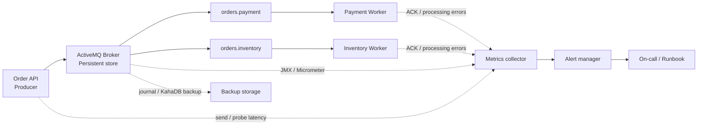

# Xây dựng hồ sơ vận hành gồm cấu hình, chỉ số, cảnh báo và quy trình khôi phục

> **Chương:** Bài tập tổng hợp  
> **Mô-đun:** `INTEGRATION_MESSAGING_MESSAGE_BROKER_ACTIVEMQ` — tìm hiểu Apache ActiveMQ Classic và Artemis trong giao tiếp bất đồng bộ bằng queue, topic, routing và JMS; thực hành producer/consumer Java, acknowledgment, transaction, redelivery, DLQ, bảo mật và vận hành broker đáng tin cậy.  
> **Sản phẩm cần hoàn thành:** Một hồ sơ vận hành có thể bàn giao cho đội on-call, gồm kiến trúc và mục tiêu dịch vụ, cấu hình broker đã kiểm soát, danh mục metric, bộ cảnh báo, runbook xử lý sự cố và bằng chứng khôi phục đã diễn tập.

## 1. Bài toán và tiêu chí hoàn thành

Một hệ thống đặt hàng gửi event qua broker tới các service thanh toán, kho và thông báo. Khi broker gặp sự cố, người trực cần trả lời được trong vài phút:

- Broker nào đang active, broker nào là backup? Client đang kết nối qua endpoint nào?
- Message có được ghi bền không? Queue nào đang tăng backlog? Consumer nào không còn hoạt động?
- Disk, memory, journal, paging, network hay JVM đang tạo áp lực?
- Cảnh báo nào cần page ngay, cảnh báo nào chỉ cần ticket?
- Nếu broker dừng, node mất kết nối, disk gần đầy hoặc message vào DLQ, cần làm gì theo thứ tự nào?
- Có thể khôi phục dữ liệu đến thời điểm nào, mất tối đa bao nhiêu dữ liệu và cần bao lâu để phục hồi?

Bài thực hành yêu cầu tạo **hồ sơ vận hành (operational profile)** cho một cụm lab. Hồ sơ không phải tập hợp screenshot dashboard. Mỗi metric phải có nguồn, ý nghĩa, cách diễn giải và hành động; mỗi alert phải có điều kiện, thời gian giữ, severity và runbook; mỗi quy trình khôi phục phải có điều kiện dừng và bằng chứng xác nhận thành công.

### 1.1. Kết quả bàn giao

Tạo một thư mục làm việc riêng trong môi trường lab, ví dụ `broker-operations-profile/`, và chuẩn bị các mục sau:

| Tệp bàn giao | Nội dung bắt buộc |
| --- | --- |
| `service-profile.md` | Sơ đồ, owner, endpoint, SLO, RTO/RPO, dependency và ranh giới trách nhiệm |
| `broker-config/` | Bản cấu hình đã loại secret, ghi rõ broker/version và checksum |
| `metrics-catalog.md` | Metric, nguồn, đơn vị, tần suất, chiều dữ liệu, ngưỡng và cách xử lý |
| `alerts.yml` | Alert rules hoặc cấu hình tương đương của nền tảng giám sát |
| `runbooks.md` | Các bước triage, khôi phục, rollback, verify và escalation |
| `recovery-evidence.md` | Thời gian diễn tập, dữ liệu trước/sau, RTO/RPO thực tế, lỗi và kết luận |

Các tên tệp trên là cấu trúc gợi ý để người học tạo trong workspace lab; bài học này chỉ cung cấp nội dung và mẫu, không yêu cầu ghi các tệp đó vào thư mục source của module.

### 1.2. Tiêu chí nghiệm thu

| Tiêu chí | Bằng chứng đạt |
| --- | --- |
| Có baseline cấu hình | Broker name, version, persistence, journal/store, address policy, security và HA được ghi |
| Có khả năng quan sát | Có metrics broker, queue, JVM, OS, network và synthetic probe |
| Có cảnh báo dùng được | Alert có severity, `for`, owner, action và link tới runbook |
| Có runbook thực thi được | Mỗi bước nêu lệnh/thao tác, điều kiện tiếp tục/dừng và kết quả mong đợi |
| Có recovery evidence | Đã diễn tập ít nhất broker restart và một tình huống HA/restore trong lab |
| Có giới hạn và giả định | RTO/RPO, ngưỡng, version, loại storage và điều chưa được kiểm chứng được nêu rõ |

## 2. Dựng bối cảnh lab và đặt mục tiêu dịch vụ

### 2.1. Kiến trúc tham chiếu

Dùng một workload đại diện: producer gửi `orders.created` vào broker; queue `orders.payment` và `orders.inventory` nhận message theo routing đã thiết kế; consumer xử lý và ACK sau khi hoàn tất công việc.



Hồ sơ cần ghi rõ một trong hai chế độ triển khai:

- **Single broker lab:** dùng để học metrics, alert, restart và restore. Không được tuyên bố HA chỉ vì process tự khởi động lại.
- **HA lab:** Artemis live/backup hoặc Classic failover topology đã được cấu hình và diễn tập. Ghi rõ shared store/replication hoặc cơ chế master/backup thực tế; không suy ra HA từ hai broker độc lập cùng chạy.

Có thể thực hành trên Artemis hoặc Classic. Nếu tổ chức đang dùng cả hai, hãy ghi hai profile riêng vì metric, persistence, management API và failover semantics khác nhau.

### 2.2. Viết SLO trước khi chọn alert threshold

Đặt các mục tiêu mẫu rồi điều chỉnh theo workload. Ví dụ:

| SLI/SLO | Mục tiêu lab minh họa | Cách đo |
| --- | --- | --- |
| Broker availability | 99,9% trong tháng | Synthetic connect/send/receive hoặc health signal |
| Publish-to-ack latency | p95 dưới 1 giây, p99 dưới 3 giây | Event ID và timestamp ở producer/consumer |
| Queue backlog | Không tăng liên tục quá 10 phút | Message added rate so với acknowledged rate |
| Oldest-message age | Dưới 2 phút cho queue thanh toán | Timestamp nghiệp vụ hoặc synthetic probe |
| DLQ | Không có message mới không được triage | DLQ count/rate và tuổi message |
| Recovery time | RTO mục tiêu 15 phút | Từ lúc phát hiện đến lúc consumer xử lý ổn định |
| Recovery point | RPO mục tiêu 0 cho persistent commit đã xác nhận trong lab | So sánh event ID đã commit trước sự cố với dữ liệu sau recovery |

Các con số trên chỉ là **mục tiêu minh họa**, không phải bảo đảm của Artemis/Classic. SLO phải phù hợp với business deadline, tải, persistence mode, storage và thiết kế HA.

Phân biệt:

- **Availability:** client có thể sử dụng dịch vụ hay không.
- **Latency:** message đi từ publish tới xử lý/ACK mất bao lâu.
- **Durability:** message đã được broker xác nhận có sống sót qua loại sự cố đã cam kết hay không.
- **RTO:** thời gian tối đa để đưa dịch vụ về trạng thái phục vụ.
- **RPO:** lượng dữ liệu tối đa có thể mất theo mốc thời gian hoặc theo số event.

Không gọi `send()` thành công là bằng chứng duy nhất về RPO. Với transacted send, xác định ranh giới commit; với async send, hiểu completion callback có ý nghĩa gì theo provider; với HA, chỉ dữ liệu được ghi bền theo cấu hình mới có thể được bảo vệ qua failover.

## 3. Lập baseline cấu hình broker

Baseline phải đủ để người khác biết broker đang chạy với semantics nào. Không sao chép cấu hình lab thành production mà không sizing lại.

### 3.1. Artemis: metrics, paging, DLQ và expiry

Trong `broker.xml` hiện có, gộp các phần tương ứng vào `<core>`; không tạo `<core>` thứ hai:

```xml
<core>
    <name>orders-artemis</name>

    <metrics>
        <jvm-memory>true</jvm-memory>
        <jvm-gc>true</jvm-gc>
        <jvm-threads>true</jvm-threads>
        <netty-pool>true</netty-pool>
        <file-descriptors>true</file-descriptors>
        <processor>true</processor>
        <uptime>true</uptime>
        <plugin class-name="org.apache.activemq.artemis.core.server.metrics.plugins.LoggingMetricsPlugin"/>
    </metrics>

    <message-expiry-scan-period>30000</message-expiry-scan-period>

    <address-settings>
        <address-setting match="orders.#">
            <max-size-bytes>512M</max-size-bytes>
            <address-full-policy>PAGE</address-full-policy>
            <page-size-bytes>10M</page-size-bytes>

            <dead-letter-address>DLQ</dead-letter-address>
            <max-delivery-attempts>5</max-delivery-attempts>
            <redelivery-delay>5000</redelivery-delay>

            <expiry-address>EXP</expiry-address>
        </address-setting>
    </address-settings>
</core>
```

Đây là ví dụ cấu hình lab, cần đối chiếu schema với đúng Artemis release:

- `<jvm-gc>`, `<jvm-threads>`, `<netty-pool>` và một số nhóm metric là optional; bật khi cần giám sát và đánh giá overhead.
- `LoggingMetricsPlugin` ghi metrics vào log để minh họa tích hợp Micrometer. Nó **không tự tạo Prometheus HTTP endpoint**. `SimpleMetricsPlugin` dùng trong test và chỉ lưu in-memory.
- Muốn đưa metrics vào hệ thống giám sát, cài plugin `ActiveMQMetricsPlugin` tạo `MeterRegistry` phù hợp exporter, hoặc thu qua JMX exporter/giải pháp monitoring đã được vận hành. Phải kiểm chứng endpoint, auth, TLS và metric names thực tế.
- `PAGE` giữ message trên paging store khi address vượt memory limit; nó không phải TTL và không tự xóa backlog.
- DLQ và expiry address cần có queue, quyền truy cập, retention và người chịu trách nhiệm.
- `max-size-bytes`, `page-size-bytes`, redelivery và expiry scan là tham số cần sizing/đo trong lab; không dùng các con số này làm mặc định production.

Trong hồ sơ ghi thêm đường dẫn thực tế của `journal-directory`, `paging-directory`, `large-messages-directory`, `bindings-directory`, loại journal NIO/ASYNCIO/MAPPED, sync semantics và volume chứa chúng. Không lưu password hoặc truststore private key vào hồ sơ bàn giao.

### 3.2. Artemis: HA policy cần được ghi như một phần của baseline

Nếu lab dùng replication, hồ sơ cần mô tả primary và backup, group name, cluster connection, connector/acceptor và cách client biết backup. Nếu dùng shared store, ghi filesystem chung, lock/fencing và yêu cầu độ sẵn sàng của storage.

Mẫu cấu trúc HA minh họa cho primary dùng shared store:

```xml
<ha-policy>
    <shared-store>
        <primary>
            <failover-on-shutdown>true</failover-on-shutdown>
        </primary>
    </shared-store>
</ha-policy>
```

Backup tương ứng dùng:

```xml
<ha-policy>
    <shared-store>
        <backup/>
    </shared-store>
</ha-policy>
```

Đây chỉ là phần HA policy; cấu hình thực tế còn phải dùng chung các thư mục dữ liệu trên shared storage, cluster connection và network connector đúng thiết kế. Không đưa hai broker lên cùng data directory nếu không phải shared-store HA được cấu hình đúng.

Nếu dùng replication, hai node có data directory riêng và đồng bộ dữ liệu qua mạng. Backup chỉ sẵn sàng thay primary sau khi hoàn tất initial synchronization. Ghi metric/management signal xác nhận replica sync; không đánh dấu backup healthy chỉ vì process đang chạy.

### 3.3. Classic: JMX, KahaDB và system usage

Trong `activemq.xml` hiện có, một baseline lab có thể dùng cấu trúc sau:

```xml
<broker brokerName="orders-classic" useJmx="true" persistent="true">
    <persistenceAdapter>
        <kahaDB
            directory="/var/lib/activemq/data/kahadb"
            journalMaxFileLength="32mb"/>
    </persistenceAdapter>

    <systemUsage>
        <systemUsage>
            <memoryUsage>
                <memoryUsage percentOfJvmHeap="60"/>
            </memoryUsage>
            <storeUsage>
                <storeUsage limit="50 gb"/>
            </storeUsage>
            <tempUsage>
                <tempUsage limit="10 gb"/>
            </tempUsage>
        </systemUsage>
    </systemUsage>
</broker>
```

Đây là phần trích để gộp vào root `<broker>` hiện có. Các điểm phải ghi trong profile:

- `useJmx="true"` bật management MBeans; JMX local thuận tiện cho lab.
- Remote JMX không được mở mặc định trong cấu hình Classic vì lý do bảo mật. Nếu cần remote management, chỉ bật qua mạng quản trị riêng, có authentication/TLS và giới hạn nguồn truy cập.
- KahaDB là persistence adapter file-based mặc định phổ biến của Classic. Ghi đường dẫn data directory, volume, dung lượng, backup policy và quyền filesystem.
- `memoryUsage`, `storeUsage`, `tempUsage` là giới hạn tài nguyên và flow-control; không thay thế monitoring filesystem thật.
- Không xóa journal/index file thủ công để giải phóng disk. Dùng management/runbook và persistence recovery đúng tài liệu.

### 3.4. Bảng cấu hình bắt buộc trong hồ sơ

| Hạng mục | Artemis | Classic |
| --- | --- | --- |
| Identity | Broker name, node ID, cluster/group | Broker name, broker ID |
| Endpoint | Acceptor, protocol, port, TLS | Transport connector, OpenWire/port, TLS |
| Persistence | Journal type, sync, journal/paging dirs | KahaDB path, journal settings |
| Capacity | Address memory, PAGE/BLOCK/DROP/FAIL, disk store | Memory/store/temp usage, producer flow control |
| Delivery | Redelivery delay, max attempts, DLQ | Redelivery policy, dead-letter strategy |
| Expiry | Expiry address, scan period | TTL, expire scan, destination policy |
| HA | Shared store hoặc replication, backup sync | Master/Slave hoặc failover URI/topology |
| Management | JMX/Jolokia/Core management/Web Console | JMX MBeans/Web Console |
| Security | Users/roles, address permissions, TLS | JAAS/auth plugin, destination authorization, TLS |
| Backup | Journal, bindings, paging, large messages theo cơ chế backup | Snapshot/backup KahaDB nhất quán |

Đính kèm checksum/hash của bản cấu hình đã triển khai và timestamp release. Không ghi secret vào Git hoặc `service-profile.md`; tham chiếu tới secret manager/path được bảo vệ.

## 4. Thiết kế danh mục metric

Metric phải trả lời câu hỏi vận hành cụ thể. Một metric không có owner hoặc hành động tiếp theo thường chỉ làm dashboard thêm nhiễu.

### 4.1. Nhóm metric broker và queue

| Mục tiêu | Artemis metric/nguồn | Classic JMX metric/nguồn | Cách đọc |
| --- | --- | --- | --- |
| Broker connection | `artemis.connection.count` | Broker `TotalConnectionsCount` | So với baseline; giảm đột ngột có thể là client/network failure |
| Broker active | `artemis.active` | Broker `Health.CurrentStatus` và process/connector | Phân biệt process sống với broker nhận traffic |
| Store pressure | `artemis.disk.store.usage` và filesystem metrics | Broker `StorePercentUsage`, filesystem metrics | Đọc cùng disk free/IOPS; không chỉ nhìn một gauge |
| Address memory | `artemis.address.memory.usage`, `artemis.address.memory.usage.percentage` | Broker/destination `MemoryPercentUsage` | Phát hiện memory pressure và paging/flow control |
| Queue backlog | `message.count` (tag address/queue) | Destination `QueueSize` | Đo snapshot và tốc độ tăng |
| Persistent backlog size | `persistent.size` | KahaDB/persistence adapter `Size` và store usage | Ước lượng storage demand |
| Delivering | `delivering.message.count` | `InFlightCount` | Phát hiện consumer chậm hoặc stuck |
| Scheduled | `scheduled.message.count` | Theo destination/JMX/provider tooling | Message đang chờ lịch, không phải backlog ready |
| Consumer count | `consumer.count` | Destination `ConsumerCount` | Đối chiếu với số replica consumer mong đợi |
| Enqueue/ACK | `messages.added`, `messages.acknowledged` | `EnqueueCount`, `DequeueCount` | Tính rate bằng delta/rate, không đọc counter tuyệt đối |
| Expired/DLQ | `messages.expired`, `messages.killed`, DLQ queue count | `ExpiredCount`, DLQ QueueSize | Theo dõi lỗi và message bị loại |
| Auth failures | `artemis.authentication.count`/`authorization.count` theo result | Security logs/plugin metrics | Phân biệt credential lỗi với traffic bất thường |

Trong Artemis, metric broker được prefix `artemis.`; metric address/queue có tag tương ứng và tên thường không có prefix đó. Ví dụ `message.count` được phân biệt bằng tag `broker`, `address`, `queue`. Không tự thêm prefix vào mọi metric.

Metric names khi đi qua Prometheus registry có thể được chuẩn hóa (dấu chấm thành dấu gạch dưới, counter có hậu tố `_total`, tên tag thành label). **Kiểm tra exposition thực tế** trước khi copy query trong bài vào alert manager.

### 4.2. Nhóm JVM, OS và network

| Lớp | Metric | Dấu hiệu cần chú ý |
| --- | --- | --- |
| JVM heap | Used/committed/max, heap after GC | Live heap sau GC tăng liên tục |
| GC | Pause count/time, allocation/promotion rate | Pause p95/p99 tăng cùng message latency |
| Native memory | Direct buffer, Netty allocator, thread stack, RSS | Heap ổn nhưng container memory gần limit |
| CPU | Process CPU, system CPU, per-core utilization, run queue | Một core/event loop bão hòa hoặc CPU quota throttling |
| Disk | IOPS, read/write throughput, await, queue depth, filesystem free | Commit p99 tăng cùng disk await hoặc volume gần đầy |
| Network | RTT, retransmit, drops, bytes/s, socket state | Remote client chậm, packet loss, reconnect storm |
| Process | Restart count, uptime, file descriptors, open sockets | Restart loop hoặc cạn file descriptor |
| Container | CPU/memory throttling, OOMKilled, volume usage | Host còn tài nguyên nhưng cgroup đã chạm limit |

Đối với queue age, nếu broker/exporter không cung cấp metric oldest-message-age theo cách bạn cần, tạo **synthetic probe** hoặc instrument ứng dụng bằng event timestamp. Không suy queue age từ queue depth: 100 message mới có thể ít nghiêm trọng hơn 2 message đã chờ quá deadline.

### 4.3. Chọn tần suất và cardinality

Một cấu hình khởi đầu cho lab:

- Broker/queue metrics: scrape mỗi 15 giây.
- OS/container metrics: 15–30 giây.
- Synthetic end-to-end probe: 30–60 giây.
- Alert evaluation: 15–30 giây.
- Dashboard history: tối thiểu 24 giờ cho lab, dài hơn theo retention monitoring của tổ chức.

Tránh tạo label có cardinality cao như `messageId`, `correlationId`, customer ID, payload value hoặc exception text. Những giá trị đó nên nằm trong log/trace có kiểm soát; metrics chỉ dùng label ổn định như broker, address, queue, environment và result.

## 5. Thu metrics cho từng broker

### 5.1. Artemis qua Micrometer

Artemis tích hợp Micrometer và cung cấp `ActiveMQMetricsPlugin` để khởi tạo `MeterRegistry`. Broker có `LoggingMetricsPlugin` để minh họa và `SimpleMetricsPlugin` cho test; cả hai không phải giải pháp export metrics production.

Để đưa metrics sang hệ thống giám sát:

1. Chọn registry/exporter được tổ chức hỗ trợ.
2. Cài plugin triển khai `ActiveMQMetricsPlugin` vào classpath broker.
3. Trong `init(Map<String,String>)`, tạo registry và đọc options đã cấu hình.
4. Trả registry từ `getRegistry()`.
5. Cung cấp cơ chế exposition/scrape phù hợp với registry, có network/auth/TLS.
6. Xác minh metric names và labels bằng cách xem dữ liệu thực tế.
7. Kiểm tra plugin không làm broker startup fail nếu monitoring endpoint tạm thời unavailable.

Nếu dùng JMX exporter, cấu hình mapping MBeans và bảo vệ endpoint. Không mở JMX/Jolokia không xác thực ra Internet hoặc mạng người dùng.

### 5.2. Classic qua JMX

Classic có MBeans cho broker, destination, connector, connection, persistence adapter và health. Dùng JConsole trên cùng host trong lab:

```text
jconsole
```

Trong JConsole chọn process broker, mở MBeans và ghi lại các ObjectName/attribute cần thiết. Những thuộc tính hữu ích gồm:

- Broker: `TotalEnqueueCount`, `TotalDequeueCount`, `TotalConnectionsCount`, `MemoryPercentUsage`, `StorePercentUsage`, `TempPercentUsage`.
- Queue/Topic: `EnqueueCount`, `DequeueCount`, `ConsumerCount`, `InFlightCount`, `QueueSize`, `ExpiredCount`.
- Persistence adapter: `Size`, `Transactions` nếu adapter/version expose.
- Health: `CurrentStatus`.

Remote JMX cần cấu hình riêng. Chỉ đưa vào profile khi có network segmentation, credentials, TLS và rotation. Nếu scrape JMX bằng exporter, lưu mapping rules cùng version và test khi nâng broker.

### 5.3. Synthetic probe cho end-to-end latency

Metrics broker có thể cho thấy queue đang có message nhưng không chứng minh ứng dụng thực hiện đúng business flow. Tạo probe riêng:

1. Mỗi 30–60 giây, producer gửi một message có `probeId` duy nhất vào queue lab.
2. Consumer probe nhận, xác nhận payload và ghi timestamp.
3. Consumer ACK/commit sau khi hoàn tất.
4. Tính `receivedAt - sentAt` và phát metric `messaging_probe_end_to_end_seconds`.
5. Nếu không nhận được trong deadline, đánh dấu probe failure và lưu event ID để điều tra.

Probe phải dùng destination riêng, payload không chứa dữ liệu cá nhân và quyền SEND/CONSUME giới hạn. Không dùng message probe trong queue nghiệp vụ có thể kích hoạt side effect.

## 6. Xây alert rules có hành động rõ ràng

Các ngưỡng dưới đây là ví dụ để lab có thể chạy; hãy hiệu chỉnh bằng baseline và SLO. Mỗi alert cần có `summary`, `description`, `severity`, `owner`, `runbook_url` và `for`.

### 6.1. Alert rules minh họa cho Prometheus

Các tên `message_count`, `consumer_count`, `messages_added_total` và `messages_acknowledged_total` dưới đây là tên đã được exporter chuẩn hóa. Trước khi dùng, xác nhận chúng bằng endpoint exposition hoặc mapping của JMX exporter.

```yaml
groups:
  - name: activemq-availability
    rules:
      - alert: BrokerMetricsTargetDown
        expr: up{job=~"artemis|activemq-classic"} == 0
        for: 2m
        labels:
          severity: critical
          owner: messaging-platform
        annotations:
          summary: "Không scrape được broker"
          description: "Kiểm tra process, network, exporter và broker health."
          runbook_url: "https://runbooks.example.invalid/broker-down"

  - name: activemq-queue
    rules:
      - alert: QueueHasBacklogWithoutConsumer
        expr: |
          message_count{queue="orders.payment"} > 0
          and on (broker, address, queue)
          consumer_count{queue="orders.payment"} == 0
        for: 5m
        labels:
          severity: critical
          owner: payments
        annotations:
          summary: "Queue thanh toán có backlog nhưng không có consumer"
          description: "Kiểm tra deployment, consumer connection và quyền CONSUME."
          runbook_url: "https://runbooks.example.invalid/queue-no-consumer"

      - alert: QueueBacklogGrowing
        expr: |
          rate(messages_added_total{queue="orders.payment"}[5m])
          -
          rate(messages_acknowledged_total{queue="orders.payment"}[5m]) > 20
        for: 10m
        labels:
          severity: warning
          owner: payments
        annotations:
          summary: "Producer đang vượt tốc độ ACK"
          description: "Kiểm tra consumer throughput, downstream latency và prefetch."
          runbook_url: "https://runbooks.example.invalid/queue-backlog"

      - alert: DeadLetterQueueNotEmpty
        expr: message_count{queue=~"DLQ.*"} > 0
        for: 2m
        labels:
          severity: warning
          owner: messaging-platform
        annotations:
          summary: "Có message mới trong DLQ"
          description: "Triage lỗi trước khi replay hoặc discard."
          runbook_url: "https://runbooks.example.invalid/dlq"

  - name: activemq-host
    rules:
      - alert: BrokerDataVolumeLowSpace
        expr: |
          node_filesystem_avail_bytes{mountpoint="/var/lib/artemis"}
          /
          node_filesystem_size_bytes{mountpoint="/var/lib/artemis"} < 0.15
        for: 5m
        labels:
          severity: critical
          owner: infrastructure
        annotations:
          summary: "Volume dữ liệu broker còn dưới 15%"
          description: "Kiểm tra journal, paging, large messages, log và tốc độ tăng."
          runbook_url: "https://runbooks.example.invalid/disk-pressure"
```

Các URL `.invalid` là placeholder; thay bằng địa chỉ runbook thực trước khi triển khai. Nếu exporter đổi tên metric, sửa query theo exposition thực tế. Với Classic, các query cần metric do JMX exporter map ra; không giả định tên series giống Artemis.

### 6.2. Bổ sung alert không thể chỉ dựa trên queue depth

Tạo alert hoặc dashboard panel cho:

| Alert | Điều kiện mẫu | Severity | Hành động đầu tiên |
| --- | --- | --- | --- |
| Oldest message age vượt deadline | Synthetic probe p99 hoặc app oldest age vượt SLO 5 phút | Critical | Kiểm tra consumer, downstream và backlog |
| Disk store pressure | Store usage tăng nhanh hoặc filesystem free dưới 15% | Critical | Kiểm tra volume, paging, journal, producer rate |
| Address memory pressure | Artemis address memory percentage trên ngưỡng đã đo | Warning/Critical | Kiểm tra PAGE/BLOCK, consumer throughput và memory |
| JVM GC pause | Pause p99 tăng liên tục và ảnh hưởng latency | Warning | Xem heap after GC, allocation, JFR |
| Authentication failure burst | Failure count tăng bất thường trong 5 phút | Warning/Security | Kiểm tra credential rotation và client rollout |
| Replica not synchronized | HA backup chưa sync hoặc management state không healthy | Critical | Không tuyên bố HA ready; điều tra replication/storage |
| Restart loop | Restart count tăng nhiều lần trong cửa sổ ngắn | Critical | Xem startup log, OOM, config và disk |
| DLQ growth rate | DLQ count/rate tăng đột ngột | Warning/Critical theo queue | Dừng retry storm, triage exception |

Không page chỉ vì queue depth vượt một con số nếu queue đó được thiết kế để tích lũy theo batch. Kết hợp backlog, tuổi message, tốc độ enqueue/ACK, consumer count và deadline nghiệp vụ.

### 6.3. Severity và routing

- **Critical/page:** broker không phục vụ, disk sắp đầy, queue quan trọng không có consumer, RPO/HA guarantee bị suy giảm, backlog vượt deadline.
- **Warning/ticket:** DLQ có message mới, backlog tăng nhưng chưa vi phạm deadline, GC hoặc connection bất thường chưa ảnh hưởng SLO.
- **Info/dashboard:** queue tạm tăng trong batch window, maintenance, failback đã được lên lịch.

Mỗi alert phải có người nhận và hành động. Alert không có owner hoặc runbook chỉ làm tăng alert fatigue.

## 7. Viết runbook: từ tín hiệu đến hành động

Mỗi runbook sử dụng cùng cấu trúc:

1. **Trigger:** Alert hoặc triệu chứng kích hoạt.
2. **Impact:** Service/queue/customer bị ảnh hưởng.
3. **Triage:** Lệnh/metric/log cần xem trước khi thay đổi.
4. **Decision:** Cây quyết định và điều kiện dừng.
5. **Action:** Thao tác an toàn theo thứ tự.
6. **Verify:** Bằng chứng dịch vụ đã ổn định.
7. **Escalation:** Khi nào gọi storage/network/application/platform owner.
8. **Record:** Incident ID, thời gian, số message, quyết định dữ liệu.

### 7.1. Runbook A — Broker không nhận kết nối

**Trigger:** Synthetic probe fail, scrape target down hoặc client reconnect liên tục.

**Triage:**

```bash
# Linux: kiểm tra process
ps -ef | grep -E 'artemis|activemq' | grep -v grep

# Kiểm tra port broker (đổi port theo acceptor/connector thực tế)
ss -lntp | grep ':61616'

# Kiểm tra filesystem
df -h

# Kiểm tra log gần nhất
tail -n 200 /var/log/artemis/artemis.log
```

Với Classic, thay log path theo installation; với Windows, dùng Task Manager/PowerShell và log directory tương ứng.

**Decision:**

- Process không chạy: xem exit code, startup log, OOM, config parse và quyền data directory.
- Process chạy nhưng port không listen: xem broker startup state, acceptor bind, port conflict và TLS configuration.
- Port listen nhưng client không connect: xem firewall, route, DNS, TLS handshake, authentication và protocol mismatch.
- Broker active nhưng queue không xử lý: chuyển sang runbook backlog/consumer.

**Action:**

1. Xác nhận node này có phải primary/live đang được client dùng không.
2. Nếu có HA, xác nhận backup active/passive và không có split-brain trước khi restart.
3. Chỉ restart đúng node theo quy trình; không khởi động broker thứ hai trên cùng data directory.
4. Sau khi process lên, kiểm tra management state, acceptor, auth và synthetic probe.
5. Kiểm tra client reconnect, duplicate event và queue backlog.

**Verify:** Probe gửi/nhận/ACK thành công liên tục trong ít nhất 5 phút; connection count ổn định; queue age và error rate trở về baseline.

### 7.2. Runbook B — Queue backlog tăng liên tục

**Trigger:** `messages.added` rate vượt `messages.acknowledged` rate hoặc oldest-message-age vi phạm SLO.

**Triage:**

- Xác định queue/address cụ thể, routing type và owner.
- So sánh producer rate, ACK rate, consumer count, delivering count và scheduled count.
- Xem exception consumer, DB/API latency, thread pool, connection pool và downstream saturation.
- Kiểm tra prefetch/window, redelivery storm và DLQ growth.

**Action:**

1. Nếu downstream đang lỗi, khắc phục hoặc giảm producer rate theo business policy.
2. Nếu consumer chết, khôi phục deployment và xác nhận quyền CONSUME.
3. Chỉ scale consumer khi downstream có capacity và xử lý idempotent.
4. Tăng concurrency theo từng bước; theo dõi DB pool, CPU, disk và duplicate side effect.
5. Không purge queue để làm dashboard về 0.
6. Nếu cần move message, dùng filter/management API và đối chiếu event ID trước/sau.

**Verify:** ACK rate bằng hoặc cao hơn enqueue rate đủ lâu để backlog giảm; oldest age trở lại SLO; không có duplicate business effect; DLQ không tăng ngoài dự kiến.

### 7.3. Runbook C — Disk pressure hoặc paging tăng

**Trigger:** Filesystem free dưới ngưỡng, store usage tăng, paging tăng hoặc broker bắt đầu block producer.

**Triage:**

```bash
df -h
du -sh /var/lib/artemis/data/*
iostat -xz 1
pidstat -d -p "$BROKER_PID" 1
```

Với Classic, xem KahaDB directory, broker `StorePercentUsage`, `TempPercentUsage` và `PersistenceAdapter.Size`.

**Action:**

1. Xác định directory/volume tăng: journal, paging, large messages, bindings, log hay backup.
2. Tìm queue backlog lớn nhất và producer/consumer rate.
3. Giảm hoặc tạm dừng producer theo runbook nghiệp vụ nếu cần bảo vệ disk.
4. Khôi phục consumer/downstream để drain backlog có kiểm soát.
5. Archive/delete log hoặc backup cũ theo retention đã duyệt.
6. Kiểm tra paging và journal cleanup theo cơ chế broker.
7. Mở rộng volume nếu đó là biện pháp đã chuẩn bị trong capacity plan.

**Không làm:**

- Không xóa journal file, KahaDB log hoặc paging file bằng `rm`/Explorer.
- Không xóa file đang được broker sử dụng.
- Không tắt persistence hoặc journal sync để tránh disk-full.
- Không purge queue nếu chưa có quyết định business data-loss.

**Verify:** Disk free tăng ổn định, store usage không tiếp tục tăng bất thường, broker không block producer, queue drain và message sample vẫn đọc/ACK được.

### 7.4. Runbook D — DLQ tăng đột biến

**Trigger:** DLQ có message mới hoặc growth rate vượt baseline.

**Triage:** Lấy mẫu có kiểm soát, ghi original address/queue, event ID, delivery count, exception category và release version của consumer.

**Action:**

1. Phân nhóm lỗi transient, schema, permission, poison payload hoặc business validation.
2. Nếu lỗi do release mới, cân nhắc rollback consumer trước khi replay.
3. Sửa nguyên nhân và xác nhận test trên message đại diện.
4. Replay theo batch nhỏ, giữ event ID để deduplicate.
5. Theo dõi message quay lại DLQ và business side effects.
6. Archive/discard chỉ theo policy và approval.

**Verify:** DLQ growth rate về 0 hoặc baseline; message được replay/đóng trạng thái; audit có số lượng và event ID; consumer không tạo retry storm.

### 7.5. Runbook E — Broker failover

**Trigger:** Primary mất kết nối hoặc HA monitor báo backup active.

**Artemis:**

1. Xác định HA policy là shared store hay replication.
2. Xác nhận backup đã activate và management state cho biết node đang active.
3. Xác nhận client reconnect tới endpoint backup; kiểm tra DNS/load balancer/discovery.
4. Đo khoảng gián đoạn, event ID đã commit và message redelivery.
5. Không khởi động primary cũ như một broker độc lập trên data copy cũ.
6. Khi primary trở lại, tuân theo failback policy và chờ đồng bộ hoàn tất.

**Classic:**

1. Xác nhận failover transport/topology đã cấu hình trên client.
2. Kiểm tra broker thay thế đang active và client reconnect.
3. Đối chiếu store/master-slave state và message delivery.
4. Không cho hai broker ghi cùng store nếu cơ chế HA không cho phép.

**Verify:** Client publish/consume trở lại; transaction in-flight được đối soát; message persistent đã commit được kiểm tra bằng event ID; consumer idempotency xử lý redelivery.

### 7.6. Runbook F — Restore từ backup

Backup không thay thế HA. HA giảm downtime; backup giúp phục hồi sau lỗi dữ liệu, thao tác nhầm, corruption hoặc mất toàn bộ cụm.

**Trình tự lab an toàn:**

1. Chọn backup đã hoàn tất và ghi timestamp, broker version, data path, checksum, retention.
2. Dừng broker restore target; cô lập network để client production không kết nối nhầm.
3. Chuẩn bị volume/data directory sạch theo runbook.
4. Restore đúng bộ dữ liệu nhất quán theo hướng dẫn persistence của broker.
5. Giữ quyền sở hữu file và permission đúng cho service account.
6. Khởi động broker trong môi trường cô lập; đọc startup log và kiểm tra store/journal recovery.
7. Kiểm tra queue/address, message count, scheduled, DLQ, durable subscriptions và sample payload.
8. Chạy consumer test với destination lab và đối chiếu event ID.
9. Chỉ chuyển traffic khi owner chấp thuận và đã xác nhận RPO/RTO.

**Artemis:** HA shared store cần toàn bộ data directories liên quan (journal, bindings, paging, large messages) trên shared storage; replication giữ bản sao trên backup node. Backup ngoài cụm vẫn cần snapshot/copy nhất quán theo quy trình được hỗ trợ. Không coi chỉ copy journal directory là bản backup đầy đủ.

**Classic/KahaDB:** tài liệu KahaDB yêu cầu snapshot nhất quán; cách được mô tả là freeze filesystem chứa database trước khi backup để bảo đảm journal snapshot đồng bộ. Với lab đơn giản, dừng broker sạch rồi backup toàn bộ data directory là cách dễ kiểm soát. Không copy một thư mục KahaDB đang ghi tùy tiện rồi tuyên bố backup hợp lệ.

**Verify RPO:** So sánh tập event ID đã được xác nhận commit trước sự cố với tập ID còn sau restore. Phân loại missing, duplicate và redelivered. Không chỉ so tổng message count vì hai tập dữ liệu khác nhau vẫn có thể có cùng số lượng.

## 8. Diễn tập sự cố có kiểm soát

Chỉ chạy fault injection trên broker lab và dữ liệu giả. Không dừng process, làm đầy disk hoặc cắt mạng trên môi trường production.

### 8.1. Bài diễn tập 1 — Consumer dừng, backlog tăng

1. Khởi chạy producer gửi 50 message/giây trong 5 phút.
2. Khởi chạy consumer và xác nhận ACK rate gần bằng enqueue rate.
3. Dừng consumer lab trong 3 phút.
4. Quan sát `message.count`, `consumer.count`, enqueue/ACK rate và alert `QueueHasBacklogWithoutConsumer`.
5. Khởi động consumer lại.
6. Đo thời gian drain và oldest-message-age.
7. Ghi số message gửi, ACK, redelivery, thời gian phát hiện và thời gian phục hồi.

**Đạt khi:** alert kích hoạt đúng thời gian `for`, runbook xác định queue/owner, consumer hồi phục và backlog giảm mà không purge.

### 8.2. Bài diễn tập 2 — Disk pressure có giới hạn

Không làm đầy filesystem. Trên lab riêng, đặt giới hạn address/store thấp có chủ đích hoặc dùng volume nhỏ đã dành cho thử nghiệm.

1. Gửi persistent message theo tốc độ cố định.
2. Tăng backlog bằng cách tạm dừng consumer.
3. Theo dõi paging/store usage và disk free.
4. Xác nhận alert threshold phát hiện trước khi volume cạn.
5. Khôi phục consumer hoặc giảm producer rate.
6. Xác nhận producer unblock và queue drain.

**Đạt khi:** alert không đến sau khi filesystem đã đầy; on-call xác định đúng volume và queue; không xóa file persistence thủ công.

### 8.3. Bài diễn tập 3 — Broker restart

1. Gửi một batch persistent message và commit.
2. Lưu event ID của batch đã commit.
3. Dừng broker theo cách được chọn (graceful restart trong lượt đầu).
4. Khởi động lại cùng data directory.
5. Xác nhận broker recovery và queue state.
6. Consume/ACK batch; đối chiếu event ID và duplicate.

Có thể chạy một lượt crash test riêng trong lab sau khi đã có backup và kế hoạch phục hồi. Ghi rõ loại crash; kết quả graceful restart không chứng minh khả năng chịu power loss.

**Đạt khi:** message đã commit và được bảo đảm theo persistence configuration còn tồn tại; consumer xử lý đúng; mọi redelivery/duplicate được giải thích.

### 8.4. Bài diễn tập 4 — HA failover

Chỉ làm nếu đã dựng live/backup đúng cấu hình.

1. Xác nhận backup đã sync/ready.
2. Gửi batch persistent message có event ID.
3. Dừng/crash primary theo kịch bản lab.
4. Ghi thời điểm backup activate và client reconnect.
5. Kiểm tra message đã commit, message in-flight và redelivery.
6. Khôi phục primary theo failback policy.
7. Xác nhận không có hai node cùng nhận vai trò active ngoài thiết kế.

**Đạt khi:** thời gian failover nằm trong RTO lab; backup chỉ nhận vai trò active khi điều kiện HA đáp ứng; event ID và transaction uncertainty được đối soát.

### 8.5. Bài diễn tập 5 — Restore backup

1. Tạo queue với 100 event ID khác nhau.
2. Commit và dừng broker sạch.
3. Tạo backup nhất quán theo quy trình của broker.
4. Khởi động lại, thêm 20 event mới rồi tạo một incident giả định cần restore.
5. Cô lập broker restore target và phục hồi từ backup.
6. Kiểm tra 100 event tại thời điểm backup; xác định 20 event sau backup có nằm ngoài RPO hay không.
7. Ghi RTO thực tế và quy trình chuyển traffic trở lại.

**Đạt khi:** người trực biết chính xác dữ liệu nào được phục hồi, dữ liệu nào nằm ngoài recovery point, và không nhầm backup cũ với dữ liệu hiện tại.

## 9. Mẫu hồ sơ vận hành hoàn chỉnh

Dùng mẫu sau làm khung bàn giao; thay mọi giá trị ví dụ bằng dữ liệu thật từ lab hoặc môi trường triển khai.

```markdown
# Operational Profile — Orders Messaging

## Service ownership
- Service owner: team-orders
- Broker owner: team-messaging-platform
- On-call: messaging-primary
- Environment: staging
- Broker: Artemis <version>
- Topology: live/backup replication
- Client endpoint: <dns-or-load-balancer>:61616

## Service objectives
- Publish-to-ACK p95: <target>
- Queue oldest age: <target>
- Availability: <target>
- RTO: <target>
- RPO: <target>
- Business data classification: <classification>

## Persistence and HA
- Journal type: <NIO|ASYNCIO|MAPPED>
- Transactional sync: <value>
- Non-transactional sync: <value>
- Data directories/volumes: <paths>
- HA mode: <shared-store|replication|single>
- Backup readiness signal: <metric-or-management-state>
- Backup cadence and retention: <policy>

## Destinations
| Address | Queue | Owner | Routing | Consumer min | Retention |
|---|---|---|---|---:|---|
| orders | orders.payment | payments | ANYCAST | 2 | <policy> |
| orders | orders.inventory | inventory | ANYCAST | 2 | <policy> |

## Metrics and alerts
| SLI/metric | Source | Warning | Critical | Owner | Runbook |
|---|---|---|---|---|---|
| queue oldest age | synthetic/app | <value> | <value> | payments | queue-backlog |
| queue backlog growth | broker counters | <value> | <value> | payments | queue-backlog |
| disk free | node exporter | <value> | <value> | infra | disk-pressure |
| DLQ count/rate | broker queue | >0 | <value> | messaging | dlq |

## Recovery
- Broker down: <runbook link>
- Disk pressure: <runbook link>
- Queue backlog: <runbook link>
- DLQ: <runbook link>
- HA failover: <runbook link>
- Backup restore: <runbook link>

## Last validation
- Date/time:
- Operator:
- Test scenario:
- RTO measured:
- RPO measured:
- Missing/duplicate event IDs:
- Follow-up actions:
```

Mẫu trên là tài liệu sống. Mỗi release thay đổi broker/client, storage, TLS, destination policy hoặc HA topology phải cập nhật profile và chạy lại các kiểm tra liên quan.

## 10. Quy trình vận hành thường kỳ

| Chu kỳ | Kiểm tra | Bằng chứng |
| --- | --- | --- |
| Mỗi ca trực | Broker active, target scrape, critical alerts, queue age, DLQ | Dashboard/alert review |
| Hàng ngày | Backlog trend, enqueue/ACK rate, expiry, auth failure, disk free | Daily operations note |
| Hàng tuần | Consumer distribution, slow queue, JVM/GC, journal/paging growth | Capacity/health review |
| Hàng tháng | Restore test, backup integrity, credential/certificate expiry, alert ownership | Recovery evidence/change record |
| Sau mỗi release | Client reconnect, transaction, redelivery, TLS, destination policy, metrics names | Release checklist |
| Sau incident | Timeline, impact, RTO/RPO, event reconciliation, alert quality | Post-incident review |

Không đặt lịch backup mà không thử restore. Một backup job báo success chỉ chứng minh thao tác copy/snapshot đã chạy; chỉ restore test mới chứng minh bộ backup có thể dùng được.

## 11. Phân tích tình huống tổng hợp

### Tình huống A — Producer vẫn gửi nhưng ACK rate bằng 0

Dashboard cho thấy `messages.added` tăng đều, `messages.acknowledged` gần như không tăng, consumer count giảm từ 4 xuống 0, disk free còn 35%.

**Yêu cầu:** Chọn alert ưu tiên, xác định runbook và giải thích vì sao chưa cần mở rộng disk.

*Định hướng:* Queue critical có backlog mà không có consumer cần page. Kiểm tra deployment/connection/auth/permission và downstream. Disk chưa phải triệu chứng đầu tiên; theo dõi tốc độ tăng để dự báo thời điểm áp lực storage.

### Tình huống B — Broker active nhưng backup chưa sync

Primary hoạt động bình thường, backup process đang chạy nhưng metric/state replica sync chưa hoàn tất.

**Yêu cầu:** Trạng thái HA có được ghi healthy không? On-call phải làm gì?

*Định hướng:* Không đánh dấu HA ready chỉ dựa vào process uptime. Kiểm tra network/replication throughput, storage và initial sync; giữ nguyên primary, không tự promote backup khi dữ liệu chưa được xác nhận đồng bộ.

### Tình huống C — Disk free còn 8%, queue backlog tăng

Broker đang PAGE message, consumer DB timeout, disk gần đầy.

**Yêu cầu:** Xác định thứ tự hành động để ngăn mất dữ liệu.

*Định hướng:* Giảm/điều tiết producer, khôi phục downstream/consumer, đánh giá volume và paging growth, mở rộng storage theo kế hoạch. Không xóa journal/paging thủ công và không tắt persistence.

### Tình huống D — Restore có cùng message count nhưng thiếu event

Backup chứa 10.000 message. Sau restore queue vẫn có 10.000 message, nhưng đối chiếu event ID cho thấy thiếu 50 event cũ và có 50 event khác.

**Yêu cầu:** Vì sao count không đủ chứng minh restore đúng? Cần evidence nào?

*Định hướng:* So sánh event ID/checksum/business key, transaction boundary, duplicate/redelivery và thời điểm backup. Báo RPO thực tế bằng dữ liệu bị mất, không chỉ bằng số lượng.

### Tình huống E — Classic remote JMX không truy cập được

Broker local JConsole xem được MBeans; monitoring server không kết nối được remote JMX.

**Yêu cầu:** Có nên mở port JMX ra mọi interface? Hồ sơ cần bổ sung gì?

*Định hướng:* Remote JMX không được bật mặc định; cần thiết kế mạng quản trị, authentication/TLS, firewall allowlist, credentials rotation và exporter mapping. Không mở JMX không bảo vệ.

### Tình huống F — Alert backlog kích hoạt liên tục trong batch window

Queue `reports.daily` tích lũy message ban ngày và consumer xử lý theo lịch lúc 23:00.

**Yêu cầu:** Điều chỉnh alert thế nào để tránh false positive nhưng vẫn phát hiện consumer hỏng?

*Định hướng:* Gắn lịch vận hành vào alert window, theo dõi oldest age và expected consumer schedule; alert nếu vượt deadline hoặc backlog không drain sau batch window, không chỉ dựa trên queue count.

## 12. Checklist nghiệm thu hồ sơ

### Cấu hình

- [ ] Broker name/version, endpoint, protocol và TLS được ghi.
- [ ] Persistence adapter/journal type, sync semantics và data paths được ghi.
- [ ] Capacity/flow-control, paging, expiry, redelivery và DLQ policy được ghi.
- [ ] HA mode, primary/backup state, sync condition và client reconnect được ghi.
- [ ] Management interface được bảo vệ; không có secret trong hồ sơ.

### Metrics và alert

- [ ] Có metric broker, queue, JVM, OS, disk, network và application probe.
- [ ] Có enqueue/ACK rate, backlog, oldest age, consumer count, delivering và DLQ.
- [ ] Có exporter mapping và metric names đã kiểm chứng.
- [ ] Alert có severity, `for`, owner, action và runbook link.
- [ ] Có cảnh báo backup chưa sync và filesystem pressure.
- [ ] Ngưỡng được hiệu chỉnh theo baseline/SLO, không copy máy móc ví dụ.

### Runbook và recovery

- [ ] Runbook broker down, backlog, disk pressure, DLQ, failover và restore.
- [ ] Mỗi runbook có trigger, triage, decision, action, verify và escalation.
- [ ] Có điều kiện dừng khi HA state/ownership/dữ liệu chưa rõ.
- [ ] Backup có timestamp, checksum, retention và restore evidence.
- [ ] Có diễn tập broker restart và restore; HA failover nếu topology hỗ trợ.
- [ ] RTO/RPO thực tế và missing/duplicate event IDs đã được ghi.

## 13. Bài tập mở rộng

1. **Capacity forecast:** từ enqueue rate trung bình/đỉnh, payload size và thời gian consumer outage dự kiến, ước tính dung lượng queue/paging cần có; thêm overhead journal và headroom.
2. **Alert tuning:** lấy số liệu 24 giờ, điều chỉnh `for`, threshold và severity để phân biệt batch window bình thường với backlog vi phạm deadline.
3. **Provider comparison:** lập hai profile Artemis và Classic, chỉ ra khác biệt metrics, management API, persistence và HA.
4. **Failure game day:** cho một người làm incident commander, một người vận hành broker và một người ghi timeline; diễn tập broker down và disk pressure.
5. **Recovery review:** người khác trong nhóm thực hiện restore chỉ dựa vào hồ sơ đã bàn giao. Nếu phải hỏi người viết mới hoàn tất được, runbook còn thiếu thông tin.

## 14. Tài liệu tham khảo chính thức

1. Apache ActiveMQ Artemis — [Metrics](https://artemis.apache.org/components/artemis/documentation/latest/metrics.html): Micrometer plugin contract, broker/address/queue metrics và optional JVM metrics.
2. Apache ActiveMQ Artemis — [Management](https://artemis.apache.org/components/artemis/documentation/latest/management.html): JMX, Jolokia, Core/JMS management API và resource inspection.
3. Apache ActiveMQ Artemis — [High Availability and Failover](https://artemis.apache.org/components/artemis/documentation/latest/ha.html): shared store, replication, backup synchronization, failover và failback.
4. Apache ActiveMQ Artemis — [Persistence](https://artemis.apache.org/components/artemis/documentation/latest/persistence.html): journal, bindings, paging, large messages và persistence behavior.
5. Apache ActiveMQ Artemis — [Using the Server](https://artemis.apache.org/components/artemis/documentation/latest/using-server.html): server configuration, data directory và operational commands.
6. Apache ActiveMQ Classic — [JMX](https://activemq.apache.org/components/classic/documentation/jmx): Broker, Destination, Connection, PersistenceAdapter và Health MBeans.
7. Apache ActiveMQ Classic — [KahaDB](https://activemq.apache.org/components/classic/documentation/kahadb): journal files, persistence settings và recovery.
8. Apache ActiveMQ Classic — [How do I back-up KahaDB](https://activemq.apache.org/components/classic/documentation/how-do-i-back-up-kahadb): filesystem freeze và consistent snapshot.
9. Apache ActiveMQ Classic — [Automatic Reconnection](https://activemq.apache.org/components/classic/documentation/how-do-i-configure-automatic-reconnection): failover transport và client reconnect.
10. Prometheus — [Recording rules and alerting rules](https://prometheus.io/docs/prometheus/latest/configuration/recording_rules/): rule groups, `for`, labels và annotations.
11. Prometheus — [Query functions](https://prometheus.io/docs/prometheus/latest/querying/functions/): `rate`, `increase`, range vectors và counter analysis.

> **Kết quả cuối cùng của bài lab:** Một người trực khác có thể xác định broker nào đang phục vụ, queue nào đang bị nghẽn, dữ liệu đang được bảo vệ ở mức nào, alert nào cần hành động và cách phục hồi theo thứ tự an toàn. Hồ sơ chỉ được xem là hoàn tất khi các ngưỡng được kiểm chứng, runbook đã diễn tập và RTO/RPO được ghi bằng bằng chứng thực tế.
