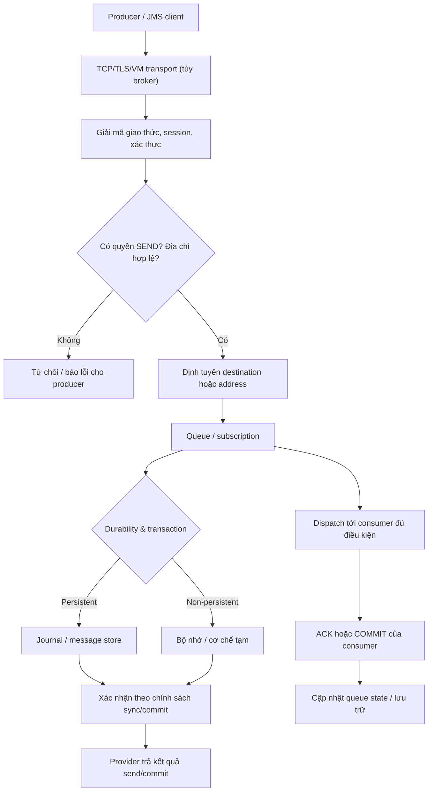
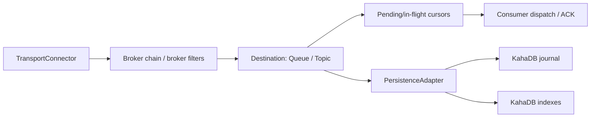
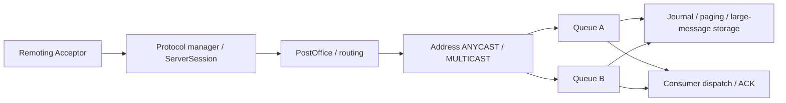
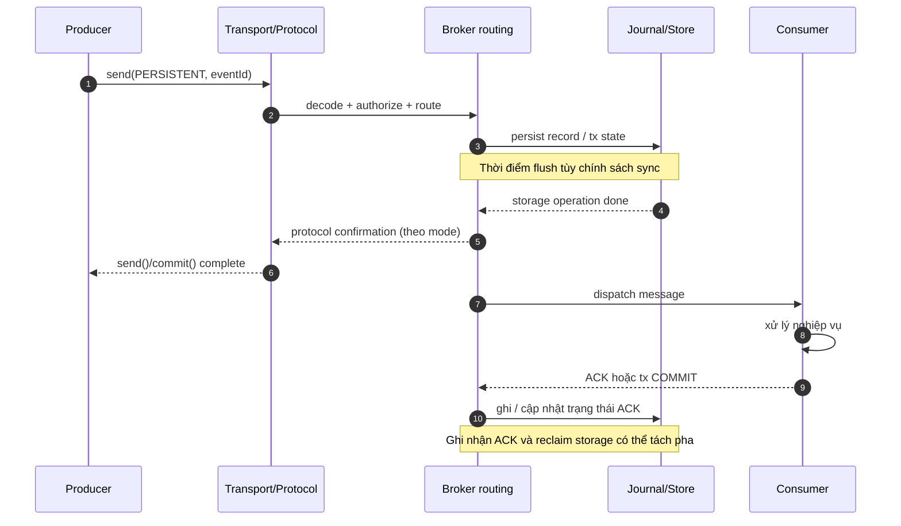

# Luồng xử lý từ transport đến bộ lưu trữ và xác nhận gửi

> **Chương:** Kiến trúc broker  
> **Mô-đun:** `INTEGRATION_MESSAGING_MESSAGE_BROKER_ACTIVEMQ` — Apache ActiveMQ Classic và ActiveMQ Artemis trong giao tiếp bất đồng bộ với queue, topic, routing và JMS.  
> **Mục tiêu:** Theo dõi một thông điệp từ producer qua kết nối mạng, lớp giao thức, kiểm tra quyền, định tuyến, bộ nhớ, lưu trữ, đến lúc producer nhận xác nhận gửi; đồng thời phân biệt xác nhận của producer với acknowledgment/transaction của consumer. Vận dụng kiến thức này để xử lý retry, redelivery, DLQ, bảo mật và vận hành broker đáng tin cậy.

## 1. Vì sao cần hiểu pipeline bên trong broker?

Giả sử dịch vụ đơn hàng tạo sự kiện:

```json
{
  "eventId": "evt-1001",
  "orderId": "ORD-1001",
  "type": "OrderCreated",
  "occurredAt": "2026-11-17T07:00:00Z"
}
```

Producer gửi sự kiện vào **queue** `orders.created` để worker xử lý thanh toán, hoặc phát vào **topic** để nhiều nhóm subscriber cùng nhận. Khi hàm `send()` trả về, ta cần biết câu trả lời chính xác cho các câu hỏi:

- Thông điệp đã đi tới **socket** của broker hay chưa?
- Broker đã giải mã, xác thực và chấp nhận thông điệp chưa?
- Thông điệp đã vào **queue/subscription** nào?
- Thông điệp được giữ **trong RAM**, **journal trên đĩa**, hay cả hai?
- Lời gọi `send()` hay `commit()` thành công có bảo đảm điều gì? Nếu bị timeout giữa chừng thì gửi lại có an toàn không?
- Consumer đã **nhận**, đã **xử lý nghiệp vụ**, hay mới chỉ **acknowledge**?

Các trạng thái này khác nhau. Lỗi phổ biến nhất là xem một lần `send()` thành công như bằng chứng rằng nghiệp vụ ở consumer đã hoàn tất.

Trong bài này, **ActiveMQ Classic** và **ActiveMQ Artemis** đều được xem là message broker, nhưng **cơ chế transport, routing và storage cụ thể khác nhau**. Những sơ đồ dùng mô hình chung trước, sau đó ghi rõ tên thành phần và giới hạn của từng dòng.

## 2. Bản đồ tổng thể: một message đi qua những tầng nào?



**Đọc đúng sơ đồ:** Đây là các *quan hệ logic*, không phải cam kết thứ tự thực thi ở mức từng luồng CPU. Broker có thể gom batch, pipeline, route song song hoặc dispatch khi ghi storage đang được xử lý. **Thời điểm gửi phản hồi cho producer phụ thuộc giao thức, delivery mode, transaction và cấu hình đồng bộ ghi.** Không suy từ sơ đồ rằng mọi `send()` đều đợi `fsync()`.

Có thể chia đường đi thành tám bước:

1. **Nhận kết nối:** Producer thiết lập TCP/TLS hay transport nội bộ được broker hỗ trợ.
2. **Giải mã:** Broker đọc frame/packet theo OpenWire, Artemis Core, AMQP, STOMP... và ánh xạ thành thao tác gửi thông điệp.
3. **Xác thực/phân quyền:** Broker xác định principal, vai trò và quyền gửi vào destination/address.
4. **Định tuyến:** Broker xác định queue/topic/subscription; Artemis dùng mô hình address + routing type + queue.
5. **Điều tiết tài nguyên:** Broker xem memory limit, paging, producer flow control, quota và tình trạng consumer.
6. **Ghi trạng thái thông điệp:** Với message persistent, broker ghi vào storage tương ứng; message non-persistent có thể chỉ được giữ tạm tùy chính sách.
7. **Xác nhận producer:** Client nhận kết quả gửi/commit theo cơ chế đã cấu hình, có thể đồng bộ hoặc bất đồng bộ.
8. **Phân phát và xác nhận consumer:** Broker gửi message cho consumer, nhận ACK/COMMIT rồi cập nhật trạng thái để không phát lại message đã xử lý hợp lệ.

**Câu hỏi cốt lõi:** `send accepted` là một mốc khác `consumer acknowledged`. Muốn biết độ bền trong lỗi tiến trình/điện/mạng, còn phải xét chính sách storage và giao dịch.

## 3. Đi sâu vào bước đầu: transport, protocol và session

### 3.1. Transport không đồng nghĩa với giao thức nhắn tin

**Transport** là cách các byte đi từ producer tới broker: TCP, TLS bọc TCP hoặc giao tiếp nội bộ JVM. **Messaging protocol** định nghĩa cấu trúc frame, lệnh gửi, session, xác nhận và các trạng thái kết nối.

| Khía cạnh | ActiveMQ Classic | ActiveMQ Artemis |
| --- | --- | --- |
| Điểm vào network | `TransportConnector` | `Acceptor` (remoting) |
| Giao thức thường gặp | OpenWire; cũng có connector cho AMQP, STOMP, MQTT theo cấu hình | Artemis Core, AMQP, OpenWire, STOMP, MQTT theo cấu hình broker |
| Ví dụ URI client | `tcp://broker.example:61616` với OpenWire client | `tcp://broker.example:61616` với Artemis Core client |
| Transport nội bộ | Classic có `vm://` dùng cùng JVM, phải đúng tổ hợp library/broker | Artemis có cơ chế in-VM riêng cho embedded; **không áp dụng nguyên cú pháp Classic** |
| Đầu ra tầng giao thức | Lệnh send/message/transaction được chuyển vào chuỗi broker | Packet/command được chuyển thành thao tác server session và routing |

Hai URI cùng viết `tcp://...:61616` **không tự động bảo đảm cùng giao thức trên wire**. Chỉ khi broker acceptor/connector thực sự hỗ trợ giao thức mà client phát ra, chúng mới giao tiếp được. Ví dụ, Artemis có thể được cấu hình chấp nhận nhiều giao thức trên cùng acceptor; Classic OpenWire client không trở thành Artemis Core client chỉ vì dùng cùng URL.

### 3.2. Mô tả một vòng kết nối thực tế

1. Client tạo `ConnectionFactory` và kết nối tới broker.
2. Transport có thể thương lượng TLS, xác thực chứng thư máy chủ; nếu dùng TCP thuần thì không có bước bảo mật đường truyền này.
3. Client và broker thực hiện phần handshake/negotiation của giao thức.
4. Client tạo session/context, nhận hoặc gửi thông điệp tới địa chỉ được khai báo.
5. Broker kiểm tra credentials, quyền SEND/CREATE/CONSUME, giới hạn resource và kiểu destination tùy cấu hình.
6. Message có header/properties/body được giải mã; broker kiểm tra metadata cần thiết (ví dụ TTL, routing) rồi định tuyến.

Một TCP ACK của hệ điều hành chỉ chứng tỏ gói tin đã được phía mạng nhận ở tầng TCP; **không chứng tỏ broker đã persist message**. Tương tự, một connection mở được không có nghĩa principal đó có quyền gửi vào mọi queue.

### 3.3. Network và embedded khác nhau ở đâu?

```text
Remote broker:
JVM producer --TCP/TLS--> JVM broker --journal/storage--> disk

Embedded broker:
JVM (application + broker) --in-process transport--> broker store
```

Mô hình embedded giảm một số chi phí mạng nhưng làm vòng đời broker gắn với ứng dụng và cần bộ thư viện tương thích trong **cùng JVM**. Chọn đường transport phải dựa trên version client/broker, không chỉ dựa vào độ trễ. Ví dụ, client Jakarta chuyển tiếp `activemq-client-jakarta` thuộc Classic 5.18.x được thiết kế cho broker **ở JVM riêng**, không hỗ trợ nhúng Classic 5.18 broker hay `vm://` với client đó. Các thế hệ Jakarta khác cần xem ma trận tương thích riêng.

## 4. Routing: broker quyết định message thuộc queue hay topic nào?

### 4.1. ActiveMQ Classic: destination và subscription

Trong Classic, producer gửi tới **destination** là `Queue` hoặc `Topic`.

- **Queue:** Message được lưu/điều phối cho một consumer đủ điều kiện trong nhóm consumer của queue. Nhiều consumer có thể cạnh tranh xử lý; cơ chế dispatch/prefetch khiến message đang in-flight chưa được xem là đã hoàn thành.
- **Topic:** Broker phát message tới các subscription đủ điều kiện. **Durable topic subscription** cần được định danh và quản lý để lưu message cho subscriber tạm ngắt kết nối; non-durable subscription thường chỉ nhận message trong thời gian subscription hoạt động.
- **Selectors:** Broker có thể chỉ chuyển message có property khớp điều kiện của subscription/consumer.

```java
// API JMS: kiểu destination thể hiện ý định của producer.
Queue queue = context.createQueue("orders.created");
Topic topic = context.createTopic("orders.events");
```

`createQueue()` và `createTopic()` trên JMS context trước hết tạo **JMS Destination object** ở phía client. Việc broker có tự tạo queue/topic thật hay không phụ thuộc broker, quyền và cơ chế auto-create.

### 4.2. ActiveMQ Artemis: address, routing type, queue

Artemis phân biệt:

- **Address:** Đích logic mà message được gửi tới.
- **Routing type `ANYCAST`:** Hướng thông điệp vào một queue phù hợp cho mô hình cạnh tranh tiêu thụ. Khi nhiều queue cùng gắn address ở chế độ anycast, việc chọn queue phụ thuộc quy tắc routing, không đồng nghĩa mọi queue đều nhận một bản.
- **Routing type `MULTICAST`:** Định tuyến một bản cho mỗi queue/subscription thích hợp, phù hợp mô hình pub/sub.
- **Queue:** Nơi duy trì trạng thái message chờ dispatch, in-flight, ACK và bộ đếm theo subscription.

Ví dụ logic:

```text
Address: orders.events  [MULTICAST]
    ├── Queue: billing.subscription  -> Consumer nhóm billing
    └── Queue: analytics.subscription -> Consumer nhóm analytics

Address: orders.created [ANYCAST]
    └── Queue: orders.created        -> Nhóm worker xử lý đơn
```

Nếu một message đi vào `orders.events` với routing type phù hợp, broker có thể lưu reference/message cho cả hai queue subscription. Một subscriber xác nhận xong **không tự động xác nhận thay** subscriber khác. Vì vậy, phải phân biệt *đã gửi tới address* với *đã hoàn tất mọi subscription*.

### 4.3. Các câu hỏi routing cần trả lời trước khi debug storage

- Address/destination có tồn tại không; broker có bật auto-create không?
- Sender có quyền SEND, và receiver có quyền CONSUME không?
- Message là queue/anycast hay topic/multicast?
- Có selector, filter hoặc subscription durable nào khiến message không được phát tới consumer không?
- Message có hết TTL trước khi consumer đọc không?
- Queue có consumer đang active hay message chỉ đang pending?

**Message không xuất hiện ở consumer chưa đủ chứng minh rằng broker không nhận hoặc không lưu message.** Trước tiên kiểm tra queue depth, routing, subscription và in-flight state.

## 5. Storage: RAM, persistent store, journal và paging

### 5.1. `PERSISTENT` là ý định về độ bền, không phải chỉ là một nhãn

Trong JMS, producer có thể đặt delivery mode:

```java
context.createProducer()
       .setDeliveryMode(DeliveryMode.PERSISTENT)
       .send(context.createQueue("orders.created"), payload);
```

Với message persistent, provider/broker triển khai cơ chế bảo đảm tồn tại qua những lỗi mà mô hình JMS yêu cầu, phù hợp cấu hình broker và giao dịch. Điều này thường liên quan **ghi journal hoặc persistent store**, nhưng không thể từ một dòng code kết luận cụ thể lúc nào kernel đã flush dữ liệu, có nhân bản sang node HA hay không.

Với `NON_PERSISTENT`, broker có thể tối ưu hiệu năng bằng lưu tạm trong RAM và bỏ qua đường ghi bền; message có thể mất sau crash/restart. Ngược lại, không nên hiểu `PERSISTENT` là “không bao giờ mất trong mọi sự cố”: ổ đĩa hỏng, cấu hình sync nguy hiểm, mất đồng thời các bản sao, quota đầy hoặc lỗi vận hành vẫn cần được xử lý.

**Phân biệt bốn thao tác:**

| Thao tác | Ý nghĩa | Không tự bảo đảm |
| --- | --- | --- |
| Broker nhận packet gửi | Lớp transport/protocol đã tiếp nhận lệnh | Message đã được route và ghi bền |
| Broker chấp nhận và route | Message đã qua xử lý điều kiện routing | Consumer đã xử lý |
| Broker ghi durable state theo cấu hình | Có trạng thái cần thiết để khôi phục sau restart theo bảo đảm áp dụng | Tác động tới DB/email bên ngoài đã hoàn tất |
| Consumer ACK hoặc COMMIT | Broker có thể giải phóng hoặc đánh dấu đã xử lý với subscription/queue tương ứng | Nghiệp vụ ngoài JMS luôn đúng hoặc idempotent |

### 5.2. Classic: từ BrokerService đến KahaDB

Một luồng điển hình của **Classic**:



Các vai trò chính:

- `BrokerService` quản lý lifecycle, connector, destination, persistence adapter và nhiều policy của broker.
- `TransportConnector` nhận kết nối từ client; thông qua các lớp transport, wire format và broker filter, thao tác được chuyển tới destination.
- **Destination** quản lý các trạng thái queue/topic, việc enqueue, dispatch và ACK.
- **Pending message cursor** giúp theo dõi thông điệp chờ dispatch/in-flight và cân đối giữa RAM và store.
- **KahaDB** là một persistence adapter phổ biến của Classic: journal ghi thay đổi theo thứ tự, index hỗ trợ tra cứu trạng thái. Đối với message persistent, storage ghi message và các thay đổi ACK/transaction cần khôi phục.
- Classic cũng có cấu hình persistence khác, ví dụ JDBC; không nên mô tả mọi Classic deployment đều chạy KahaDB.

**Chú ý độ trễ:** Khi áp lực bộ nhớ tăng hoặc disk store chậm, producer có thể bị chặn, bị timeout hoặc chịu producer flow control. **Prefetch** ở phía consumer ảnh hưởng lượng message đang nằm in-flight và tốc độ nhìn thấy message, không có nghĩa broker đã ACK business processing.

Ví dụ cấu hình **minh họa** cho Classic (trích đoạn trong cấu hình broker phù hợp, không phải toàn bộ file XML):

```xml
<broker persistent="true" xmlns="http://activemq.apache.org/schema/core">
    <persistenceAdapter>
        <kahaDB directory="data/kahadb"/>
    </persistenceAdapter>
    <transportConnectors>
        <transportConnector name="openwire" uri="tcp://0.0.0.0:61616"/>
    </transportConnectors>
</broker>
```

Sử dụng `0.0.0.0` mở cổng trên các interface của máy; môi trường thực tế cần firewall, TLS/authentication và giới hạn truy cập. Trên môi trường production, cấu hình hoàn chỉnh còn phụ thuộc context XML/Spring schema, storage policy và broker version.

### 5.3. Artemis: remoting, PostOffice, queue, journal

Một luồng điển hình của **Artemis**:



Các thành phần cần biết:

- **Acceptor và protocol manager** tiếp nhận connection/packet từ Artemis Core, AMQP hoặc giao thức khác đã bật.
- **Server session** gắn thao tác message với trạng thái session, quyền và transaction tương ứng.
- **PostOffice/routing** xác định message đi đến address và queue nào, đồng thời tạo những reference cần thiết.
- **Journal** ghi trạng thái durable: thông điệp, liên kết queue/reference, ACK và transaction tùy cơ chế. Artemis có lựa chọn I/O journal theo nền tảng như NIO hoặc AIO; cấu hình và khả năng hỗ trợ khác nhau theo môi trường.
- **Paging** xử lý khi dung lượng message vượt giới hạn bộ nhớ quy định cho address; broker chuyển bớt message ra page files để hạn chế RAM phình không kiểm soát. Paging **không phải** là việc bỏ qua quản lý quota đĩa.
- **Large message** có cơ chế lưu payload lớn phù hợp, khác cách giữ body nhỏ ở memory/journal; cần cân đối ngưỡng kích thước và dung lượng đĩa.

Một trích đoạn cấu hình **Artemis `broker.xml`** để thể hiện mối quan hệ routing và persistence:

```xml
<!-- Trích đoạn minh họa: đặt vào các section tương ứng của broker.xml -->
<journal-sync-transactional>true</journal-sync-transactional>
<journal-sync-non-transactional>true</journal-sync-non-transactional>

<addresses>
    <address name="orders.created">
        <anycast>
            <queue name="orders.created"/>
        </anycast>
    </address>
</addresses>

<address-settings>
    <address-setting match="#">
        <max-size-bytes>104857600</max-size-bytes>
        <address-full-policy>PAGE</address-full-policy>
    </address-setting>
</address-settings>
```

Các thuộc tính journal sync thể hiện sự khác biệt giữa ghi giao dịch và không giao dịch; khi triển khai phải kiểm tra **phiên bản, môi trường I/O, policy và default**. `PAGE` là một chính sách xử lý đầy address; các chính sách như `BLOCK`/`FAIL`/`DROP` có đánh đổi khác nhau và chỉ nên chọn khi hiểu yêu cầu mất dữ liệu/backpressure.

### 5.4. So sánh quyết định storage

| Trục so sánh | Classic | Artemis |
| --- | --- | --- |
| Đường lưu bền thường gặp | KahaDB journal + index (hoặc adapter khác) | Artemis journal, bindings và reference; có paging/large-message storage |
| Đơn vị routing | JMS queue/topic và subscription | Address + ANYCAST/MULTICAST + queue |
| Hạn chế RAM | Usage limits, cursors, producer flow control | Address size/paging, address-full-policy và consumer credits |
| Ảnh hưởng đến producer | Có thể block/timeout khi store hoặc resource đầy | Có thể page/block/fail/drop theo policy |
| Xác nhận đúng nghĩa | Phụ thuộc mode send, transaction và sync behavior | Phụ thuộc client protocol, transaction, block-on-send/confirmation, journal sync |
| Chẩn đoán thực tế | Destination pending/inflight, KahaDB health, disk usage | Address/queue metrics, journal/page state, disk usage |

**Hai điểm phải tách bạch:** (1) ghi vào OS page cache không đồng nghĩa đã an toàn trước mọi lỗi mất điện, và (2) nhân bản/HA không tự động được kích hoạt chỉ vì message dùng `PERSISTENT`. Độ bền cuối cùng phụ thuộc filesystem, storage, replication/failover và lựa chọn sync của chính broker.

## 6. “Xác nhận gửi” là xác nhận nào?

Đây là trọng tâm của bài học. Trong ứng dụng, từ **ACK** thường chỉ ít nhất ba sự kiện khác nhau:

1. **Xác nhận giao thức/producer:** Broker hoặc messaging provider trả kết quả thao tác gửi. Ví dụ OpenWire response, Artemis Core send acknowledgement hoặc AMQP disposition có ngữ nghĩa theo giao thức.
2. **Kết quả API của producer:** `MessageProducer.send()` / `JMSProducer.send()` trả về hoặc callback bất đồng bộ báo thành công. Với **transacted session**, một lần `send()` thành công **chưa phải** commit giao dịch.
3. **Acknowledgment của consumer:** Consumer gửi ACK hoặc commit sau khi nhận/xử lý message. Nó ảnh hưởng việc broker redeliver và dọn trạng thái queue/subscription, **không phải** trả lời producer đã gửi thành công.

### 6.1. Timeline khi gửi một message persistent



**Điều quan trọng:** Sơ đồ mô tả trường hợp producer nhận xác nhận **sau điều kiện lưu trữ thích hợp**. Nếu đã bật gửi bất đồng bộ, tối ưu batching hoặc cấu hình sync khác, thời điểm quan sát có thể khác. Đừng suy diễn mốc gọi `send()` trở về là mốc mọi block trên đĩa vật lý đã được flush nếu chưa xác minh cấu hình broker/client.

### 6.2. Khi dùng non-transacted session

Producer gọi `send()`; kết quả thành công nghĩa là messaging provider đã hoàn tất thao tác gửi theo bảo đảm và cấu hình áp dụng. Một số client có **asynchronous send** hoặc buffer/pipeline để tăng throughput; thay đổi cấu hình có thể thay đổi lúc kết quả thực sự được xác nhận. Cần đọc đúng phiên bản và transport của client.

Ở Jakarta Messaging, `JMSProducer.setAsync(CompletionListener)` hoặc overload `MessageProducer.send(..., CompletionListener)` cho phép thông báo qua callback khi thao tác gửi bất đồng bộ hoàn tất. Callback thành công không có nghĩa consumer đã ACK hoặc DB nghiệp vụ đã commit. Nếu callback báo lỗi, ứng dụng phải xử lý failure path.

### 6.3. Khi dùng transacted session

Đối với JMS transaction cục bộ:

```text
session.begin (ngầm khi session transacted)
    -> send(message A)
    -> send(message B)
    -> commit()
    -> broker công nhận transaction
```

`send()` chỉ đưa thao tác gửi vào **giao dịch hiện tại**. **`commit()` mới là ranh giới** để các message của transaction được xác nhận như đã commit và trở nên đủ điều kiện dispatch theo semantics giao dịch. `rollback()` loại bỏ các thao tác gửi chưa commit; với consumer, rollback khiến message đã nhận được phép redeliver theo policy.

Khi `commit()` bị mất phản hồi do network, producer có thể không biết broker đã commit hay chưa:

```text
Producer      Broker
   |--COMMIT---->|
   |             |  commit thành công
   |             X  kết nối đứt trước khi gửi reply
   |<-- ? ------ |
```

**Lỗi “không rõ kết quả” (in-doubt outcome)** nguy hiểm hơn việc broker rõ ràng từ chối gửi. Retry vô điều kiện có thể tạo thêm một message cho cùng event. Phải gắn **business event ID ổn định** qua các lần thử, dùng idempotency/duplicate detection hoặc outbox/inbox để tránh áp dụng nghiệp vụ hai lần. Đừng chỉ dựa vào `JMSMessageID` vì resend có thể sinh ID mới.

### 6.4. Ba lớp xác nhận thường bị đánh đồng

| Người hỏi | Mốc quan sát | Điều có thể kết luận | Điều chưa thể kết luận |
| --- | --- | --- | --- |
| Producer | `send()` trả thành công | Provider hoàn tất thao tác gửi theo mode hiện tại | Consumer đã đọc/xử lý |
| Producer trong transaction | `commit()` thành công | Transaction JMS đã được broker chấp nhận/commit theo cấu hình | Giao dịch DB của consumer đã commit |
| Consumer | ACK hoặc `commit()` thành công | Broker có cơ sở đánh dấu message đã xử lý ở queue/subscription | Một hệ thống ngoài JMS chắc chắn không bị xử lý lặp |
| Vận hành | Broker metrics giảm pending | Ít message đang pending hơn tại thời điểm đo | Tất cả message đã được nghiệp vụ xử lý đúng |

**Trong hệ thống cần kiểm toán**, nên log riêng: `eventId`, kết quả producer send/commit, thời điểm enqueue, số lần delivery, kết quả consumer transaction và trạng thái nghiệp vụ. Một nhãn “sent=true” là không đủ để đối soát toàn bộ hành trình.

## 7. Thực hành Java: gửi persistent + commit rồi nhận + commit

Ví dụ sau dùng **ActiveMQ Artemis** với API `jakarta.jms`; Classic dùng cùng nguyên lý JMS nhưng cần chọn artifact/namespace tương thích với phiên bản Classic. Để tập trung vào đường gửi tới broker và ACK, ví dụ dùng hai lần chạy độc lập: một lần producer, một lần consumer.

### 7.1. Điều kiện thực hành

- Có broker Artemis đang chạy ở một **tiến trình riêng**, acceptor hỗ trợ Artemis Core tại `tcp://127.0.0.1:61616`.
- Có queue `orders.created` được bind vào address `orders.created` theo `ANYCAST`, hoặc bật auto-create queue/address phù hợp **trong môi trường học**.
- Broker bật persistence và có đủ dung lượng journal/disk.
- Tài khoản client có quyền SEND và CONSUME ở queue, credentials được cung cấp từ biến môi trường.
- Java 17 và Maven; dependency dưới đây chỉ là phiên bản minh họa, cần thống nhất với broker và chính sách cập nhật phiên bản khi dùng thực tế.

```xml
<!-- Các phần chính trong pom.xml của project Maven Java 17 -->
<project xmlns="http://maven.apache.org/POM/4.0.0"
         xmlns:xsi="http://www.w3.org/2001/XMLSchema-instance"
         xsi:schemaLocation="http://maven.apache.org/POM/4.0.0 https://maven.apache.org/xsd/maven-4.0.0.xsd">
    <modelVersion>4.0.0</modelVersion>
    <groupId>example.messaging</groupId>
    <artifactId>artemis-message-flow</artifactId>
    <version>1.0.0</version>
    <properties>
        <maven.compiler.release>17</maven.compiler.release>
    </properties>
    <dependencies>
        <dependency>
            <groupId>org.apache.activemq</groupId>
            <artifactId>artemis-jakarta-client</artifactId>
            <version>2.38.0</version>
        </dependency>
    </dependencies>
    <build>
        <plugins>
            <plugin>
                <groupId>org.apache.maven.plugins</groupId>
                <artifactId>maven-compiler-plugin</artifactId>
                <version>3.13.0</version>
            </plugin>
            <plugin>
                <groupId>org.codehaus.mojo</groupId>
                <artifactId>exec-maven-plugin</artifactId>
                <version>3.5.0</version>
            </plugin>
        </plugins>
    </build>
</project>
```

### 7.2. Producer: xác nhận sau commit của JMS

Tạo file `src/main/java/example/messaging/FlowDemo.java`:

```java
package example.messaging;

import jakarta.jms.ConnectionFactory;
import jakarta.jms.DeliveryMode;
import jakarta.jms.JMSConsumer;
import jakarta.jms.JMSContext;
import jakarta.jms.JMSException;
import jakarta.jms.Message;
import jakarta.jms.Queue;
import jakarta.jms.TextMessage;

import org.apache.activemq.artemis.jms.client.ActiveMQConnectionFactory;

import java.util.UUID;

public final class FlowDemo {
    private FlowDemo() {}

    public static void main(String[] args) throws JMSException {
        if (args.length != 1 ||
                (!"send".equals(args[0]) && !"receive".equals(args[0]))) {
            throw new IllegalArgumentException(
                    "Usage: FlowDemo send|receive");
        }

        String url = System.getenv().getOrDefault(
                "BROKER_URL", "tcp://127.0.0.1:61616");
        String user = requiredEnv("BROKER_USER");
        String password = requiredEnv("BROKER_PASSWORD");

        ConnectionFactory factory = new ActiveMQConnectionFactory(url);
        if ("send".equals(args[0])) {
            send(factory, user, password);
        } else {
            receive(factory, user, password);
        }
    }

    private static String requiredEnv(String key) {
        String value = System.getenv(key);
        if (value == null || value.isBlank()) {
            throw new IllegalStateException("Missing env: " + key);
        }
        return value;
    }

    private static void send(ConnectionFactory factory,
                             String user, String password) throws JMSException {
        try (JMSContext context = factory.createContext(
                user, password, JMSContext.SESSION_TRANSACTED)) {

            Queue queue = context.createQueue("orders.created");
            String eventId = UUID.randomUUID().toString();

            TextMessage event = context.createTextMessage(
                    "{\"eventId\":\"" + eventId
                    + "\",\"orderId\":\"ORD-1001\",\"type\":\"OrderCreated\"}");
            event.setStringProperty("eventId", eventId);
            event.setStringProperty("eventType", "OrderCreated");

            // Yêu cầu delivery mode bền vững của JMS.
            context.createProducer()
                    .setDeliveryMode(DeliveryMode.PERSISTENT)
                    .send(queue, event);

            // Thành công ở send() chưa phải giao dịch đã commit.
            context.commit();
            System.out.println("JMS transaction committed, eventId=" + eventId);
            System.out.println("JMSMessageID=" + event.getJMSMessageID());
        }
    }

    private static void receive(ConnectionFactory factory,
                                String user, String password) throws JMSException {
        try (JMSContext context = factory.createContext(
                user, password, JMSContext.SESSION_TRANSACTED)) {

            Queue queue = context.createQueue("orders.created");
            JMSConsumer consumer = context.createConsumer(queue);
            Message message = consumer.receive(10_000);

            if (message == null) {
                System.out.println("No message in 10 seconds");
                return;
            }

            try {
                if (!(message instanceof TextMessage)) {
                    throw new IllegalStateException("Expected TextMessage");
                }
                TextMessage textMessage = (TextMessage) message;

                System.out.println("Event: " + textMessage.getText());
                System.out.println("eventId="
                        + message.getStringProperty("eventId"));
                System.out.println("redelivered=" + message.getJMSRedelivered());

                // Chỗ này trong ứng dụng thật là bước xử lý nghiệp vụ.
                // Chỉ commit JMS sau khi bước xử lý thành công.
                context.commit();
                System.out.println("Consumer JMS commit completed");
            } catch (JMSException | RuntimeException failure) {
                context.rollback(); // cho phép broker redeliver theo policy
                throw failure;
            }
        }
    }
}
```

Chạy hai chế độ bằng Maven; đặt `BROKER_USER` và `BROKER_PASSWORD` trong **môi trường shell** trước khi chạy:

```bash
mvn -q compile exec:java -Dexec.mainClass=example.messaging.FlowDemo -Dexec.args=send
mvn -q compile exec:java -Dexec.mainClass=example.messaging.FlowDemo -Dexec.args=receive
```

Kết quả tiêu biểu khi broker, queue và quyền đã cấu hình đúng:

```text
JMS transaction committed, eventId=...
JMSMessageID=ID:...

Event: {"eventId":"...","orderId":"ORD-1001","type":"OrderCreated"}
eventId=...
redelivered=false
Consumer JMS commit completed
```

**Tại sao dùng `SESSION_TRANSACTED`?** Với producer, `commit()` cho một ranh giới xác nhận rõ ràng của JMS transaction. Với consumer, `commit()` giúp broker xác nhận việc nhận/xử lý message trong JMS session. Nếu code xử lý nghiệp vụ ném lỗi trước commit, `rollback()` cho phép message được phát lại theo chính sách. **Giao dịch JMS này không tự bao gồm việc commit cơ sở dữ liệu bên ngoài**.

**Tại sao vẫn có thể có duplicate?** Nếu broker đã commit gửi nhưng reply về producer bị mất, producer có thể retry eventId cũ. Trong ví dụ demo, `eventId` được sinh trong mỗi lần chạy `send`, nên một retry bằng cách chạy lại sẽ sinh ID mới. Trong ứng dụng thực tế, **tạo eventId từ bản ghi outbox/nguồn sự kiện bền vững và tái sử dụng cùng ID khi retry**; consumer đối soát eventId qua inbox/unique constraint.

### 7.3. Đổi sang Classic thì thay gì?

- Với **Classic 6.x** dùng API Jakarta, chọn artifact Classic `org.apache.activemq:activemq-client` phiên bản tương ứng và `org.apache.activemq.ActiveMQConnectionFactory`.
- Với **Classic 5.x** ứng dụng `javax.jms`, dùng import `javax.jms.*` và artifact phù hợp 5.x. Đừng trộn namespace `javax.jms` và `jakarta.jms` trong cùng tầng mã.
- Với client Jakarta **chuyển tiếp của Classic 5.18.x**, `activemq-client-jakarta` chỉ phù hợp broker chạy **ở JVM khác**, không dùng embedded broker/`vm://` trong cùng JVM.
- Artemis và Classic có khác biệt về address/queue và các option dành riêng cho client: không sao chép cấu hình routing, producer sync hoặc failover từ broker này sang broker kia mà chưa kiểm chứng.

## 8. Lỗi ở từng cửa sổ thời gian: khi nào phải retry?

Một lần gửi có thể trải qua nhiều trạng thái quan sát được. Bảng sau giúp quyết định retry:

| Thời điểm xảy ra lỗi | Broker có thể đang có message? | Producer nên hiểu gì? | Hướng phục hồi |
| --- | --- | --- | --- |
| Trước khi client gửi được packet | Thường chưa, nhưng cần biết thao tác đã thật sự bắt đầu hay chưa | Gửi chưa hoàn thành | Retry với **eventId cũ** |
| Broker đã nhận nhưng chưa ghi/chấp nhận | Không chắc nếu mất kết nối | Trạng thái chưa rõ | Retry có idempotency |
| Broker đã lưu/commit nhưng reply bị mất | **Có thể có** | Timeout không đồng nghĩa gửi thất bại | Retry với eventId ổn định; deduplicate |
| Broker xác nhận gửi, consumer chưa nhận | Có thể vẫn pending hoặc đã in-flight | Producer hoàn tất nghĩa vụ gửi theo mode đã chọn | Kiểm tra queue depth/consumer |
| Consumer nhận và cập nhật DB, nhưng chưa ACK JMS | Có thể sẽ redeliver | Rủi ro xử lý nghiệp vụ hai lần | Inbox/idempotency hoặc phối hợp transaction |
| Consumer ACK được ghi, nhưng storage chưa reclaim | Message không nhất thiết còn được dispatch | Bộ đếm/disk có thể giảm trễ | Theo dõi reclaim/compaction theo broker |
| Broker crash khi cấu hình persistence/sync không phù hợp | Có nguy cơ mất dữ liệu theo cấu hình | Không giả định dữ liệu luôn bền | Kiểm tra durability, test crash/recovery |

### 8.1. Tại sao retry thường dẫn đến at-least-once?

Để không bỏ sót dữ liệu, producer có thể retry khi không nhận phản hồi. Vì không thể luôn biết broker đã nhận/commit trước khi kết nối đứt, retry có thể tạo bản sao logic của cùng event. Đây là nền tảng cho **at-least-once delivery** trong rất nhiều hệ thống messaging thực tế.

**Idempotency:** Consumer đảm bảo áp dụng cùng `eventId` một lần, ví dụ bảng database:

```sql
CREATE TABLE processed_events (
    event_id VARCHAR(100) PRIMARY KEY,
    processed_at TIMESTAMP NOT NULL
);
```

Khi nhận event, consumer mở DB transaction, tạo record `processed_events` có unique `event_id`, cập nhật nghiệp vụ trong **cùng DB transaction**, commit rồi mới ACK JMS. Nếu eventId đã tồn tại, consumer coi như message được xử lý trước đó và ACK an toàn theo thiết kế nghiệp vụ. Cần xử lý lỗi unique constraint đúng loại; không “nuốt” mọi lỗi DB rồi ACK.

Trên Artemis, có cơ chế **duplicate detection** ở broker qua duplicate ID do client chỉ định (thường dùng property đặc biệt `_AMQ_DUPL_ID` với Artemis Core/JMS phù hợp). Cơ chế này hữu ích nhưng **không thay** idempotency ở ranh giới với DB, HTTP hay dịch vụ ngoài.

### 8.2. ACK của consumer và redelivery

- **`AUTO_ACKNOWLEDGE`:** Provider tự acknowledge theo quy tắc API; thích hợp ví dụ đơn giản, cần chú ý ranh giới khi xử lý business logic.
- **`CLIENT_ACKNOWLEDGE`:** Ứng dụng gọi `message.acknowledge()`; theo semantics JMS, có thể ACK **toàn bộ message đã consume trong session**, không chỉ message hiện tại.
- **`SESSION_TRANSACTED`:** Message được xác nhận khi `commit()`; `rollback()` cho phép phát lại. Trong transacted session, ACK mode truyền vào không điều khiển hành vi acknowledgment như non-transacted session.
- **Redelivery policy:** Xác định số lần thử và độ trễ/backoff. Khi quá ngưỡng, message có thể chuyển sang **dead-letter queue (DLQ)** nếu broker được cấu hình. Đừng lặp vô hạn một message luôn gây lỗi dữ liệu.
- **Metadata:** `JMSRedelivered` cho biết dấu hiệu nhận lại; `JMSXDeliveryCount`, nếu provider hỗ trợ và công bố đúng ngữ nghĩa, giúp quan sát số lần thử. Không dùng riêng một property làm căn cứ tính tiền hay quyết định nghiệp vụ không thể hoàn tác.

### 8.3. Transaction chỉ bao phủ những resource nào?

`JMSContext.commit()` quản lý **JMS session**; việc gọi API thanh toán, ghi DB hoặc gửi email nằm ngoài giao dịch này trừ khi có cơ chế phối hợp riêng. Do đó trường hợp sau vẫn lỗi:

```text
1. Consumer nhận order-created
2. Database COMMIT thành công
3. JVM chết trước JMS COMMIT
4. Broker redeliver
5. Consumer cập nhật DB thêm lần nữa nếu không idempotent
```

Có thể xử lý bằng **transactional inbox**, **outbox**, unique business key hoặc giải pháp phối hợp phân tán phù hợp. Với giao dịch XA, phải đánh giá giới hạn và chi phí thật, không tự giả định rằng bật transacted JMS là một distributed transaction.

## 9. Resource pressure và tác động tới xác nhận gửi

Nhiều lỗi “producer bị treo” thực chất xảy ra vì broker **cố giữ cam kết storage** trong khi tài nguyên cạn.

### 9.1. Classic: producer flow control

Khi destination/store/memory vượt giới hạn, Classic có thể điều tiết producer. Ứng dụng thấy `send()` chậm, treo chờ resource hoặc timeout tùy client và broker policy. Cách xử lý đúng là kiểm tra:

- `enqueue` so với `dequeue`; queue depth, số consumer, inflight và prefetch.
- Dung lượng KahaDB, tốc độ disk I/O, mức RAM/disk usage.
- Producer flow control, TTL, persistent vs non-persistent và lịch compaction/cleanup.
- Các consumer chậm do business transaction, ACK quá muộn hoặc lỗi retry liên tục.

Tăng timeout mà không giải quyết áp lực storage thường chỉ kéo dài thời gian chờ.

### 9.2. Artemis: paging và address-full-policy

Ở Artemis, khi address vượt ngưỡng memory đã cấu hình, broker có thể:

- **PAGE:** Chuyển message sang page files để hạn chế RAM; cần đĩa đủ lớn và theo dõi backlog.
- **BLOCK:** Chặn/điều tiết producer cho tới khi giải phóng tài nguyên, dễ thấy tăng latency của `send()`.
- **FAIL:** Báo lỗi thao tác gửi khi chạm giới hạn, buộc ứng dụng xử lý retry/throttle.
- **DROP:** Bỏ message theo policy; **không** phù hợp các luồng yêu cầu đảm bảo không mất dữ liệu trừ khi đây là lựa chọn có chủ đích.

Kiểm tra **address-specific** size, journal và page store metrics; một broker còn RAM trống ở mức host vẫn có thể chặn producer vì quota của address đã đầy.

### 9.3. Consumer throughput ảnh hưởng producer thế nào?

Nếu message đến nhanh hơn tốc độ xử lý, backlog tăng:

```text
producer 1000 msg/s
      |
      v
   broker queue ----> consumer 300 msg/s
      |
      +-- backlog tăng khoảng 700 msg/s
```

Đây là ví dụ số học đơn giản, không phải số đo sản phẩm. Queue dần chiếm bộ nhớ/đĩa, dẫn tới paging hoặc flow control. Giải pháp có thể là tăng số consumer hiệu quả, giảm thời gian xử lý, điều tiết producer hoặc phân vùng workload; luôn kiểm tra tính thứ tự/idempotency khi tăng concurrency.

## 10. Bảo mật và vận hành đường dữ liệu

### 10.1. Bảo vệ ingress trước khi route

- Bật **TLS** khi mạng không hoàn toàn tin cậy; xác minh chứng thư, hostname và cơ chế quản lý chứng chỉ.
- Dùng **authentication và authorization** riêng cho SEND, CONSUME, CREATE/DELETE queue/address và quyền quản trị. Tránh để producer tự tạo bất kỳ destination nào ngoài ý muốn.
- Không hardcode credential trong source/POM; dùng môi trường runtime, secret manager hoặc cơ chế tương đương.
- Áp dụng giới hạn kích thước message, quota, TTL và client connection/producer rate để chống cạn tài nguyên.
- Không đưa body chứa dữ liệu cá nhân/bí mật vào log debug; chỉ log eventId, correlationId và metadata cần quan sát.

### 10.2. Những metric nên ghép lại để nhìn toàn hành trình

| Tầng | Tín hiệu cần theo dõi | Câu hỏi trả lời |
| --- | --- | --- |
| Transport | Connections, auth failures, TLS handshake failures, reconnect | Client có vào được broker? |
| Producer/protocol | Send latency, send/commit errors, timeouts | Đã có xác nhận theo mode chưa? |
| Routing | Address/queue tồn tại, enqueue, filter/no-route | Message vào đúng chỗ? |
| Storage | Journal/DB I/O latency, disk space, paging/store usage | Broker có đủ khả năng giữ message? |
| Queue | Pending, in-flight, delivering, aging | Message bị tồn ở đâu? |
| Consumer | Delivery rate, ACK/commit rate, rollback, redelivery | Consumer đang xử lý hay nhận lặp? |
| Reliability | DLQ size, expired, duplicate count, failover | Có message bị kẹt/bị loại/mất ngữ nghĩa? |

Tên và đơn vị metric cụ thể khác nhau giữa Classic và Artemis. Nếu `enqueue` tăng nhưng `dequeue` không tăng, kiểm tra consumer/ACK; nếu producer latency tăng cùng disk usage, kiểm tra store/paging; nếu có nhiều error sau network flap, đối chiếu `eventId` để tìm gửi trùng.

### 10.3. Checklist khi `send()` chậm hoặc timeout

1. **Đúng version/client/protocol chưa?** Client OpenWire và Artemis Core khác nhau dù cùng URL `tcp://`.
2. **Kết nối thật sự an toàn và được phân quyền chưa?** Kiểm tra TLS, principal và SEND ACL.
3. **Message route tới đâu?** Destination/address, routing type, selector và durable subscription.
4. **Broker còn room không?** Disk, KahaDB/journal/page files, address limits, flow control.
5. **Send là sync hay async, có transaction không?** Xác định `send()`, callback hay `commit()` là mốc quan sát chính.
6. **Kết quả thất bại rõ ràng hay in-doubt?** Nếu timeout sau khi broker nhận, retry bằng eventId ổn định.
7. **Consumer có ACK/commit không?** Kiểm tra redelivery, DLQ và ghi DB ngoài JMS.

Đừng chỉ xem log “Connected” rồi kết luận toàn bộ luồng gửi thông điệp đã an toàn.

## 11. Bài tập kiến trúc và tình huống điều tra

### Bài tập 1 — Vẽ lại timeline của một message

Với sự kiện `OrderCreated(eventId=evt-1001)`, hãy mô tả từng bước từ TCP accept đến producer commit, journal, dispatch và consumer ACK. Ghi rõ ba mốc: **producer nhận phản hồi**, **message được lưu**, **consumer xác nhận**. Mỗi mốc có thể xảy ra ở thời điểm nào trong cấu hình synchronous khác asynchronous?

### Bài tập 2 — Mất phản hồi sau khi broker commit

Producer gửi persistent message, broker commit xong nhưng reply bị đứt mạng. Producer timeout và retry.

**Yêu cầu:** Giải thích vì sao cả hai câu “gửi thất bại” và “gửi thành công” đều có thể sai nếu chỉ dựa trên timeout. Đề xuất eventId, outbox và consumer inbox hoặc duplicate detection để xử lý.

### Bài tập 3 — Queue bị tồn nhưng broker còn RAM

Artemis queue `orders.created` có 500.000 message pending; CPU bình thường, RAM host còn trống, nhưng `send()` bắt đầu chậm. Address đã bật policy `PAGE`.

**Yêu cầu:** Phân biệt address memory quota với RAM host; tìm dấu hiệu page files tăng, consumer/ACK chậm và disk I/O. Đề xuất theo dõi và giới hạn backlog hợp lý.

### Bài tập 4 — So sánh topic subscriptions

Classic có một topic với hai durable subscribers; Artemis có multicast address với hai durable queues. Một subscriber xử lý/ACK nhanh, subscriber còn lại đã offline.

**Yêu cầu:** Giải thích tại sao message có thể vẫn cần được lưu cho subscriber offline dù nhóm còn lại đã hoàn tất, và vì sao không nên xem ACK của một consumer là ACK toàn topic.

### Bài tập 5 — Chọn giải pháp cho nghiệp vụ thanh toán

Consumer nhận event đặt hàng, ghi payment record rồi commit DB; JMS commit thất bại do broker kết nối chập chờn.

**Yêu cầu:** Chỉ ra rủi ro double payment, thiết kế unique `orderId`/`eventId`, xác nhận JMS sau xử lý idempotent và cách giám sát DLQ.

**Đáp án định hướng:** (1) nhận, route, journal, producer confirmation, dispatch và consumer ACK là các mốc độc lập; (2) timeout có trạng thái in-doubt, dùng dedup với eventId không đổi; (3) quota/paging và tốc độ ACK quyết định backlog; (4) mỗi durable subscription có trạng thái riêng; (5) JMS transaction không tự gộp DB transaction, cần idempotency và reconciliation.

## 12. Tài liệu tra cứu

- **ActiveMQ Classic** — [KahaDB](https://activemq.apache.org/components/classic/documentation/kahadb): cơ chế persistence adapter, journal và index.
- **ActiveMQ Classic** — [Producer Flow Control](https://activemq.apache.org/components/classic/documentation/producer-flow-control): broker điều tiết producer khi tài nguyên vượt giới hạn.
- **ActiveMQ Classic** — [Prefetch Limit](https://activemq.apache.org/components/classic/documentation/what-is-the-prefetch-limit-for): ý nghĩa message in-flight và hiệu suất consumer.
- **ActiveMQ Artemis** — [Architecture](https://activemq.apache.org/components/artemis/documentation/latest/architecture.html): kiến trúc server, remoting/routing.
- **ActiveMQ Artemis** — [Address Model](https://activemq.apache.org/components/artemis/documentation/latest/address-model.html): mô hình address, ANYCAST, MULTICAST, queue.
- **ActiveMQ Artemis** — [Persistence](https://activemq.apache.org/components/artemis/documentation/latest/persistence.html): journal, sync và lưu trữ message.
- **ActiveMQ Artemis** — [Paging](https://activemq.apache.org/components/artemis/documentation/latest/paging.html): address-full-policy và paging.
- **Jakarta Messaging** — [Specification 3.1](https://jakarta.ee/specifications/messaging/3.1/): delivery mode, session transaction và acknowledgment.

> **Ghi nhớ khi thiết kế:** Producer confirmation chỉ cho biết mức độ hoàn tất của thao tác gửi **theo protocol/client, delivery mode, transaction và storage configuration**. Consumer ACK là một việc khác. Muốn vận hành ổn định với Classic hoặc Artemis, cần quan sát **toàn pipeline**, kiểm thử crash/retry, quản lý disk/backpressure và xử lý trùng bằng business ID bền vững.
