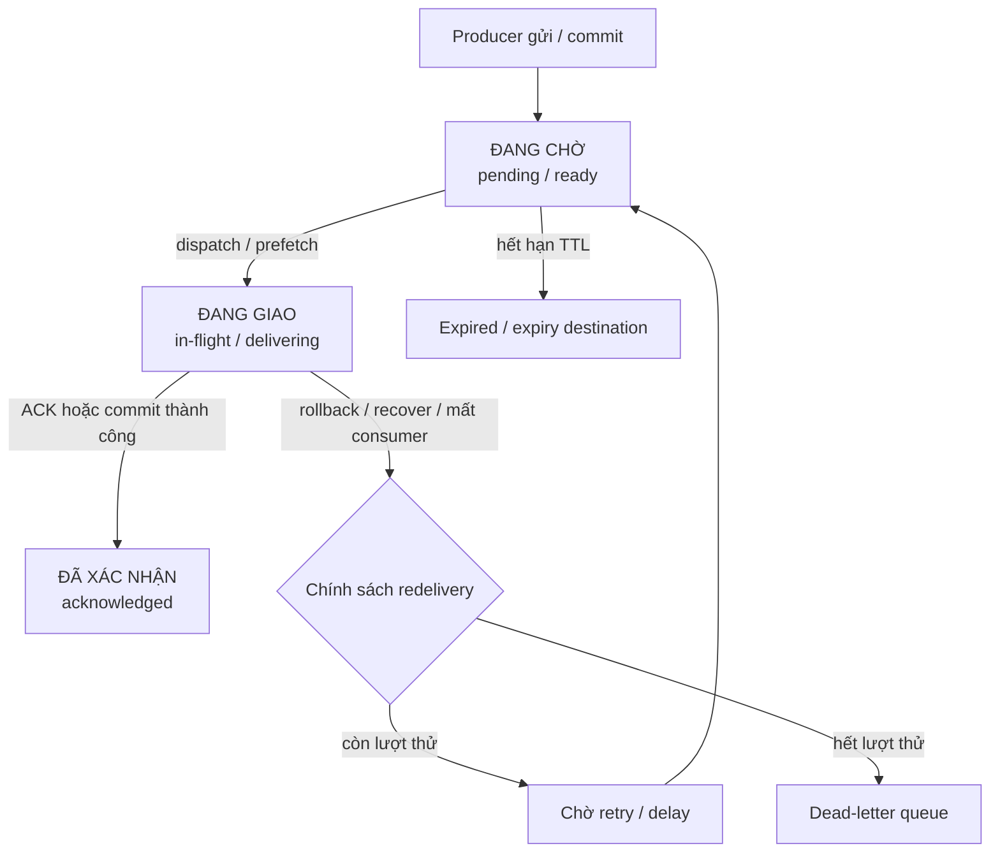
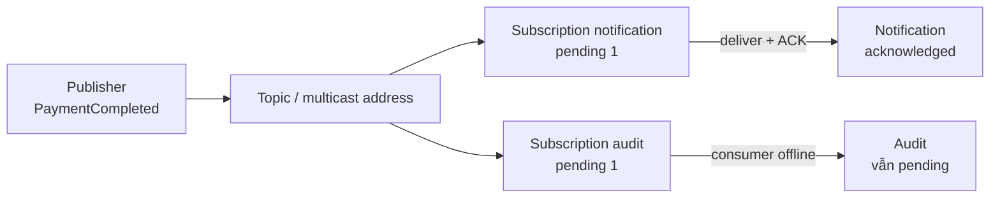
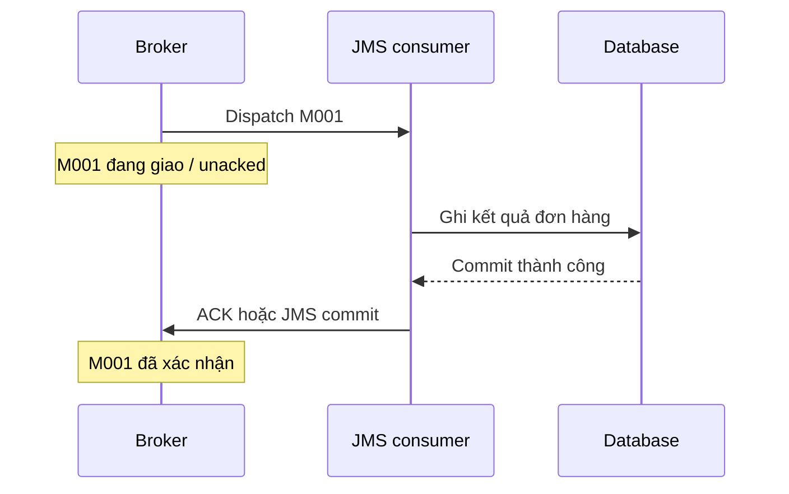

# Phân biệt thông điệp đang chờ, đang giao và đã được xác nhận

> **Chương:** Kiến trúc broker  
> **Phạm vi:** Apache ActiveMQ Classic và ActiveMQ Artemis trong hệ thống bất đồng bộ dùng queue, topic và JMS. Bài học tập trung vào vòng đời message, quy tắc acknowledgment/transaction, redelivery, DLQ và cách đọc số liệu vận hành.

## 1. Vì sao cần phân biệt ba trạng thái?

Hãy xét một hệ thống thanh toán:

1. `order-service` gửi thông điệp `OrderCreated` vào queue `orders.in`.
2. Broker lưu hoặc giữ thông điệp và phân phối cho `payment-worker`.
3. Worker gọi API thanh toán, ghi kết quả vào cơ sở dữ liệu.
4. Worker xác nhận đã nhận/xử lý message để broker có thể kết thúc trách nhiệm phân phối của lần đó.

Giữa các bước có nhiều khả năng: worker đang bận, broker đã đẩy message vào bộ đệm của client nhưng ứng dụng chưa xử lý, API thanh toán lỗi, worker bị tắt giữa chừng hoặc broker chưa nhận được acknowledgment (ACK). Vì vậy, **“producer đã gửi”, “consumer đã nhận” và “message đã được xác nhận” là ba sự kiện khác nhau**.

Nếu không tách chúng ra, người vận hành có thể nhầm rằng queue rỗng nghĩa là toàn bộ đơn hàng đã xử lý xong, hoặc message vẫn tồn tại nghĩa là broker phân phối thất bại. Những kết luận đó có thể sai do cơ chế prefetch, transaction và cách từng broker tính metric.

### Mục tiêu học tập

Sau bài này, bạn có thể:

- Mô tả đúng **đang chờ (pending/ready)**, **đang giao (dispatched/in-flight)** và **đã được xác nhận (acknowledged/committed)**.
- Giải thích mối liên hệ giữa bộ đệm client, acknowledgment, rollback, recover, timeout và redelivery.
- Phân biệt thời điểm broker xử lý ACK với thời điểm nghiệp vụ thực sự hoàn tất.
- Đọc đúng các metric liên quan trong ActiveMQ Classic và Artemis, tránh đánh đồng `queue size`, `delivering` và `dequeue`.
- Thực hành producer/consumer Java JMS với transaction và cố tình rollback để quan sát vòng đời message.

## 2. Mô hình vòng đời cơ bản

Xét **một bản sao logic của message gắn với một queue**. Trong JMS queue thông thường, message thường đi qua các trạng thái:

| Trạng thái | Ý nghĩa ở broker | Consumer nhìn thấy gì? | Có thể chuyển tiếp |
|---|---|---|---|
| **Đang chờ** (*pending / ready / available*) | Message đã được định tuyến đến queue, chưa nằm trong lượt giao chưa xác nhận của consumer | Chưa được client nhận trong lượt giao này | Broker dispatch khi có consumer và credit/prefetch |
| **Đang giao** (*dispatched / in-flight / delivering*) | Broker đã chọn hoặc gửi message cho consumer nhưng còn thiếu acknowledgment/commit hoàn tất | Có thể đã vào bộ đệm client, đang nằm trong `receive()` hoặc đang được xử lý | ACK/commit; rollback/recover; đứt kết nối; retry/DLQ |
| **Đã được xác nhận** (*acknowledged*) | Broker đã áp dụng xác nhận hợp lệ cho lần giao của queue/subscription | Consumer không cần nhận lại message từ queue đó | Message được loại khỏi trách nhiệm phân phối của queue; bộ nhớ/storage có thể được dọn sau |

**Điểm cốt lõi:** ba nhãn trên biểu diễn **trạng thái giao nhận của một queue/subscription**, không bắt buộc là ba giá trị của một enum tồn tại nguyên xi trong tất cả broker.



Sơ đồ là giản lược để học trạng thái. Trên thực tế, message còn có thể ở trạng thái **scheduled**, **delayed redelivery**, **paged to disk**, **expired**, **moved to DLQ** hoặc ở trong transaction chưa commit. Chúng không được gộp vào “đã xác nhận” chỉ vì đã biến mất khỏi danh sách ready.

### 2.1. Trạng thái gắn với queue reference, không nhất thiết gắn với một bản tin toàn cục

Với **queue**, thường có một nhóm competing consumers cùng chia việc từ một queue. Consumer A ACK một message thì message đó hoàn tất đối với queue đó.

Với **topic**, một lần publish có thể được sao chép logic vào nhiều subscription queue:



Một subscriber đã ACK **không** có nghĩa mọi subscriber đã ACK. Trong Artemis, điều này thể hiện rõ qua address dùng multicast và các queue subscription. Trong Classic, có thể quan sát qua destination/topic subscription. Với **non-durable topic subscription**, khi không còn subscriber hoạt động thì broker thường không giữ backlog cho lần đăng ký đã kết thúc; durable subscription giữ tin phù hợp điều kiện của subscription khi consumer ngắt kết nối.

## 3. Đang chờ (*pending*): đã vào queue, chưa được giao trong lượt chưa ACK

Một message có thể đang chờ vì:

- Chưa có consumer khả dụng hoặc consumer bị dừng.
- Consumer đã nhận đủ số message được cho phép theo prefetch/credit.
- Message đang xếp sau message khác; broker dùng selector, priority hoặc chính sách dispatch.
- Message đã được rollback và đang đợi đến lượt giao tiếp theo.

Ví dụ:

```text
Queue orders.in:
  M001 M002 M003 M004 M005

Consumer A: chưa kết nối
Consumer B: chưa kết nối

=> 5 message đang chờ được giao.
```

Sau khi consumer A kết nối, broker có thể dispatch một hoặc nhiều message ngay lập tức. **Không được mặc định consumer chỉ có một message đang giao ở mọi thời điểm.**

### 3.1. “Đang chờ” không đồng nghĩa “nằm trong RAM”

ActiveMQ Classic và Artemis đều có các cơ chế lưu trữ/bộ nhớ và giới hạn tài nguyên. Một message đang chờ có thể đang được giữ trong RAM, nằm trên persistent store hoặc tham gia cơ chế paging. Vị trí vật lý không quyết định một mình trạng thái nghiệp vụ.

Đối với Artemis, cần phân biệt thêm:

- **Ready/available:** message đã đến hạn có thể dispatch.
- **Scheduled:** message được hẹn giờ; chưa đủ điều kiện giao.
- **Delayed redelivery:** message chờ qua khoảng trễ retry sau lỗi.
- **Paged:** một phần dữ liệu message được chuyển ra paging store để quản lý tải; paging không tự đồng nghĩa message đã ACK.

Do đó, “có message trên ổ đĩa” không chứng minh “đang chờ”; một số bản ghi storage vẫn tồn tại cho tới khi quá trình cleanup/compaction chạy.

### 3.2. Producer đã gọi `send()` chưa chắc đã có một message chờ

Cần tách thời điểm **producer gửi**, **broker chấp nhận** và **transaction commit**:

```java
Session session = connection.createSession(
        true, Session.SESSION_TRANSACTED);
Queue queue = session.createQueue("orders.in");

MessageProducer producer = session.createProducer(queue);
producer.setDeliveryMode(DeliveryMode.PERSISTENT);
producer.send(session.createTextMessage("OrderCreated: O-101"));

// Với session transacted, gửi mới chỉ thuộc transaction.
session.commit(); // Giao dịch gửi được commit tại đây.
```

Trước `commit()`, không nên báo cho nghiệp vụ rằng message đã được broker commit bền vững. Ngay cả khi đã commit, **persistent delivery** cũng phải đặt trong ngữ cảnh cấu hình storage, độ bền phần cứng và HA của broker. Không có một lời hứa “không bao giờ mất message” chỉ dựa vào một lệnh `send()`.

## 4. Đang giao (*in-flight*): broker đã dispatch nhưng chưa nhận ACK hợp lệ

Đây là trạng thái dễ nhầm nhất.

Một broker có thể dispatch message cho client JMS theo **prefetch**. Khi đó, message đã rời tập ready của broker nhưng nằm trong **bộ đệm phía client**, chưa chắc callback xử lý nghiệp vụ đã bắt đầu.

Ví dụ consumer A có prefetch 3:

```text
Broker queue:
  Ready: M004, M005, M006

Consumer A (local buffer):
  M001, M002, M003  <-- đã dispatch, chưa ACK

Ứng dụng:
  Đang xử lý M001
  Chưa hề chạy logic cho M002/M003

=> In-flight có thể bằng 3, trong khi nghiệp vụ chỉ đang xử lý 1.
```

Vì vậy:

> **In-flight ≠ số request nghiệp vụ đang chạy.** Nó phản ánh các message đang ở trong vòng giao chưa được xác nhận, bao gồm cả message đã prefetch.

Prefetch/consumer credit, tối ưu dispatch và khả năng xử lý song song đều ảnh hưởng con số này. Client có nhiều session/consumer sẽ khiến tổng in-flight tăng, nhưng không tự làm tăng số message được commit thành công.

### 4.1. Điều gì xảy ra nếu consumer biến mất?

Một message đang giao nhưng chưa được ACK có thể cần được giao lại khi:

- Consumer gọi `session.rollback()` trong session transacted.
- Consumer gọi `session.recover()` trong session không transacted.
- Kết nối/session mất trước khi broker hoàn tất acknowledgment.
- Transaction thất bại hoặc bị hủy.
- Broker phát hiện consumer không còn hợp lệ.

Broker sẽ đưa message vào luồng **redelivery** theo chính sách. Nó có thể lập tức sẵn sàng, chờ delay rồi thử lại, hoặc đi tới DLQ nếu vượt số lần giao cho phép.

**Không mặc định message quay lại ngay vị trí đầu queue** hay cùng consumer sẽ nhận lại. Thứ tự có thể thay đổi khi có nhiều consumer, priority, prefetch, selector và retry delay.

### 4.2. Redelivery khác với producer gửi một message mới

Khi broker redeliver, message cũ được gửi lại do lần giao trước chưa hoàn tất; nó không nhất thiết tương ứng một lần `producer.send()` mới. Vì vậy, các metric **dispatch/delivery** có thể tăng trong khi tổng số message producer gửi không tăng.

Ngược lại, nếu producer không chắc lần gửi trước đã thành công sau sự cố mạng và tự gửi lại, **hai message vật lý khác nhau** có thể cùng biểu diễn một `eventId` nghiệp vụ. Hệ thống cần khóa idempotency hoặc cơ chế phát hiện trùng lặp ở mức business key.

## 5. Đã được xác nhận (*acknowledged*): kết thúc nghĩa vụ giao của lượt nhận

ACK là tín hiệu từ client/JMS session để broker biết message đã được nhận/xử lý theo **điều kiện acknowledgment mode hoặc transaction**.

Với queue, sau khi ACK có hiệu lực:

- Broker không còn cần giao tiếp message đó cho consumer khác trong queue.
- Trạng thái số message **outstanding** của queue giảm.
- Bộ đếm acknowledged/dequeued có thể tăng, theo định nghĩa của broker và metric cụ thể.
- Dữ liệu vật lý có thể được xóa/dọn bất đồng bộ; **“đã ACK” là trạng thái logic**, không đồng nhất với mọi byte đã xóa khỏi storage.

Cần phân biệt **ACK của JMS** và **xác nhận nghiệp vụ**. Broker chỉ biết một cơ chế xác nhận giao nhận; nó không tự xác minh lệnh chuyển khoản đã được ghi đúng, email đã gửi hay database đã commit.



Trong khoảng giữa database commit và broker ACK, nếu consumer gặp lỗi, broker có thể phát lại M001. Đây là lý do các handler giao dịch quan trọng cần **idempotency** hoặc **transactional outbox/inbox**, chứ không chỉ dựa vào cờ `JMSRedelivered`.

### 5.1. Các acknowledgment mode của JMS

| Cách tạo session | Khi nào/như thế nào xác nhận | Rủi ro và cách dùng |
|---|---|---|
| `AUTO_ACKNOWLEDGE` | Provider tự xác nhận khi `receive()` kết thúc thành công hoặc callback listener hoàn thành thành công theo JMS semantics | Với `receive()`, nghiệp vụ xử lý sau khi hàm trả về nên có thể thất bại **sau khi đã ACK** |
| `CLIENT_ACKNOWLEDGE` | Ứng dụng gọi `message.acknowledge()` | Trong JMS session thông thường, lời gọi ACK xác nhận **toàn bộ các message đã được consume trong session** đến thời điểm đó; không phải ACK riêng đúng một message |
| `DUPS_OK_ACKNOWLEDGE` | Provider được phép xác nhận theo lô/chậm | Có thể gặp giao lặp trong trường hợp failure; không thích hợp nếu ứng dụng suy diễn exactly-once |
| `SESSION_TRANSACTED` | Gọi `session.commit()` để commit nhận/gửi; `rollback()` để hủy transaction | Phù hợp kiểm soát ranh giới xử lý message; không tự làm transaction database và JMS thành một giao dịch chung |

**Ví dụ bẫy của `CLIENT_ACKNOWLEDGE`:**

```java
Session session = connection.createSession(
        false, Session.CLIENT_ACKNOWLEDGE);
Queue queue = session.createQueue("orders.in");
MessageConsumer consumer = session.createConsumer(queue);

Message first = consumer.receive(5_000);
Message second = consumer.receive(5_000);

if (second != null) {
    // Theo semantics CLIENT_ACKNOWLEDGE của JMS session,
    // xác nhận cả first (nếu đã consume) và second.
    second.acknowledge();
}
```

Nếu ứng dụng muốn xác nhận độc lập từng nghiệp vụ, thiết kế số session/transaction phù hợp; không giả định gọi `acknowledge()` trên một instance chỉ xác nhận instance đó.

### 5.2. Consumer transaction và thời điểm thật sự rời queue

```java
Session session = connection.createSession(
        true, Session.SESSION_TRANSACTED);
Queue queue = session.createQueue("orders.in");
MessageConsumer consumer = session.createConsumer(queue);

Message message = consumer.receive(5_000);
if (message != null) {
    try {
        processOrder(message); // Logic nghiệp vụ của ứng dụng
        session.commit();      // Broker xử lý commit receive.
    } catch (Exception failure) {
        session.rollback();    // Message có thể được giao lại.
    }
}
```

Ở đây, lời gọi `processOrder` là pseudocode. Nếu nó ghi database qua một transaction riêng thì **JMS commit và DB commit không nguyên tử**. Ứng dụng phải xử lý tình huống database commit rồi JMS rollback, hoặc cân nhắc XA khi hệ thống thực sự yêu cầu và các thành phần đều hỗ trợ.

## 6. Thực hành Java: nhìn thấy chuyển trạng thái và redelivery

Thí nghiệm này dùng **ActiveMQ Classic JMS client** qua OpenWire, có thể chạy với ActiveMQ Classic hoặc Artemis có cấu hình OpenWire acceptor và quyền tạo/ghi/đọc queue. Chọn broker thử nghiệm không có consumer khác tranh cùng queue.

### 6.1. Dependency Maven

```xml
<dependencies>
  <dependency>
    <groupId>org.apache.activemq</groupId>
    <artifactId>activemq-client</artifactId>
    <version>5.18.5</version>
  </dependency>
</dependencies>
```

Đây là phiên bản minh họa; trong dự án thực tế dùng dependency được phê duyệt theo Java/JMS version và ma trận hỗ trợ. `activemq-client` 5.x sử dụng các kiểu `javax.jms` trong ví dụ.

### 6.2. Chương trình hoàn chỉnh

Tạo `MessageLifecycleDemo.java`:

```java
import java.util.UUID;
import javax.jms.Connection;
import javax.jms.DeliveryMode;
import javax.jms.JMSException;
import javax.jms.Message;
import javax.jms.MessageConsumer;
import javax.jms.MessageProducer;
import javax.jms.Queue;
import javax.jms.Session;
import javax.jms.TextMessage;

import org.apache.activemq.ActiveMQConnectionFactory;

public final class MessageLifecycleDemo {
    public static void main(String[] args) throws JMSException {
        String brokerUrl = args.length > 0
                ? args[0]
                : "tcp://localhost:61616?jms.prefetchPolicy.queuePrefetch=1";

        ActiveMQConnectionFactory factory =
                new ActiveMQConnectionFactory(brokerUrl);

        String username = System.getenv("BROKER_USER");
        String password = System.getenv("BROKER_PASSWORD");

        Connection connection = username == null || username.isEmpty()
                ? factory.createConnection()
                : factory.createConnection(username, password);

        try {
            // Đặt prefetch = 1 trong URL để dễ quan sát một message.
            Session sender = connection.createSession(
                    true, Session.SESSION_TRANSACTED);
            Session receiver = connection.createSession(
                    true, Session.SESSION_TRANSACTED);

            try {
                // Tên queue riêng để tránh dữ liệu từ các lần chạy trước.
                String queueName = "demo.lifecycle."
                        + UUID.randomUUID().toString();
                Queue sendQueue = sender.createQueue(queueName);
                Queue receiveQueue = receiver.createQueue(queueName);

                MessageProducer producer = sender.createProducer(sendQueue);
                producer.setDeliveryMode(DeliveryMode.PERSISTENT);

                TextMessage outgoing =
                        sender.createTextMessage("OrderCreated: O-123");
                outgoing.setStringProperty("eventId", "evt-123");

                producer.send(outgoing);
                sender.commit();
                System.out.println("1. SEND COMMIT: message đã vào queue.");

                MessageConsumer consumer =
                        receiver.createConsumer(receiveQueue);
                connection.start();

                Message first = consumer.receive(15_000L);
                if (first == null) {
                    throw new IllegalStateException(
                            "Không nhận được message lần đầu");
                }

                logDelivery("2. FIRST RECEIVE", first);
                receiver.rollback();
                System.out.println("3. ROLLBACK: chưa ACK, cần redelivery.");

                Message second = consumer.receive(15_000L);
                if (second == null) {
                    throw new IllegalStateException(
                            "Không nhận được message sau rollback");
                }

                logDelivery("4. SECOND RECEIVE", second);
                receiver.commit();
                System.out.println("5. RECEIVE COMMIT: đã ACK.");

                Message third = consumer.receive(1_000L);
                System.out.println("6. QUEUE EMPTY FOR TEST: "
                        + (third == null));

                consumer.close();
                producer.close();
            } finally {
                try {
                    sender.close();
                } finally {
                    receiver.close();
                }
            }
        } finally {
            connection.close();
        }
    }

    private static void logDelivery(String stage, Message message)
            throws JMSException {
        int deliveryCount = message.propertyExists("JMSXDeliveryCount")
                ? message.getIntProperty("JMSXDeliveryCount")
                : -1;

        System.out.printf(
                "%s: id=%s, eventId=%s, redelivered=%s, count=%s%n",
                stage,
                message.getJMSMessageID(),
                message.getStringProperty("eventId"),
                message.getJMSRedelivered(),
                deliveryCount < 0 ? "n/a" : deliveryCount);
    }
}
```

Chạy với broker Classic mặc định (hoặc truyền URL Artemis OpenWire tương ứng):

```bash
java -cp "target/classes:target/dependency/*" \
    MessageLifecycleDemo "tcp://localhost:61616?jms.prefetchPolicy.queuePrefetch=1"
```

Lệnh trên minh họa **classpath kiểu Unix** khi các dependency đã được sao chép vào `target/dependency`; trên Windows dùng dấu `;` phân cách classpath, hoặc chạy trực tiếp bằng Maven Exec Plugin nếu dự án đã cấu hình. Chương trình yêu cầu broker đang chạy, cho phép tạo queue theo quyền được cấp.

**Diễn biến mong đợi:**

| Bước | Trạng thái message | Hành động cần quan sát |
|---|---|---|
| `sender.commit()` | Ready/pending (nếu chưa có consumer) | Queue nhận 1 message persistent |
| `receiver.receive()` | In-flight, chưa xác nhận | Broker có lượt dispatch chưa ACK |
| `receiver.rollback()` | Không ACK; đi vào retry/redelivery | Broker cần giao lại theo policy |
| `receiver.receive()` lần 2 | In-flight lần tiếp theo | Thường `JMSRedelivered=true`; `JMSXDeliveryCount` có thể tăng nếu provider hỗ trợ |
| `receiver.commit()` | Acknowledged | Message không còn cần được giao từ queue thử nghiệm |
| `receive()` lần 3 trả `null` | Queue không còn message để giao trong cửa sổ kiểm tra | Chỉ chứng minh đối với queue riêng của thí nghiệm |

**Cảnh báo đo đạc:** `JMSXDeliveryCount` là header/property liên quan lần giao mà mức hỗ trợ có thể khác giữa client/broker; không tự dùng nó làm chuẩn duy nhất cho kết luận dữ liệu đã được xử lý chính xác. Khi không có thuộc tính, ví dụ in `n/a`.

Không nên biến bước cuối thành khẳng định broker đã ngay lập tức xóa sạch mọi record trên đĩa. Nó chỉ thể hiện không còn message sẵn sàng được nhận ở thời điểm đó.

### 6.3. Bài tập nâng cao: cố tình để consumer chết trước ACK

Sửa chương trình để chỉ gửi một lần, lưu lại tên queue cố định phục vụ bài thực hành và **đóng kết nối hoặc dừng tiến trình sau khi nhận nhưng trước khi commit**. Chạy một consumer mới để nhận lại message. Cần theo dõi broker và log:

- Message đã dispatch bao nhiêu lần?
- Nó được giao lại ngay hay chậm một khoảng?
- `JMSRedelivered` có được đánh dấu?
- Nếu nhiều consumer, consumer mới có được chọn không?
- Khi bật giới hạn retry, message đi đâu sau nhiều lần rollback?

Trên môi trường production, chỉ thực hiện failure injection bằng queue và data giả lập.

## 7. Đọc metric trong ActiveMQ Classic và Artemis

### 7.1. ActiveMQ Classic

Classic thường cung cấp các bộ đếm qua JMX, Web Console và công cụ monitoring:

| Metric thường gặp | Cách diễn giải | Cần tránh nhầm |
|---|---|---|
| `QueueSize` | Độ sâu destination/queue theo định nghĩa của Classic | Không mặc định hoàn toàn trùng số pending-ready hoặc bao gồm mọi in-flight ở mọi phiên bản |
| `InFlightCount` | Số message đã dispatch nhưng đang đợi acknowledgment | Có thể bao gồm message nằm trong prefetch buffer |
| `DispatchCount` | Tổng số lượt dispatch | Có thể tăng khi redelivery, không phải số message nghiệp vụ duy nhất |
| `DequeueCount` | Số message đã rời queue theo cơ chế dequeue/ack | Không được đồng nhất với số nghiệp vụ thành công trong DB |
| `EnqueueCount` | Tổng lượt enqueue vào destination | Không phản ánh trực tiếp số message còn tồn |
| `ConsumerCount` | Số consumer hiện có | Không nói lên consumer đang xử lý được bao nhiêu message/giây |

**Quan trọng:** Các MBean/metric có thể được tổng hợp hoặc định nghĩa khác nhau tùy phiên bản và loại destination. Để kết luận chính xác, nên so khớp số liệu với bài kiểm thử có xác định message ID, kiểm tra broker version và documentation tương ứng.

### 7.2. ActiveMQ Artemis

Artemis quản lý message theo **address/queue** và cung cấp qua management API/JMX/console:

| Queue metric thường gặp | Ý nghĩa thực dụng |
|---|---|
| `MessageCount` | Tổng số message thuộc queue theo định nghĩa management của Artemis; khi vận hành cần kiểm tra thành phần delivering/scheduled có được tính trong phiên bản đang chạy |
| `DeliveringCount` | Số message đang được delivery, chưa hoàn tất acknowledgment của queue |
| `MessagesAdded` | Bộ đếm message được thêm vào queue |
| `MessagesAcknowledged` | Bộ đếm message được acknowledgment |
| `ScheduledCount` | Message đang được lập lịch, chưa tới hạn giao |
| `ConsumerCount` | Số consumer kết nối với queue |

Đừng xây công thức chung kiểu **`pending = MessageCount - DeliveringCount`** rồi áp dụng cho mọi dashboard, vì `MessageCount`, scheduled messages, paging, expiry, DLQ và thống kê của client có phạm vi định nghĩa khác nhau. Phép trừ chỉ có ý nghĩa khi **đã xác minh rõ** metric tổng chứa đúng tập in-flight cần trừ, không bị trùng và cùng thời điểm lấy mẫu.

### 7.3. Ví dụ số liệu có thể giải thích đúng

Giả sử quan sát 10 message riêng biệt đi vào một queue thử nghiệm trong một khoảng ngắn:

- 10 message đã được broker tiếp nhận/commit.
- 4 message được dispatch tới consumer.
- Trong 4 message đó, 3 message đã nhận ACK/commit; 1 message vẫn chưa ACK.
- 6 message chưa được dispatch.

Ở **mô hình logic đơn giản, không có retry/TTL/DLQ**, kết quả là:

| Nhóm | Số lượng |
|---|---:|
| Đang chờ sẵn sàng | 6 |
| Đang giao, chờ ACK | 1 |
| Đã ACK | 3 |
| Tổng message từng được gửi thành công | 10 |
| Tổng message chưa hoàn tất tại queue | 7 |

Không có lý do gì để diễn giải “đã dispatch 4” thành “đã xử lý xong 4”. Cũng không nên lấy bảng logic này làm định nghĩa mặc định của tất cả metric có tên `QueueSize` hoặc `MessageCount`.

### 7.4. Công thức giám sát nên dùng đúng ngữ cảnh

**Mức logic đối với một queue và một khoảng thử không có expiry/DLQ/rollback:**

\[
N_{\text{accepted}} = N_{\text{ready}} + N_{\text{in-flight}} + N_{\text{acknowledged}}
\]

**Khi có retry, expiration, DLQ, subscription và nhiều snapshot**, công thức này không đủ vì các event khác nhau có thể tăng bộ đếm dispatch nhiều lần và message có thể rời queue theo nhiều lý do. Muốn dựng luồng đối soát đáng tin cậy, hãy lưu `eventId` và phân nhóm kết quả nghiệp vụ theo **ID duy nhất**, đồng thời đối chiếu các event `sent / delivered / committed / moved-to-DLQ / expired`.

Để đo **tốc độ ACK**, có thể lấy chênh lệch của một counter acknowledgment tăng dần trong hai lần lấy mẫu:

\[
\text{ACK rate} \approx \frac{\Delta \text{AcknowledgedCount}}{\Delta t}
\]

Nhưng phải chắc counter không vừa reset khi broker restart và phép đo không trộn queue khác hoặc một loại dequeue khác.

## 8. Khi acknowledgment thất bại: redelivery, DLQ và timeout

Hãy xét một payment consumer:

```text
M101 -> dispatch -> xử lý thất bại -> rollback
     -> chờ retry 1 giây -> dispatch lại
     -> xử lý thất bại -> rollback
     -> chờ retry 2 giây -> dispatch lại
     -> vượt giới hạn -> chuyển sang DLQ
```

**DLQ không phải trạng thái “ACK thành công”.** Message rời khỏi queue nguồn theo chính sách dead-letter vì không thể xử lý sau một số lần thử; một queue DLQ khác vẫn giữ message chờ điều tra hoặc phát lại thủ công.

### 8.1. Ví dụ cấu hình Artemis

Trong `broker.xml`, có thể định nghĩa riêng address/queue DLQ và retry policy:

```xml
<address-settings>
  <address-setting match="orders.in">
    <redelivery-delay>1000</redelivery-delay>
    <redelivery-delay-multiplier>2.0</redelivery-delay-multiplier>
    <max-redelivery-delay>10000</max-redelivery-delay>
    <max-delivery-attempts>3</max-delivery-attempts>
    <dead-letter-address>DLQ</dead-letter-address>
  </address-setting>
</address-settings>

<addresses>
  <address name="orders.in">
    <anycast>
      <queue name="orders.in"/>
    </anycast>
  </address>
  <address name="DLQ">
    <anycast>
      <queue name="DLQ"/>
    </anycast>
  </address>
</addresses>
```

Đây là **hai phần cấu hình cần đặt vào đúng phần tử cha tương ứng** của `broker.xml`. Trong ví dụ, queue `orders.in` nhận message nghiệp vụ và queue `DLQ` nhận message quá số lần giao theo policy. Hệ thống thực tế có thể dùng dead-letter address/queue riêng cho từng nhóm nghiệp vụ, nhưng phải xác định rõ naming, quyền đọc, khả năng quan sát và cách redrive.

Các mục cần kiểm thử:

1. Một message lỗi được giao lại bao nhiêu lần (kể cả lượt đầu)?
2. Thời gian giữa các lần giao có đúng policy?
3. Khi hết số lần thử, message biến mất khỏi queue nguồn và xuất hiện đúng queue DLQ chưa?
4. Message có giữ được business key, lý do lỗi và đủ dữ liệu để xử lý lại không?
5. Nếu worker restart, bộ đếm delivery có được duy trì theo cấu hình và phiên bản đang dùng không?

Classic có chính sách redelivery và dead-letter riêng, có thể phụ thuộc vào client/`RedeliveryPolicy` và `deadLetterStrategy`. Không sao chép XML Artemis sang Classic hoặc giả định cùng một tham số có hiệu lực giống nhau.

### 8.2. “Timeout” nào có thể dẫn tới phát lại?

Cần phân biệt:

- **Timeout chờ nhận**: `consumer.receive(5000)` trả `null` nếu không có message; không có nghĩa một message đã giao bị rollback.
- **Timeout nghiệp vụ**: lời gọi HTTP/DB của consumer hết giờ; chỉ khi ứng dụng rollback/recover/để session mất thì nó mới ảnh hưởng acknowledgment.
- **Phát hiện connection bị hỏng**: broker/client nhận biết kết nối không hợp lệ qua cơ chế transport/heartbeat và quản lý lại lượt giao.
- **Transaction timeout** (nếu được quản lý): một transaction có thể bị hủy, kéo theo redelivery theo policy.

Nếu chỉ thấy log “timeout” mà không biết nó thuộc loại nào thì chưa thể kết luận trạng thái message đã thay đổi.

## 9. Thiết kế xử lý nghiệp vụ để trạng thái đáng tin

### 9.1. Tình huống một: ACK quá sớm dẫn tới mất cơ hội retry

Một consumer đồng bộ có thể viết:

```java
Session s = connection.createSession(
        false, Session.AUTO_ACKNOWLEDGE);
Message m = consumer.receive(5_000L);

// Nếu receive trả thành công, ACK tự động có thể đã hoàn tất.
// Bước sau mới gọi database:
savePaymentToDatabase(m); // Có thể lỗi, nhưng broker không còn retry.
```

Ví dụ này diễn giải **thứ tự nghiệp vụ** và giả định `consumer` đã được tạo từ `s`. Nếu có rủi ro lỗi sau khi nhận, ưu tiên chiến lược ack/transaction gắn với thời điểm handler hoàn tất và có cơ chế khôi phục/idempotency.

### 9.2. Tình huống hai: DB commit xong nhưng broker chưa nhận ACK

```text
Broker dispatch M501
  -> Worker ghi DB, COMMIT DB thành công
  -> Worker crash trước JMS COMMIT
  -> Broker redeliver M501
  -> Worker khác thấy M501 lần nữa
```

Nếu handler thực hiện lại một khoản thanh toán không kiểm tra trùng, nguy cơ bị tính tiền hai lần. Giải pháp thông dụng:

1. Gắn `eventId` hoặc transaction ID duy nhất và ổn định.
2. Lưu dấu đã xử lý bằng unique constraint/index trong DB; đặt thay đổi nghiệp vụ và cập nhật trạng thái inbox trong **cùng DB transaction**.
3. Nếu `eventId` đã được ghi nhận thành công, bỏ qua side effect và ACK JMS cho lần giao hiện tại.
4. Theo dõi DLQ và chủ động redrive có kiểm soát; không replay mù các message có side effect.

Một kiểu triển khai inbox đơn giản:

```sql
CREATE TABLE processed_events (
    event_id VARCHAR(128) PRIMARY KEY,
    processed_at TIMESTAMP NOT NULL
);
```

Trong DB transaction, handler chèn `event_id` duy nhất và chỉ áp dụng side effect nếu chèn thành công. **Đây là phác thảo nguyên tắc**, cần xử lý isolation/concurrency, duplicate-key và tương tác với hệ thống ngoài như payment gateway tùy use case.

### 9.3. Tình huống ba: topic có nhiều subscription khác trạng thái

```text
Topic = orders.events

Subscription billing:
  Event E1 -> ACK

Subscription analytics:
  Event E1 -> IN-FLIGHT, chưa ACK

Subscription audit (durable, offline):
  Event E1 -> PENDING
```

Một dashboard chỉ xem subscription billing sẽ đưa ra kết luận thiếu về “toàn bộ topic đã xử lý”. Khi đánh giá pub/sub, **monitor từng subscription queue**, không chỉ address/topic tổng.

### 9.4. Tình huống bốn: queue depth thấp nhưng độ trễ vẫn cao

Nếu consumer có prefetch lớn, broker đã dispatch nhiều message vào client buffer. Queue ready giảm, nhưng message chờ trong local buffer và chưa được xử lý nghiệp vụ. Cần đồng thời quan sát:

- ready/pending;
- delivering/in-flight;
- tốc độ ACK hoặc dequeue;
- thời gian xử lý thực tế của handler;
- tuổi của message lâu nhất và tốc độ tăng backlog;
- số consumer và prefetch/credit;
- redelivery, DLQ, scheduled và paging.

Một metric riêng lẻ không cho thấy toàn bộ bức tranh.

## 10. Checklist chẩn đoán theo triệu chứng

| Triệu chứng | Khả năng liên quan đến trạng thái | Kiểm tra tiếp |
|---|---|---|
| Queue ready tăng liên tục | Message đến nhanh hơn khả năng dispatch/consume | Consumer count, filter/selector, flow control, lỗi connect, throughput |
| Ready thấp nhưng in-flight cao | Message đã dispatch, nằm ở buffer hoặc handler chậm | Prefetch, xử lý DB/HTTP, transaction chưa commit |
| Dispatch tăng nhanh, ACK tăng ít | Retry hoặc consumer không xác nhận | Rollback/error logs, dead-letter policy, processing time |
| Message lặp lại sau restart | Lượt giao trước chưa được commit/ACK hoặc producer gửi lại | `JMSRedelivered`, `eventId`, log commit, connection failover |
| Queue nguồn giảm nhưng nghiệp vụ chưa thành công | Có thể ACK quá sớm, expiry hoặc chuyển sang DLQ | ACK mode, DLQ, expiry address, application audit |
| Topic có subscriber nhận, subscriber khác không | Mỗi subscription có queue/vòng đời riêng | Durable subscription, selector, online/offline, multicast routing |
| Broker hiển thị message count khác phép trừ thủ công | Metric có phạm vi khác nhau; scheduled/paging và snapshot cạnh tranh | Tài liệu version, JMX/management definition, snapshot cùng thời điểm |

## 11. Bài thực hành quan sát có cấu trúc

Thiết lập một queue `demo.states`, một producer và một consumer, rồi thực hiện từng kịch bản. Lưu `eventId` cho mỗi message và ghi snapshot quản trị trước/sau từng bước.

| Kịch bản | Kết quả trạng thái cần chứng minh |
|---|---|
| Gửi 5 message, chưa chạy consumer | Các message đang chờ, chưa có ACK từ consumer |
| Khởi động một consumer, prefetch 1, nhận nhưng không ACK | Một message chuyển sang in-flight; các message khác chờ |
| Rollback message đang giao | Message không hoàn tất; broker lên lịch hoặc thực hiện redelivery |
| Receive lại và commit | Message được ACK; không nhận lại từ queue đó trong điều kiện bình thường |
| Đóng kết nối trước khi ACK | Lượt giao chưa xác nhận phải được xử lý lại theo chính sách và tình trạng broker |
| Chạy hai consumer với prefetch lớn | Có thể có nhiều in-flight hơn số handler đang thực thi thực tế |
| Dùng message lỗi luôn rollback đến ngưỡng DLQ | Message rời queue nguồn, xuất hiện trong DLQ; không được gọi là xử lý nghiệp vụ thành công |
| Durable topic có hai subscription, một offline | Một subscription đã ACK trong khi subscription khác vẫn giữ backlog |

**Cách ghi kết quả:** với mỗi `eventId`, lưu thời điểm publish, dispatch, xử lý nghiệp vụ, rollback/commit, redelivery, chuyển DLQ và tên consumer. So sánh event log với metric broker để hiểu chính xác định nghĩa metric trong môi trường của mình.

## 12. Những ngộ nhận cần loại bỏ

**“Producer `send()` xong nghĩa là consumer đã xử lý.”** Không đúng: message có thể mới nằm ở queue, hoặc transaction gửi còn chưa commit.

**“Queue ready = 0 nghĩa là mọi message đã ACK.”** Không đúng: nhiều message có thể đang in-flight, scheduled, expired hoặc đã vào DLQ.

**“Broker dispatch nghĩa là callback `onMessage` đã chạy.”** Không đúng: message có thể vẫn nằm trong prefetch buffer.

**“ACK chắc chắn chứng minh database đã commit.”** Không đúng: JMS không tự biết kết quả nghiệp vụ bên ngoài broker.

**“Rollback sẽ luôn lập tức giao lại cho cùng consumer.”** Không đúng: phụ thuộc policy, delay, topology, session, prefetch và lựa chọn consumer.

**“Message đã ACK thì mọi byte trên ổ đĩa biến mất tức thì.”** Không đúng: trách nhiệm giao nhận được kết thúc về mặt logic; việc tái sử dụng/xóa storage có thể diễn ra sau đó.

**“Cùng metric name ở Classic và Artemis là cùng công thức.”** Không nên giả định; cần kiểm tra chính xác broker version, phạm vi queue và ý nghĩa mỗi counter.

## 13. Câu hỏi tự kiểm tra

1. Khi `QueueSize` giảm và `InFlightCount` tăng, có thể kết luận đơn hàng đã thanh toán xong chưa? Vì sao?
2. Với một session `CLIENT_ACKNOWLEDGE` đã nhận hai message, `acknowledge()` trên message thứ hai có ý nghĩa gì?
3. Vì sao một producer commit thành công và một consumer có `JMSRedelivered=false` vẫn chưa đủ để khẳng định “exactly once business processing”?
4. Với topic có ba durable subscriber, một subscriber đã ACK và hai subscriber offline, hãy mô tả trạng thái message tương ứng cho từng subscription.
5. Consumer update DB thành công rồi crash trước JMS commit. Bạn sẽ sử dụng `eventId`, unique constraint và logic ACK thế nào để tránh tác dụng phụ lặp lại?
6. Hãy thiết kế một bảng giám sát dùng cả ready, delivering, ACK rate, DLQ và tuổi message để phát hiện consumer nghẽn.

## 14. Tài liệu tham khảo chính thức

- [Jakarta Messaging Specification](https://jakarta.ee/specifications/messaging/) — semantics của message delivery, acknowledgment và session transaction; đối chiếu phiên bản API đang dùng (`javax.jms` hay `jakarta.jms`).
- [ActiveMQ Classic – What is the prefetch limit for?](https://activemq.apache.org/components/classic/documentation/what-is-the-prefetch-limit-for) — cơ chế prefetch và message đã dispatch.
- [ActiveMQ Classic – Redelivery Policy](https://activemq.apache.org/components/classic/documentation/message-redelivery-and-dlq-handling) — redelivery, poison ACK và DLQ.
- [ActiveMQ Classic – JMX](https://activemq.apache.org/components/classic/documentation/jmx) — quản trị destination và queue metrics.
- [ActiveMQ Artemis – Address Model](https://artemis.apache.org/components/artemis/documentation/latest/address-model.html) — address, anycast, multicast và subscription queue.
- [ActiveMQ Artemis – Message Redelivery and Undelivered Messages](https://artemis.apache.org/components/artemis/documentation/latest/undelivered-messages.html) — rollback, redelivery delay, delivery count và DLQ.
- [ActiveMQ Artemis – Management](https://artemis.apache.org/components/artemis/documentation/latest/management.html) — quan sát queue, management API và counters.

**Ghi nhớ:** Đang chờ là **message chưa được phân phối trong một lượt giao chưa ACK**; đang giao là **đã dispatch nhưng broker chưa hoàn tất xác nhận**; đã ACK là **lượt nhận đã được xác nhận theo JMS/transaction**. Khi đánh giá sức khỏe hệ thống, luôn kết hợp trạng thái broker với kết quả nghiệp vụ, từng subscription và chính sách retry/DLQ.
