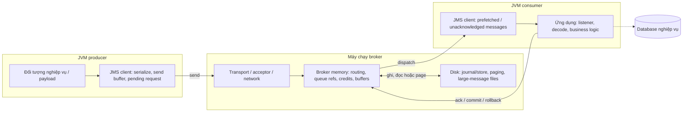
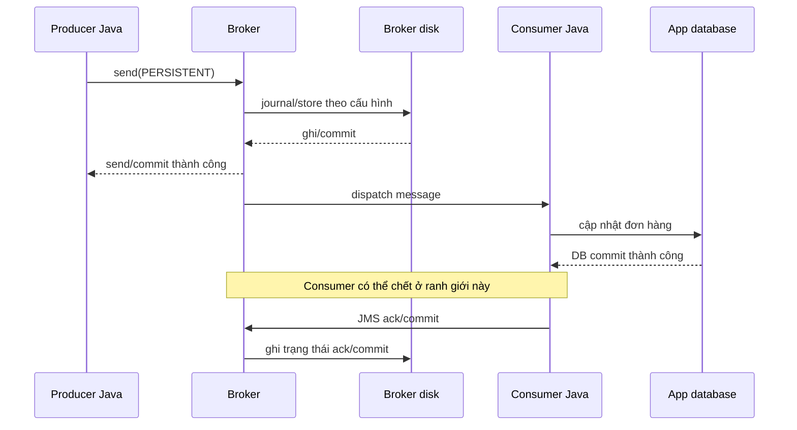
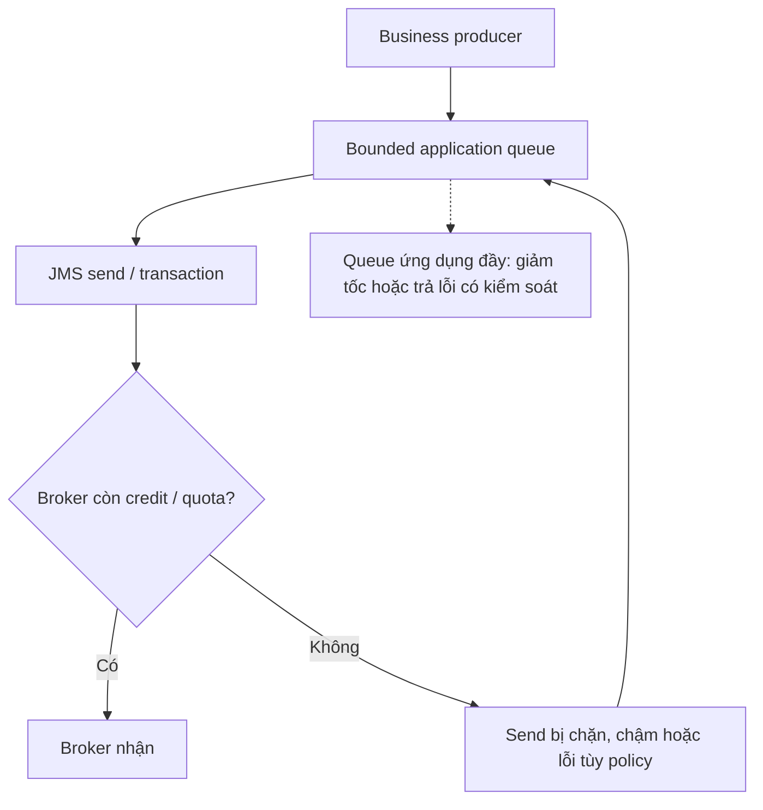
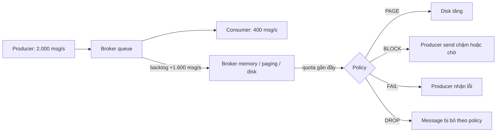

# Ranh giới giữa bộ nhớ broker, bộ nhớ client và dữ liệu trên đĩa

> **Chương:** Kiến trúc broker  
> **Phạm vi:** Apache ActiveMQ Classic và Apache Artemis trong hệ thống Java/JMS; phân biệt bộ nhớ broker, bộ đệm producer/consumer, journal/message store, paging và dữ liệu nghiệp vụ. Bài học kết nối kiến trúc lưu trữ với acknowledgment, transaction, redelivery, DLQ, bảo mật và vận hành.

## 1. Vì sao phải hiểu ba ranh giới lưu trữ?

Một tình huống thường gặp: ứng dụng Java gửi 100.000 message vào queue, dashboard của broker báo lượng heap còn thấp, consumer ngừng xử lý và ổ đĩa broker tiếp tục tăng. Đội vận hành tăng JVM heap nhưng vài giờ sau lại gặp sự cố. Vấn đề không nhất thiết nằm ở “broker thiếu RAM”: message có thể đang nằm ở **client producer**, **broker memory**, **broker disk**, **client consumer**, hoặc đã được consumer xử lý nhưng chưa **acknowledge**.

Bài này giúp trả lời sáu câu hỏi kỹ thuật:

1. Message đang nằm ở đâu trong từng giai đoạn gửi, phân phối và xác nhận?
2. Khi nào một message được lưu trên đĩa, và ghi đĩa có đồng nghĩa với giao nhận thành công không?
3. Vì sao queue chậm có thể làm heap **producer** hoặc **consumer** phình to ngay cả khi heap broker bình thường?
4. Khi queue đầy hoặc broker hết tài nguyên, backpressure đi ngược về phía producer như thế nào?
5. Classic và Artemis kiểm soát memory, store, paging và prefetch khác nhau ở đâu?
6. Nên đo chỉ số, đặt giới hạn và diễn tập sự cố ra sao để hạn chế mất/lặp message?

**Nguyên tắc cốt lõi:** đây là các **vùng trách nhiệm khác nhau**, không phải ba vị trí vật lý loại trừ nhau. Cùng một message có thể đồng thời có bản sao trong RAM producer, trên đường mạng, trong cấu trúc broker và trên đĩa. Một khi broker đã gửi tới consumer, việc xuất hiện trong bộ nhớ client cũng **chưa** có nghĩa message đã được xử lý thành công.

## 2. Bức tranh tổng thể: producer → broker → consumer



Nhìn sơ đồ cần phân biệt thêm hai thành phần:

- **Bộ nhớ của hệ điều hành**: socket buffers, page cache, bộ nhớ native/direct, thread stacks và metadata JVM. Chúng không hiện đầy đủ trong biểu đồ Java heap nhưng vẫn tính vào giới hạn RAM/container.
- **Đĩa của ứng dụng**: database nghiệp vụ, transactional outbox hay cache tự triển khai nằm ngoài broker. JMS client thông thường **không biến bộ đệm producer thành hàng đợi bền vững trên đĩa của ứng dụng** một cách mặc định.

### 2.1. Các vùng trách nhiệm

| Vùng | Thường chứa gì | Ai quản lý? | Điều gì xảy ra khi process chết? |
|---|---|---|---|
| Heap Java producer | Message object, JSON/string/byte array, callback, collection chờ gửi | Ứng dụng và JMS provider client | Dữ liệu chưa được broker chấp nhận có thể mất; tùy giao thức, send timeout có thể không cho biết broker đã nhận hay chưa |
| Buffer/network producer | Bytes đã serialize, request chờ phản hồi, TCP send buffer | JMS client, runtime, OS | Chưa có cam kết bền vững nếu chỉ nằm trong vùng này |
| Heap/native broker | Queue references, routing metadata, cache message/body, dispatch buffers, journal buffers | Broker/JVM/OS | Nội dung thuần volatile mất khi broker chết; message persistent có thể phục hồi từ store |
| Disk broker | KahaDB, journal, page files, large-message files, metadata/config tùy broker | Broker và filesystem | Có thể phục hồi dữ liệu đã được ghi bền vững; phụ thuộc mode, transaction, flush, storage và corruption |
| Heap Java consumer | Prefetched messages, deserialized payload, in-flight work, handler queue | JMS client và ứng dụng | Message **chưa ack/commit** có thể được broker giao lại, tùy loại delivery và trạng thái |
| Database nghiệp vụ | Trạng thái đơn hàng, hóa đơn, idempotency key | Ứng dụng/DBMS | Độc lập với transaction JMS, trừ khi có coordination như XA; dễ sinh duplicate side effects nếu không thiết kế idempotency |

**Sai lầm phổ biến:** “Broker dùng 500 MB heap nên đang giữ tối đa 500 MB message.” Thực tế heap còn chứa rất nhiều cấu trúc khác, body có thể ở đĩa, queue reference có thể ở RAM, và message đang chuyển sang client có thể chiếm thêm RAM ở JVM khác.

## 3. Vòng đời một message và trạng thái ở từng ranh giới

Giả sử `OrderService` gửi message `OrderPlaced{orderId=42}` đến queue `orders.process` với delivery mode `PERSISTENT`.

| Mốc | Dữ liệu có thể đang ở đâu? | Điều đã biết / chưa thể kết luận |
|---|---|---|
| T0 — tạo message | Đối tượng Java, `TextMessage`/`BytesMessage` trong producer heap | Chỉ có dữ liệu trong JVM; broker chưa biết |
| T1 — gọi `send()` | Producer heap/client buffer/socket; broker có thể đồng thời đang nhận | Send có thể đồng bộ, bất đồng bộ hoặc trong transaction theo provider/config |
| T2 — broker nhận và route | Transport buffers, queue/address metadata, broker heap/native | Route thành công chưa tự chứng minh message đã bền vững trên đĩa |
| T3 — persistence/commit | Broker journal/store và có thể vẫn cache trong RAM | Độ bền phụ thuộc chính sách persistence, sync và kết quả transaction |
| T4 — consumer nhận trước | Broker đánh dấu delivering/in-flight, client prefetch/window, consumer heap | Message đã được giao xuống client, **chưa chắc handler đã chạy** |
| T5 — handler xử lý | JVM consumer; có thể đã ghi database | Business side effect có thể xảy ra trước JMS acknowledgment |
| T6 — ack/commit JMS | Ack/transaction được gửi tới broker; cập nhật trạng thái giao nhận và store | Chỉ lúc broker xử lý ack hợp lệ mới có thể kết thúc trách nhiệm giữ/retry của broker |
| T7 — cleanup | Broker thu hồi reference, journal được compact/reclaim khi phù hợp | Dung lượng file store **không nhất thiết giảm tức thì** khi từng message được ack |

Trong môi trường phân tán, ranh giới này có thể bị ngắt bởi crash hoặc network partition:



Nếu consumer chết sau khi database commit nhưng trước JMS ack, broker có thể **redeliver**. Vì vậy, hãy gắn `eventId` và thiết kế xử lý **idempotent**. Nếu producer bị timeout quanh thời điểm commit, cũng không được suy luận chắc chắn rằng broker chưa nhận message.

## 4. Ranh giới thứ nhất — bộ nhớ broker

Broker cần bộ nhớ để thực hiện:

- Parse protocol frames, giữ connection/session/subscription và authentication state.
- Route message vào queue/topic, giữ metadata và reference tới message.
- Cache nội dung message khi cần phân phối nhanh, đọc từ store/page vào RAM.
- Giữ delivery state như dispatch, acknowledgment đang chờ, transaction, group/selector metadata.
- Tạo buffer cho network I/O, journal/file I/O, encryption và native libraries.

Khối lượng này không tăng tuyến tính đơn giản theo số message. Ví dụ 1 triệu message 200 B có thể tạo lượng metadata lớn đáng kể; ngược lại message 10 MB có thể được stream/ghi vào cơ chế large-message và không nhất thiết giữ nguyên toàn bộ body trong heap broker.

### 4.1. Broker heap không phải toàn bộ RAM của host

Hệ điều hành thường tiêu thụ thêm RAM cho:

- **Direct/native buffers** dùng bởi networking hoặc I/O.
- **JVM non-heap**: metaspace, code cache, thread stacks, GC structures.
- **Page cache** cho journal, page files và logs.
- TLS buffers, file descriptors, container runtime, agent giám sát.

Nếu container có memory limit 2 GiB mà cấu hình `-Xmx2g`, broker dễ bị OOMKill dù heap JVM chưa báo `OutOfMemoryError`. Cần để **headroom** cho vùng ngoài heap và page cache; đo RSS/container working set cùng heap/GC.

### 4.2. Broker quản lý message reference, không nhất thiết giữ mọi payload trong RAM

Một durable queue có thể có hàng triệu message chờ consumer. Broker vẫn cần quản lý order, filter/selector, expiration và transaction, nhưng không nên bắt buộc giữ toàn bộ payload trong heap.

Hai cách triển khai điển hình:

- **ActiveMQ Classic:** memory usage và message cursor quyết định lượng message/reference được giữ hoặc lưu tạm; persistent messages thường dùng **KahaDB** (tùy persistence adapter). Có các giới hạn độc lập **memoryUsage**, **storeUsage**, **tempUsage**.
- **Apache Artemis:** dùng **address/queue** với routing anycast/multicast; kiểm soát bộ nhớ message qua **global-max-size**, **max-size-bytes** cho address và **address-full-policy**. Khi policy là **PAGE**, message được chuyển sang page store để giảm áp lực RAM.

Không nên xem queue depth là phép đo heap broker: queue có thể dài nhưng nhiều payload nằm trên đĩa; ngược lại queue depth thấp mà có hàng nghìn connection, large in-flight transaction hoặc plugin nặng vẫn có thể dùng nhiều RAM.

### 4.3. Các giới hạn memory không thay thế quota đĩa

Ví dụ với Artemis:

- `max-size-bytes` giới hạn dung lượng message theo address phục vụ quyết định khi address “đầy” trong mô hình quản lý memory/paging.
- `address-full-policy=PAGE` giúp broker không phải giữ toàn bộ backlog trong memory.
- `global-max-size` áp một giới hạn tổng thể cho quản lý memory message trong broker.

Các mức này **không** đồng nghĩa “ổ đĩa chỉ dùng tối đa từng ấy byte”. Khi paging được bật, lượng dữ liệu trên đĩa có thể tiếp tục tăng. Cần giám sát capacity, watermark và bảo đảm filesystem đủ chỗ.

## 5. Ranh giới thứ hai — bộ nhớ JMS client

Trong bài toán tải cao, sự cố RAM đôi khi xuất hiện ở **JVM producer hoặc consumer**, mặc dù dashboard broker báo vẫn khỏe.

### 5.1. Producer heap và bộ đệm gửi

Trước khi message rời ứng dụng, dữ liệu có thể tồn tại dưới nhiều dạng:

1. Object nghiệp vụ trong bộ nhớ ứng dụng.
2. JSON string, byte array hoặc `BytesMessage` được tạo từ object.
3. Bản serialized/wire buffer mà JMS client chuẩn bị gửi.
4. Entry trong hàng đợi pending của thư viện/framework.
5. Future/callback hoặc retry record còn giữ tham chiếu đến payload.

Vì vậy một payload 1 MiB **không nhất thiết chỉ chiếm 1 MiB heap producer**. Số bản sao và overhead phụ thuộc thư viện, encoding, batching, payload size và collector.

Nếu ứng dụng đọc 100.000 bản ghi DB rồi tạo `List<Message>` trước khi gửi, bộ nhớ có thể tăng ngay tại producer. Nếu gửi bất đồng bộ, phải giới hạn số message **đang chờ xác nhận** chứ không chỉ tốc độ gọi `send()`.

**Thiết kế tốt hơn:** đọc theo batch, dùng hàng đợi hữu hạn hoặc semaphore để giới hạn in-flight, chỉ giải phóng permit khi callback/commit cho biết kết quả tương ứng. Với request hết hạn hoặc kết quả không rõ, bảo đảm retry idempotent.



Không được tạo retry queue vô hạn trong RAM khi broker chậm; đó là cách chuyển OOM từ broker sang producer.

### 5.2. Consumer prefetch và in-flight messages

Broker thường có cơ chế đẩy trước message đến client để giảm round-trip.

- Với **Classic**, `prefetch` thường được cấu hình theo **số lượng message** cho queue/topic/consumer.
- Với **Artemis Core JMS**, `consumerWindowSize` dùng đơn vị **byte** cho flow-control/credits; `0` thường dùng để giảm/tắt prefetch theo cơ chế của client, còn giá trị âm có ý nghĩa cấu hình riêng. Phải kiểm tra API/phiên bản và workload trước khi chọn.
- Với AMQP, cơ chế flow control có thể là link credits; **không áp dụng máy móc tham số Core JMS** cho mọi protocol.

Giả sử một client prefetch 500 message, mỗi message có payload 200 KiB. Chỉ riêng tổng payload lý thuyết là:

```text
500 × 200 KiB = 100.000 KiB ≈ 97,7 MiB
```

Chưa tính decoded object, buffer bổ sung, handler queue hoặc nhiều consumer trong cùng JVM. Nếu có 10 consumer tương tự, client có thể giữ backlog rất lớn. Đồng thời các message đã dispatch có thể được tính là **delivering/in-flight** trên broker và chưa ack.

**Trade-off:**

| Prefetch/window | Ưu điểm | Rủi ro |
|---|---|---|
| Lớn | Giảm round-trip; thường tăng throughput với message nhỏ/handler nhanh | Tăng memory client, in-flight lớn, mất cân bằng giữa consumer, nhiều message phải redeliver sau crash |
| Nhỏ | Giới hạn memory và in-flight; phù hợp message lớn hoặc xử lý lâu | Nhiều round-trip, có thể giảm throughput |
| Gần 0 theo semantics client | Giao gần sát tốc độ nhận/xử lý | Cần đo latency/throughput; hành vi nhận có thể khác theo provider |

Không chọn một giá trị prefetch “tối ưu cho mọi loại message”. Đo theo phân phối payload, tốc độ xử lý và kích thước heap thực tế của consumer.

### 5.3. Framework có thể tạo thêm buffer ngoài JMS

Spring listener container, executor, reactive pipeline hoặc batch processor có thể nhận message rồi **đưa vào queue nội bộ** trước khi worker xử lý. Khi đó có hai hàng đợi:

- Hàng đợi/delivery window của JMS client.
- Hàng đợi công việc của ứng dụng/framework.

Nếu ứng dụng coi “đã đưa vào executor queue” là đã xử lý và ack quá sớm, crash có thể làm mất công việc dù broker hoạt động đúng. Nên xác định chính xác **ack boundary** sau khi side effect được commit hoặc có cơ chế lưu bền vững thay thế.

### 5.4. Phân biệt client memory với broker memory khi quan sát

| Triệu chứng | Khả năng liên quan | Cần đo |
|---|---|---|
| Producer Java OOM, broker vẫn ổn | Payload duplication, unbounded buffer, retry pending | Producer heap histogram, pending queue, blocked send duration |
| Consumer Java OOM, broker heap ổn | Prefetch lớn, deserialization, executor queue, batch lớn | Consumer heap, in-flight, callback time, client window |
| Broker heap/GC tăng, message count tăng | Quá nhiều metadata, queue refs, cache, nhiều connection | Broker heap, GC, address/queue metrics, connection count |
| Broker disk tăng, heap ổn | Persistent backlog, paging, journal/compaction, DLQ | Journal/store/page bytes, oldest age, disk free |
| Broker disk ít mà producer send chậm | Backpressure ở memory window, consumer chậm, connection hoặc network | Credits, blocked producer, network RTT, CPU, GC |

## 6. Ranh giới thứ ba — đĩa broker: persistence, journal, paging

**Disk storage có ít nhất hai vai trò khác nhau:** lưu trạng thái bền vững và giảm áp lực bộ nhớ khi message tồn đọng. Không đánh đồng hai vai trò này.

### 6.1. Persistent delivery và durability

JMS có `DeliveryMode.PERSISTENT` và `DeliveryMode.NON_PERSISTENT`:

- **PERSISTENT:** yêu cầu provider thực hiện mức bảo đảm lưu trữ phù hợp với hợp đồng JMS, với điều kiện broker được cấu hình persistence đúng và tài nguyên lưu trữ vận hành bình thường.
- **NON_PERSISTENT:** provider không đưa ra cùng bảo đảm phục hồi sau broker failure; cấu hình tối ưu có thể ưu tiên throughput. Không nên dùng nếu message mất là không chấp nhận được.

Một producer gọi `send()` thành công **không đồng nghĩa nghiệp vụ đã xử lý**. Với transaction JMS, ranh giới cần quan sát có thể là `session.commit()`. Các tùy chọn async send, journal sync, batching hoặc cấu hình provider có thể làm thay đổi thời điểm dữ liệu thực sự an toàn trên storage. Chỉ kết luận sau khi kiểm tra **phiên bản + cấu hình + chế độ gửi + failover**.

### 6.2. ActiveMQ Classic: KahaDB, memory cursor và temporary store

Trong cấu hình phổ biến:

- **KahaDB** lưu message persistent và metadata giao nhận/transaction trong store dạng journal và index.
- **Memory limit** chi phối lượng broker có thể giữ trong vùng memory/cursor trước khi áp các cơ chế điều tiết.
- **Store limit** giới hạn dung lượng persistent store mà broker quản lý.
- **Temp store** có thể tham gia lưu tạm/cursor cho dữ liệu không persistent hoặc tình huống backlog theo policy.

Một message có thể **đang được cache trong RAM** và **đã có bản ghi trên KahaDB**; hai khía cạnh không loại trừ nhau. File KahaDB có thể chưa co lại ngay khi queue trống do cơ chế checkpoint/cleanup và reference chưa được giải phóng.

**Phân biệt ba giới hạn Classic:**

| Giới hạn | Mục đích chính | Khi đạt giới hạn |
|---|---|---|
| `memoryUsage` | Memory broker dùng cho message theo cơ chế quản lý của Classic | Flow control/cursor có thể kích hoạt theo policy |
| `storeUsage` | Dung lượng persistent message store | Producer persistent có thể bị chặn/khước từ hoặc chịu hành vi flow control tùy cấu hình |
| `tempUsage` | Dung lượng temp store | Đường tiêu thụ temp/cursor có thể bị giới hạn; cần điều tra loại message và cursor |

Giới hạn cấu hình không phải phép màu: nếu đĩa vật lý đầy, broker vẫn có thể gặp lỗi nghiêm trọng ở tầng filesystem.

### 6.3. Artemis: journal, paging và large-message store

Artemis thường có các vùng dữ liệu riêng với mục đích khác nhau:

- **Journal**: record message và các thao tác/metadata bền vững liên quan trong cơ chế persistence.
- **Paging store**: chứa page files cho address chịu backlog khi chính sách paging được kích hoạt.
- **Large-message storage**: giảm áp lực phải giữ toàn bộ body message lớn trong heap; location và threshold theo cấu hình broker.
- **Bindings/metadata** và các thư mục khác: trạng thái queue, address và cấu trúc hệ thống tùy phiên bản.

Khi `address-full-policy=PAGE`, broker ghi message vào page files để xử lý backlog vượt khả năng giữ trong memory. **Paging không tự bảo đảm dữ liệu bền vững** cho message non-persistent; điều kiện phục hồi vẫn phải xem delivery mode, transaction và persistence semantics.

Artemis hỗ trợ các policy phản ứng khi address đầy, phổ biến gồm:

| Policy | Ý nghĩa vận hành | Khi nào cân nhắc |
|---|---|---|
| `PAGE` | Ghi backlog vào page store khi đạt ngưỡng | Muốn hấp thụ burst/buffer outage, có đủ disk và cơ chế cảnh báo |
| `BLOCK` | Gây backpressure lên producer khi không còn room theo giới hạn | Muốn giữ ổn định broker, chấp nhận producer chờ |
| `FAIL` | Báo lỗi gửi thay vì tích tụ thêm message | Producer có retry/backoff/durable outbox |
| `DROP` | Bỏ message mới khi vượt ngưỡng theo chính sách | Chỉ phù hợp dữ liệu **được phép mất**; không dùng cho lệnh tài chính/đơn hàng |

Các policy có thể phụ thuộc version/protocol và chi tiết cấu hình. Cần xác minh bằng kiểm thử lỗi, **đặc biệt khi có message PERSISTENT**.

### 6.4. Đĩa không chỉ có message body

Tổng dung lượng cần cấp phát cho broker có thể gồm:

```text
disk_used =
  active persistent store / journal
+ page files
+ large-message files
+ temporary storage
+ transaction / metadata / indexes
+ logs / backups / snapshots (nếu cùng filesystem)
+ filesystem overhead
```

Journal thường tái sử dụng hoặc compact file theo cơ chế của broker. Bởi vậy, không so sánh trực tiếp `df` với queue depth rồi kết luận message đã mất hoặc không được cleanup. Cần theo dõi metrics riêng của journal, paging và DLQ.

### 6.5. Disk write không tương đương fsync, và fsync không tương đương app commit

Hệ điều hành có page cache, thiết bị lưu trữ có write cache và broker có policy đồng bộ/batching. Một lần gọi API “ghi” có thể mới hoàn tất ở một tầng cache nào đó. Tùy cấu hình, việc trả kết quả có thể gắn với ghi bền vững hoặc policy hiệu năng được chấp nhận.

Ngay cả khi JMS message đã được broker ghi bền vững:

- Consumer có thể chưa nhận được message.
- Consumer có thể nhận, nhưng xử lý thất bại và rollback.
- Consumer có thể commit DB rồi chết trước JMS ack, dẫn đến redelivery.
- Message có thể đi vào DLQ/expiry trước khi xử lý theo nhánh nghiệp vụ mong muốn.

Do đó, **storage durability**, **delivery guarantee** và **business correctness** phải được kiểm tra tách biệt.

## 7. Quyền sở hữu dữ liệu và acknowledgment/transaction

Ranh giới bộ nhớ quan trọng vì **ai đang chịu trách nhiệm** cho message thay đổi theo trạng thái.

### 7.1. AUTO_ACKNOWLEDGE, CLIENT_ACKNOWLEDGE và transacted session

| Kiểu | Ai xác nhận? | Rủi ro nếu hiểu sai |
|---|---|---|
| `AUTO_ACKNOWLEDGE` | JMS provider ack tự động theo semantics nhận/xử lý callback | Tùy cách dùng `receive`/listener, thời điểm ack có thể khác kỳ vọng của ứng dụng |
| `CLIENT_ACKNOWLEDGE` | Ứng dụng gọi `message.acknowledge()` | JMS 1.1 acknowledgment thường có hiệu lực **tích lũy trên session**, không chỉ message hiện tại |
| `SESSION_TRANSACTED` | Ứng dụng `session.commit()` hoặc `rollback()` | Commit DB và commit JMS là **hai transaction khác nhau** trừ khi có coordinator phù hợp |
| XA/JTA | Transaction coordinator phối hợp nhiều resource | Phức tạp, có thể có in-doubt recovery; cần kiểm tra hỗ trợ của cả broker/client/DB |

Một ví dụ tiêu biểu:

1. Consumer nhận `OrderCreated{eventId=evt-42}`.
2. Consumer ghi trạng thái thanh toán vào DB, DB commit.
3. Consumer bị kill trước khi JMS session commit.
4. Broker không thấy ack hợp lệ và có thể giao lại `evt-42`.
5. Consumer phải nhận ra `evt-42` đã xử lý qua **unique constraint/idempotency table**.

Đừng xóa record idempotency quá sớm khi vẫn có khả năng replay/retry từ DLQ.

### 7.2. Ví dụ Java: consumer transaction và xử lý idempotent

Ví dụ dưới đây dùng `javax.jms` để minh họa JMS 1.1. Với ứng dụng `jakarta.jms` cần chọn client artifact và import tương ứng; không trộn hai namespace.

```java
import javax.jms.Connection;
import javax.jms.ConnectionFactory;
import javax.jms.JMSException;
import javax.jms.Message;
import javax.jms.MessageConsumer;
import javax.jms.Queue;
import javax.jms.Session;
import javax.jms.TextMessage;

public final class OrderConsumer {
    public interface OrderHandler {
        // Hàm này phải idempotent theo eventId ở tầng database.
        void processOnce(String eventId, String jsonPayload);
    }

    public static void runOne(ConnectionFactory factory, OrderHandler handler)
            throws JMSException {
        Connection connection = factory.createConnection();
        try {
            Session session = connection.createSession(
                true, Session.SESSION_TRANSACTED
            );
            try {
                Queue queue = session.createQueue("orders.process");
                MessageConsumer consumer = session.createConsumer(queue);
                try {
                    connection.start();
                    Message message = consumer.receive(5_000L);
                    if (message == null) {
                        return; // Không có gì để xử lý.
                    }

                    try {
                        if (!(message instanceof TextMessage)) {
                            throw new IllegalArgumentException("Expected TextMessage");
                        }

                        String eventId = message.getStringProperty("eventId");
                        if (eventId == null || eventId.isEmpty()) {
                            throw new IllegalArgumentException("Missing eventId");
                        }

                        String payload = ((TextMessage) message).getText();
                        handler.processOnce(eventId, payload);
                        // DB transaction của processOnce đã commit riêng.
                        session.commit(); // Ranh giới ack của JMS.
                    } catch (JMSException | RuntimeException error) {
                        session.rollback(); // Broker có thể redeliver.
                        throw error;
                    }
                } finally {
                    consumer.close();
                }
            } finally {
                session.close();
            }
        } finally {
            connection.close();
        }
    }
}
```

**Chú ý:** `processOnce` phải thực sự thực hiện việc kiểm tra/ghi `eventId` trong **cùng transaction DB** với side effect. Chỉ kiểm tra bằng biến `Set<String>` trong JVM không đủ: JVM có thể restart và nhiều instance có thể xử lý song song. Ví dụ là khung triển khai; ứng dụng production cần quản lý connection pool, log, retry policy và lifecycle.

### 7.3. Producer có cần outbox không?

Nếu ứng dụng vừa update DB vừa send JMS:

```text
BEGIN DB TRANSACTION
  UPDATE orders SET state='PAID' ...
COMMIT DB

SEND JMS Event: OrderPaid
```

Crash giữa `COMMIT DB` và `SEND JMS` có thể khiến database đã đổi nhưng broker không có sự kiện. **Transactional outbox** giải quyết bằng cách ghi trạng thái nghiệp vụ và bản ghi outbox trong **cùng DB transaction**, rồi một relay đọc outbox để phát JMS. Relay có thể phát trùng khi retry, vì thế consumer vẫn cần idempotency.

Outbox là dữ liệu trên **đĩa DB ứng dụng**, không phải bộ nhớ broker, và có lifecycle/retention riêng.

## 8. Flow control và backpressure đi qua các ranh giới thế nào?

Một broker không thể dự trữ RAM hoặc đĩa vô hạn cho producer nhanh hơn consumer. Khi đạt giới hạn, hệ thống cần **điều tiết, phân trang, từ chối hoặc chấp nhận mất** theo hợp đồng nghiệp vụ.



Điều đáng chú ý là khi **BLOCK** hoặc flow control làm producer chậm lại, áp lực không biến mất: nó đi ngược vào upstream. Nếu upstream là web request, request latency tăng; nếu upstream tự xếp vào một queue vô hạn, producer heap có thể OOM. Cần thống nhất chính sách từ đầu đến cuối:

- Queue ứng dụng **bounded**, có giới hạn in-flight rõ ràng.
- Retry có **exponential backoff** và jitter; không retry tight loop.
- Có **idempotency key** vì retry có thể phát trùng message.
- Dùng outbox/spool bền vững nếu upstream không được phép mất việc.
- Bật alert trên queue age, disk reserve, send latency và số lần retry.
- Có cơ chế shed load/chặn sớm khi tài nguyên không còn đủ, chỉ khi hợp đồng nghiệp vụ cho phép.

### 8.1. Vì sao tăng heap có thể làm sự cố tệ hơn?

Nếu nguyên nhân là consumer chậm, tăng heap có thể kéo dài thời gian trước khi backpressure xảy ra. Backlog vẫn tiếp tục tăng và cuối cùng đổ sang disk/GC; trong khi đó việc tăng heap quá sát memory limit làm giảm page cache, native headroom và có thể gây OOMKill.

**Giải pháp gốc** có thể nằm ở tăng năng lực consumer, giảm thời gian xử lý DB, chia partition/queue, giới hạn producer, thiết kế DLQ/retry hoặc điều chỉnh payload.

## 9. Ví dụ cấu hình ActiveMQ Classic

Đây là **đoạn cấu hình minh họa** trong `activemq.xml`, không phải file XML độc lập. Mục đích là phân biệt ba quota Classic; cú pháp và giá trị hỗ trợ cần đối chiếu phiên bản broker trước khi triển khai.

```xml
<systemUsage>
  <systemUsage>
    <!-- Quota memory cho message/cursor ở broker -->
    <memoryUsage>
      <memoryUsage limit="256 mb"/>
    </memoryUsage>

    <!-- Quota cho persistent message store, ví dụ KahaDB -->
    <storeUsage>
      <storeUsage limit="20 gb"/>
    </storeUsage>

    <!-- Quota cho temporary store/cursor -->
    <tempUsage>
      <tempUsage limit="5 gb"/>
    </tempUsage>
  </systemUsage>
</systemUsage>
```

Nếu consumer chậm:

1. Cursor và bộ nhớ dành cho message có thể tăng đến ngưỡng.
2. Broker áp dụng producer flow control/cursor policy tương ứng.
3. Persistent store vẫn có thể tăng khi backlog còn message persistent.
4. Temp store có thể tăng với các loại dữ liệu/cursor tương ứng.
5. Khi producer bắt đầu bị block, ứng dụng upstream phải giới hạn buffer/retry của chính nó.

**Không giả định:** đặt `memoryUsage=256 mb` có nghĩa toàn bộ JVM broker chỉ dùng 256 MB. JVM heap phải chứa những thành phần khác; hệ điều hành còn có các vùng ngoài heap.

### 9.1. Classic client: giới hạn queue prefetch theo số message

```java
import org.apache.activemq.ActiveMQConnectionFactory;
import org.apache.activemq.ActiveMQPrefetchPolicy;

ActiveMQConnectionFactory factory =
    new ActiveMQConnectionFactory("tcp://localhost:61616");

ActiveMQPrefetchPolicy prefetch = new ActiveMQPrefetchPolicy();
prefetch.setQueuePrefetch(20); // Giới hạn ví dụ cho consumer đọc queue.
factory.setPrefetchPolicy(prefetch);
```

Nếu payload có P95 là 256 KiB, cấu hình prefetch `20` có upper bound sơ bộ theo payload là khoảng `5 MiB` mỗi consumer, **chưa tính** object, buffer, framework, topic consumer, producer hay memory ngoài heap. Trên nhiều consumer và nhiều queue, tổng áp lực vẫn có thể cao. Phải đo memory thực tế.

## 10. Ví dụ cấu hình Apache Artemis

Đoạn dưới đây là **phần minh họa** các mục cần đặt trong `broker.xml`, không phải file broker hoàn chỉnh. Nó tách rõ quota tổng của broker và policy cho một nhóm address.

```xml
<!-- Thuộc phần core config, đơn vị byte -->
<global-max-size>536870912</global-max-size> <!-- 512 MiB -->

<address-settings>
  <address-setting match="orders.#">
    <!-- Ngưỡng message memory trên từng address khớp pattern -->
    <max-size-bytes>104857600</max-size-bytes> <!-- 100 MiB -->

    <!-- Kích thước page file; không phải hạn mức tổng dung lượng đĩa -->
    <page-size-bytes>10485760</page-size-bytes> <!-- 10 MiB -->

    <!-- Khi address đầy, ghi backlog qua paging -->
    <address-full-policy>PAGE</address-full-policy>

    <dead-letter-address>DLQ</dead-letter-address>
    <max-delivery-attempts>5</max-delivery-attempts>
    <redelivery-delay>2000</redelivery-delay>
  </address-setting>
</address-settings>

<addresses>
  <address name="orders.process">
    <anycast>
      <queue name="orders.process"/>
    </anycast>
  </address>

  <address name="DLQ">
    <anycast>
      <queue name="DLQ"/>
    </anycast>
  </address>
</addresses>
```

**Giải thích các ranh giới:**

- `global-max-size` là một ngưỡng tổng cho quản lý bộ nhớ message, **không phải** JVM `-Xmx`.
- `max-size-bytes` thuộc address, dùng để xác định khi nào áp `address-full-policy`.
- `page-size-bytes` là kích thước đơn vị page; **không giới hạn tổng dung lượng page store**.
- `PAGE` giúp broker giữ memory trong phạm vi hợp lý nhưng **làm tăng disk I/O/usage** khi backlog cao.
- `DLQ` nhận message không thể xử lý theo policy, vì vậy DLQ cũng phải có dung lượng, quyền truy cập và cảnh báo.

Các giá trị chỉ để học cơ chế. Thực tế phải đối chiếu `global-max-size`, `max-size-bytes`, `page-size-bytes`, heap, RAM container và dung lượng disk của môi trường cụ thể; chúng không thể thay nhau.

### 10.1. Artemis JMS client: giới hạn consumer window theo byte

```java
import org.apache.activemq.artemis.jms.client.ActiveMQConnectionFactory;

ActiveMQConnectionFactory factory =
    new ActiveMQConnectionFactory("tcp://localhost:61616");

// Hạn mức tín dụng nhận theo byte cho Artemis Core JMS client.
factory.setConsumerWindowSize(256 * 1024); // 256 KiB, giá trị minh họa.
```

Khác với Classic queue prefetch đo bằng **số message**, ở Artemis window thường dựa trên byte/credits. Hai giá trị `20` và `256 KiB` **không tương đương** khi payload thay đổi. Kiểm tra version và cách provider xử lý message lớn, transaction và window trước khi suy ra memory upper bound cứng.

### 10.2. Large messages và streaming

Nếu message có body rất lớn (ví dụ file 30 MiB), lưu cả body trong `String` rồi tạo thêm byte array có thể chiếm nhiều bản sao ở producer và consumer. Artemis có cơ chế **large messages** để hạn chế giữ toàn bộ body trong broker memory.

Khi dùng, cần hiểu:

- Phía **broker** có thể stream/lưu body ở large-message files.
- Phía **client** vẫn có thể OOM nếu ứng dụng gọi API khiến toàn bộ body được materialize thành một `byte[]` hoặc `String`.
- Transaction và cleanup của large messages cần được kiểm tra khi consumer thất bại, expiry hoặc DLQ.
- Với dữ liệu blob rất lớn, cân nhắc lưu ở object storage rồi gửi **reference/URL + checksum + metadata** qua JMS, tùy độ tin cậy và yêu cầu bảo mật.

**Không lưu secret hoặc URL truy cập vô hạn thời hạn vào message**; mọi reference tới object storage phải có chính sách quyền, TTL và truy xuất phù hợp.

## 11. Bài toán sizing: tính RAM và đĩa từ tốc độ và backlog

Một hệ thống nhập đơn hàng có thông số:

- Producer tạo **100 message/giây**.
- Payload trung bình **10 KiB/message**.
- Consumer ngừng hoạt động **1 giờ**.
- Tất cả message là persistent, chưa kể transaction/index/replication/metadata.

Lượng dữ liệu nghiệp vụ tồn đọng ước tính:

```text
100 msg/s × 3.600 s × 10 KiB
= 3.600.000 KiB
≈ 3,43 GiB payload
```

Đây chỉ là **mức tối thiểu theo payload**; cần cộng metadata, journal overhead, page files, DLQ, replication nếu có, snapshot, reserve disk và giới hạn tăng trưởng.

Sau 1 giờ, consumer khởi động lại với năng lực `150 msg/s`. Nếu producer vẫn gửi 100 msg/s, tốc độ giảm backlog thuần là:

```text
150 - 100 = 50 msg/s
360.000 msg backlog / 50 msg/s = 7.200 s = 2 giờ
```

Như vậy **consumer phải chạy 2 giờ** mới xả hết backlog, dù danh nghĩa nhanh hơn producer 50%. Nếu muốn drain trong 30 phút, cần năng lực tiêu thụ ròng:

```text
360.000 / 1.800 = 200 msg/s (phần bù backlog)
+ 100 msg/s (traffic đến mới)
= 300 msg/s tổng
```

Để sizing **client memory**, giả sử mỗi JVM consumer có 8 concurrent consumer, mỗi consumer prefetch 50 message, payload P95 128 KiB:

```text
8 × 50 × 128 KiB = 51.200 KiB ≈ 50 MiB
```

`50 MiB` là con số **payload in-flight theo giả định**, không phải kết luận tổng heap: body decode, buffer, framework, DB client và GC overhead có thể làm mức tiêu thụ tăng đáng kể. Với Artemis byte-window, sizing cần dựa trên tổng credits/window và tính chất protocol.

**Quy trình sizing hợp lý:**

1. Thu phân phối payload P50/P95/P99 và kích thước lớn nhất.
2. Thu incoming peak, consumer service time, concurrency, backlog duration.
3. Tính dung lượng tối thiểu, nhân hệ số dự phòng phù hợp với growth/failure window.
4. Đo broker heap/RSS/GC, page/journal usage và client heap khi tăng tải.
5. Chạy fault injection để biết disk usage và RTO khi consumer tắt lâu hơn dự kiến.

## 12. Monitoring: chỉ số nào thuộc ranh giới nào?

| Vùng | Chỉ số nên theo dõi | Câu hỏi được trả lời |
|---|---|---|
| Producer app | Heap used, pending sends, in-flight count/bytes, blocked send duration, retry count | Producer có giữ message vô hạn trong JVM không? |
| Producer network | Connection errors, reconnect, send timeout, RTT, throughput | Có nghẽn ở transport không? |
| Broker JVM | Heap, GC pause, RSS/container memory, native/direct buffers, thread count | Broker bị pressure tại heap hay ngoài heap? |
| Broker queue/address | Enqueue/dequeue, scheduled, delivering/unacknowledged, message count, oldest message age | Message đang chờ ở đâu và bao lâu? |
| Broker storage | Persistent store/journal, paging bytes/files, large-message storage, disk free, disk latency | Backlog/cleanup có làm đầy storage không? |
| Broker health | Producer blocked/rejected, address-full events, disk-full alerts, DLQ/expiry rates | Broker đang tự bảo vệ tài nguyên bằng cách nào? |
| Consumer app | Prefetch/in-flight, handler duration, worker pool queue, heap/GC, DB latency | Consumer nghẽn vì JMS window hay nghiệp vụ? |
| Business end-to-end | Event created-at → processed-at, duplicate/event-id count, outcome status | Thời gian hoàn thành nghiệp vụ và tính chính xác có đạt SLA không? |

Tên metric cụ thể khác giữa Classic và Artemis, cũng như giữa JMX, Prometheus exporter và console. Khi thay broker, cần **map lại ý nghĩa metric** trước khi tái sử dụng dashboard.

### 12.1. Cẩn thận với queue depth và “message đã được gửi đến client”

Giả sử dashboard hiển thị queue depth giảm từ 100.000 xuống 0 sau khi bật 10 consumer. Điều đó **không chắc** toàn bộ 100.000 công việc đã hoàn thành: message có thể đang ở trạng thái delivering/unacknowledged hoặc đã được prefetch vào client.

Để đo tiến độ đúng, kết hợp:

- Pending/ready count.
- Delivering/in-flight/unacknowledged count.
- Ack/commit completion rate.
- Business completion event từ DB/app.
- Oldest unprocessed age và retry/DLQ count.

Không dùng enqueue/dequeue rate riêng lẻ làm thước đo duy nhất cho “xử lý thành công”.

## 13. Thí nghiệm đề xuất: phân biệt RAM broker, RAM client và disk

Có thể làm trên môi trường test với 2 broker hoặc từng broker riêng, một producer Java, một consumer Java, các dashboard JVM và filesystem. **Không thực hiện các bước kill/disk stress trên production.**

### Thí nghiệm 1 — Consumer dừng, persistent backlog tăng

1. Tạo queue `orders.process`; producer phát message persistent liên tục.
2. Dừng consumer 10 phút, vẫn giữ producer.
3. Quan sát: queue pending/oldest age, broker memory, Classic store/temp usage hoặc Artemis journal/paging, disk free, latency `send()`.
4. Khởi động consumer; so sánh lúc drain backlog với lúc queue rỗng.

**Mong đợi:** backlog tăng; storage và/hoặc paging có thể tăng tùy cấu hình; broker memory không phải thước đo duy nhất cho số byte message. Nếu đạt quota, send có thể chậm, block hoặc lỗi tùy policy.

### Thí nghiệm 2 — Prefetch/window quá lớn

1. Cho 4 consumer nhận message có payload vài trăm KiB, handler ngủ 500 ms mỗi message.
2. Đo heap/RSS của JVM consumer và delivering/unacknowledged trên broker.
3. Giảm `queuePrefetch` (Classic) hoặc `consumerWindowSize` (Artemis Core JMS).
4. So sánh memory, throughput, fairness và số message phải redeliver sau khi kill consumer.

**Mong đợi:** giới hạn client window thấp hơn thường giảm in-flight/memory nhưng có thể làm tăng round-trip và giảm throughput. Kết luận theo số đo, không dựa vào cấu hình đơn độc.

### Thí nghiệm 3 — Broker restart trước và sau JMS commit

1. Producer gửi persistent message, commit session.
2. Giữ consumer ở trạng thái đã nhận nhưng chưa commit/ack.
3. Restart/kill broker theo kịch bản test.
4. Kiểm tra message sau khi broker phục hồi, transaction state và tình huống redelivery.
5. Lặp lại với non-persistent message để thấy mức bảo đảm khác nhau.

**Mong đợi:** persistence, ack và transaction ảnh hưởng tới hành vi phục hồi. **Không khẳng định mọi message non-persistent đều mất**; điều được đảm bảo khác nhau và broker có thể giữ chúng trong những điều kiện bình thường.

### Thí nghiệm 4 — Broker chậm và backpressure lan sang producer

1. Giảm rate tiêu thụ trong khi producer tăng tốc.
2. Bật policy phù hợp để hạn chế address/memory/store; theo dõi blocked/rejected send.
3. Quan sát heap producer và số pending trong queue nội bộ.
4. Thêm limit in-flight và retry backoff; so sánh heap và latency.
5. Với môi trường test riêng, thử storage quota thấp để quan sát hành vi đầy đĩa **có kiểm soát**.

**Mong đợi:** một producer có hàng đợi vô hạn vẫn có thể OOM dù broker đã biết tự block. Giới hạn đầu cuối mới giúp hệ thống ổn định.

### Mẫu ghi số liệu

```text
Broker/version/JDK:
Protocol/JMS client/version:
Delivery mode; ack mode; transaction:
Message rate, size distribution, consumer processing time:
Broker heap/RSS/GC; memory quotas:
Queue pending/delivering; oldest age:
Journal/store/page bytes; disk free/latency:
Producer pending sends/blocked duration/heap:
Consumer window/in-flight/heap:
Kill/restart timing:
Message count, duplicate eventId, missing eventId, DLQ:
Kết luận và giới hạn của phép đo:
```

## 14. Các lỗi thiết kế cần tránh

### 14.1. “Đã có paging thì không cần giới hạn disk”

Sai vì paging chỉ chuyển áp lực từ memory sang storage. Khi disk đầy, broker có thể dừng ghi, block producer hoặc gặp lỗi phục hồi. Cần retention, expiration, DLQ policy, disk alerts và capacity cho tình huống consumer offline lâu hơn bình thường.

### 14.2. “Một message chỉ xuất hiện tại một chỗ”

Sai vì khi truyền và persist có nhiều bản sao tạm thời. Broker có thể vừa cache vừa lưu disk; client có thể đã prefetch nhưng broker vẫn giữ delivery state để phục hồi nếu chưa ack.

### 14.3. “Broker trả send thành công là order đã xử lý”

Sai vì broker chỉ chứng minh điều kiện gửi/nhận tương ứng với API và cấu hình. Xử lý nghiệp vụ cần tín hiệu hoàn tất riêng; nếu phải trả trạng thái cho người dùng, dùng workflow/status database hoặc reply pattern có timeout và correlation ID.

### 14.4. “Tăng số consumer luôn làm queue nhanh hơn”

Không nhất thiết: DB phía sau có thể nghẽn, prefetch quá lớn gây mất cân bằng và GC tăng, hoặc nhiều consumer gây lock contention. Cần đo service time và downstream saturation.

### 14.5. “JMS transaction tự động bao gồm database transaction”

Sai khi chỉ dùng local JMS session transaction. Một `session.commit()` chỉ bao trùm các thao tác JMS trong session; DB transaction riêng vẫn có cửa sổ thất bại. Dùng idempotency/outbox hoặc XA/JTA nếu bài toán và hạ tầng thực sự cần.

### 14.6. “Heap broker ổn nghĩa là không có memory problem”

Sai nếu container RSS tăng do direct buffers/page cache/native memory hoặc producer/consumer JVM đang OOM. Quan sát cả ba nhóm process và host.

## 15. Checklist thiết kế trước production

- [ ] Đã xác định rõ **message còn sống ở đâu**, lúc nào được xem là committed/persisted/acked.
- [ ] Broker heap, non-heap và container/host memory có khoảng dự phòng hợp lý.
- [ ] Producer có bounded pending/in-flight, retry với backoff và idempotency key.
- [ ] Consumer prefetch/window được chọn theo payload, concurrency và handler latency.
- [ ] Có policy cho persistent/non-persistent, transaction, redelivery, expiration và DLQ.
- [ ] Giới hạn Classic `memoryUsage/storeUsage/tempUsage` hoặc Artemis `global-max-size/max-size-bytes/address-full-policy` được thử với backlog thật.
- [ ] Disk capacity đủ cho burst, consumer outage, paging, replication, journal, DLQ và reserve.
- [ ] Đã diễn tập broker crash, client crash giữa DB commit và JMS ack, network timeout, storage pressure.
- [ ] Có metrics riêng producer, broker memory, broker disk, consumer và nghiệp vụ end-to-end.
- [ ] Có runbook khi queue age tăng, DLQ bất thường, paging kéo dài, memory pressure hoặc broker full.
- [ ] Producer/consumer không giả định message chỉ được xử lý đúng một lần end-to-end.

## 16. Tài liệu chính thức và chủ đề đọc tiếp

- [Apache Artemis — Paging](https://artemis.apache.org/components/artemis/documentation/latest/paging.html): ngưỡng address memory, page store và chính sách khi đầy.
- [Apache Artemis — Persistence](https://artemis.apache.org/components/artemis/documentation/latest/persistence.html): journal, đồng bộ dữ liệu và trạng thái bền vững.
- [Apache Artemis — Flow Control](https://artemis.apache.org/components/artemis/documentation/latest/flow-control.html): consumer credits/window và producer flow control.
- [Apache Artemis — Large Messages](https://artemis.apache.org/components/artemis/documentation/latest/large-messages.html): xử lý body lớn mà không bắt buộc nạp toàn bộ vào heap broker.
- [ActiveMQ Classic — Producer Flow Control](https://activemq.apache.org/components/classic/documentation/producer-flow-control): cách Classic điều tiết producer theo resource policy.
- [ActiveMQ Classic — Prefetch Policy](https://activemq.apache.org/components/classic/documentation/what-is-the-prefetch-limit-for): giới hạn prefetch và ảnh hưởng tới consumer.
- [ActiveMQ Classic — KahaDB](https://activemq.apache.org/components/classic/documentation/kahadb): message store persistent của Classic.

> **Ghi nhớ:** có ba đường biên quan trọng: **client giữ gì**, **broker giữ gì**, **disk bảo đảm gì**. Chỉ khi đối chiếu cùng với **acknowledgment/transaction** và kết quả nghiệp vụ, hệ thống mới tránh được kết luận sai rằng “message đã xuống đĩa” tương đương “công việc đã hoàn tất”. Các thông số/cú pháp cấu hình phải được kiểm tra trên đúng phiên bản ActiveMQ Classic/Artemis đang dùng.
