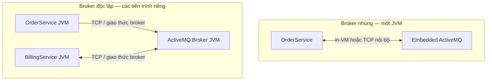
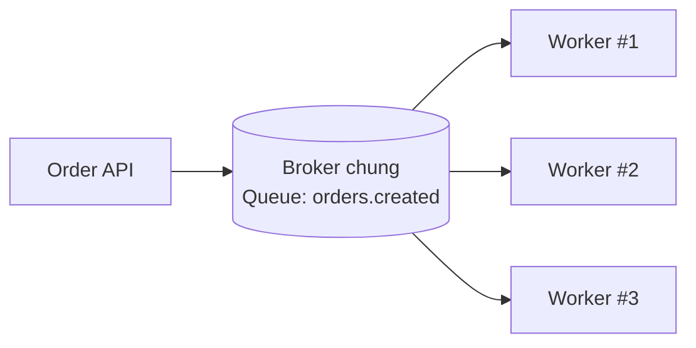
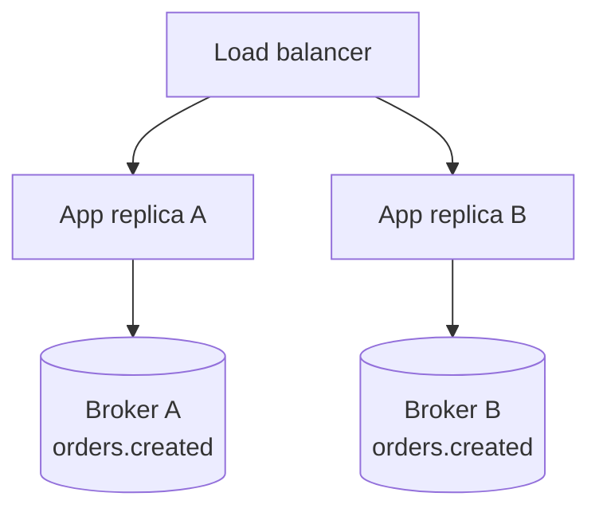

# Khác biệt giữa broker độc lập và broker nhúng trong ứng dụng

> **Chương:** Kiến trúc broker  
> **Phạm vi:** Apache ActiveMQ Classic và Apache ActiveMQ Artemis trong hệ thống Java giao tiếp bất đồng bộ bằng queue, topic và JMS/Jakarta Messaging.

## 1. Hai mô hình triển khai cùng một vai trò broker

Một **message broker** nhận thông điệp từ producer, lưu trữ/định tuyến theo queue hoặc topic, rồi phân phối cho consumer. ActiveMQ Classic và ActiveMQ Artemis đều có thể hoạt động như một dịch vụ riêng hoặc được khởi tạo từ chính chương trình Java.

Điểm phân biệt cốt lõi là **broker chạy ở đâu và do ai quản lý vòng đời**:

- **Broker độc lập (standalone/external broker):** chạy bằng **tiến trình/JVM riêng** — trên máy chủ, VM, container hoặc nền tảng orchestration. Ứng dụng kết nối đến endpoint của broker qua giao thức mạng được hỗ trợ. Broker có thể sống lâu hơn một lần triển khai hoặc một lần khởi động lại ứng dụng.
- **Broker nhúng (embedded/in-process broker):** chạy **trong cùng JVM** với ứng dụng; ứng dụng tạo, cấu hình, khởi động và dừng broker thông qua API hoặc cơ chế tích hợp framework. Broker chia sẻ tài nguyên và ranh giới lỗi của tiến trình ứng dụng.

Ví dụ: dịch vụ `OrderService` đẩy `OrderCreated` vào queue `orders.created`; dịch vụ `BillingService` tiêu thụ message để phát hành hóa đơn. Nếu hai dịch vụ là hai tiến trình độc lập, chúng thường kết nối đến **một broker chung**. Nếu mỗi dịch vụ tự tạo broker nhúng riêng, chúng có **hai queue độc lập**, dù cùng đặt tên `orders.created`.

### Sơ đồ so sánh



**Độc lập không có nghĩa là ở máy vật lý khác:** broker vẫn là standalone nếu chạy ở một container hoặc JVM riêng trên cùng host với ứng dụng. **Nhúng không có nghĩa chỉ chạy trong bộ nhớ:** embedded broker vẫn có thể bật persistence, journal và kết nối TCP. Hai khái niệm này mô tả **ranh giới triển khai**, không trực tiếp mô tả độ bền của dữ liệu.

## 2. So sánh kiến trúc và vận hành

| Tiêu chí | Broker độc lập | Broker nhúng |
| --- | --- | --- |
| **Tiến trình** | Có JVM/process riêng | Chung JVM với ứng dụng |
| **Vòng đời** | Được start/stop/upgrade độc lập | Thường start/stop cùng ứng dụng |
| **Ranh giới lỗi** | Ứng dụng crash không trực tiếp làm broker crash | Ứng dụng hoặc JVM crash thì broker nhúng cũng dừng |
| **Tài nguyên** | Heap, GC, thread, CPU và giới hạn riêng | Cạnh tranh tài nguyên với logic nghiệp vụ |
| **Kết nối** | Thường dùng TCP và giao thức broker hỗ trợ | Có thể dùng in-VM; cũng có thể mở TCP |
| **Dùng chung** | Nhiều ứng dụng kết nối cùng broker/cluster | Mặc định mỗi JVM có broker và destination riêng |
| **Mở rộng ứng dụng** | Có thể scale app mà giữ broker chung | Thêm replica app có thể tạo thêm broker độc lập |
| **Persistence** | Có thể dùng journal/disk/replication | Cũng có thể dùng journal/disk nếu cấu hình |
| **Độ sẵn sàng cao (HA)** | Dễ tổ chức một tầng broker riêng, nhưng **phải cấu hình HA** | Phụ thuộc vòng đời app; HA phức tạp khi app scale |
| **Triển khai/cập nhật** | Cần quản lý service, cấu hình và endpoint riêng | Gói broker vào ứng dụng, ít thành phần chạy riêng |
| **Bảo mật** | Cần kiểm soát listener, TLS, auth và quyền JMS qua mạng | In-VM hạn chế bề mặt mạng; mở TCP vẫn cần bảo mật |
| **Quan sát/vận hành** | Có thể đo queue, consumer, DLQ, journal tập trung | Broker metrics và log trộn trong tiến trình app |
| **Độ trễ** | Có chi phí kết nối mạng | In-VM có thể giảm chi phí network, nhưng cạnh tranh CPU/GC |
| **Tình huống điển hình** | Nhiều service, tải production, broker được quản trị tập trung | Test, demo, công cụ desktop hoặc ứng dụng độc lập một JVM |

**Không có mô hình nào tự đảm bảo “không mất message”.** Với cả hai, độ bền còn phụ thuộc delivery mode, thời điểm acknowledgment/commit, journal, disk, cấu hình đồng bộ dữ liệu, replication/failover và xử lý message trùng lặp.

### Ba nhầm lẫn cần tránh

1. **Embedded ≠ in-memory.** `persistent=false` là lựa chọn cấu hình, không phải đặc tính bắt buộc của broker nhúng.
2. **Standalone ≠ highly available.** Một broker riêng lẻ vẫn là điểm lỗi đơn (single point of failure) nếu không có kế hoạch khôi phục hoặc HA.
3. **Cùng tên queue ≠ cùng queue.** `orders.created` trong broker A và `orders.created` trong broker B là hai đích độc lập nếu không cấu hình liên kết/cluster/federation tương ứng.

## 3. Khi queue, topic và routing đi qua hai mô hình

### 3.1. Một broker chung: nhiều service cùng truy cập một destination

Giả sử có ba replica `OrderWorker` cùng đọc queue `orders.created` ở **một broker độc lập**:



Queue có mô hình competing consumers: mỗi message được giao cho **một consumer tại một thời điểm** theo chính sách dispatch. Nếu xử lý thất bại trước khi commit/ack thành công, message có thể được gửi lại, nên handler phải idempotent. Scale worker không tự tạo thêm queue độc lập vì các worker vẫn trỏ về cùng broker/destination.

Với **topic**, broker phát message đến các subscription theo chính sách publish/subscribe. Durable subscription, backlog và routing cần được hiểu trong phạm vi broker/cluster đang cấu hình.

### 3.2. Mỗi replica tự nhúng broker: destination bị chia tách



Nếu không có federation/cluster/network connector được thiết lập rõ ràng:

- Producer gắn với replica A gửi vào broker A; consumer chỉ kết nối broker B **không nhìn thấy** message đó.
- Message backlog, DLQ, durable subscription và metric queue của hai broker khác nhau.
- Rolling restart hoặc autoscaling khiến số broker và nơi đặt message biến động theo số replica.
- Việc hai broker cùng sử dụng tên queue **không tạo ra một hàng đợi dùng chung**.

ActiveMQ Classic hỗ trợ những cơ chế kết nối mạng giữa broker (network of brokers), còn Artemis hỗ trợ clustering/federation theo tính năng và phiên bản. Nhưng đây là **cấu hình hệ thống phân tán bổ sung**, không phát sinh chỉ vì gọi hàm khởi tạo embedded broker. Bài này tập trung vào lựa chọn mô hình triển khai, không đi sâu thuật toán routing của các topology đó.

## 4. Ví dụ thực hành với ActiveMQ Classic

Để minh họa vòng đời, ví dụ sử dụng **ActiveMQ Classic 5.x** và JMS truyền thống. Version trong POM là ví dụ cho một dòng 5.x; khi dùng dự án thật, hãy đồng bộ phiên bản broker/client qua dependency management và kiểm tra JDK được hỗ trợ.

### 4.1. Nhúng broker vào chính JVM

Maven dependencies:

```xml
<dependencies>
    <dependency>
        <groupId>org.apache.activemq</groupId>
        <artifactId>activemq-broker</artifactId>
        <version>5.19.12</version>
    </dependency>
    <dependency>
        <groupId>org.apache.activemq</groupId>
        <artifactId>activemq-client</artifactId>
        <version>5.19.12</version>
    </dependency>
</dependencies>
```

Ví dụ Java khởi tạo broker bằng `BrokerService`, rồi producer và consumer cùng kết nối qua transport **`vm://`** trong một JVM:

```java
import javax.jms.Connection;
import javax.jms.Message;
import javax.jms.MessageConsumer;
import javax.jms.MessageProducer;
import javax.jms.Queue;
import javax.jms.Session;
import javax.jms.TextMessage;

import org.apache.activemq.ActiveMQConnectionFactory;
import org.apache.activemq.broker.BrokerService;

public class EmbeddedClassicDemo {
    public static void main(String[] args) throws Exception {
        BrokerService broker = new BrokerService();
        broker.setBrokerName("orders-local");
        broker.setPersistent(false); // Chỉ dùng dữ liệu tạm trong demo
        broker.setUseJmx(false);     // Giảm thành phần quản trị trong demo

        broker.start();
        broker.waitUntilStarted();   // Đảm bảo broker sẵn sàng trước client

        try {
            ActiveMQConnectionFactory factory =
                    new ActiveMQConnectionFactory(
                            "vm://orders-local?create=false");

            Connection connection = factory.createConnection();
            try {
                connection.start();
                Session session = connection.createSession(
                        false, Session.AUTO_ACKNOWLEDGE);

                Queue queue = session.createQueue("demo.orders");
                MessageProducer producer = session.createProducer(queue);
                producer.send(session.createTextMessage("ORDER-1001"));

                MessageConsumer consumer = session.createConsumer(queue);
                Message message = consumer.receive(2000);

                if (message instanceof TextMessage) {
                    System.out.println(
                            "Received: " + ((TextMessage) message).getText());
                } else {
                    System.out.println("No text message received");
                }
            } finally {
                connection.close();
            }
        } finally {
            broker.stop();
            broker.waitUntilStopped();
        }
    }
}
```

Điểm cần quan sát:

- `broker.start()` và `broker.stop()` nằm **trong vòng đời của ứng dụng**, không cần chạy service ActiveMQ riêng.
- URL `vm://orders-local?create=false` dùng Classic **VM transport** để kết nối tới broker đã khởi tạo trong **cùng JVM**; `create=false` tránh việc client tự tạo broker khác nếu đặt sai tên.
- `broker.setPersistent(false)` cố ý làm demo đơn giản: backlog trong broker này **không bền vững qua restart**. Trong hệ thống thực tế, có thể bật persistence và cấu hình storage riêng, song điều đó không tách broker khỏi tiến trình ứng dụng.
- `Session.AUTO_ACKNOWLEDGE` làm ví dụ ngắn gọn; ứng dụng production cần cân nhắc transaction, acknowledgment, redelivery và DLQ theo yêu cầu độ tin cậy.

**Quan trọng:** đoạn demo là API Classic 5.x và client `javax.jms`. Không ghép client Jakarta chuyển tiếp `activemq-client-jakarta` của Classic 5.x với embedded broker Classic 5.x trong cùng JVM; client đó được thiết kế cho remote broker. Khi chuyển sang Classic 6.x, phải kiểm tra lại namespace JMS và artifact theo phiên bản, không sao chép nguyên POM minh họa.

### 4.2. Cùng ứng dụng, nhưng broker chạy độc lập

Với mô hình external, broker Classic được khởi động/quản lý bởi một tiến trình riêng, chẳng hạn dịch vụ ActiveMQ đã cài trong hạ tầng. Ứng dụng **không tạo `BrokerService`** nữa, mà chỉ tạo kết nối tới endpoint được cấu hình:

```java
import javax.jms.Connection;
import org.apache.activemq.ActiveMQConnectionFactory;

public class ExternalClassicConnection {
    public static void main(String[] args) throws Exception {
        String brokerUrl = System.getenv("BROKER_URL");
        if (brokerUrl == null || brokerUrl.isEmpty()) {
            throw new IllegalStateException("BROKER_URL is required");
        }

        ActiveMQConnectionFactory factory =
                new ActiveMQConnectionFactory(brokerUrl);

        Connection connection = factory.createConnection();
        try {
            connection.start();
            System.out.println("Connected to external broker");
            // Khởi tạo JMS session/producer/consumer tại đây.
        } finally {
            connection.close();
        }
    }
}
```

Ví dụ cấu hình bên ngoài ứng dụng:

```text
BROKER_URL=tcp://broker.internal:61616
```

Khác biệt kiến trúc nằm ở chỗ ứng dụng chỉ giữ **client connection**. Nếu `OrderService` restart hoặc redeploy, broker có thể tiếp tục chạy, giữ queue và xử lý message từ các ứng dụng khác. Nhưng khả năng giữ message sau sự cố broker vẫn phụ thuộc persistence/HA đã cấu hình; ứng dụng cũng phải có chiến lược reconnect, timeout và readiness.

Địa chỉ `broker.internal:61616` chỉ là placeholder minh họa. Trong triển khai thật, cần cấu hình host, listener, giao thức, xác thực, TLS, ACL và network policy theo môi trường.

## 5. ActiveMQ Artemis: hai cách triển khai tương tự

Artemis cũng hỗ trợ broker trong một Java process hoặc broker chạy riêng. Điều thay đổi chủ yếu là **API khởi tạo server và cấu hình acceptor**, không phải khái niệm ranh giới tiến trình.

### 5.1. Nhúng Artemis bằng `EmbeddedActiveMQ`

Ví dụ sau minh họa **server embedded** của Artemis với cấu hình tạm thời. Cần dependency phù hợp cho module `artemis-server` và client Artemis đồng bộ phiên bản; từ Artemis 2.50.0, Maven groupId chính là `org.apache.artemis`.

```java
import org.apache.activemq.artemis.core.config.Configuration;
import org.apache.activemq.artemis.core.config.impl.ConfigurationImpl;
import org.apache.activemq.artemis.core.server.embedded.EmbeddedActiveMQ;

public class EmbeddedArtemisDemo {
    public static void main(String[] args) throws Exception {
        Configuration config = new ConfigurationImpl();
        config.setPersistenceEnabled(false); // Chỉ dùng cho demo/test
        config.setSecurityEnabled(false);    // Không dùng để mở broker ra mạng
        config.addAcceptorConfiguration("in-vm", "vm://0");

        EmbeddedActiveMQ server = new EmbeddedActiveMQ();
        server.setConfiguration(config);
        server.start();

        try {
            // Code trong cùng JVM có thể dùng client Artemis
            // với transport in-VM tương thích, ví dụ "vm://0".
            // Chạy producer/consumer tại đây.
            System.out.println("Embedded Artemis started");
        } finally {
            server.stop();
        }
    }
}
```

Giải thích:

- `EmbeddedActiveMQ` quản lý broker **trong process Java hiện tại**.
- `vm://0` là địa chỉ **in-VM transport** của Artemis cho ví dụ một broker nội bộ; không phải địa chỉ TCP cho dịch vụ khác JVM.
- `setPersistenceEnabled(false)` và `setSecurityEnabled(false)` chỉ giúp demo ngắn. Với embedded broker mở TCP hoặc xử lý dữ liệu quan trọng, phải cấu hình persistence, user/role và bảo vệ listener đúng yêu cầu.
- Nếu cần kết nối từ tiến trình khác, embedded Artemis vẫn **có thể** cấu hình TCP acceptor; điều này không biến nó thành standalone, vì broker vẫn chết cùng JVM ứng dụng.

Module `artemis-server` chứa phần broker. Module client, chẳng hạn `artemis-jms-client` hoặc `artemis-jakarta-client`, phục vụ bên **producer/consumer**; chọn loại client theo thế hệ JMS của ứng dụng. Không nên nhầm client library với một dịch vụ broker độc lập.

### 5.2. Chạy Artemis thành service riêng

Đường triển khai phổ biến là tạo **broker instance**, quản lý instance bằng process/container/service manager, rồi cho client kết nối đến một TCP acceptor thích hợp. Ví dụ hai thành phần có thể nằm trong hai container:

```text
orders-app (Java)
  |
  | tcp://artemis-broker:61616
  v
artemis-broker (JVM riêng)
  |-- address/queue/topic routing
  |-- journal / paging / DLQ settings
  |-- security settings
  |-- monitoring / metrics
```

Ứng dụng chỉ cần provider client, broker URL và credential/quyền phù hợp. Broker độc lập cần dữ liệu trên volume bền vững nếu muốn giữ journal qua việc thay container; chỉ dựa vào filesystem tạm của container sẽ không đáp ứng yêu cầu khôi phục.

Việc cấu hình queue, address, routing type (`anycast` cho competing consumers, `multicast` cho publish/subscribe theo mô hình Artemis), persistence, paging và DLQ thuộc về cấu hình của **broker instance**, tách khỏi quá trình build và deploy service Java.

## 6. Vòng đời và ranh giới lỗi: điểm quyết định khi đưa vào production

### 6.1. Startup và shutdown

| Giai đoạn | Embedded | Standalone |
| --- | --- | --- |
| **Khởi động** | Khởi động broker, đợi sẵn sàng, rồi mở producer/consumer | Broker được vận hành riêng; app kết nối/retry khi broker sẵn sàng |
| **Readiness** | App không nên báo ready nếu broker nhúng hoặc listener chưa sẵn sàng | App kiểm tra kết nối; broker có health check riêng |
| **Shutdown** | Ngừng nhận việc mới, drain/commit hoặc rollback, đóng client, rồi stop broker | App drain/đóng client; broker không nhất thiết dừng |
| **Nâng cấp** | Thay app thường kéo theo restart broker | Có thể deploy app và upgrade broker theo lịch riêng |
| **Crash** | Crash JVM đồng thời mất app + broker | App crash không trực tiếp tắt broker, nhưng kết nối bị ngắt |

Với embedded, thứ tự khởi động là phần của ứng dụng:

```text
Start JVM
  -> Load broker configuration
  -> Start embedded broker
  -> Verify broker ready
  -> Start JMS consumers/producers
  -> Mark application ready

Shutdown:
  -> Stop accepting new work
  -> Drain/finish/rollback in-flight messages
  -> Close JMS connections
  -> Stop embedded broker
  -> Exit JVM
```

Nếu xử lý message chưa commit khi JVM bị kill, message có thể được giao lại **nếu trạng thái và dữ liệu còn tồn tại sau khi broker khôi phục**; với broker chỉ dùng memory và process chết, không thể giả định message vẫn còn. Đây là lý do cần phân biệt *acknowledgment/transaction* với *durability*.

### 6.2. Cùng JVM nghĩa là cùng failure domain

Ví dụ ứng dụng tạo bộ nhớ quá lớn, bị `OutOfMemoryError` hoặc JVM bị hệ điều hành kill. Với embedded, broker cũng biến mất cùng tiến trình: các service khác đang kết nối có thể mất điểm nhận message, mọi queue trong memory biến mất và journal chỉ tồn tại nếu đã cấu hình bền vững trên storage giữ lại qua restart.

Với standalone, lỗi đó chỉ làm ứng dụng client bị ngắt. Broker vẫn chạy, có thể giữ backlog cho ứng dụng khác xử lý. Tuy vậy, backlog tăng quá giới hạn disk/memory vẫn là rủi ro: cần policy paging/flow control, quota và giám sát.

### 6.3. Persistence không phụ thuộc vào vị trí broker

Cần phân biệt hai biến độc lập:

| Kiểu triển khai | Persistence tắt | Persistence bật |
| --- | --- | --- |
| Embedded | Nhanh cho test, dữ liệu queue có thể mất khi JVM dừng | Có thể có journal trên disk, nhưng cùng vòng đời JVM |
| Standalone | Dùng cho môi trường tạm nếu chấp nhận mất dữ liệu | Có journal bền vững, cần storage và backup phù hợp |

Một persistent message chỉ được bảo toàn theo bảo đảm cụ thể của broker/journal/configuration. Không nên tuyên bố “gửi PERSISTENT là an toàn tuyệt đối”; cần xét transaction commit, fsync, replication, filesystem, disk failure và chính sách failover.

## 7. Scale ứng dụng, HA và khi nào cần broker riêng

### Trường hợp A — bài test tích hợp hoặc demo trên máy phát triển

Một test dùng broker embedded tạo queue, gửi message, assert kết quả, rồi dừng broker. Mô hình này nhanh, ít phụ thuộc hạ tầng và dễ tạo dữ liệu kiểm thử tạm.

Nhược điểm: test in-VM không tái hiện toàn bộ TCP disconnect, TLS, authentication, network partition, failover, disk latency hay broker cluster. Hệ thống production dùng standalone nên có thêm **integration test với broker thật ở process/container riêng**.

### Trường hợp B — ứng dụng đơn lẻ chạy offline

Một công cụ desktop hay Java service chạy duy nhất một instance có thể dùng embedded broker để xử lý công việc nội bộ mà không cần quản trị service ActiveMQ riêng.

Cần cân nhắc vòng đời restart, backup journal, giới hạn disk và việc triển khai nhiều instance sau này. Nếu có hệ thống khác phải kết nối xuyên mạng, cấu hình nhúng bắt đầu mang trách nhiệm vận hành của một broker chia sẻ.

### Trường hợp C — nhiều microservice hoặc scale theo replica

Ví dụ có `Order API`, `Payment Worker`, `Email Worker`, mỗi service có nhiều replica và cùng dùng queue/topic của đơn hàng. Broker độc lập thường hợp lý hơn vì:

- Không gắn số broker với số replica ứng dụng.
- Mọi service có endpoint và không gian destination rõ ràng.
- Dễ phân quyền theo producer/consumer và giám sát backlog/DLQ chung.
- Có thể mở rộng năng lực broker và ứng dụng theo nhu cầu riêng.

**Broker độc lập vẫn phải được thiết kế HA nếu yêu cầu sẵn sàng cao.** Một container broker đơn lẻ vẫn có thể chết vì host failure. Classic và Artemis có cơ chế cluster/replication/failover với đặc điểm khác nhau; lựa chọn topology phải dựa trên phiên bản và yêu cầu RPO/RTO. Đặt hai broker cạnh nhau mà không cấu hình liên kết và dữ liệu đồng bộ chưa tạo thành cluster an toàn.

## 8. Bảo mật, tài nguyên và quan sát

### 8.1. Bảo mật

**Broker standalone** thường mở network listener. Cần xác thực client, phân quyền gửi/nhận theo queue hoặc address, TLS khi đi qua mạng không tin cậy, giới hạn network ingress, quản lý secret và audit. Không nên public cổng message broker trực tiếp lên Internet chỉ vì test kết nối thành công.

**Broker embedded** chỉ dùng in-VM có ít bề mặt mạng hơn, nhưng mọi code chạy cùng JVM có quyền tác động đến broker theo cơ chế nội bộ. Nếu nhúng broker nhưng mở TCP listener, vẫn phải cấu hình các biện pháp network/auth/TLS tương tự standalone. Không sao chép `setSecurityEnabled(false)` từ demo sang môi trường thật.

### 8.2. CPU, heap và disk

- **Embedded:** heap và GC của broker có thể cạnh tranh với request handlers, scheduler hoặc batch job của ứng dụng; đột biến message backlog có thể ảnh hưởng trực tiếp latency nghiệp vụ.
- **Standalone:** broker có JVM/heap, thread pool, storage quota và chính sách restart riêng, nhưng vẫn cần capacity planning. Nếu cùng host, broker và app vẫn cạnh tranh CPU, RAM và disk ở mức hệ điều hành.
- **Cả hai:** monitor queue depth, tuổi message, số consumer, tốc độ enqueue/dequeue, redelivery, DLQ, journal/disk usage, paging, thread/heap/GC và connection failures.

Trong production, việc phân tách process thường giúp điều tra lỗi và điều chỉnh cấu hình hiệu quả hơn. Nhưng không nên coi kết quả latency hay throughput là hiển nhiên; cần benchmark dưới **workload, persistence và message size thực tế**.

### 8.3. Quản trị và cấu hình

Với standalone, file cấu hình broker, secret, TLS cert, retention policy và journal thường thuộc tầng hạ tầng; application deploy chỉ cần endpoint và credentials. Với embedded, cấu hình broker đi cùng application artifact hoặc application configuration; mỗi bản deploy cần đảm bảo cấu hình tương ứng.

Nếu ứng dụng dùng embedded broker như shared infrastructure cho các service khác, thao tác redeploy **ứng dụng chủ** có thể thành sự cố messaging toàn hệ thống. Ranh giới vận hành vì thế nên được quyết định trước, không chỉ dựa trên việc API có hỗ trợ embedded hay không.

## 9. Cách ra quyết định cho một hệ thống mới

Dùng các câu hỏi sau theo thứ tự:

1. **Có nhiều ứng dụng hoặc replica cần chia sẻ queue/topic không?** Nếu có, ưu tiên broker độc lập hoặc một topology broker được quản trị rõ ràng.
2. **Message phải tồn tại khi ứng dụng restart không?** Nếu có, cấu hình persistence bền vững là bắt buộc; tách broker riêng thường dễ quản lý vòng đời và storage hơn.
3. **Có cần HA, thay phiên bản ứng dụng không gián đoạn hoặc kiểm soát backlog tập trung không?** Broker riêng thuận lợi để tổ chức các khả năng đó, nhưng vẫn phải thiết kế/kiểm thử HA.
4. **Đây chỉ là unit/integration test, demo hoặc một JVM chạy nội bộ không chia sẻ message?** Embedded có thể giảm công vận hành.
5. **Có mở TCP listener cho dịch vụ khác không?** Nếu có, embedded cũng cần đầy đủ auth, TLS, giới hạn truy cập, metrics và kế hoạch shutdown, vì nó đang gánh vai trò hạ tầng.

| Bối cảnh | Lựa chọn khởi đầu nên cân nhắc | Lý do chính |
| --- | --- | --- |
| Test Java có vòng đời vài giây/phút | Embedded, persistence tắt nếu test không cần dữ liệu bền | Setup/dọn dẹp nhanh |
| Công cụ Java offline một instance | Embedded, cân nhắc storage nếu cần giữ queue | Đóng gói đơn giản |
| Nhiều service trao đổi queue/topic | Standalone | Endpoint chung và vận hành độc lập |
| Service scale từ 1 lên nhiều replica | Standalone | Tránh tạo broker/queue tách biệt ở mỗi replica |
| Workload có yêu cầu HA, backup, ACL và giám sát chặt | Standalone với cấu hình HA thích hợp | Tách failure domain và kiểm soát vận hành |
| Embedded hiện có nhưng nhiều service ngoài đang phụ thuộc | Xem xét tách ra standalone | Application restart không nên kéo theo downtime broker dùng chung |

Không phải mọi embedded broker đều phải chuyển sang standalone. Nếu broker chỉ phục vụ xử lý nội bộ không cần chia sẻ và vòng đời gắn liền ứng dụng là chủ ý, embedded vẫn là một lựa chọn hợp lệ.

## 10. Bài thực hành so sánh trực tiếp

**Mục tiêu:** quan sát sự khác biệt về vòng đời, không chỉ đo số mili giây gửi message.

**Phần 1 — Embedded Classic**

1. Chạy `EmbeddedClassicDemo` ở mục 4.1; xác nhận nhận `ORDER-1001`.
2. Bật log lifecycle; quan sát broker start và stop cùng tiến trình Java.
3. Giữ `setPersistent(false)`; thử tạo backlog rồi dừng JVM, khởi động lại và kiểm tra dữ liệu còn không. Chỉ làm trong môi trường test.
4. Đặt sai tên broker trong `vm://...?create=false`; quan sát lỗi kết nối để hiểu transport trong JVM.

**Phần 2 — Broker độc lập**

1. Chạy một broker Classic trong process/container riêng với TCP listener được phép sử dụng.
2. Thiết lập `BROKER_URL` để chạy `ExternalClassicConnection`; ứng dụng chỉ kết nối.
3. Dừng/restart Java client, kiểm tra broker vẫn hoạt động và giữ session/destination theo cấu hình.
4. Dừng/restart broker, quan sát timeout/reconnect của client. Thử lại với producer/consumer có retry phù hợp và kiểm tra acknowledgment.

**Phần 3 — Bẫy khi scale**

1. Giả lập hai tiến trình app, mỗi tiến trình nhúng một broker khác nhau.
2. Tạo queue trùng tên ở cả hai; gửi message vào A và chỉ cho consumer của B nghe.
3. Xác nhận B không tự nhận message từ A; giải thích sự khác biệt giữa **tên destination** và **broker chứa destination**.
4. Chuyển cả producer và consumer sang cùng broker độc lập, quan sát message có thể lưu chuyển qua ranh giới process.

**Câu hỏi tự kiểm tra:**

- Broker embedded có thể bật persistence không? **Có**; persistence là cấu hình riêng.
- Hai app replica cùng nhúng broker và cùng đặt queue `orders.created` có đang chia sẻ một queue không? **Không**, trừ khi có topology liên kết/cluster được cấu hình.
- Broker standalone có tự động HA không? **Không**; cần topology, storage và failover được thiết kế.
- Khi app nhúng broker bị kill, broker còn tồn tại ở process khác không? **Không**, vì cùng JVM.
- Khi dùng transport in-VM, có thể kết nối trực tiếp từ JVM khác qua `vm://` không? **Không**; muốn kết nối từ process khác phải dùng listener và giao thức mạng phù hợp.
- Nên đặt DLQ policy, bảo mật và monitor ở đâu? **Tại broker thực sự xử lý message**, dù là standalone hay embedded.

## 11. Checklist thiết kế trước khi chọn mô hình

- [ ] Xác định rõ broker là tài nguyên của **một JVM** hay dịch vụ **dùng chung**.
- [ ] Liệt kê producer, consumer, số replica và queue/topic phải chia sẻ.
- [ ] Quyết định có cho phép broker dừng cùng deployment ứng dụng hay không.
- [ ] Xác định persistence, vị trí journal/volume, chính sách backup/khôi phục và độ bền mong muốn.
- [ ] Xác định behavior reconnect, ack/transaction, redelivery và DLQ.
- [ ] Tính giới hạn CPU, heap, GC, disk, queue depth và cách lấy metrics.
- [ ] Cấu hình auth/authorization/TLS nếu broker có endpoint truy cập qua mạng.
- [ ] Nếu cần HA, thiết kế failover/replication cụ thể và diễn tập sự cố.
- [ ] Kiểm thử process restart, shutdown khi có message đang xử lý và scale nhiều replica.

## Tài liệu tham khảo

- [Apache ActiveMQ Classic — tài liệu cấu hình broker](https://activemq.apache.org/components/classic/documentation/broker-configuration-uri).
- [Apache ActiveMQ Classic — VM Transport Reference](https://activemq.apache.org/components/classic/documentation/vm-transport-reference).
- [Apache ActiveMQ Artemis — Embedding Apache ActiveMQ Artemis](https://artemis.apache.org/components/artemis/documentation/latest/embedding-activemq.html).
- [Apache ActiveMQ Artemis — Configuring the Broker](https://artemis.apache.org/components/artemis/documentation/latest/configuration-index.html).
- [Apache ActiveMQ Artemis — Persistence](https://artemis.apache.org/components/artemis/documentation/latest/persistence.html).
