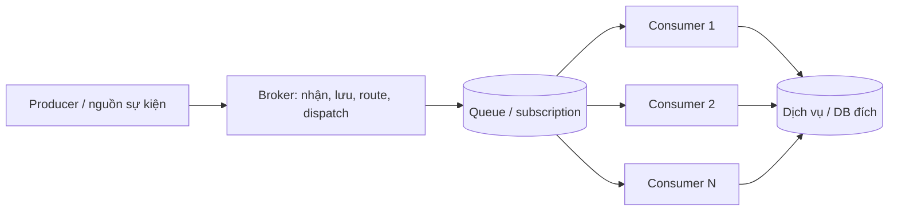
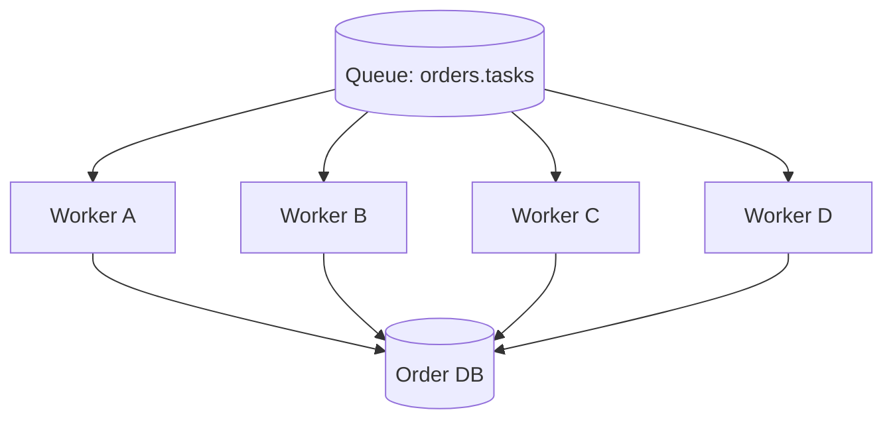
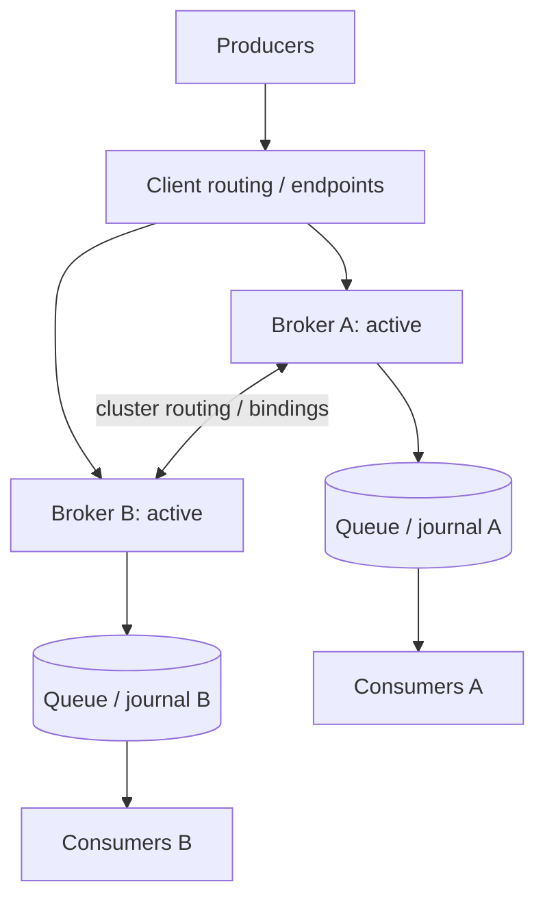
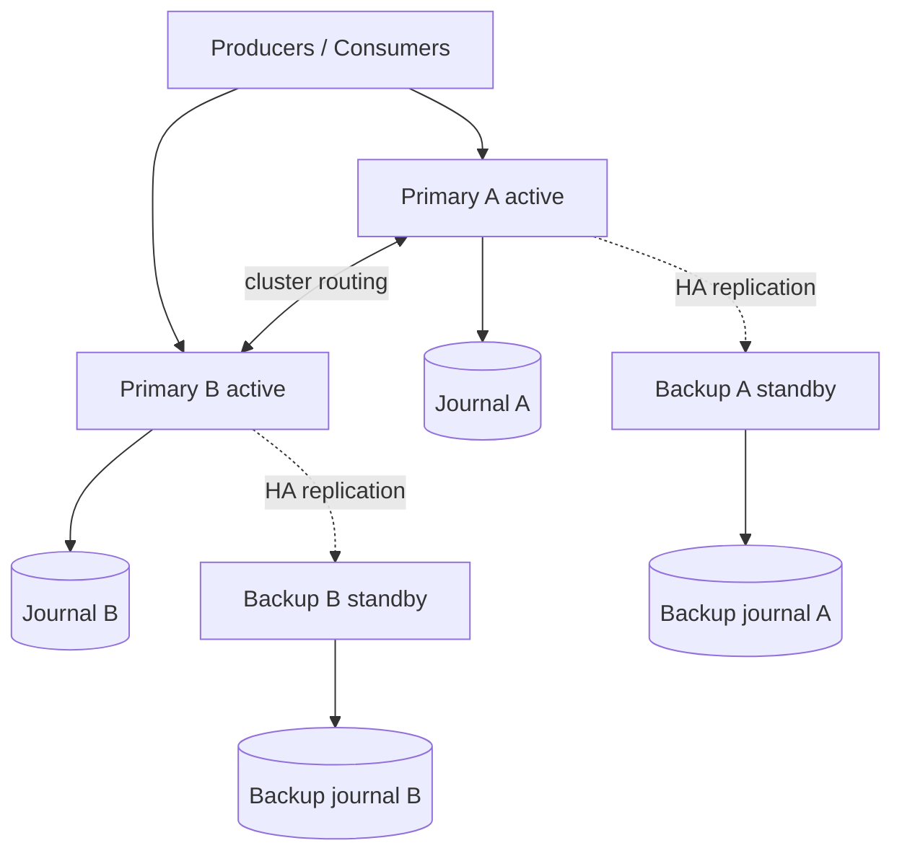
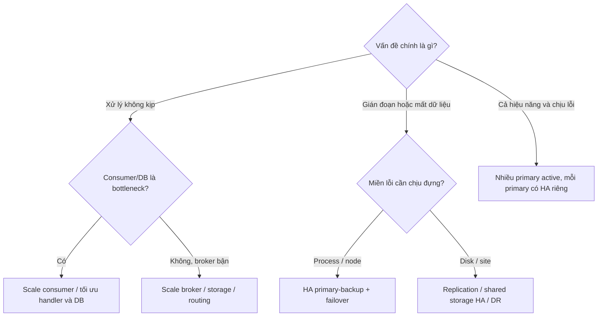
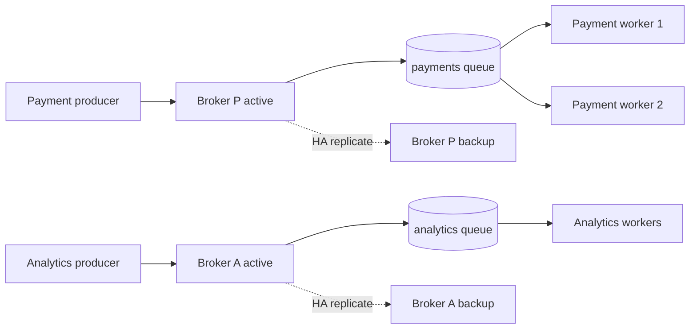

# Phân biệt mở rộng consumer, mở rộng broker và dự phòng dữ liệu

> **Chương:** Kiến trúc broker  
> **Phạm vi:** Apache ActiveMQ Classic, Apache ActiveMQ Artemis và hệ thống Java/JMS xử lý message bất đồng bộ.  
> **Mục tiêu:** Chọn đúng giải pháp khi cần tăng năng lực xử lý, tăng năng lực truyền/lưu message hoặc bảo vệ dịch vụ và dữ liệu trước sự cố.

## 1. Ba bài toán dễ bị đánh đồng

Một hệ thống đặt hàng nhận 800 sự kiện/giây từ nhiều ứng dụng. Consumer xử lý mỗi sự kiện trung bình 40 ms; queue tăng liên tục. Nhóm vận hành cân nhắc:

1. Thêm các instance Java consumer.
2. Chạy thêm một broker ActiveMQ và tạo cluster/network.
3. Đặt một broker dự phòng với bản sao dữ liệu.

Cả ba có thể có nhiều tiến trình hơn, nhưng giải quyết **ba nút thắt khác nhau**:

| Bài toán | Mục tiêu trực tiếp | Đơn vị được tăng thêm | Ví dụ | Không tự mang lại |
| --- | --- | --- | --- | --- |
| **Mở rộng consumer** (*consumer scaling*) | Tăng tốc độ **xử lý nghiệp vụ** đã được broker nhận | Worker, thread hoặc instance consumer | Từ 4 lên 16 worker đọc cùng queue | Tăng IOPS/CPU/dung lượng ghi journal của broker; sao chép dữ liệu để chịu lỗi |
| **Mở rộng broker** (*broker scaling*) | Tăng năng lực **nhận, lưu, định tuyến và phát message** | Nhiều broker **đang hoạt động** và phân bố tải | Hai node Artemis hoạt động, các queue/address được định tuyến theo tải | Bảo đảm dữ liệu của node hỏng được phục hồi; tăng tốc handler Java vốn đang nghẽn |
| **Dự phòng dữ liệu và broker** (*high availability / disaster recovery*) | Giảm gián đoạn và/hoặc mất dữ liệu khi node, đĩa, vùng gặp sự cố | Bản dự phòng, shared store, replication, backup, cơ chế failover | Artemis primary–backup, backup tiếp quản khi primary hỏng | Gấp đôi thông lượng xử lý khi backup chỉ đứng chờ |

**Quy tắc quyết định:** nhìn vào **nút thắt thật** và **kịch bản lỗi cần chống chịu**, không chọn giải pháp chỉ vì hệ thống “đông máy hơn”.

### 1.1. Nhìn vào đường đi của message



Có ba nhóm tài nguyên:

- **Consumer:** CPU xử lý, thread, kết nối DB, thời gian gọi API, tốc độ commit/ack.
- **Broker:** socket, CPU định tuyến, memory, page/cache, journal/IOPS, mạng và số lượng destination.
- **Dữ liệu/khả dụng:** message đã được lưu bền vững chưa, bản lưu nằm ở miền lỗi nào, broker dự phòng có thể tiếp quản không, client có kết nối lại và xử lý an toàn không.

Phần sau tách riêng cách mở rộng từng nhóm.

## 2. Mở rộng consumer: tăng tốc xử lý trên cùng một hàng đợi

### 2.1. Competing consumers trên queue

Hai consumer cùng đọc **một queue** thường cạnh tranh lấy message; broker giao mỗi lần phát cho **một** consumer của queue. Khi tăng số worker, nhiều message độc lập có thể xử lý song song:



Đây là cơ chế chuẩn để scale xử lý hàng đợi trong **ActiveMQ Classic** lẫn **Artemis**. Không phải tạo queue mới cho từng replica. Nếu mỗi worker lại đọc một topic với subscription riêng, cùng một message có thể được giao cho **mọi** worker — hoàn toàn khác competing consumers.

Với topic cần phân phối **mỗi nhóm nghiệp vụ một bản** nhưng chia tải bên trong nhóm, Artemis có shared subscription/JMS shared consumer hoặc các queue subscription tương đương; Classic thường dùng Virtual Topics + một queue riêng cho mỗi nhóm. Chi tiết API khác phiên bản, nhưng **nguyên tắc scale** không đổi: các replica cần cùng một nhóm tiêu thụ, thay vì mỗi replica sở hữu một bản sao luồng.

### 2.2. Ước lượng số consumer cần thiết

Ký hiệu:

- \(\lambda\): tốc độ vào queue (message/giây).
- \(t\): thời gian xử lý trung bình của một consumer cho một message (giây), bao gồm các lời gọi bên ngoài và commit nếu có.
- \(N\): số consumer xử lý song song thực sự.
- \(u\): tỷ lệ sử dụng mục tiêu của mỗi consumer, ví dụ \(0{,}70\) để còn dư địa cho dao động tải.

Nếu consumer xử lý tuần tự, **công suất lý thuyết** mỗi consumer xấp xỉ \(1/t\). Để xử lý đều đặn lưu lượng đầu vào và còn dư tải:

\[
N \ge \left\lceil \frac{\lambda \times t}{u} \right\rceil
\]

Ví dụ \(\lambda=800\) message/s, \(t=0{,}040\) s và \(u=0{,}70\):

\[
N \ge \left\lceil \frac{800 \times 0{,}040}{0{,}70} \right\rceil
= \lceil 45{,}71\rceil
= 46
\]

Nếu có **20** consumer thì công suất mục tiêu khoảng:

\[
\mu \approx \frac{20 \times 0{,}70}{0{,}040}=350\ \text{message/s}
\]

Backlog khi còn đủ message để tiêu thụ tăng xấp xỉ \(\lambda-\mu=450\) message/s; sau 10 phút có thể tăng khoảng **270.000 message**. Đây chỉ là mô hình **ước lượng**; phải đo thời gian xử lý thực tế (kể cả p95/p99), burst, transaction, số khóa hoặc rate limit của dịch vụ đích.

**Giới hạn quan trọng:** công thức giả định \(N\) worker thật sự chạy song song và broker có thể cấp đủ message. Nếu một đích DB chỉ cho phép 25 transaction song song, việc thêm 100 consumer có thể làm độ trễ xấu hơn.

### 2.3. Những thứ làm scale consumer không tuyến tính

| Cơ chế / nút thắt | Triệu chứng | Cách xử lý |
| --- | --- | --- |
| **Broker dispatch chậm** | Worker nhàn rỗi dù queue còn sâu | Quan sát IO/CPU broker, paging, prefetch và flow control |
| **DB/API đích hết công suất** | Số consumer tăng nhưng p95 xử lý tăng mạnh | Giới hạn concurrency, batch hợp lý, tối ưu query hoặc scale hệ đích |
| **Yêu cầu thứ tự** | Một chuỗi message không thể chạy cùng lúc | Phân nhóm theo business key, chấp nhận song song **giữa** các nhóm |
| **`JMSXGroupID` / exclusive consumer** | Nhiều worker nhưng chỉ một vài worker bận | Kiểm tra số group đang hoạt động và chính sách ghim group vào consumer |
| **Prefetch / consumer window** | Có worker ôm nhiều message chưa xử lý, worker khác đói | Điều chỉnh prefetch (Classic) hoặc consumer window/flow control (Artemis) theo phiên bản và workload |
| **Transaction lớn, rollback nhiều** | Throughput thấp, redelivery tăng | Giao dịch nhỏ, handler idempotent, phân loại lỗi, retry/DLQ |
| **Quá nhiều kết nối/context** | Broker cạn socket/heap, GC tăng | Giới hạn và tái sử dụng tài nguyên theo vòng đời ứng dụng; mỗi session/context dùng đúng luồng |

Với JMS session, việc mở nhiều thread **không** có nghĩa được dùng chung một `JMSContext` hoặc `Session` trên tất cả các thread. Mỗi worker nên có context/session riêng (hoặc dùng container/pool được quản lý), tránh đồng thời gọi nhận/ack trên một session.

### 2.4. Ví dụ Java: tăng số worker của **một queue**

Ví dụ dưới dùng Artemis JMS client ở **namespace `jakarta.jms`**. Khởi chạy broker thử nghiệm có cổng `tcp://localhost:61616`, quyền tự tạo queue hoặc queue đã được tạo. Cần dependency `artemis-jakarta-client` khớp phiên bản Artemis mà dự án sử dụng. Mỗi worker có **một `JMSContext` giao dịch riêng**, nhận message từ **cùng queue** và chỉ commit sau khi xử lý thành công.

```java
import jakarta.jms.*;
import org.apache.activemq.artemis.jms.client.ActiveMQConnectionFactory;

import java.util.ArrayList;
import java.util.List;
import java.util.UUID;
import java.util.concurrent.*;

public final class CompetingConsumersDemo {
    private static final int WORKERS = 4;
    private static final int MESSAGES = 12;

    private static void process(TextMessage message) throws JMSException {
        // Thay bằng xử lý nghiệp vụ idempotent theo eventId.
        String eventId = message.getStringProperty("eventId");
        System.out.printf("%s xử lý %s%n",
                Thread.currentThread().getName(), eventId);
    }

    public static void main(String[] args) throws Exception {
        String url = args.length > 0
                ? args[0]
                : "tcp://localhost:61616";
        ConnectionFactory factory = new ActiveMQConnectionFactory(url);
        String runId = UUID.randomUUID().toString();
        String queueName = "probe.worker.scale." + runId;

        // Tạo 12 message chờ sẵn trong một queue dùng riêng cho thử nghiệm.
        try (JMSContext publisher = factory.createContext()) {
            Queue queue = publisher.createQueue(queueName);
            JMSProducer producer = publisher.createProducer()
                    .setDeliveryMode(DeliveryMode.PERSISTENT);

            for (int i = 0; i < MESSAGES; i++) {
                TextMessage message =
                        publisher.createTextMessage("order-" + i);
                message.setStringProperty("eventId", runId + "-" + i);
                producer.send(queue, message);
            }
        }

        CountDownLatch completed = new CountDownLatch(MESSAGES);
        ExecutorService pool = Executors.newFixedThreadPool(WORKERS);
        List<Future<?>> tasks = new ArrayList<>();

        try {
            for (int i = 0; i < WORKERS; i++) {
                tasks.add(pool.submit(() -> {
                    // Không dùng chung JMSContext giữa các worker.
                    try (JMSContext context = factory.createContext(
                            JMSContext.SESSION_TRANSACTED)) {
                        Queue queue = context.createQueue(queueName);
                        JMSConsumer consumer = context.createConsumer(queue);

                        while (completed.getCount() > 0
                                && !Thread.currentThread().isInterrupted()) {
                            Message message = consumer.receive(500);
                            if (message == null) continue;

                            try {
                                if (!(message instanceof TextMessage)) {
                                    throw new IllegalStateException(
                                            "Payload không phải TextMessage");
                                }
                                process((TextMessage) message);
                                context.commit(); // Xác nhận sau xử lý.
                                completed.countDown();
                            } catch (Exception ex) {
                                context.rollback(); // Cho phép redelivery.
                                throw ex;
                            }
                        }
                    }
                    return null;
                }));
            }

            for (Future<?> task : tasks) {
                task.get(30, TimeUnit.SECONDS);
            }
            if (completed.getCount() != 0) {
                throw new IllegalStateException(
                        "Còn " + completed.getCount() + " message");
            }
            System.out.println("Đã xử lý đủ " + MESSAGES + " message");
        } finally {
            pool.shutdownNow();
            pool.awaitTermination(5, TimeUnit.SECONDS);
        }
    }
}
```

**Quan sát đúng:** tổng số message được commit bởi **nhóm** là 12, không yêu cầu cả bốn worker đều nhận đúng ba message; broker có thể phân phối lệch vì scheduling hoặc prefetch. Khi thử nghiệm lặp lại, đổi `WORKERS` từ 1 lên 4, đo tổng thời gian và CPU của **cả consumer, broker, DB**. Queue có tên duy nhất để tránh lẫn dữ liệu; dọn destination thử nghiệm theo cơ chế quản trị của broker sau khi đo.

Trong production, xử lý lỗi cần có retry giới hạn, chính sách redelivery/DLQ và kiểm soát idempotency. Transaction của JMS **không tự gộp** với transaction database nghiệp vụ; nếu DB đã commit mà JMS commit thất bại, message có thể quay lại và làm trùng hiệu ứng.

## 3. Mở rộng broker: tăng năng lực nhận, lưu và chuyển message

### 3.1. Khi nào một broker đơn lẻ trở thành nút thắt?

Dấu hiệu điển hình:

- Producer bị chặn bởi producer flow control hoặc tăng thời gian gửi persistent message.
- Journal/disk IOPS, fsync, paging hoặc network saturate trong khi các consumer còn tài nguyên.
- Số destination, connection hoặc message inflight lớn làm broker CPU/heap/GC tăng.
- Hàng đợi tích tụ ngay cả khi đã có đủ worker nhanh để tiêu thụ.
- Nhu cầu cô lập workload: thanh toán không nên chịu tác động từ traffic analytics khối lượng lớn.

Thêm broker **đang phục vụ tải** có thể mở rộng năng lực, nhưng hiệu quả phụ thuộc **cách message được phân bố**. Chạy hai broker nhưng tất cả producer và consumer vẫn trỏ vào broker A thì B không tạo ra thêm công suất thực tế.

### 3.2. Bốn kiểu bố trí dễ gặp

| Cách bố trí | Cơ chế | Tác dụng thật | Điều cần kiểm tra |
| --- | --- | --- | --- |
| **Chia workload theo broker** | Queue/topic nhóm A ở broker 1, nhóm B ở broker 2; producer chọn endpoint đúng | Tách journal, CPU, lỗi theo miền nghiệp vụ | Router/service discovery, mapping destination, di chuyển workload |
| **Nhiều broker hoạt động trong Artemis cluster** | `cluster-connection` chia sẻ thông tin topology/binding và có thể route/redistribute message giữa node | Phân phối message/destination và consumer trên nhiều broker | `address`, routing type, local/remote queue bindings, load-balancing policy, rebalance/redistribution |
| **Classic Network of Brokers** | Network connector chuyển message theo nhu cầu subscription/consumer giữa broker | Liên thông broker và phân phối consumer/workload theo thiết kế network | Network TTL, demand forwarding, selector, subscription advisory, loops/duplicates |
| **Nhiều primary, mỗi primary có backup** | Nhiều broker active gánh tải; backup tương ứng bảo vệ từng primary | Kết hợp **scale broker** và **HA** | Ràng buộc cặp HA, dung lượng mỗi backup, failover client, vị trí journal |

Hai lưu ý không được bỏ qua:

1. **Artemis cluster không tạo một journal toàn cục duy nhất.** Các node trao đổi topology/bindings và chuyển message theo cấu hình; message được lưu ở node/queue cụ thể, không tự động thành các bản sao dữ liệu trên mọi node. **`cluster-connection` không đồng nghĩa `ha-policy`.**
2. **Classic Network of Brokers không tự động là replication HA.** Message chuyển qua network là hoạt động routing/forwarding theo nhu cầu, không phải bản dự phòng đồng bộ của kho message tại broker nguồn.

### 3.3. Minh họa cluster nhiều node đang hoạt động



Đường giữa broker A và B không biểu thị sao chép dữ liệu đầy đủ. Trong Artemis, cần lựa chọn `message-load-balancing` và `redistribution` tùy nhu cầu; hàng đợi trên từng broker và demand của consumer ảnh hưởng nơi message nằm. Không được giả định “hai broker = thông lượng gấp đôi”: có thể còn bottleneck chung ở storage, connection gateway, network link, routing hoặc DB đích.

**Ví dụ capacity:** nếu một node đo được bền vững 500 message/s, hai node được phân tải đều *có thể* tiến gần 1.000 message/s. Nếu toàn bộ destination nóng vẫn trên node A, hệ thống vẫn chỉ gần 500 message/s. Cần thử lại dưới phân bố thật, với persistent messages và failure test.

### 3.4. Ordering và việc di chuyển message giữa broker

Mở rộng broker thường làm yêu cầu thứ tự trở nên khó hơn:

- Message đi qua nhiều producer/route/queue có thể không giữ **thứ tự toàn cục**.
- Thêm broker, redistribution, failover hoặc redelivery có thể làm thứ tự quan sát khác với lúc gửi.
- Nếu chỉ cần thứ tự **theo đơn hàng**, định tuyến nhất quán bằng `orderId`/group và tránh xử lý song song các message cùng key.
- Nếu cần thứ tự tuyệt đối trên một stream, khả năng song song hóa và scale out bị giới hạn; phải nêu rõ trade-off trước khi chọn topology.

Đừng dùng số node thay cho hợp đồng về thứ tự. Kiểm thử bằng nhiều producer, failover và redelivery, không chỉ bằng luồng gửi tuần tự trong một process.

## 4. Dự phòng broker và dữ liệu: bảo vệ trước sự cố

### 4.1. Ba thuật ngữ cần tách rõ

- **Durable/persistent message:** broker có cơ chế lưu message ổn định theo delivery mode và cấu hình. Message `PERSISTENT` hướng tới tồn tại qua restart broker theo contract JMS; nhưng dữ liệu trên **một đĩa** vẫn gặp rủi ro khi đĩa hoặc cả máy hỏng.
- **High availability (HA):** thành phần dự phòng có thể tiếp tục dịch vụ khi broker chính ngừng hoạt động. Đòi hỏi cả **bản dữ liệu đủ mới**, điều phối vai trò và client reconnect/failover.
- **Disaster recovery (DR):** phục hồi sau lỗi miền lớn (mất cả cụm, storage, vùng mạng, site); thường cần replication/backup sang miền lỗi khác và quy trình khôi phục được diễn tập.

Các chỉ tiêu quản trị:

| Chỉ tiêu | Nghĩa | Ví dụ mục tiêu |
| --- | --- | --- |
| **RTO** (*Recovery Time Objective*) | Thời gian gián đoạn tối đa mong muốn trước khi dịch vụ hoạt động trở lại | 30 giây để consumer kết nối lại |
| **RPO** (*Recovery Point Objective*) | Khoảng dữ liệu gần thời điểm lỗi tối đa được phép mất | 0 message **đã được xác nhận bền vững**, nếu cơ chế thực tế bảo đảm và đã test |
| **Data durability** | Message và trạng thái ack/transaction chịu được loại sự cố đã định nghĩa không? | Process crash khác hỏng cả disk |
| **Consistency khi failover** | Primary và backup có thể cùng nhận ghi không? | Cần cơ chế tránh split-brain/fencing |

Không tuyên bố RPO=0 chỉ vì UI hiển thị “replication enabled”: cần xét khi nào broker xác nhận gửi, journal đã flush chưa, replication đồng bộ/không đồng bộ theo cấu hình, và một sự cố mạng có thể tạo hai primary hay không.

### 4.2. Các topology dự phòng thường gặp

**A. Broker đơn, persistence nội bộ**

```text
Producer --> Broker A --> Journal trên disk A --> Consumer
```

Có thể khôi phục sau restart tiến trình nếu storage còn nguyên; mất máy/ổ đĩa có thể làm mất service và dữ liệu. Persistence là một phần của durability, **chưa phải dự phòng**.

**B. Primary–backup dùng shared store**

```text
Producer/Consumer --> Primary (active)
                          |
                    Shared journal  <--- Backup (standby)
```

Primary và backup truy cập kho lưu bền vững dùng chung, thường cần storage và khóa/leader coordination tương thích. Khi primary lỗi, backup tiếp quản journal. **Shared storage có thể trở thành single point of failure** nếu không được bảo vệ độc lập; thiết kế HA của compute không đồng nghĩa HA của storage.

**C. Primary–backup dùng replication**

```text
                   replicated journal/state
Primary (active) ---------------------------> Backup (standby)
      |                                         |
 local journal                             local journal
```

Hai node có storage riêng; bản dự phòng đồng bộ/đồng bộ hóa trạng thái theo giao thức và cấu hình sản phẩm. Cần thiết kế rõ điều kiện backup được quyền trở thành primary, thời điểm client được thông báo gửi thành công, xử lý khi link replication bị đứt, khôi phục node cũ và nguy cơ split-brain.

**D. Cluster nhiều primary + HA cho từng primary**



Đây là cách kết hợp **hai mục tiêu độc lập**: A và B đều xử lý tải bình thường, còn backup A/B là nơi tiếp quản lỗi. Tùy cấu hình thực tế, có thể dùng shared-store thay replication. Số broker đang *active* mới giúp chia công suất; backup chuyên dụng thường không được tính là nguồn thông lượng xử lý thường ngày.

### 4.3. Classic và Artemis khác nhau thế nào về cơ chế?

| Đặc điểm | ActiveMQ Classic | ActiveMQ Artemis |
| --- | --- | --- |
| Mở rộng giữa nhiều broker | **Network of Brokers**, network connectors, virtual destinations hoặc tự chia workload | **Cluster connections**, topology/bindings, routing/redistribution; cũng có thể chia workload thủ công |
| Dự phòng | Các cấu hình **master/slave** theo phiên bản, ví dụ shared file system hoặc JDBC store; cần kiểm tra kiểu store và chế độ đang được hỗ trợ ở bản cụ thể | **HA primary–backup**, thường theo mô hình **shared-store** hoặc **replication** |
| Kho message | Ví dụ **KahaDB** hoặc JDBC persistence adapter theo cấu hình | Journal/paging/bindings trên storage node; replication hoặc shared-store do HA policy quyết định |
| Failover client | Ví dụ **failover transport** của Classic, cần kiểm tra client URL, retry, transaction | Client Artemis có topology/reconnect/failover; cần cấu hình locator/connection factory và thử trên phiên bản thật |
| Điều không nên suy diễn | Có network connector **không** chứng minh backup của message gốc | Có cluster-connection **không** chứng minh journal đã được replicate |

Classic và Artemis có phiên bản, storage engine, transport và lựa chọn HA khác nhau; ví dụ cấu hình của một nhánh không được sao chép nguyên sang nhánh còn lại. Đặc biệt, những mô hình HA Classic cũ có trạng thái hỗ trợ khác nhau theo release; cần đọc tài liệu chính thức của **đúng phiên bản broker đang vận hành** trước khi dùng trong sản xuất.

### 4.4. Đã có backup vẫn phải kiểm tra hành vi của ứng dụng

Một sự cố xảy ra giữa các bước có thể tạo kết quả khó xác định:

```text
1. Producer gửi message M
2. Broker ghi M / chuyển thông tin sang backup
3. Primary mất kết nối trước khi producer nhận phản hồi
4. Client kết nối lại và không rõ M đã được chấp nhận hay chưa
5. Ứng dụng retry M -> có khả năng message trùng
```

Tương tự, consumer có thể đã ghi DB nhưng broker chưa ghi nhận JMS ack/commit. Sau failover, message được redeliver. Vì vậy:

- Producer gắn **business event ID** ổn định cho mỗi sự kiện; retry không đổi ID.
- Consumer **idempotent**: kiểm tra ID đã xử lý, ràng buộc unique hoặc inbox table.
- Ack/commit chỉ khi xử lý thành công; hiểu rõ ranh giới transaction giữa JMS và DB.
- Theo dõi redelivery, DLQ, duplicate và số message **đang chuyển giao** khi mất kết nối.
- Thử failover ngay trong lúc **đang gửi persistent message** và **đang commit**; không chỉ thử lúc broker nhàn rỗi.

HA giúp dịch vụ tiếp tục và tăng cơ hội giữ dữ liệu, nhưng không biến mô hình queue/JMS thông thường thành “exactly-once business processing” một cách tự động.

## 5. Chọn giải pháp theo dấu hiệu thực tế

### 5.1. Bảng chẩn đoán nhanh

| Dấu hiệu | Bước đo xác nhận | Giải pháp ưu tiên |
| --- | --- | --- |
| Queue depth tăng, worker CPU cao, broker disk/CPU còn dư | Thời gian xử lý, số worker bận, tốc độ dequeue so với enqueue | **Thêm/điều chỉnh consumer**, tối ưu handler |
| Queue depth tăng nhưng worker nhàn rỗi, broker I/O hoặc CPU cao | Journal latency, paging, enqueue/dispatch latency, producer blocked | Tối ưu broker/storage; nếu một node không đủ, **phân phối tải qua nhiều broker** |
| Một workload “nóng” ảnh hưởng tất cả destination | CPU/heap/journal theo broker, queue hot spot | **Phân tách workload/destination** sang broker khác hoặc cluster có routing rõ ràng |
| Restart broker gây downtime nhiều phút | RTO đo từ client, reconnect, recovery journal | **HA primary–backup** và cải thiện client failover |
| Hỏng ổ đĩa có thể mất message quan trọng | Mô hình storage, retention, mức replication, restore test | **Dự phòng dữ liệu** ở miền lỗi khác, kiểm thử RPO |
| Sự cố cả site làm ngưng dịch vụ | Phạm vi hỏng, replication sang site khác, runbook chuyển site | **DR đa vùng/site**, cùng chiến lược phục hồi producer/consumer |
| Message trùng sau lỗi mạng | Log ID, retry producer, redelivery consumer, trạng thái commit | **Idempotency/transaction**; thêm broker không giải quyết gốc |

### 5.2. Decision tree ngắn



Không cần đợi tới khi broker “chết” mới tính HA; khả năng chịu lỗi được thiết kế dựa trên **mục tiêu RTO/RPO** và mức quan trọng của luồng message.

## 6. Đo lường để không scale sai tầng

### 6.1. Các tín hiệu nên lấy cùng thời điểm

| Nhóm | Chỉ số | Diễn giải |
| --- | --- | --- |
| **Nguồn vào** | Enqueue rate, publish/send latency, producer blocked time | Nhu cầu và áp lực lên broker |
| **Consumer** | Dequeue/ack rate, processing duration p50/p95/p99, số worker bận, lỗi DB/API | Năng lực xử lý nghiệp vụ |
| **Backlog** | Queue message count, age of oldest message, unacknowledged/delivering count | Khả năng bắt kịp và nguy cơ trễ |
| **Broker** | CPU, heap/GC, memory/page usage, disk usage/IOPS, journal sync latency, connection count | Giới hạn routing/storage |
| **Độ tin cậy** | Replication/backup health, failover count/duration, reconnect failures, RPO/RTO đo được | Mức chịu lỗi thực tế |
| **Chất lượng xử lý** | Redelivery count, DLQ depth, duplicate rate, transaction rollback | Lỗi có thể bị che sau throughput tổng |

Tránh chỉ nhìn **queue depth**: queue có thể luôn gần 0 vì **producer bị throttle**, dù hệ thống không đáp ứng được lưu lượng. Ngược lại, queue depth cao trong burst ngắn không nhất thiết là lỗi nếu consumer có khả năng drain backlog trước hạn SLA.

### 6.2. Hai công thức đơn giản nhưng hữu ích

**Tốc độ thay đổi backlog** (ước lượng trong khoảng thời gian ổn định):

\[
\frac{\Delta Q}{\Delta t} \approx \lambda - \mu
\]

trong đó \(\mu\) là tốc độ **xử lý và ack/commit thành công**. Nếu \(\lambda > \mu\) kéo dài, backlog tăng; tăng số broker mà không tăng \(\mu\) của consumer sẽ không giải quyết khối lượng xử lý tồn.

**Thời gian dọn backlog** khi đầu vào trở lại mức bình thường, nếu \(\mu > \lambda\):

\[
T_{\text{drain}} \approx \frac{Q_0}{\mu-\lambda}
\]

Ví dụ backlog 36.000 message, lưu lượng mới 400 message/s và consumer xử lý ổn định 500 message/s thì cần khoảng **360 giây (6 phút)** để xóa backlog, chưa tính thay đổi tải hoặc retry. Đây là phép tính cho workload, không phải SLA mặc định của broker.

### 6.3. Thử nghiệm có kiểm soát

Chạy ít nhất bốn vòng, trên môi trường với cấu hình persistence, security, producer acknowledgment và kích thước message giống production:

1. **Baseline:** một broker active, một số consumer cố định; đo gửi, xử lý, backlog và tài nguyên.
2. **Scale consumer:** giữ topology broker, tăng consumer từ 1 → 2 → 4 → 8; tìm lúc throughput không tăng tương xứng và xác định bottleneck.
3. **Scale broker:** giữ tổng worker và lưu lượng, phân bổ workload thực sự qua hai broker active; kiểm tra hotspot và lưu lượng chuyển broker.
4. **Failover/DR:** với tải đang chạy, dừng primary có kiểm soát hoặc mô phỏng node/storage failure; đo client reconnect, message thiếu/trùng, backlog và thời gian khôi phục.

Đừng dùng cùng một bài test chỉ đo “đã có message đến consumer” để kết luận cả **khả năng scale** và **độ bền dữ liệu**. Phép thử failover cần đối chiếu **tập ID** của producer với bản ghi xử lý thành công và trạng thái DLQ/backlog.

## 7. Thiết kế ví dụ: khi vừa cần scale vừa cần HA

Giả sử hệ thống có hai luồng:

- **Thanh toán:** 100–200 message/s, yêu cầu không bỏ sót, hạn chế trùng effect, RTO thấp.
- **Phân tích:** 1.500–3.000 message/s, payload lớn, có thể chấp nhận xử lý trễ hơn.

Thiết kế tham khảo:



Ở đây:

- **Scale consumer:** tăng số payment worker khi DB thanh toán cho phép; tăng analytics worker khi backlog tăng và DB/warehouse còn công suất.
- **Scale broker / isolation:** tách payment và analytics sang broker active khác nhau để hạn chế contention journal/CPU/flow control; nếu analytics tiếp tục tăng, có thể phân luồng analytics sang nhiều primary active nữa.
- **HA:** mỗi primary có backup và chiến lược replication/storage riêng, với cấu hình client failover; dự phòng không cộng vào công suất thường nhật.
- **Khôi phục nghiệp vụ:** dùng event ID, idempotent handler, transaction, redelivery/DLQ để kiểm soát kết quả trong khi broker chuyển vai trò.

**Không mặc định phải dựng toàn bộ topology này.** Nếu một broker vẫn còn headroom và RTO/RPO cho phép, một broker cộng backup có thể phù hợp hơn; nếu DB thanh toán là nút thắt, thêm broker không tăng throughput thanh toán.

## 8. Sự cố cần mô phỏng để xác nhận kiến trúc

| Tình huống | Thứ cần đo | Dấu hiệu đạt |
| --- | --- | --- |
| Tăng đột ngột 3 lần producer rate | Enqueue latency, queue age, flow control, time to drain | Hệ thống chặn tải có kiểm soát và phục hồi trong SLA |
| Tắt 1/4 consumer | Throughput, backlog, redelivery, phân phối tới worker còn lại | Không mất message đã được cam kết; các worker còn lại tiếp tục |
| Broker active hết disk/IOPS | Producer timeout/flow control, journal latency, alert | Phát hiện trước đầy disk; không xác nhận bền vững sai |
| Ngắt network giữa các node cluster | Route/redistribution, tình trạng queue trên từng node | Không giả định cluster tự chữa mọi partition; trạng thái và hướng xử lý rõ ràng |
| Tắt primary khi đang gửi persistent | Thời gian failover, ID thiếu/trùng, publisher retry | Đáp ứng RTO/RPO đã thống nhất, duplicate được xử lý an toàn |
| Mất link replication | Trạng thái backup, quyền promotion, split-brain | Chỉ một primary được phép nhận ghi, cảnh báo rõ |
| Mất dữ liệu/storage site | Thời gian restore, độ mới backup, thủ tục chuyển site | Đáp ứng mục tiêu DR bằng phép thử thực tế |

Khi thao tác với production, thử nghiệm phá hủy cần kế hoạch diễn tập riêng, cơ chế rollback và cửa sổ vận hành được phê duyệt. Với bài học, hãy bắt đầu trên môi trường lab có tập message ID xác định.

## 9. Những nhận định sai cần tránh

**“Cứ tăng consumer là throughput tăng tuyến tính.”** Sai khi broker, DB, network, prefetch hoặc thứ tự xử lý trở thành giới hạn. Có thể chỉ tăng số kết nối và redelivery.

**“Tôi có hai broker trong cluster nên dữ liệu luôn có hai bản.”** Sai: cluster routing không nhất thiết replicate journal. Phải xem cấu hình HA/storage cụ thể và xác minh dữ liệu được lưu ở đâu.

**“Có một primary và một backup thì công suất tăng gấp đôi.”** Sai nếu backup chỉ chờ tiếp quản. Công suất bình thường chủ yếu do các **primary đang active** quyết định.

**“Message PERSISTENT thì không thể mất trong mọi loại sự cố.”** Sai nếu storage duy nhất bị phá hỏng, cấu hình chưa đạt durability mong muốn hoặc trạng thái gửi/commit còn chưa xác định khi broker sập. Cần quy định miền lỗi, storage, replication và điểm xác nhận.

**“Failover sẽ không bao giờ giao lại message.”** Sai: producer/consumer có thể mất phản hồi đúng lúc lỗi mạng. Redelivery và gửi trùng phải được xử lý ở lớp nghiệp vụ.

**“ActiveMQ Classic và Artemis có thể dùng chung config cluster/HA.”** Sai: hai sản phẩm có kiến trúc routing, store và cơ chế HA riêng. Tham chiếu tài liệu đúng **phiên bản sản phẩm**, broker và client trước khi thay cấu hình.

## 10. Checklist quyết định kiến trúc

- [ ] Xác định SLA: thông lượng, p95/p99 latency, backlog age tối đa, RTO, RPO.
- [ ] Phân biệt bottleneck của **handler**, **broker** hay **khả dụng/storage** bằng metrics.
- [ ] Xác định queue vs topic subscription để consumer replicas nhận **chia việc** hay **mỗi người một bản**.
- [ ] Đo capacity theo tải thật, gồm persistent message, kích thước payload, transaction và rate limit của DB.
- [ ] Nếu scale consumer: mỗi worker dùng session/context phù hợp; xem prefetch, ordering, message group, ack, retry và idempotency.
- [ ] Nếu scale broker: chứng minh cách định tuyến thực sự dùng nhiều node active; kiểm tra hotspot, cross-broker link và journal ownership.
- [ ] Nếu yêu cầu HA: nêu rõ primary–backup, shared-store/replication, backup health, failover client, fencing/quorum và storage failure domain.
- [ ] Nếu yêu cầu DR: diễn tập mất cả node/site và đo RTO/RPO thật; backup không chỉ tồn tại “trên giấy”.
- [ ] Test failover khi có inflight producer send, JMS transaction và DB side effect; đối chiếu message ID, backlog và DLQ.
- [ ] Đọc hướng dẫn đúng phiên bản của **ActiveMQ Classic hoặc Artemis**; không đồng nhất cluster với replication hay HA.

## 11. Bài tập vận dụng

1. **Queue 50.000 message, broker CPU 15%, disk 20%, hai consumer CPU 95%.** Bạn tăng broker hay consumer trước? Chỉ số nào chứng minh quyết định đúng?
2. **Queue 50.000 message, tám consumer nhàn rỗi, journal latency cao.** Vì sao mở thêm consumer có thể làm tình hình tệ hơn? Kế hoạch đo và scale broker hợp lý là gì?
3. **Artemis cluster có ba node active nhưng không cấu hình HA.** Một node bị mất cả disk: những message còn nằm trên node đó có chắc khôi phục được từ hai node khác không? Vì sao?
4. **Một cặp primary–backup có cùng storage chia sẻ.** Có chống được mất một tiến trình broker không? Có tự chống được việc storage dùng chung bị phá hỏng không?
5. **Consumer đã commit DB, primary sập trước JMS commit.** Điều gì có thể xảy ra khi failover? Cần cơ chế gì bảo vệ nghiệp vụ?
6. **Bảo đảm “theo từng orderId” phải đúng thứ tự.** Làm thế nào tăng song song hóa mà vẫn giữ thứ tự trong một order? Những giới hạn sẽ gặp?

**Định hướng đáp án:** (1) ưu tiên consumer, đo dequeue/handler throughput; (2) broker là bottleneck I/O, kiểm tra journal/paging rồi phân tải; (3) không, clustering không tự replicate journal; (4) chống lỗi process/compute theo điều kiện failover, không thay thế HA của storage; (5) message có thể redeliver, cần idempotency/inbox/transaction phù hợp; (6) partition/group theo orderId, tăng concurrency giữa các group, chấp nhận giới hạn bởi nhóm nóng.

## 12. Tài liệu tham khảo để đối chiếu theo phiên bản

- [ActiveMQ Classic — Networks of Brokers](https://activemq.apache.org/components/classic/documentation/networks-of-brokers): network connector, định tuyến và nhu cầu consumer.
- [ActiveMQ Classic — Master Slave](https://activemq.apache.org/components/classic/documentation/masterslave): các mô hình dự phòng broker/store của Classic và điều kiện cấu hình.
- [ActiveMQ Classic — What is the Prefetch Limit For?](https://activemq.apache.org/components/classic/documentation/what-is-the-prefetch-limit-for): dispatch/prefetch của consumer Classic.
- [Artemis — Clusters](https://artemis.apache.org/components/artemis/documentation/latest/clusters.html): `cluster-connection`, message load balancing và redistribution.
- [Artemis — High Availability and Failover](https://artemis.apache.org/components/artemis/documentation/latest/ha.html): HA primary–backup, replication, shared-store, điều phối và client failover.
- [Artemis — Address Model](https://artemis.apache.org/components/artemis/documentation/latest/address-model.html): address, queue và routing type trong Artemis.
- [Jakarta Messaging Specification](https://jakarta.ee/specifications/messaging/): contract về delivery, session, transaction và acknowledgment; cần đọc đúng API edition ứng dụng đang dùng.

> **Kết luận kỹ thuật:** **Consumer** xử lý message nhanh hơn; **broker active** gánh thêm tải nhận/lưu/định tuyến; **dự phòng dữ liệu và HA** giúp dịch vụ tồn tại qua sự cố. Một kiến trúc tốt có thể dùng cả ba, nhưng mỗi tầng cần metric và phép thử riêng để chứng minh hiệu quả.
