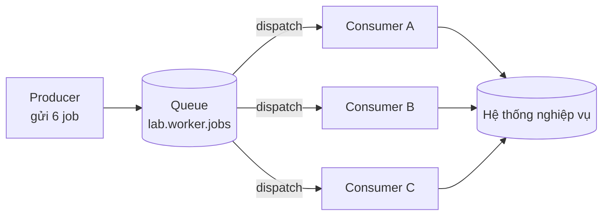
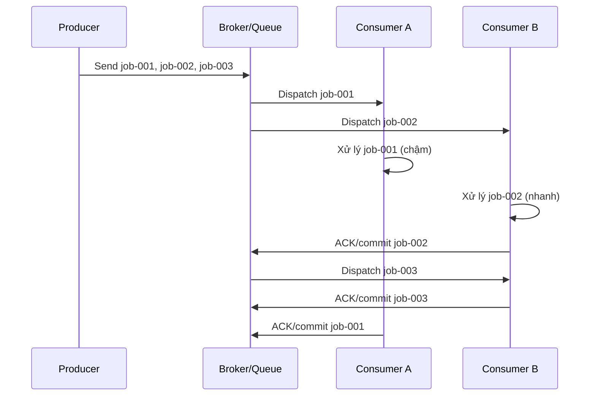
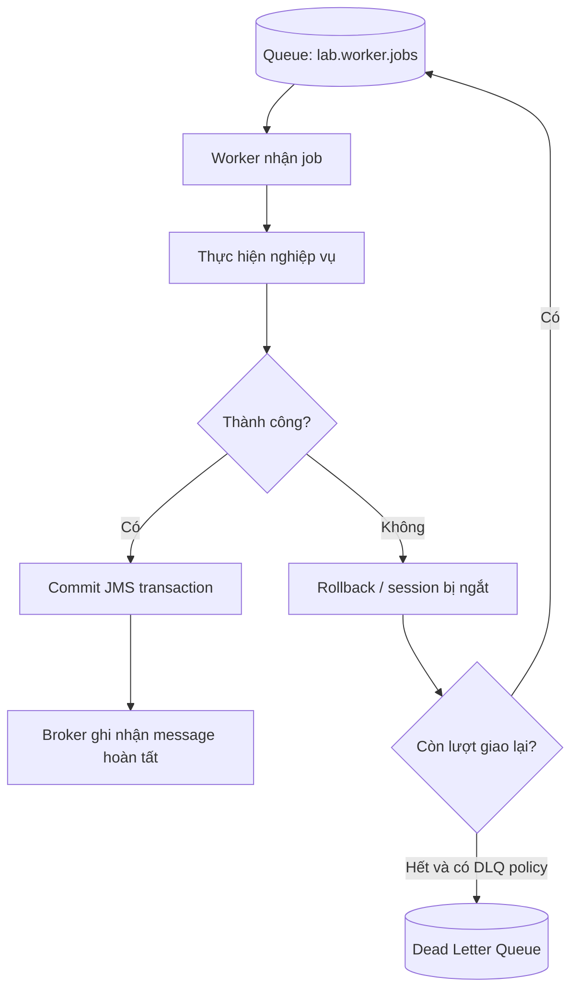

# Queue và mô hình nhiều consumer cạnh tranh xử lý

> **Chương:** Queue và Topic  
> **Phạm vi bài:** Cơ chế **queue** và **competing consumers** trong Apache ActiveMQ Classic/Artemis: một hàng đợi, nhiều worker độc lập, phân phối công việc, acknowledgment, giao lại, thứ tự, điều phối tải và thực hành Java JMS.  
> **Trọng tâm:** Hiểu chính xác điều gì xảy ra khi nhiều consumer cùng đọc **một queue**, thay vì học lại kiến trúc broker tổng quát hoặc triển khai mô hình topic.

## 1. Sau bài học, bạn làm được gì?

- Diễn giải được quy tắc **một message của queue được giao cho một consumer tại một thời điểm** và phân biệt **đã giao** với **đã xử lý thành công/đã ACK**.
- Tạo được **hai hoặc nhiều JMS consumer** độc lập cùng đăng ký một queue trên ActiveMQ Artemis, sau đó quan sát message được chia cho các worker.
- Giải thích vì sao chia tải **không bảo đảm round-robin**, ảnh hưởng của thời gian xử lý, message in-flight, prefetch/consumer window và tốc độ ACK.
- Chọn giữa **AUTO_ACKNOWLEDGE** và **transacted session** khi xử lý công việc; xử lý tình huống rollback, consumer chết và **redelivery**.
- Xây dựng consumer **idempotent**, hiểu giới hạn thứ tự xử lý với nhiều worker và biết khi nào cần **message group**.
- Ước lượng quy mô worker bằng tốc độ nhận/xử lý, giám sát backlog và thiết kế đường xử lý message lỗi không gây kẹt toàn hệ thống.

## 2. Queue và competing consumers: ngữ nghĩa cốt lõi

Giả sử hệ thống tiếp nhận yêu cầu tạo chứng từ. Mỗi yêu cầu là một công việc có `taskId` riêng; nhóm worker chạy nhiều bản sao của cùng một ứng dụng. Producer gửi lần lượt `job-001` đến `job-006` vào queue `lab.worker.jobs`.



Ba consumer **cạnh tranh nhận message từ cùng một queue** (*competing consumers*). Khi một message được phân phối cho A, broker không đồng thời phát bản sao của message đó cho B và C như mô hình broadcast. Sau khi A xử lý và xác nhận thành công theo chế độ JMS đang dùng, message được xem là hoàn tất và broker có thể loại khỏi hàng đợi.

Tuy nhiên, **không được diễn giải quy tắc này thành “nghiệp vụ chắc chắn chạy đúng một lần”**. Nếu A chết, rollback hoặc mất kết nối trước lúc broker ghi nhận ACK/commit, message có thể được giao lại cho A hoặc consumer khác. Nếu A đã ghi vào database nhưng ACK thất bại, lần giao lại sẽ gây xử lý trùng nếu thiếu cơ chế idempotency.

### 2.1 Ba trạng thái cần phân biệt

| Trạng thái logic | Message đang ở đâu? | Ý nghĩa thực tế |
|---|---|---|
| **Ready / pending** | Nằm trong queue, chưa được giao đến consumer. | Một consumer đủ điều kiện có thể nhận công việc. |
| **Dispatched / in-flight** | Đã chuyển cho consumer hoặc nằm trong bộ đệm phía client, chờ xử lý/xác nhận. | Không nên tính nó là đã xử lý xong; có thể được giao lại khi consumer lỗi. |
| **Acknowledged / committed** | Broker đã ghi nhận hoàn tất thao tác nhận theo chế độ JMS. | Message được giải phóng khỏi queue; trạng thái ở database ngoài JMS vẫn cần tự bảo đảm. |

Tên metric trong web console có thể khác giữa Classic và Artemis. Ví dụ, Artemis thường hiển thị **message count**, **delivering count** và **consumer count** để phản ánh số message trong queue, số đang giao và số consumer, nhưng ý nghĩa chính xác và cách đếm cần đối chiếu với phiên bản broker khi giám sát.

### 2.2 Một timeline phân phối minh họa



Đây là **một tình huống khả dĩ**, không phải lịch phân phối bắt buộc. Thứ tự gửi là 001 → 002 → 003, nhưng thứ tự **hoàn tất** có thể là 002 → 003 → 001. Broker không hứa sẽ chia số job tuyệt đối bằng nhau cho các consumer.

### 2.3 Khác biệt ngắn với topic

Để quyết định đúng mô hình, chỉ cần nhớ: **nhiều consumer trên cùng queue** thường **chia** tập công việc; **nhiều subscription topic** thường **nhận bản sao riêng** của cùng sự kiện. Chạy thêm worker cho một queue không tạo thêm bản sao công việc để mọi worker cùng xử lý. Nếu cả Kho và Kế toán đều phải xử lý riêng một sự kiện, cần thiết kế nhiều subscription/queue phù hợp thay vì đăng ký hai hệ thống vào cùng một queue và kỳ vọng cả hai đều nhận.

## 3. Một queue trên Classic và Artemis được biểu diễn thế nào?

Ở lớp **JMS**, Java khai báo `Queue queue = context.createQueue("lab.worker.jobs")`. Cả ActiveMQ Classic và Artemis đều hỗ trợ khái niệm này. Điểm khác là cấu hình phía broker:

| ActiveMQ Classic | ActiveMQ Artemis |
|---|---|
| JMS queue tương ứng một destination kiểu Queue, ví dụ `lab.worker.jobs`. | JMS queue thông thường được ánh xạ đến một **address** có routing **ANYCAST** và một **queue** gắn với address đó. |
| Nhiều consumer cùng lắng nghe một destination queue để chia message. | Nhiều consumer cùng lắng nghe **cùng một queue** trên address ANYCAST để chia message. |
| Có cơ chế **prefetch** phía consumer có thể ảnh hưởng phân phối công việc. | Có **consumer credit/window** và message delivery/in-flight có thể ảnh hưởng phân phối công việc. |
| Chính sách redelivery/DLQ thường liên quan `RedeliveryPolicy` và `deadLetterStrategy`. | Broker hỗ trợ `address-settings` cho redelivery, max-delivery-attempts và dead-letter-address. |

Ví dụ một phần cấu hình **`broker.xml` của Artemis** cho queue công việc được tạo trước:

```xml
<addresses>
    <address name="lab.worker.jobs">
        <anycast>
            <queue name="lab.worker.jobs" durable="true"/>
        </anycast>
    </address>
</addresses>
```

Đây là **đoạn con** đặt trong vị trí `<addresses>` thích hợp của cấu hình broker hiện có, không phải toàn bộ file `broker.xml`. Nếu queue đã được tạo tự động, không khai báo trùng mà không kiểm tra cấu hình. `durable="true"` nói về queue; để message tồn tại qua khởi động lại còn phụ thuộc **persistent delivery**, cơ chế lưu trữ và chính sách broker.

Trong ví dụ này, một địa chỉ có một queue nên những consumer cùng đọc `lab.worker.jobs` là competing consumers. Artemis cũng cho phép mô hình address/queue phong phú hơn; **nhiều queue dưới một address** không đồng nghĩa với nhiều consumer dưới **cùng một queue**. Khi chẩn đoán, cần đối chiếu đúng tên **address**, **queue** và **routing type**.

## 4. Cơ chế phân phối công việc và các yếu tố làm thay đổi kết quả

### 4.1 Không có bảo đảm chia đều

Giả sử A xử lý mỗi job trong 100 ms, B mất 1 giây. Khi queue có nhiều việc, A có thể hoàn thành nhiều job hơn B. Số lượng nhận còn phụ thuộc:

1. **Thời điểm consumer kết nối.** Consumer đến trước có thể được broker giao sẵn nhiều message.
2. **Prefetch/consumer window.** Message đã cấp phát cho một consumer có thể đang chờ trong buffer client dù worker chưa xử lý.
3. **Tốc độ xác nhận.** Worker commit nhanh thường sớm có khả năng nhận thêm công việc.
4. **Message selector, priority và grouping.** Các quy tắc lọc, ưu tiên và giữ nhóm có thể hạn chế consumer nào được nhận.
5. **Redelivery, lỗi mạng hoặc consumer disconnect.** Công việc đang giao có thể trở lại để worker khác xử lý.

Ví dụ kết quả quan sát có thể là:

| Worker | Tác vụ hoàn tất | Số tác vụ |
|---|---|---:|
| A | 001, 003, 005, 006 | 4 |
| B | 002, 004 | 2 |

Đây chỉ là **một kết quả minh họa**, không phải phân phối tất định. Chạy lại có thể cho tỉ lệ khác, kể cả khi số worker không đổi.

### 4.2 Prefetch và consumer window

Trong **ActiveMQ Classic**, prefetch có thể cho phép broker dispatch nhiều message tới một consumer trước khi consumer ACK từng message. Trong **Artemis**, cơ chế cấp tín dụng nhận theo **consumer window** kiểm soát lượng dữ liệu in-flight, thường tính theo kích thước dữ liệu chứ không đơn giản là số message.

Nếu consumer A giữ sẵn nhiều message nhưng xử lý rất chậm, B có thể rảnh trong khi một số job vẫn nằm ở bộ đệm của A. Khi giảm prefetch/window, phân phối có thể công bằng và phản hồi tải nhanh hơn nhưng tăng tương tác mạng, giảm throughput trong một số tình huống. Khi tăng quá cao, thông lượng có thể tốt hơn với message nhỏ nhưng tác động của worker chậm hoặc chết có thể lớn hơn.

**Không có một giá trị tối ưu chung.** Thử tải với kích cỡ message, RTT, thời gian xử lý và số worker thực tế; theo dõi queue depth, in-flight, processing latency trước khi điều chỉnh. Tránh lấy cấu hình `queuePrefetch` của Classic áp nguyên văn vào Artemis vì hai cơ chế và client API khác nhau.

### 4.3 Thêm consumer không luôn tăng throughput

Nếu 1 worker có thể xử lý 60 job/phút và dữ liệu đầu vào đến ở mức 240 job/phút, ba worker chỉ đạt khoảng 180 job/phút trong điều kiện lý tưởng: backlog vẫn tăng khoảng 60 job/phút. Bốn worker có thể theo kịp tốc độ đầu vào về mặt toán học, nhưng **không có dư công suất để xóa backlog cũ**. Năm worker có năng lực lý tưởng 300 job/phút, tạo dư 60 job/phút để xử lý backlog đang tồn, nếu database/API phía sau đáp ứng được.

Một ước lượng ban đầu:

\[
\mu_{\text{hệ thống}} \approx \min(N\times\mu_{\text{worker}},\ \mu_{\text{phụ thuộc}})
\]

Trong đó \(N\) là số worker, \(\mu_{\text{worker}}\) là tốc độ xử lý trung bình của một worker, \(\mu_{\text{phụ thuộc}}\) là giới hạn từ database/API/CPU/IO phía sau. Nếu tốc độ vào \(\lambda\) lớn hơn tốc độ ra thực tế, backlog sẽ tăng; tăng worker vượt giới hạn phụ thuộc chỉ có thể làm hệ thống quá tải hơn.

## 5. Thực hành Java JMS: hai worker cùng tiêu thụ một queue

Mục tiêu của lab là **thấy được competing consumers**, vì vậy producer sẽ gửi 12 message độc lập, hai process consumer cùng lắng nghe `lab.worker.jobs`, mỗi consumer commit message sau khi xử lý xong.

**Điều kiện của ví dụ:** JDK 17, Gradle 8.x và **Apache ActiveMQ Artemis** đang cho phép kết nối JMS TCP tại `tcp://localhost:61616`. Mặc định minh họa user `labuser` và password `labpass123` của môi trường thử nghiệm; thay bằng cấu hình thật của lab nếu khác. Broker cần cho phép tạo queue tự động hoặc đã khai báo `lab.worker.jobs` như ở phần 3.

### 5.1 Tạo cấu trúc dự án nhỏ

```text
queue-competing/
├── settings.gradle
├── build.gradle
└── src/
    └── main/
        └── java/
            └── lab/
                └── CompetingConsumersLab.java
```

**`settings.gradle`:**

```groovy
rootProject.name = 'queue-competing'
```

**`build.gradle`:**

```groovy
plugins {
    id 'java'
    id 'application'
}

repositories {
    mavenCentral()
}

java {
    toolchain {
        languageVersion = JavaLanguageVersion.of(17)
    }
}

dependencies {
    implementation 'jakarta.jms:jakarta.jms-api:3.1.0'
    implementation 'org.apache.activemq:artemis-jakarta-client:2.37.0'
    runtimeOnly 'org.slf4j:slf4j-simple:2.0.16'
}

application {
    mainClass = 'lab.CompetingConsumersLab'
}
```

Ví dụ chọn **Jakarta Messaging** (import `jakarta.jms.*`) và client Artemis phù hợp; các phiên bản thư viện được cố định để người học có đầu vào cụ thể, không đại diện cho bản mới nhất. **ActiveMQ Classic 5.x** thường dùng `activemq-client` với `javax.jms.*`; đổi broker/client cần kiểm tra API, dependency và cấu hình, không chỉ đổi URL.

### 5.2 Mã producer và consumer

Tạo file **`src/main/java/lab/CompetingConsumersLab.java`**:

```java
package lab;

import jakarta.jms.DeliveryMode;
import jakarta.jms.JMSConsumer;
import jakarta.jms.JMSContext;
import jakarta.jms.JMSException;
import jakarta.jms.JMSProducer;
import jakarta.jms.Message;
import jakarta.jms.Queue;
import jakarta.jms.TextMessage;
import org.apache.activemq.artemis.jms.client.ActiveMQConnectionFactory;

public final class CompetingConsumersLab {
    private static final String QUEUE_NAME = "lab.worker.jobs";

    private CompetingConsumersLab() { }

    public static void main(String[] args) throws Exception {
        if (args.length != 2 ||
                (!"send".equals(args[0]) && !"work".equals(args[0]))) {
            System.err.println("Usage: send <count> | work <workerName>");
            return;
        }

        String brokerUrl = env("BROKER_URL", "tcp://localhost:61616");
        String user = env("BROKER_USER", "labuser");
        String password = env("BROKER_PASSWORD", "labpass123");
        ActiveMQConnectionFactory factory =
                new ActiveMQConnectionFactory(brokerUrl);

        // Mỗi process có JMSContext/transaction RIÊNG.
        try (JMSContext context = factory.createContext(
                user, password, JMSContext.SESSION_TRANSACTED)) {
            Queue queue = context.createQueue(QUEUE_NAME);
            if ("send".equals(args[0])) {
                int count = Integer.parseInt(args[1]);
                if (count < 1 || count > 1000) {
                    throw new IllegalArgumentException(
                            "count must be between 1 and 1000");
                }
                sendJobs(context, queue, count);
            } else {
                consumeJobs(context, queue, args[1]);
            }
        }
    }

    private static void sendJobs(
            JMSContext context, Queue queue, int count) throws JMSException {
        JMSProducer producer = context.createProducer()
                .setDeliveryMode(DeliveryMode.PERSISTENT);

        for (int i = 1; i <= count; i++) {
            String taskId = String.format("job-%03d", i);
            TextMessage message = context.createTextMessage(
                    "Render document for " + taskId);
            message.setStringProperty("taskId", taskId);
            producer.send(queue, message);
        }
        // Commit cả lô message trong transaction của producer.
        context.commit();
        System.out.println("SENT " + count + " jobs to " + QUEUE_NAME);
    }

    private static void consumeJobs(
            JMSContext context, Queue queue, String workerName)
            throws InterruptedException {
        JMSConsumer consumer = context.createConsumer(queue);
        long processingMs = Long.parseLong(env("LAB_WORK_MS", "500"));
        if (processingMs < 0) {
            throw new IllegalArgumentException("LAB_WORK_MS must be >= 0");
        }

        System.out.println("Worker " + workerName
                + " listening on " + QUEUE_NAME
                + " (stop with Ctrl+C)");
        while (true) {
            Message message = consumer.receive(5_000);
            if (message == null) {
                // Queue trống tạm thời; worker tiếp tục chờ.
                continue;
            }

            String taskId = null;
            try {
                taskId = message.getStringProperty("taskId");
                System.out.println(workerName + " PROCESSING " + taskId
                        + ", redelivered=" + message.getJMSRedelivered());

                // Thay bằng nghiệp vụ idempotent trong ứng dụng thực.
                Thread.sleep(processingMs);

                // Commit session JMS xác nhận message đã nhận.
                context.commit();
                System.out.println(workerName + " COMMITTED " + taskId);
            } catch (InterruptedException interrupted) {
                context.rollback();
                Thread.currentThread().interrupt();
                throw interrupted;
            } catch (Exception error) {
                // Rollback để broker có thể giao lại theo chính sách.
                context.rollback();
                System.err.println(workerName + " FAILED " + taskId
                        + ": " + error.getMessage());
            }
        }
    }

    private static String env(String name, String defaultValue) {
        String value = System.getenv(name);
        return value == null || value.isBlank()
                ? defaultValue : value;
    }
}
```

**Các quyết định quan trọng trong code:**

1. Cả hai consumer tạo destination cùng tên **`lab.worker.jobs`**; mỗi process kết nối riêng nên cạnh tranh nhận từ **cùng queue**.
2. Mỗi consumer có một `JMSContext` ở chế độ **`SESSION_TRANSACTED`**, commit **sau mỗi job**. `JMSContext`/session không được tùy tiện dùng đồng thời từ nhiều thread; nếu chạy nhiều consumer trong cùng một JVM, cấp session/context riêng cho từng worker.
3. Producer dùng `PERSISTENT` và commit sau khi gửi hết lô. Consumer không dùng `AUTO_ACKNOWLEDGE` để tránh ACK trước bước giả lập xử lý.
4. `taskId` là **định danh nghiệp vụ ổn định** phục vụ đối soát/idempotency; `JMSMessageID` là ID do provider cấp, không nên coi là khóa nghiệp vụ cho mọi lần producer thử gửi lại.
5. `Thread.sleep` chỉ mô phỏng thời gian xử lý, **không đại diện cho transaction database**. Nếu business logic thực sự ghi dữ liệu ngoài broker, phải có chiến lược commit/idempotency riêng.

### 5.3 Chạy hai worker và quan sát chia tải

Từ thư mục chứa `build.gradle`, nếu dự án chưa có wrapper, có thể tạo bằng `gradle wrapper --gradle-version 8.10.2` sau khi cài Gradle tương thích. Tạo bản phân phối ứng dụng một lần:

```bash
./gradlew installDist
```

Trên Windows PowerShell, dùng `.\gradlew.bat installDist`. Lệnh `installDist` sinh script và runtime dependencies để các terminal chạy **các Java process độc lập**; điều này giúp quan sát cạnh tranh nhận rõ hơn so với chạy nhiều Gradle build song song.

**Linux/macOS — mở ba terminal:**

```bash
# Terminal A (worker A):
./build/install/queue-competing/bin/queue-competing work A

# Terminal B (worker B):
./build/install/queue-competing/bin/queue-competing work B

# Terminal C (producer, chạy sau khi A và B đã sẵn sàng):
./build/install/queue-competing/bin/queue-competing send 12
```

**Windows PowerShell — ba terminal tương tự:**

```powershell
# Terminal A:
.\build\install\queue-competing\bin\queue-competing.bat work A

# Terminal B:
.\build\install\queue-competing\bin\queue-competing.bat work B

# Terminal C:
.\build\install\queue-competing\bin\queue-competing.bat send 12
```

Nếu broker yêu cầu thông tin đăng nhập/URL khác, đặt `BROKER_URL`, `BROKER_USER`, `BROKER_PASSWORD` cho **từng terminal** trước khi chạy. Tài khoản/password hardcode mặc định chỉ để dùng trong môi trường lab cục bộ, không đưa vào mã production.

Kết quả minh họa (thứ tự thay đổi tùy tải):

```text
# Terminal C
SENT 12 jobs to lab.worker.jobs

# Terminal A
Worker A listening on lab.worker.jobs (stop with Ctrl+C)
A PROCESSING job-001, redelivered=false
A COMMITTED job-001
A PROCESSING job-003, redelivered=false
A COMMITTED job-003
...

# Terminal B
Worker B listening on lab.worker.jobs (stop with Ctrl+C)
B PROCESSING job-002, redelivered=false
B COMMITTED job-002
B PROCESSING job-004, redelivered=false
B COMMITTED job-004
...
```

Không nên kỳ vọng chính xác “A nhận số lẻ, B nhận số chẵn”. Sau khi hai worker đã nhận và commit hết 12 công việc, **mỗi `taskId` nên xuất hiện đúng một lần trong tập log `COMMITTED` của một lần chạy bình thường không có sự cố**. Nếu worker bị gián đoạn trong lúc xử lý hoặc nhà sản xuất phát lại cùng `taskId`, có thể nhìn thấy `PROCESSING` trùng; log chỉ hỗ trợ quan sát, không chứng minh **exactly-once** ở tầng nghiệp vụ.

**Thí nghiệm phân phối không đều:** ở terminal A, trước khi chạy worker, đặt `LAB_WORK_MS=3000`, còn B để mặc định 500 ms. Trong PowerShell:

```powershell
$env:LAB_WORK_MS = "3000"
```

Trong Bash/Zsh:

```bash
export LAB_WORK_MS=3000
```

Chạy lại hai worker với queue trống rồi gửi 12 công việc. Worker A xử lý chậm hơn, nhưng phân phối thực tế vẫn chịu ảnh hưởng prefetch/consumer window, lịch dispatch và ACK. Không dùng kết quả một lần chạy để kết luận thuật toán phân phối của broker.

## 6. ACK, transaction và lỗi khi worker đang giữ message

### 6.1 Chính xác khi nào broker coi job đã hoàn tất?

Với consumer dùng `SESSION_TRANSACTED`, broker coi các message đã nhận trong phiên giao dịch JMS được xác nhận khi `context.commit()` thành công. Nếu `rollback()`, giao dịch nhận chưa hoàn tất và message có thể được broker giao lại theo redelivery policy.



`AUTO_ACKNOWLEDGE` phù hợp ứng dụng đơn giản nhưng thường không kiểm soát chính xác thời điểm ACK gắn với việc ghi database khi sử dụng API receive đồng bộ. Transacted session tạo được ranh giới ACK rõ ràng cho phần JMS, tuy vậy **JMS transaction không tự bao gồm giao dịch database/JPA/REST phía ngoài**.

### 6.2 Bốn kịch bản cần phân tích

| Tình huống | Broker có thể làm gì? | Điều kiện để nghiệp vụ vẫn đúng |
|---|---|---|
| Worker chưa nhận job và bị dừng | Job còn pending trong queue nếu lưu giữ đúng. | Worker khác tiếp tục xử lý khi sẵn sàng. |
| Worker nhận job nhưng chết **trước commit** | Job có thể được broker giao lại sau khi xác định phiên nhận không còn hợp lệ. | Không dựa vào giả định job chưa từng chạy; consumer phải idempotent. |
| Worker ghi DB thành công nhưng chết **trước JMS commit** | Job có thể được giao lại dù DB đã thay đổi. | Lưu `taskId` đã xử lý và chống lặp trong transaction database. |
| Worker commit JMS thành công rồi lỗi ứng dụng | Theo ngữ nghĩa JMS, job đã ACK nên broker thường không tự giao lại. | Chỉ commit sau khi hiệu ứng nghiệp vụ đã được lưu chắc chắn. |

Việc broker phát hiện mất kết nối có thể có độ trễ; worker cũ và worker mới trong tình huống network partition có thể có **thời gian chồng lấn** về xử lý. Vì vậy điều kiện không trừ tiền hai lần hoặc không tạo hai chứng từ phải được bảo vệ ở **tầng dữ liệu nghiệp vụ**, không chỉ ở cơ chế queue.

### 6.3 Thử nghiệm redelivery có chủ đích

Để quan sát (chỉ trên môi trường lab), có thể đặt `LAB_WORK_MS=20000` cho worker A, chạy worker B bình thường và gửi một nhóm công việc. Khi A in `PROCESSING job-... ` mà chưa in `COMMITTED`, dừng cưỡng bức **đúng process worker A** để giả lập crash, rồi theo dõi B/queue trên console. Broker có thể giao lại job chưa commit khi phát hiện kết nối mất, và lúc đó `JMSRedelivered` thường sẽ là `true`.

Đây không phải phép thử bảo đảm kết quả xảy ra theo một mốc thời gian cố định: message có thể đang được prefetch, broker cần thời gian nhận biết ngắt kết nối và số lượt redelivery phụ thuộc cấu hình. Thử nghiệm không nên thực hiện trên queue production hoặc dùng lệnh xóa dữ liệu broker.

## 7. Idempotency: bảo vệ nghiệp vụ khi nhận trùng

Giả sử worker tạo hóa đơn từ `job-007`. Một lần thực thi đã lưu thành công hóa đơn vào database, nhưng kết nối JMS chết trước commit. Broker giao lại `job-007` cho worker khác. Nếu mỗi lần nhận lại gọi `INSERT invoice` mới không kiểm tra khóa, khách hàng có thể nhận hai hóa đơn.

Một cách xây dựng consumer idempotent là đặt **unique constraint** lên định danh job đã xử lý và ghi dấu xử lý **trong cùng transaction database với thay đổi nghiệp vụ**. Ví dụ với PostgreSQL:

```sql
CREATE TABLE processed_jobs (
    task_id VARCHAR(100) PRIMARY KEY,
    processed_at TIMESTAMPTZ NOT NULL DEFAULT now()
);
```

Quy trình xử lý một job:

1. Bắt đầu transaction database.
2. Thử ghi `taskId` vào `processed_jobs`. Nếu đã tồn tại, xem job là đã xử lý và không tạo lại hiệu ứng nghiệp vụ.
3. Nếu đây là job mới, thực hiện thay đổi nghiệp vụ (ví dụ ghi chứng từ) **trong cùng transaction database**.
4. Commit database.
5. **Sau khi database commit thành công**, commit phiên JMS để ACK message.

Minh họa phần transaction PostgreSQL cho một `taskId` mới:

```sql
BEGIN;

INSERT INTO processed_jobs (task_id)
VALUES (:task_id)
ON CONFLICT (task_id) DO NOTHING
RETURNING task_id;

-- Chỉ tạo/sửa dữ liệu nghiệp vụ nếu INSERT trả về một dòng.
-- Các thao tác nghiệp vụ tiếp theo nằm trong CÙNG transaction này.

COMMIT;
-- Ứng dụng Java mới gọi context.commit() cho JMS SAU bước trên.
```

Đoạn SQL mô tả một cơ chế; trong Java cần kiểm tra số dòng thực sự insert và dùng connection/transaction database thống nhất. Nếu transaction DB thất bại, rollback DB và rollback JMS. Nếu DB đã commit nhưng JMS commit thất bại, lần redelivery được nhận biết qua `processed_jobs` và có thể ACK lại mà không thực hiện nghiệp vụ lần thứ hai.

**Lưu ý định danh:** nếu producer retry gửi **cùng công việc**, `taskId` phải giữ nguyên. Nếu mỗi lần retry lại tạo ID mới, bảng dedupe không phát hiện được sự kiện trùng nghiệp vụ. Nếu một task hợp lệ cần chạy nhiều lần theo lịch, hãy định nghĩa khóa theo **lần thực hiện dự kiến**, tránh chặn nhầm.

## 8. Thứ tự, đồng thời và message grouping

### 8.1 Queue FIFO không đồng nghĩa hoàn tất theo FIFO

Với một producer và một consumer xử lý tuần tự, các message thông thường có thể được nhận theo thứ tự enqueue trong điều kiện không có ưu tiên, selector hoặc redelivery làm thay đổi. Khi có nhiều consumer:

- `job-001` có thể do A xử lý trong 10 giây;
- `job-002` do B xử lý trong 100 ms;
- `job-002` hoàn tất trước `job-001`.

Các cơ chế priority, prefetch, rollback và multiple producers cũng có thể ảnh hưởng thứ tự quan sát. Nếu nghiệp vụ bắt buộc `OrderUpdated(version=2)` chỉ chạy **sau** version 1, không được chỉ dựa vào “cùng queue” và “đã gửi đúng thứ tự”.

### 8.2 Giải pháp: group theo khóa nghiệp vụ

ActiveMQ Classic và Artemis hỗ trợ cơ chế **message groups** để giữ các message cùng nhóm gắn với một consumer nhất định trong một khoảng thời gian, tùy implementation/cấu hình. Từ producer, đặt property chuẩn thường dùng `JMSXGroupID` theo khóa nghiệp vụ:

```java
TextMessage message = context.createTextMessage("Update order");
message.setStringProperty("taskId", "ORD-101-v2");
message.setStringProperty("JMSXGroupID", "ORD-101");
producer.send(queue, message);
```

Các cập nhật cho `ORD-101` dùng cùng `JMSXGroupID`; các đơn hàng khác có group khác nên vẫn có thể được xử lý song song. Cơ chế này nhằm giữ **affinity** khi dispatch, không tạo transaction giữa nhiều message, không loại trùng và không bảo đảm hệ thống ngoài JMS quan sát đúng thứ tự nếu worker tự chạy nhiều tác vụ đồng thời trong một group.

**Đánh đổi:** một nhóm quá “nóng” có thể khiến một worker bị quá tải trong khi worker khác rảnh. Với yêu cầu nhất quán mạnh hơn, cân nhắc thêm **version check**, optimistic locking, deduplication hoặc tổ chức lại khóa grouping.

### 8.3 Consumer selector và chia việc theo loại

Trong JMS, `MessageSelector` cho phép consumer chỉ nhận message khớp property, ví dụ:

```java
JMSConsumer northConsumer =
        context.createConsumer(queue, "region = 'north'");
```

Nếu consumer chỉ nhận `region='north'` mà queue tồn nhiều job `region='south'`, những job `south` có thể ở lại backlog nếu không có consumer phù hợp. Đây là **lọc trên cùng queue**, không tạo ra các subscription độc lập kiểu topic. Với nhu cầu tách quyền sở hữu, độ ưu tiên hoặc SLO, đôi khi nên tạo **nhiều queue riêng** thay vì lạm dụng selector trên một queue lớn.

## 9. Redelivery, retry và DLQ khi nhiều consumer cùng xử lý

Một message có payload không hợp lệ có thể khiến **mọi worker đều thất bại**. Nếu rollback rồi giao lại vô hạn, hệ thống tiêu tốn CPU/log và có thể làm chậm các job lành mạnh. Cần phân biệt:

- **Lỗi tạm thời:** timeout database, phụ thuộc ngoài chưa sẵn sàng → retry có giới hạn, backoff.
- **Lỗi vĩnh viễn:** message thiếu trường bắt buộc, mã không hợp lệ → chuyển DLQ sớm để điều tra.
- **Lỗi do concurrency:** hai worker tranh chấp cùng aggregate hoặc tài nguyên → dùng khóa/version, giới hạn đồng thời, retry có kiểm soát.

Một phần cấu hình **Artemis `broker.xml`** minh họa cho queue demo:

```xml
<address-settings>
    <address-setting match="lab.worker.jobs">
        <dead-letter-address>DLQ</dead-letter-address>
        <max-delivery-attempts>5</max-delivery-attempts>
        <redelivery-delay>2000</redelivery-delay>
    </address-setting>
</address-settings>
```

Đây chỉ là **đoạn cấu hình** để chèn vào phần `address-settings` hiện có; không tạo thêm phần tử cùng tên nếu cấu hình đã có. Để xử lý message sau khi vượt ngưỡng và đưa vào DLQ, **DLQ address/queue phải tồn tại hoặc được cấu hình tự tạo thích hợp**. Có thể khai báo ví dụ:

```xml
<addresses>
    <address name="DLQ">
        <anycast>
            <queue name="DLQ" durable="true"/>
        </anycast>
    </address>
</addresses>
```

Trong cấu hình thực, phần `<addresses>` còn chứa queue `lab.worker.jobs` và các address khác; hai đoạn ở đây không phải hai file broker độc lập. Cấu hình này cần kiểm tra tương thích với phiên bản Artemis hiện chạy, khởi động lại/reload theo tài liệu broker và thử nghiệm chỉ trên môi trường lab.

Trên **ActiveMQ Classic**, chính sách redelivery và DLQ sử dụng cơ chế khác (ví dụ client `RedeliveryPolicy`, broker `deadLetterStrategy`); không sao chép trực tiếp XML Artemis vào `activemq.xml` Classic. Sau khi message vào DLQ, quy trình vận hành nên lưu nguyên nhân, phân loại, sửa dữ liệu/code, rồi replay **có giới hạn và chống trùng**. Không phát lại toàn bộ DLQ vô điều kiện.

## 10. Thiết kế worker chạy production

### 10.1 Concurrency và tài nguyên

Một worker process có thể chạy nhiều consumer trong cùng JVM, nhưng mỗi session/context JMS phải được sử dụng theo quy tắc đồng thời của JMS; cách dễ quản lý nhất là **mỗi luồng worker có session/context riêng**. Thay vì tăng số consumer cho đến khi CPU bão hòa, hãy đo cả độ trễ database, số kết nối, I/O và throughput toàn hệ thống.

Ví dụ cùng máy chạy 8 consumer, mỗi consumer mở tối đa 5 connection database riêng có thể làm cạn pool nhanh hơn một cấu hình 4 consumer có backpressure phù hợp. Không tính năng lực chỉ theo số message/s ở broker; theo dõi **thời gian hoàn tất tác vụ nghiệp vụ**.

### 10.2 Cơ chế dừng worker và xử lý lỗi

Một worker tốt cần:

1. Dừng nhận message mới khi được yêu cầu shutdown, hoàn thành hoặc rollback các job đang xử lý rồi mới đóng kết nối.
2. Phân loại lỗi để không rollback vòng lặp vô hạn; phải có redelivery/DLQ và cảnh báo.
3. Ghi log `taskId`, worker ID, thời gian xử lý, correlation ID và thông tin redelivery; hạn chế log dữ liệu nhạy cảm.
4. Áp timeout cho dependency và quản lý giới hạn concurrent requests để tránh worker bị treo vô thời hạn.
5. Sẵn sàng xử lý lại cùng `taskId` sau failover, reconnect và crash.

Ví dụ `while (true)` ở phần lab chỉ để quan sát cạnh tranh phân phối và cần dừng thủ công. Production nên chạy worker dưới service/container orchestrator có tín hiệu shutdown, health check và lifecycle quản lý riêng.

### 10.3 Những metric nên xem trước khi scale

| Metric | Khi tăng hoặc bất thường thì nghĩ đến |
|---|---|
| Ready messages / queue backlog | Tốc độ nhận nhanh hơn tốc độ xử lý; consumer ít hoặc bị nghẽn. |
| In-flight / delivering messages | Nhiều message đã dispatch nhưng chưa ACK, có thể do worker chậm/prefetch cao. |
| Consumer count / disconnect rate | Thiếu worker, worker crash liên tục hoặc mạng không ổn định. |
| Enqueue và acknowledged/dequeue rate | Đầu vào/đầu ra mất cân bằng; cần đo xu hướng theo thời gian. |
| Processing latency và oldest message age | Người dùng chịu độ trễ, có thể có job bị kẹt dù backlog nhỏ. |
| Rollback/redelivery rate | Lỗi lặp, xung đột dữ liệu, phụ thuộc ngoài chập chờn. |
| DLQ depth và tốc độ tăng DLQ | Message độc, schema sai, code consumer lỗi hoặc chính sách retry chưa phù hợp. |
| DB connection, CPU, memory, I/O | Xác định giới hạn thực sự trước khi tăng số worker. |

Với Artemis, kiểm tra queue/address bằng web console hoặc management API; với Classic dùng console/JMX và metric exporter thích hợp. Tên metric cụ thể phụ thuộc phiên bản và công cụ giám sát. Nên đặt cảnh báo theo **độ tuổi message**, **tỉ lệ lỗi** và **thời gian hoàn tất**, không chỉ theo queue depth.

## 11. Những hiểu nhầm hay gây lỗi

| Hiểu nhầm | Điều đúng cần nhớ |
|---|---|
| “Có hai consumer thì mỗi message đến cả hai.” | Cùng **một queue** thì các consumer cạnh tranh nhận; một message không được broadcast như một topic có nhiều subscription. |
| “Hai worker chia đúng 50–50.” | Phân phối chịu ảnh hưởng tốc độ xử lý, prefetch/consumer credit, kết nối và lịch dispatch; không có bảo đảm chia đều. |
| “Queue bảo đảm đúng một lần.” | Redelivery có thể gây chạy lại; idempotency ở nghiệp vụ là bắt buộc khi hiệu ứng không được lặp. |
| “ACK nghĩa là database chắc chắn đã commit.” | ACK/commit JMS chỉ liên quan ngữ nghĩa messaging nếu không có giao dịch phân tán được cấu hình cụ thể. |
| “Queue có thứ tự FIFO nên việc hoàn thành luôn FIFO.” | Nhiều worker có thể hoàn tất không theo thứ tự; redelivery/priority còn làm tình hình phức tạp hơn. |
| “Thêm consumer sẽ luôn nhanh hơn.” | Có giới hạn CPU/IO/DB; quá nhiều consumer làm tăng contention và latency. |
| “Tăng prefetch càng cao càng tốt.” | Prefetch/window lớn có thể gây phân phối không đều hoặc tăng message in-flight khi worker chậm. |
| “Retry lỗi mãi rồi sẽ thành công.” | Poison message cần được phát hiện và chuyển DLQ, với quy trình xử lý riêng. |

## 12. Bài tập kiểm chứng và câu hỏi tự đánh giá

### Thực hành quan sát

1. Khởi động **hai worker** độc lập với `LAB_WORK_MS=500`, gửi 12 message, ghi lại phân phối theo worker và kiểm tra các `taskId` đã commit.
2. Đổi worker A thành `LAB_WORK_MS=3000`; thử lại khi queue trống, so sánh số job hoàn tất theo worker. Giải thích tại sao kết quả không thể suy chỉ từ số worker.
3. Khởi động **ba worker**, gửi 30 message; so sánh throughput/latency với hai worker. Quan sát backlog và in-flight trong broker console.
4. Với queue lab không chứa dữ liệu quan trọng, cố tình dừng một worker trước khi `COMMITTED`. Quan sát redelivery và nhận diện vì sao cùng `taskId` có thể xuất hiện nhiều lần trong log xử lý.
5. Sửa producer để gửi hai message có `JMSXGroupID="ORD-101"` và hai message `JMSXGroupID="ORD-102"`; kiểm tra worker nào nhận các message cùng group và giải thích giới hạn về thứ tự hoàn tất.

### Câu hỏi phân tích

1. Nếu broker báo **100 ready** và **20 delivering**, bạn có thể kết luận 20 message đã xử lý thành công chưa? Vì sao?
2. Một job đã ghi database nhưng worker chết trước JMS commit. Vì sao broker có thể giao lại? Thiết kế `processed_jobs` xử lý vấn đề này thế nào?
3. Khi worker A chậm nhưng B còn rảnh, những yếu tố nào ngoài CPU có thể khiến A vẫn giữ nhiều message?
4. Khi nghiệp vụ yêu cầu cập nhật cùng một order đúng thứ tự, tại sao chỉ thêm consumer không giải quyết? Bạn chọn grouping hay version check trong điều kiện nào?
5. Khi backlog tăng 60 message/phút, vì sao thêm một worker đôi khi không giúp gì nếu database đã bão hòa?

### Checklist trước khi ứng dụng vào hệ thống thật

- [ ] Producer gửi đúng **queue** cần chia việc, không nhầm với topic/subscription.
- [ ] Mỗi worker có kết nối/session JMS độc lập và định danh để truy vết.
- [ ] Consumer chỉ ACK/commit sau khi nghiệp vụ đạt trạng thái an toàn.
- [ ] Có khóa idempotency ổn định qua các lần gửi lại và ràng buộc dữ liệu chống trùng.
- [ ] Có chính sách redelivery/backoff/DLQ đã thử với lỗi tạm thời và lỗi vĩnh viễn.
- [ ] Đã đo backlog, in-flight, processing latency và giới hạn tài nguyên trước khi scale.
- [ ] Nếu cần bảo đảm thứ tự theo khóa, đã có grouping/versioning thay vì mặc định trông chờ FIFO hoàn tất.
- [ ] Đã kiểm tra chênh lệch cấu hình giữa Classic và Artemis nếu hệ thống phải hỗ trợ cả hai.

**Kết luận:** Mô hình **competing consumers** cho phép nhiều worker chia việc trên **cùng một queue** và tăng khả năng xử lý bằng cách bổ sung năng lực tiêu thụ. Giá trị của mô hình đến từ việc kết hợp đúng dispatch, ACK/commit, redelivery, idempotency, kiểm soát thứ tự và điều tiết tải. **Một message được giao cho một consumer trong một lần phân phối không đồng nghĩa một thao tác nghiệp vụ chỉ chạy đúng một lần**; đó là ranh giới quan trọng nhất khi đưa ActiveMQ vào quy trình có trạng thái và dữ liệu thật.
