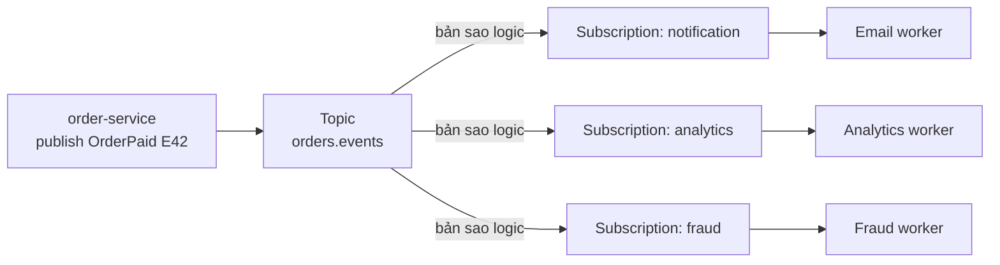
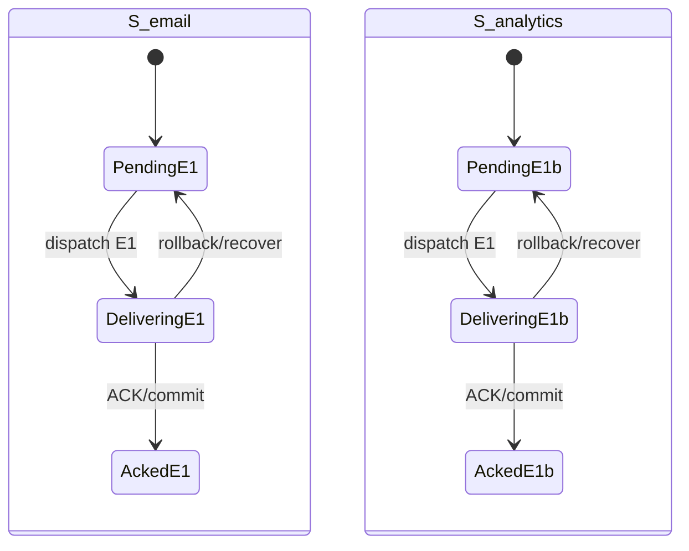
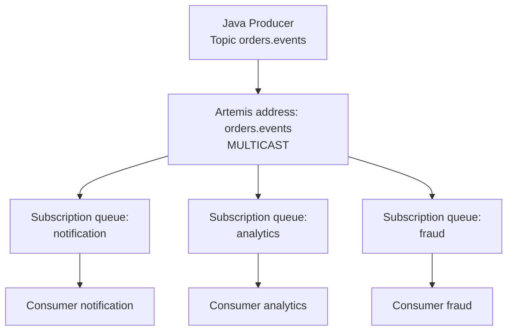

# Topic và mô hình mỗi subscription nhận một bản sao

> **Chương:** Queue và Topic  
> **Bối cảnh:** ActiveMQ Classic, ActiveMQ Artemis và ứng dụng Java dùng JMS.  
> **Trọng tâm:** Khi một message được publish lên topic, broker phân phối message cho **mỗi subscription đủ điều kiện** như thế nào, mỗi subscription giữ backlog và ACK độc lập ra sao, và lúc nào một subscriber không nhận được message.

## 1. Một sự kiện, nhiều nhóm xử lý độc lập

Giả sử `order-service` phát sự kiện `OrderPaid` lên topic `orders.events`. Ba nhóm quan tâm:

- **Notification:** gửi email cho khách hàng.
- **Analytics:** cập nhật báo cáo doanh thu.
- **Fraud detection:** đánh giá giao dịch bất thường.

Mong muốn là **mỗi nhóm đều nhìn thấy sự kiện**, thay vì ba nhóm cùng tranh nhau lấy một message. Notification đã xử lý và ACK không được làm mất sự kiện mà Analytics chưa nhận.



**Quy tắc nền tảng:** Với một lần publish hợp lệ lên topic, broker định tuyến message tới **từng subscription đang tồn tại và đủ điều kiện nhận**. Kể từ đó, mỗi subscription có vòng đời giao nhận riêng.

Điểm quan trọng nằm ở cụm **“từng subscription”**, không phải “từng consumer process” và cũng không phải “mọi subscriber từng xuất hiện trong quá khứ”.

## 2. “Mỗi subscription một bản sao” thực sự có nghĩa gì?

Ta cần tách ba khái niệm:

| Khái niệm | Ví dụ | Vai trò |
|---|---|---|
| **Topic** | `orders.events` | Destination mà producer publish một sự kiện |
| **Subscription** | `notification`, `analytics` | Quan hệ đăng ký nhận message; quyết định một luồng giao nhận, selector và trạng thái nhận độc lập |
| **Consumer** | `notification-worker-1` | Tiến trình/đối tượng lấy message từ subscription để xử lý |

Mô hình có thể phát biểu như sau:

> Nếu có \(N\) subscription **đang có hiệu lực** và **khớp điều kiện định tuyến/lọc** tại thời điểm publish, mỗi subscription nhận một **bản sao logic** của message. Broker không nhất thiết phải tạo \(N\) bản sao đầy đủ của toàn bộ payload trên đĩa.

Ở cấp broker, “bản sao” có thể là một message reference trong từng queue của subscription, dùng chung một phần dữ liệu vật lý theo cách triển khai. Điều có ý nghĩa đối với ứng dụng là:

- Subscription A ACK message của mình **không** làm subscription B tự động ACK.
- A chậm có thể tích lũy backlog của A; B vẫn tiếp tục xử lý.
- A rollback có thể bị redelivery trong A mà không buộc B nhận lại.
- Selector hoặc vòng đời subscription quyết định liệu message có được đưa vào A hay không.
- Các bản sao logic có thể **hết hạn** hoặc chuyển tới **DLQ** theo chính sách của từng queue; vì thế “nhận một bản sao” không bảo đảm nghiệp vụ được xử lý thành công.

### 2.1. Diễn biến cụ thể với hai subscription

Giả sử `S_email` và `S_analytics` là hai **durable subscription** đã được đăng ký từ trước. Cả hai tạm offline. Producer publish `E1` và `E2`, rồi Analytics kết nối trước.

| Thời điểm | Hành động | `S_email` | `S_analytics` |
|---|---|---|---|
| \(t_0\) | Tạo hai durable subscription, sau đó ngắt consumer | Không có backlog | Không có backlog |
| \(t_1\) | Publish `E1`, `E2` | Chờ `E1`, `E2` | Chờ `E1`, `E2` |
| \(t_2\) | Analytics nhận `E1` và commit | Chờ `E1`, `E2` | Còn `E2` |
| \(t_3\) | Analytics nhận `E2` và commit | Chờ `E1`, `E2` | Rỗng |
| \(t_4\) | Email kết nối, nhận `E1` | `E1` đang giao, `E2` chờ | Rỗng |
| \(t_5\) | Email commit `E1` rồi `E2` | Rỗng | Rỗng |

**Kết luận từ bảng:** Hai subscription đã nhận **cùng hai event ID** nhưng có thời điểm xử lý, backlog và ACK khác nhau. Broker không chờ mọi subscription cùng ACK rồi mới cho một subscriber tiếp tục.

### 2.2. ACK thuộc về bản sao trong subscription



Trong ví dụ, ACK ở `S_analytics` không xóa bản sao đang chờ của `S_email`. Điều này cũng đúng khi hai subscription cùng sử dụng một tên topic và cùng filter, miễn chúng là **hai định danh subscription độc lập**.

## 3. Vì sao không phải tất cả subscriber đều nhận mọi message?

Câu nói “mỗi subscriber nhận một bản sao” thường bị hiểu quá rộng. Trong thực tế, phải xét **thời điểm đăng ký**, **kiểu subscription** và **điều kiện lọc**.

### 3.1. Non-durable subscription: chỉ tồn tại khi đang hoạt động

Với non-durable subscriber thông thường:

1. Consumer kết nối, subscribe vào topic.
2. Broker bắt đầu chuyển các message phù hợp trong thời gian subscription hoạt động.
3. Consumer đóng và subscription kết thúc.
4. Message publish khi subscription không tồn tại **không được giữ lại** để consumer non-durable mới đến nhận lại.

Ví dụ:

```text
10:00:00  email-service OFFLINE
10:00:01  Producer publish E1
10:00:02  email-service tạo non-durable subscriber
10:00:03  Producer publish E2

Kết quả thường gặp:
  email-service không nhận E1;
  email-service nhận E2 nếu kết nối và phân phối hoạt động.
```

Đây không phải lỗi mất message của broker. Đó là semantics của **non-durable topic subscription**. Một topic cũng không tự lưu vô hạn mọi sự kiện để cấp lại cho những người đăng ký trong tương lai.

### 3.2. Durable subscription: giữ backlog khi subscriber offline

Với durable subscription:

1. Ứng dụng **đăng ký durable subscription trước**.
2. Consumer có thể đóng/ngắt kết nối, trong khi subscription vẫn tồn tại trên broker.
3. Những message phù hợp được publish sau khi subscription hình thành vẫn có thể được giữ để subscriber nhận khi quay lại.
4. Message đã ACK được loại khỏi backlog của subscription đó.
5. Khi **unsubscribe** durable subscription, backlog và danh tính subscription tương ứng có thể bị xóa.

**Durable** mô tả tuổi thọ của **subscription**, không đồng nghĩa mọi message đều sống mãi. TTL/expiry, storage policy, địa chỉ lưu, xóa tài nguyên và tình trạng broker vẫn ảnh hưởng khả năng nhận lại. Message ở delivery mode `PERSISTENT` thường cần thiết khi yêu cầu sống qua broker restart; cần cấu hình persistence và kiểm thử thực tế.

Trong JMS classic API, một non-shared durable subscription thường được định danh bằng **cặp** `clientID` và `subscriptionName`. Một client khác với `clientID` khác có thể tạo subscription độc lập dù dùng cùng `subscriptionName`. Hai kết nối hoạt động đồng thời thường không thể cùng tuyên bố một `clientID`.

### 3.3. Selector: chỉ subscription khớp điều kiện mới nhận

Giả sử event có thuộc tính:

```java
TextMessage event = session.createTextMessage("OrderPaid");
event.setStringProperty("region", "HCM");
event.setStringProperty("tier", "VIP");
producer.send(event);
```

Và hai subscription:

- `S_hcm` dùng selector `region = 'HCM'`.
- `S_hn` dùng selector `region = 'HN'`.

Event này có thể được định tuyến vào `S_hcm`, **không** vào `S_hn` vì filter không khớp. Vì vậy, số bản sao logic có thể nhỏ hơn tổng số subscription đã đăng ký.

Với JMS, selector sử dụng **message property/header** theo ngôn ngữ selector, không trực tiếp tìm chuỗi trong `TextMessage` body. Nếu một subscriber được tạo với selector khác khi reconnect, hãy kiểm tra quy tắc cập nhật subscription của broker/provider; có trường hợp cần unsubscribe và đăng ký lại, làm thay đổi backlog.

### 3.4. No-local và quyền truy cập cũng ảnh hưởng điều kiện nhận

Một JMS TopicSubscriber có thể khai báo `noLocal=true` để không nhận những message do **cùng connection** publish, tùy semantics và khả năng hỗ trợ của provider. Bên cạnh đó, quyền create/consume trên destination hoặc subscription có thể làm thao tác đăng ký thất bại.

Vì vậy, trước khi kết luận “Topic gửi thiếu bản sao”, cần xác minh subscription có thực sự tồn tại, có filter phù hợp và có quyền nhận hay không.

## 4. Mỗi subscription một bản sao khác gì nhiều consumer cùng một subscription?

Đây là ranh giới rất quan trọng khi tăng số lượng worker.

### 4.1. Hai subscription khác nhau: fan-out

```text
Topic orders.events
  |
  +--> Subscription A --> Consumer A   (nhận E1)
  |
  +--> Subscription B --> Consumer B   (nhận E1)
```

**E1 đi tới cả A và B** nếu cả hai subscription hợp lệ, tồn tại và khớp selector.

### 4.2. Hai consumer của cùng một shared subscription: chia việc

Khi JMS provider hỗ trợ **shared subscription** (JMS 2.0 hoặc API tương ứng):

```text
Topic orders.events
  |
  +--> Shared subscription Billing
          |
          +--> Billing worker 1
          +--> Billing worker 2

Một lần publish E1 -> một bản sao logic ở Billing
                   -> chỉ một worker xử lý một lượt giao E1
```

Không được suy luận rằng có hai process đăng ký shared subscription `Billing` thì `E1` phải đến cả hai process. Chúng là **hai consumer của cùng một subscription**, nên chúng chia tải nhận từ một luồng backlog.

| Mô hình | Số subscription logic | Một message phù hợp được phân phối theo cách nào? | Ca sử dụng |
|---|---:|---|---|
| Hai non-durable subscriber độc lập, đang online | 2 | Mỗi subscriber một bản sao | Hai dịch vụ cần cùng event khi đang chạy |
| Hai durable subscription khác tên/danh tính | 2 | Mỗi subscription một bản sao, backlog riêng | Email và Analytics độc lập, nhận cả khi offline |
| Hai consumer cùng shared subscription | 1 | Một bản sao ở subscription, một consumer nhận mỗi lượt giao | Scale-out một nhóm xử lý |
| Một queue JMS với hai competing consumers | 1 queue | Một message giao cho một consumer mỗi lượt | Phân chia công việc |
| Hai subscription với selector khác nhau | 2, nhưng không phải cả hai đều khớp | Chỉ subscription phù hợp nhận | Routing theo loại sự kiện |

**Lưu ý phiên bản:** `Session.createSharedDurableConsumer(...)` thuộc API JMS 2.0. Các project dùng `javax.jms` JMS 1.1 và `activemq-client` nhánh 5.x không thể giả định có method này hoặc broker luôn hỗ trợ. Nếu dùng shared subscription, kiểm tra đúng API/client/broker và phiên bản đang triển khai.

### 4.3. Khi một consumer trong shared subscription lỗi

Một message `E1` đã được giao cho worker 1 nhưng chưa ACK có thể được redeliver cho worker 2 theo chính sách. Đây vẫn là **lượt giao lại của một bản sao subscription**, không phải broker fan-out thêm một bản sao cho worker 2. Vì vậy, idempotency vẫn cần thiết dù các worker chia sẻ một subscription.

## 5. Cơ chế tại ActiveMQ Classic và Artemis

### 5.1. ActiveMQ Classic: topic và đối tượng subscription

Trong JMS API, producer tạo `Topic` rồi publish. ActiveMQ Classic quản lý các subscriber và durable subscription của topic; mỗi subscription đủ điều kiện có trạng thái dispatch/ACK riêng.

```java
Topic topic = session.createTopic("orders.events");
MessageProducer producer = session.createProducer(topic);
producer.send(session.createTextMessage("OrderPaid: O-42"));
```

**Không nên đồng nhất** mọi subscription của Classic với một queue vật lý có tên theo một công thức chung. API thao tác với JMS Topic và durable subscriber; cách broker tổ chức lưu trữ, prefetch và subscription state là chi tiết riêng của Classic.

### 5.2. ActiveMQ Artemis: multicast address và subscription queues

Artemis dùng mô hình **address – queue – routing type**. Đối với JMS topic, Artemis thường ánh xạ destination tới một **multicast address**. Broker tạo hoặc sử dụng **queue đại diện cho từng subscription**.



Một đoạn trong phần `<addresses>` của `etc/broker.xml`:

```xml
<addresses>
  <address name="orders.events">
    <multicast/>
  </address>
</addresses>
```

Đoạn này minh họa address đa hướng. Queue subscription có thể được Artemis tạo động khi JMS client đăng ký, nếu cấu hình địa chỉ, auto-create và quyền hạn cho phép. Khi khai báo theo cách này, broker không tự tạo ba subscription `notification`, `analytics`, `fraud` chỉ vì chúng được vẽ trên sơ đồ; ứng dụng vẫn phải subscribe hoặc quản trị viên phải cấu hình các queue phù hợp.

**Phân biệt anycast/multicast:**

- Với **multicast**, mỗi queue được bind vào address và phù hợp điều kiện routing/filter có thể nhận một reference của message.
- Với **anycast**, message được chuyển tới một queue phù hợp theo chính sách định tuyến, nhằm chia việc.
- **Số consumer trong queue** không làm tăng số bản sao được routing tới queue đó.

Khi cùng một address có cả anycast và multicast, cần kiểm tra routing type client thực sự yêu cầu; không thể suy luận chỉ từ tên destination.

### 5.3. Độc lập về ACK không có nghĩa độc lập tuyệt đối về tài nguyên

Nhiều subscription của một topic có thể:

- có **backlog khác nhau**, và ACK của queue này không hoàn tất message của queue kia;
- dùng chung broker, bộ nhớ, đĩa, network và tài nguyên paging;
- gây **áp lực lưu trữ** nếu một durable subscription offline quá lâu;
- chịu các chính sách queue/address, expiry và giới hạn tài nguyên có thể ảnh hưởng lẫn nhau.

Một subscriber bị lag có thể khiến tổng dung lượng broker tăng dù các subscriber khác xử lý nhanh. Sự độc lập về **kết quả giao nhận** không phải bảo đảm cách ly hoàn toàn về hiệu năng và tài nguyên.

## 6. Thực hành Java JMS: hai durable subscription nhận cùng hai sự kiện

Mục đích thí nghiệm:

1. Đăng ký hai durable subscription **trước khi publish**.
2. Đóng cả hai consumer để chứng minh backlog được giữ khi offline.
3. Publish hai message vào một topic bằng producer transaction.
4. Kết nối subscriber A, đọc và commit cả hai message.
5. Kết nối subscriber B **sau khi A đã ACK** và chứng minh B vẫn đọc được cả hai event.

Thí nghiệm dùng **ActiveMQ Classic JMS client OpenWire** và `javax.jms`; có thể thử với ActiveMQ Classic hoặc Artemis đã bật OpenWire, có cấu hình multicast/topic, persistence và quyền tạo durable subscription phù hợp.

### 6.1. Maven dependency

```xml
<dependency>
  <groupId>org.apache.activemq</groupId>
  <artifactId>activemq-client</artifactId>
  <version>5.18.5</version>
</dependency>
```

Phiên bản là ví dụ minh họa. Chọn phiên bản được dự án hỗ trợ và kiểm thử tương thích với broker, Java runtime thực tế. Client này sử dụng API `javax.jms`.

### 6.2. Chương trình hoàn chỉnh

Tạo `TopicSubscriptionCopiesDemo.java`:

```java
import java.util.UUID;
import javax.jms.Connection;
import javax.jms.DeliveryMode;
import javax.jms.JMSException;
import javax.jms.Message;
import javax.jms.MessageConsumer;
import javax.jms.MessageProducer;
import javax.jms.Session;
import javax.jms.TextMessage;
import javax.jms.Topic;
import org.apache.activemq.ActiveMQConnectionFactory;

public final class TopicSubscriptionCopiesDemo {

    private static final String SUBSCRIPTION = "orders";

    public static void main(String[] args) throws JMSException {
        String url = args.length > 0
                ? args[0]
                : "tcp://localhost:61616";

        ActiveMQConnectionFactory factory =
                new ActiveMQConnectionFactory(url);

        String suffix = UUID.randomUUID().toString();
        String topicName = "demo.orders.events." + suffix;
        String notificationId = "notification-" + suffix;
        String analyticsId = "analytics-" + suffix;

        // Bước 1: tạo hai subscription độc lập rồi đóng consumer.
        registerDurable(factory, notificationId, topicName);
        registerDurable(factory, analyticsId, topicName);

        // Bước 2: publish trong khi cả hai consumer đều offline.
        publishTwo(factory, topicName);

        // Bước 3: A nhận và commit. B vẫn chưa kết nối.
        consumeTwo(factory, notificationId, topicName);

        // Bước 4: B vẫn nhận đủ cùng hai event.
        consumeTwo(factory, analyticsId, topicName);
    }

    private static Connection openConnection(
            ActiveMQConnectionFactory factory) throws JMSException {
        String username = System.getenv("BROKER_USER");
        String password = System.getenv("BROKER_PASSWORD");

        if (username != null && !username.isEmpty()) {
            return factory.createConnection(username, password);
        }
        return factory.createConnection();
    }

    private static void registerDurable(
            ActiveMQConnectionFactory factory,
            String clientId,
            String topicName) throws JMSException {

        Connection connection = openConnection(factory);
        try {
            // Client ID phải được đặt trước khi dùng connection.
            connection.setClientID(clientId);
            Session session = connection.createSession(
                    false, Session.AUTO_ACKNOWLEDGE);
            try {
                Topic topic = session.createTopic(topicName);
                MessageConsumer subscriber =
                        session.createDurableSubscriber(topic, SUBSCRIPTION);
                subscriber.close();

                System.out.println("Đã tạo durable subscription: " + clientId);
            } finally {
                session.close();
            }
        } finally {
            connection.close();
        }
    }

    private static void publishTwo(
            ActiveMQConnectionFactory factory,
            String topicName) throws JMSException {

        Connection connection = openConnection(factory);
        try {
            Session session = connection.createSession(
                    true, Session.SESSION_TRANSACTED);
            try {
                Topic topic = session.createTopic(topicName);
                MessageProducer producer = session.createProducer(topic);
                try {
                    producer.setDeliveryMode(DeliveryMode.PERSISTENT);

                    sendEvent(session, producer, "E1", "OrderPaid");
                    sendEvent(session, producer, "E2", "OrderShipped");

                    session.commit();
                    System.out.println("Producer COMMIT E1 và E2.");
                } finally {
                    producer.close();
                }
            } finally {
                session.close();
            }
        } finally {
            connection.close();
        }
    }

    private static void sendEvent(
            Session session,
            MessageProducer producer,
            String eventId,
            String eventType) throws JMSException {

        TextMessage message = session.createTextMessage(eventType);
        message.setStringProperty("eventId", eventId);
        producer.send(message);
    }

    private static void consumeTwo(
            ActiveMQConnectionFactory factory,
            String clientId,
            String topicName) throws JMSException {

        Connection connection = openConnection(factory);
        try {
            connection.setClientID(clientId);
            Session session = connection.createSession(
                    true, Session.SESSION_TRANSACTED);
            try {
                Topic topic = session.createTopic(topicName);
                MessageConsumer subscriber =
                        session.createDurableSubscriber(topic, SUBSCRIPTION);
                try {
                    connection.start();

                    for (int i = 0; i < 2; i++) {
                        Message received = subscriber.receive(10_000L);
                        if (!(received instanceof TextMessage)) {
                            session.rollback();
                            throw new IllegalStateException(
                                    clientId + " chưa nhận đủ message");
                        }

                        String eventId =
                                received.getStringProperty("eventId");
                        String body =
                                ((TextMessage) received).getText();

                        System.out.printf("%s nhận %s: %s%n",
                                clientId, eventId, body);

                        // ACK thuộc transaction nhận của subscription này.
                        session.commit();
                    }
                } finally {
                    subscriber.close();
                }

                // Chỉ dọn durable subscription của client đang chạy.
                session.unsubscribe(SUBSCRIPTION);
            } finally {
                session.close();
            }
        } finally {
            connection.close();
        }
    }
}
```

**Giải thích các chi tiết quan trọng:**

- `notificationId` và `analyticsId` **khác nhau**, vì vậy cặp `(clientID, subscriptionName)` tạo hai durable subscription riêng.
- Cả hai subscription được tạo **trước khi** producer gửi sự kiện. Việc subscribe lần đầu sau khi publish không tự làm xuất hiện những event trong quá khứ.
- Producer dùng transaction và `PERSISTENT`. Điều này giúp thí nghiệm sát bài toán giữ backlog hơn một lệnh send không commit.
- Mỗi subscriber nhận hai message rồi `session.commit()` riêng. A commit không làm B mất `E1`, `E2`.
- `session.unsubscribe(SUBSCRIPTION)` dọn subscription của đúng `clientID` đang kết nối sau khi đọc xong. Không dùng bước này trong hệ thống thật nếu cần giữ subscription và backlog lâu dài.
- Tên topic và client ID có hậu tố UUID để các lần thử tránh đụng durable subscription cũ.
- Một connection có `clientID` nhất định được đóng trước khi tạo connection sau với cùng ID. Không mở đồng thời hai connection cùng client ID.

Kết quả console đại ý:

```text
Đã tạo durable subscription: notification-...
Đã tạo durable subscription: analytics-...
Producer COMMIT E1 và E2.
notification-... nhận E1: OrderPaid
notification-... nhận E2: OrderShipped
analytics-... nhận E1: OrderPaid
analytics-... nhận E2: OrderShipped
```

Thứ tự hai event trong ví dụ đơn giản thường giữ nguyên theo thứ tự producer gửi trên cùng session, không có priority/expiry hay concurrency. Trong hệ thống có nhiều producer, consumer song song, retry, priority hoặc cluster, **không suy ra thứ tự toàn cục** cho tất cả subscription.

### 6.3. Chuẩn bị broker và các trường hợp lỗi thường gặp

Chương trình dùng tên topic có hậu tố UUID. Để chạy trên Artemis, môi trường thử nghiệm cần **cho phép tự tạo address và subscription queues** cùng các quyền phù hợp. Nếu muốn khai báo address tường minh, thay dòng tạo `topicName` trong Java bằng tên cố định `"demo.orders.events"` và cấu hình multicast address cùng tên:

```xml
<addresses>
  <address name="demo.orders.events">
    <multicast/>
  </address>
</addresses>
```

Khi dùng tên cố định, vẫn cần `clientID`/subscription riêng để tránh đè dữ liệu từ lần thử cũ. Tên trong phần `<address name="...">` là **một address cụ thể**, không phải wildcard template tự tạo các address con. Đảm bảo OpenWire acceptor và security cho phép connect, publish, tạo/consume durable subscription; nếu thiếu quyền, thao tác subscribe hoặc publish có thể bị từ chối.

Với ActiveMQ Classic, một OpenWire connector thường lắng nghe `tcp://localhost:61616` trong môi trường phát triển. Với Artemis, cần acceptor hỗ trợ `OPENWIRE`. Demo không phụ thuộc việc chuyển code sang Artemis Core client.

**Bài thử nghiệm này không bao phủ** broker crash, TTL, rollback nhiều lần, selector, distributed transaction hay topology HA. Đây là phép thử đúng mục tiêu: **một sự kiện có backlog và acknowledgment độc lập ở hai durable subscription**.

## 7. Số bản sao và dung lượng lưu trữ: đừng nhân nhầm

Giả sử một topic có bốn subscription:

| Subscription | Selector | Có nhận event `E7` với `region=HCM`, `tier=VIP`? |
|---|---|---|
| `S_all` | Không có | Có |
| `S_hcm` | `region = 'HCM'` | Có |
| `S_vip` | `tier = 'VIP'` | Có |
| `S_hn` | `region = 'HN'` | Không |

Khi publish `E7`, **ba subscription** đủ điều kiện. Mô hình tạo ba **bản sao logic/reference phân phối**. Nếu `S_hcm` có năm consumer trong cùng một shared subscription, số bản sao logic của `S_hcm` vẫn là **một**.

Số subscription không phải công thức chính xác để dự báo đĩa. Artemis có thể dùng chung dữ liệu payload giữa nhiều queue reference; Classic có chính sách store và topic subscription riêng. Khi lập capacity plan, đo thực tế:

- số subscription durable đang tồn tại, kể cả offline;
- tốc độ publish;
- kích thước message payload và metadata;
- tỷ lệ selector khớp từng subscription;
- tốc độ ACK, retention, TTL, DLQ và paging;
- cấu hình persistence/replication/HA.

Điểm cần giữ là **backlog thuộc từng subscription**, còn tổng tài nguyên lưu trữ phụ thuộc cách broker hiện thực và thông số vận hành.

## 8. Các lỗi nghiệp vụ thường bị quy nhầm cho cơ chế fan-out

### 8.1. “Notification nhận, Analytics không nhận”

Kiểm tra tuần tự:

1. `Analytics` đã tạo subscription **trước thời điểm publish** chưa?
2. Subscription là durable hay non-durable? Nếu non-durable, lúc publish consumer có online không?
3. Có dùng đúng topic/address không? Với Artemis, routing type có phải multicast không?
4. Selector và `noLocal` có loại event không?
5. Có ACK trước khi xử lý nghiệp vụ không, hoặc consumer khác cùng shared subscription đã nhận message?
6. Message có hết hạn, bị DLQ, bị xóa khi unsubscribe hoặc bị từ chối bởi permission không?

Không nên kết luận một topic chỉ cho một subscriber nhận khi chưa phân biệt **subscription riêng** và **nhiều consumer trên cùng một subscription**.

### 8.2. “Analytics rollback khiến Notification nhận trùng”

Trong mô hình thuần với hai subscription độc lập, rollback của Analytics chỉ ảnh hưởng lượt giao trong Analytics. Nếu Notification cũng nhận trùng, điều tra các nguyên nhân khác:

- Producer đã publish lại cùng `eventId`.
- Notification chưa ACK và bị redelivery sau reconnect/crash.
- Có hai đường publish hoặc bridge/replication được cấu hình gây trùng.
- Hai subscription hoặc client không thực sự độc lập như thiết kế.

Không dựa vào `JMSMessageID` đơn thuần để kết luận hai sự kiện nghiệp vụ khác nhau; nên định nghĩa `eventId` ổn định từ producer và làm idempotency theo khóa này.

### 8.3. “Durable subscription đủ để có exactly-once”

Không đủ. Durable subscription giữ backlog khi consumer offline; nó không làm side effect bên ngoài JMS trở thành giao dịch nguyên tử.

Ví dụ:

```text
S_email nhận E42
  -> Gửi email thành công
  -> Tiến trình crash trước JMS commit
  -> E42 được broker redeliver
  -> Email có nguy cơ gửi lần hai
```

Handler cần thiết kế idempotency theo `eventId`, trạng thái gửi và policy retry. Đặc biệt với email/payment API, cần kiểm tra cơ chế idempotency của hệ thống đích; chỉ thêm local counter không đảm bảo loại bỏ mọi duplicate khi xảy ra crash.

### 8.4. “Topic không cần quan tâm DLQ”

Một subscription có thể bị lỗi xử lý liên tục trong khi subscription khác ACK bình thường. Chuyển một bản sao từ queue subscription lỗi vào DLQ là hành vi theo chính sách broker. Phải giám sát **message tồn đọng ở subscription và DLQ tương ứng**, không chỉ queue tổng của một topic.

## 9. Kiểm thử fan-out có kết quả kiểm chứng được

Thực hiện trên môi trường thử nghiệm với một topic, ba subscription và event có ID duy nhất.

| Ca thử | Thiết lập | Kết quả cần thấy |
|---|---|---|
| Hai subscription đang online | `S1`, `S2` độc lập, cùng không filter | Một event phù hợp được giao cho cả `S1` và `S2` |
| ACK độc lập | `S1` nhận và commit, `S2` chưa nhận | `S2` vẫn còn message, không bị ACK hộ |
| Durable offline | Đăng ký `S1` durable rồi ngắt kết nối, publish `E1` | `S1` reconnect nhận được `E1` (không expired/removed) |
| Non-durable đến muộn | Publish `E1` rồi mới subscribe non-durable | Không nhận lịch sử `E1` theo semantics thông thường |
| Selector | `S_HCM` lọc `region='HCM'`, `S_HN` lọc `region='HN'` | Chỉ subscription khớp event nhận |
| Shared subscription | Hai worker cùng một shared sub | Một event không được broadcast riêng tới cả hai worker của cùng sub |
| Rollback một bên | `S1` rollback `E1`, `S2` commit `E1` | `S1` có thể redeliver; `S2` không bị buộc redeliver |
| Subscriber chậm | `S_slow` không ACK, `S_fast` commit đều | Backlog `S_slow` tăng độc lập; đo thêm áp lực broker |
| Expiry / DLQ | Cấu hình TTL hoặc giới hạn retry | Message có thể rời subscription theo policy mà chưa có ACK nghiệp vụ |

### 9.1. Quan sát trên Artemis

Trong Artemis, mô hình mỗi subscription một queue giúp kiểm chứng qua các queue được bind dưới multicast address. Với mỗi queue subscription, nên theo dõi:

- số message tồn đọng (*message count*, theo định nghĩa phiên bản);
- số message đang giao nhưng chưa ACK (*delivering count*);
- tổng số message được thêm và được ACK (*messages added/acknowledged*);
- consumer count;
- scheduled/expired/dead-lettered message;
- consumer lag và tuổi message cũ nhất nếu có số liệu hỗ trợ.

Không lấy việc **topic có một publisher** làm lý do gộp toàn bộ subscription vào một metric ACK duy nhất. A có thể hoàn tất và B vẫn chờ.

### 9.2. Quan sát trên Classic

Trong ActiveMQ Classic, quan sát danh sách topic subscriptions (durable/non-durable), số dispatched/in-flight, pending và ACK/dequeue tương ứng theo khả năng của JMX/Web Console. Tên MBean/metric và cơ chế prefetch khác Artemis; hãy xem phạm vi **subscription** của số liệu trước khi đối chiếu.

Một bảng vận hành hữu ích:

| Event ID | Subscription | Dispatch | ACK/commit | Kết quả nghiệp vụ |
|---|---|---|---|---|
| `E42` | Notification | Có | Có | Email sent |
| `E42` | Analytics | Có | Chưa | Processing |
| `E42` | Fraud | Chưa | Chưa | Pending |

Bảng trên cho thấy chính xác **một event đang ở ba trạng thái khác nhau**. Đây là góc nhìn hữu ích hơn kết luận “E42 đã được xử lý” mà không ghi rõ bởi subscription nào.

## 10. Câu hỏi vận dụng

1. Một topic có ba durable subscription, trong đó một subscription dùng selector không khớp. Publisher gửi một message. Có bao nhiêu bản sao logic được định tuyến? Vì sao?
2. Hai consumer cùng shared durable subscription có cần cùng xử lý event `OrderPaid` không? Nếu muốn hai bộ phận đều xử lý thì cần thay đổi cấu hình subscription như thế nào?
3. Một non-durable subscriber kết nối lúc 10:05; sự kiện được publish lúc 10:03. Vì sao subscriber không nhận lại sự kiện đó?
4. Analytics ACK `E9` nhưng Notification offline từ trước khi `E9` được publish. Trong trường hợp Notification đã đăng ký durable subscription hợp lệ, `E9` có còn chờ Notification không?
5. Nếu một subscription liên tục rollback còn các subscription khác xử lý bình thường, bạn sẽ đo các metric nào và cần triển khai idempotency ra sao?
6. Trong Artemis, một multicast address có ba subscription queue nhưng chỉ một queue có consumer. Những queue nào có thể tích lũy backlog? Điều gì thay đổi nếu hai queue kia là non-durable subscription đã bị xóa?

## 11. Tài liệu tìm hiểu thêm

- [Apache ActiveMQ Classic – How do durable queues and topics work?](https://activemq.apache.org/components/classic/documentation/how-do-durable-queues-and-topics-work): khái niệm subscription bền vững và vòng đời subscriber.
- [Apache ActiveMQ Artemis – Address Model](https://artemis.apache.org/components/artemis/documentation/latest/address-model.html): multicast, subscription queue, anycast và routing.
- [Apache ActiveMQ Artemis – Using JMS or Jakarta Messaging](https://artemis.apache.org/components/artemis/documentation/latest/using-jms.html): JMS Topic, durable subscriber và client.
- [Jakarta Messaging Specification](https://jakarta.ee/specifications/messaging/): semantics của topic, durable/shared subscription, selector và acknowledgment.

**Điểm cần nhớ:** Topic cho phép **fan-out tới từng subscription phù hợp**, không nhất thiết tới mọi process. Mỗi subscription có backlog, redelivery và ACK riêng; với shared subscription, nhiều consumer lại **cạnh tranh nhận từ cùng một bản sao logic**. Muốn bảo đảm không bỏ lỡ event khi offline, đăng ký durable subscription từ trước và kiểm thử persistence, expiry, quyền truy cập và xử lý duplicate.
