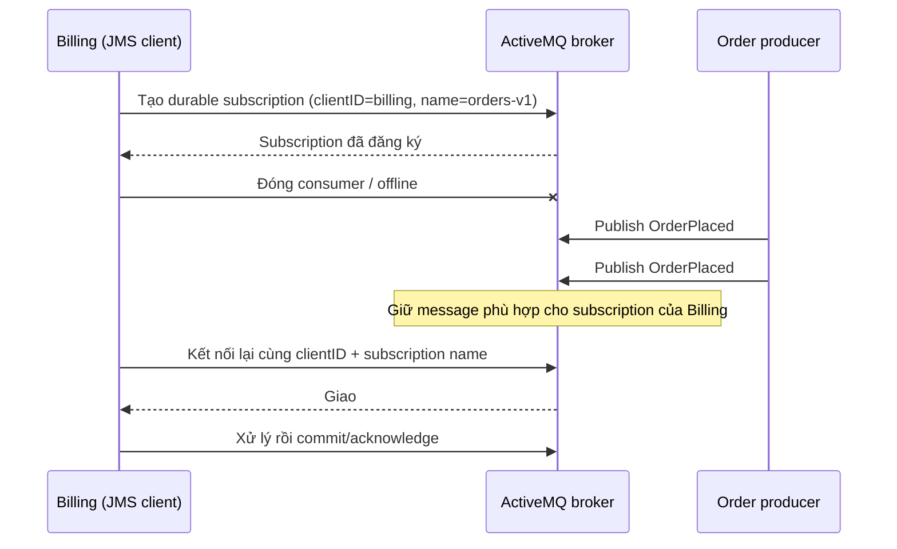
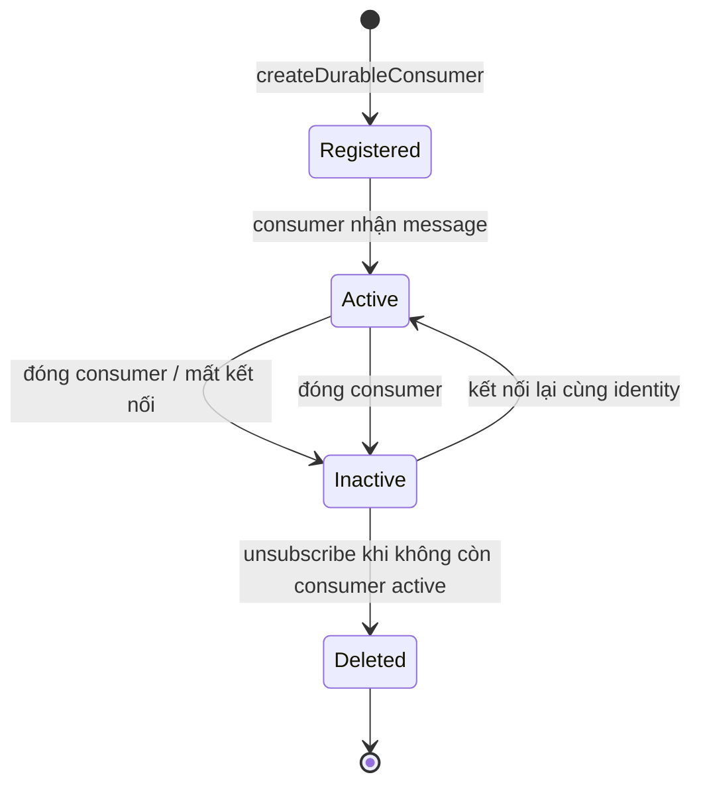
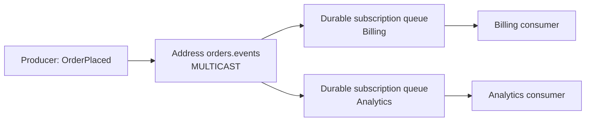
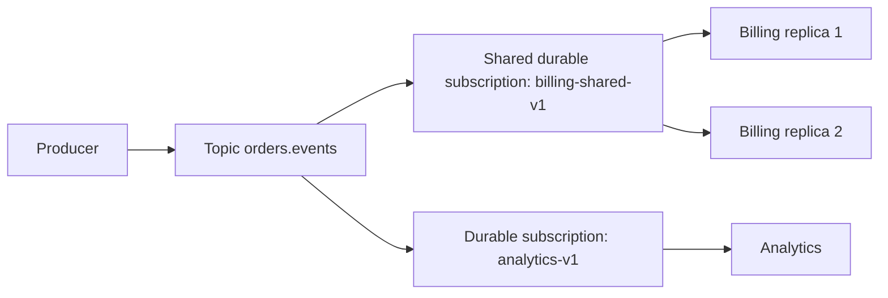

# Durable subscription, client ID và tên subscription

> **Chương:** Queue và Topic  
> **Phạm vi:** Java Messaging Service (JMS)/Jakarta Messaging với Apache ActiveMQ Artemis và ActiveMQ Classic; tập trung vào vòng đời, định danh, dữ liệu tồn đọng và vận hành **durable topic subscription**.

## 1. Bài toán: subscriber ngắt kết nối nhưng vẫn cần nhận sự kiện

Hệ thống đặt hàng phát sự kiện `OrderPlaced` lên topic `orders.events`. Hai dịch vụ độc lập cần nhận sự kiện: **Billing** tạo hóa đơn và **Analytics** thống kê doanh thu. Billing được triển khai lại trong 15 phút; nếu dùng subscription không bền (*non-durable*), các sự kiện đến trong thời gian vắng mặt thường không được giữ riêng cho Billing. Nếu Billing đã đăng ký **durable subscription**, broker có thể lưu các thông điệp phù hợp cho subscription đó trong khi Billing offline để nó tiếp tục nhận khi kết nối lại.

Điều quan trọng là **đăng ký phải tồn tại trước khi thông điệp được phát**. Durable subscription không tự động phát lại toàn bộ lịch sử topic từ lúc broker ra đời.



Durable subscription là **trạng thái được broker quản lý cho một người đăng ký topic**, không phải cài đặt “durable=true” cho toàn topic. Một topic có thể có nhiều subscription với chính sách và backlog độc lập.

| Tình huống khi event được publish | Non-durable topic subscriber | Durable topic subscriber đã đăng ký |
|---|---|---|
| Consumer đang online | Có thể nhận event phù hợp | Có thể nhận event phù hợp |
| Consumer offline | Thông thường không tích lũy event cho consumer đã ngắt | Broker giữ event phù hợp theo delivery mode, TTL, persistence và chính sách |
| Consumer mở lại sau downtime | Bắt đầu nhận event mới | Tiếp tục nhận backlog chưa được xác nhận |
| Consumer chưa từng đăng ký trước đó | Không có lịch sử riêng | Không thể nhận lại event cũ chỉ nhờ tạo subscription muộn |
| Subscription bị `unsubscribe` | Không áp dụng theo cách tương tự | Broker xóa đăng ký bền vững cùng backlog gắn với nó |

**Giới hạn bảo đảm:** durable subscription và message `DeliveryMode.PERSISTENT` cần đi cùng cấu hình persistence phù hợp nếu muốn chịu được **broker restart/crash**. TTL, expiry, giới hạn bộ nhớ/lưu trữ, chính sách dọn subscription và việc quản trị xóa tài nguyên vẫn có thể làm message không còn. Durable không đồng nghĩa “giữ vĩnh viễn” hoặc “xử lý nghiệp vụ chính xác một lần”.

## 2. Khóa định danh subscription: client ID và subscription name

Trong mô hình **unshared durable subscription** của JMS, một subscription được nhận diện về mặt logic bằng cặp:

```text
(clientID, subscriptionName)
```

- **Client ID** (`clientID`): tên định danh ổn định của *JMS connection* (hoặc connection bên dưới `JMSContext`), chẳng hạn `billing-service-lab`. Provider yêu cầu ID không trùng giữa các kết nối đang hoạt động khi sử dụng cơ chế định danh này.
- **Subscription name** (`subscriptionName`): tên bền vững do ứng dụng đặt, chẳng hạn `billing-orders-v1`. Tên này xác định subscription trong phạm vi client ID tương ứng.
- **Topic, selector, noLocal**: cấu hình của subscription, **không phải** ba thành phần có thể tùy tiện thay đổi mà vẫn bảo toàn backlog. Thay topic, selector hoặc cờ `noLocal` khi đăng ký lại có thể khiến subscription cũ bị thay thế theo ngữ nghĩa của JMS/provider, làm mất những message đang chờ.

Ví dụ định danh:

| clientID | subscriptionName | Kết quả |
|---|---|---|
| `billing-service-lab` | `billing-orders-v1` | Subscription của Billing |
| `billing-service-lab` | `billing-orders-v1` | Kết nối lại **đúng** subscription của Billing, nếu topic/selector/noLocal phù hợp |
| `billing-service-lab-02` | `billing-orders-v1` | **Một subscription khác** vì client ID đã đổi |
| `billing-service-lab` | `billing-orders-v2` | **Một subscription khác** vì subscription name đã đổi |
| `analytics-service-lab` | `analytics-orders-v1` | Subscription độc lập của Analytics; có thể nhận một bản của mỗi event |

Khi đăng ký thành công, trạng thái subscription được lưu tại broker. Sau khi ứng dụng đóng consumer hoặc mất kết nối, **subscription vẫn tồn tại**. Lần chạy sau phải dùng lại **cùng cặp định danh** để đọc backlog, thay vì tạo một tên mới theo PID, hostname, UUID hoặc tên pod.

### 2.1. Đặt tên ổn định để tránh subscription “ma”

Ví dụ một cấu hình nhất quán cho một môi trường:

```text
Topic:             orders.events
JMS clientID:      billing-dev-tenant-a
Subscription name: orders-placed-v1
Message selector:  eventType = 'OrderPlaced'
noLocal:           false
```

Khi ứng dụng restart, giữ nguyên toàn bộ cấu hình trên. Chỉ đổi `clientID` hoặc `subscriptionName` nếu **cố ý tạo subscription logic mới**. Nên đưa tên môi trường/tenant vào quy ước định danh để các deployment không dùng nhầm backlog của nhau, và giữ tên ổn định trong cùng deployment.

Không dùng `clientID` như mật khẩu hay cơ chế phân quyền. Đây là **định danh JMS**, còn xác thực, cấp quyền tạo durable subscription và đọc topic phải được broker kiểm soát riêng.

### 2.2. Vì sao client ID không phải tên consumer instance?

Một unshared durable subscription được thiết kế cho **một consumer đang hoạt động tại một thời điểm**. Nếu hai instance Billing cùng kết nối với **cùng client ID**, broker có thể từ chối kết nối trùng client ID; nếu các instance đặt **client ID khác nhau**, chúng trở thành **hai subscription khác nhau** và mỗi instance có thể nhận toàn bộ event.

Khi muốn nhiều replica **chia nhau** các event trong **cùng một subscription**, hãy dùng **shared durable subscription** của JMS 2.0/Jakarta Messaging nếu broker/client hỗ trợ, hoặc thiết kế một mô hình queue/nhóm consumer phù hợp. Đừng tự tạo client ID ngẫu nhiên để “sửa lỗi trùng ID”: cách này có thể nhân số bản message và tạo backlog không bao giờ được tiêu thụ.

## 3. Vòng đời chuẩn của một durable subscription



**Pha 1 — Đăng ký:** client tạo durable consumer trên topic và đặt client ID/định danh subscription. Broker tạo hoặc tìm subscription tương ứng. Chỉ những publish phù hợp **sau khi subscription tồn tại** mới có cơ hội được giữ cho subscriber offline.

**Pha 2 — Consumer đang online:** broker phân phối các thông điệp phù hợp; consumer cần hoàn tất xử lý và ack/commit. Khi xử lý thất bại, message có thể được redeliver.

**Pha 3 — Consumer offline:** broker giữ subscription cùng các message chưa hoàn tất và các message mới phù hợp với điều kiện subscription. Tính bền vững của dữ liệu phụ thuộc delivery mode, journal/store và giới hạn/TTL.

**Pha 4 — Nối lại:** client khởi động với **cùng client ID và tên subscription**, cùng định nghĩa topic/selector/noLocal. Broker có thể phân phối backlog lẫn message mới. Consumer phải xử lý idempotent vì sự cố giữa nghiệp vụ và ack có thể tạo lần giao lại.

**Pha 5 — Hủy:** chỉ khi chắc chắn không cần backlog, đóng hết consumer liên quan rồi gọi `unsubscribe(subscriptionName)` trong đúng định danh hoặc xóa subscription qua giao diện quản trị của broker. Tùy loại subscription và API, hủy sẽ xóa các thông điệp đang lưu cho subscription đó. Sau khi hủy, lần đăng ký mới **không** khôi phục được lịch sử đã bị xóa.

**Phân biệt đóng và hủy:**

```java
consumer.close();              // Đóng consumer, durable subscription vẫn tồn tại.
context.unsubscribe("orders-placed-v1"); // Hủy subscription và backlog: thao tác phá hủy.
```

Lưu ý: chỉ gọi `unsubscribe` **sau khi consumer của subscription đã đóng** và không có consumer khác đang sử dụng; ví dụ hai dòng trên nhằm minh họa ngữ nghĩa, không phải mẫu reset production không kiểm tra trạng thái.

## 4. Mối liên hệ với broker Artemis và Classic

Ở mức ứng dụng, JMS cung cấp `Topic` và API durable consumer. Ở mức Artemis, topic thường ánh xạ đến một **address với routing type MULTICAST**; mỗi subscription có thể tương ứng một **queue lưu trữ** bên dưới address này. Hai durable subscription độc lập có hai backlog độc lập.



**Ví dụ khai báo address trong cấu hình `broker.xml` của Artemis** (đặt đúng vị trí dưới phần cấu hình addresses của broker):

```xml
<addresses>
    <address name="orders.events">
        <multicast/>
    </address>
</addresses>
```

Việc gọi `createDurableConsumer` có thể tạo queue subscription nội bộ; broker phải cho phép tạo queue theo cấu hình và cấp đúng quyền. Không suy ra tên queue nội bộ bằng công thức tự đặt nếu chưa xem công cụ quản trị của **phiên bản Artemis đang chạy**. Trong hệ thống đã quản lý queue bằng cấu hình khai báo, thống nhất cách provisioning trước khi tạo subscriber.

Với **ActiveMQ Classic**, client JMS sử dụng cùng ý tưởng client ID/subscription name, nhưng quản trị durable subscriber và persistence đi theo cấu hình Classic (thường là KahaDB), không theo mô hình address/anycast/multicast của Artemis. Chuyển từ Classic sang Artemis cần kiểm tra metadata subscription, topic name, selector, backlog, client library và kế hoạch chuyển dữ liệu; **chỉ giữ nguyên hai chuỗi tên không có nghĩa backlog tự di chuyển giữa hai broker**.

| Thuộc tính | Ý nghĩa với subscription |
|---|---|
| Topic/address | Nơi nhận sự kiện từ producer; tồn tại topic không chứng minh subscription đã được tạo |
| Durable subscription | Đơn vị ghi nhận trạng thái nhận sự kiện của một người đăng ký |
| Selector | Chỉ message phù hợp biểu thức mới vào luồng nhận của subscription |
| `noLocal` | Khi `true`, hạn chế nhận message xuất bản từ cùng JMS connection; phải giữ nhất quán qua lần đăng ký lại |
| Persistent delivery | Bảo vệ message trước broker failure trong phạm vi cấu hình persistence/transaction |
| Acknowledgment/transaction | Xác định thời điểm broker có thể coi message đã xử lý |
| Expiry, DLQ, cleanup policy | Có thể kết thúc vòng đời message/subscription dù consumer không nhận nó |

## 5. Thực hành với Jakarta Messaging và ActiveMQ Artemis

Lab này chứng minh bằng thực nghiệm: **đăng ký → offline → publish → reconnect → nhận lại đúng event → unsubscribe có chủ đích**. Giả sử Artemis đang chạy tại `tcp://localhost:61616`, đã có user/password và cho phép sử dụng topic `orders.events`. Với Artemis, broker phải có address MULTICAST và quyền thích hợp; có thể dùng khai báo ở mục 4 hoặc chính sách tự tạo tương ứng.

### 5.1. Cấu hình Maven

Ứng dụng sử dụng **Jakarta Messaging** với package `jakarta.jms`, do đó chọn `artemis-jakarta-client`. Ví dụ cố định phiên bản client để các lần chạy ổn định; khi làm dự án thật cần chọn bản client tương thích với broker, JDK và chính sách nâng cấp.

Tạo `pom.xml`:

```xml
<project xmlns="http://maven.apache.org/POM/4.0.0"
         xmlns:xsi="http://www.w3.org/2001/XMLSchema-instance"
         xsi:schemaLocation="http://maven.apache.org/POM/4.0.0
                             https://maven.apache.org/xsd/maven-4.0.0.xsd">
    <modelVersion>4.0.0</modelVersion>
    <groupId>lab.messaging</groupId>
    <artifactId>durable-subscription-lab</artifactId>
    <version>1.0.0</version>
    <properties>
        <maven.compiler.release>17</maven.compiler.release>
        <project.build.sourceEncoding>UTF-8</project.build.sourceEncoding>
        <artemis.version>2.38.0</artemis.version>
    </properties>
    <dependencies>
        <dependency>
            <groupId>org.apache.activemq</groupId>
            <artifactId>artemis-jakarta-client</artifactId>
            <version>${artemis.version}</version>
        </dependency>
    </dependencies>
    <build>
        <plugins>
            <plugin>
                <groupId>org.apache.maven.plugins</groupId>
                <artifactId>maven-compiler-plugin</artifactId>
                <version>3.13.0</version>
            </plugin>
            <plugin>
                <groupId>org.codehaus.mojo</groupId>
                <artifactId>exec-maven-plugin</artifactId>
                <version>3.3.0</version>
            </plugin>
        </plugins>
    </build>
</project>
```

Tạo file `src/main/java/DurableSubscriptionLab.java` với toàn bộ nội dung sau:

```java
import jakarta.jms.ConnectionFactory;
import jakarta.jms.DeliveryMode;
import jakarta.jms.JMSConsumer;
import jakarta.jms.JMSContext;
import jakarta.jms.Message;
import jakarta.jms.TextMessage;
import jakarta.jms.Topic;
import org.apache.activemq.artemis.jms.client.ActiveMQConnectionFactory;

import java.util.UUID;

public final class DurableSubscriptionLab {
    private static final String TOPIC = "orders.events";
    private static final String SELECTOR = "eventType = 'OrderPlaced'";

    private static String env(String name, String fallback) {
        String value = System.getenv(name);
        return value == null || value.isBlank() ? fallback : value;
    }

    public static void main(String[] args) throws Exception {
        if (args.length != 1) {
            throw new IllegalArgumentException(
                "Usage: register | publish | receive | unsubscribe");
        }

        String brokerUrl = env("BROKER_URL", "tcp://localhost:61616");
        String user = env("BROKER_USER", "lab");
        String password = System.getenv("BROKER_PASSWORD");
        if (password == null || password.isBlank()) {
            throw new IllegalStateException("Set BROKER_PASSWORD");
        }

        // Cac gia tri nay phai GIU NGUYEN giua cac lan chay.
        String clientId = env("JMS_CLIENT_ID", "billing-service-lab");
        String subName = env("JMS_SUBSCRIPTION_NAME", "billing-orders-v1");

        ConnectionFactory factory = new ActiveMQConnectionFactory(brokerUrl);

        switch (args[0]) {
            case "register": {
                try (JMSContext ctx = factory.createContext(
                        user, password, JMSContext.AUTO_ACKNOWLEDGE)) {
                    ctx.setClientID(clientId);
                    // Dang ky subscription ma khong bat dau dispatch.
                    ctx.setAutoStart(false);
                    Topic topic = ctx.createTopic(TOPIC);
                    try (JMSConsumer consumer = ctx.createDurableConsumer(
                            topic, subName, SELECTOR, false)) {
                        System.out.printf(
                            "REGISTERED clientId=%s subscription=%s%n",
                            clientId, subName);
                    }
                }
                break;
            }

            case "publish": {
                try (JMSContext ctx = factory.createContext(
                        user, password, JMSContext.AUTO_ACKNOWLEDGE)) {
                    Topic topic = ctx.createTopic(TOPIC);
                    String eventId = UUID.randomUUID().toString();
                    TextMessage message = ctx.createTextMessage(
                        "{\"eventId\":\"" + eventId +
                        "\",\"eventType\":\"OrderPlaced\"}");
                    message.setStringProperty("eventId", eventId);
                    message.setStringProperty("eventType", "OrderPlaced");

                    ctx.createProducer()
                       .setDeliveryMode(DeliveryMode.PERSISTENT)
                       .send(topic, message);
                    System.out.println("PUBLISHED eventId=" + eventId);
                }
                break;
            }

            case "receive": {
                try (JMSContext ctx = factory.createContext(
                        user, password, JMSContext.SESSION_TRANSACTED)) {
                    ctx.setClientID(clientId);
                    Topic topic = ctx.createTopic(TOPIC);
                    try (JMSConsumer consumer = ctx.createDurableConsumer(
                            topic, subName, SELECTOR, false)) {
                        for (int i = 0; i < 10; i++) {
                            Message message = consumer.receive(2000L);
                            if (message == null) {
                                System.out.println("NO_MORE_MESSAGES");
                                break;
                            }

                            try {
                                if (!(message instanceof TextMessage)) {
                                    throw new IllegalStateException(
                                        "Expected TextMessage");
                                }
                                String body = ((TextMessage) message).getText();
                                String eventId =
                                    message.getStringProperty("eventId");
                                System.out.printf(
                                    "RECEIVED id=%s redelivered=%s body=%s%n",
                                    eventId, message.getJMSRedelivered(), body);

                                // Cho phep thay bang logic nghiep vu idempotent.
                                // Commit sau xu ly de xac nhan JMS delivery.
                                ctx.commit();
                            } catch (Exception ex) {
                                ctx.rollback();
                                throw ex;
                            }
                        }
                    }
                }
                break;
            }

            case "unsubscribe": {
                try (JMSContext ctx = factory.createContext(
                        user, password, JMSContext.AUTO_ACKNOWLEDGE)) {
                    ctx.setClientID(clientId);
                    // Khong tao consumer; phai dam bao subscription inactive.
                    ctx.unsubscribe(subName);
                    System.out.printf(
                        "UNSUBSCRIBED clientId=%s subscription=%s%n",
                        clientId, subName);
                }
                break;
            }

            default:
                throw new IllegalArgumentException("Unknown action: " + args[0]);
        }
    }
}
```

**Những lựa chọn quan trọng trong code:**

1. `ctx.setClientID(clientId)` được gọi **trước** khi dùng connection để tạo durable consumer. Client ID là giá trị ổn định qua mọi lần restart.
2. `register` gọi `setAutoStart(false)` để tránh bắt đầu giao message khi mục đích chỉ là tạo subscription, rồi đóng consumer; subscription **không** bị hủy.
3. `publish` dùng `DeliveryMode.PERSISTENT` để thử nghiệm trường hợp broker lưu bền vững. Producer không cần và không được dùng cùng client ID của subscriber chỉ để gửi topic.
4. `receive` tạo lại durable consumer với **cùng topic, client ID, subscription name, selector và noLocal**. Mỗi message được `commit()` sau khi xử lý; crash trước commit có thể làm redelivery.
5. `unsubscribe` là thao tác **xóa durable subscription**, chỉ dùng khi quyết định bỏ backlog cũ. Phải chắc chắn không có consumer của subscription đang hoạt động.

Đây là chương trình console để học semantics, chưa thay thế ứng dụng production: chưa có retry có kiểm soát, health check, observability, idempotency store, TLS hoặc phối hợp transaction với database. Thực hành các chính sách đó sẽ cần cấu hình riêng ở client và broker.

### 5.2. Chạy thí nghiệm “offline vẫn nhận được”

Trên Bash/WSL, đặt biến môi trường phù hợp với **broker lab của bạn**:

```bash
export BROKER_URL='tcp://localhost:61616'
export BROKER_USER='lab'
export BROKER_PASSWORD='your-local-lab-password'
export JMS_CLIENT_ID='billing-service-lab'
export JMS_SUBSCRIPTION_NAME='billing-orders-v1'

# 1. Tao durable subscription, dong consumer ngay.
mvn -q compile exec:java -Dexec.mainClass=DurableSubscriptionLab -Dexec.args=register

# 2. Consumer dang offline; gui hai event persistent.
mvn -q compile exec:java -Dexec.mainClass=DurableSubscriptionLab -Dexec.args=publish
mvn -q compile exec:java -Dexec.mainClass=DurableSubscriptionLab -Dexec.args=publish

# 3. Mo lai dung subscription va doc backlog.
mvn -q compile exec:java -Dexec.mainClass=DurableSubscriptionLab -Dexec.args=receive
```

Trên PowerShell, cách đặt môi trường tương đương là `$env:BROKER_URL = 'tcp://localhost:61616'`, `$env:BROKER_USER = 'lab'`, `$env:BROKER_PASSWORD = '...'`, `$env:JMS_CLIENT_ID = 'billing-service-lab'` và `$env:JMS_SUBSCRIPTION_NAME = 'billing-orders-v1'`; các lệnh Maven giữ nguyên.

**Kết quả kỳ vọng:** lệnh `register` in `REGISTERED`; mỗi `publish` in một `PUBLISHED eventId`; lệnh `receive` in hai dòng `RECEIVED id=...` có cùng hai `eventId` đã gửi, sau đó `NO_MORE_MESSAGES`. Nếu đã có backlog từ lần thử trước thì có thể có nhiều hơn hai message; tạo subscription riêng cho lab hoặc purge có chủ đích trước khi thử.

Lặp lại lệnh `receive` khi không có sự kiện mới: kết quả nên là `NO_MORE_MESSAGES` vì hai thông điệp vừa được commit. Bài thử này chứng minh **tồn tại backlog khi client offline và nối lại đúng subscription**, chứ không chứng minh exactly-once processing trong database.

**Thử biến thể cần giải thích:**

- **Đổi `JMS_CLIENT_ID`** sang `billing-service-lab-02` rồi chạy `register` và `receive`: bạn đã tạo subscription logic khác, không nhận được hai event đã publish **trước khi nó được đăng ký**.
- **Giữ client ID nhưng đổi `JMS_SUBSCRIPTION_NAME`** sang `billing-orders-v2`: cũng tạo subscription khác, không phải phiên bản đổi tên của backlog cũ.
- **Dùng lại cặp ban đầu:** subscription cũ vẫn hiện diện nếu chưa `unsubscribe`, nhưng các message đã commit ở lần trước không được phát lại chỉ vì reconnect.
- **Hủy rồi đăng ký lại:** chỉ khi đã ghi nhận backlog không còn cần, chạy `unsubscribe`, sau đó `register`. Event publish lúc subscription không tồn tại **không được hồi tố** khi đăng ký lại.

Không đổi selector ngay trên subscription đang có backlog để thử “bộ lọc mới”: thao tác đăng ký với selector khác có thể thay thế subscription theo quy tắc JMS/provider, làm mất dữ liệu cũ. Hãy dùng **subscription name mới** cho bài kiểm tra selector độc lập hoặc lập kế hoạch chuyển đổi rõ ràng.

## 6. Shared durable subscription: nhiều consumer, một backlog

JMS 2.0 bổ sung khả năng **shared durable subscription**. Đây là cơ chế khác unshared durable: **nhiều consumer có thể cùng gắn vào một subscription** và các thông điệp được chia giữa họ. Nếu Billing muốn chạy hai replica để xử lý song song mà mỗi event chỉ đi vào một trong hai replica của Billing, đây là mô hình cần cân nhắc.



Đặc điểm định danh:

- Với **unshared durable**, cặp `(clientID, subscriptionName)` định danh subscription và chỉ có **một consumer active** cho subscription đó.
- Với **shared durable**, subscription được định danh bởi tên và **client ID nếu client ID có được thiết lập**. Khi không có client ID, tên subscription có thể là định danh trong phạm vi provider. Cả hai consumer phải tham gia **cùng một subscription logic**.
- Hai JVM sử dụng **cùng client ID explicit** vẫn có nguy cơ bị provider từ chối vì trùng client ID trên các connection khác nhau. Trong cấu hình phù hợp và được Artemis hỗ trợ, các consumer shared durable thường **không tự đặt client ID**, dùng cùng subscription name và cấu hình topic/selector.
- Nếu hai replica đặt **client ID khác nhau**, chúng có thể hình thành **hai durable subscription khác nhau**, tạo fan-out thay vì chia tải.

Ví dụ API shared durable của Jakarta Messaging; đoạn này minh họa phía consumer, dùng biến `factory`, `user` và `password` đã được khởi tạo như trong lab:

```java
try (JMSContext ctx = factory.createContext(
        user, password, JMSContext.SESSION_TRANSACTED)) {
    Topic topic = ctx.createTopic("orders.events");

    // Co chu dich KHONG goi setClientID() khi muon hai replica
    // tham gia cung shared durable subscription theo ten.
    try (JMSConsumer consumer = ctx.createSharedDurableConsumer(
            topic, "billing-shared-v1",
            "eventType = 'OrderPlaced'")) {
        Message message = consumer.receive(5000L);
        if (message != null) {
            // Thuc hien nghiep vu idempotent.
            ctx.commit();
        }
    }
}
```

Mở hai JVM chạy cùng đoạn consumer trên, xác minh bằng broker console rằng chỉ có **một subscription queue** với hai active consumers. Khi gửi nhiều message, từng message có thể đi đến một trong các replica; không hứa hẹn chia đúng 50/50 hoặc thứ tự hoàn tất nghiệp vụ giữa các replica.

**Lưu ý tương thích:** Artemis hỗ trợ các API Jakarta Messaging/JMS phù hợp với client đã chọn. Với ActiveMQ Classic và client/phiên bản cũ chỉ triển khai JMS 1.1, API `createSharedDurableConsumer` không có; phải kiểm tra **phiên bản đặc tả JMS mà client và broker thực sự hỗ trợ** trước khi áp dụng. Cũng không được lấy định danh session MQTT rồi mặc nhiên xem nó là cùng một durable JMS subscription: việc ánh xạ cross-protocol cần được kiểm chứng riêng.

## 7. Selector, `noLocal` và thay đổi cấu hình khi đã có backlog

Thử nghiệm ban đầu sử dụng:

```java
ctx.createDurableConsumer(
    topic,
    "billing-orders-v1",
    "eventType = 'OrderPlaced'",
    false
);
```

Trong đó `eventType` là **message property** (được producer đặt bằng `setStringProperty`), không phải trường JSON bên trong body. Broker áp dụng selector theo ngữ nghĩa JMS; nếu producer chỉ gửi JSON mà không đặt property, selector trên sẽ **không** match.

**Không thể dùng subscription như một bộ nhớ lịch sử tùy ý để đổi bộ lọc sau:**

- Subscription có selector `eventType = 'OrderPlaced'` không lưu để Billing lấy lại tất cả các event `OrderCancelled` không thỏa điều kiện.
- Khi thay selector thành `eventType IN ('OrderPlaced', 'OrderCancelled')` trên cùng identity, việc mở lại durable consumer có thể **xóa và tạo lại** subscription do thay định nghĩa. Không được giả định backlog cũ còn nguyên.
- Khi `noLocal=true`, message do cùng connection publish có thể bị loại khỏi subscription; việc đổi cờ này cũng là thay định nghĩa.
- Khi đổi topic từ `orders.events` sang `orders.events.v2`, dù giữ client ID và subscription name, đó là một thay đổi có thể **thay subscription hiện có**, không phải cách “chuyển tiếp backlog” giữa hai topic.

**Quy trình đổi selector/topic an toàn hơn:** tạo một subscription mới với tên phiên bản mới; xác định mốc cutover (event ID hoặc thời điểm do hệ thống kiểm soát), cho producer/consumer hoạt động theo kế hoạch tránh mất hoặc nhân đôi event, giữ subscription cũ cho đến khi xử lý hết backlog hoặc có quyết định lưu trữ/xóa, rồi `unsubscribe` cũ khi mọi bên đã xác nhận. Nếu yêu cầu chuyển dữ liệu lịch sử, dùng cơ chế chuyển/replay được broker hoặc ứng dụng hỗ trợ; chỉ đổi tham số của `createDurableConsumer` không phải migration.

## 8. Acknowledgment, rollback và redelivery của durable subscriber

Durable subscription giải quyết **lưu event khi subscriber không online**; còn thời điểm message được xóa khỏi backlog phụ thuộc **acknowledgment/transaction**.

| Cơ chế | Điều xảy ra với message trong subscription |
|---|---|
| `AUTO_ACKNOWLEDGE` | Provider xác nhận theo ngữ nghĩa auto acknowledgment; nếu app xử lý nghiệp vụ sau khi nhận mà crash, có thể mất cơ hội xử lý lại dù message đã ack |
| `CLIENT_ACKNOWLEDGE` | Ứng dụng gọi `message.acknowledge()`; trong một session, thao tác có thể xác nhận tất cả message chưa ack của session, không riêng message hiện tại |
| `SESSION_TRANSACTED` + `commit()` | Broker coi các nhận message trong transaction đã hoàn thành khi commit thành công |
| `SESSION_TRANSACTED` + `rollback()` | Message có thể được redeliver theo chính sách delay/attempts của broker |
| Broker DLQ policy | Message thất bại nhiều lần có thể bị chuyển sang DLQ; với Artemis có thể xảy ra ở queue đại diện cho một subscription cụ thể |

Ví dụ lỗi thực tế:

1. Billing nhận `OrderPlaced(event-101)` và ghi hóa đơn vào database.
2. Billing crash **trước** `ctx.commit()` ở JMS.
3. Broker chưa được xác nhận xử lý hoàn tất; khi kết nối lại, Billing có thể nhận `event-101` lần nữa.
4. Nếu insert hóa đơn không có khóa idempotency, có thể tạo hai hóa đơn.

Thiết kế đúng cần có **khóa nghiệp vụ ổn định**, ví dụ unique constraint theo `eventId` hoặc `orderId + eventType` trong database. Khi nhận lại, nếu event đã xử lý, consumer có thể xác nhận message mà không lặp tác dụng nghiệp vụ. JMS session transaction **không mặc nhiên bao trùm** transaction database ngoài hệ thống.

Với hệ có nhiều durable subscriptions, cùng một sự kiện có thể đã được Billing commit nhưng Analytics chưa commit. Hai backlog tiến triển độc lập; việc Billing ack không xóa bản đang chờ của Analytics.

## 9. Vận hành: đếm đúng backlog và dọn đúng subscription

Hãy quan sát **đúng đối tượng subscription**, không chỉ nhìn số lượng message tổng của topic. Khi Billing offline, durable subscription tương ứng có thể còn queue với **consumer count = 0**, message count tăng khi producer phát sự kiện phù hợp.

Các thông tin cần nhìn trong Artemis management console hoặc API quản trị tương ứng:

| Chỉ số/thuộc tính | Câu hỏi vận hành |
|---|---|
| Address/topic và routing type | Subscription có gắn đúng topic MULTICAST không? |
| Tên subscription / queue tương ứng | Đây có phải durable subscription của service đang debug? |
| Client ID, selector, filter, durable flag | Có đang dùng nhầm identity hoặc lọc mất message không? |
| Consumer count | Đang offline, một consumer hay hai consumer chia tải? |
| Ready/message count và delivering count | Message đang chờ, hay đã giao cho consumer nhưng chưa được ack? |
| Messages added/acknowledged | Backlog tăng do producer mới hay giảm do consumer xử lý? |
| Redelivery count, expiry và DLQ | Có poison message, TTL hết hạn hoặc retries vượt ngưỡng không? |
| Storage/paging/journal, broker resource limits | Broker có đủ dung lượng để giữ backlog khi subscriber offline lâu không? |

**Checklist trước khi xóa subscription:** xác nhận đúng topic, client ID (nếu có), subscription name, consumer đang active, backlog, yêu cầu giữ lịch sử, snapshot/backup nếu cần và trách nhiệm của service chủ quản. **Purge backlog** có thể giữ subscription để tiếp tục nhận event mới; **unsubscribe/delete subscription** xóa đăng ký và backlog. Đây là hai thao tác khác nhau.

Tình huống cleanup kinh điển là một phiên bản ứng dụng cũ liên tục đổi client ID theo tên pod. Broker có hàng trăm subscription `billing-<pod-id>` với consumer count bằng 0 và backlog ngày càng lớn. Cách xử lý là:

1. Dừng việc sinh client ID mới; xác định mô hình đúng (một unshared consumer ổn định hay shared durable).
2. Liệt kê từng subscription theo topic/selector và thời gian hoạt động cuối cùng; xác minh không còn service hợp lệ phụ thuộc.
3. Đánh giá backlog cần lưu hoặc replay; tạo backup theo cơ chế hỗ trợ trước khi xóa.
4. Xóa riêng những subscription lỗi thời qua management API/console hoặc `unsubscribe` với đúng identity; không xóa toàn bộ address/topic.
5. Theo dõi resource usage và subscription count sau cleanup.

**Không nhầm với security:** quyền gửi topic, tạo durable queue, tiêu thụ subscription và thao tác quản trị có thể được cấp riêng. Trên Artemis, kiểm tra các quyền phù hợp như `send`, `consume` và `createDurableQueue` trong cấu hình security; trên Classic tên policy/authorization khác. Đừng cấp toàn quyền broker chỉ để ứng dụng tự tạo một durable subscriber.

## 10. Những lỗi thường gặp và cách phân tích

| Hiện tượng | Nguyên nhân thường gặp | Cách kiểm tra và khắc phục |
|---|---|---|
| Offline rồi reconnect nhưng không thấy message | Subscription được tạo **sau** khi publish; dùng nhầm client ID/name; selector không match; TTL hết hạn; persistence/storage không giữ message | So thời điểm đăng ký, identity, selector, event property, expiry và queue subscription trên broker |
| Connection bị từ chối do client ID đã tồn tại | Hai connection active cùng client ID | Xác định instance giữ connection; dùng mô hình shared durable hoặc queue nếu muốn nhiều replica |
| Mỗi replica nhận một bản event | Replica dùng client ID khác nhau, vô tình tạo subscription độc lập | Tập hợp dưới một shared durable subscription hoặc thay đổi mô hình xử lý |
| Broker đầy storage trong khi service đã dừng | Durable subscription vẫn tích lũy backlog; không có consumer hoặc không có cleanup/expiry phù hợp | Quan sát consumer count/queue depth; phục hồi consumer hoặc cleanup có kế hoạch |
| Đổi selector rồi backlog “biến mất” | Định nghĩa subscription thay đổi có thể khiến provider thay thế đăng ký | Kiểm tra thao tác redeclare; sử dụng subscription mới có tên mới và kế hoạch migration |
| Một số message xuất hiện lại sau crash | Chưa ack/commit trước khi consumer chết | Kiểm tra transacted session, redelivery, idempotency, DLQ |
| `unsubscribe` báo subscription đang active | Vẫn còn consumer gắn vào subscription | Đóng consumer/kết nối trước, xác minh consumer count rồi mới hủy |
| Có topic nhưng không có durable queue | Client chưa tạo subscriber thành công; quyền tạo queue hoặc cấu hình address/routing chưa đúng | Đọc lỗi client/broker; kiểm tra quyền, topic MULTICAST và broker configuration |
| `receive()` timeout dù producer đang gửi | Selector không match; client gắn sai subscription/topic; message nằm ở DLQ/expiry | So event property với selector, destination và trạng thái queue |

### 10.1. Lưu ý riêng khi nâng cấp hoặc di chuyển broker

Đừng lấy client ID và subscription name làm cơ chế xuất/nhập dữ liệu. Hai chuỗi này giúp client **tìm lại một subscription đang tồn tại trên cùng broker/provider hoặc cụm được triển khai đúng**, nhưng không chứa backlog. Khi migration ActiveMQ Classic → Artemis, cần kiểm thử cách provision topic, địa chỉ/queue nội bộ, subscriber metadata, selector, store, policy redelivery/DLQ và biên giới chuyển message. Một kế hoạch migration hợp lệ phải nêu rõ thời điểm dừng producer, xử lý backlog cũ, tạo subscription mới, kiểm thử đối chiếu event ID và cơ chế rollback.

## 11. Bài thực hành mở rộng có tiêu chí kiểm chứng

1. **Hai ứng dụng độc lập:** đăng ký `billing-service-lab/billing-orders-v1` và `analytics-service-lab/analytics-orders-v1` trước khi publish. Dừng cả hai, gửi ba sự kiện persistent rồi mở lại từng consumer. Xác minh **mỗi subscription** nhận đủ ba event và việc Billing commit không làm biến mất message của Analytics.
2. **Thay đổi danh tính:** chỉ đổi một trong hai giá trị `JMS_CLIENT_ID` hoặc `JMS_SUBSCRIPTION_NAME`. Ghi lại subscription mới xuất hiện và giải thích vì sao nó không có lịch sử trước khi được tạo.
3. **Lọc sự kiện:** publish cả `OrderPlaced` và `OrderCancelled` với message property đúng. Đăng ký một durable subscription selector `eventType = 'OrderPlaced'`. Xác minh chỉ nhận loại được chọn, kể cả sau thời gian offline. Đừng thay selector trên subscription cũ có backlog.
4. **Kiểm tra redelivery:** trong phiên nhận transacted, sau khi đọc event hãy `rollback()` thay vì commit; mở lại consumer và quan sát `JMSRedelivered`, số lần giao lại và chính sách delay/DLQ theo broker đang dùng.
5. **Thử shared durable:** chạy hai JVM cùng `createSharedDurableConsumer(topic, "billing-shared-v1", selector)` và không đặt client ID; gửi nhiều event, xác minh trong console có một subscription với hai active consumers. Chứng minh rằng tổng số event **được commit qua cả hai replica** bằng số event phù hợp đã gửi, trong điều kiện lab không có lỗi/retry.
6. **Dọn đăng ký có chủ đích:** đóng consumer, xác minh đúng client ID/name rồi gọi `unsubscribe`. Đăng ký lại và chứng minh sự kiện được phát **trước khi đăng ký mới** không tự xuất hiện. Ghi chú rằng đây là thao tác có thể làm mất backlog.

### Tự đánh giá

Bạn hoàn thành bài khi giải thích và chứng minh được:

- Vì sao `createDurableConsumer` phải diễn ra trước thời điểm subscriber offline nhận event mới.
- Vì sao cùng `subscriptionName` nhưng khác `clientID` là hai subscription khác nhau trong mô hình unshared.
- Khi nào dùng unshared durable, khi nào dùng shared durable; vì sao không dùng client ID ngẫu nhiên cho từng replica.
- Vì sao đổi selector/topic/noLocal trên identity cũ cần được coi là thay đổi cấu hình có nguy cơ mất backlog.
- Vì sao `close()` giữ subscription còn `unsubscribe()` xóa subscription; vì sao ack/commit và idempotency vẫn bắt buộc với nghiệp vụ đáng tin cậy.

**Nguyên tắc ghi nhớ:** durable subscription là **định danh và vòng đời lưu backlog của một người đăng ký topic**. Để nó hoạt động đúng qua restart, hãy đăng ký trước khi publish, giữ identity ổn định, tái sử dụng đúng định nghĩa topic/selector, commit sau khi xử lý và chỉ hủy subscription khi đã chủ động quyết định bỏ dữ liệu tồn đọng.
