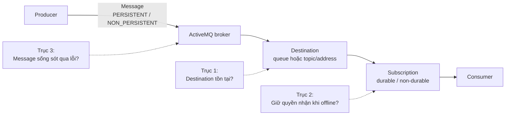
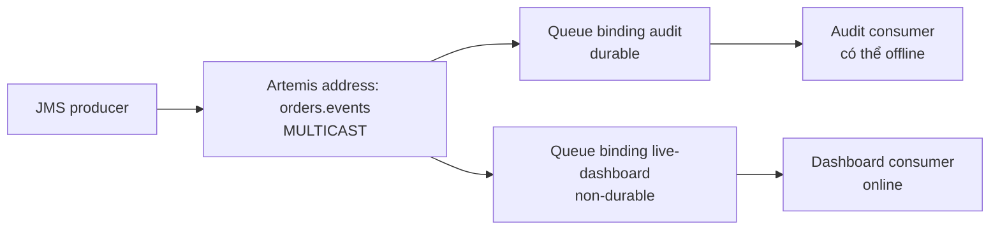
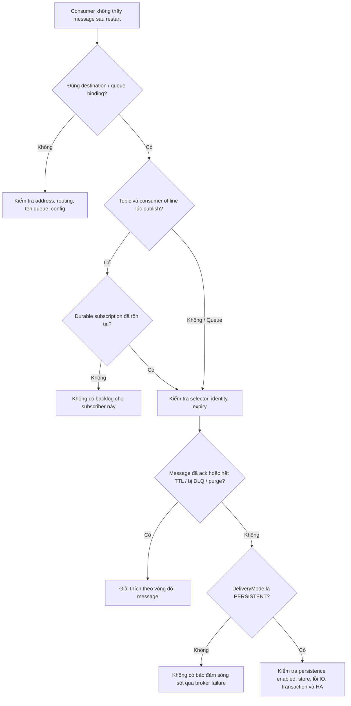

# Phân biệt độ bền của destination, subscription và chế độ persistent của thông điệp

> **Chương:** Queue và Topic  
> **Phạm vi:** Apache ActiveMQ Classic, ActiveMQ Artemis và Java/JMS. Bài học đi sâu vào ba loại “độ bền” thường bị đánh đồng: sự tồn tại của đích nhận, trạng thái đăng ký nhận sự kiện và khả năng lưu giữ một message.

Một hệ thống đơn hàng phát sự kiện `OrderCreated` đến topic `orders.events`. Producer gửi với `DeliveryMode.PERSISTENT`, nhưng dịch vụ Audit triển khai lại và bỏ lỡ sự kiện. Ở hệ thống khác, dịch vụ Audit có **durable subscription**, song message vẫn biến mất khi broker gặp sự cố. Hai tình huống này không mâu thuẫn: **persistent message**, **durable subscription** và **durable destination** điều khiển *ba lớp trạng thái khác nhau*.

Ba câu hỏi cần tách riêng:

1. **Destination tồn tại bao lâu?** Queue, topic hoặc queue binding của broker có tiếp tục tồn tại khi không có consumer và sau khi broker khởi động lại không?
2. **Ai có quyền nhận message khi đang offline?** Với topic, broker có duy trì trạng thái của một **durable subscription** để dành các sự kiện đã phát trong thời gian consumer không kết nối không?
3. **Bản thân message có được lưu bền không?** `PERSISTENT` yêu cầu provider bảo vệ message trước sự cố broker theo ngữ nghĩa JMS; `NON_PERSISTENT` ưu tiên cách phân phối nhẹ hơn, không có bảo đảm phục hồi tương đương.

Không thể suy ra đáp án cho câu hỏi thứ hai hoặc thứ ba chỉ bằng việc thấy một queue/topic có tên trong console.

## 1. Bản đồ ba lớp: topology, subscription và message



| Trục | Đối tượng được giữ | Câu hỏi khi consumer offline | Câu hỏi khi broker restart |
|---|---|---|---|
| **Destination/topology** | Định nghĩa đích, address, queue binding và cấu hình vòng đời. | Đích còn ở đó dù không có người đọc? | Đích được lưu bền hoặc tạo lại đúng cấu hình? |
| **Subscription** | Danh tính, bộ lọc và backlog của một nhánh nhận **topic**. | Broker còn đại diện người nhận để định tuyến sự kiện mới? | Trạng thái subscription có được khôi phục? |
| **Message delivery mode** | Nội dung message và metadata cần thiết để giao lại. | Message có được xếp vào backlog phù hợp? | Provider có trách nhiệm giữ message qua sự cố/restart theo ngữ nghĩa persistent? |

**Cách đọc:** Một durable subscription không tự làm mọi message trở thành persistent. Một persistent message không tự tạo subscription cho người chưa từng đăng ký. Một durable queue không buộc các message `NON_PERSISTENT` trên queue phải được khôi phục sau sự cố.

Từ “durable” trong tài liệu broker đôi khi được dùng cho cả queue lẫn subscription. Khi trao đổi kỹ thuật, luôn nói rõ **durable queue**, **durable subscription** hay **persistent message**, thay vì chỉ nói “đã bật durable”.

## 2. Độ bền của destination: giữ định nghĩa đích khác với giữ message

Trong API **JMS**, `Queue` và `Topic` là các destination logic. JMS cung cấp thao tác tạo đối tượng đại diện như `Session.createQueue("orders.work")` hoặc `Session.createTopic("orders.events")`, nhưng **không có một thuộc tính JMS portable `destination.setDurable(true)`**. Broker quyết định vòng đời của đích thông qua cấu hình, quản trị, cơ chế tạo động và cơ chế dọn dẹp.

Đặt hai tình huống cạnh nhau:

- **Đích còn, message đã hết:** Broker sau restart vẫn thấy queue `orders.work`; backlog có thể rỗng vì message đã được acknowledge, hết TTL, bị purge hoặc trước đó chỉ được gửi ở chế độ `NON_PERSISTENT` rồi mất trong sự cố.
- **Đích được tạo lại, message cũ mất:** Cấu hình tĩnh hoặc auto-create tái lập queue với **cùng tên**, nhưng điều đó không chứng minh dữ liệu từ instance trước được phục hồi.

### 2.1. ActiveMQ Classic: queue/topic và chính sách vòng đời

Ở **ActiveMQ Classic**, broker có thể khai báo destination bằng cấu hình, tạo động khi producer/consumer sử dụng (tùy quyền/cấu hình) và dọn các destination không hoạt động bằng policy. Việc một `Queue` xuất hiện trong console **không phải một cam kết JMS rằng metadata của nó sẽ tồn tại mãi**.

Classic thường dùng persistence adapter, chẳng hạn KahaDB, để lưu các **persistent messages** và trạng thái liên quan. Cần kiểm tra riêng:

1. Broker có bật khả năng lưu bền không (chẳng hạn thuộc tính `persistent` và cấu hình `persistenceAdapter`)?
2. Đích là cấu hình tĩnh, tạo động hay bị chính sách xóa khi không hoạt động?
3. Trên đích còn message chưa ack không? TTL, DLQ, quota hoặc thao tác quản trị có tác động không?

**Ví dụ:** Tạo `orders.work` từ Java bằng `session.createQueue("orders.work")`. Với Classic, lệnh này trước hết tạo **đối tượng đại diện destination ở client**; việc broker thực sự tạo/quản lý queue phụ thuộc khi có lệnh gửi/consume và policy của broker. Đừng hiểu đây là lệnh tạo một kho dữ liệu bền vững độc lập với cấu hình phía server.

### 2.2. ActiveMQ Artemis: address, routing type và queue binding

Trong **ActiveMQ Artemis**, cần tách rõ:

- **Address:** Nơi producer gửi message; router xử lý theo **ANYCAST** hoặc **MULTICAST**.
- **Queue binding:** Queue gắn với address, giữ các message đã được route tới nó và cung cấp cho consumer. Ở tầng core, queue có thuộc tính **durable**.
- **Auto-create/auto-delete:** Chính sách cho phép tạo queue/address khi cần và xóa khi đáp ứng điều kiện. Đây là *vòng đời topology*, khác với delivery mode của mỗi message.

Đối với queue trong mô hình **ANYCAST**, nhiều consumer cùng đọc một queue thì cạnh tranh nhận message. Trong **MULTICAST**, các queue subscription khác nhau gắn với cùng address có thể nhận bản sao độc lập của mỗi event. Vì vậy độ bền của **queue subscription** trên Artemis ảnh hưởng trực tiếp đến khả năng giữ luồng nhận của một subscriber.



Sơ đồ là mô hình logic, **không phải mặc định broker sẽ tự tạo đúng hai queue này**. Cần cấu hình và xác minh subscription/queue binding thực tế. Một queue được cấu hình durable mà mọi message đã bị ack thì vẫn rỗng; một queue có tên cố định vẫn có thể bị auto-delete theo policy nếu cấu hình cho phép.

| Tiêu chí | Classic | Artemis |
|---|---|---|
| JMS destination | `Queue` / `Topic` với chính sách broker tương ứng. | JMS queue/topic được ánh xạ sang address/routing type/queue. |
| “Độ bền của destination” | Chủ yếu kiểm tra khai báo, cơ chế tạo/xóa, persistence và dữ liệu còn pending; không suy ra từ JMS interface. | Có thể kiểm tra trực tiếp `durable` của core queue cùng với auto-create/auto-delete và binding. |
| Queue tồn tại sau restart | Tùy cấu hình quản trị/topology và state được phục hồi. | Tùy durable binding, cấu hình tĩnh, chính sách tạo lại và trạng thái journal. |
| Message cũ sống sót | Cần xét delivery mode + persistence + broker/store policy. | Cũng cần xét delivery mode + store; durable queue chỉ là một điều kiện liên quan. |

**Hệ quả:** Trên Artemis, **durable queue** là một thuộc tính của hạ tầng queue; ở JMS, **durable subscription** là cam kết đăng ký nhận topic. Chúng liên quan khi JMS topic được hiện thực bằng queue binding, nhưng không phải cùng một API hay cùng một loại bảo đảm.

## 3. Độ bền của subscription: quyền nhận event khi consumer offline

Đối với topic, publisher **không gửi đến danh sách consumer Java đang chạy**. Broker định tuyến dựa trên subscription thích hợp tại thời điểm phát. Hai hình thức chính:

### 3.1. Non-durable subscription

Một consumer tạo bằng:

```java
Topic topic = session.createTopic("orders.events");
MessageConsumer consumer = session.createConsumer(topic);
```

đang sử dụng một topic subscription thông thường, thường là **non-durable** (không tính các extension đặc thù). Khi consumer đóng kết nối và subscription đó biến mất, sự kiện phát trong khoảng offline thường không có “hộp thư” riêng để giữ cho nó. Gửi `PERSISTENT` cũng **không thay đổi** nguyên tắc này.

**Tình huống:** Notification Service chạy lúc 09:00, dừng lúc 09:05; `OrderCreated` xuất hiện 09:06; service khởi động lại 09:10. Nếu chỉ dùng non-durable subscription và không có một cơ chế lưu/đọc lại khác, service không thể trông đợi nhận sự kiện 09:06.

### 3.2. Durable subscription

Trong JMS API `javax.jms`, ứng dụng có thể dùng:

```java
Connection connection = factory.createConnection();
connection.setClientID("audit-service");
Session session = connection.createSession(
    false, Session.CLIENT_ACKNOWLEDGE);
Topic topic = session.createTopic("orders.events");
MessageConsumer subscriber =
    session.createDurableSubscriber(topic, "audit-v1");
```

Với API JMS 1.1 không shared, danh tính subscription thường được xác định bằng cặp **`clientID` + `subscriptionName`**. Sau khi đăng ký, consumer có thể đóng nhưng broker vẫn duy trì một subscription durable và backlog của nó theo cấu hình. Khi khôi phục kết nối với **cùng danh tính**, ứng dụng tiếp tục tiêu thụ message phù hợp chưa được xác nhận.

Những ranh giới rất quan trọng:

- **Phải tạo subscription trước khi event được phát.** Việc tạo durable subscription sau một event không biến topic thành kho lịch sử có thể đọc lùi từ đầu.
- **Giữ nguyên định danh.** Đổi `clientID` hoặc `subscriptionName` tạo/nhắm tới danh tính khác; backlog cũ không tự chuyển sang.
- **Durable không đồng nghĩa không hết hạn.** Message có TTL, bộ lọc, expiry, DLQ, quota và các chính sách quản trị khác.
- **Đã acknowledge thì không còn pending ở subscription đó.** Durable không phải chế độ lưu trữ mọi event vĩnh viễn để đọc lại tùy ý.
- **Hủy subscription là thao tác riêng.** `session.unsubscribe("audit-v1")` có thể xóa trạng thái/backlog của subscription khi đủ điều kiện; chỉ `consumer.close()` không có nghĩa hủy durable subscription.

**Ví dụ nghiệp vụ:** Audit Service phải chịu được việc rolling deployment 10 phút. Tạo `audit-v1` trước thời điểm triển khai, giữ danh tính ổn định qua restart và có đủ dung lượng cho backlog. Việc này giải quyết **khoảng offline của consumer**; để chịu được **sự cố broker**, vẫn cần xét delivery mode và persistence.

### 3.3. Shared durable và số consumer

JMS 2.0/Jakarta Messaging và các client/broker hỗ trợ tương ứng có thể cung cấp **shared durable subscription**: nhiều consumer cùng chia một subscription, mỗi message thuộc subscription thường chỉ giao cho **một consumer thành công**, trừ redelivery. **Hai durable subscription khác danh tính** trên cùng topic lại là **hai nhánh nhận độc lập**, mỗi nhánh có backlog riêng.

Không suy từ số consumer ra số bản sao event. Đặc biệt, **ActiveMQ Classic 5.x với API JMS 1.1** không nên được mặc định coi là hỗ trợ shared durable chỉ vì một thư viện Jakarta/JMS mới có method đó. Kiểm tra rõ client, broker và API trước khi thiết kế scale ngang.

## 4. `PERSISTENT` và `NON_PERSISTENT`: thuộc tính của mỗi lần gửi

JMS định nghĩa hai giá trị `DeliveryMode`:

```java
import javax.jms.DeliveryMode;

producer.setDeliveryMode(DeliveryMode.PERSISTENT);     // 2
producer.send(persistentMessage);

producer.setDeliveryMode(DeliveryMode.NON_PERSISTENT); // 1
producer.send(nonPersistentMessage);
```

Đây là thuộc tính của **message được gửi qua producer**, không phải thuộc tính durable của một queue/topic. `MessageProducer` có mặc định delivery mode **`PERSISTENT`** theo JMS, nhưng code production nên đặt tường minh khi lựa chọn có ý nghĩa nghiệp vụ.

| Nội dung | `PERSISTENT` | `NON_PERSISTENT` |
|---|---|---|
| Mục đích | Yêu cầu provider tăng bảo đảm chống mất message khi broker lỗi. | Cho phép provider tối ưu bằng cách không bắt buộc bảo đảm phục hồi tương đương. |
| Khi broker còn chạy | Có thể giao message cho consumer/queue/subscription phù hợp. | Cũng có thể giao, kể cả đến durable subscription còn backlog. |
| Sau broker crash/restart | Mong đợi khôi phục message *chưa xử lý* khi broker có persistence, storage và cấu hình đúng. | **Không được dựa vào khả năng sống sót** qua broker failure; provider có thể mất message. |
| Bản thân mode có giúp topic subscriber offline không? | **Không:** cần durable subscription đã tồn tại. | **Không:** cũng cần subscription phù hợp nếu muốn giữ trong lúc offline. |
| Có bảo đảm exactly-once nghiệp vụ không? | Không. Ack, transaction, retry và idempotency vẫn cần thiết. | Không. |
| Có bảo đảm giữ mãi không? | Không: TTL, expiry, DLQ, quota, purge và chính sách vẫn áp dụng. | Không. |

**Điểm tinh tế:** JMS nói về cách provider xử lý việc gửi với delivery mode; độ bền cuối cùng còn phụ thuộc broker được cấu hình **persistence thực sự** (ví dụ Classic KahaDB/JDBC, Artemis journal), trạng thái storage, cấu hình HA và giới hạn hạ tầng. Một broker cố ý tắt persistence, lưu trữ lỗi hoặc bị administrator purge không thể được chữa bằng việc client gọi `PERSISTENT`.

### 4.1. Persistent không phải là “đã xử lý”

Xét queue `payments.commands`:

1. Producer gửi message ở chế độ `PERSISTENT`.
2. Broker lưu/route message theo chính sách.
3. Consumer nhận và ghi kết quả thanh toán vào database.
4. Consumer chết **trước** khi ack/commit.
5. Broker có thể giao lại cùng message sau khi consumer khác kết nối.

Message persistent giúp bảo vệ **đầu vào chưa hoàn tất** trước một số lỗi, nhưng không tạo bảo đảm exactly-once cho side effect bên ngoài JMS. Consumer thanh toán phải có khóa idempotency, ví dụ `paymentRequestId`, để không thu tiền hai lần.

### 4.2. Ack và transaction là một trục khác

| Cơ chế | Trả lời câu hỏi |
|---|---|
| `DeliveryMode.PERSISTENT` | Broker/provider bảo vệ message *trước sự cố* ra sao? |
| Durable subscription | Khi topic consumer offline, nhánh nhận này có còn được đại diện không? |
| `CLIENT_ACKNOWLEDGE` | Khi nào phía nhận xác nhận những message đã tiêu thụ trong JMS session? |
| Transacted session / `commit()` | Khi nào các thao tác JMS trong transaction được chấp nhận hoàn tất? |
| Retry/redelivery/DLQ | Xử lý các lần giao thất bại và message gây lỗi như thế nào? |

Đặc biệt, `CLIENT_ACKNOWLEDGE` trong JMS có thể xác nhận **tất cả message đã được tiêu thụ trong cùng session** đến thời điểm gọi `acknowledge()`. Một message đã ack sẽ không còn nằm trong backlog pending chỉ vì trước đó nó được gửi persistent hoặc thuộc durable subscription.

## 5. Ma trận trạng thái: consumer offline và broker restart

Giả sử message đã được broker chấp nhận, **chưa ack**, chưa hết hạn, chưa bị purge và không có chính sách đặc biệt. Cần phân biệt **consumer offline nhưng broker còn sống** với **broker gặp sự cố và khởi động lại**.

| Destination và subscriber | Delivery mode | Consumer offline, broker vẫn chạy | Broker lỗi/restart trước khi consume |
|---|---|---|---|
| Queue có trạng thái/binding phù hợp | `PERSISTENT` | Message thường nằm chờ trên queue. | Có thể phục hồi với persistence/store và cấu hình đúng; queue cũng phải tồn tại/được khôi phục. |
| Queue có trạng thái/binding phù hợp | `NON_PERSISTENT` | Có thể nằm chờ trong memory hoặc cơ chế broker hiện hành. | **Không có bảo đảm JMS** message còn lại. |
| Topic, **non-durable** subscription đã offline | `PERSISTENT` | Subscriber bỏ lỡ event phát trong thời gian không đăng ký. | Không có backlog riêng để phục hồi cho subscriber đó. |
| Topic, **non-durable** subscription đã offline | `NON_PERSISTENT` | Cũng bỏ lỡ event. | Không có backlog riêng. |
| Topic, **durable subscription đã tạo trước**, đang offline | `PERSISTENT` | Broker giữ message phù hợp trong backlog của subscription. | Mong đợi khôi phục khi metadata subscription, persistent store và cấu hình phù hợp. |
| Topic, **durable subscription đã tạo trước**, đang offline | `NON_PERSISTENT` | Broker **có thể** giữ message cho subscriber khi còn hoạt động. | **Không được bảo đảm phục hồi** message sau broker failure. |

Hai nhận xét quan trọng:

- **Durable subscription + NON_PERSISTENT** không phải một kết hợp “bất hợp lệ”. Broker còn chạy vẫn có thể giữ và sau đó giao message. Tuy nhiên không thể dựa vào nó khi broker chết.
- **Non-durable subscription + PERSISTENT** cũng hợp lệ: khi consumer đang online có thể nhận message, nhưng nếu subscription không hiện hữu lúc phát thì message persistent không tự phát lại cho consumer mới.

Trong những bản broker cụ thể, restart **có kiểm soát** có thể cho kết quả khác crash đột ngột: một vài message `NON_PERSISTENT` vẫn xuất hiện sau restart nhờ hành vi triển khai, nhưng đó không phải hợp đồng bền vững để nghiệp vụ dựa vào. Đừng dùng một lần restart thành công để suy ra `NON_PERSISTENT` an toàn trước mọi lỗi.

## 6. Những ví dụ phản trực giác cần nhớ

### Trường hợp A — Queue durable nhưng message không persistent

Một queue Artemis có binding durable, producer gửi `NON_PERSISTENT`, không có consumer trong 5 phút. Trong thời gian broker còn sống, message có thể đợi consumer đến. Nếu broker crash, **binding queue có thể còn sau restart nhưng message đã mất**. Kiểm tra “queue vẫn tồn tại” không đủ để kết luận “job đã được bảo toàn”.

### Trường hợp B — Message persistent nhưng topic subscriber non-durable

Publisher gửi `OrderCreated` ở chế độ `PERSISTENT` vào `orders.events` lúc 14:00. Dashboard subscriber khởi động lúc 14:01 và dùng `createConsumer(topic)`. Nó thường **không** nhận event 14:00: không có một nhánh subscription tồn tại lúc publish để giữ bản sao cho dashboard.

### Trường hợp C — Durable subscription nhưng publisher gửi non-persistent

Audit có durable subscription `audit-v1` được đăng ký từ sáng. Event `OrderCreated` ở chế độ `NON_PERSISTENT` đến trong lúc Audit offline. Broker còn chạy nên có thể giao event khi Audit trở lại. Nếu broker mất nguồn trước đó, **không có bảo đảm** event này được phục hồi.

### Trường hợp D — Đủ ba điều kiện nhưng message vẫn không nằm ở queue

Destination và subscription được khôi phục, message được gửi `PERSISTENT`, nhưng message có TTL 30 giây trong khi consumer offline 10 phút. Nó có thể hết hạn theo chính sách, chuyển đến expiry/DLQ hoặc bị loại; đừng chẩn đoán thành “persistence không hoạt động” trước khi xem `JMSExpiration` và chính sách broker.

### Trường hợp E — Đã ack xong, restart không làm message quay lại

Message persistent thuộc durable subscription được consumer nhận và **commit/ack hợp lệ** trước restart. Khi broker lên lại, không có lý do để giao lại message đã hoàn tất chỉ vì subscription vẫn bền. Độ bền không đồng nghĩa lưu lịch sử đã tiêu thụ.

## 7. Thực hành Java/JMS: kiểm chứng ba trục trên ActiveMQ Classic

Thí nghiệm dùng một **ActiveMQ Classic standalone** có OpenWire tại `tcp://127.0.0.1:61616`, persistence hoạt động, và Java client có quyền tạo/gửi/nhận trên hai destination dành riêng cho lab:

- Queue `lab.durability.commands`: kiểm tra queue giữ message khi không có consumer; so sánh hai delivery mode.
- Topic `lab.durability.events`: so sánh **durable audit subscription** và **non-durable live subscriber** nhận cùng loại sự kiện.

Chương trình có năm chế độ chạy độc lập. Để phân biệt topic offline, **đăng ký durable subscription trước**, dừng tiến trình client, rồi mới publish event. Không cần để consumer Audit chạy liên tục.

### 7.1. Maven dependency và API

Mã bên dưới dùng `javax.jms` với ActiveMQ Classic 5.x. Một `pom.xml` tối thiểu có thể dùng:

```xml
<project xmlns="http://maven.apache.org/POM/4.0.0"
         xmlns:xsi="http://www.w3.org/2001/XMLSchema-instance"
         xsi:schemaLocation="http://maven.apache.org/POM/4.0.0
                             https://maven.apache.org/xsd/maven-4.0.0.xsd">
    <modelVersion>4.0.0</modelVersion>
    <groupId>lab.activemq</groupId>
    <artifactId>durability-axis-lab</artifactId>
    <version>1.0-SNAPSHOT</version>

    <properties>
        <maven.compiler.release>11</maven.compiler.release>
        <project.build.sourceEncoding>UTF-8</project.build.sourceEncoding>
    </properties>

    <dependencies>
        <dependency>
            <groupId>org.apache.activemq</groupId>
            <artifactId>activemq-client</artifactId>
            <version>5.18.4</version>
        </dependency>
    </dependencies>

    <build>
        <plugins>
            <plugin>
                <groupId>org.apache.maven.plugins</groupId>
                <artifactId>maven-compiler-plugin</artifactId>
                <version>3.11.0</version>
            </plugin>
            <plugin>
                <groupId>org.codehaus.mojo</groupId>
                <artifactId>exec-maven-plugin</artifactId>
                <version>3.2.0</version>
            </plugin>
        </plugins>
    </build>
</project>
```

`5.18.4` là phiên bản minh họa để tái lập bài lab, không phải tuyên bố đây là phiên bản mới nhất hoặc bản nên dùng cho production. Đối với **Artemis** hoặc client dùng `jakarta.jms`, chọn đúng dependency và package tương thích, thay vì trộn `javax.jms` và `jakarta.jms` trong cùng chương trình.

Tạo file `src/main/java/lab/DurabilityAxisLab.java`:

```java
package lab;

import javax.jms.Connection;
import javax.jms.DeliveryMode;
import javax.jms.Destination;
import javax.jms.JMSException;
import javax.jms.Message;
import javax.jms.MessageConsumer;
import javax.jms.MessageProducer;
import javax.jms.Queue;
import javax.jms.Session;
import javax.jms.TextMessage;
import javax.jms.Topic;
import org.apache.activemq.ActiveMQConnectionFactory;

public final class DurabilityAxisLab {
    private static final String QUEUE = "lab.durability.commands";
    private static final String TOPIC = "lab.durability.events";

    // Giữ ổn định cả hai giá trị qua các lần chạy.
    private static final String CLIENT_ID = "lab-audit-client-006";
    private static final String SUB_NAME = "audit-v1";

    private DurabilityAxisLab() {
    }

    public static void main(String[] args) throws Exception {
        if (args.length != 1) {
            throw new IllegalArgumentException(
                "Chọn register-audit | publish | drain-queue "
                + "| drain-audit | listen-live");
        }
        switch (args[0]) {
            case "register-audit":
                registerDurableAudit();
                break;
            case "publish":
                publishToQueueAndTopic();
                break;
            case "drain-queue":
                receive(false, false);
                break;
            case "drain-audit":
                receive(true, true);
                break;
            case "listen-live":
                receive(true, false);
                break;
            default:
                throw new IllegalArgumentException("Chế độ không hợp lệ");
        }
    }

    private static Connection newConnection(boolean durable)
            throws JMSException {
        String url = System.getenv("ACTIVEMQ_BROKER_URL");
        if (url == null || url.trim().isEmpty()) {
            url = "tcp://127.0.0.1:61616";
        }
        ActiveMQConnectionFactory factory =
                new ActiveMQConnectionFactory(url);
        Connection connection = factory.createConnection();
        if (durable) {
            // Phải đặt trước khi createSession()/start().
            connection.setClientID(CLIENT_ID);
        }
        return connection;
    }

    private static void registerDurableAudit() throws JMSException {
        Connection connection = newConnection(true);
        try {
            Session session = connection.createSession(
                    false, Session.CLIENT_ACKNOWLEDGE);
            try {
                Topic topic = session.createTopic(TOPIC);
                MessageConsumer subscriber =
                        session.createDurableSubscriber(topic, SUB_NAME);
                subscriber.close();
                System.out.println(
                    "REGISTERED durable subscription: " + CLIENT_ID
                    + " / " + SUB_NAME);
                // Không unsubscribe: broker tiếp tục giữ subscription.
            } finally {
                session.close();
            }
        } finally {
            connection.close();
        }
    }

    private static void publishToQueueAndTopic() throws JMSException {
        Connection connection = newConnection(false);
        try {
            Session session = connection.createSession(
                    false, Session.AUTO_ACKNOWLEDGE);
            try {
                Queue queue = session.createQueue(QUEUE);
                Topic topic = session.createTopic(TOPIC);
                publishPair(session, queue, "COMMAND");
                publishPair(session, topic, "EVENT");
            } finally {
                session.close();
            }
        } finally {
            connection.close();
        }
    }

    private static void publishPair(
            Session session, Destination destination, String label)
            throws JMSException {
        MessageProducer producer = session.createProducer(destination);
        try {
            sendWithMode(
                session, producer, label, DeliveryMode.PERSISTENT);
            sendWithMode(
                session, producer, label, DeliveryMode.NON_PERSISTENT);
        } finally {
            producer.close();
        }
    }

    private static void sendWithMode(
            Session session, MessageProducer producer,
            String label, int mode) throws JMSException {
        producer.setDeliveryMode(mode);
        String modeName = mode == DeliveryMode.PERSISTENT
                ? "PERSISTENT" : "NON_PERSISTENT";
        TextMessage message = session.createTextMessage(
                label + " / " + modeName);
        message.setStringProperty("lab", "durability-006");
        producer.send(message);
        System.out.println("SENT " + label + ": " + modeName);
    }

    private static void receive(
            boolean topicDestination, boolean durable) throws JMSException {
        Connection connection = newConnection(durable);
        try {
            Session session = connection.createSession(
                    false, Session.CLIENT_ACKNOWLEDGE);
            try {
                MessageConsumer consumer;
                if (!topicDestination) {
                    consumer = session.createConsumer(
                        session.createQueue(QUEUE));
                } else if (durable) {
                    consumer = session.createDurableSubscriber(
                        session.createTopic(TOPIC), SUB_NAME);
                } else {
                    consumer = session.createConsumer(
                        session.createTopic(TOPIC));
                }

                try {
                    connection.start();
                    System.out.println("LISTENING "
                        + (topicDestination ? TOPIC : QUEUE)
                        + (durable ? " (durable)" : ""));

                    // listen-live chờ publisher chạy ở terminal khác.
                    long firstTimeoutMs =
                            (topicDestination && !durable) ? 30000 : 3000;
                    for (int i = 0; i < 10; i++) {
                        Message message = consumer.receive(
                            i == 0 ? firstTimeoutMs : 1500);
                        if (message == null) {
                            break;
                        }
                        String body = message instanceof TextMessage
                                ? ((TextMessage) message).getText()
                                : "<not TextMessage>";
                        String mode = message.getJMSDeliveryMode()
                                == DeliveryMode.PERSISTENT
                                ? "PERSISTENT" : "NON_PERSISTENT";
                        System.out.println("RECEIVED " + mode
                                + " | " + body
                                + " | redelivered="
                                + message.getJMSRedelivered());

                        // Chỉ ack sau khi xử lý bản demo thành công.
                        message.acknowledge();
                        System.out.println("ACKED");
                    }
                } finally {
                    consumer.close();
                }
            } finally {
                session.close();
            }
        } finally {
            connection.close();
        }
    }
}
```

Ví dụ cố ý dùng **một consumer trong mỗi session** và gọi `acknowledge()` sau mỗi lần in thành công để dễ quan sát. Trong ứng dụng thật, một lời gọi `acknowledge()` ở `CLIENT_ACKNOWLEDGE` có thể xác nhận các message khác đã tiêu thụ trước đó trong cùng session.

### 7.2. Kịch bản 1: offline consumer, broker vẫn chạy

Mở terminal tại thư mục dự án Maven. Các lệnh mẫu sau dùng dấu nháy kép cho các tùy chọn `-D` để dùng được trong PowerShell; trên Bash cũng dùng được.

**Bước 1 — tạo danh tính durable trước khi gửi event:**

```bash
mvn -q compile exec:java "-Dexec.mainClass=lab.DurabilityAxisLab" "-Dexec.args=register-audit"
```

Khi lệnh kết thúc, consumer Audit **đã offline** nhưng durable subscription `lab-audit-client-006 / audit-v1` vẫn được broker duy trì, nếu cấu hình và quyền broker cho phép.

**Bước 2 — gửi hai mode vào queue và topic khi chưa có người nhận:**

```bash
mvn -q compile exec:java "-Dexec.mainClass=lab.DurabilityAxisLab" "-Dexec.args=publish"
```

Producer gửi **bốn message**:

| Destination | Message | Delivery mode |
|---|---|---|
| Queue `lab.durability.commands` | `COMMAND / PERSISTENT` | `PERSISTENT` |
| Queue `lab.durability.commands` | `COMMAND / NON_PERSISTENT` | `NON_PERSISTENT` |
| Topic `lab.durability.events` | `EVENT / PERSISTENT` | `PERSISTENT` |
| Topic `lab.durability.events` | `EVENT / NON_PERSISTENT` | `NON_PERSISTENT` |

**Bước 3 — nhận backlog queue và backlog durable subscription:**

```bash
mvn -q compile exec:java "-Dexec.mainClass=lab.DurabilityAxisLab" "-Dexec.args=drain-queue"
mvn -q compile exec:java "-Dexec.mainClass=lab.DurabilityAxisLab" "-Dexec.args=drain-audit"
```

Khi broker tiếp tục chạy bình thường, thường sẽ quan sát **hai message ở queue** và **hai bản sao topic của durable Audit**. `NON_PERSISTENT` có thể vẫn được giữ trong thời gian consumer offline nếu broker chưa lỗi; việc này **không** biến nó thành persistent. Một khi đã nhận/ack, các message này không còn pending để làm thí nghiệm restart; cần publish lô mới nếu muốn kiểm tra lại.

Kết quả mong đợi có dạng:

```text
REGISTERED durable subscription: lab-audit-client-006 / audit-v1
SENT COMMAND: PERSISTENT
SENT COMMAND: NON_PERSISTENT
SENT EVENT: PERSISTENT
SENT EVENT: NON_PERSISTENT
RECEIVED PERSISTENT | COMMAND / PERSISTENT | redelivered=false
ACKED
RECEIVED NON_PERSISTENT | COMMAND / NON_PERSISTENT | redelivered=false
ACKED
RECEIVED PERSISTENT | EVENT / PERSISTENT | redelivered=false
ACKED
RECEIVED NON_PERSISTENT | EVENT / NON_PERSISTENT | redelivered=false
ACKED
```

Thứ tự hoặc cờ `JMSRedelivered` có thể khác do broker/prefetch/retry, đặc biệt khi queue cũ còn message. Đây là **đầu ra minh họa**, không phải kết quả bắt buộc trong mọi môi trường.

### 7.3. Kịch bản 2: non-durable listener đang online hoặc offline

Để quan sát non-durable subscription, mở terminal A và chạy:

```bash
mvn -q compile exec:java "-Dexec.mainClass=lab.DurabilityAxisLab" "-Dexec.args=listen-live"
```

Trong khoảng chờ 30 giây của lần nhận đầu tiên, dùng terminal B gọi `publish`. Listener đang online có thể nhận hai event. Sau khi `listen-live` kết thúc, hãy publish thêm một lô khi không có instance `listen-live` đang chạy; sau đó mới chạy `listen-live` trở lại mà **không publish mới**. Subscriber mới thông thường không nhận các event đã phát khi nó offline, dù lô đó có event `PERSISTENT`.

**Cẩn thận khi quan sát:** Độc lập với dashboard, durable subscription `audit-v1` **vẫn có thể tích backlog** từ các lần `publish`. Nếu chạy `drain-audit` sau nhiều lô, bạn sẽ thấy các event khác với những gì non-durable listener thấy. Đây là hành vi cần kiểm chứng, không phải broker nhân bản message sai.

### 7.4. Kịch bản 3: broker restart và ý nghĩa của persistent

Thực hiện trên broker **lab riêng** có persistence hoạt động và đủ dung lượng:

1. Đảm bảo durable subscription `audit-v1` tồn tại trước khi phát sự kiện.
2. Chạy `publish`, **chưa chạy** `drain-audit` hoặc `drain-queue`.
3. Dừng broker bằng cách shutdown bình thường; chờ store đóng và khởi động lại **cùng broker/data directory**.
4. Chạy `drain-queue` và `drain-audit`, đối chiếu delivery mode, thời gian và backlog.
5. So sánh với trạng thái queue/subscription trong console/JMX khi có công cụ quan sát.

Nếu persistence được cấu hình đúng và không có expiry hoặc purge, message `PERSISTENT` chưa ack phải được broker bảo vệ/khôi phục theo bảo đảm của provider. Với `NON_PERSISTENT`, **đừng khẳng định chắc còn hay chắc mất** sau restart: hành vi thực tế của một lần shutdown sạch không đại diện mọi loại failure. Không cố tình tắt nguồn hoặc `kill -9` broker đang phục vụ dữ liệu của hệ thống khác chỉ để tạo hiện tượng mất message.

Một bài test restart thành công chỉ kiểm chứng đường đi trong **đúng điều kiện test**. Để đánh giá tính đáng tin cậy khi mất điện, đầy ổ, hỏng journal hoặc chuyển failover, phải có kiểm thử lỗi và yêu cầu vận hành riêng.

## 8. Chọn cấu hình theo yêu cầu nghiệp vụ

Không có một lựa chọn “bật durable ở mọi nơi” tự động mang lại độ tin cậy cao nhất. Mỗi cơ chế đi kèm chi phí lưu trữ, backlog, vận hành và mức độ phức tạp.

| Yêu cầu | Destination/topology | Subscription | Delivery mode và xử lý |
|---|---|---|---|
| Hàng đợi thanh toán phải chịu được worker offline và broker restart | Queue/binding được quản lý, có trạng thái lưu bền phù hợp. | Không dùng topic subscription cho luồng queue thông thường. | `PERSISTENT`, ack/commit sau xử lý, idempotency theo `paymentRequestId`. |
| Audit cần nhận mọi `OrderCreated` trong khoảng triển khai lại | Topic được route tới một nhánh Audit tồn tại trước lúc publish. | **Durable subscription** ổn định client ID/name, backlog đủ dung lượng. | `PERSISTENT`, persistence broker, xử lý trùng và quản lý TTL/retention. |
| Dashboard realtime chỉ cần dữ liệu khi màn hình đang mở | Topic/address hoạt động khi có người xem. | **Non-durable subscription**. | Có thể dùng `NON_PERSISTENT` khi chấp nhận mất sample; quyết định theo SLA. |
| Nhiều instance Audit xử lý song song nhưng mỗi event chỉ xử lý một lần theo nghiệp vụ | Một luồng backlog Audit. | **Shared durable subscription** nếu API/broker hỗ trợ, hoặc queue công việc do broker định tuyến có chủ đích. | `PERSISTENT`, idempotency, ack/transaction, retry/DLQ. |
| Hai dịch vụ Billing và Search đều cần nhận cùng một event | Topic/multicast address route tới hai nhánh. | **Hai subscription độc lập**, mỗi service một danh tính. | `PERSISTENT` nếu mỗi service phải phục hồi sau lỗi; mỗi bên ack độc lập. |
| Telemetry lưu nhanh, chấp nhận rơi một số mẫu khi broker lỗi | Queue/topic có vòng đời rõ ràng, quota phù hợp. | Theo nhu cầu hiện diện người đọc. | Có thể dùng `NON_PERSISTENT`, tránh backlog không giới hạn. |

Từ bảng này có thể rút ra một quy tắc thiết kế: trước hết xác định **cần giữ quyền nhận cho ai**, sau đó xác định **mỗi message cần sống sót qua loại sự cố nào**. Khi đó mới chọn topology, subscription và delivery mode tương ứng.

### 8.1. Bốn điều kiện thường cần cùng đúng để phục hồi sau lỗi

Với một event topic phải tiếp tục được Audit nhận sau broker failure, cần xem như một chuỗi điều kiện:

1. **Subscription được tạo trước lúc publish**, định danh ổn định và không bị unsubscribe.
2. **Message được gửi với `PERSISTENT`**, đã được provider chấp nhận theo cơ chế gửi/transaction tương ứng.
3. **Broker có cơ chế persistence vận hành đúng**, dữ liệu store và metadata subscription được khôi phục; Artemis có queue binding phù hợp.
4. **Message chưa hết hạn/chưa ack/chưa bị purge hoặc xử lý bởi policy khác** tại thời điểm cần consume.

Nếu một điều kiện không đáp ứng, người vận hành không thể kết luận broker “làm mất message persistent” chỉ bằng việc Audit không thấy event.

### 8.2. Cần phân biệt tính bền vững với tính sẵn sàng

**Durability** hỏi về trạng thái có được lưu/khôi phục hay không; **availability** hỏi broker/client có thể hoạt động và trả lời đúng lúc hay không. Một broker lưu message persistent trên đĩa nhưng đang dừng vẫn có thể tạm thời **không sẵn sàng**. HA/failover, replication, network và client reconnect là những vấn đề liên quan nhưng không được giải quyết chỉ bằng `DeliveryMode.PERSISTENT`.

Đồng thời, **durability không phải exactly-once processing**: broker có thể giao lại persistent message khi ack bị mất. Người triển khai cần kết hợp transaction, khóa idempotency và quy trình giám sát DLQ phù hợp mức rủi ro nghiệp vụ.

## 9. Theo dõi trạng thái thực trên Classic và Artemis

Khi điều tra một message cụ thể, hãy ghi nhận tối thiểu:

| Đối tượng | Dữ liệu cần nhìn | Điều cần kết luận |
|---|---|---|
| **Producer/message** | Destination, `JMSMessageID`, `JMSDeliveryMode`, `JMSExpiration`, send timestamp, transaction commit. | Message gửi vào đâu, đã được chấp nhận chưa, có TTL không? |
| **Queue/destination** | Destination tồn tại, pending count, enqueue/dequeue, in-flight/delivering count. | Có backlog chưa xử lý hay chỉ còn message đang được consumer giữ? |
| **Topic subscription** | Durable/non-durable, client ID/name, selector, active/inactive, pending count. | Có đúng nhánh nhận trước lúc event phát không? |
| **Persistence** | Broker persistence enabled, store path, disk/journal state, lỗi flush/IO. | Message có điều kiện để khôi phục sau lỗi không? |
| **Consumer** | Kết nối, ack/commit, số lần redelivery, log exception. | Message bị xử lý thành công, còn chờ ack hay bị giao lại? |
| **Expiry/DLQ** | TTL, expiry/dead-letter policy, số message chuyển đích. | Message đã chuyển đi hoặc hết hạn thay vì bị mất ngẫu nhiên? |

**Classic:** Dùng console/JMX và log để quan sát queue/topic, durable subscriber đang hoạt động hoặc inactive, persistent store và các destination policy. Có thể phân biệt enqueue, dequeue, dispatch, pending theo các metric được cung cấp ở phiên bản đang chạy. Không dựa vào duy nhất “consumer count = 0”: một durable subscription **được tạo và đang inactive** vẫn có thể có backlog.

**Artemis:** Kiểm tra **address**, **routing type**, **queue binding**, thuộc tính **durable**, **auto-delete**, consumer count, message count và delivering count. Trên topic multicast, backlog của Audit thường nằm ở **queue subscription của Audit** chứ không phải một “queue chung của topic”. Hai queue trên một address có thể có số message pending khác nhau vì mỗi consumer group ack độc lập.

Một số UI hiển thị message “đang giao” tách khỏi “pending”. Không cộng/trừ metric tùy tiện khi chưa biết định nghĩa của broker version và cách prefetch/transaction ảnh hưởng số liệu.

### 9.1. Trình tự kiểm tra khi message biến mất sau restart



Đường đi chẩn đoán này cố tình **không bắt đầu bằng việc chỉnh cấu hình journal**. Cần loại trừ trường hợp không có subscription đúng, sai routing hoặc message đã hết vòng đời; đó thường là nguyên nhân của các kết luận sai về persistence.

## 10. Những hiểu lầm hay gặp trong review thiết kế

### “Producer đặt `PERSISTENT` nên tất cả service sẽ nhận event sau khi reconnect.”

**Sai.** Persistent bảo vệ **message được định tuyến đến nơi giữ thích hợp**; nó không tự tạo backlog cho subscriber mới hoặc non-durable subscriber đã offline. Muốn Audit nhận event khi offline, tạo durable subscription trước khi phát và duy trì danh tính của nó.

### “Queue có cờ durable nên mọi message trong queue an toàn sau restart.”

**Sai.** Durable queue/binding thuộc topology. Message `NON_PERSISTENT` không có cùng bảo đảm phục hồi; message `PERSISTENT` cũng có thể đã ack, hết hạn hoặc bị purge. Kiểm tra riêng delivery mode, broker persistence và vòng đời dữ liệu.

### “Durable topic subscriber phải giữ một consumer Java luôn online.”

**Sai.** Mục đích của durable subscription là **duy trì trạng thái đăng ký khi consumer offline**. Client phải đăng ký từ trước; khi offline, backlog có thể được giữ theo điều kiện broker. Việc để consumer online liên tục thuộc mục tiêu availability/throughput, không phải điều kiện định nghĩa durable subscription.

### “Đặt TTL bằng 0 nghĩa là message vĩnh viễn.”

**Sai.** TTL bằng 0 trong JMS thường là không có thời điểm hết hạn dựa trên TTL của producer; nó **không vô hiệu hóa** chính sách lưu trữ, quota, xóa thủ công, DLQ, lỗi store, hủy subscription hay acknowledgment.

### “Có hai consumer nên chắc chắn mỗi event được gửi hai lần.”

**Sai.** Hai consumer cùng queue thì cạnh tranh xử lý; hai consumer dùng cùng một **shared subscription** cũng chia một luồng; hai **subscription độc lập** trên topic mới có các bản sao riêng. Mối quan hệ giữa consumer và subscription quan trọng hơn số kết nối.

### “Đã gọi `send()` là broker đã lưu message mãi mãi.”

**Sai.** Producer có thể đang ở trong một **JMS transaction chưa commit**; ngoài ra semantics của gửi bất đồng bộ, persistent storage và failover khác nhau theo provider/cấu hình. Kể cả khi gửi đã hoàn tất, TTL, ack và admin policy vẫn ảnh hưởng việc còn message.

## 11. Chuỗi thời gian để phân tích một sự cố

Giả sử Audit yêu cầu không bỏ lỡ event khi service offline và broker restart:

| Mốc | Sự kiện | Trạng thái nào có ý nghĩa? |
|---|---|---|
| 08:00 | Audit tạo durable subscription `audit-v1` trên topic. | Broker có danh tính subscription, có thể tạo queue binding tương ứng. |
| 08:05 | Audit tắt tiến trình để triển khai phiên bản mới. | **Consumer offline**, nhưng subscription durable vẫn tồn tại. |
| 08:07 | Order Service phát M1 `PERSISTENT`, M2 `NON_PERSISTENT`. | Cả hai có thể đi vào backlog của subscription khi broker còn sống. |
| 08:08 | Broker gặp sự cố trước khi Audit nhận. | Chỉ M1 có kỳ vọng phục hồi theo bảo đảm persistent, với store/config đúng. |
| 08:10 | Broker lên lại, Audit reconnect cùng client ID/name. | Kiểm tra subscription được khôi phục, backlog, TTL và message thực nhận. |
| 08:11 | Audit xử lý M1, ghi database rồi chết trước ack. | M1 có thể **redeliver**; cần idempotency. |
| 08:12 | Audit reconnect, xử lý/ack hợp lệ. | Message đã hoàn tất không còn pending; subscription tiếp tục tồn tại. |

**Điểm ra quyết định:**

- Nếu event nghiệp vụ **không được phép mất**, chọn durable subscription + persistent delivery + persistence/HA phù hợp và cơ chế khắc phục khi consumer không xử lý được.
- Nếu một service khác chỉ cần realtime, nó có thể dùng non-durable subscription và chấp nhận event phát trong khoảng offline không được giao lại.
- Nếu retention cần **đọc lại sự kiện cũ đã ack theo offset**, JMS durable subscription thông thường không đáp ứng nhu cầu đó; cần thiết kế event store/streaming hoặc cơ chế replay riêng.

## 12. Bài tập vận dụng

**Bài 1 — Phân loại ba thuộc tính**

Một thiết kế ghi: “Queue trên Artemis được đặt durable; producer dùng `NON_PERSISTENT`; consumer nhận bằng `AUTO_ACKNOWLEDGE`.” Hãy xác định mỗi thuộc tính thuộc trục nào và điều gì xảy ra nếu broker lỗi trước khi consumer nhận.

**Đáp án gợi ý:** Durable queue thuộc **destination/topology**; `NON_PERSISTENT` thuộc **message delivery mode**; `AUTO_ACKNOWLEDGE` thuộc **xác nhận tiêu thụ**. Khi broker failure trước khi nhận, queue binding có thể được khôi phục, nhưng message `NON_PERSISTENT` không có bảo đảm phục hồi. Ack mode chưa có tác dụng vì consumer chưa nhận.

**Bài 2 — Sự kiện đặt hàng bị bỏ lỡ**

Notification Service chỉ gọi `session.createConsumer(topic)` sau khi khởi động. Trong thời gian deployment 20 phút, producer đã gửi 500 event `PERSISTENT`. Sau restart service chỉ nhận event mới. Broker có làm sai JMS durability không?

**Đáp án gợi ý:** Chưa có bằng chứng broker sai. Notification dùng **non-durable subscription** và không có nhánh nhận giữ backlog trong 20 phút; persistent messages không tự tạo subscription. Nếu yêu cầu nhận event trong thời gian offline, cần durable subscription được tạo trước khi dừng.

**Bài 3 — Đổi client ID khi nâng cấp**

Audit đang dùng `clientID=orders-audit-v1` và `subscriptionName=audit`. Sau deployment, cấu hình mới dùng `clientID=orders-audit-v2` cùng tên subscription. Audit không nhận được backlog cũ. Giải thích.

**Đáp án gợi ý:** Danh tính subscription đã thay đổi; broker xem cặp định danh mới là một luồng khác. Phải giữ ổn định ID/name khi muốn tiếp tục backlog; nếu thay đổi có chủ đích, cần kế hoạch chuyển giao và dọn trạng thái cũ, không mặc định broker chuyển backlog giữa hai danh tính.

**Bài 4 — Message persistent vẫn không còn sau restart**

Broker đã bật persistence, message `PERSISTENT` đến durable subscription, nhưng consumer không còn nhận được sau hai giờ outage. Đề xuất ít nhất ba nguyên nhân khác ngoài lỗi đĩa.

**Đáp án gợi ý:** (1) Message có TTL ngắn và đã hết hạn; (2) subscription bị `unsubscribe`, bị xóa hoặc được tạo lại với identity khác; (3) message đã được ack/commit trước khi outage; (4) selector/routing không đưa message vào nhánh này; (5) admin purge/expiry/DLQ policy tác động. Cần đối chiếu thông tin thực tế thay vì mặc định persistent sai.

**Bài 5 — Shared durable trên nhiều instance**

Ba instance của Audit muốn mở rộng throughput nhưng chỉ ghi mỗi event một lần theo nghiệp vụ. Nếu tạo ba durable subscription riêng, mỗi instance khác identity, điều gì xảy ra?

**Đáp án gợi ý:** Mỗi subscription có thể nhận một bản sao, dẫn tới **ba lần ghi** nếu không thiết kế kiểm soát trùng. Cần một luồng nhận chia tải (shared durable subscription khi broker/client hỗ trợ, hoặc queue do hệ thống định tuyến phù hợp), cộng với idempotency và ack/transaction.

## 13. Ghi nhớ

**Destination durability** mô tả vòng đời **đích/queue binding**; **subscription durability** mô tả sự tồn tại của **quyền nhận event khi topic consumer offline**; **message persistence** mô tả bảo đảm của broker/provider đối với **nội dung message trước sự cố**. Ba trục kết hợp với nhau nhưng không thay thế nhau.

Với ActiveMQ Classic, hãy xem cấu hình vòng đời queue/topic, persistence adapter và durable subscriber identity. Với ActiveMQ Artemis, hãy truy từ address/routing type đến **durable queue binding** và chính sách auto-create/auto-delete, rồi kiểm tra delivery mode. Trong cả hai, hãy xác minh **message đã được route tới đâu, đã ack/expire chưa và broker lưu bền bằng gì** trước khi kết luận một message thực sự bị mất.

Đối với luồng nghiệp vụ cần phục hồi sau consumer offline **và** broker failure: tạo đúng destination/subscription **trước thời điểm phát**, gửi message `PERSISTENT`, bật persistence phù hợp, duy trì định danh ổn định và xử lý redelivery bằng idempotency. Đây là tổ hợp điều kiện để thiết kế đáng tin cậy, không phải một công tắc “durable” duy nhất.
