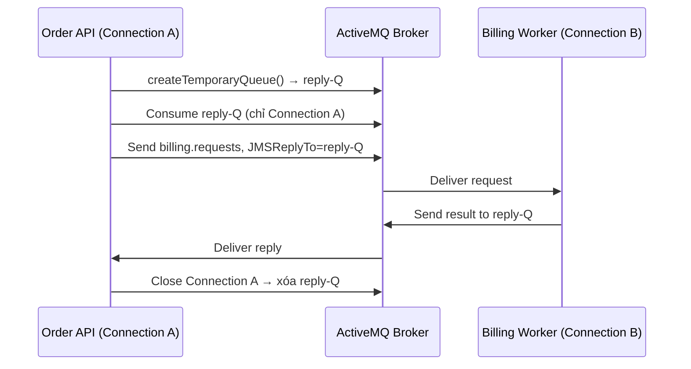
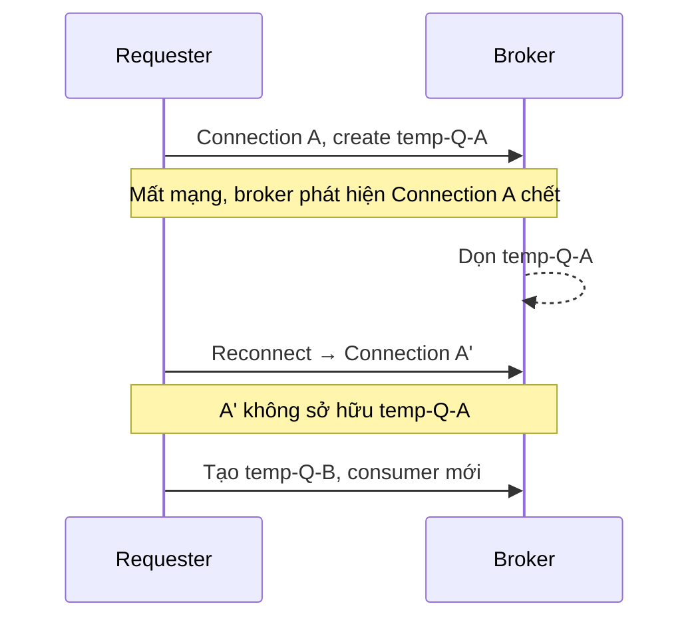

# Temporary queue, temporary topic và ràng buộc vòng đời kết nối

> **Chương:** Queue và Topic  
> **Phạm vi:** Apache ActiveMQ Classic và Apache ActiveMQ Artemis; Java JMS/Jakarta Messaging. Bài học tập trung vào **temporary destination** và vòng đời của connection sở hữu, đặc biệt trong mô hình request–reply bất đồng bộ.

## 1. Vấn đề cần giải quyết: nhận phản hồi ở đâu?

Một dịch vụ `Order API` gửi yêu cầu tính phí đến queue `billing.requests`; `Billing Worker` nhận yêu cầu và phải gửi câu trả lời về đúng nơi `Order API` đang chờ. Nếu nhiều phiên xử lý chạy đồng thời, việc tạo sẵn một queue phản hồi cho từng phiên có thể gây khó quản lý tên, quyền truy cập và dọn dẹp.

JMS cung cấp **temporary queue** và **temporary topic** để client tự tạo destination có vòng đời ngắn, gắn với **connection tạo ra nó**:

- `TemporaryQueue` là queue tạm, thường dùng làm địa chỉ nhận **một phản hồi** hoặc một luồng phản hồi riêng của client.
- `TemporaryTopic` là topic tạm, dùng khi một nhóm subscriber sống trong **cùng connection sở hữu** cần nhận những bản tin xuất bản vào một topic tồn tại ngắn hạn.
- Cả hai đều được broker quản lý và có định danh do provider cấp. Application không cần đặt tên vật lý để tạo; không được giả định tên đó tái sử dụng được sau reconnect.

Ví dụ luồng request–reply:



**Quy tắc quan trọng:** Chỉ **connection tạo temporary destination** được **consume** từ đó. Các connection khác **được phép gửi/publish** đến destination khi nó còn tồn tại và được broker cấp quyền. Đây là hành vi API JMS; không phải cách đặt tên queue hay chuyện hai ứng dụng có chạy cùng JVM.

## 2. Phân biệt `TemporaryQueue`, `TemporaryTopic` và destination thông thường

| Thuộc tính | Temporary queue | Temporary topic | Queue/topic thông thường |
| --- | --- | --- | --- |
| Tạo từ API | `Session.createTemporaryQueue()` | `Session.createTemporaryTopic()` | `Session.createQueue(name)` / `createTopic(name)` |
| Kiểu trả về | `javax.jms.TemporaryQueue` hoặc `jakarta.jms.TemporaryQueue` | `javax.jms.TemporaryTopic` hoặc `jakarta.jms.TemporaryTopic` | `Queue` / `Topic` |
| Tên vật lý | Broker/provider sinh | Broker/provider sinh | Ứng dụng hoặc quản trị viên cung cấp tên |
| Connection khác **gửi** | Được, nếu còn tồn tại và có quyền | Được, nếu còn tồn tại và có quyền | Theo cấu hình quyền của broker |
| Connection khác **nhận** | **Không** | **Không** | Được, nếu có quyền/thuê bao |
| Mô hình phân phối | Mỗi message giao cho một consumer đủ điều kiện | Mỗi subscription đang hoạt động nhận bản sao phù hợp | Queue: competing consumers; topic: publish/subscribe |
| Vòng đời destination | Gắn với connection tạo ra | Gắn với connection tạo ra | Do ứng dụng/quản trị viên và policy của broker quyết định |
| Dùng làm reply-to | Rất phổ biến | Ít gặp; phù hợp phản hồi kiểu broadcast trong một connection | Phù hợp reply queue cố định, dùng chung |
| Durable topic subscription | Không áp dụng | **Không hỗ trợ** | Topic thông thường có thể hỗ trợ durable subscription |

**Điểm cần hiểu đúng:** Quy định "chỉ connection tạo mới được nhận" không có nghĩa chỉ **một consumer**. Có thể tạo nhiều consumer thuộc các session **của cùng connection** trên temporary destination, nếu provider cho phép và tài nguyên đủ. Trên temporary queue, các consumer này cạnh tranh message; trên temporary topic, mỗi subscriber hiện diện tại thời điểm publish có thể nhận một bản sao.

Ở chiều gửi, producer không nhất thiết nằm cùng connection. Ví dụ worker chạy JVM khác có thể nhận object `Destination` trong header `JMSReplyTo` rồi gửi lại; đây chính là mục đích của temporary queue trong request–reply.

### API và kiểu dữ liệu

```java
// Java JMS 1.1/2.0 — ActiveMQ Classic 5.x hoặc client Artemis javax.jms
import javax.jms.Session;
import javax.jms.TemporaryQueue;
import javax.jms.TemporaryTopic;

// Các lệnh được gọi trên Session đã tạo bởi một Connection:
TemporaryQueue replyQueue = session.createTemporaryQueue();
TemporaryTopic notificationTopic = session.createTemporaryTopic();

// TemporaryQueue extends Queue; TemporaryTopic extends Topic.
// Có thể dùng chúng khi API nhận tham số Destination.
```

Trong ứng dụng Jakarta Messaging 3.x, đổi các import `javax.jms.*` thành `jakarta.jms.*` **và** chọn provider client tương thích. Tập trung vào **vòng đời connection**, vì quy tắc temporary destination giống nhau về mặt mô hình dù dùng ActiveMQ Classic hay Artemis.

## 3. Bảng vòng đời: session, connection, stop, close và delete

Temporary destination có **connection sở hữu**, không đơn thuần là session đã gọi phương thức tạo. Phân biệt rõ các sự kiện:

| Sự kiện | Temporary destination | Điều xảy ra với consumer/producer |
| --- | --- | --- |
| `session.createTemporaryQueue()` hoặc `createTemporaryTopic()` | Được broker/provider tạo | Có thể tạo consumer trên connection sở hữu, gửi từ connection khác |
| `session.close()` | **Không tự trở thành destination thường; không mặc nhiên bị xóa chỉ do đóng session** | Consumer/producer thuộc session đóng; session mới của **cùng connection** có thể tiếp tục dùng destination nếu chưa xóa |
| `connection.stop()` | Vẫn còn | Tạm dừng phân phối message vào consumer trên connection đó; `start()` có thể tiếp tục |
| `TemporaryQueue.delete()` / `TemporaryTopic.delete()` | Yêu cầu xóa **trước khi connection đóng** | Cần đóng consumer đang dùng destination trước; nếu còn consumer hoạt động, provider có thể ném `JMSException` |
| `connection.close()` | **Bị xóa theo vòng đời connection** | Mọi session/consumer của connection đóng; reply-to cũ không còn hợp lệ |
| Mất mạng/JVM crash | Broker dọn khi xác định connection đã chết | Việc phát hiện có thể cần heartbeat/connection TTL; không bảo đảm xóa tức thì tại thời điểm dây mạng đứt |
| Reconnect tạo **connection mới** | Temporary destination của connection cũ **không thể tái sử dụng như cũ** | Phải tạo lại temp destination, consumer và thông báo reply-to mới |
| Broker restart | Không được dựa vào temp destination cũ | Khởi tạo lại connection và destination theo trạng thái broker thực tế |

Các quy tắc này khác với **message time-to-live (TTL)**. TTL quy định khi nào *một message* hết hạn; connection lifetime quy định khi nào *destination tạm* tồn tại. Dù gửi persistent message hay đặt TTL rất dài, điều đó **không** kéo dài tuổi thọ temporary destination sau khi connection sở hữu bị đóng.

### Ví dụ chuyển session nhưng giữ connection

```java
Connection owner = factory.createConnection();
Session first = owner.createSession(false, Session.AUTO_ACKNOWLEDGE);

TemporaryQueue temp = first.createTemporaryQueue();
first.close(); // Đóng Session, không phải Connection.

Session second = owner.createSession(false, Session.AUTO_ACKNOWLEDGE);
MessageConsumer receiver = second.createConsumer(temp);
// Vẫn là Connection owner, nên có thể consume temp nếu chưa bị delete.

receiver.close();
temp.delete(); // Giải phóng sớm khi không còn consumer.
second.close();
owner.close();
```

Ở ví dụ này `factory` là `ConnectionFactory` của provider phù hợp và cần có exception handling. Điểm chính là **session thứ hai chia sẻ cùng connection Java**. Nếu thay bằng `factory.createConnection()` lần nữa, đó sẽ là một connection khác và **không có quyền consume** temporary queue cũ.

**Lưu ý về pooling:** Một `Connection.close()` trên wrapper từ connection pool đôi khi chỉ trả logical connection về pool, chưa đóng physical connection ngay. Khi đó không nên phỏng đoán thời điểm broker dọn temporary destination chỉ từ lời gọi `close()` ở tầng ứng dụng; kiểm tra hợp đồng pooling của thư viện và chủ động gọi `delete()` sau khi consumer đóng nếu cần dọn sớm.

## 4. Ví dụ Java hoàn chỉnh: request–reply bằng `TemporaryQueue`

Bối cảnh: `Order API` gửi một request vào queue **`billing.requests`** và chờ phản hồi. Worker chạy một connection **khác** (có thể JVM khác) để xử lý.

Để ví dụ rõ ràng, dùng **Apache ActiveMQ Classic 5.x** với `javax.jms`; giả định broker có TCP listener `tcp://localhost:61616` và đã cho phép hai client truy cập. Đây là code tập trung vào semantics temporary destination, không thay thế cấu hình TLS, xác thực hoặc reliability policy của production.

Maven dependency cho **cả hai chương trình**:

```xml
<dependency>
    <groupId>org.apache.activemq</groupId>
    <artifactId>activemq-client</artifactId>
    <version>5.19.12</version>
</dependency>
```

### 4.1. Client sở hữu temporary queue

File `BillingRequester.java`:

```java
import java.util.UUID;

import javax.jms.Connection;
import javax.jms.ConnectionFactory;
import javax.jms.JMSException;
import javax.jms.Message;
import javax.jms.MessageConsumer;
import javax.jms.MessageProducer;
import javax.jms.Queue;
import javax.jms.Session;
import javax.jms.TemporaryQueue;
import javax.jms.TextMessage;

import org.apache.activemq.ActiveMQConnectionFactory;

public class BillingRequester {
    public static void main(String[] args) throws JMSException {
        ConnectionFactory factory =
                new ActiveMQConnectionFactory("tcp://localhost:61616");

        Connection owner = factory.createConnection();
        try {
            Session session = owner.createSession(
                    false, Session.AUTO_ACKNOWLEDGE);

            Queue requests = session.createQueue("billing.requests");
            TemporaryQueue replies = session.createTemporaryQueue();

            // Không dùng tên physical queue làm correlation id.
            String requestId = UUID.randomUUID().toString();

            // Chỉ connection owner được nhận từ replies.
            String selector = "JMSCorrelationID = '" + requestId + "'";
            MessageConsumer replyConsumer =
                    session.createConsumer(replies, selector);
            MessageProducer requestProducer =
                    session.createProducer(requests);

            owner.start(); // Bắt đầu phân phối message vào consumer.

            TextMessage request =
                    session.createTextMessage("amount=125000;order=O-1001");
            request.setJMSReplyTo(replies);
            request.setJMSCorrelationID(requestId);

            requestProducer.send(request);
            System.out.println("Sent request " + requestId);

            Message answer = replyConsumer.receive(5_000);
            if (answer == null) {
                System.out.println("Timeout: no reply in 5 seconds");
            } else if (answer instanceof TextMessage) {
                System.out.println(
                        "Reply: " + ((TextMessage) answer).getText());
            } else {
                System.out.println("Unexpected reply type");
            }

            // Đóng consumer trước khi xóa temporary destination.
            replyConsumer.close();
            requestProducer.close();
            replies.delete();
            session.close();
        } finally {
            // Kể cả khi gặp exception, đóng connection sẽ dọn destination tạm.
            owner.close();
        }
    }
}
```

Điểm chính của code:

1. `session.createTemporaryQueue()` trả về **địa chỉ do broker quản lý**, không cần tự sinh tên.
2. `request.setJMSReplyTo(replies)` đặt địa chỉ phản hồi vào **header JMSReplyTo** của request, để worker biết phải gửi về đâu.
3. `request.setJMSCorrelationID(requestId)` đặt định danh nghiệp vụ. Selector ở consumer giúp chọn reply đúng request khi trên một destination có nhiều message.
4. `owner.start()` phải được gọi trước khi chờ `receive()`, nếu không consumer chưa được phép phân phối message.
5. `receive(5_000)` có timeout. **Timeout không tự xóa queue**: code phải tự dọn bằng `delete()` hoặc đóng connection.
6. Đã có `finally owner.close()` để giải phóng connection trong trường hợp lỗi; ở ứng dụng thật cũng nên quản lý đóng producer, consumer và session trong `finally` hoặc abstraction tương ứng.

Ở ví dụ một request mỗi connection, selector nhằm minh họa correlation. Khi mở rộng nhiều request đồng thời trên **cùng** temporary queue, phải quản lý correlation và concurrency kỹ hơn; không tạo một session dùng chung cho nhiều thread vì JMS `Session` thông thường không thread-safe.

### 4.2. Worker trả lời qua **connection khác**

File `BillingWorker.java`:

```java
import javax.jms.Connection;
import javax.jms.ConnectionFactory;
import javax.jms.DeliveryMode;
import javax.jms.Destination;
import javax.jms.JMSException;
import javax.jms.Message;
import javax.jms.MessageConsumer;
import javax.jms.MessageProducer;
import javax.jms.Queue;
import javax.jms.Session;
import javax.jms.TextMessage;

import org.apache.activemq.ActiveMQConnectionFactory;

public class BillingWorker {
    public static void main(String[] args) throws JMSException {
        ConnectionFactory factory =
                new ActiveMQConnectionFactory("tcp://localhost:61616");

        Connection workerConnection = factory.createConnection();
        try {
            // Cùng Session transacted: chốt gửi reply và ack request.
            Session session = workerConnection.createSession(
                    true, Session.SESSION_TRANSACTED);
            Queue requests = session.createQueue("billing.requests");
            MessageConsumer requestConsumer =
                    session.createConsumer(requests);
            MessageProducer replyProducer =
                    session.createProducer(null); // Destination được chọn khi send.

            workerConnection.start();
            Message request = requestConsumer.receive(15_000);

            if (request != null) {
                try {
                    Destination replyTo = request.getJMSReplyTo();
                    if (replyTo == null) {
                        throw new JMSException(
                                "Request missing JMSReplyTo header");
                    }
                    if (!(request instanceof TextMessage)) {
                        throw new JMSException("Expected TextMessage");
                    }

                    String payload =
                            ((TextMessage) request).getText();
                    TextMessage reply =
                            session.createTextMessage("APPROVED: " + payload);

                    // Correlation ID dùng để khớp request–response.
                    reply.setJMSCorrelationID(
                            request.getJMSCorrelationID());

                    // Connection khác vẫn có quyền SEND đến temp queue.
                    replyProducer.send(
                            replyTo,
                            reply,
                            DeliveryMode.NON_PERSISTENT,
                            4,         // JMS priority
                            10_000L); // Reply TTL 10 giây

                    session.commit(); // Gửi reply + ack request cùng local tx.
                    System.out.println("Reply sent");
                } catch (JMSException e) {
                    session.rollback();
                    throw e;
                }
            } else {
                System.out.println("No request received");
            }

            replyProducer.close();
            requestConsumer.close();
            session.close();
        } finally {
            workerConnection.close();
        }
    }
}
```

**Chạy thử:** khởi động broker, chạy `BillingWorker` rồi nhanh chóng chạy `BillingRequester`. Requester chờ **5 giây** và worker chờ **15 giây**, nên cần chạy gần nhau để không hết timeout. Nếu worker đến quá muộn, reply queue có thể đã bị xóa khi requester đóng connection, và lệnh `send(replyTo, ...)` có thể thất bại với lỗi destination không còn tồn tại.

Ví dụ worker dùng **local JMS transaction** để gắn việc gửi reply và xác nhận request trong cùng session/provider. Đây không phải transaction trải qua cả database nghiệp vụ hoặc các hệ thống ngoài broker. Nếu cần cập nhật DB + gửi reply đáng tin cậy, hãy thiết kế transaction/outbox/idempotency phù hợp. Khi gửi reply thất bại và `rollback()` được gọi, request có thể được redeliver theo broker policy; nếu requester đã chết, hệ thống phải có chính sách xử lý lỗi thay vì retry vô hạn.

**Phân biệt hai loại định danh:**

- `JMSReplyTo`: *nơi* phải gửi phản hồi; ở ví dụ là `TemporaryQueue`.
- `JMSCorrelationID`: *phản hồi thuộc request nào*; ở ví dụ là UUID do caller đặt.

Broker không tự dùng `JMSCorrelationID` để tìm requester. Chính ứng dụng quyết định quy tắc correlation và selector/dispatcher.

### 4.3. Khi muốn dùng Jakarta Messaging và Artemis

Với Artemis, Java có thể giữ logic request–reply tương tự nhưng thay bộ dependency/import:

```xml
<!-- Một ví dụ với Artemis 2.57.0 và Jakarta Messaging -->
<dependency>
    <groupId>org.apache.artemis</groupId>
    <artifactId>artemis-jakarta-client</artifactId>
    <version>2.57.0</version>
</dependency>
```

```java
import jakarta.jms.Connection;
import jakarta.jms.Session;
import jakarta.jms.TemporaryQueue;

import org.apache.activemq.artemis.jms.client.ActiveMQConnectionFactory;

// Cấu hình broker URL/credential thực tế.
ActiveMQConnectionFactory factory =
        new ActiveMQConnectionFactory("tcp://localhost:61616");
Connection connection = factory.createConnection();
try {
    Session session = connection.createSession(
            false, Session.AUTO_ACKNOWLEDGE);
    TemporaryQueue replyTo = session.createTemporaryQueue();
    // Tạo consumer trên connection này; gửi replyTo qua JMSReplyTo.
    replyTo.delete();
    session.close();
} finally {
    connection.close();
}
```

Khi dùng `javax.jms` với Artemis, chọn `artemis-jms-client`; với Classic 5.x, ví dụ phía trên dùng `activemq-client`. **Không** trộn import `javax.jms` với client trả về `jakarta.jms.ConnectionFactory`. Đây là chi tiết tương thích thư viện; quy tắc vòng đời temporary destination vẫn gắn với connection sở hữu.

## 5. Ví dụ `TemporaryTopic`: phát thông báo trong phạm vi một connection

Temporary topic phù hợp khi một client tạo một kênh sự kiện ngắn hạn, và **nhiều subscriber trên connection đó** muốn nghe cùng một thông báo. Producer có thể nằm trên connection khác.

Ví dụ dưới đây dùng cùng provider ActiveMQ Classic ở phần 4 và một broker TCP đang chạy. Phần `TemporaryTopic` được tạo bởi `ownerSession`; hai consumer được tạo trước khi publisher gửi:

```java
import javax.jms.Connection;
import javax.jms.ConnectionFactory;
import javax.jms.Message;
import javax.jms.MessageConsumer;
import javax.jms.MessageProducer;
import javax.jms.Session;
import javax.jms.TemporaryTopic;

import org.apache.activemq.ActiveMQConnectionFactory;

public class TemporaryTopicDemo {
    public static void main(String[] args) throws Exception {
        ConnectionFactory factory =
                new ActiveMQConnectionFactory("tcp://localhost:61616");

        Connection owner = factory.createConnection();
        Connection remotePublisher = factory.createConnection();

        try {
            Session ownerSession = owner.createSession(
                    false, Session.AUTO_ACKNOWLEDGE);
            TemporaryTopic topic = ownerSession.createTemporaryTopic();

            MessageConsumer subscriberA =
                    ownerSession.createConsumer(topic);
            MessageConsumer subscriberB =
                    ownerSession.createConsumer(topic);

            Session publishingSession = remotePublisher.createSession(
                    false, Session.AUTO_ACKNOWLEDGE);
            MessageProducer producer =
                    publishingSession.createProducer(topic);

            owner.start(); // Cho phép 2 subscriber nhận.
            producer.send(
                    publishingSession.createTextMessage("DONE: O-1001"));

            Message a = subscriberA.receive(2_000);
            Message b = subscriberB.receive(2_000);

            System.out.println("Subscriber A got message: " + (a != null));
            System.out.println("Subscriber B got message: " + (b != null));

            subscriberA.close();
            subscriberB.close();
            producer.close();
            topic.delete();

            publishingSession.close();
            ownerSession.close();
        } finally {
            remotePublisher.close();
            owner.close();
        }
    }
}
```

Kết quả mong đợi là cả hai subscriber đã đăng ký trước khi publish đều thấy message, nhưng việc gửi/nhận thực tế còn phụ thuộc broker đã sẵn sàng, quyền và timeout. Một subscriber được tạo **sau** khi publish không được dựa vào khả năng nhận lại message cũ: **temporary topic không hỗ trợ durable subscription**.

**Khác với temporary queue:** temporary topic có thể có nhiều subscriber nhận cùng một publication, nhưng tất cả consumer hợp lệ vẫn phải thuộc **connection sở hữu topic**. Nếu nhiều dịch vụ độc lập cần đăng ký durable topic, hãy dùng **topic thông thường** và cấu hình subscription thích hợp.

## 6. Những tình huống làm temporary destination mất hiệu lực

### 6.1. Requester timeout trước khi worker trả lời

Dòng thời gian:

```text
t=0 s  Requester tạo temp queue và gửi request.
t=5 s  Requester receive() timeout.
t=5 s  Requester đóng connection; temp queue bị xóa.
t=7 s  Worker xử lý xong và gửi reply vào JMSReplyTo cũ.
       Broker/provider có thể trả lỗi destination không tồn tại.
```

Nếu requester chỉ timeout nhưng **vẫn giữ connection**, temp queue có thể vẫn tồn tại; reply muộn có thể vào queue và trở thành message không còn ai mong đợi. Vì vậy **timeout không tương đương delete**.

Cách xử lý:

- Áp dụng timeout và TTL phù hợp, định nghĩa khi nào request hết hiệu lực.
- Sau timeout, đánh dấu correlation ID thất bại; bỏ qua reply muộn hoặc chuyển sang quy trình bù trừ.
- Dọn consumer/destination đúng vòng đời; nếu dùng một temp queue dùng chung nhiều request thì **không xóa nó khi một request riêng lẻ timeout**.
- Worker cần chính sách rõ cho trường hợp reply-to không còn tồn tại; tránh retry vô hạn rồi làm đầy DLQ.

### 6.2. Mạng đứt và cơ chế tự reconnect



Với một kết nối vật lý đã mất, broker có thể chỉ dọn destination khi phát hiện connection hết thời gian sống; thời điểm dọn phụ thuộc heartbeat, inactivity monitor hoặc connection TTL của provider. Không nên thiết kế logic đòi hỏi queue bị xóa **ngay lập tức** khi socket ngắt.

Khi client reconnect, connection mới không kế thừa quyền sở hữu temporary queue/topic đã tạo ở connection cũ. Dù thư viện failover cố gắng khôi phục một số trạng thái client, ứng dụng vẫn phải kiểm thử khả năng phục hồi temporary destination, consumer và những request còn chờ với **đúng provider/version**. Một chiến lược rõ ràng là phát hiện connection failure, tạo reply destination mới và retry những request mà nghiệp vụ cho phép.

Nếu cần **trả kết quả khi requester tạm offline trong thời gian dài**, temporary destination là lựa chọn yếu: dùng reply queue được quản lý độc lập, lưu trạng thái yêu cầu hoặc trả lời qua cơ chế callback/webhook phù hợp.

### 6.3. Connection pool và Spring JMS

Trong ứng dụng nhiều request/giây, việc tạo **một physical connection và một temporary queue cho mỗi request** có thể tốn kết nối, destination metadata và tài nguyên broker. Thực tế thường tái sử dụng connection và dùng một trong các cách:

- **Một temporary queue cho mỗi connection đang sống:** nhiều request chung queue; quản lý correlation ID, selector hoặc reply dispatcher; khi connection đổi, tạo queue mới.
- **Temporary queue theo từng request:** dễ cô lập phản hồi nhưng tạo/xóa rất nhiều destination; cần kiểm thử churn và bảo đảm cleanup.
- **Reply queue cố định:** dùng khi nhiều instance hoặc worker cần reply bền vững, nhưng phải thiết kế correlation, partition/consumer routing, quyền truy cập và tránh worker A nhận reply của worker B.

Các framework như Spring JMS có thể quản lý connection, session hoặc cơ chế request–reply. Nếu dùng `CachingConnectionFactory`, pooled JMS connection hoặc `JmsTemplate`, hãy kiểm tra **physical connection nào đang thực sự sở hữu temporary destination**. Một lời gọi đóng wrapper có thể chỉ trả object về pool, khiến tài nguyên tồn tại lâu hơn dự kiến. Ngược lại, khi pool tái tạo physical connection, reply-to cũ không còn đáng tin cậy.

Không chia sẻ một `Session` cho các thread đồng thời. Dùng session riêng hoặc dispatcher được đồng bộ đúng cách, quản lý reply theo `JMSCorrelationID` và chỉ xóa temporary destination khi không còn consumer hoặc request đang dùng nó.

## 7. Bảo mật, giới hạn tài nguyên và tính tin cậy

Temporary destination thường sinh tên động, vì vậy broker cần có chính sách **create/consume/send** phù hợp:

- **Create:** requester được phép tạo temporary queue/topic.
- **Consume:** connection sở hữu được phép tạo consumer; connection khác vẫn không được consume dù thông tin tên destination bị lộ.
- **Send:** responder phải có quyền gửi tới temporary destination đã nhận qua `JMSReplyTo`.
- **Quota:** giới hạn số temporary destination, connection, consumer, backlog và bộ nhớ; tránh cho mỗi request tạo một queue không được dọn.
- **Observability:** theo dõi số destination tạm, tốc độ create/delete, connection leak, message quá hạn, reply timeout và lỗi `InvalidDestinationException`.

Cơ chế cụ thể của ACL và tên internal temporary destination khác nhau giữa **ActiveMQ Classic** và **Artemis**. Không hardcode tên queue hệ thống hoặc coi queue tạm là một tên queue tĩnh có thể tự xây dựng bằng chuỗi. Hãy truyền **`Destination` object** qua `JMSReplyTo` trong client JMS tương thích.

Một số quy tắc về độ tin cậy cần tách riêng:

| Khía cạnh | Điều bảo đảm / không bảo đảm |
| --- | --- |
| `DeliveryMode.PERSISTENT` | Là yêu cầu độ bền cho **message**, không làm temporary destination sống sau connection |
| `JMSExpiration` / TTL | Cho phép message hết hạn; không thay thế cleanup của destination |
| `Session.commit()` | Chốt giao dịch JMS; không biến reply thành kết quả có thể lấy khi connection đã chết |
| Redelivery/DLQ | Phụ thuộc broker policy; reply-to có thể đã biến mất khi request được redeliver |
| `JMSCorrelationID` | Ứng dụng dùng để nhận diện request/reply; broker không tự ghép kết quả vào một Java `Future` |
| Reconnect | Có thể cần tạo lại temporary destination và các consumer; kiểm thử với client failover cụ thể |

**Không dùng `ObjectMessage` cho hợp đồng reply xuyên service nếu chưa kiểm soát chặt việc deserialize và class version.** `TextMessage` chứa JSON hoặc payload có schema rõ ràng thường dễ tương tác hơn khi các service nâng cấp độc lập.

## 8. Bảng chẩn đoán lỗi thường gặp

| Triệu chứng | Nguyên nhân thường gặp | Cách kiểm tra/sửa |
| --- | --- | --- |
| `InvalidDestinationException` khi tạo consumer | Consumer dùng connection **khác** connection tạo temp queue/topic; hoặc destination đã bị xóa | Xác định connection sở hữu, tạo consumer trên session thuộc connection đó |
| Responder gửi reply bị lỗi destination không tồn tại | Requester đã đóng connection hoặc temp destination đã được `delete()` | Kiểm tra reply timeout, connection failure, log create/delete của broker |
| `receive()` luôn timeout | Chưa `connection.start()`, correlation selector sai hoặc worker không gửi được reply | Kiểm tra `start()`, `JMSReplyTo`, `JMSCorrelationID`, ACL và broker log |
| Queue tạm tăng không ngừng | Tạo per-request nhưng không xóa; physical connection bị pool giữ lại | Dọn consumer/destination, rà soát pooling và số lượng outstanding request |
| Reply sai request | Dùng một temp queue cho nhiều request mà thiếu correlation/dispatcher | UUID correlation + selector hoặc pending-response map có xử lý timeout |
| Reply mất sau redeploy | Connection chủ bị đóng, temporary destination bị xóa | Chuyển sang reply queue bền vững nếu yêu cầu reply sau downtime |
| Temporary topic không nhận bản tin cũ | Subscriber tạo sau lúc publish; không có durable subscription | Dùng topic thông thường + durable subscription nếu cần replay/durable delivery |
| Send được nhưng không consume được từ connection B | Quy tắc ownership của temp destination | Chỉ connection A tạo destination được consume; B chỉ gửi khi được cấp quyền |
| Dọn chậm sau mất mạng | Broker chờ heartbeat/connection TTL để nhận diện dead connection | Kiểm tra timeout/inactivity monitor và metric connection, không giả định xóa ngay |

## 9. Bài thực hành có kiểm chứng

**Thiết lập:** một ActiveMQ Classic hoặc Artemis broker đã chạy, hai Java process dùng client provider tương thích. Thực hiện trên môi trường test, không dùng queue dữ liệu thật.

1. **Request–reply:** chạy `BillingWorker` trước, sau đó `BillingRequester`. Xác nhận worker nhận request, reply về temporary queue, requester nhận đúng `JMSCorrelationID`.
2. **Cross-connection send:** cho worker gửi tới `JMSReplyTo` được tạo bởi requester. Xác nhận hành vi gửi qua **connection khác** là hợp lệ khi được broker cấp quyền.
3. **Cross-connection consume:** thử tạo `MessageConsumer` trên temp queue đó bằng worker connection. Dự kiến bị từ chối theo quy tắc ownership.
4. **Session vs connection:** đóng session tạo temp queue rồi mở session mới **cùng connection**; tạo consumer mới trên queue tạm khi queue chưa xóa. Sau đó đóng connection và xác minh queue không còn hợp lệ.
5. **Explicit delete:** đóng mọi consumer, gọi `TemporaryQueue.delete()`, rồi thử dùng destination cũ để gửi. Quan sát lỗi từ provider/broker và việc dọn resource.
6. **Late reply:** đặt requester timeout thấp hơn thời gian worker xử lý. Quan sát phản hồi thất bại khi reply destination đã mất hoặc bị bỏ qua nếu connection vẫn giữ queue.
7. **Temporary topic:** tạo hai consumer cùng connection trước publish; kiểm chứng cả hai nhận message. Thử subscribe sau publish rồi so sánh với topic thường có durable subscription.
8. **Reconnect:** mô phỏng mất connection và tạo physical connection mới. Xác nhận cần cập nhật `JMSReplyTo`, consumer và correlation đối với request tiếp theo.

### Câu hỏi tự kiểm tra

1. **Temporary queue do `Session A` tạo, `Session B` trên cùng `Connection X` có nhận được không?** — Có, nếu destination chưa xóa và provider đáp ứng JMS contract; quyền nhận bị ràng buộc bởi **connection**, không chỉ session.
2. **`Connection Y` khác có gửi tới queue của `Connection X` được không?** — Có, miễn destination còn tồn tại và được broker cấp quyền.
3. **`Connection Y` có tạo consumer trên queue tạm của X được không?** — Không.
4. **Đóng `Session A` có đồng nghĩa xóa temporary queue không?** — Không; lifetime gắn với owning connection.
5. **`Connection.stop()` có xóa temporary topic không?** — Không; nó tạm ngừng message delivery.
6. **Dùng persistent message có giữ temporary queue qua lần đóng connection không?** — Không.
7. **Khi requester timeout, worker có chắc gửi reply được không?** — Không; tùy connection chủ còn sống và destination chưa bị xóa.
8. **Có nên dùng temporary topic cho subscriber offline cần nhận lại các sự kiện?** — Không; chọn topic thường và subscription bền vững.

## 10. Checklist thiết kế trước khi áp dụng

- [ ] Đã xác định temporary destination được tạo và sở hữu bởi **connection vật lý nào**.
- [ ] Đã phân biệt đường **send** từ connection khác với đường **consume** chỉ từ owner.
- [ ] Đã chọn `TemporaryQueue` cho reply một-đích hay `TemporaryTopic` cho fan-out ngắn hạn.
- [ ] `JMSReplyTo` và `JMSCorrelationID` được truyền và kiểm tra nhất quán.
- [ ] Đã thiết kế timeout, TTL, late reply và logic xử lý request trùng lặp.
- [ ] Đã đóng consumer trước `delete()` và kiểm tra cleanup khi close/crash.
- [ ] Đã thử behavior khi reconnect, failover hoặc physical connection bị thay thế.
- [ ] Đã kiểm tra tác động của connection pool/Spring wrapper lên lifetime.
- [ ] Đã cấu hình ACL cho tạo/nhận/gửi temporary destination và quota phù hợp.
- [ ] Đã chuyển sang queue/topic thường nếu message cần sống lâu hơn client connection.

## Tài liệu tham khảo

- [Jakarta Messaging 3.1 Specification](https://jakarta.ee/specifications/messaging/3.1/jakarta-messaging-spec-3.1.html) — quy tắc `TemporaryQueue`, `TemporaryTopic` và `JMSReplyTo`.
- [Apache ActiveMQ Classic — JMS Request/Response](https://activemq.apache.org/components/classic/documentation/how-should-i-implement-request-response-with-jms) — mô hình reply destination và correlation.
- [Apache ActiveMQ Classic — JMS Client](https://activemq.apache.org/components/classic/documentation/jms-client) — kết nối Java qua client ActiveMQ.
- [Apache ActiveMQ Artemis Documentation](https://artemis.apache.org/components/artemis/documentation/latest/) — cấu hình broker, temporary destinations, connection TTL và security theo phiên bản.
