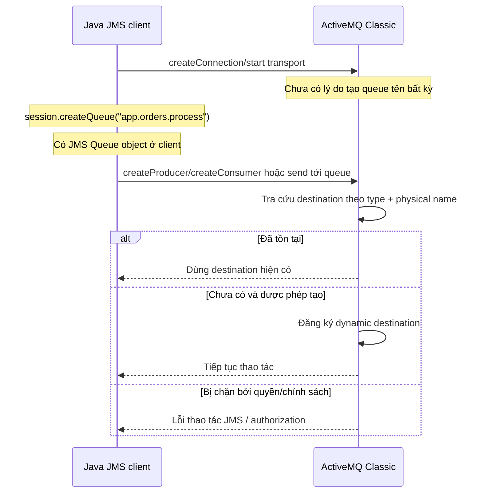

# Tạo destination tĩnh và tự tạo destination khi client kết nối

> **Chương:** Định tuyến Classic  
> **Broker áp dụng:** Apache ActiveMQ **Classic**; ví dụ Java dùng JMS (`javax.jms`) với client Classic tương ứng.  
> **Mục tiêu:** Biết cách khai báo queue/topic ngay khi broker khởi động, hiểu vì sao queue/topic có thể xuất hiện khi producer hoặc consumer kết nối, thiết kế quyền tạo destination, giám sát và kiểm thử để tránh sai tuyến message trong production.

## 1. Bài toán: queue xuất hiện dù không có trong cấu hình

Một hệ thống xử lý đơn hàng có producer gửi lệnh tới `app.orders.process` và consumer chờ đúng queue đó. Nhân viên triển khai vô tình sửa tên trong producer thành `app.order.process` (thiếu chữ `s`):

```text
Producer: app.order.process   -> broker tạo queue mới -> message chờ mãi
Consumer: app.orders.process  -> queue đúng vẫn rỗng
```

Mặc định, ActiveMQ Classic hỗ trợ **tạo destination theo nhu cầu** (*on-demand/dynamic destination creation*). Vì vậy, một tên queue sai có thể vẫn được broker chấp nhận, thay vì báo ngay “queue không tồn tại”. Điều này thuận tiện trong phát triển nhưng có thể che giấu lỗi cấu hình ở production.

Có hai cách phổ biến để destination tồn tại trong broker:

- **Destination tĩnh:** quản trị viên khai báo trước trong cấu hình broker. Broker tạo/đăng ký queue hoặc topic khi khởi động, trước khi có ứng dụng sử dụng.
- **Destination động:** producer, consumer hoặc một thao tác quản trị yêu cầu một tên destination chưa được khai báo, và broker tạo destination tương ứng khi xử lý thao tác đó, nếu chính sách/quyền cho phép.

**Hai cách này tạo ra cùng loại queue hoặc topic ở góc nhìn client JMS.** Khác nhau chủ yếu ở **thời điểm, quyền tạo, khả năng quản trị và quản lý vòng đời**, không phải một kiểu message delivery riêng.

## 2. Hiểu chính xác “client kết nối thì broker tự tạo destination”

Cụm “tự tạo khi client kết nối” rất dễ bị hiểu nhầm. **Chỉ mở một kết nối TCP/JMS đến broker không làm broker tạo mọi queue mà ứng dụng có thể dùng.** Destination được tạo khi broker xử lý thao tác thực sự tham chiếu tới nó; thời điểm chính xác có thể khác theo loại client, protocol và phiên bản.

Một chuỗi thao tác thường gặp:



### 2.1. Ba đối tượng không được đánh đồng

| Khái niệm | Ví dụ | Ý nghĩa |
|---|---|---|
| **JMS Destination object** | `Queue q = session.createQueue("app.orders.process")` | Đối tượng ở phía client biểu diễn tên logic; lời gọi này tự nó **không bảo đảm broker đã đăng ký queue** |
| **Broker destination** | Queue `app.orders.process` xuất hiện trên JMX/web console | Đối tượng queue/topic thật trong broker, có producer/consumer, thống kê, chính sách và lifecycle |
| **Message đang lưu trong destination** | Queue có `QueueSize=25` | Dữ liệu chờ xử lý; việc destination tồn tại **không chứng minh có message**, cũng không chứng minh message persistent |

Các phương thức `createProducer(...)`, `createConsumer(...)` hoặc lần `send(...)` đầu tiên có thể làm broker phải tạo/đăng ký destination. **Không xây logic vận hành phụ thuộc vào chính xác phương thức nào tạo trước**: hãy kiểm tra trạng thái thật trên broker.

### 2.2. Queue và topic trùng tên vẫn là hai destination khác kiểu

```java
Queue commands = session.createQueue("app.orders");
Topic events  = session.createTopic("app.orders");
```

Đây là hai destination **khác loại** dù cùng physical name `app.orders`. Producer gửi queue sẽ không tự chuyển thành publish tới topic. Hãy đặt quy ước tên rõ nghĩa, chẳng hạn `app.orders.command` và `app.orders.event`, và kiểm tra cả **type + physical name** trong hệ thống giám sát.

## 3. Khai báo destination tĩnh trong `activemq.xml`

Trong ActiveMQ Classic, khai báo các destination muốn có ngay khi broker khởi động ở phần tử `<destinations>`, nằm **bên trong `<broker>`** theo cấu hình XML Classic. Ví dụ đoạn sau cần được ghép vào phần `broker` hiện có:

```xml
<!-- Trong <broker xmlns="http://activemq.apache.org/schema/core" ...> -->
<destinations>
    <queue physicalName="app.orders.process"/>
    <queue physicalName="app.payments.process"/>
    <queue physicalName="app.orders.DLQ"/>
    <topic physicalName="app.orders.events"/>
</destinations>
```

**Ý nghĩa của khai báo:**

- `<queue physicalName="app.orders.process"/>` yêu cầu broker có queue nhận lệnh xử lý đơn.
- `<queue physicalName="app.orders.DLQ"/>` chuẩn bị queue để điều tra message lỗi, nếu chính sách DLQ thực tế trỏ đến tên này.
- `<topic physicalName="app.orders.events"/>` tạo destination kiểu topic. **Nó không tự tạo durable subscription cho từng dịch vụ**, và không giữ mọi event khi chưa có subscriber.
- `physicalName` phải khớp **chính xác** (bao gồm hoa/thường) với tên mà client sử dụng.

### 3.1. Quy trình cấu hình trên broker đang chạy

1. Chọn tên queue/topic từ hợp đồng giữa producer và consumer; thống nhất kiểu `Queue`/`Topic`, owner, ACL và policy.
2. Bổ sung các entry vào `<destinations>` **của broker Classic** theo cấu trúc XML đúng phiên bản.
3. Kiểm tra cấu hình XML hợp lệ và khả năng khởi động ở staging trước khi triển khai.
4. Khởi động/restart broker theo quy trình vận hành.
5. **Chưa bật ứng dụng producer/consumer**, mở web console hoặc JMX để xác nhận các destination đã xuất hiện.
6. Sau đó kết nối client và chạy kiểm thử send/receive/subscribe.

Một cách tổ chức điển hình của cấu hình broker:

```xml
<!-- Đoạn rút gọn của phần broker trong activemq.xml Classic -->
<broker xmlns="http://activemq.apache.org/schema/core"
        brokerName="orders-broker"
        persistent="true">

    <destinations>
        <queue physicalName="app.orders.process"/>
        <topic physicalName="app.orders.events"/>
    </destinations>

    <!-- Các mục transportConnectors, persistenceAdapter,
         destinationPolicy, security plugins... thuộc cấu hình thực tế. -->
</broker>
```

Đây là **mảnh ví dụ**, không thay thế toàn bộ cấu hình phân phối chuẩn của ActiveMQ Classic (thường có các phần tử Spring/namespace, persistence adapter, system usage và transport connector). Giữ cấu trúc và schema tương ứng phiên bản của hệ thống.

### 3.2. Điều gì xảy ra khi restart?

Destination được **khai báo tĩnh** tiếp tục nằm trong cấu hình nên broker có thể dựng lại sau restart dù lúc đó không có client và queue rỗng. Điều này giúp kiểm tra cấu hình trong quá trình triển khai.

Nhưng **việc có entry tĩnh không phải bảo đảm dữ liệu được khôi phục**. Message tồn tại sau crash còn phụ thuộc `DeliveryMode.PERSISTENT`, broker persistence, transaction, storage và quá trình khôi phục. Một queue được tạo động cũng có thể chứa message persistent trong store; không nên suy luận “động nghĩa là message sẽ mất” hoặc “tĩnh nghĩa là mọi message đều bền vững”.

### 3.3. Khi nào nên khai báo tĩnh?

Hợp lý nhất với các destination đóng vai trò **hợp đồng lâu dài**:

- Queue xử lý nghiệp vụ: `app.orders.process`, `app.payments.process`.
- Topic sự kiện dành cho nhiều nhóm dịch vụ: `app.orders.events`.
- Queue lỗi cụ thể của ứng dụng: `app.orders.DLQ`.
- Queue cần được monitor và cấp quyền trước khi hệ thống nhận lưu lượng.

Không cần đưa mọi destination ngắn hạn vào XML nếu kiến trúc có luồng tạo động được quản trị rõ ràng.

## 4. Tạo destination động: hành vi mặc định và các thời điểm kích hoạt

Khi tên destination chưa khai báo, broker Classic thông thường có thể tạo khi producer hoặc consumer bắt đầu dùng nó. Với ứng dụng Java:

```java
Queue queue = session.createQueue("app.demo.dynamic");
// Dòng trên tạo JMS Queue object.
// Việc broker thêm queue thực sự có thể diễn ra ở một thao tác kế tiếp:
MessageProducer producer = session.createProducer(queue);
producer.send(session.createTextMessage("hello"));
```

Trên broker với cấu hình mặc định cho phép, destination `app.demo.dynamic` xuất hiện khi được dùng. Queue này có thể không có bất kỳ entry nào trong `activemq.xml`.

**Thời điểm chính xác của lệnh tạo có thể khác:** trong một bản client, tạo producer đã làm broker đăng ký destination; bản khác có thể đợi tới send hoặc thao tác consumer. Dấu hiệu cần xác minh là **broker nhìn thấy queue/topic**, không phải chỉ có đối tượng Java.

### 4.1. Nếu destination không có consumer thì sao?

Đối với queue:

- Producer có thể gửi thành công và broker giữ message theo delivery/persistence policy.
- Queue có thể tồn tại với `ConsumerCount=0` và `QueueSize>0`.
- Khi consumer kết nối đúng queue và nhận được message, backlog được giảm theo cơ chế ack/transaction.

Đối với topic:

- Message được phân phối tới subscription phù hợp.
- **Non-durable subscriber** chỉ nhận message trong thời gian subscription hoạt động (theo contract và trạng thái thực tế).
- **Durable subscription** được đăng ký riêng; topic xuất hiện **không** đồng nghĩa mọi message sẽ được giữ vô hạn cho một ứng dụng chưa từng tạo durable subscription.

### 4.2. Producer có thể tự “sửa” lỗi cấu hình thành lỗi dữ liệu

Giả sử producer viết sai:

```java
Queue queue = session.createQueue("app.ordres.process"); // Typo!
```

Trong môi trường cho phép auto-create, broker có thể tạo queue mới `app.ordres.process` rồi lưu message ở đó. Người vận hành cần đối chiếu queue mới phát sinh, lượng message tăng và consumer count bằng 0, thay vì chỉ nhìn lỗi ở producer.

**Biện pháp:** thống nhất danh mục destination, dùng constants/structured configuration, xác nhận quyền truy cập và chạy contract test của hai phía.

## 5. Ví dụ Java JMS thực tế: cùng client code cho tĩnh hoặc động

Ví dụ dưới đây dùng API `javax.jms` và ActiveMQ Classic client tương thích. Nó tập trung vào một queue `app.orders.process`. **Không có API riêng cho “send vào queue tĩnh” và “send vào queue động”**; broker quyết định destination có tồn tại sẵn hay được tạo khi cần.

### 5.1. Dependency và kết nối

Với dự án Java dùng Maven, khai báo client Classic đúng phiên bản hệ thống đã kiểm thử, chẳng hạn:

```xml
<dependency>
    <groupId>org.apache.activemq</groupId>
    <artifactId>activemq-client</artifactId>
    <version>5.18.7</version>
</dependency>
```

Ví dụ sử dụng một phiên bản thuộc nhánh Classic 5.x và `javax.jms`. Trong ứng dụng thực, phải chọn **phiên bản client được phép dùng và tương thích JDK/broker**; không tự trộn `javax.jms` với `jakarta.jms` hay suy luận rằng mọi phiên bản Classic đều có API giống nhau.

Kết nối tới transport connector của broker:

```java
import javax.jms.Connection;
import org.apache.activemq.ActiveMQConnectionFactory;

ActiveMQConnectionFactory factory =
        new ActiveMQConnectionFactory("tcp://127.0.0.1:61616");

// Local demo có thể bật anonymous authentication.
// Production nên tạo connection với thông tin xác thực được quản lý an toàn.
Connection connection = factory.createConnection();
```

Dùng endpoint, TLS và credential của môi trường thực tế; cổng `61616` chỉ là ví dụ thường gặp.

### 5.2. Producer gửi message persistent và commit

```java
import javax.jms.Connection;
import javax.jms.DeliveryMode;
import javax.jms.JMSException;
import javax.jms.MessageProducer;
import javax.jms.Queue;
import javax.jms.Session;
import javax.jms.TextMessage;
import org.apache.activemq.ActiveMQConnectionFactory;

public final class SendOrder {
    public static void main(String[] args) throws JMSException {
        String destinationName = args.length > 0
                ? args[0] : "app.orders.process";

        ActiveMQConnectionFactory factory =
                new ActiveMQConnectionFactory("tcp://127.0.0.1:61616");
        Connection connection = factory.createConnection();

        try {
            Session session = connection.createSession(
                    true, Session.SESSION_TRANSACTED);
            try {
                Queue queue = session.createQueue(destinationName);
                MessageProducer producer = session.createProducer(queue);
                try {
                    producer.setDeliveryMode(DeliveryMode.PERSISTENT);

                    TextMessage message =
                            session.createTextMessage("{\"orderId\":\"ORD-42\"}");
                    message.setStringProperty("eventId", "order-42-v1");

                    try {
                        producer.send(message);
                        session.commit();
                        System.out.println("Sent to: " + destinationName);
                    } catch (JMSException | RuntimeException error) {
                        session.rollback();
                        throw error;
                    }
                } finally {
                    producer.close();
                }
            } finally {
                session.close();
            }
        } finally {
            connection.close();
        }
    }
}
```

**Kiểm tra hai tình huống:**

- `SendOrder app.orders.process`: nếu queue đã khai báo tĩnh, message được route vào queue hiện có.
- `SendOrder app.demo.dynamic`: nếu broker và quyền cho phép, queue mới được tạo theo nhu cầu rồi nhận message.

Với `SESSION_TRANSACTED`, `session.commit()` mới kết thúc transaction gửi. Nếu `commit()` timeout, phía producer có thể không biết kết quả cuối cùng; cần `eventId`/idempotency để xử lý retry an toàn.

### 5.3. Consumer đọc và xác nhận bằng JMS transaction

```java
import javax.jms.Connection;
import javax.jms.JMSException;
import javax.jms.Message;
import javax.jms.MessageConsumer;
import javax.jms.Queue;
import javax.jms.Session;
import javax.jms.TextMessage;
import org.apache.activemq.ActiveMQConnectionFactory;

public final class ReceiveOrder {
    public static void main(String[] args) throws JMSException {
        String destinationName = args.length > 0
                ? args[0] : "app.orders.process";

        ActiveMQConnectionFactory factory =
                new ActiveMQConnectionFactory("tcp://127.0.0.1:61616");
        Connection connection = factory.createConnection();

        try {
            Session session = connection.createSession(
                    true, Session.SESSION_TRANSACTED);
            try {
                Queue queue = session.createQueue(destinationName);
                MessageConsumer consumer = session.createConsumer(queue);
                try {
                    connection.start();
                    Message received = consumer.receive(5000L);
                    if (received == null) {
                        System.out.println("No message");
                        return;
                    }

                    try {
                        if (!(received instanceof TextMessage)) {
                            throw new IllegalArgumentException(
                                    "Expected TextMessage");
                        }

                        String eventId =
                                received.getStringProperty("eventId");
                        String json = ((TextMessage) received).getText();

                        // Production: áp dụng idempotency trong DB theo eventId.
                        System.out.println(eventId + ": " + json);
                        session.commit();
                    } catch (JMSException | RuntimeException error) {
                        session.rollback();
                        throw error;
                    }
                } finally {
                    consumer.close();
                }
            } finally {
                session.close();
            }
        } finally {
            connection.close();
        }
    }
}
```

Consumer cũng có thể khiến broker tạo queue khi gắn vào một tên chưa tồn tại. Vì vậy, đừng dùng “consumer start không báo lỗi” làm bằng chứng queue đã được cấp phát đúng theo hợp đồng.

### 5.4. Queue/Topic API không quyết định static hay dynamic

```java
Queue commands = session.createQueue("app.orders.process");
Topic events = session.createTopic("app.orders.events");

// Cả hai đều trả về JMS Destination object cho phía client.
// Sự tồn tại thật và policy nằm ở ActiveMQ Classic broker.
```

Producer gửi tới topic bằng `session.createProducer(events)`; consumer nhận topic bằng `session.createConsumer(events)`. Với subscriber durable, cần thêm thiết lập `clientID` và subscription name, không chỉ tạo topic:

```java
connection.setClientID("billing-service-instance-01");
Session session = connection.createSession(
        false, Session.CLIENT_ACKNOWLEDGE);
Topic events = session.createTopic("app.orders.events");
MessageConsumer durable =
        session.createDurableSubscriber(events, "billing-orders-events");
connection.start();
```

`clientID` phải được quản lý để không xung đột giữa các kết nối đang hoạt động; cùng tên subscription nhưng sai `clientID` có thể thành subscription khác. Khi dùng `CLIENT_ACKNOWLEDGE`, lời gọi `acknowledge()` trong JMS 1.1 thường xác nhận các message đã nhận trong session, vì thế cần hiểu phạm vi ack trước khi chạy nhiều consumer chung session.

## 6. Phân biệt ba vòng đời: broker destination, message và subscription

Một destination có thể xuất hiện từ startup (tĩnh) hoặc từ hoạt động client (động), nhưng **trạng thái message và subscription có vòng đời riêng**.

| Thành phần | Có thể được tạo bởi | Khi nào còn tồn tại? | Điểm cần bảo đảm |
|---|---|---|---|
| Queue tĩnh | `<destinations>` trong broker config | Được tạo lại sau startup theo config | Đúng tên, quyền, policy |
| Queue động | Hoạt động producer/consumer hoặc management | Có thể tồn tại khi client disconnect; cleanup phụ thuộc config/quản trị | Theo dõi destination rác và quota |
| Message persistent | Producer gửi persistent, broker/transaction chấp nhận | Phục hồi theo bảo đảm persistence cụ thể | Store, transaction, ack, disk |
| Message non-persistent | Producer gửi non-persistent | Không có bảo đảm phục hồi như persistent | Chỉ dùng khi cho phép mất |
| Topic tĩnh/động | Cấu hình hoặc hoạt động client | Destination type Topic tồn tại trong broker | Không suy ra có durable subscribers |
| Durable subscription | JMS subscriber đăng ký durable | Có thể lưu message phù hợp khi subscriber offline | `clientID`, subscription name, selector |
| Temporary queue/topic | `Session.createTemporaryQueue/Topic` | Gắn với vòng đời connection theo JMS | Không dùng thay queue nghiệp vụ lâu dài |

### 6.1. Temporary destination là cơ chế riêng

```java
javax.jms.TemporaryQueue replyQueue = session.createTemporaryQueue();
```

Đây là destination phục vụ các trường hợp như request/reply, do provider quản lý và gắn với connection. Nó **không giống** queue động thông thường được đặt tên dài hạn bằng `session.createQueue("...")`. Không thêm temporary queue vào danh sách `<destinations>` và cũng không thiết kế hệ thống giữ backlog nghiệp vụ lâu dài trong temporary destination.

### 6.2. Tạo sẵn topic không tạo sẵn subscriber

Giả sử topic `app.orders.events` đã có trong XML từ lúc broker start. `BillingService` chưa từng tạo durable subscription. Producer phát 1.000 event rồi mới bật Billing.

- Nếu Billing chỉ tạo **non-durable subscription**, không mặc nhiên nhận lại 1.000 event trước đó.
- Nếu Billing muốn nhận event khi offline, cần **đăng ký durable subscription trước khi offline**, phối hợp chính xác `clientID`/subscription name và kiểm tra chính sách broker.
- Topic static giúp quản trị tên/topic; **không phải lịch sử sự kiện lưu trữ có thể đọc lại tùy ý**.

## 7. Kiểm soát tự tạo destination bằng quyền và cấu hình

Mục tiêu production thường là: ứng dụng được quyền **send/consume ở destination đã phê duyệt**, nhưng không được tạo tùy ý một nghìn queue mới.

**Cần phân biệt:** khai báo `<destinations>` chỉ bảo đảm các destination được tạo trước. **Nó không tự tắt khả năng auto-create các destination khác.**

Trong ActiveMQ Classic, plugin authorization có phân quyền thường dùng:

- `read`: consumer/subscriber đọc destination.
- `write`: producer gửi message vào destination.
- `admin`: thao tác quản trị destination, bao gồm tạo/xóa trong những đường đi cần quyền quản trị.

### 7.1. Ví dụ authorization cho queue/topic đã biết

Đây là **đoạn plugin minh họa** gắn vào `<broker>` Classic. Giả sử cơ chế authentication/identity provider đã ánh xạ tài khoản sang các nhóm `orders-producers`, `orders-workers`, `orders-events-consumers` và `broker-admins`:

```xml
<plugins>
  <authorizationPlugin>
    <map>
      <authorizationMap>
        <authorizationEntries>
          <authorizationEntry
              queue="app.orders.process"
              read="orders-workers"
              write="orders-producers"
              admin="broker-admins"/>

          <authorizationEntry
              topic="app.orders.events"
              read="orders-events-consumers"
              write="orders-producers"
              admin="broker-admins"/>
        </authorizationEntries>
      </authorizationMap>
    </map>
  </authorizationPlugin>
</plugins>
```

Trong cấu hình production, cần bổ sung đầy đủ authorization cho các destination hệ thống, DLQ, temporary destinations và mọi namespace được sử dụng, cùng chính sách từ chối những thao tác ngoài phạm vi. **Đoạn XML trên không phải bộ cấu hình security hoàn chỉnh**: thiếu authentication provider, TLS và có thể thiếu quyền cần thiết cho advisory topics hoặc framework sử dụng.

Không chia sẻ tài khoản `broker-admins` cho producer/consumer thông thường. Đồng thời cần kiểm tra thực nghiệm: có một số thao tác tạo destination được yêu cầu trong giai đoạn khởi tạo producer/consumer, một số chỉ lúc send, và exception có thể xuất hiện ở thời điểm khác nhau theo client/version.

### 7.2. Ma trận kiểm thử quyền tối thiểu

| Actor | Hành động | Kỳ vọng của hệ thống đã khóa chặt |
|---|---|---|
| `orders-producers` | Send `app.orders.process` đã tồn tại | Thành công nếu có `write` |
| `orders-workers` | Consume `app.orders.process` đã tồn tại | Thành công nếu có `read` |
| `orders-producers` | Send `app.orders.proces` (gõ sai tên) | Thất bại; broker **không tạo** queue mới |
| `orders-workers` | Create consumer trên queue tên lạ | Thất bại nếu cần tạo destination và actor không được phép |
| `broker-admins` | Chủ động tạo destination được phê duyệt | Thành công qua cơ chế quản trị đã kiểm soát |
| User không xác thực | Đăng ký topic hoặc tạo queue | Bị từ chối theo cấu hình authentication/authorization |

**Lưu ý:** nếu policy granting có wildcard rộng, quyền được kết hợp theo matching rule có thể cho phép thao tác ngoài dự kiến. Kiểm thử **positive lẫn negative** với đúng phiên bản Classic, client, plugin và cấu hình thực tế; đừng chỉ đọc XML rồi cho rằng đã khóa hết.

### 7.3. Chính sách đặt tên là một phần của bảo vệ

Dành các namespace khác nhau:

```text
app.orders.commands.*   (queue nghiệp vụ)
app.orders.events.*     (topic sự kiện)
app.orders.dlq.*        (queue lỗi)
app.runtime.reply.*     (nếu có cơ chế dynamic queue được phê duyệt)
ActiveMQ.Advisory.*     (destination hệ thống, tránh dùng làm tên app)
```

Tên destination cần được kiểm soát qua code/config review. Đừng đưa trực tiếp `userId`, `orderId`, correlation ID vào tên queue mới mỗi request: điều này tạo **cardinality explosion**, khó cấp quyền, khó monitor và tiêu tốn tài nguyên broker. Dùng message property như `JMSCorrelationID`, `JMSReplyTo` hoặc routing business logic thay vì tạo queue riêng cho từng đơn hàng.

## 8. Destination tĩnh, auto-create, persistence và DLQ

### 8.1. Destination tĩnh không quyết định message persistent

Producer có thể gửi non-persistent message vào queue khai báo tĩnh. Ngược lại, producer có thể gửi persistent message vào queue tạo động, nếu policy broker cho phép.

```java
MessageProducer producer = session.createProducer(queue);
producer.setDeliveryMode(javax.jms.DeliveryMode.PERSISTENT);
producer.send(session.createTextMessage("ORD-42"));
```

Khả năng phục hồi phụ thuộc message delivery mode, broker persistence adapter (ví dụ KahaDB), transaction, storage và các tùy chọn gửi/ghi đồng bộ. Không lấy tình trạng “queue có trong XML” làm kiểm thử durability.

### 8.2. Queue lỗi: tạo sẵn hay tạo động?

ActiveMQ Classic thường có default dead-letter destination như `ActiveMQ.DLQ`; nếu hệ thống cấu hình `individualDeadLetterStrategy` thì có thể dùng những tên DLQ khác. DLQ thực tế được tạo, sử dụng và quản lý theo policy. Có thể khai báo tĩnh **đúng tên DLQ sẽ dùng** để:

- Cấp quyền hạn chế chỉ cho service/support phù hợp.
- Cấu hình monitoring và cảnh báo từ lúc khởi động.
- Tránh nhầm DLQ với queue nghiệp vụ.
- Dễ truy vết destination phát sinh ngoài dự kiến.

Ví dụ này chỉ có ý nghĩa nếu destination policy thực sự route lỗi đến `app.orders.DLQ`:

```xml
<destinations>
  <queue physicalName="app.orders.process"/>
  <queue physicalName="app.orders.DLQ"/>
</destinations>
```

**Đừng suy luận** broker sẽ gửi lỗi vào `app.orders.DLQ` chỉ vì queue này đã được khai báo; cần cấu hình redelivery/dead-letter strategy tương ứng và thử bằng message lỗi có kiểm soát.

### 8.3. Acknowledgment không làm thay đổi loại destination

Queue tĩnh hay động đều có thể dùng `AUTO_ACKNOWLEDGE`, `CLIENT_ACKNOWLEDGE` và `SESSION_TRANSACTED`. Message có thể quay lại queue sau rollback, đi DLQ khi quá retry hoặc hết hạn theo policy. Nếu xử lý DB đã commit nhưng client chết trước ack JMS, broker có thể giao lại message: phải dùng idempotency để tránh tác dụng phụ trùng.

## 9. Quan sát destination thật trên ActiveMQ Classic

### 9.1. Web console

Nếu được cấu hình, web console Classic thường ở endpoint quản trị như `http://localhost:8161/admin` (địa chỉ minh họa trên môi trường local). Vào màn hình **Queues** hoặc **Topics** và kiểm tra:

- **Tên và loại destination:** có đúng `app.orders.process` (Queue), `app.orders.events` (Topic)?
- **QueueSize/Pending:** có message chờ hay không?
- **ConsumerCount:** consumer có thực sự gắn đúng queue?
- **EnqueueCount/DequeueCount:** broker có nhận/phân phối message?
- **MemoryPercentUsage** và các chỉ số destination nếu được expose.

Web console/JMX phải giới hạn truy cập, xác thực và dùng HTTPS/TLS khi ra khỏi local/test. Không mở giao diện quản trị công khai.

### 9.2. JMX và kiểm tra trước khi client kết nối

BrokerViewMBean của ActiveMQ Classic thường cung cấp danh sách queues/topics để xem broker đã đăng ký. Các MBean destination thường được đặt tên theo dạng:

```text
org.apache.activemq:
  type=Broker,
  brokerName=orders-broker,
  destinationType=Queue,
  destinationName=app.orders.process
```

Định dạng/sanitization và cách hiển thị cụ thể phụ thuộc JMX/config phiên bản. Có thể dùng JConsole, Jolokia/Prometheus exporter nếu hệ thống có cấu hình, hoặc broker web console.

**Thứ tự kiểm tra chứng minh khai báo tĩnh:**

1. Broker khởi động, **producer và consumer vẫn đang tắt**.
2. JMX/console đã thấy tên queue/topic được khai báo.
3. Chạy producer/consumer và kiểm tra message flow.
4. Restart broker và thử lại bước 1.

Nếu queue chỉ xuất hiện sau bước 3, cần xem lại XML đã được broker load hay chỉ được tạo động bởi ứng dụng.

### 9.3. Phát hiện typo và destination rác

Xây một danh sách **approved destinations** từ cấu hình quản trị, rồi so sánh với danh sách runtime theo type + physical name.

Cảnh báo nên theo dõi:

- Destination lạ vừa xuất hiện.
- Destination mới có `ConsumerCount=0` và `QueueSize` tăng liên tục.
- Số lượng queues/topics tăng bất thường.
- Topic không có subscriber, queue giữ message nhiều ngày.
- DLQ có message tăng hoặc không có consumer xử lý.
- Broker memory/store/temp usage tăng theo số destination.

**Không tự động xóa queue lạ khi chưa kiểm tra:** có thể đang chứa message nghiệp vụ. Trước tiên xác định producer nào gửi vào, đánh giá tác động, ngừng gửi sai và lập kế hoạch chuyển/đối soát message nếu cần.

## 10. Quản lý vòng đời destination động và dọn dẹp

Tạo động thuận tiện trong môi trường thử nghiệm, tenant tạm, integration test hoặc một số workflow request/reply. Nhưng khi client disconnect, destination động thông thường **không nhất thiết biến mất ngay**. Nên phân biệt dọn sạch message, hủy consumer và gỡ chính destination khỏi broker.

### 10.1. Tự dọn destination không còn hoạt động

ActiveMQ Classic có cấu hình cho phép broker định kỳ loại bỏ destination không còn hoạt động, ví dụ kết hợp:

- `gcInactiveDestinations` ở destination policy.
- `inactiveTimeoutBeforeGC` đặt thời gian không hoạt động.
- `schedulePeriodForDestinationPurge` ở broker đặt chu kỳ rà soát.

Một **đoạn cấu hình minh họa** dành riêng cho namespace thử nghiệm:

```xml
<!-- Thuộc thuộc tính của <broker ...> -->
<!-- schedulePeriodForDestinationPurge="60000" -->

<destinationPolicy>
  <policyMap>
    <policyEntries>
      <policyEntry
          queue="app.ephemeral.>"
          gcInactiveDestinations="true"
          inactiveTimeoutBeforeGC="300000"/>
    </policyEntries>
  </policyMap>
</destinationPolicy>
```

Kết hợp với thuộc tính broker:

```xml
<broker xmlns="http://activemq.apache.org/schema/core"
        brokerName="test-broker"
        schedulePeriodForDestinationPurge="60000">

    <!-- ...các thành phần broker khác... -->
</broker>
```

**Chỉ bật trên nhóm destination có vòng đời thật sự ngắn**, sau khi đã thử hành vi với pending message, in-flight message, durable subscriptions và producer/consumer reconnect. Không áp policy dọn tự động đại trà lên queue xử lý đơn, thanh toán, DLQ hoặc bất kỳ destination nào có backlog cần giữ. Tránh áp wildcard quá rộng như `queue=">"` nếu chưa phân loại các luồng.

### 10.2. Dọn dẹp thủ công qua công cụ quản trị

ActiveMQ Classic hỗ trợ thao tác quản trị tạo/xóa destination thông qua các công cụ như web console hoặc JMX, tùy cách triển khai.

Trước khi xóa một queue:

1. Ngừng hoặc chặn producer tiếp tục gửi.
2. Xem lại queue size, in-flight, scheduled/expired, DLQ và consumer count.
3. Quyết định drain, chuyển message hoặc lưu bằng chứng để xử lý.
4. Kiểm tra không còn ứng dụng nào tham chiếu tên queue.
5. Thực hiện thao tác dưới quyền quản trị và xác nhận queue không bị client tái tạo.

Xóa destination có thể làm mất khả năng truy cập message tồn đọng; vì vậy đây là thao tác vận hành cần quy trình riêng. Tách biệt việc **xóa queue** với **purge message** bên trong queue.

## 11. Những lỗi đặc biệt khi chạy nhiều broker hoặc failover

Một queue tồn tại trên broker A không mặc nhiên đồng nghĩa nó tồn tại trên broker B; cần phân biệt topology:

- **Broker độc lập:** cấu hình `<destinations>` phải được triển khai nhất quán trên những broker mà ứng dụng có thể kết nối; dynamic creation ở A không tự tạo B.
- **Network of brokers:** network connector chuyển tiếp message/demand theo policy; không nên coi đó là cơ chế đồng bộ tất cả destination tĩnh và ACL. Cần hiểu demand forwarding và network TTL theo cấu hình thực tế.
- **Failover client:** khi client chuyển endpoint, broker mới có thể tạo lại destination theo nhu cầu nếu được phép. Nếu broker mới có policy/ACL khác, cùng chương trình có thể thành công ở A nhưng lỗi ở B.
- **Shared store/HA setup:** cần kiểm tra metadata, broker identity và cơ chế recovery thực tế; không suy từ tên destination mà khẳng định state được đồng bộ.

Mỗi environment nên có cơ chế quản lý cấu hình để tránh lệch giữa staging, production và node dự phòng; đồng thời so sánh destination inventory sau deploy.

## 12. Bảng so sánh để quyết định cách tạo

| Tiêu chí | Tĩnh trong `activemq.xml` | Động do client/broker tạo khi sử dụng |
|---|---|---|
| Thời điểm xuất hiện | Khi broker start, nếu config hợp lệ | Khi broker xử lý thao tác cần destination, tùy policy và quyền |
| Ai kiểm soát tên | Quản trị/config review | Caller có thể quyết định tên nếu được cấp quyền |
| Phát hiện typo | Ít rủi ro hơn nếu khóa quyền tạo mới | Tên sai có thể âm thầm thành queue/topic khác |
| Deployment | Thường cần thay cấu hình và restart/redeploy broker | Không nhất thiết chỉnh file cấu hình broker |
| Scale số destination | Phù hợp danh sách có quản trị ổn định | Phù hợp số lượng động **được giới hạn** |
| ACL, auditing | Dễ lập whitelist và cấp quyền trước | Cần pattern, quota và giám sát cẩn thận |
| Data durability | Do message delivery mode và persistence quyết định | Cũng do message delivery mode và persistence quyết định |
| Cleanup | Quản lý theo vòng đời config và công cụ quản trị | Cần lifecycle/GC/quy trình cleanup |
| Dùng phù hợp | Business queue, event topic, DLQ | Test namespace, luồng tạm hoặc dịch vụ có quản trị lifecycle động |

**Khuyến nghị thực dụng:** các queue/topic nghiệp vụ cố định nên có **source of truth** về tên, quyền và policy, có thể là XML/config quản trị. Đối với luồng động, cần namespace riêng, limit, audit và cleanup. Dù chọn cách nào, kiểm thử tính đúng đắn của message routing vẫn là điều bắt buộc.

## 13. Bài thực hành có tiêu chí kiểm chứng

Chuẩn bị một ActiveMQ Classic chạy ở `tcp://127.0.0.1:61616` trong môi trường test, bật JMX/console, và hai chương trình `SendOrder`, `ReceiveOrder` ở phần trên.

### Thực hành A — Static destination tồn tại trước client

1. Thêm hai entry queue/topic vào `<destinations>`.
2. Start broker, giữ producer/consumer tắt.
3. Kiểm tra JMX/console: `app.orders.process` và `app.orders.events` phải có.
4. Chạy `SendOrder app.orders.process`, xác nhận enqueue count tăng.
5. Chạy `ReceiveOrder app.orders.process`, xác nhận message được nhận, commit và queue pending giảm.

**Đạt khi:** cả hai destination xuất hiện trước khi app chạy, queue nhận đúng message và không tự sinh destination gần giống do lỗi tên.

### Thực hành B — Destination động tạo theo nhu cầu

1. Không khai báo `app.demo.dynamic` trong XML.
2. Start broker rồi kiểm tra chưa có queue này (trong môi trường test mới/đã làm sạch).
3. Chạy `SendOrder app.demo.dynamic`.
4. Kiểm tra queue đã xuất hiện trên broker, có message pending.
5. Chạy `ReceiveOrder app.demo.dynamic`, xác nhận message được xử lý.
6. Ngắt các client, quan sát queue còn hiển thị hay không theo policy.

**Đạt khi:** thấy được điểm chuyển từ “chưa có queue” sang “có queue” gắn với thao tác sử dụng; không suy luận rằng chỉ `createQueue()` đã là sự kiện tạo broker destination.

### Thực hành C — Kiểm tra lỗi chính tả có bị chặn không

1. Chuẩn bị quyền producer chỉ `write` vào `app.orders.process`, không có quyền `admin` tạo destination ngoài whitelist.
2. Với user producer thường, thử `SendOrder app.ordres.process`.
3. Xác nhận thao tác bị từ chối và queue sai **không xuất hiện**.
4. Với tài khoản quản trị trong môi trường test, thử lại để quan sát đường đi tạo động được phép.
5. Kiểm tra log exception ở client, audit security và destination inventory trên broker.

**Đạt khi:** quyền thực tế bảo vệ được contract, không chỉ có policy trên giấy. Nếu queue sai vẫn được tạo, rà soát authorization match/wildcards và cách client gửi.

### Thực hành D — Static topic khác durable subscription

1. Tạo sẵn `app.orders.events` trong broker XML.
2. Gửi event khi chưa có subscriber.
3. Bật consumer non-durable; ghi lại event nhận được sau khi subscribe.
4. Tạo durable subscriber có `clientID` riêng; cho subscriber offline, gửi event khác, sau đó reconnect cùng identity.
5. Đối chiếu event nhận được với thời điểm subscription được tạo.

**Đạt khi:** người học giải thích đúng vì sao topic static không tự cung cấp replay cho client chưa đăng ký durable.

### Thực hành E — Quan sát destination rác

1. Trong test, cố tình gửi vào ba tên `app.orders.process`, `app.order.process` và `app.ordres.process` khi auto-create cho phép.
2. Xem danh sách queue xuất hiện; tìm queue nào không có consumer và có pending.
3. Đề xuất cách sửa tên client, drain/move message và chặn tạo tên ngoài danh sách.
4. Chỉ dọn queue test sau khi đã xác nhận dữ liệu còn lại không cần giữ.

**Đạt khi:** phân biệt đúng bug routing với lỗi broker, không xóa message nghiệp vụ để “làm sạch dashboard”.

## 14. Troubleshooting theo triệu chứng

| Triệu chứng | Nguyên nhân đáng kiểm tra | Hướng xử lý |
|---|---|---|
| Queue không thấy ngay sau broker startup | Entry không nằm trong `<broker><destinations>` thực sự được load; sai file environment; XML invalid | Kiểm tra log startup, XML đang mount, console/JMX trước lúc client chạy |
| Gửi thành công nhưng consumer không nhận | Typo/case mismatch, sai Queue/Topic, consumer gắn broker khác, selector không match | So sánh destination type/name, broker endpoint, `ConsumerCount`, queue pending |
| Producer bị từ chối khi queue chưa có | Authorization `admin`/`write`, destination policy, authn hoặc broker plugin | Đọc exception cụ thể, thử đúng tài khoản và negative test |
| Producer chạy nhưng tạo hàng loạt queue mới | Dynamic name từ user/request ID, config concatenation, retry tạo tên mới | Chuyển request ID thành message property, đặt naming policy và quota |
| Queue biến mất sau một khoảng idle | GC inactive destinations hoặc công cụ admin xóa | Kiểm tra `gcInactiveDestinations`, purge interval, audit và owner |
| Queue vẫn hiển thị khi tắt hết client | Destination động không tự xóa ngay; policy giữ lại hoặc còn message | Kiểm tra lifecycle và tiêu chí GC; không xóa khi còn pending |
| Topic tạo sẵn nhưng không có event cũ | Non-durable hoặc durable subscription được tạo sau khi event phát | Xác định subscription semantics, `clientID` và đăng ký durable trước khi offline |
| DLQ mong đợi không có message | Dead-letter strategy không trỏ tới DLQ đã tạo, redelivery chưa đạt ngưỡng | Kiểm tra policy, thử rollback đủ lần và đọc broker metrics |
| Behavior khác khi failover | Node cấu hình destination/security khác, network broker khác, durable state khác | So sánh config giữa node; test failover + inventory |
| Destination vẫn còn nhưng dữ liệu mất sau crash | Message non-persistent, transaction chưa commit hoặc store/recovery issue | Xem delivery mode, persistence, journal/KahaDB và thử lại fault injection |

## 15. Checklist khi triển khai production

- [ ] Mọi queue/topic được phân loại **tĩnh hay động**, có owner và mục đích rõ ràng.
- [ ] Tên được quản lý nhất quán giữa producer, consumer, config và monitoring.
- [ ] Queue/topic nghiệp vụ cần quản trị được khai báo trong `<destinations>` hoặc nguồn cấu hình có kiểm soát.
- [ ] Broker JMX/console đã được kiểm tra **trước lúc app kết nối** để chứng minh destination tĩnh.
- [ ] `createQueue/createTopic` của JMS không bị nhầm với việc chắc chắn tạo broker destination.
- [ ] Quyền `read/write/admin` và authentication/TLS được áp theo nhóm, có negative tests cho tên sai.
- [ ] Có dashboard/cảnh báo cho destination lạ, queue không consumer, pending/oldest age tăng.
- [ ] Temporary destinations không bị dùng làm durable business queue.
- [ ] Durable topic subscription được kiểm chứng độc lập với sự tồn tại của topic.
- [ ] Dynamic destination có naming limit và cleanup rõ ràng; không tự động GC business queue.
- [ ] Tên DLQ khớp cấu hình dead-letter strategy, có quy trình redrive.
- [ ] Đã kiểm tra restart/failover, persistence, retry và message idempotency khi thay đổi broker.
- [ ] Có phương án kiểm kê và xử lý message trong queue tạo nhầm trước khi xóa.

## 16. Tài liệu tra cứu thêm

1. [ActiveMQ Classic — How do I create new destinations?](https://activemq.apache.org/components/classic/documentation/how-do-i-create-new-destinations): cách tạo queue/topic và khai báo destination.
2. [ActiveMQ Classic — Security](https://activemq.apache.org/components/classic/documentation/security): xác thực, authorization, phân quyền read/write/admin.
3. [ActiveMQ Classic — Authorization](https://activemq.apache.org/components/classic/documentation/authorization): quy tắc map destination và entry permission.
4. [ActiveMQ Classic — Delete Inactive Destinations](https://activemq.apache.org/components/classic/documentation/delete-inactive-destinations): garbage collection và cấu hình quét destination idle.
5. [ActiveMQ Classic — What is the Prefetch Limit For?](https://activemq.apache.org/components/classic/documentation/what-is-the-prefetch-limit-for): consumer prefetch và delivery khi có backlog.
6. [ActiveMQ Classic — Message Redelivery and DLQ Handling](https://activemq.apache.org/components/classic/documentation/message-redelivery-and-dlq-handling): redelivery và dead-letter strategy.
7. [ActiveMQ Classic — JMS Destinations](https://activemq.apache.org/components/classic/documentation/jms-destinations): mô hình queue/topic và chính sách destination.

> **Điểm cần nhớ:** trong Classic, khai báo tĩnh đưa destination vào broker từ lúc khởi động; tạo động cho phép broker bổ sung destination theo nhu cầu khi client thực sự sử dụng. Hai cách này cùng dựa trên **type + physical name**, và **không thay thế** việc kiểm soát quyền, persistence, ack, DLQ hoặc quản lý subscription. Đối với production, chính sách đặt tên và phép thử ngăn tạo queue sai quan trọng ngang với cấu hình `<destinations>`.
