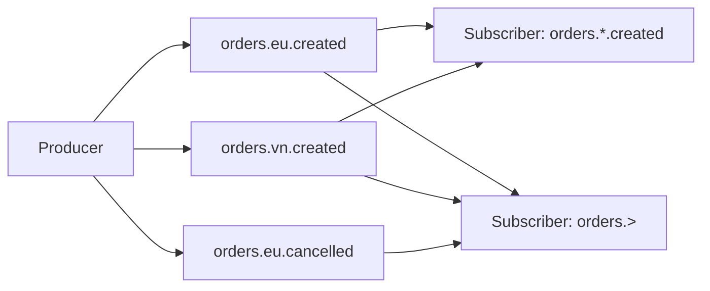

# Wildcard của Classic và phạm vi áp dụng

> **Chương:** Định tuyến Classic  
> **Hệ thống:** Apache ActiveMQ **Classic**, dùng JMS với queue, topic và các quy tắc destination trên broker.  
> **Mục tiêu:** Đọc đúng mẫu `*` và `>`, áp dụng vào consumer, chính sách destination và phân quyền; nhận biết trường hợp wildcard **không** phải là cơ chế định tuyến/fan-out của producer.

## 1. Tình huống cần wildcard

Một hệ thống phát sự kiện lên các topic cụ thể:

```text
orders.eu.created
orders.vn.created
orders.us.created
orders.eu.cancelled
orders.vn.paid
payments.eu.completed
```

Dịch vụ kiểm toán cần nhận sự kiện **tạo đơn** từ mọi vùng, còn dịch vụ phân tích muốn nhận **mọi** loại sự kiện của miền `orders`. Thay vì tạo một subscription thủ công cho từng topic rồi cập nhật mã mỗi khi có vùng mới, ActiveMQ Classic cho phép consumer đăng ký một **mẫu tên destination**:

- `orders.*.created`: nhận sự kiện `created` có đúng **một cấp** giữa `orders` và `created`.
- `orders.>`: nhận các destination con thuộc namespace `orders` ở **nhiều cấp**.
- `>`: mẫu rất rộng, dùng để khớp mọi namespace phù hợp; nên tránh trong ứng dụng nghiệp vụ vì rủi ro nhận dữ liệu ngoài ý muốn.

Đây là **wildcard destination** của ActiveMQ Classic. Nó khác hẳn việc gửi message đến một topic cụ thể, lọc bằng JMS selector, hay dùng hàng đợi để chia việc giữa nhiều worker.



Hình trên minh họa **sự khớp tên destination**: subscriber A và B là hai subscription khác nhau, nên một message trên `orders.eu.created` có thể được giao cho **cả hai**. Wildcard không biến topic thành queue và không làm hai subscriber cùng nhau chia một subscription.

## 2. Cú pháp: dấu chấm, `*` và `>`

Classic xem tên destination như các đoạn (*segment*) ngăn bởi dấu chấm `.`:

```text
orders . eu . created
  ^      ^       ^
đoạn 1  đoạn 2  đoạn 3
```

| Ký hiệu | Cách hiểu trong mẫu Classic | Ví dụ |
| --- | --- | --- |
| `.` | Phân cách các cấp tên | `orders.eu.created` có 3 segment |
| `*` | Khớp **đúng một segment** | `orders.*.created` khớp `orders.eu.created` |
| `>` | Khớp **phần hậu tố nhiều cấp**; thường dùng ở **cuối mẫu** | `orders.>` khớp `orders.eu.created` và `orders.eu.created.audit` |
| Tên thông thường | Khớp segment tương ứng chính xác | `orders.*.created` không khớp `payments.eu.created` |

Không dùng `**`, `?`, `%`, `#` hoặc biểu thức chính quy để thay cho hai wildcard trên: đó là cú pháp của hệ thống khác hoặc của cơ chế lọc khác. Tên destination và pattern **phân biệt chữ hoa/chữ thường**; `Orders.EU.Created` và `orders.eu.created` phải được coi là hai tên khác nhau.

### 2.1. Bảng đối chiếu thực tế

Giả sử broker có những topic sau:

| Tên topic | `orders.*` | `orders.*.created` | `orders.>` | `*.eu.created` |
| --- | :---: | :---: | :---: | :---: |
| `orders.eu` | ✓ | – | ✓ | – |
| `orders.eu.created` | – | ✓ | ✓ | ✓ |
| `orders.vn.created` | – | ✓ | ✓ | – |
| `orders.eu.paid` | – | – | ✓ | – |
| `orders.eu.created.audit` | – | – | ✓ | – |
| `payments.eu.created` | – | – | – | ✓ |
| `orders.eu.created.v2` | – | – | ✓ | – |

Điểm quan trọng:

1. `orders.*` chỉ mô tả **hai segment**; nó không có nghĩa “mọi topic bắt đầu bằng orders”.
2. `orders.*.created` có ba segment, phù hợp khi muốn giới hạn chính xác một tầng region.
3. `orders.>` bao phủ sâu hơn nhiều; dễ vô tình nhận thêm event mới với schema khác.
4. `*.eu.created` chỉ buộc segment thứ hai là `eu` và thứ ba là `created`; nó **không** giới hạn miền `orders`.

**Lưu ý biên:** Nếu nghiệp vụ có destination gốc `orders` (không có hậu tố), đừng tự suy luận nó chắc chắn được khớp bởi `orders.>` trong mọi biến thể/configuration. Hãy thử riêng trường hợp này trên phiên bản đang dùng, hoặc đăng ký tên `orders` một cách tường minh khi bắt buộc nhận cả gốc.

### 2.2. Ví dụ quy ước tên ổn định

Nếu chọn cấu trúc:

```text
<domain>.<schemaVersion>.<region>.<event>
```

thì:

- `orders.v1.*.created`: tạo đơn, schema `v1`, mọi region tại một tầng.
- `orders.v1.>`: mọi sự kiện của miền orders, schema `v1`.
- `orders.>`: nhận cả `v1`, `v2` và mọi event/region, chỉ nên dùng khi consumer thật sự có thể xử lý tất cả.

Version schema trong tên giúp tránh subscriber cũ âm thầm nhận message không tương thích. Tuy nhiên không cần nhét mọi thuộc tính vào destination name: thông tin nghiệp vụ chi tiết thường thích hợp hơn trong body/header và JMS selector.

## 3. Wildcard áp dụng ở đâu?

Cùng mẫu `orders.>` có thể xuất hiện ở các nơi khác nhau nhưng **ý nghĩa thao tác** không giống nhau.

| Vị trí | Mẫu được hiểu như thế nào? | Kết quả |
| --- | --- | --- |
| `Session.createConsumer(session.createTopic("orders.>"))` | **Subscription filter** của consumer | Consumer nhận message từ các topic có tên khớp |
| `Session.createConsumer(session.createQueue("jobs.*"))` | **Queue destination filter** của consumer, theo hỗ trợ của Classic | Consumer cạnh tranh nhận message trên các queue khớp mẫu |
| `<policyEntry topic="orders.>">` | **Bộ chọn destination policy** của broker | Cài đặt policy cho các topic khớp, không tự tạo subscriber |
| `<authorizationEntry queue="jobs.*">` | **Mẫu phân quyền destination** | Quy định nhóm nào có thể read/write/admin với queue khớp |
| Tên trong cấu hình mạng/virtual destination | Mẫu dành cho **thành phần cấu hình cụ thể** | Hành vi phụ thuộc chức năng đó; không mặc định giống consumer subscription |

Đặc điểm chung là mẫu làm việc với **tên destination thực tế**, nhưng:

- Consumer filter quyết định **consumer đăng ký nhận ở đâu**.
- Policy filter quyết định **cấu hình vận hành nào áp dụng cho destination**.
- Authorization filter quyết định **ai được phép thao tác**.
- Network connector hoặc virtual destination có cơ chế routing riêng; chỉ vì tên chứa wildcard không có nghĩa hai tính năng tương đương.

### 3.1. Không dùng wildcard làm đích phát một-nhiều

Đây là nhầm lẫn phổ biến:

```java
// Không dùng cách này để "gửi vào mọi topic orders".
producer.send(session.createTopic("orders.>"), message);
```

Wildcard trong ví dụ subscriber **không phải** một lệnh yêu cầu broker liệt kê rồi phát đến mọi topic khớp mẫu. Khi producer muốn phát một sự kiện, nên gửi đến **tên topic cụ thể**:

```java
producer.send(session.createTopic("orders.eu.created"), message);
```

Broker sau đó phân phối message đến các subscription có filter khớp `orders.eu.created`. Nếu muốn gửi **một bản message đến nhiều destination vật lý** một cách có chủ đích, hãy xem cơ chế riêng của Classic như **composite destinations** hoặc **virtual destinations** và kiểm thử rule tương ứng.

### 3.2. Wildcard cũng không thay thế JMS selector

Hai bộ lọc xử lý **hai loại dữ liệu khác nhau**:

```java
Topic topicPattern = session.createTopic("orders.*.created");
MessageConsumer consumer = session.createConsumer(
    topicPattern,
    "tenant = 'retail' AND schemaVersion = 1"
);
```

- `orders.*.created` chọn các **tên topic**.
- `tenant = 'retail' AND schemaVersion = 1` chọn các **message properties** theo cú pháp SQL-92 subset của JMS selector.
- Một message cần vừa đến từ topic phù hợp, vừa có các property thỏa selector mới được giao cho consumer.

Không thể thay `orders.*.created` bằng `LIKE` của SQL selector trên tên destination; JMS selector không phải một cách chuẩn để dò wildcard trong tên topic.

## 4. Thực hành JMS: subscriber dùng wildcard topic

Để kiểm chứng, dùng **Apache ActiveMQ Classic 5.18.x** (nhánh `javax.jms`) và một broker thử nghiệm đang nghe tại `tcp://localhost:61616`. Mẫu thử:

1. Tạo wildcard subscriber **trước khi gửi**.
2. Gửi hai message vào topic khớp mẫu.
3. Gửi hai message vào topic không khớp.
4. Kiểm tra chỉ nhận đúng hai ID mong đợi.

Nếu dự án dùng **Classic 6.x**, namespace client là `jakarta.jms`; phải chọn artifact/import đúng nhánh. Cú pháp wildcard của Classic vẫn là phần mở rộng dành cho provider, không phải contract chung của JMS.

### 4.1. Dependency Maven minh họa

```xml
<dependency>
    <groupId>org.apache.activemq</groupId>
    <artifactId>activemq-client</artifactId>
    <version>5.18.3</version>
</dependency>
```

`5.18.3` chỉ là **phiên bản minh họa API**; khi xây dựng hệ thống thật hãy chọn bản Classic đã được kiểm tra bảo mật, tương thích với broker và nền tảng của dự án. Đoạn Java sau sử dụng `javax.jms` và không yêu cầu `JMSContext`.

### 4.2. Chương trình có thể chạy

```java
import javax.jms.Connection;
import javax.jms.DeliveryMode;
import javax.jms.JMSException;
import javax.jms.Message;
import javax.jms.MessageConsumer;
import javax.jms.MessageProducer;
import javax.jms.Session;
import javax.jms.TextMessage;
import javax.jms.Topic;

import org.apache.activemq.ActiveMQConnectionFactory;

import java.util.Arrays;
import java.util.HashSet;
import java.util.Set;
import java.util.UUID;

public final class WildcardTopicProbe {
    private static void send(
            Session session,
            MessageProducer producer,
            String topicName,
            String value) throws JMSException {

        Topic concreteTopic = session.createTopic(topicName);
        producer.send(concreteTopic, session.createTextMessage(value));
    }

    public static void main(String[] args) throws Exception {
        String brokerUrl = args.length == 0
                ? "tcp://localhost:61616"
                : args[0];

        ActiveMQConnectionFactory factory =
                new ActiveMQConnectionFactory(brokerUrl);

        Connection connection = factory.createConnection();
        try {
            Session session =
                    connection.createSession(false, Session.AUTO_ACKNOWLEDGE);

            // Namespace riêng mỗi lần chạy để không lẫn message từ lần khác.
            String prefix = "lab." + UUID.randomUUID()
                    .toString().replace("-", "");

            Topic wildcard = session.createTopic(
                    prefix + ".orders.*.created");
            MessageConsumer subscriber = session.createConsumer(wildcard);

            // Producer anonymous gửi tới các topic cụ thể.
            MessageProducer producer = session.createProducer(null);
            producer.setDeliveryMode(DeliveryMode.NON_PERSISTENT);

            // Subscriber phải sẵn sàng trước lúc publish.
            connection.start();

            send(session, producer, prefix + ".orders.eu.created", "EU");
            send(session, producer, prefix + ".orders.vn.created", "VN");

            // Hai topic dưới đây không khớp orders.*.created.
            send(session, producer, prefix + ".orders.eu.paid", "PAID");
            send(session, producer,
                    prefix + ".orders.eu.created.audit", "AUDIT");

            Set<String> actual = new HashSet<>();
            for (int i = 0; i < 2; i++) {
                Message message = subscriber.receive(5_000);
                if (!(message instanceof TextMessage)) {
                    throw new IllegalStateException(
                            "Không nhận đủ hai TextMessage");
                }

                String body = ((TextMessage) message).getText();
                actual.add(body);
                System.out.println(
                        "Topic nguồn: " + message.getJMSDestination()
                        + ", body=" + body);
            }

            Set<String> expected =
                    new HashSet<>(Arrays.asList("EU", "VN"));

            if (!expected.equals(actual)) {
                throw new IllegalStateException(
                        "Sai tập message: " + actual);
            }

            Message unexpected = subscriber.receive(750);
            if (unexpected != null) {
                throw new IllegalStateException(
                        "Wildcard nhận thừa từ " +
                        unexpected.getJMSDestination());
            }

            System.out.println("PASS: orders.*.created");
        } finally {
            connection.close();
        }
    }
}
```

**Kết quả mong đợi:** thấy `EU`, `VN`, thông báo `PASS` và **không** thấy `PAID` hoặc `AUDIT`. Thứ tự giữa hai topic cụ thể có thể thay đổi; bài thử chỉ so sánh **tập** message. Header `JMSDestination` giúp biết message đến từ topic vật lý nào, rất hữu ích nếu consumer nhận nhiều loại event qua một wildcard.

Đây là ví dụ non-durable topic subscriber: message được gửi **trước khi subscriber hoạt động** không phải backlog dành cho subscriber này. Nếu muốn khôi phục sau downtime, phải thiết kế durable subscription đúng cho phiên bản/provider và kiểm thử vòng đời; thêm wildcard vào tên topic **không tự tạo độ bền**.

**Khi thực hành:** cần broker đã khởi động, quyền read topic khớp mẫu và quyền write/admin phù hợp đối với topic publish. Nếu broker tắt chức năng tự tạo destination, phải chuẩn bị các destination thử nghiệm trước; chỉ với mã Java thì chưa đủ. Demo dùng namespace ngẫu nhiên và không viết vào topic nghiệp vụ.

### 4.3. Vì sao tạo subscriber trước producer?

Các topic ở ví dụ đều có thể mới hoàn toàn. Đăng ký wildcard trước rồi publish kiểm chứng rằng consumer không phải “liệt kê cứng những topic hiện có”. Trên hệ thống thật, tình huống xuất hiện **topic mới sau khi subscriber đã đăng ký** cần được thử trong phiên bản broker, client, topology và security hiện hành; theo dõi consumer count/advisory nếu kết quả khác mong đợi.

Một subscriber ngắt kết nối rồi kết nối lại là tình huống khác: khoảng thời gian offline của **non-durable** subscriber không được bảo vệ bởi wildcard. Nếu luồng sự kiện quan trọng, đừng coi wildcard là giải pháp thay thế durable subscription, queue backlog, retry hay DLQ.

## 5. Wildcard với queue: một consumer có thể khớp nhiều hàng đợi

Ví dụ các queue:

```text
jobs.email.high
jobs.email.low
jobs.push.high
jobs.email.retry.delayed
```

Mẫu `jobs.email.*` khớp `jobs.email.high` và `jobs.email.low`, không khớp `jobs.push.high` hoặc `jobs.email.retry.delayed`.

Trong ActiveMQ Classic, consumer có thể tạo bằng destination queue pattern:

```java
// ActiveMQ Classic client (javax.jms), đoạn mã nằm trong một Session.
javax.jms.Queue queuePattern =
        session.createQueue("jobs.email.*");
MessageConsumer emailWorker =
        session.createConsumer(queuePattern);
```

**Khác biệt với topic:** đối với từng **queue vật lý** khớp mẫu, worker đó cạnh tranh nhận message với các consumer khác của chính queue ấy. Nó **không** nhận thêm một bản copy của mỗi message như subscriber topic độc lập.

Giả sử hai worker cùng dùng `jobs.email.*`:

```text
jobs.email.high ----+-----> Worker A
                    +-----> Worker B
jobs.email.low  ----+-----> Worker A
                    +-----> Worker B
```

Mỗi message của `jobs.email.high` hoặc `jobs.email.low` được broker giao đến một consumer trong mỗi lần delivery, nhưng message có thể redeliver sau rollback/consumer crash. **Không bảo đảm chia đều, thứ tự tổng thể hoặc “một bản xử lý nghiệp vụ đúng một lần”**.

### 5.1. Cần cảnh giác điều gì?

- Một consumer có thể đăng ký vào **nhiều queue** cùng lúc. Queue nhạy cảm như `jobs.email.high` có thể bị “hút” bởi worker tổng quát mà bạn không dự định giao việc.
- **Prefetch**, số consumer trên từng queue, tốc độ xử lý và broker dispatch ảnh hưởng mức độ cân bằng; không coi wildcard queue consumer là bộ lập lịch ưu tiên chính xác.
- Nếu cần ưu tiên rõ giữa `high` và `low`, dùng consumer pool/giới hạn concurrency và destination riêng cho từng mức; wildcard chỉ giúp khớp tên.
- Một Java `Session` có quy tắc sử dụng tuần tự; không chia một session/`JMSContext` cho nhiều thread đồng thời. Nếu worker xử lý chậm, tăng số consumer với tài nguyên phiên riêng, đo broker và dịch vụ đích.
- Không dùng `jobs.>` rộng cho một worker nếu handler chỉ biết xử lý email; event/queue mới có thể xuất hiện và bị tiêu thụ sai.

Nếu chỉ có **một queue nghiệp vụ**, việc đọc tên cụ thể rõ ràng hơn wildcard. Sự tiện lợi khi gom tên không đáng đánh đổi với việc đánh mất ranh giới ownership giữa các nhóm consumer.

## 6. Wildcard trong cấu hình broker ActiveMQ Classic

Bên cạnh JMS consumer, ActiveMQ Classic dùng destination pattern trong cấu hình broker. Các đoạn XML dưới đây là **mảnh cấu hình**, đặt vào đúng vị trí trong `activemq.xml` theo version/XBean schema của broker đang chạy, **không phải** một file broker hoàn chỉnh.

### 6.1. `destinationPolicy`: chọn destination để áp chính sách

```xml
<!-- Bên trong <broker xmlns="http://activemq.apache.org/schema/core"> -->
<destinationPolicy>
    <policyMap>
        <policyEntries>
            <policyEntry
                queue="jobs.email.*"
                producerFlowControl="true"
                memoryLimit="8mb"/>

            <policyEntry
                topic="orders.>"
                producerFlowControl="true"
                memoryLimit="32mb"/>
        </policyEntries>
    </policyMap>
</destinationPolicy>
```

Diễn giải:

- `queue="jobs.email.*"` chọn các queue có **đúng một segment** sau `jobs.email`, chẳng hạn `jobs.email.high` và `jobs.email.low`.
- `topic="orders.>"` chọn các topic con trong miền `orders` với độ sâu linh hoạt.
- `producerFlowControl` và `memoryLimit` là **policy được áp dụng** lên destination phù hợp, không phải yêu cầu broker chuyển một message từ `orders.eu.created` sang `orders.vn.created`.
- Mức `8mb` và `32mb` chỉ minh họa cú pháp; muốn chọn giá trị vận hành phải đo memory usage, paging, producer blocking và chính sách broker.

Mẫu này là công cụ cấu hình theo **namespace destination**: không tạo consumer và không tạo sẵn toàn bộ destination phù hợp. Khi có nhiều `policyEntry` chồng lấn, cần kiểm tra **effective policy** trên đúng broker/version; đừng mặc định “dòng XML viết sau sẽ thắng” như cấu hình firewall theo thứ tự.

### 6.2. `authorizationEntry`: khớp tên để phân quyền

```xml
<!-- Fragment dưới <plugins> của broker -->
<authorizationPlugin>
    <map>
        <authorizationMap>
            <authorizationEntries>
                <authorizationEntry
                    queue="jobs.email.*"
                    read="mail-workers"
                    write="mail-publishers"
                    admin="messaging-admins"/>

                <authorizationEntry
                    topic="orders.*.created"
                    read="order-audit"
                    write="order-services"
                    admin="messaging-admins"/>
            </authorizationEntries>
        </authorizationMap>
    </map>
</authorizationPlugin>
```

Ví dụ trên mô tả **phạm vi tên destination của mỗi quyền**:

- Nhóm `mail-workers` chỉ được đọc các queue khớp `jobs.email.*` theo entry này.
- Nhóm `order-audit` được đọc những topic ba segment kiểu `orders.eu.created`, không mặc nhiên được đọc `orders.eu.paid`.
- Quyền `admin` cho việc tạo/quản trị destination khác với `read`/`write`. Khi broker cần tự tạo destination, phải thiết kế đúng quyền tạo hoặc pre-provision, không chỉ cấp `write` rồi kỳ vọng auto-create luôn được phép.

Đây là ví dụ **quy tắc ACL**, không định nghĩa sẵn tài khoản, group hay authentication. Để cấu hình chạy thật cần hệ thống xác thực/nhóm tương ứng và kiểm thử cả ca **được phép** lẫn **bị từ chối**.

**Lưu ý bảo mật:** Một entry như `topic=">" read="all-users"` có thể mở quyền đọc cả sự kiện nội bộ hoặc topic advisory. Nên ưu tiên tiền tố cụ thể, hạn chế quyền với `ActiveMQ.Advisory.>`, và không cho client tùy ý nhập pattern wildcard nếu cần phân vùng dữ liệu theo tenant.

### 6.3. Phân biệt policy pattern và subscription pattern

Xét hai cấu hình:

```xml
<policyEntry topic="orders.>" memoryLimit="32mb"/>
```

```java
MessageConsumer consumer = session.createConsumer(
        session.createTopic("orders.>")
);
```

Dù dùng cùng chuỗi `orders.>`:

- Đoạn XML tác động tới **cách broker vận hành các topic tương ứng**.
- Đoạn Java tạo **một subscription nhận message**.

Không nên nhầm việc “broker có policy cho `orders.>`” với việc “broker đã tự động có một subscriber nhận mọi topic orders”.

## 7. Phạm vi ngoài wildcard: virtual topics, composite destinations, selector

Khi thiết kế định tuyến ActiveMQ Classic, phải chọn đúng cơ chế:

| Nhu cầu | Cơ chế phù hợp | Wildcard đóng vai trò gì? |
| --- | --- | --- |
| Subscriber kiểm toán muốn nghe nhiều topic `orders.<region>.created` | **Wildcard topic subscription** | Khớp tên topic để nhận |
| Worker muốn xử lý nhiều queue `jobs.email.<priority>` | **Wildcard queue consumer** | Đăng ký tiêu thụ từ nhiều queue phù hợp |
| Producer cần phát một event sang nhiều destination xác định | **Composite destination / broker-side routing rule** | Wildcard consumer không thay thế fan-out của producer |
| Nhiều nhóm nghiệp vụ muốn mỗi nhóm có queue riêng, nhóm nào cũng nhận event | **Virtual Topics** hoặc cấu hình virtual destination | Có thể dùng pattern trong định nghĩa/cấu hình nhưng khác việc đăng ký wildcard |
| Chỉ nhận message có `tenant = 'north'` | **JMS selector** trên property | Wildcard không lọc property |
| Chỉ áp policy lên những queue `jobs.email.*` | **Destination policy** | Chọn destination cho cấu hình broker |
| Chỉ cho phép một group đọc topic `orders.*.created` | **Authorization map** | Chọn destination để kiểm tra ACL |

Ví dụ Classic Virtual Topic thường thấy:

```text
Topic phát:            VirtualTopic.OrderEvents
Queue cho Billing:     Consumer.Billing.VirtualTopic.OrderEvents
Queue cho Analytics:   Consumer.Analytics.VirtualTopic.OrderEvents
```

Tên queue theo quy ước Virtual Topic **không có nghĩa** tự động áp dụng quy tắc `*` hoặc `>` lên producer. Broker có cơ chế virtual destination để sao chép/định tuyến message sang các queue của từng nhóm; còn một **wildcard queue consumer** chỉ đăng ký đọc các queue có tên phù hợp. Hai thao tác có thể phối hợp, nhưng không thay thế nhau.

Ngoài ra, composite destination (ví dụ một danh sách destination cách nhau bằng dấu phẩy theo cú pháp Classic) là **tập đích chỉ định tường minh**, không cùng nghĩa với “mọi destination có tiền tố này”. Khi cần quyền kiểm soát và danh sách nhỏ, một tập đích tường minh thường dễ kiểm thử hơn wildcard rộng.

## 8. Giới hạn và sai lầm thường gặp

### 8.1. Wildcard Classic là mở rộng theo provider

JMS chuẩn định nghĩa `Queue`, `Topic`, producer, consumer, selector, session và transaction; **cú pháp `*`/`>` dùng cho destination name không phải tính năng JMS bảo đảm xuyên broker**.

- **ActiveMQ Classic**: dấu chấm phân cấp, `*` một cấp, `>` nhiều cấp.
- **ActiveMQ Artemis**: wildcard theo mô hình address/routing, thường dùng `*` một cấp và `#` nhiều cấp theo cấu hình mặc định của Artemis. Không bê nguyên `orders.>` từ Classic sang Artemis mà mong nghĩa giống nhau.
- Broker khác có thể dùng regex, token riêng hoặc không cho wildcard consumer.

Khi nâng từ Classic 5.x sang 6.x, cũng phải kiểm tra import `javax.jms`/`jakarta.jms` và phiên bản client. Việc đổi namespace Java **không** xác nhận cơ chế destination wildcard của broker đã được kiểm thử trên phiên bản mới.

### 8.2. Wildcard không định nghĩa điều kiện lưu message

`orders.>` có thể là một **non-durable** topic subscription: subscriber offline thì những message mới phát thường không được lưu dành riêng cho nó.

Với durable topic subscriber, cần thiết kế **clientID, subscription name, selector và lifecycle** phù hợp provider. Khả năng dùng wildcard trong durable/shared subscription cần được xác minh trên đúng client/broker/version và ca reconnect; không suy từ việc non-durable wildcard đã hoạt động.

Queue có backlog riêng; wildcard queue consumer chỉ là cách đăng ký vào những queue ấy, không gộp journal hay hợp nhất transaction của mọi queue thành một hàng đợi duy nhất.

### 8.3. Ký tự wildcard không phải dấu thay thế trong dữ liệu

Nếu tên topic là `orders.eu.created` nhưng bạn muốn lọc nội dung:

```json
{"orderId":"A1024","tenant":"north","total":150000}
```

thì dùng JMS property/selector hoặc logic nghiệp vụ. `orders.*.created` chỉ biết **đường dẫn tên topic**; nó không nhìn vào `orderId`, `tenant` hay `total`.

Để có selector hiệu quả, producer phải đặt property tương ứng:

```java
TextMessage message = session.createTextMessage(payload);
message.setStringProperty("tenant", "north");
message.setIntProperty("schemaVersion", 1);
producer.send(session.createTopic("orders.eu.created"), message);
```

Subscriber có thể kết hợp cả pattern và selector. Nhưng filter selector **không thay** cấu hình ACL: client không được phép tự dùng một pattern rộng để truy cập tenant khác chỉ vì nó tự đặt selector đúng.

### 8.4. Dùng mẫu quá rộng gây chi phí và rủi ro

`orders.>` có thể tự động nhận cả những nhánh sau khi hệ thống mở rộng:

```text
orders.eu.created
orders.eu.cancelled
orders.eu.internal.audit
orders.v2.eu.created
orders.eu.pii.exported
```

Hậu quả có thể là:

- Consumer nhận schema lạ rồi ném lỗi, rollback liên tục hoặc đẩy message vào DLQ.
- Băng thông/CPU dispatch tăng; subscription non-durable không giữ backlog nhưng vẫn tiêu thụ tài nguyên khi online.
- Durable subscriber lưu lại lượng lớn message không cần thiết, làm backlog/disk tăng khi offline.
- Lộ dữ liệu nhạy cảm nếu ACL quá rộng.
- Consumer code tự suy đoán loại event từ body, thiếu xử lý theo `JMSDestination` hoặc schema version.

Nên dùng pattern hẹp nhất phản ánh contract nghiệp vụ; với luồng nhạy cảm cần prefix dành riêng hoặc phân quyền theo từng namespace.

### 8.5. Không có thứ tự toàn cục giữa nhiều destination

Nếu wildcard consumer nhận hai topic `orders.eu.created` và `orders.vn.created`, thứ tự nhận tổng thể phụ thuộc thời điểm producer gửi, dispatch và nhiều yếu tố khác. Wildcard **không** thiết lập một global ordered stream.

Với queue wildcard, trộn message từ nhiều queue cũng không tạo total order. Nếu cần xử lý theo từng `orderId` đúng thứ tự, phải thiết kế quy tắc định tuyến, message group hoặc khóa nghiệp vụ và kiểm thử redelivery/failover; không suy ra thứ tự chỉ từ cấu trúc tên.

### 8.6. Thay đổi topology và dynamic destination

Một subscription wildcard có thể khớp destination được tạo sau lúc consumer đăng ký, nhưng bạn cần xác minh các tình huống:

1. Broker đã có destination trước khi subscriber mở.
2. Destination được tạo **sau** khi subscriber mở.
3. Broker/consumer reconnect sau network partition.
4. Destination xuất hiện trên broker khác qua network connector.
5. ACL hoặc policy mới thay đổi, destination bị xóa/tạo lại.

Không suy rộng hành vi trên một broker đơn lẻ sang network of brokers. Việc forward giữa broker còn phụ thuộc network connector, advisory, demand và chính sách về destination, độc lập với cú pháp wildcard local.

### 8.7. Thận trọng với tên và quyền do người dùng nhập

Nếu ứng dụng nhận một chuỗi trực tiếp từ API rồi gọi:

```java
session.createTopic(userProvidedDestinationPattern);
```

thì ký tự `>` có thể khiến ứng dụng đăng ký rộng hơn nhiều so với dự định. Thực hành tốt là **không** cho người dùng tự chọn pattern JMS; map một danh sách nghiệp vụ đã duyệt sang các tên cụ thể, whitelist domain/prefix, áp ACL broker và ghi log destination subscription hiệu lực.

## 9. Kiểm thử wildcard theo ca dương và âm

Chỉ kiểm tra “có nhận một message” là chưa đủ. Cần gửi ít nhất một message **khớp**, một message **không khớp**, kiểm tra topic nguồn và xác minh broker policy/ACL.

### 9.1. Ma trận chấp nhận cho `orders.*.created`

| Topic phát | Kết quả mong đợi | Mục đích |
| --- | --- | --- |
| `orders.eu.created` | Nhận | Một region |
| `orders.vn.created` | Nhận | Region khác |
| `orders.created` | Không nhận | Thiếu segment |
| `orders.eu.cancelled` | Không nhận | Sai loại event |
| `orders.eu.created.audit` | Không nhận | Thừa segment |
| `payments.eu.created` | Không nhận | Sai domain |
| `Orders.eu.created` | Không nhận | Sai chữ hoa/thường |

Với pattern `orders.>`, bổ sung ca `orders.eu.created.audit` phải nhận; ca chỉ có `orders` phải được test tường minh nếu có trong hệ thống.

### 9.2. Các bước kiểm tra trong lab

1. Chạy broker Classic đúng phiên bản dự kiến, bật logging/console quản trị và cấu hình quyền theo kịch bản.
2. Mở subscriber wildcard trước khi publish; gửi vào các topic **concrete** từ bảng trên.
3. Đối chiếu danh sách event ID đã phát với event ID đã nhận; in `JMSDestination` để truy ngược topic gốc.
4. Tạo một topic khớp mẫu **sau** khi subscription đã hoạt động, bảo đảm subscriber nhận đúng.
5. Ngắt subscriber rồi gửi thêm message: xác định kỳ vọng non-durable/durable; nối lại và kiểm tra.
6. Kiểm tra tài khoản chỉ có quyền `orders.*.created` không thể đọc `payments.eu.created` hoặc `orders.eu.internal`; theo dõi lỗi authorization.
7. Với `policyEntry`, kiểm tra mức policy có tác dụng tại destination thật (flow control, memory), không chỉ nhìn chuỗi XML.
8. Nếu dùng network of brokers/Virtual Topics, lặp lại bài thử ở topology thật vì wildcard ở consumer chưa đủ chứng minh định tuyến xuyên broker.

**Tiêu chí PASS:** chỉ nhận đúng tập topic mong đợi, không có quyền vượt scope, không có message trùng bất thường, và policy áp dụng đúng destination. Nếu một ca fail, kiểm tra riêng syntax pattern, destination type (queue/topic), ACL, broker/client version, selector, thời điểm tạo subscriber, prefetch và topology.

## 10. Checklist trước khi dùng trong production

- [ ] Destination name thống nhất dấu chấm, chữ hoa/thường và số segment.
- [ ] Chọn `*` cho **một cấp**; `>` cho **nhiều cấp**, dùng ở cuối mẫu với phạm vi rõ ràng.
- [ ] Có ca thử **không khớp** để phát hiện subscription rộng quá mức.
- [ ] Producer luôn gửi tới destination cụ thể; nếu cần fan-out thì xác định Virtual Topic/composite destination.
- [ ] Không nhầm destination wildcard với JMS message selector.
- [ ] Nếu dùng queue wildcard, biết rõ mọi queue bị ảnh hưởng và quyền sở hữu handler.
- [ ] Nếu dùng policy/ACL wildcard, kiểm tra effective policy và nguyên tắc least privilege.
- [ ] Kiểm thử destination mới, reconnect, broker failover và network connector nếu có.
- [ ] Với topic critical, xác định rõ non-durable/durable subscription, clientID và vòng đời.
- [ ] Khi di chuyển từ Classic sang Artemis, chuyển đổi và kiểm tra lại **cú pháp wildcard**, namespace client và routing semantics.

## 11. Câu hỏi tự kiểm tra

1. Mẫu `orders.*.created` có khớp `orders.eu.created.audit` không? Vì sao?
2. Nếu subscriber dùng `orders.>`, điều gì xảy ra khi xuất hiện topic mới `orders.eu.internal.audit`? Cần bảo vệ quyền truy cập bằng cách nào?
3. Gửi một message tới `orders.>` có làm message đến tất cả topic `orders.eu.created` và `orders.vn.created` không?
4. `<policyEntry topic="orders.>">` khác `createConsumer(createTopic("orders.>"))` ở đâu?
5. Hai worker cùng đọc `jobs.email.*` có cùng nhận bản copy của mỗi queue message không?
6. Vì sao không được bê nguyên `orders.>` từ ActiveMQ Classic sang Artemis khi migration?
7. Chỉ dùng JMS selector `tenant = 'north'` có đủ để chặn một client đọc dữ liệu tenant khác không?

**Gợi ý trả lời:** (1) không, dư một segment; (2) pattern rộng có thể nhận, giới hạn prefix và ACL; (3) không, wildcard consumer không phải lệnh fan-out producer; (4) policy cấu hình broker, consumer là subscription; (5) không, chúng cạnh tranh nhận trên từng queue; (6) cú pháp multi-level wildcard khác nhau; (7) không, phải có authorization ở broker.

## 12. Tài liệu tham khảo

- [ActiveMQ Classic — Wildcards](https://activemq.apache.org/components/classic/documentation/wildcards): mô tả wildcard destination `*` và `>` của Classic.
- [ActiveMQ Classic — Composite Destinations](https://activemq.apache.org/components/classic/documentation/composite-destinations): phân biệt danh sách destination với pattern.
- [ActiveMQ Classic — Virtual Destinations](https://activemq.apache.org/components/classic/documentation/virtual-destinations): các cơ chế broker-side routing/Virtual Topics.
- [ActiveMQ Classic — Security](https://activemq.apache.org/components/classic/documentation/security): xác thực, phân quyền và destination authorization map.
- [ActiveMQ Classic — Per Destination Policies](https://activemq.apache.org/components/classic/documentation/per-destination-policies): cách cấu hình policy theo destination.
- [Apache ActiveMQ Artemis — Wildcard Syntax](https://artemis.apache.org/components/artemis/documentation/latest/wildcard-syntax.html): đối chiếu cú pháp, tránh nhầm `>` của Classic với `#` của Artemis.

> **Điểm cần nhớ:** Với ActiveMQ Classic, `*` khớp một đoạn và `>` khớp hậu tố nhiều cấp của **tên destination**. Wildcard hữu ích cho subscription và cấu hình broker theo namespace; nó **không** tự tạo fan-out từ producer, không thay thế selector hay ACL và không đảm bảo bền vững/thứ tự message.
