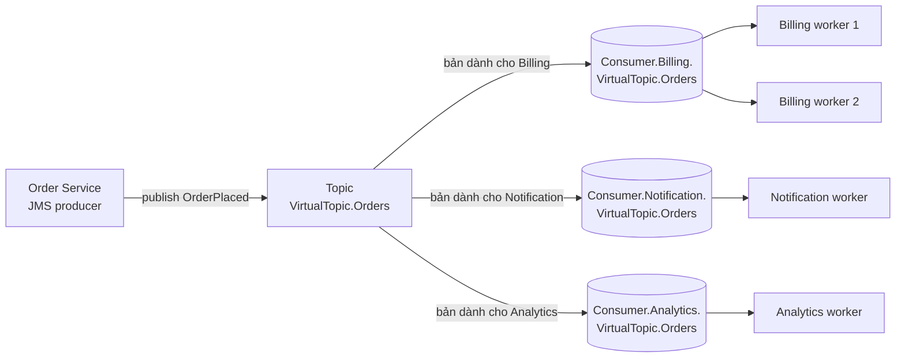

# Virtual Topic và các queue tiêu thụ độc lập trong ActiveMQ Classic

> **Chương:** Định tuyến Classic  
> **Phạm vi:** Bài chuyên sâu về **Virtual Topic của Apache ActiveMQ Classic**, thuộc module **INTEGRATION_MESSAGING_MESSAGE_BROKER_ACTIVEMQ**. Trong hệ thống messaging bất đồng bộ sử dụng queue, topic, routing và JMS, bài này tập trung vào cách **một lần publish** tạo các bản message cho **nhiều nhóm xử lý độc lập**, nhưng **nhiều worker cùng nhóm** lại chia nhau xử lý một queue. Các ví dụ dùng Java, JMS `javax.jms` và ActiveMQ Classic 5.19.x; nội dung về acknowledgment, transaction, redelivery, DLQ, phân quyền và vận hành được gắn trực tiếp với cơ chế Virtual Topic.

## 1. Vấn đề cần giải quyết

Giả sử dịch vụ Đơn hàng phát sự kiện `OrderPlaced`. Ba dịch vụ đều cần nhận sự kiện đó:

- **Billing**: ghi nhận yêu cầu tính tiền.
- **Notification**: gửi thông báo cho khách.
- **Analytics**: cập nhật thống kê đơn hàng.

Mỗi dịch vụ cần **bản riêng** của event để tự retry, lưu backlog và triển khai lại mà không ảnh hưởng backlog của dịch vụ khác. Đồng thời Billing cần chạy **hai hoặc nhiều worker** để chia tải. Nếu tất cả cùng nghe một JMS queue, các service sẽ tranh giành cùng một message: một message đến Billing thì Notification không nhận được. Nếu tất cả subscribe vào JMS topic theo cách không durable, một dịch vụ tạm offline có thể bỏ lỡ event. Nếu dùng durable topic subscription kiểu truyền thống, việc tổ chức nhiều consumer xử lý cạnh tranh cho cùng một subscriber gặp các giới hạn theo mô hình JMS và triển khai.

**Virtual Topic giải bài toán này bằng cách kết hợp fan-out kiểu topic với tiêu thụ kiểu queue:**

- Producer vẫn **publish tới JMS Topic** tên `VirtualTopic.Orders`.
- Broker Classic định tuyến/copy một message tới từng **queue vật lý tương ứng với nhóm** đã tồn tại, chẳng hạn `Consumer.Billing.VirtualTopic.Orders` và `Consumer.Notification.VirtualTopic.Orders`.
- Mỗi nhóm có backlog, acknowledgment và nhiều consumer cạnh tranh **riêng**.
- Một nhóm mới có thể tham gia bằng cách tạo queue đúng quy tắc tên, không cần sửa danh sách nhận event trong code producer.

Đây là tính năng **Virtual Destinations của ActiveMQ Classic**, không phải một loại destination chuẩn riêng của JMS. Client dùng API `Topic` để gửi và `Queue` để nhận; broker triển khai fan-out bằng cơ chế riêng. Tài liệu chính thức: [ActiveMQ Classic — Virtual Destinations](https://activemq.apache.org/components/classic/documentation/virtual-destinations).

## 2. Sơ đồ: một topic, nhiều queue nhóm, nhiều worker trong một nhóm



Trong tình huống **một sự kiện E1** và **ba queue nhóm đã tồn tại đúng lúc publish**:

| Địa chỉ | Số message E1 nhận về | Cách nhận |
|---|---:|---|
| `VirtualTopic.Orders` | Producer publish một message vào topic | Broker áp dụng virtual-topic interception |
| `Consumer.Billing.VirtualTopic.Orders` | 1 bản | Worker Billing 1 **hoặc** worker Billing 2 nhận tại một thời điểm |
| `Consumer.Notification.VirtualTopic.Orders` | 1 bản | Notification tự xử lý và ack |
| `Consumer.Analytics.VirtualTopic.Orders` | 1 bản | Analytics tự xử lý và ack |

Nếu Billing xử lý xong/ack E1, queue của Billing giảm số message tương ứng; điều đó **không xóa** bản E1 trong queue Notification hoặc Analytics. Nếu Billing worker 1 crash trước ack, bản trong queue Billing có thể được redeliver cho Billing worker 1/2 theo chính sách; bản của hai nhóm còn lại không phải nhận lại chỉ vì Billing lỗi.

**Phân biệt hai mức nhân bản:**

1. **Giữa các nhóm:** một message được fan-out thành **một bản trên mỗi queue nhóm phù hợp**.
2. **Trong một nhóm:** nhiều worker cùng subscribe **một tên queue** để *competing consumers*; chúng **chia việc**, không mỗi worker nhận toàn bộ bản sao.

Không thể đòi hỏi “mọi worker Billing đều nhận E1” bằng cách cho họ cùng đọc `Consumer.Billing.VirtualTopic.Orders`. Nếu mỗi worker thực sự cần độc lập xử lý mỗi event, các worker ấy phải có **queue nhóm riêng** và khi đó đã thay đổi mô hình trách nhiệm, chi phí lưu trữ.

## 3. Quy tắc đặt tên mặc định: chính xác từng dấu chấm

ActiveMQ Classic hỗ trợ mặc định một quy tắc virtual-topic phổ biến:

| Vai trò | Tên / mẫu mặc định | Nghĩa |
|---|---|---|
| Topic producer gửi | `VirtualTopic.Orders` | Topic thuộc namespace `VirtualTopic.>` |
| Queue của Billing | `Consumer.Billing.VirtualTopic.Orders` | Nhóm `Billing` độc lập |
| Queue của Notification | `Consumer.Notification.VirtualTopic.Orders` | Nhóm `Notification` độc lập |
| Queue của Analytics | `Consumer.Analytics.VirtualTopic.Orders` | Nhóm `Analytics` độc lập |
| Mẫu queue được broker tìm | `Consumer.*.VirtualTopic.>` | `*` khớp một segment, `>` khớp phần đuôi phân cấp |

Trong ActiveMQ Classic, dấu chấm `.` phân tách các segment của tên destination. Với tên mặc định, `Consumer.Billing.VirtualTopic.Orders` có các segment:

```text
Consumer | Billing | VirtualTopic | Orders
  1          2           3          4
```

**`Billing` là định danh của một nhóm logic**, không phải tên process/container/worker. Ba instance Billing cùng nghe `Consumer.Billing.VirtualTopic.Orders` vẫn là **một** nhóm. Ngược lại:

```text
Consumer.BillingA.VirtualTopic.Orders
Consumer.BillingB.VirtualTopic.Orders
```

là **hai queue độc lập**, mỗi queue có bản riêng của mỗi event phù hợp, nên nếu dùng hai tên này chỉ để scale Billing thì đã vô tình nhân đôi tác vụ nghiệp vụ.

Một lỗi khác là consumer trực tiếp tạo **Topic `Consumer.Billing.VirtualTopic.Orders`**; tên chuỗi đúng nhưng **kiểu JMS destination sai**. Consumer Virtual Topic phải nhận **Queue `Consumer.Billing.VirtualTopic.Orders`**. Producer cũng phải dùng **Topic `VirtualTopic.Orders`**, không gửi vào Queue có cùng tên.

### 3.1. Mẫu tuỳ biến cần đồng bộ hai phía

Có thể đổi namespace topic, prefix queue hoặc postfix bằng cấu hình broker. Khi sửa từ `Consumer.*.` sang tên khác, **producer và mọi consumer phải thỏa thuận lại** trên destination đã triển khai. Ví dụ mặc định:

```text
Producer Topic:   VirtualTopic.Orders
Consumer Queue:   Consumer.Billing.VirtualTopic.Orders
```

Không tự suy rằng `Billing.VirtualTopic.Orders`, `VirtualTopic.Orders.Billing` hay `VirtualTopic.Orders::Billing` được broker nhận như queue tương đương. Chỉ những queue khớp rule đang cấu hình mới được cơ chế Virtual Topic chọn để copy.

## 4. Queue phải tồn tại trước lúc publish nếu muốn giữ lịch sử cho nhóm

Đây là điều kiện vận hành thường bị hiểu sai. Broker Classic tìm các **queue phù hợp đã hiện diện** khi nhận message để fan-out. Tạo một nhóm queue **sau** lúc message đã publish **không tạo lại các bản quá khứ** cho queue mới.

Xét dòng thời gian, giả định broker bật persistence, producer gửi `PERSISTENT`, các queue không có consumer ack:

| Thời điểm | Hành động | Billing | Notification | Audit |
|---|---|---|---|---|
| T0 | Tạo queue Billing và Notification | Có queue | Có queue | **Chưa có** |
| T1 | Publish E1 | Nhận E1 | Nhận E1 | Không có |
| T2 | Worker Notification offline, **queue vẫn tồn tại** | Độc lập | Backlog E1 được giữ | Không có |
| T3 | Publish E2 | Nhận E2 | **E2 vẫn vào queue Notification** | Không có |
| T4 | Tạo queue Audit | Không đổi | Không đổi | Queue mới, rỗng |
| T5 | Publish E3 | Nhận E3 | Nhận E3 | **Chỉ nhận E3** |

Hai khái niệm khác nhau:

- **Nhóm offline nhưng queue còn:** broker vẫn có thể ghi những message được fan-out vào queue và giữ backlog.
- **Nhóm chưa từng tạo queue hoặc queue đã bị xóa:** không tồn tại nơi nhận bản sao trong thời gian đó; việc tạo lại queue về sau không replay tự động message trước đó.

Điều này giống một **điểm bắt đầu quan sát từ thời điểm subscription/queue được thiết lập**, nhưng cơ chế vật lý là queue Classic. Đây **không phải cơ chế lưu toàn bộ log rồi replay từ offset** như một số nền tảng streaming.

### 4.1. Cách chủ động tạo queue

Có ba cách phổ biến:

1. **Pre-create trong cấu hình broker**: dễ kiểm tra trong triển khai chính thức, nhất là khi service cần nhận event ngay từ lúc khởi chạy broker.
2. **Tạo bằng công cụ quản trị broker** (JMX/Web Console) trước thời điểm publish.
3. **Cho một JMS consumer kết nối vào queue rồi đóng consumer**, để broker auto-create queue; sau đó xác nhận queue thực sự đã được tạo và giữ lại. Chỉ gọi `Session.createQueue(...)` trong ứng dụng **chưa chắc** đã bắt broker tạo resource vật lý ngay, vì trong JMS đó chủ yếu là thao tác tạo đối tượng destination ở client.

Một queue có thể chịu chính sách dọn dẹp khi không sử dụng nếu quản trị viên đã cấu hình như vậy; đừng suy rằng đã tạo một lần là queue tồn tại vô hạn. Với consumer group quan trọng, **đưa queue vào cấu hình/khai báo triển khai và giám sát queue bị xóa hoặc tạo lại**.

## 5. Cấu hình broker Classic: default và khi cần khai báo tường minh

### 5.1. Giữ quy tắc mặc định khi không cần tùy biến

Với cấu hình Classic phổ biến, Virtual Topic áp dụng cho namespace `VirtualTopic.>` và queue `Consumer.*.VirtualTopic.>`. **Không cần chỉnh `activemq.xml`** chỉ để sử dụng `VirtualTopic.Orders` nếu broker đang áp dụng mặc định đó.

Nếu tổ chức muốn ghi rõ rule hoặc thay rule đang dùng, đoạn sau là **fragment bên trong phần tử `<broker>` của `conf/activemq.xml`**, không phải toàn bộ file XML:

```xml
<destinationInterceptors>
  <virtualDestinationInterceptor>
    <virtualDestinations>
      <virtualTopic
          name="VirtualTopic.>"
          prefix="Consumer.*."
          selectorAware="false" />
    </virtualDestinations>
  </virtualDestinationInterceptor>
</destinationInterceptors>
```

- `name="VirtualTopic.>"`: những topic nào được áp dụng cơ chế virtual.
- `prefix="Consumer.*."`: tiền tố cho queue nhận bản copy của topic.
- `selectorAware="false"`: broker **không dựa vào selector của active consumer** để quyết định có fan-out bản message vào queue hay không; xem phần 8.

Cấu hình này là **thay đổi chính sách định tuyến**; nếu file đã có `destinationInterceptors`, hãy chỉnh phần hiện hữu thay vì thêm interceptor trùng lặp, tránh hành vi bất ngờ. Sau khi thay, triển khai/restart broker theo quy trình quản trị và kiểm tra bằng gửi/nhận thực tế. Cần giữ persistent store phù hợp nếu muốn message tồn tại qua restart.

### 5.2. Khai báo trước các queue nhóm ở broker startup

Đoạn sau cũng là fragment **bên trong `<broker>`**:

```xml
<destinations>
  <queue physicalName="Consumer.Billing.VirtualTopic.Orders" />
  <queue physicalName="Consumer.Notification.VirtualTopic.Orders" />
  <queue physicalName="Consumer.Analytics.VirtualTopic.Orders" />
</destinations>
```

Dùng với broker hỗ trợ khai báo startup destinations; nếu cấu hình đã có `<destinations>` thì gộp các queue vào phần hiện hữu. Bản thân khai báo queue không gửi message; nó bảo đảm các queue đã hiện diện trước publisher, tránh race condition giữa **service phát event** và **subscriber lần đầu khởi động**.

**Không cần** khai báo topic `VirtualTopic.Orders` và queue `Consumer.*.VirtualTopic.Orders` trong mọi hệ thống, nhưng **các nhóm bắt buộc nhận từ lúc phát sự kiện đầu tiên** cần được tạo trước bằng một cơ chế chắc chắn. Kiểm tra destination tồn tại qua JMX/Web Console rồi mới cho phép producer publish các sự kiện quan trọng.

Tham khảo [Configure Startup Destinations](https://activemq.apache.org/components/classic/documentation/configure-startup-destinations).

### 5.3. Chính sách riêng theo queue nhóm

Nếu cần tách DLQ theo queue thay vì dồn vào một DLQ mặc định, có thể cấu hình **destination policy** trên các queue nhóm. Fragment minh họa:

```xml
<destinationPolicy>
  <policyMap>
    <policyEntries>
      <policyEntry queue="Consumer.>">
        <deadLetterStrategy>
          <individualDeadLetterStrategy
              queuePrefix="DLQ."
              useQueueForQueueMessages="true" />
        </deadLetterStrategy>
      </policyEntry>
    </policyEntries>
  </policyMap>
</destinationPolicy>
```

Fragment phải được **gộp vào cấu hình `destinationPolicy` hiện có** nếu broker đã có nhiều `policyEntry`. `Consumer.>` áp dụng rộng cho mọi queue với prefix Consumer; trong hệ thống phức tạp cần cân nhắc policy có trùng/ưu tiên với cấu hình hiện tại, capacity và retention. Cơ chế redelivery tới DLQ còn phụ thuộc **client redelivery policy/poison acknowledgment**, persistence và policy của broker; không thể chỉ thêm đoạn XML là mọi lỗi xử lý đều tự động vào DLQ sau đúng N lần.

## 6. Thực hành Java/JMS: một producer, các nhóm nhận độc lập

Ví dụ dùng **ActiveMQ Classic 5.19.12**, Java 17, Maven 3 và `javax.jms`. ActiveMQ Classic 5.19.x vẫn dùng API JMS `javax.jms` ở `activemq-client`; **không đổi import thành `jakarta.jms`** nếu vẫn giữ dependency này. Classic 6.x và Artemis có tuyến dependency/API riêng cần lựa chọn tương ứng.

Broker Classic đang chạy, client có quyền gửi tới `VirtualTopic.Orders`, quyền tạo/nhận các queue `Consumer.*.VirtualTopic.Orders` và cho phép persistent store. Ví dụ dùng biến môi trường:

```text
BROKER_URL=tcp://127.0.0.1:61616
BROKER_USER=<username configured on broker>
BROKER_PASSWORD=<password configured on broker>
```

Không commit thông tin đăng nhập vào Git. Trường hợp broker không bật xác thực, chương trình dưới đây có nhánh tạo connection không truyền username/password; production vẫn cần authentication/authorization và TLS phù hợp.

### 6.1. Maven dependency

Tạo một Maven project lab độc lập, thêm `pom.xml`:

```xml
<project xmlns="http://maven.apache.org/POM/4.0.0"
         xmlns:xsi="http://www.w3.org/2001/XMLSchema-instance"
         xsi:schemaLocation="http://maven.apache.org/POM/4.0.0
              https://maven.apache.org/xsd/maven-4.0.0.xsd">
  <modelVersion>4.0.0</modelVersion>
  <groupId>demo.messaging</groupId>
  <artifactId>classic-virtual-topic-lab</artifactId>
  <version>1.0-SNAPSHOT</version>

  <properties>
    <maven.compiler.release>17</maven.compiler.release>
    <project.build.sourceEncoding>UTF-8</project.build.sourceEncoding>
  </properties>

  <dependencies>
    <dependency>
      <groupId>org.apache.activemq</groupId>
      <artifactId>activemq-client</artifactId>
      <version>5.19.12</version>
    </dependency>
  </dependencies>

  <build>
    <plugins>
      <plugin>
        <groupId>org.apache.maven.plugins</groupId>
        <artifactId>maven-compiler-plugin</artifactId>
        <version>3.14.1</version>
      </plugin>
      <plugin>
        <groupId>org.codehaus.mojo</groupId>
        <artifactId>exec-maven-plugin</artifactId>
        <version>3.5.1</version>
      </plugin>
    </plugins>
  </build>
</project>
```

### 6.2. Một chương trình producer/consumer dùng lại cho các thí nghiệm

Tạo `src/main/java/demo/VirtualTopicLab.java`:

```java
package demo;

import javax.jms.Connection;
import javax.jms.DeliveryMode;
import javax.jms.JMSException;
import javax.jms.Message;
import javax.jms.MessageConsumer;
import javax.jms.MessageProducer;
import javax.jms.Queue;
import javax.jms.QueueBrowser;
import javax.jms.Session;
import javax.jms.TextMessage;
import javax.jms.Topic;

import org.apache.activemq.ActiveMQConnectionFactory;

import java.util.Enumeration;
import java.util.Set;

public final class VirtualTopicLab {
    private static final String TOPIC = "VirtualTopic.Orders";
    private static final Set<String> GROUPS =
            Set.of("Billing", "Notification", "Analytics", "Audit");

    public static void main(String[] args) throws Exception {
        if (args.length == 0) {
            usage();
            return;
        }

        String brokerUrl = System.getenv().getOrDefault(
                "BROKER_URL", "tcp://127.0.0.1:61616");
        String user = System.getenv("BROKER_USER");
        String password = System.getenv("BROKER_PASSWORD");

        ActiveMQConnectionFactory factory =
                new ActiveMQConnectionFactory(brokerUrl);
        Connection connection =
                user != null && !user.isBlank()
                        ? factory.createConnection(user, password)
                        : factory.createConnection();

        try {
            connection.start();
            switch (args[0]) {
                case "prepare" -> {
                    if (args.length != 1) {
                        usage();
                        return;
                    }
                    prepareQueues(connection);
                }
                case "publish" -> {
                    if (args.length != 3) {
                        usage();
                        return;
                    }
                    publish(connection, args[1],
                            Integer.parseInt(args[2]));
                }
                case "browse" -> {
                    if (args.length != 2) {
                        usage();
                        return;
                    }
                    browse(connection, args[1]);
                }
                case "consume" -> {
                    if (args.length != 4) {
                        usage();
                        return;
                    }
                    consume(connection, args[1], args[2],
                            Integer.parseInt(args[3]), false);
                }
                case "rollback-one" -> {
                    if (args.length != 2) {
                        usage();
                        return;
                    }
                    consume(connection, args[1], "rollback-probe",
                            1, true);
                }
                default -> usage();
            }
        } finally {
            connection.close();
        }
    }

    // Bảo đảm queue được broker tạo trước khi producer publish.
    private static void prepareQueues(Connection connection)
            throws JMSException {
        Session session =
                connection.createSession(false, Session.AUTO_ACKNOWLEDGE);
        try {
            for (String group :
                    new String[]{"Billing", "Notification", "Analytics"}) {
                MessageConsumer consumer =
                        session.createConsumer(groupQueue(session, group));
                consumer.close();
                System.out.println("PREPARED group=" + group);
            }
        } finally {
            session.close();
        }
    }

    private static void publish(Connection connection,
                                String batch, int count)
            throws JMSException {
        if (count < 1 || count > 1000) {
            throw new IllegalArgumentException("count must be 1..1000");
        }
        Session session =
                connection.createSession(true, Session.SESSION_TRANSACTED);
        try {
            Topic topic = session.createTopic(TOPIC);
            MessageProducer producer = session.createProducer(topic);
            try {
                producer.setDeliveryMode(DeliveryMode.PERSISTENT);
                producer.setTimeToLive(0L);
                for (int index = 1; index <= count; index++) {
                    String orderId = batch + "-" + index;
                    TextMessage message =
                            session.createTextMessage(
                                    "OrderPlaced:" + orderId);
                    message.setStringProperty("eventType", "OrderPlaced");
                    message.setStringProperty("orderId", orderId);
                    message.setStringProperty(
                            "region", index % 2 == 0 ? "VN" : "SG");
                    // Dùng khóa ổn định nếu nhiều event cùng aggregate
                    // cần được xử lý theo nhóm.
                    message.setStringProperty("JMSXGroupID", orderId);
                    producer.send(message);
                    System.out.println("SEND " + orderId
                            + " JMSMessageID=" + message.getJMSMessageID());
                }
                session.commit(); // Chốt transaction gửi.
                System.out.println("PUBLISH COMMITTED");
            } finally {
                producer.close();
            }
        } catch (JMSException | RuntimeException failure) {
            session.rollback();
            throw failure;
        } finally {
            session.close();
        }
    }

    private static void browse(Connection connection, String group)
            throws JMSException {
        Session session =
                connection.createSession(false, Session.AUTO_ACKNOWLEDGE);
        try {
            Queue queue = groupQueue(session, group);
            QueueBrowser browser = session.createBrowser(queue);
            try {
                Enumeration<?> cursor = browser.getEnumeration();
                int count = 0;
                while (cursor.hasMoreElements()) {
                    Message message = (Message) cursor.nextElement();
                    System.out.println("BROWSE " + group
                            + " id=" + message.getStringProperty("orderId")
                            + " JMSMessageID=" + message.getJMSMessageID());
                    count++;
                }
                System.out.println("BROWSE TOTAL " + group
                        + "=" + count);
            } finally {
                browser.close();
            }
        } finally {
            session.close();
        }
    }

    private static void consume(Connection connection, String group,
                                String worker, int max, boolean rollback)
            throws JMSException {
        if (max < 1 || max > 1000) {
            throw new IllegalArgumentException("max must be 1..1000");
        }

        Session session =
                connection.createSession(true, Session.SESSION_TRANSACTED);
        try {
            MessageConsumer consumer =
                    session.createConsumer(groupQueue(session, group));
            try {
                for (int i = 0; i < max; i++) {
                    Message incoming = consumer.receive(5000L);
                    if (incoming == null) {
                        System.out.println("NO_MORE_MESSAGE " + group);
                        break;
                    }

                    System.out.println("RECEIVE group=" + group
                            + " worker=" + worker
                            + " orderId="
                            + incoming.getStringProperty("orderId")
                            + " redelivered=" + incoming.getJMSRedelivered());

                    if (rollback) {
                        session.rollback();
                        System.out.println("ROLLBACK: not acknowledged");
                        break;
                    }

                    // Lab chỉ in log. Production phải ghi DB
                    // và thực hiện idempotency trước khi commit.
                    session.commit();
                    System.out.println("ACK group=" + group
                            + " worker=" + worker);
                }
            } finally {
                consumer.close();
            }
        } catch (JMSException | RuntimeException failure) {
            session.rollback();
            throw failure;
        } finally {
            session.close();
        }
    }

    private static Queue groupQueue(Session session, String group)
            throws JMSException {
        if (!GROUPS.contains(group)) {
            throw new IllegalArgumentException("Unknown group: " + group);
        }
        return session.createQueue(
                "Consumer." + group + "." + TOPIC);
    }

    private static void usage() {
        System.out.println("Commands:");
        System.out.println("  prepare");
        System.out.println("  publish <batchId> <count>");
        System.out.println("  browse Billing|Notification|Analytics|Audit");
        System.out.println(
                "  consume Billing|Notification|Analytics|Audit <worker> <max>");
        System.out.println(
                "  rollback-one Billing|Notification|Analytics|Audit");
    }
}
```

**Những chỗ cần hiểu đúng trong code:**

- `Session.createTopic("VirtualTopic.Orders")` dành **cho producer**; `Session.createQueue("Consumer.Billing.VirtualTopic.Orders")` dành **cho consumer**. Chúng có kiểu JMS khác nhau dù cùng tham chiếu một luồng event logic.
- `prepare` tạo consumer rồi đóng để tạo các queue group từ trước. **Không tạo queue Audit** ở bước này để ta kiểm tra tình huống nhóm tham gia muộn.
- `publish` đặt delivery mode `PERSISTENT` và `session.commit()`: ưu tiên kiểm chứng lưu backlog khi nhóm offline. Tuy vậy broker phải thực sự bật persistent store, còn TTL, expiry hoặc quota có thể ảnh hưởng kết quả.
- `browse` dùng `QueueBrowser`, không tiêu thụ/ack message. Đây là phương pháp so sánh an toàn trước và sau từng thí nghiệm.
- `consume` dùng một transacted JMS session mỗi lần chạy và commit **sau mỗi message**. Nghiệp vụ thật phải có idempotency/outbox nếu ghi SQL và phát thêm event, bởi JMS local transaction không tự động nguyên tử với cơ sở dữ liệu bên ngoài.
- `rollback-one` cho phép quan sát redelivery. Message có thể được phát lại sau một khoảng delay theo redelivery policy và có thể chuyển DLQ sau nhiều lần thất bại.

Ứng dụng mẫu giới hạn tên group vào một allowlist để tránh gõ nhầm tên queue mà vô tình tạo subscription logic mới. Tên `worker` chỉ để log; **đổi `worker` không đổi queue nhóm**.

### 6.3. Lần chạy đầu: kiểm tra fan-out

Từ thư mục Maven lab, đặt `BROKER_URL`, `BROKER_USER`, `BROKER_PASSWORD` phù hợp với broker thử nghiệm. Trên Bash hoặc PowerShell, các tham số Maven có thể đặt trong dấu nháy đơn như sau:

```bash
mvn -q compile exec:java '-Dexec.mainClass=demo.VirtualTopicLab' '-Dexec.args=prepare'

mvn -q compile exec:java '-Dexec.mainClass=demo.VirtualTopicLab' '-Dexec.args=publish batchA 5'

mvn -q compile exec:java '-Dexec.mainClass=demo.VirtualTopicLab' '-Dexec.args=browse Billing'
mvn -q compile exec:java '-Dexec.mainClass=demo.VirtualTopicLab' '-Dexec.args=browse Notification'
mvn -q compile exec:java '-Dexec.mainClass=demo.VirtualTopicLab' '-Dexec.args=browse Analytics'
```

Kỳ vọng với **broker/queue ban đầu rỗng, không consumer nền, không có expiry**:

```text
BROWSE TOTAL Billing=5
BROWSE TOTAL Notification=5
BROWSE TOTAL Analytics=5
```

Đây là 5 event được producer publish, **không phải 15 event khác nhau**; broker tạo một bản cho mỗi queue nhóm. Mỗi nhóm có cùng `orderId`/cùng ý nghĩa event nhưng bản message ở queue khác nhau.

**Nếu queue đã có backlog từ thí nghiệm trước**, tổng không phải 5. Hãy dùng `batchId` riêng hoặc mở môi trường lab riêng thay vì xóa queue đang có dữ liệu cần giữ.

### 6.4. Nhóm độc lập trong việc ack

Cho Billing tiêu thụ hết 5 event:

```bash
mvn -q compile exec:java '-Dexec.mainClass=demo.VirtualTopicLab' '-Dexec.args=consume Billing billing-1 5'

mvn -q compile exec:java '-Dexec.mainClass=demo.VirtualTopicLab' '-Dexec.args=browse Billing'
mvn -q compile exec:java '-Dexec.mainClass=demo.VirtualTopicLab' '-Dexec.args=browse Notification'
```

Kỳ vọng `Billing=0`, trong khi `Notification=5` nếu chưa tiêu thụ. Việc Billing commit **không ack hộ** Notification.

Sau đó tiêu thụ Notification và quan sát Analytics vẫn độc lập:

```bash
mvn -q compile exec:java '-Dexec.mainClass=demo.VirtualTopicLab' '-Dexec.args=consume Notification notif-1 5'

mvn -q compile exec:java '-Dexec.mainClass=demo.VirtualTopicLab' '-Dexec.args=browse Analytics'
```

Điều này diễn tả chính xác ranh giới nghiệp vụ: Billing hoàn tất xử lý không có nghĩa Analytics đã cập nhật báo cáo.

### 6.5. Hai Billing worker cạnh tranh trên một queue

Publish một batch mới, rồi **mở hai terminal** và chạy đồng thời:

Terminal 1:

```bash
mvn -q compile exec:java '-Dexec.mainClass=demo.VirtualTopicLab' '-Dexec.args=consume Billing billing-worker-A 20'
```

Terminal 2:

```bash
mvn -q compile exec:java '-Dexec.mainClass=demo.VirtualTopicLab' '-Dexec.args=consume Billing billing-worker-B 20'
```

Trước đó, trong terminal khác:

```bash
mvn -q compile exec:java '-Dexec.mainClass=demo.VirtualTopicLab' '-Dexec.args=publish batchB 20'
```

Để hai worker có cơ hội tranh việc trong lúc publish, bạn có thể khởi chạy chúng trước khi publisher gửi message. **Kết quả được bảo đảm ở mức logic:** tổng số message được commit bởi hai worker Billing là **20** nếu không gặp lỗi/redelivery và queue ban đầu không có message nào khác; **không có bảo đảm** hai worker sẽ chia đều 10/10. Dispatch, prefetch và tốc độ từng worker quyết định phân phối thực tế.

Cần tránh một biến thể dễ sai:

```text
Consumer.BillingWorkerA.VirtualTopic.Orders
Consumer.BillingWorkerB.VirtualTopic.Orders
```

Nếu dùng hai queue trên thay vì cùng queue `Consumer.Billing.VirtualTopic.Orders`, broker sẽ gửi **20 message cho mỗi queue**: tổng 40 bản dành cho hai nhóm khác nhau. Đây không còn là competing consumers của một nhóm Billing.

### 6.6. Nhóm tham gia muộn và không có historical replay

Trước khi tạo queue `Audit`, publish:

```bash
mvn -q compile exec:java '-Dexec.mainClass=demo.VirtualTopicLab' '-Dexec.args=publish beforeAudit 2'
```

Lúc này nhóm Audit **chưa được chuẩn bị**. Nếu chưa có queue Audit do thao tác nào khác, nó không nhận hai message trên.

Bây giờ lần đầu duyệt queue Audit (thao tác browse có thể khiến broker tạo resource khi cần) rồi publish batch mới:

```bash
mvn -q compile exec:java '-Dexec.mainClass=demo.VirtualTopicLab' '-Dexec.args=browse Audit'

mvn -q compile exec:java '-Dexec.mainClass=demo.VirtualTopicLab' '-Dexec.args=publish afterAudit 3'

mvn -q compile exec:java '-Dexec.mainClass=demo.VirtualTopicLab' '-Dexec.args=browse Audit'
```

**Cẩn thận:** Chỉ dựa vào `browse Audit` để *bảo đảm* queue được tạo là chưa đủ trong mọi cấu hình. Để thí nghiệm có tính quyết định, hãy **xác minh queue Audit hiện hữu trên broker** (console/JMX), hoặc mở/đóng một consumer thật của queue Audit trước lúc `publish afterAudit`. Sau khi queue tồn tại, Audit được kỳ vọng chỉ có `afterAudit-1..3`, không có `beforeAudit-1..2`.

Trong hệ thống cần Audit bắt đầu từ event đầu tiên, khai báo startup queue là giải pháp vững chắc hơn là đợi process Audit tự kết nối lần đầu.

## 7. Redelivery, thứ tự và giới hạn “exactly once”

Cơ chế Virtual Topic không thay đổi quy luật xử lý message trên queue:

1. Một nhóm nhận một bản sao trong queue của mình.
2. Consumer bắt đầu xử lý; chưa ack thì message vẫn chịu cơ chế giao nhận lại.
3. Consumer commit/ack, broker xóa bản message đã xử lý khỏi **queue của nhóm đó**.
4. Nếu consumer rollback hoặc mất kết nối trước commit, message có thể được redeliver, kể cả cho **worker khác trong cùng nhóm**.
5. Nếu vượt chính sách redelivery, message có thể được chuyển DLQ; xử lý độc lập các queue khác vẫn diễn ra.

### 7.1. Thử rollback một bản thuộc Billing

```bash
mvn -q compile exec:java '-Dexec.mainClass=demo.VirtualTopicLab' '-Dexec.args=publish retryProbe 1'

mvn -q compile exec:java '-Dexec.mainClass=demo.VirtualTopicLab' '-Dexec.args=rollback-one Billing'

mvn -q compile exec:java '-Dexec.mainClass=demo.VirtualTopicLab' '-Dexec.args=consume Billing billing-recover 1'
```

Nếu Billing queue có backlog cũ, lệnh rollback có thể tác động message cũ nhất **đang sẵn sàng**, không nhất thiết vào `retryProbe-1`. Chỉ xác nhận đúng `orderId` trên log để biết bạn đang thử message nào. Tùy chính sách broker/client, message rollback có thể bị delay trước khi có thể nhận lại.

### 7.2. Chống lặp phải nằm ở nghiệp vụ consumer

Một message nằm trong queue Billing có thể bị giao lại sau crash ngay khi tác vụ bên ngoài đã chạy nhưng trước JMS commit. Ví dụ khi Billing gọi API phát hành hóa đơn:

```text
Billing nhận OrderPlaced(order-101)
    ├─ Tạo hóa đơn trong DB / gọi API bên ngoài: thành công
    └─ Crash trước session.commit()
          ↓
Broker phát lại bản ở queue Billing
          ↓
Nếu không chống lặp → có nguy cơ tạo hóa đơn lần hai
```

Vì vậy cần khóa nghiệp vụ (ví dụ `eventId + consumerGroup` hoặc `orderId + operationType`), unique constraint/outbox/inbox, và chiến lược retry/idempotency. Virtual Topic tạo **mỗi nhóm một luồng xử lý logic**, nhưng không tự chứng minh **tác dụng phụ end-to-end chạy đúng một lần**.

### 7.3. Message Groups và thứ tự

Hai worker Billing cùng một queue có thể hoàn tất các message ở thứ tự khác với thứ tự publish. Nếu các event cùng một aggregate bắt buộc được xử lý tuần tự, cân nhắc dùng `JMSXGroupID`:

```java
message.setStringProperty("JMSXGroupID", orderId);
```

Trong Classic, message có cùng group ID được broker gán cho một consumer trong điều kiện hoạt động thông thường, giúp tăng cơ hội giữ thứ tự theo aggregate trong queue, đồng thời chia các aggregate khác nhau cho các worker. Mô hình này vẫn cần xét failover, redelivery, prefetch và các trường hợp consumer chết; **không bảo đảm** thứ tự hoàn tất xuyên suốt nhiều queue nhóm độc lập.

Ví dụ code gán `JMSXGroupID=orderId`; nếu batch tạo 20 order khác nhau, group ID khác nhau nên các message vẫn có thể phân tán giữa worker. Nếu hệ thống phát `OrderCreated`, `OrderPaid`, `OrderShipped` cho cùng `orderId`, sử dụng ID ổn định này mới thể hiện lợi ích grouping.

## 8. Selector trên queue: ba kiểu hành vi rất khác nhau

Giả sử mỗi event có JMS property `region`:

```java
message.setStringProperty("region", "VN");
```

Consumer của queue Billing muốn chỉ nhận message VN:

```java
Queue billingQueue =
    session.createQueue("Consumer.Billing.VirtualTopic.Orders");

MessageConsumer vnConsumer =
    session.createConsumer(billingQueue, "region = 'VN'");
```

### 8.1. Mặc định `selectorAware=false`

Broker vẫn fan-out message phù hợp **theo tên queue**, không dựa vào selector của consumer đang hoạt động. Queue Billing có thể chứa cả `region='VN'` và `region='SG'`; `vnConsumer` chỉ nhận VN. Những message SG **vẫn chờ trong queue Billing** cho tới khi có consumer phù hợp, hết hạn, bị dọn theo chính sách hoặc được xử lý một cách hợp lệ khác.

Ví dụ 100 event, 50 VN + 50 SG, và Billing chỉ có consumer `region='VN'`:

| Mức xử lý | VN | SG |
|---|---:|---:|
| Broker fan-out sang Billing queue | 50 | 50 |
| Consumer có selector chỉ xử lý | Có thể nhận 50 | Không nhận |
| Phần còn chờ trên queue | Tùy ack | Có thể tồn tại 50 |

Đây là một **bẫy backlog**: application báo đã xử lý tất cả message nó nhìn thấy nhưng queue depth vẫn tăng vì các message không khớp selector. Giải pháp có thể là thêm consumer phù hợp, thay đổi thiết kế route theo từng miền, hoặc kiểm soát selection ngay tại broker với đầy đủ hiểu biết về offline consumers.

### 8.2. Bật `selectorAware=true`

Khi định nghĩa Virtual Topic:

```xml
<virtualTopic name="VirtualTopic.>"
              prefix="Consumer.*."
              selectorAware="true" />
```

broker có thể chỉ fan-out message khớp selector của **các consumer đang hiện diện** trên queue. Điều này giúp ngăn backlog của những message không ai trong nhóm muốn xử lý **khi consumer đang kết nối**.

**Đánh đổi lớn:** Nếu consumer dùng selector đã ngắt kết nối, selector đó có thể không còn được broker sử dụng trong quyết định fan-out. Event phù hợp xảy ra lúc consumer offline có thể **không được copy** tới queue; group có thể mất cơ hội nhận message ấy ngay cả khi queue tồn tại. Vì vậy với consumer nhóm cần **bắt buộc nhận được event trong khi offline**, không bật `selectorAware=true` mà chưa thiết kế/cấu hình lưu selector tương ứng.

### 8.3. Plugin cache selector là một lựa chọn có điều kiện

ActiveMQ Classic có `virtualSelectorCacheBrokerPlugin` để nhớ selector gắn với destination khi consumer offline và tùy chọn persist selector cache. Ví dụ fragment **bên trong `<broker>`**:

```xml
<plugins>
  <virtualSelectorCacheBrokerPlugin
      persistFile="/var/lib/activemq/selector-cache.data" />
</plugins>
```

Đường dẫn chỉ mang tính ví dụ: phải là path có quyền ghi, tồn tại trên storage được giữ qua restart nếu muốn cache còn. Ngoài ra tài liệu ActiveMQ lưu ý file cache dùng **Java serialization** và cần giới hạn bằng `jdk.serialFilter` phù hợp; không đưa vào production chỉ bằng copy fragment trên. Plugin cache giúp duy trì các selector đã biết, **không phải** phép màu phát lại message lịch sử từ lúc queue chưa tồn tại.

**Khuyến nghị thực dụng:** Nếu nhóm xử lý bắt buộc nhận mọi `OrderPlaced` dù offline, giữ `selectorAware=false`, dùng queue độc lập không filter theo region hoặc xây dựng những topic/queue nhóm được phân vùng rõ ràng, đồng thời định nghĩa trách nhiệm xử lý từng region. Chỉ dùng selector-aware khi yêu cầu lọc chính xác và chấp nhận/kiểm soát được mất message do thiếu active selector.

Tham khảo [VirtualSelectorCacheBrokerPlugin](https://activemq.apache.org/components/classic/documentation/virtual-destinations) và [JMS Selectors](https://activemq.apache.org/components/classic/documentation/selectors).

## 9. Khác nhau với durable topic subscriber và composite destination

| Tiêu chí | JMS durable topic subscriber truyền thống | Virtual Topic + queue | Composite virtual destination |
|---|---|---|---|
| Producer gửi tới | Topic | Topic `VirtualTopic.*` | Một logical destination được cấu hình |
| Trạng thái nhận độc lập | Theo subscription identity | Theo **physical queue** của group | Theo các destination được khai báo |
| Scale worker cùng nhóm | Phụ thuộc phiên bản/API và giới hạn subscription | Nhiều competing consumers trên **cùng queue** | Phụ thuộc destination đích |
| Quản trị backlog | Theo durable subscription | Xem/browse **queue vật lý** | Theo các queue/topic đích |
| Nhóm mới tham gia | Tạo durable subscription | Tạo queue đúng naming convention | Thường phải cập nhật mapping broker |
| Nguy cơ | Client ID/subscription identity, hạn chế concurrency | Lỡ event trước khi queue ra đời, queue “mồ côi”, fan-out tốn storage | Mapping cứng, quản trị đích phức tạp |

**Virtual Topic khác Composite Destination ở điểm động:** Trong mô hình Virtual Topic, khi queue mới đúng naming convention tồn tại, broker có thể đưa queue đó vào fan-out mà không phải sửa mapping cố định. Composite Destination điển hình khai báo danh sách đích trong broker configuration; phù hợp trường hợp cần copy có kiểm soát tới các đích cố định. Tham khảo [Virtual Topic vs Composite Destination](https://activemq.apache.org/components/classic/documentation/what-is-the-difference-between-a-virtual-topic-and-a-composite-destination).

**Virtual Topic cũng không phải “Kafka topic + consumer group” theo nghĩa có chung một append-only log lưu mọi event và mỗi nhóm có offset có thể tua lại.** Classic copy message sang queue tại thời điểm định tuyến. Khi queue group chưa tồn tại, không có cơ chế mặc định tạo lại lịch sử của group từ log của topic.

### 9.1. Dùng trực tiếp subscriber Topic cùng lúc có sao không?

Có thể có client subscribe trực tiếp `VirtualTopic.Orders` như một JMS topic thông thường, trong khi broker vẫn fan-out tới queue `Consumer.*.VirtualTopic.Orders`. Khi đó client topic và queue group là các đường giao nhận **khác nhau**; application vừa nghe topic trực tiếp vừa nghe queue group có thể tự nhận hai lần cùng ý nghĩa event. Hãy thống nhất mỗi service tiêu thụ qua **một** đường logic nếu không chủ ý xây dựng hai luồng độc lập.

## 10. Nhiều broker Classic: coi chừng nhân đôi fan-out

Trong network of brokers, ActiveMQ Classic có thể bridge topic và queue. Với Virtual Topic, **không đồng thời bridge VirtualTopic và các Consumer queue của nó một cách thiếu kiểm soát**, vì message chuyển qua topic sang broker khác có thể bị **fan-out lần nữa** tới queue bên đó, trong khi bản queue cũng đã được bridge, tạo message trùng.

Hai chiến lược thường được cân nhắc:

1. **Bridge các consumer queue**, không bridge topic VirtualTopic tương ứng theo cách khiến fan-out lặp.
2. **Bridge VirtualTopic**, loại trừ các `Consumer.*.VirtualTopic.>` queue khỏi network connector liên quan.

Ví dụ fragment cấu hình network connector để loại trừ queue khi **đã chủ động chọn bridge VirtualTopic**:

```xml
<networkConnectors>
  <networkConnector uri="static:(tcp://other-broker:61616)">
    <excludedDestinations>
      <queue physicalName="Consumer.*.VirtualTopic.>" />
    </excludedDestinations>
  </networkConnector>
</networkConnectors>
```

Đây **không phải file cấu hình network hoàn chỉnh**, cũng không bảo đảm network sẽ chuyển đủ mọi event nếu không cấu hình điều kiện demand, included destinations và virtual destination advisory phù hợp. Mô hình nhiều broker cần test thực tế số message trước/sau bridge, xử lý lặp, reconnect và network split; không áp dụng fragment này tùy tiện vào network sẵn có.

Tham khảo [Avoiding Duplicate Message in a Network of Brokers](https://activemq.apache.org/components/classic/documentation/virtual-destinations) và [Networks of Brokers](https://activemq.apache.org/components/classic/documentation/networks-of-brokers).

## 11. Quan sát và vận hành các queue độc lập

Virtual Topic tạo thêm **số queue vật lý**, vì thế quản lý backlog theo từng nhóm đặc biệt quan trọng. Quan sát trên Web Console/JMX các queue:

```text
Consumer.Billing.VirtualTopic.Orders
Consumer.Notification.VirtualTopic.Orders
Consumer.Analytics.VirtualTopic.Orders
```

Theo dõi ít nhất:

| Metric/dấu hiệu | Cách đọc |
|---|---|
| `QueueSize` / pending messages từng group | Nhóm nào đang tồn backlog |
| `ConsumerCount` | Nhóm nào đang offline hoặc có số worker khác kỳ vọng |
| `EnqueueCount` | Tổng bản message broker đưa vào queue group |
| `DequeueCount` | Tổng message đã rời queue theo ngữ nghĩa broker; đối chiếu kết quả nghiệp vụ |
| `InFlightCount` / dispatched | Message đã chuyển tới consumer nhưng chưa hoàn tất ack |
| DLQ / expired messages | Poison message, TTL hoặc lỗi retry |
| Oldest message age / enqueue-to-ack latency | Nhóm nào bị trễ vượt SLO |
| JVM, disk, KahaDB store usage | Chi phí lưu bản sao tăng theo số group và backlog |

**Ví dụ:** Billing queue depth = 0, Notification = 48.000, Analytics = 300.000. Không thể nói hệ thống “OrderPlaced đã xử lý xong” chỉ vì Billing nhanh. Event đã được fan-out, nhưng từng nhóm có tốc độ tiêu thụ khác nhau; Analytics có thể cần thêm worker hoặc xử lý tắc nghẽn độc lập.

### 11.1. Capacity và backpressure

Một event được copy đến N queue nhóm có thể làm tổng dung lượng store tăng đáng kể khi N lớn. Kích thước message payload, index, journal/KahaDB và chính sách broker quyết định chi phí thực, không nên ước lượng chính xác bằng phép nhân thô. Nếu một queue nhóm chậm và làm store đầy, **cả broker** có thể chịu backpressure, dù các nhóm khác vẫn khỏe.

Các thuộc tính Virtual Topic nâng cao như `concurrentSend`, `transactedSend`, `dropOnResourceLimit`, `local` cần được đánh giá qua throughput, độ trễ, tính nguyên tử fan-out và chính sách hạn mức. Đặc biệt, bật `dropOnResourceLimit=true` có thể dẫn tới việc **không chuyển bản message vào một destination khi gặp resource limit**; đây là quyết định chấp nhận mất bản dành cho nhóm đó, không phải tối ưu vô hại.

### 11.2. Bảo mật theo topic và từng queue

Vì producer publish topic còn consumer đọc các queue khác tên, ACL cần bao phủ cả hai vai trò:

- Order Service có quyền **write/send** vào `VirtualTopic.Orders`, không cần quyền đọc queue Billing.
- Billing Service có quyền **read/consume** `Consumer.Billing.VirtualTopic.Orders`, không nên được đọc queue Notification.
- Notification có quyền read riêng queue Notification; Analytics riêng queue Analytics.
- Quyền tạo queue tự động, quyền quản lý broker và quyền truy cập DLQ phải được kiểm soát rõ. Nếu broker đòi quyền admin để auto-create destination, có thể pre-create queue thay vì cấp quyền tạo rộng cho mọi app.
- Dùng authenticated connection, TLS cho lưu lượng mạng không tin cậy, giới hạn quyền management console/JMX. Đừng ghi secret hay nội dung nhạy cảm của message vào log/DLQ không kiểm soát.

**Không nên cấp quyền `Consumer.>` cho tất cả ứng dụng** chỉ để “cho chạy nhanh lab”: việc đó cho phép một service đọc queue group khác và có thể làm biến mất bản message sau khi ack.

### 11.3. Redelivery và DLQ theo group

Giả sử Billing fail khi xử lý một event cụ thể, còn Notification đã ack. Lỗi ở Billing cần được giải quyết **trong queue Billing và DLQ tương ứng**, tránh replay lại event vào topic rồi khiến Notification xử lý lại không cần thiết.

Điểm điều tra:

1. Consumer Billing rollback hay bị mất kết nối trước ack? Kiểm tra `JMSRedelivered`, delivery count và log.
2. Lỗi tạm thời hay nghiệp vụ không thể xử lý? Lỗi tạm thời retry/backoff, lỗi có tính quyết định cần được phân loại và xử lý riêng.
3. Message đã chuyển DLQ nào? Chính sách default có thể dùng `ActiveMQ.DLQ`; policy individual có thể tạo tên riêng.
4. Có đủ `eventId`/`orderId` để replay an toàn mà không tạo side effect lặp không?
5. Khi replay, nên đưa message về **queue group cần sửa** theo quy trình kiểm soát, tránh publish lại vào Virtual Topic nếu không muốn các group khỏe nhận bản sao thứ hai.

### 11.4. Dọn queue nhóm bỏ hoang

Queue của một group cũ có thể tồn tại lâu và tiếp tục nhận mọi event mới dù service không còn chạy. Dấu hiệu: `ConsumerCount=0` lâu ngày nhưng `EnqueueCount`/`QueueSize` tăng. Trước khi xóa, cần xác nhận:

- Group đã chính thức ngừng sử dụng hay chỉ đang bảo trì?
- Cần chuyển hoặc lưu giữ backlog để audit không?
- Có producer vẫn publish và broker vẫn fan-out vào queue đó không?
- ACL/monitoring có cần được cập nhật để tránh tạo lại queue do client cũ reconnect?

Xóa queue sẽ xóa các message chưa tiêu thụ của queue đó; không phải thao tác có thể làm bừa với dữ liệu nghiệp vụ.

## 12. Chẩn đoán nhanh những lỗi thường gặp

| Hiện tượng | Nguyên nhân thường gặp | Điều cần kiểm chứng |
|---|---|---|
| Producer publish thành công nhưng Billing không có message | Queue Billing chưa tồn tại lúc publish; gửi sai loại destination; rule không khớp | Broker destinations, JMS `Topic` của producer và `Queue` của consumer, interceptor config |
| Billing và Notification tranh giành cùng message | Cả hai đọc **cùng một queue** | Queue physical name thực tế trong consumer |
| Hai Billing worker đều xử lý cùng một event | Hai queue group khác nhau; redelivery; idempotency thiếu | Log queue name, `eventId`, `JMSRedelivered`, ack/rollback |
| Worker Notification offline, sau đó backlog mất | Queue đã bị xóa/chưa được tạo; nonpersistent, expiry, policy, store không giữ | Queue lifecycle, delivery mode, KahaDB, TTL, startup log |
| Queue depth tăng dù consumer đang chạy | Selector loại bớt message, worker không đủ, consumer bị block | Inspect message properties, selector, pending/inflight, DLQ |
| Bật `selectorAware=true` khiến event lúc offline không đến | Selector của offline consumer không có trong quyết định fan-out | Broker interceptor, cache selector, consumer connection timeline |
| Bật bridge nhiều broker rồi thấy duplicate | VirtualTopic và queue copy cùng được bridge | Network connector include/exclude và đường fan-out |
| Queue nhóm mới không thấy sự kiện cũ | Queue được tạo sau thời điểm publish | Lịch sử tạo queue vs timestamp publish |
| Từng group ack xong nhưng tổng store vẫn lớn | Nhóm khác còn backlog, DLQ/paging/KahaDB chưa thu hồi ngay | Queue metrics từng group, store usage |
| Code Java lỗi `ClassNotFoundException`/`NoClassDefFoundError` | Dùng sai `javax.jms`/`jakarta.jms` hoặc dependency/classpath | Phiên bản Classic, artifact `activemq-client`, imports |

### Checklist xem một event E đã đi đâu

1. Xác định **topic được publish**: đúng `VirtualTopic.Orders` và producer dùng `Topic`, không phải queue trùng tên.
2. Xác nhận **queue nhóm đã tồn tại** trước thời điểm broker nhận E; xem tên queue chính xác.
3. So sánh `EnqueueCount`/`QueueSize` và selector để xác định E được copy vào queue hay bị lọc.
4. Kiểm tra `ConsumerCount`, `InFlightCount`, ack/rollback, retry và DLQ của **đúng nhóm**.
5. Với network of brokers, truy theo broker path để phát hiện forward lặp hoặc thiếu demand.
6. Đối chiếu `eventId`/`orderId` với kết quả nghiệp vụ; tránh suy luận “exactly once” chỉ từ số message hiện còn trong queue.

## 13. Bài tập nâng cao có tiêu chí kiểm chứng

### Bài A — Fan-out và chia tải

Tạo ba queue nhóm Billing, Notification, Analytics trước khi publish. Gửi 30 `OrderPlaced`. Chạy ba Billing worker và một worker mỗi nhóm còn lại. Ghi lại tổng `EnqueueCount`/`DequeueCount` theo queue.

**Kỳ vọng:** mỗi queue nhóm nhận 30 message logic; tổng các Billing worker **không vượt 30 lần commit thành công** khi không có retry/duplicate từ producer và queue bắt đầu rỗng; số message mỗi Billing worker nhận có thể khác nhau. Notification và Analytics xử lý 30 message độc lập.

### Bài B — Khả năng xử lý khi một nhóm offline

Dừng hết Notification worker nhưng giữ queue Notification. Publish 10 event, cho Billing tiêu thụ. Kiểm tra `Consumer.Notification.VirtualTopic.Orders` còn backlog 10, rồi khởi động Notification worker nhận lại. **Giải thích** vì sao Billing không phải nhận lại.

### Bài C — Nhóm tham gia sau sự kiện

Không tạo queue Audit, publish 5 event. Sau đó **tạo queue Audit thật trên broker**, publish 3 event nữa. Duyệt queue Audit.

**Kỳ vọng:** Audit chỉ thấy 3 event sau khi queue được tạo. Đề xuất phương án bootstrap để Audit nhận được ngay từ lần publish đầu tiên trong production.

### Bài D — Selector và backlog khó thấy

Gắn `region='VN'` cho 5 event và `region='SG'` cho 5 event. Billing có một consumer selector `region = 'VN'` với `selectorAware=false`. Hỏi tại sao Billing queue vẫn còn message sau khi worker đọc hết những message phù hợp; giải thích đánh đổi khi bật `selectorAware=true`.

### Bài E — Redelivery và DLQ chỉ ở một nhóm

Cho Billing rollback một event nhiều lần theo cấu hình retry, trong khi Notification commit thành công. Quan sát DLQ của Billing, đề xuất quy trình replay an toàn **vào đúng queue Billing** với idempotency key. Không publish lại vào VirtualTopic nếu không muốn tất cả nhóm nhận một event bổ sung.

## 14. Ghi nhớ bằng bốn nguyên tắc

1. **Một producer publish topic; một queue vật lý cho mỗi nhóm logic.** Tên thường là `VirtualTopic.Orders` → `Consumer.<Group>.VirtualTopic.Orders`.
2. **Nhiều worker cùng nhóm phải dùng cùng queue.** Đổi token `<Group>` tạo một bản sao độc lập, không phải tăng concurrency cho cùng backlog.
3. **Queue nhóm phải tồn tại khi message được publish.** Worker offline có thể phục hồi từ backlog nếu queue vẫn còn và message được lưu bền vững; nhóm tạo muộn không tự replay quá khứ.
4. **ACK, retry, selector, ACL và monitoring đều theo queue nhóm.** Fan-out giải quyết định tuyến; idempotency, retention, DLQ, storage và network topology vẫn cần được thiết kế rõ ràng.

## 15. Tài liệu tham khảo

- [ActiveMQ Classic — Virtual Destinations (Virtual Topic, naming, selectorAware, network bridge)](https://activemq.apache.org/components/classic/documentation/virtual-destinations).
- [ActiveMQ Classic — What is the difference between a Virtual Topic and a Composite Destination?](https://activemq.apache.org/components/classic/documentation/what-is-the-difference-between-a-virtual-topic-and-a-composite-destination).
- [ActiveMQ Classic — Configure Startup Destinations](https://activemq.apache.org/components/classic/documentation/configure-startup-destinations).
- [ActiveMQ Classic — JMS Selectors](https://activemq.apache.org/components/classic/documentation/selectors).
- [ActiveMQ Classic — Networks of Brokers](https://activemq.apache.org/components/classic/documentation/networks-of-brokers).
- [ActiveMQ Classic — JMS 2 and Jakarta namespace compatibility](https://activemq.apache.org/components/classic/documentation/jms2).
- [ActiveMQ Classic — Version 5.19.12 release](https://activemq.apache.org/components/classic/download/classic-05-19-12).
