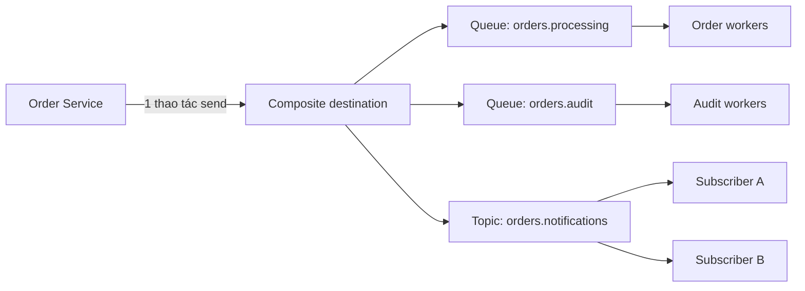
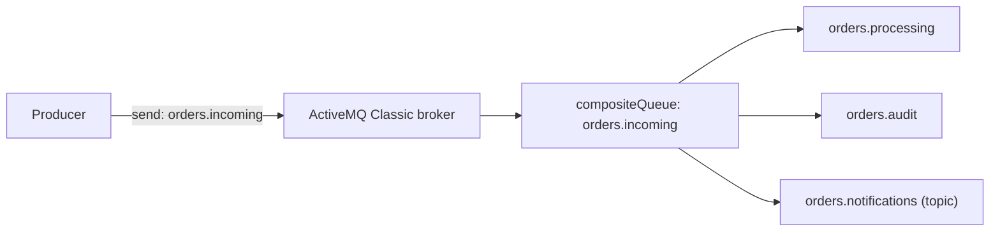

# Composite destination và gửi một thông điệp đến nhiều đích

> **Chương:** Định tuyến Classic  
> **Phạm vi:** Apache ActiveMQ **Classic**, sử dụng composite destination để fan-out một thao tác gửi JMS đến nhiều queue/topic. Minh họa bằng Java với client Classic 5.18.x; phân tích cấu hình ở broker, tính bền vững, transaction và cách kiểm chứng.  
> **Tình huống:** Dịch vụ Order Service phát ra `OrderCreated`. Hệ thống cần chuyển cùng sự kiện đến queue xử lý đơn, queue kiểm toán và topic thông báo mà producer không phải tự gọi `send()` cho từng destination.

## 1. Bài toán định tuyến một-nhiều

Giả sử thông điệp nghiệp vụ có nội dung:

```json
{
  "eventId": "evt-1001",
  "orderId": "ORD-1001",
  "eventType": "OrderCreated",
  "region": "HN"
}
```

Ba nhóm xử lý cần nhận sự kiện:

| Đích | Kiểu JMS | Mục đích | Cách nhận |
| --- | --- | --- | --- |
| `orders.processing` | Queue | Thực thi quy trình đơn hàng | Một consumer trong nhóm worker xử lý mỗi bản được enqueue |
| `orders.audit` | Queue | Ghi audit độc lập | Một consumer trong nhóm audit xử lý mỗi bản được enqueue |
| `orders.notifications` | Topic | Đẩy thông báo cho các subscriber đang quan tâm | Mỗi subscription đủ điều kiện nhận bản tương ứng |

Nếu viết ba lệnh gửi riêng rẽ, producer phải biết cả ba đích và xử lý từng kết quả. **Composite destination của ActiveMQ Classic** cho phép biểu diễn nhiều destination vật lý bằng **một destination logic** hoặc để broker định tuyến ngầm tới nhiều destination.



**Điều cốt lõi:** “Một thông điệp đến nhiều đích” nghĩa là **một thao tác gửi logic được broker fan-out vào nhiều destination**. Đây **không phải** một JMS queue có ba consumer, cũng **không** có nghĩa tất cả consumer đã ACK sau khi producer gọi `send()`.

Trong ActiveMQ Classic có **hai cơ chế liên quan nhưng khác vị trí cấu hình**:

1. **Client-side composite destination:** Producer tạo tên destination chứa danh sách ngăn bằng dấu phẩy, ví dụ `orders.processing,orders.audit,topic://orders.notifications`. Ứng dụng biết rõ các đích vật lý.
2. **Broker-side composite destination:** Producer gửi một tên ổn định, ví dụ `orders.incoming`; broker dùng `virtualDestinationInterceptor` và `compositeQueue` để chuyển tiếp đến danh sách đích trong cấu hình. Ứng dụng không cần biết danh sách fan-out.

Cả hai đều là **tính năng mở rộng của ActiveMQ Classic**, không phải cú pháp quy định chung của đặc tả JMS. Khi đổi broker/provider, phải thiết kế lại routing tương ứng.

## 2. Client-side composite: danh sách đích ngay trong tên JMS Destination

### 2.1. Dấu phẩy và tiền tố kiểu destination

Cú pháp được ActiveMQ Classic hỗ trợ:

```text
orders.processing,orders.audit
orders.processing,orders.audit,topic://orders.notifications
queue://orders.processing,queue://orders.audit,topic://orders.notifications
```

Các quy tắc đọc:

- Dấu **`,`** ngăn các destination thành viên.
- Nếu tạo `ActiveMQQueue("A,B")`, các mục không có tiền tố được xem là **queue**; nếu dùng `ActiveMQTopic(...)` thì các mục không có tiền tố được xem là **topic**.
- Khi trộn hai kiểu, dùng **`queue://`** hoặc **`topic://`** trước tên thành viên có kiểu cần chỉ định.
- Dấu `.` trong `orders.processing` chỉ là ký tự phân cấp tên, **không** tạo fan-out. Dấu phẩy mới là ký hiệu composite.
- Đặt dấu phẩy trong một tên nghiệp vụ có thể vô tình biến thành nhiều destination. Vì thế nên có quy ước đặt tên không chứa dấu phẩy.

Ví dụ **đúng** với client Classic dùng `javax.jms`:

```java
import javax.jms.Destination;
import org.apache.activemq.command.ActiveMQQueue;

Destination targets = new ActiveMQQueue(
        "orders.processing,orders.audit,topic://orders.notifications");

// Một lệnh send, ActiveMQ Classic fan-out đến các đích thành viên:
producer.send(targets, textMessage);
```

Một cách tương đương qua factory của `Session` với provider Classic:

```java
Queue compositeQueue = session.createQueue(
        "orders.processing,orders.audit,topic://orders.notifications");
```

**Không dùng tên trộn kiểu mà thiếu `topic://`:**

```java
// Cả ba bị diễn giải là queue nếu tạo bằng ActiveMQQueue:
new ActiveMQQueue(
    "orders.processing,orders.audit,orders.notifications");
```

Khi đó `orders.notifications` sẽ là **queue**, không phải topic, làm sai hợp đồng pub/sub.

### 2.2. Khác gì gọi ba lần `send()`?

```java
// Cách 1: producer tự gửi ba lần:
producer.send(processing, msg1);
producer.send(audit, msg2);
producer.send(notifications, msg3);

// Cách 2: một thao tác gửi logic với ActiveMQ Classic:
producer.send(new ActiveMQQueue(
        "orders.processing,orders.audit,topic://orders.notifications"), msg);
```

Cách 2 giảm danh sách thao tác tại lớp nghiệp vụ và tận dụng fan-out của provider, nhưng **không tạo phép màu "exactly once"**. Các destination vẫn có hàng chờ, subscription, tốc độ consumer, ACK, TTL và DLQ **riêng**. Trong giao dịch producer, cần commit; sau khi fan-out thành công, mỗi consumer tiếp tục thực hiện giao dịch xử lý độc lập.

Thứ tự phân phối giữa các queue/topic không phải một hợp đồng toàn cục. Không thiết kế luồng mà service Audit phải nhận **trước** service Processing chỉ vì tên queue audit đứng trước trong composite.

### 2.3. Khi nào nên dùng client-side?

Phù hợp nếu danh sách đích ngắn, cố định theo ứng dụng, producer kiểm soát hợp đồng phát sự kiện và có chấp nhận coupling trực tiếp với các tên queue/topic. Không phù hợp nếu đội vận hành thường xuyên thêm/xóa người nhận mà không muốn phát hành lại ứng dụng; khi đó broker-side mapping hoặc virtual topic có thể thích hợp hơn.

## 3. Ví dụ Java hoàn chỉnh: hai queue và một topic

Ví dụ này sử dụng **Apache ActiveMQ Classic 5.18.x**, API **`javax.jms`** và broker chạy thành **tiến trình độc lập**. Mục đích là quan sát fan-out: một lần producer gửi, hai queue nhận mỗi queue một thông điệp và một subscriber topic đang hoạt động nhận một thông điệp.

### 3.1. Khởi tạo môi trường

Cần có:

- JDK 17, Maven và **broker ActiveMQ Classic 5.18.x** đang lắng nghe `tcp://127.0.0.1:61616`.
- Có quyền gửi/nhận các đích `orders.processing`, `orders.audit` và `orders.notifications`. Với broker phát triển có auto-create destination, các đích có thể được tạo khi lần đầu sử dụng; production nên kiểm soát quyền tạo destination.
- Vì ví dụ dùng **topic subscription không durable**, chương trình sẽ đăng ký consumer và mở connection **trước khi gửi**. Nếu subscriber chưa tồn tại khi gửi, nó không nhận lại message cũ như queue.
- Nếu broker đòi xác thực, đặt `BROKER_USER` và `BROKER_PASSWORD` trong môi trường.

File `pom.xml`:

```xml
<project xmlns="http://maven.apache.org/POM/4.0.0"
         xmlns:xsi="http://www.w3.org/2001/XMLSchema-instance"
         xsi:schemaLocation="http://maven.apache.org/POM/4.0.0 https://maven.apache.org/xsd/maven-4.0.0.xsd">
  <modelVersion>4.0.0</modelVersion>

  <groupId>example.activemq</groupId>
  <artifactId>classic-composite-demo</artifactId>
  <version>1.0.0</version>

  <properties>
    <maven.compiler.release>17</maven.compiler.release>
  </properties>

  <dependencies>
    <dependency>
      <groupId>org.apache.activemq</groupId>
      <artifactId>activemq-client</artifactId>
      <version>5.18.3</version>
    </dependency>
  </dependencies>

  <build>
    <plugins>
      <plugin>
        <groupId>org.apache.maven.plugins</groupId>
        <artifactId>maven-compiler-plugin</artifactId>
        <version>3.13.0</version>
      </plugin>
      <plugin>
        <groupId>org.codehaus.mojo</groupId>
        <artifactId>exec-maven-plugin</artifactId>
        <version>3.5.0</version>
      </plugin>
    </plugins>
  </build>
</project>
```

`5.18.3` là phiên bản **cụ thể phục vụ ví dụ**, không hàm ý đây là phiên bản mới nhất hoặc nên dùng mặc định trong production. Với Classic 6.x, namespace JMS và artifact/version cần được lựa chọn đúng theo stack Jakarta của nhánh 6; không trộn `javax.jms` và `jakarta.jms`.

### 3.2. Producer và ba consumer minh họa

Tạo file `src/main/java/example/activemq/CompositeClientDemo.java`:

```java
package example.activemq;

import java.util.UUID;

import javax.jms.Connection;
import javax.jms.DeliveryMode;
import javax.jms.Destination;
import javax.jms.JMSException;
import javax.jms.Message;
import javax.jms.MessageConsumer;
import javax.jms.MessageProducer;
import javax.jms.Queue;
import javax.jms.Session;
import javax.jms.TextMessage;
import javax.jms.Topic;

import org.apache.activemq.ActiveMQConnectionFactory;
import org.apache.activemq.command.ActiveMQQueue;

public final class CompositeClientDemo {
    private CompositeClientDemo() {}

    public static void main(String[] args) throws JMSException {
        String url = System.getenv().getOrDefault(
                "BROKER_URL", "tcp://127.0.0.1:61616");

        ActiveMQConnectionFactory factory =
                new ActiveMQConnectionFactory(url);

        String user = System.getenv("BROKER_USER");
        String password = System.getenv("BROKER_PASSWORD");

        Connection connection = (user == null || user.isBlank())
                ? factory.createConnection()
                : factory.createConnection(user, password);

        try {
            // Producer dùng JMS transaction để commit thao tác gửi.
            Session sendSession = connection.createSession(
                    true, Session.SESSION_TRANSACTED);
            // Consumer dùng một session riêng cho ví dụ nhận đồng bộ.
            Session receiveSession = connection.createSession(
                    false, Session.AUTO_ACKNOWLEDGE);
            try {
                Queue processing =
                        receiveSession.createQueue("orders.processing");
                Queue audit =
                        receiveSession.createQueue("orders.audit");
                Topic notifications =
                        receiveSession.createTopic("orders.notifications");

                MessageConsumer processingConsumer =
                        receiveSession.createConsumer(processing);
                MessageConsumer auditConsumer =
                        receiveSession.createConsumer(audit);
                MessageConsumer topicSubscriber =
                        receiveSession.createConsumer(notifications);

                // Đăng ký topic subscription rồi start trước khi gửi.
                connection.start();

                Destination composite = new ActiveMQQueue(
                        "orders.processing,orders.audit,"
                        + "topic://orders.notifications");

                MessageProducer producer = sendSession.createProducer(null);
                try {
                    producer.setDeliveryMode(DeliveryMode.PERSISTENT);

                    String eventId = UUID.randomUUID().toString();
                    TextMessage message = sendSession.createTextMessage(
                            "{\"eventId\":\"" + eventId
                            + "\",\"orderId\":\"ORD-1001\""
                            + ",\"eventType\":\"OrderCreated\"}");
                    message.setStringProperty("eventId", eventId);
                    message.setStringProperty("region", "HN");

                    // MỘT thao tác gửi tới composite destination.
                    producer.send(composite, message);
                    sendSession.commit();

                    System.out.println("Committed eventId=" + eventId);
                } catch (JMSException ex) {
                    sendSession.rollback();
                    throw ex;
                } finally {
                    producer.close();
                }

                printReceived("processing",
                        processingConsumer.receive(5000));
                printReceived("audit",
                        auditConsumer.receive(5000));
                printReceived("notifications",
                        topicSubscriber.receive(5000));
            } finally {
                receiveSession.close();
                sendSession.close();
            }
        } finally {
            connection.close();
        }
    }

    private static void printReceived(String label, Message received)
            throws JMSException {
        if (received == null) {
            System.out.println(label + ": TIMEOUT");
            return;
        }
        if (!(received instanceof TextMessage)) {
            throw new JMSException(
                    label + ": unexpected message type "
                    + received.getClass().getName());
        }
        TextMessage text = (TextMessage) received;
        System.out.println(label + ": "
                + text.getStringProperty("eventId")
                + " => " + text.getText());
    }
}
```

Chạy khi broker đã sẵn sàng:

```bash
mvn -q compile exec:java -Dexec.mainClass=example.activemq.CompositeClientDemo
```

Kết quả điển hình:

```text
Committed eventId=...
processing: ... => {"eventId":"...","orderId":"ORD-1001","eventType":"OrderCreated"}
audit: ... => {"eventId":"...","orderId":"ORD-1001","eventType":"OrderCreated"}
notifications: ... => {"eventId":"...","orderId":"ORD-1001","eventType":"OrderCreated"}
```

**Cần hiểu chính xác các giả định của ví dụ:**

- Cả ba consumer được tạo trước khi gửi; queue chưa có consumer thì vẫn có thể giữ message, còn **topic non-durable** thông thường chỉ giao đến subscriber đang hoạt động.
- Mỗi queue nhận **một bản logic** cho sự kiện; nếu thêm hai consumer cùng đọc `orders.processing`, họ **tranh nhau** message của queue, không phải cả hai đều tự nhận một bản.
- Nếu thêm hai subscriber độc lập trên `orders.notifications` và cả hai đăng ký đúng thời điểm, topic có thể giao tới **cả hai subscription**.
- Lệnh `send()` nằm trong transacted session; **`sendSession.commit()`** mới là mốc hoàn tất JMS transaction của producer. Dù commit thành công, nó vẫn **không đồng nghĩa** ba consumer đã xử lý nghiệp vụ.
- `eventId` là mã sự kiện ở mức nghiệp vụ; các message chuyển tiếp có thể mang cùng giá trị property này. Dùng nó khi đối soát và thiết kế idempotency; không dựa vào việc `JMSMessageID` của mọi bản sao có giống nhau hay không.

### 3.3. Kiểm tra bằng broker metrics

Có thể mở ActiveMQ Classic Web Console/JMX trong môi trường cho phép, xem:

- `orders.processing` và `orders.audit`: **Enqueue Count** tăng cho mỗi lần gửi; **Dequeue Count** tăng khi consumer xác nhận thành công.
- **Queue Size** có thể về 0 sau khi consumer đọc; quan sát thực tế phụ thuộc dispatch, ACK và thời điểm refresh metrics.
- Topic `orders.notifications`: theo dõi topic statistics và subscription state; một subscriber non-durable không hiện diện khi gửi sẽ không nhận lại sự kiện vừa bỏ lỡ.
- Đừng lấy thông số broker tích lũy làm kết luận “mỗi lần gửi nhận đúng 1 bản” khi destination đã có backlog hoặc producer khác. Dùng `eventId` độc nhất trong lần test để đối soát.

Để kiểm tra “queue lưu khi không có consumer”, bỏ phần tạo consumer queue, gửi rồi khởi chạy consumer riêng sau đó. Để kiểm tra “topic non-durable chỉ nhận lúc active”, tạo subscriber **sau** commit của producer và quan sát không nhận lại sự kiện cũ. Các thử nghiệm này không yêu cầu sửa broker-side config.

## 4. Broker-side composite: producer chỉ gửi một tên logic

Nếu producer không nên biết danh sách đích, cấu hình **virtual destination tại broker** là lựa chọn phù hợp.



Producer chỉ biết `orders.incoming`. Broker áp dụng mapping một-nhiều tới các đích vật lý. Khi thêm/bớt một destination nhận, đội vận hành sửa quy tắc broker, thay vì phải đổi mọi producer.

### 4.1. Cấu hình `compositeQueue` với `forwardOnly=true`

Trong file `conf/activemq.xml` của một bản phân phối Classic dùng cấu hình XBean, đặt **đoạn sau bên trong phần tử `<broker>` hiện có**, cùng cấp với các khối broker configuration phù hợp:

```xml
<destinationInterceptors>
  <virtualDestinationInterceptor>
    <virtualDestinations>
      <compositeQueue name="orders.incoming" forwardOnly="true">
        <forwardTo>
          <queue physicalName="orders.processing"/>
          <queue physicalName="orders.audit"/>
          <topic physicalName="orders.notifications"/>
        </forwardTo>
      </compositeQueue>
    </virtualDestinations>
  </virtualDestinationInterceptor>
</destinationInterceptors>
```

`forwardOnly="true"` là hành vi mặc định của composite destination. Với cấu hình trên:

1. Producer gửi **một** message đến `orders.incoming`.
2. Broker định tuyến bản của sự kiện đến hai queue và một topic trong `<forwardTo>`.
3. **Không có một bản message chờ xử lý ở queue vật lý `orders.incoming`** chỉ vì producer gửi tên đó; đây là tên nguồn logic chỉ dùng để forward.
4. Consumer phải đọc `orders.processing`, `orders.audit` hoặc subscribe `orders.notifications` tùy chức năng; không đọc `orders.incoming` để nhận message trong chế độ forward-only.

Đoạn XML là trích đoạn cấu hình hợp lệ theo ActiveMQ Classic; **không** tạo một `<broker>` thứ hai. Nếu file hiện đã có `<destinationInterceptors>` hoặc `<virtualDestinationInterceptor>`, cần gộp vào cấu trúc hiện có thay vì nhân đôi một cách tùy tiện. Khởi động lại broker sau khi đổi cấu hình và kiểm tra log để biết interceptor đã nạp.

### 4.2. Producer lúc này đơn giản hơn

Với cấu hình broker-side ở trên, đoạn producer dùng Classic có thể chỉ viết:

```java
Queue incoming = sendSession.createQueue("orders.incoming");
TextMessage message = sendSession.createTextMessage("OrderCreated");
message.setStringProperty("eventId", "evt-1001");

producer.send(incoming, message);
sendSession.commit();
```

Không có dấu phẩy hay `topic://` trong tên `orders.incoming`. Đây là khác biệt rõ nhất giữa broker-side và client-side.

### 4.3. Đổi `forwardOnly="false"` để lưu cả ở queue gốc

Một nhu cầu khác: chính queue `orders.incoming` cần có worker xử lý, đồng thời mọi message còn phải được gửi tới queue audit hoặc topic notification. Đây thường được gọi là mô hình **wire tap**.

```xml
<destinationInterceptors>
  <virtualDestinationInterceptor>
    <virtualDestinations>
      <compositeQueue name="orders.incoming" forwardOnly="false">
        <forwardTo>
          <queue physicalName="orders.audit"/>
          <topic physicalName="orders.notifications"/>
        </forwardTo>
      </compositeQueue>
    </virtualDestinations>
  </virtualDestinationInterceptor>
</destinationInterceptors>
```

Khi producer gửi một message đến `orders.incoming`, broker thực hiện logic:

```text
orders.incoming (queue vật lý)    -> workers xử lý đơn
    + orders.audit (queue)        -> audit worker
    + orders.notifications (topic)-> subscriber đang active
```

**Khác biệt quyết định:**

| Cấu hình | `orders.incoming` có bản vật lý để consumer đọc? | Đích trong `forwardTo` nhận bản? |
| --- | --- | --- |
| `forwardOnly="true"` hoặc bỏ thuộc tính | Không | Có |
| `forwardOnly="false"` với `compositeQueue` | Có | Có |

Vì vậy, khi dự định **vừa xử lý tại queue nguồn vừa gửi audit**, phải đặt `forwardOnly="false"`. Nếu quên thuộc tính, consumer của `orders.incoming` có thể chờ mãi, dù các đích đích đã nhận đúng.

Tài liệu Classic cũng có `compositeTopic`. Khi `forwardOnly="true"`, nó tương tự `compositeQueue` về vai trò tên logic; còn khi `forwardOnly="false"`, việc chọn **composite queue** hay **composite topic** quyết định kiểu destination vật lý tương ứng ở nguồn.

### 4.4. `copyMessage` và header gốc

Thuộc tính `copyMessage` của `compositeQueue`/`compositeTopic` mặc định là `true`. Khi forward, broker có thể tạo/cập nhật bản sao message để đích nhận có header destination phù hợp với destination vật lý.

Điều này có nghĩa consumer ở `orders.audit` có thể thấy `JMSDestination` là `orders.audit`, không phải tên logic `orders.incoming`. Nếu nghiệp vụ cần lưu “message đến từ quy tắc nào”, hãy thêm một property rõ ràng như `sourceEvent` hoặc `eventId` ngay từ producer. **Không dựa vào một trường header nội bộ hoặc `JMSMessageID` để thay thế event ID nghiệp vụ**.

Thay đổi `copyMessage` sang `false` có thể tác động cách lưu/chia sẻ và header của message; chỉ thực hiện khi hiểu cụ thể version broker, đã kiểm thử và có lý do đo được về hiệu năng. Ví dụ trong bài giữ mặc định.

## 5. Filtered destination: chỉ forward đến đích phù hợp thuộc tính

Composite broker-side hỗ trợ lọc tại từng nhánh chuyển tiếp bằng `filteredDestination` và một **selector** JMS. Điều này hữu ích khi cùng một nguồn `orders.incoming` nhưng chỉ đơn hàng miền Bắc đến đội xử lý khu vực Bắc, còn audit thì luôn nhận.

### 5.1. XML có điều kiện

```xml
<destinationInterceptors>
  <virtualDestinationInterceptor>
    <virtualDestinations>
      <compositeQueue name="orders.incoming" forwardOnly="true">
        <forwardTo>
          <queue physicalName="orders.audit"/>
          <filteredDestination
              selector="region = 'HN'"
              queue="orders.processing.hn"/>
          <filteredDestination
              selector="region = 'HCM'"
              queue="orders.processing.hcm"/>
        </forwardTo>
      </compositeQueue>
    </virtualDestinations>
  </virtualDestinationInterceptor>
</destinationInterceptors>
```

Producer gửi:

```java
Queue incoming = session.createQueue("orders.incoming");
TextMessage message = session.createTextMessage(
        "{\"orderId\":\"ORD-1001\",\"region\":\"HN\"}");

// Selector so khớp với JMS property, không parse JSON body:
message.setStringProperty("region", "HN");

producer.send(incoming, message);
```

Kết quả mong đợi cho event với `region=HN`:

- `orders.audit` nhận một bản (nhánh chuyển tiếp không điều kiện).
- `orders.processing.hn` nhận một bản (selector đúng).
- `orders.processing.hcm` **không** nhận bản này (selector sai).
- `orders.incoming` không giữ bản vật lý, vì `forwardOnly="true"`.

**Lưu ý selector:** `selector="region = 'HN'"` kiểm tra **JMS message property** tên `region`. Nếu chỉ có `"region":"HN"` trong JSON body mà **không** gọi `setStringProperty("region","HN")`, nhánh HN sẽ không được chọn. `null`/property vắng mặt, kiểu dữ liệu không khớp hoặc cú pháp selector sai có thể khiến filter không match hoặc cấu hình không khởi động đúng; cần kiểm thử với message mẫu.

### 5.2. Tránh nhầm filter tại router với filter tại consumer

- **Filtered destination:** Broker **quyết định có chuyển tiếp vào destination đó hay không**. Nếu không match, queue đích không nhận bản sao.
- **Consumer selector:** Message vẫn có thể được lưu trên queue, nhưng consumer chỉ chọn message có property match. Message không match có thể tiếp tục chờ consumer khác.
- **TTL/expiration:** Cơ chế hết hạn sau khi message đã được gửi/định tuyến, không phải cách thay thế selector routing.

Chọn đúng nơi lọc ảnh hưởng dung lượng queue, hành vi retry và khả năng giải thích “vì sao queue không có message”.

## 6. Những nhầm lẫn thường gây lỗi routing

| Nhầm lẫn | Hậu quả | Cách xử lý |
| --- | --- | --- |
| `new ActiveMQQueue("A,B,C")` nhưng C thực ra phải là topic | C bị gửi như queue | Viết `"A,B,topic://C"` |
| Gửi vào `orders.incoming` rồi consume chính queue đó khi `forwardOnly=true` | Không có bản vật lý tại queue nguồn | Consume queue trong `forwardTo` hoặc đổi `forwardOnly=false` |
| Cấu hình broker-side mapping nhưng producer vẫn gửi composite chứa cả alias và đích forwarded | Một đích có thể nhận nhiều bản logic | Định nghĩa một hợp đồng entry point duy nhất |
| Tạo topic subscriber sau khi producer gửi | Subscriber non-durable bỏ lỡ event cũ | Tạo subscriber trước hoặc dùng durable subscription/queue |
| Dùng `filteredDestination` nhưng chỉ đưa điều kiện vào JSON body | Selector không đọc body | Đặt JMS properties đúng tên và kiểu |
| Tưởng một lệnh `send()` nghĩa là mọi consumer đã ACK | Đánh giá sai độ tin cậy | Đo riêng producer commit, queue depth, consumer ACK |
| Tưởng composite tự chuyển qua các broker khác nhau | Mapping chỉ đến destinations theo cơ chế broker hiện có | Cấu hình network of brokers riêng nếu cần liên broker |
| Tự động retry ngay khi connection timeout | Có thể gửi trùng nếu broker đã commit | Tái dùng eventId + idempotent consumer |
| Có bản sao tại hai queue và cùng xử lý tác dụng phụ không idempotent | Một tác vụ có thể bị thực hiện hai lần ở hai service | Tách rõ trách nhiệm destination; kiểm soát side effect theo eventId |

**Cẩn trọng với cấu hình kép:** Nếu broker định nghĩa `orders.incoming -> orders.audit` và client gửi `"orders.incoming,orders.audit"`, nhánh audit có thể nhận **một bản từ client và một bản từ alias forwarded**. Kiểm chứng cấu trúc fan-out và tránh trùng đường chuyển tiếp. Tương tự, không thiết kế composite vòng lặp kiểu `A -> B -> A`.

## 7. Transaction, bảo đảm gửi và ACK khi fan-out

### 7.1. Producer transaction và fan-out

Một `send()` vào composite **không** đồng nghĩa “giao dịch nghiệp vụ phân tán”. Với transacted JMS session, producer cần:

```java
Session tx = connection.createSession(true, Session.SESSION_TRANSACTED);
try {
    Destination many = new ActiveMQQueue(
            "orders.processing,orders.audit,topic://orders.notifications");
    MessageProducer producer = tx.createProducer(null);
    try {
        TextMessage message = tx.createTextMessage("OrderCreated");
        message.setStringProperty("eventId", "evt-1001");
        producer.send(many, message);
        tx.commit();
    } catch (JMSException error) {
        tx.rollback();
        throw error;
    } finally {
        producer.close();
    }
} finally {
    tx.close();
}
```

Giao dịch JMS này điều khiển hoạt động gửi trong session với **một broker** theo semantics và cấu hình client/broker tương ứng. Nó **không** tự bảo đảm database commit ở hai consumer, chuyển tiếp qua network connector đến broker khác, hay tác vụ HTTP/email bên ngoài đều thành công nguyên tử.

**Ghi chú kỹ thuật:** Classic có các tùy chọn về fan-out/concurrent send và tối ưu broker; cách báo lỗi giữa chừng, thứ tự forward và tác động của restart phải được kiểm chứng trên **đúng phiên bản và cấu hình**. Không mô tả một lần `send()` đơn thuần như một bảo đảm tất cả đích đều durable sau mọi kiểu sự cố. Khi nghiệp vụ đòi hỏi atomicity chặt chẽ, dùng transaction với kiểm thử failure injection và đối soát, thay vì chỉ dựa vào việc API có một tham số composite.

### 7.2. Các consumer ACK độc lập

Giả sử producer đã commit và hai queue đều có event `evt-1001`:

```text
orders.processing --Worker A--> DB ghi thành công --> ACK
orders.audit      --Worker B--> lỗi DB         --> rollback/redelivery
```

ACK của Worker A **không xác nhận thay** event ở `orders.audit`. Worker B có thể nhận lại thông điệp sau rollback hoặc mất kết nối, được điều khiển bởi redelivery policy và DLQ của destination. Nếu thông điệp vượt giới hạn retry, bản ở một queue có thể bị đưa vào **DLQ** trong khi queue còn lại đã xử lý xong.

Với topic, các subscription cũng có state độc lập: một subscriber ACK thành công không đồng nghĩa các subscriber khác đã hoàn tất.

### 7.3. Độ bền message và topic

Dùng `DeliveryMode.PERSISTENT` giúp broker sử dụng cơ chế storage bền theo cấu hình. Tuy nhiên:

- **Queue:** Có thể tồn tại message đang chờ consumer, kể cả khi chưa có consumer online.
- **Topic non-durable:** Không giữ lại lịch sử cho subscriber xuất hiện sau khi message được phát.
- **Topic durable:** Giữ phần message cần thiết cho durable subscription đã đăng ký, theo semantics, retention và cấu hình.

Composite **không biến topic non-durable thành durable topic**. Nếu mọi team phải có backlog độc lập và có nhiều worker cạnh tranh trong từng team, có thể cân nhắc fan-out vào **các queue riêng**, hoặc **virtual topic** khi tập consumer thay đổi động.

### 7.4. Retry và chống trùng

Failure window thường gặp:

```text
producer -> broker: send + commit
broker:       đã ghi/commit nhánh composite
mạng:         mất response trước khi producer nhận
producer:     timeout, không biết commit đã thành công chưa
producer:     retry => event có thể xuất hiện lại
```

Thiết kế an toàn hơn:

1. Tạo `eventId` từ bản ghi event/outbox ổn định; **giữ cùng ID khi retry**.
2. Consumer của từng queue sử dụng `eventId` để deduplicate trong nghiệp vụ của mình (ví dụ unique constraint).
3. Đừng dùng riêng `JMSMessageID` để kiểm tra business duplicate khi resend, vì message mới có thể mang JMS ID mới.
4. Với lỗi lâu dài, cấu hình redelivery và DLQ theo từng nhóm consumer, lưu ngữ cảnh lỗi để xử lý lại có kiểm soát.

Composite giúp đơn giản hóa fan-out, **không thay thế** outbox/inbox, transactional acknowledgment hay chiến lược recovery.

## 8. Composite destination so với virtual topic

Cả hai đều là công cụ routing của ActiveMQ Classic nhưng phù hợp các thay đổi topology khác nhau.

| Tiêu chí | Composite destination | Virtual topic |
| --- | --- | --- |
| Danh sách đích | Client khai báo trong tên composite hoặc broker cấu hình `forwardTo` tĩnh | Consumer queue có thể tham gia động theo mẫu tên `Consumer.*.VirtualTopic.>` |
| Producer gửi | Tên composite nhiều thành viên hoặc alias broker-side | Tên topic logic, thường `VirtualTopic.Orders` |
| Receiver | Queue/topic nằm trong danh sách đích | Các queue consumer theo naming convention |
| Phối hợp queue và topic | Có thể trộn trong cùng mapping | Tập trung vào fan-out từ topic sang consumer queues |
| Thay đổi nhóm nhận | Thường sửa mã producer hoặc cấu hình broker | Có thể tạo consumer queue theo quy ước mà không sửa từng mapping |
| Tình huống phù hợp | Gửi audit, wire tap, gửi đến số ít đích cố định | Nhiều nhóm consumer độc lập, thay đổi theo thời gian |

**Ví dụ quyết định:** Hệ thống luôn cần một bản cho `orders.processing` và một bản cho `orders.audit` ⇒ broker-side composite queue dễ hiểu. Hệ thống có hàng chục đội nghiệp vụ muốn tự thêm queue subscriber, mỗi đội có nhiều worker ⇒ virtual topic thường phù hợp hơn. Không nên dùng song song cả hai mô hình fan-out trên cùng một message nếu chưa kiểm soát được bản sao và network bridge.

## 9. Bảo mật, hiệu năng và khả năng quan sát

### 9.1. Phân quyền

Producer gửi vào alias `orders.incoming`, trong khi broker forward đến `orders.processing`, `orders.audit` và `orders.notifications`. Khi triển khai:

- Kiểm thử **quyền SEND thực tế** của principal đối với alias và tác động trên các đích được forward, vì chi tiết authorization qua virtual destination phụ thuộc cơ chế security và phiên bản broker.
- Phân quyền CONSUME riêng cho các nhóm; service xử lý đơn không cần đọc queue audit.
- Hạn chế quyền tạo destination tự động; chống typo hoặc một composite tùy ý tạo quá nhiều queue ngoài kiểm soát.
- Dùng TLS, credentials và log audit phù hợp; không đưa payload nhạy cảm lên notification topic chỉ vì dễ thêm fan-out.

### 9.2. Hiệu năng

Một send tới nhiều đích có thể làm **số bản cần lưu/dispatch tăng theo số đích**. Ví dụ một message 32 KB fan-out vào 5 queue persistent dẫn đến áp lực lưu trữ và số ACK/consumer state lớn hơn nhiều so với một queue đơn, dù broker có thể tối ưu lưu payload/reference tùy adapter và phiên bản.

Những thứ cần đo: **throughput gửi và nhận, latency `commit()`, journal/disk I/O, pending/inflight trên từng queue, backlog theo subscriber, memory/store usage, redelivery và DLQ**. Khi một queue nhận chậm, nó có thể giữ nhiều message và làm tăng mức sử dụng disk dù các nhóm khác đã ACK.

Tùy phiên bản, Classic có tùy chọn xử lý fan-out đồng thời (`concurrentSend`) và các chính sách resource. Đó là tối ưu có đánh đổi về thứ tự, luồng thực thi và áp lực I/O; cần đo bằng workload thật trước khi bật.

### 9.3. Checklist kiểm thử sau khi đổi routing

| Bước | Kiểm tra | Kỳ vọng |
| --- | --- | --- |
| 1 | Broker nạp XML và khởi động thành công | Không lỗi parse/XBean/virtual destination |
| 2 | Producer gửi một event với `eventId` duy nhất | Send/commit theo đúng cấu hình |
| 3 | Kiểm tra enqueue count của từng queue đích | Mỗi queue cần nhận có một message logic |
| 4 | Đăng ký topic subscriber **trước** khi gửi | Subscriber nhận event của phiên test |
| 5 | Với `forwardOnly=true`, kiểm tra queue alias nguồn | Không có bản vật lý cần consume tại alias |
| 6 | Với `forwardOnly=false`, kiểm tra alias nguồn | Có thể consume bản tại queue gốc |
| 7 | Với `filteredDestination`, thay property `region` | Chỉ nhánh match nhận bản được forward |
| 8 | Cố ý làm một consumer rollback | Chỉ destination/subscription đó redeliver theo policy |
| 9 | Tắt/mở broker khi có message persistent chưa ACK | Quan sát behavior recovery theo cấu hình |
| 10 | Mô phỏng timeout producer rồi retry cùng `eventId` | Consumer không thực hiện side effect trùng |

Bước đo nên dùng eventId riêng của từng lần thử, thay vì chỉ nhìn tổng message trên console. Nếu có nhiều producer chạy song song, ghi lại mốc thời gian và destination để tránh kết luận nhầm.

## 10. Bài tập thực hành

### Bài tập 1 — Client-side: phân biệt queue và topic

Viết `ActiveMQQueue` chứa ba đích `billing.queue`, `audit.queue` và topic `orders.notify`. Tạo một consumer ở mỗi queue và **hai** subscriber cho topic.

**Câu hỏi:** Nếu producer gửi một event và tất cả consumer/subscriber đã kết nối, mỗi đối tượng nhận bao nhiêu bản?

**Đáp án định hướng:** Dùng `"billing.queue,audit.queue,topic://orders.notify"`. Mỗi queue nhận một bản logic để một consumer trong nhóm xử lý; hai subscription topic đủ điều kiện có thể mỗi subscription nhận một bản.

### Bài tập 2 — Broker-side: wire tap

Producer hiện chỉ gửi vào `orders.incoming`. Cần giữ message ở queue đó cho worker, đồng thời chuyển bản đến `orders.audit` và topic `orders.events` mà không sửa producer.

**Yêu cầu:** Cấu hình `compositeQueue` với tên phù hợp, liệt kê `forwardTo` và đặt thuộc tính nào để consumer vẫn đọc được `orders.incoming`?

**Đáp án định hướng:** `forwardOnly="false"`; khai báo queue audit và topic events trong `<forwardTo>`.

### Bài tập 3 — Lọc theo khu vực

Chỉ forward đơn có JMS property `region = 'HN'` tới `orders.hn`, còn `orders.audit` nhận mọi message. Gửi hai message: một có `region="HN"`, một có `region="HCM"`.

**Kỳ vọng:** Audit nhận hai bản; HN chỉ nhận một; HCM không vào queue HN. Nếu chỉ sửa JSON body mà không đặt JMS property, HN không nhận message.

### Bài tập 4 — Debug trùng bản

Broker định nghĩa alias `orders.incoming` forward đến `orders.audit`. Client gửi composite `"orders.incoming,orders.audit"` và thấy audit nhận hai message cùng `eventId`.

**Câu hỏi:** Có phải broker lỗi lưu trữ? Sửa ở đâu?

**Đáp án định hướng:** Một nhánh đi trực tiếp từ client đến audit, nhánh còn lại từ alias broker-side. Đây là cấu hình hai đường fan-out. Chọn gửi chỉ `orders.incoming` hoặc bỏ trùng alias/đích trong composite.

### Bài tập 5 — ACK và DLQ

Sau khi producer commit fan-out vào processing và audit, consumer processing commit thành công; consumer audit rollback nhiều lần rồi message chuyển DLQ.

**Câu hỏi:** ACK của processing có nên xóa message audit không? Producer có phải gửi lại toàn bộ event không?

**Đáp án định hướng:** Không. State tiêu thụ/ACK của mỗi queue độc lập. Cần xử lý audit/DLQ theo cơ chế kiểm soát retry; gửi lại toàn bộ composite khi không cần thiết có thể tạo bản sao ở processing. Dùng `eventId` để đối soát và phương án replay có chủ đích.

## 11. Tài liệu tham khảo

1. Apache ActiveMQ Classic — [Composite Destinations](https://activemq.apache.org/components/classic/documentation/composite-destinations): dấu phẩy, `ActiveMQQueue`, phối hợp `queue://` và `topic://`, client-side composite.
2. Apache ActiveMQ Classic — [Virtual Destinations](https://activemq.apache.org/components/classic/documentation/virtual-destinations): `compositeQueue`/`compositeTopic`, `forwardTo`, `forwardOnly`, `filteredDestination` và ví dụ XML.
3. Apache ActiveMQ Classic — [What is the difference between a Virtual Topic and a Composite Destination?](https://activemq.apache.org/components/classic/documentation/what-is-the-difference-between-a-virtual-topic-and-a-composite-destination): topology danh sách đích tĩnh so với virtual topic dynamic.
4. Apache ActiveMQ Classic — [XBean XML Reference](https://activemq.apache.org/components/classic/documentation/xbean-xml-reference-50): các thuộc tính `copyMessage`, `forwardOnly`, `forwardTo` của composite.
5. Apache ActiveMQ Classic — [How do I create new destinations?](https://activemq.apache.org/components/classic/documentation/how-do-i-create-new-destinations): phân biệt tên Destination phía client với destination vật lý phía broker và quyền auto-create.

> **Ghi nhớ:** Trong **ActiveMQ Classic**, client-side composite định tuyến bằng **danh sách phân tách dấu phẩy**; broker-side composite định tuyến bằng **`virtualDestinationInterceptor` và `forwardTo`**. `forwardOnly` quyết định có giữ bản tại nguồn hay không; `filteredDestination` quyết định nhánh forward theo property. Fan-out giúp **một thao tác gửi** phục vụ **nhiều destination**, nhưng transaction của producer, ACK của từng consumer và chống xử lý trùng vẫn phải được thiết kế, kiểm thử độc lập.
