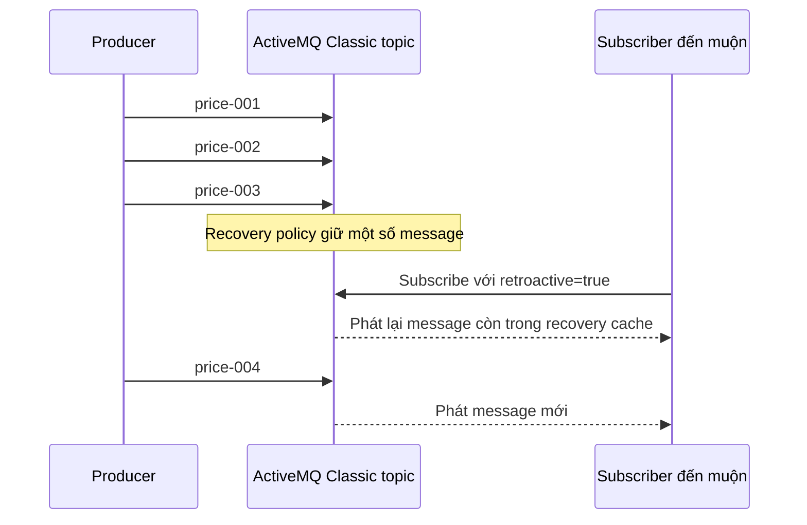
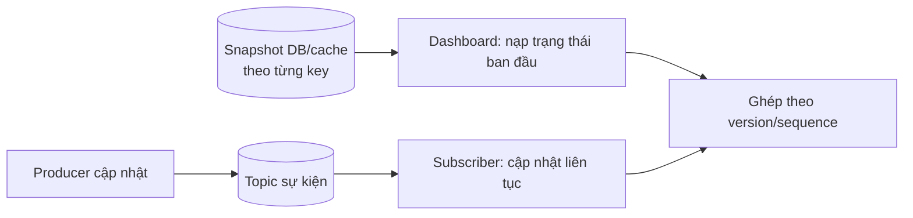

# Retroactive consumer, subscription recovery và giới hạn lưu giữ

> **Chương:** Định tuyến Classic  
> **Phạm vi:** Cơ chế **retroactive consumer** của **Apache ActiveMQ Classic**, các triển khai `subscriptionRecoveryPolicy`, phạm vi message được khôi phục cho người đăng ký topic đến muộn và giới hạn lưu giữ. Ví dụ XML/JMS trong bài dành cho **ActiveMQ Classic 5.x**, không dùng thay thế nguyên dạng cho ActiveMQ Artemis.

## 1. Bài toán: subscriber đến sau khi topic đã phát message

Một ứng dụng giám sát tỷ giá phát bản cập nhật vào topic `lab.retro.count.prices` mỗi khi giá thay đổi. Dashboard khởi động lúc 09:05 nhưng producer đã phát các bản tin từ 09:00. Với một **JMS topic subscriber không durable**, dashboard thông thường chỉ nhận message **được phát sau khi subscription của nó hoạt động**. Đây là hành vi hợp lý đối với luồng sự kiện thời gian thực, nhưng không phù hợp khi màn hình cần một ít ngữ cảnh gần nhất ngay lúc kết nối.

**Retroactive consumer** là phần mở rộng của ActiveMQ Classic cho phép một topic consumer yêu cầu broker cấp lại các message cũ mà **subscription recovery policy** còn lưu giữ, sau đó tiếp tục nhận message mới. Chức năng này hữu ích với bản tin giá gần nhất, trạng thái thiết bị vừa được công bố hoặc một vài thông báo gần đây. Nó **không biến topic thành event log có thể truy vấn lịch sử vô hạn**.



Hai điều kiện **đều phải có**: (1) broker có chính sách lưu message topic để khôi phục, (2) consumer yêu cầu retroactive khi tạo subscription. Nếu broker không giữ message cũ, gắn cờ retroactive không tự tạo ra lịch sử.

### Kết quả cần đạt sau bài

- Giải thích được **subscription recovery** ở tầng broker và cách consumer đến muộn yêu cầu replay.
- Chọn được chính sách **fixed count**, **time window**, **last image** và nhận ra giới hạn của mỗi cách.
- Đọc/viết được đoạn cấu hình `destinationPolicy` cho ActiveMQ Classic.
- Thực hiện thí nghiệm Java JMS để phân biệt consumer thường, retroactive consumer và durable subscription.
- Thiết kế retention dựa trên lượng message, kích thước message, thời gian cần truy cập, memory và nhu cầu phục hồi khi broker restart.
- Biết khi nào phải chuyển sang durable subscription, database hoặc event store thay vì kỳ vọng recovery cache.

## 2. Ngữ nghĩa chính xác của retroactive consumer

### 2.1 Message được giữ ở đâu, ai nhận và khi nào?

Trong ActiveMQ Classic, `subscriptionRecoveryPolicy` là **cấu hình của destination topic phía broker**. Policy quyết định **tập message cũ có thể được phát lại** cho một consumer mới được đánh dấu retroactive. Cache dùng để phục hồi được duy trì theo chính sách của broker; nó không phải hàng đợi riêng được bảo đảm tồn tại cho từng client chưa từng đăng ký.

| Tình huống | Subscriber thường, non-durable | Retroactive subscriber, non-durable |
|---|---|---|
| Message phát **trước** khi subscriber xuất hiện | Không nhận lịch sử chỉ vì vừa kết nối. | Có thể nhận **phần lịch sử còn trong recovery policy**. |
| Message phát **khi** subscriber đang hoạt động | Nhận nếu phù hợp selector, TTL và điều kiện giao hàng. | Nhận như subscriber thường sau giai đoạn recovery. |
| Subscriber ngắt kết nối rồi quay lại | Khoảng thời gian offline không tự được lưu riêng. | Lần kết nối mới có thể lấy lại cửa sổ **recovery hiện còn**; có thể bỏ sót message đã bị loại. |
| Broker khởi động lại | Không tự có backlog cho non-durable subscription. | Không được giả định cache phục hồi còn nguyên sau restart; phụ thuộc implementation/cấu hình và vòng đời broker. |
| Message đã bị policy loại khỏi cache | Không nhận. | Cũng không thể yêu cầu replay lại từ cache đã mất. |

**Mấu chốt:** retroactive là một cách **khởi tạo nội dung ban đầu khi subscribe**, không phải lời hứa cung cấp đầy đủ mọi message trong thời gian consumer vắng mặt. Nếu ứng dụng cần chắc chắn nhận từng sự kiện theo định danh subscription, cần đánh giá **durable subscription**; nếu cần đọc lại lịch sử dài, chọn hệ thống lưu trữ sự kiện phù hợp.

### 2.2 Cờ retroactive là tính năng riêng của ActiveMQ Classic

Một cách yêu cầu retroactive trong **Classic JMS client** là dùng **destination consumer option**:

```java
Topic retroTopic = session.createTopic(
        "lab.retro.count.prices?consumer.retroactive=true");
MessageConsumer consumer = session.createConsumer(retroTopic);
connection.start();
```

Ở đây tên topic logic là `lab.retro.count.prices`; phần sau dấu `?` là **tùy chọn dành cho consumer** mà ActiveMQ Classic client xử lý. Đây **không phải** khả năng chuẩn hóa của API JMS và không bảo đảm hoạt động với Artemis hoặc JMS provider khác. Một consumer không có option trên sẽ không yêu cầu phát lại lịch sử.

Nên khai báo cờ tại **consumer cần hành vi này**, tránh vô tình áp retroactive cho mọi ứng dụng và tạo đợt tải bất ngờ khi nhiều subscriber đồng thời kết nối lại.

### 2.3 Những đặc tính mà replay không tự bảo đảm

1. **Không phải full event history:** số lượng, thời gian và dung lượng message replay phụ thuộc policy, không phụ thuộc số message từng được producer gửi.
2. **Không đồng nghĩa exactly-once:** nếu application retry hoặc phiên nhận gặp sự cố, cùng dữ liệu nghiệp vụ có thể xuất hiện lại; consumer cần khóa sự kiện để chống trùng khi cần.
3. **Không tự khôi phục trạng thái cuối của từng đối tượng:** policy chỉ giữ **message**, không tính toán một snapshot chuẩn cho từng `symbol`, `deviceId` hoặc `orderId`.
4. **Không thay thế độ bền broker:** các recovery policy cache không được coi là lưu trữ lâu dài hoặc nguồn dữ liệu chuẩn để khôi phục sau disaster.
5. **Không bỏ qua bảo mật/expiration:** consumer vẫn phải có quyền subscribe, và message hết hạn không nên được kỳ vọng xuất hiện trong luồng phục hồi.

## 3. Cấu hình Classic: subscription recovery policy theo topic

Trong cấu hình XML của ActiveMQ Classic (thường là `conf/activemq.xml`, đường dẫn thực tế phụ thuộc gói triển khai), chính sách destination nằm trong phần **`<destinationPolicy>`** bên trong phần tử broker. Các ví dụ sau là **đoạn cấu hình để tích hợp vào file hiện hữu**, không phải file `activemq.xml` đầy đủ. Chỉ giữ **một cấu trúc `destinationPolicy` hợp lệ**, thêm các `policyEntry` thích hợp vào `policyEntries` đã có; không chép đè cấu hình persistence, transportConnector hoặc chính sách khác.

### 3.1 Ba chính sách điển hình trong một cấu hình

```xml
<!-- Đoạn con trong broker Classic: destinationPolicy -->
<destinationPolicy>
    <policyMap>
        <policyEntries>
            <!-- Lưu tối đa 3 message gần đây của mỗi topic khớp pattern. -->
            <policyEntry topic="lab.retro.count.>">
                <subscriptionRecoveryPolicy>
                    <fixedCountSubscriptionRecoveryPolicy maximumSize="3"/>
                </subscriptionRecoveryPolicy>
            </policyEntry>

            <!-- Khôi phục message trong cửa sổ 60 giây gần nhất. -->
            <policyEntry topic="lab.retro.time.>">
                <subscriptionRecoveryPolicy>
                    <timedSubscriptionRecoveryPolicy recoverDuration="60000"/>
                </subscriptionRecoveryPolicy>
            </policyEntry>

            <!-- Khôi phục chỉ message cuối của mỗi topic. -->
            <policyEntry topic="lab.retro.image.>">
                <subscriptionRecoveryPolicy>
                    <lastImageSubscriptionRecoveryPolicy/>
                </subscriptionRecoveryPolicy>
            </policyEntry>
        </policyEntries>
    </policyMap>
</destinationPolicy>
```

Đối với XML thực, bảo đảm các phần tử được đặt **đúng namespace và cấu trúc schema** của ActiveMQ Classic đang chạy. Trong wildcard destination Classic, dấu `>` khớp phần đuôi nhiều cấp, vì vậy `lab.retro.count.prices` khớp `lab.retro.count.>`; cấu hình theo từng nhóm topic giúp kiểm soát chi phí recovery. Nếu đã tồn tại một policy khác khớp cùng destination, kiểm tra **policyEntry thực sự được chọn** và tránh tình trạng cấu hình rộng không chủ ý ghi đè chính sách cụ thể.

Sau khi thay cấu hình broker trên môi trường lab, restart/reload theo hướng dẫn của phiên bản đang dùng, xem log khởi động để phát hiện XML sai, rồi kiểm chứng trên **topic mới**. Việc sửa file XML nhưng không áp dụng lên broker đang chạy sẽ không làm thay đổi hành vi test.

### 3.2 `fixedCountSubscriptionRecoveryPolicy`: số bản tin gần nhất

`maximumSize="3"` yêu cầu giữ tối đa **ba message** để phục vụ phục hồi cho mỗi topic phù hợp. Nếu producer phát `p1`, `p2`, `p3`, `p4`, `p5` trước khi một retroactive consumer xuất hiện, consumer đến muộn thường thấy **`p3`, `p4`, `p5`** từ cửa sổ recovery, nếu chúng chưa hết hạn và môi trường không có yếu tố khác làm thay đổi kết quả.

```text
Timeline:   p1 ---- p2 ---- p3 ---- p4 ---- p5 ---- [consumer subscribe]
Cache (3):                [ p3 | p4 | p5 ]
Late consumer:            replay p3, p4, p5; rồi nhận message mới
```

Ưu điểm là **dễ dự đoán số lượng message**, hữu ích cho một số bản tin gần nhất. Nhược điểm: count **không giới hạn byte**. Ba message 5 KiB rất khác ba message 20 MiB; một `maximumSize` lớn có thể tạo áp lực heap. Chính sách này cũng không quy định “lấy các message trong đúng 60 giây”: nếu topic ít phát, message trong cache có thể đã rất cũ về mặt nghiệp vụ nếu vẫn còn hợp lệ.

### 3.3 `timedSubscriptionRecoveryPolicy`: giữ theo thời gian

`recoverDuration="60000"` đặt khoảng thời gian recovery ở mức **60.000 ms**, tức xấp xỉ **60 giây**. Với một subscriber đến muộn, broker chỉ có cơ sở phát lại các message còn trong cửa sổ thời gian được policy giữ. Nếu topic nhận 5 message/giây, cửa sổ một phút có thể chứa nhiều message hơn rất nhiều so với topic chỉ nhận một message/phút.

Đây là lựa chọn hợp lý khi yêu cầu “người vừa kết nối cần quan sát những cập nhật **mới trong vòng một phút**”, nhưng **không bảo đảm số lượng cố định**. Hiệu quả thực tế còn chịu ảnh hưởng expiration, cleanup, lưu giữ trong memory và thời điểm message được phát. Không nên viết kiểm thử dựa vào giả định rằng ở đúng mili giây thứ 60.000 broker sẽ giao một tập sự kiện chính xác về biên thời gian.

### 3.4 `lastImageSubscriptionRecoveryPolicy`: trạng thái cuối gần nhất

Policy này giữ **message cuối cùng** của topic để subscriber mới có một trạng thái khởi đầu gần nhất, ví dụ “trạng thái bật/tắt hiện tại” của một thiết bị:

```text
lab.retro.image.pump-A:
  OFF  -> ON -> OFF -> ON
                       ^ message cuối có thể được replay
```

**Cạm bẫy quan trọng:** last image là **một message trên một topic**, không phải “một message cho mỗi khóa nghiệp vụ”. Nếu cùng topic có giá của `USDVND` và `EURVND`, last image thường chỉ còn message được phát gần nhất của **toàn topic**, có thể thuộc một trong hai cặp tỷ giá. Khi cần snapshot cho **từng symbol**, hãy tách topic theo symbol nếu phù hợp mô hình, hoặc lưu trạng thái trong cơ sở dữ liệu/cache có khóa riêng.

### 3.5 Các lựa chọn khác và tiêu chí chọn

ActiveMQ Classic còn có chính sách hướng đến **giới hạn kích thước bộ nhớ** (như `fixedSizedSubscriptionRecoveryPolicy`) và các dạng recovery có thể tùy biến sâu hơn. Những lựa chọn đó cần được đối chiếu chính xác với phiên bản Classic và kiểm thử tải, đặc biệt về cách ước lượng dung lượng message, eviction và overhead. Không suy luận rằng policy đặt giới hạn kích thước cache sẽ tự chặn toàn bộ memory broker hoặc giới hạn số message đang chờ của mọi durable subscriber.

| Yêu cầu nghiệp vụ | Recovery policy cân nhắc | Giới hạn cần chấp nhận |
|---|---|---|
| Màn hình muốn vài thông báo gần nhất | Fixed count | Không giới hạn tổng byte nếu message có kích thước khác nhau. |
| Consumer mới cần dữ liệu vừa phát trong 30–60 giây | Timed | Số message thay đổi theo lưu lượng; đỉnh tải có thể tiêu tốn memory lớn. |
| Cần trạng thái cuối cùng của **một topic** | Last image | Không tự tạo ảnh trạng thái cuối theo từng key trong một topic chung. |
| Cần kiểm soát footprint recovery cache theo dung lượng | Fixed size, sau khi xác minh phiên bản | Giới hạn theo cách policy đo kích thước; vẫn phải tính overhead và các bộ đệm khác. |
| Bắt buộc nhận đủ message kể cả offline nhiều giờ | Durable subscription/persistent storage | Recovery cache không phải cơ chế bảo đảm backlog riêng của subscription. |
| Đọc lại lịch sử có tìm kiếm, phân trang hoặc replay từ ngày bất kỳ | Database/event store hoặc giải pháp log chuyên biệt | Recovery policy không có offset lịch sử tùy ý cho người đọc. |

## 4. Phân biệt rõ subscription recovery và durable subscription

Hai khái niệm dễ nhầm vì đều liên quan đến subscriber kết nối sau:

| Thuộc tính | Retroactive consumer + recovery policy | JMS durable subscription |
|---|---|---|
| Khi subscription được định nghĩa | Consumer có thể kết nối lần đầu **sau khi** producer đã gửi. | Phải **tạo durable subscription** trước giai đoạn offline muốn tích lũy message. |
| Phạm vi message cũ | Chỉ phần còn lại theo cache topic của broker. | Backlog dành cho **subscription đã tồn tại**, theo chính sách lưu và thời gian sống. |
| Danh tính subscription | Không cần danh tính durable chỉ để dùng cờ retroactive. | Cần client ID/subscription name ổn định trong JMS Classic 5.x. |
| Consumer offline | Không có backlog bền vững riêng chỉ nhờ retroactive. | Broker theo dõi subscription và có thể giữ message phù hợp khi offline. |
| Sau broker restart | Không coi recovery cache là bằng chứng bảo toàn history. | Độ bền phụ thuộc persistent delivery, broker store, cấu hình, TTL và trạng thái subscription. |
| Công dụng chính | *Warm start* với ít dữ liệu gần đây. | Tích lũy các message cần giao sau thời gian subscriber không hoạt động. |

Đừng chọn durable chỉ vì cần hiển thị “giá mới nhất”: backlog lâu ngày có thể rất lớn nếu consumer chậm hoặc ngắt kết nối. Ngược lại, đừng chọn retroactive nếu “không được bỏ sót bất kỳ giao dịch nào” là điều kiện bắt buộc. Một hệ thống thực tế có thể dùng **snapshot từ database** để khởi tạo trạng thái và **topic** để cập nhật liên tục, với chiến lược xử lý ranh giới snapshot/live event bằng sequence hoặc version.

### 4.1 Phân biệt với pending messages của subscriber đang hoạt động

ActiveMQ Classic có các cơ chế như **pending message policy**, **pending message limit** và **message eviction strategy** để quản lý tình huống một subscriber **đang online nhưng nhận/xử lý chậm**. Những cấu hình đó không đồng nghĩa với **`subscriptionRecoveryPolicy`**, vốn quyết định dữ liệu có thể được replay cho **retroactive subscriber mới**.

Ví dụ, tăng pending message limit cho slow subscriber **không tự kéo dài cửa sổ lịch sử cho người đăng ký mới**. Ngược lại, giữ 100 message để recovery **không bảo đảm** một consumer chậm được phép tồn backlog vô hạn. Khi rà soát sự cố “mất message”, cần xác định đó là **late join**, **slow subscriber**, **offline durable subscriber** hay **expired message** trước khi thay một policy bất kỳ.

## 5. Lab ActiveMQ Classic: gửi trước, đăng ký sau

Thực hành dưới đây dùng một broker **ActiveMQ Classic 5.x**, JDK 17 và Gradle. Tập trung vào **hành vi subscription**, nên không lặp hướng dẫn cài JDK/Docker hay tạo broker từ đầu. Cần bảo đảm `destinationPolicy` ở phần 3 đã được áp dụng trên broker lab, broker chấp nhận kết nối OpenWire tại `tcp://127.0.0.1:61616`, và tài khoản (nếu có) được phép publish/subscribe.

**Chú ý phiên bản:** ví dụ Java dùng client Classic `org.apache.activemq:activemq-client:5.18.3` và namespace **`javax.jms`**; đây là một phiên bản minh họa có API phù hợp với Classic 5.x, không phải khẳng định phiên bản mới nhất hoặc đề xuất khóa production vào phiên bản cũ. Không thay bằng `artemis-jakarta-client` rồi giữ nguyên import.

### 5.1 Cấu trúc dự án và dependency

```text
classic-retro-lab/
├── settings.gradle
├── build.gradle
└── src/main/java/lab/ClassicRecoveryLab.java
```

`settings.gradle`:

```groovy
rootProject.name = 'classic-retro-lab'
```

`build.gradle`:

```groovy
plugins {
    id 'java'
    id 'application'
}

repositories {
    mavenCentral()
}

java {
    toolchain {
        languageVersion = JavaLanguageVersion.of(17)
    }
}

dependencies {
    implementation 'org.apache.activemq:activemq-client:5.18.3'
}

application {
    mainClass = 'lab.ClassicRecoveryLab'
}
```

Mỗi lần chạy ứng dụng sẽ tạo **một kết nối mới**. Công cụ có các chế độ `send`, `plain`, `retro`, `durable-create` và `durable-read`, giúp kiểm chứng sự khác nhau giữa cách giữ lịch sử theo policy và backlog của durable subscription.

### 5.2 Mã Java: producer, subscriber thường, retroactive và durable

`src/main/java/lab/ClassicRecoveryLab.java`:

```java
package lab;

import javax.jms.Connection;
import javax.jms.DeliveryMode;
import javax.jms.JMSException;
import javax.jms.Message;
import javax.jms.MessageConsumer;
import javax.jms.MessageProducer;
import javax.jms.Session;
import javax.jms.TextMessage;
import javax.jms.Topic;
import javax.jms.TopicSubscriber;
import org.apache.activemq.ActiveMQConnectionFactory;

public final class ClassicRecoveryLab {
    private static final String CLIENT_ID = "classic-recovery-lab-client";
    private static final String SUBSCRIPTION = "classic-recovery-lab-sub";

    private ClassicRecoveryLab() { }

    public static void main(String[] args) throws Exception {
        if (args.length < 2) {
            usage();
            return;
        }

        String mode = args[0];
        String topicName = args[1];
        String url = env("BROKER_URL", "tcp://127.0.0.1:61616");
        String user = System.getenv("BROKER_USER");
        String password = System.getenv("BROKER_PASSWORD");

        ActiveMQConnectionFactory factory = new ActiveMQConnectionFactory(url);
        Connection connection = user == null || user.isBlank()
                ? factory.createConnection()
                : factory.createConnection(user, password);
        Session session = null;
        try {
            // Phải đặt clientID trước khi tạo Session.
            if (mode.startsWith("durable-")) {
                connection.setClientID(CLIENT_ID);
            }

            session = connection.createSession(
                    false, Session.AUTO_ACKNOWLEDGE);
            Topic topic = session.createTopic(topicName);

            switch (mode) {
                case "send":
                    if (args.length != 3) {
                        usage();
                        break;
                    }
                    int count = Integer.parseInt(args[2]);
                    if (count < 1 || count > 1000) {
                        throw new IllegalArgumentException(
                                "count must be between 1 and 1000");
                    }
                    send(session, topic, count);
                    break;
                case "plain":
                case "retro":
                    // Option consumer.retroactive là của ActiveMQ Classic.
                    Topic chosenTopic = "retro".equals(mode)
                            ? session.createTopic(
                                    topicName + "?consumer.retroactive=true")
                            : topic;
                    MessageConsumer consumer =
                            session.createConsumer(chosenTopic);
                    try {
                        connection.start();
                        receiveAvailable(consumer);
                    } finally {
                        consumer.close();
                    }
                    break;
                case "durable-create":
                    TopicSubscriber initial =
                            session.createDurableSubscriber(topic, SUBSCRIPTION);
                    // Đóng subscriber, nhưng giữ durable subscription.
                    initial.close();
                    System.out.println("Created durable subscription");
                    break;
                case "durable-read":
                    TopicSubscriber durable =
                            session.createDurableSubscriber(topic, SUBSCRIPTION);
                    try {
                        connection.start();
                        receiveAvailable(durable);
                    } finally {
                        durable.close();
                    }
                    break;
                default:
                    usage();
            }
        } finally {
            try {
                if (session != null) {
                    session.close();
                }
            } finally {
                connection.close();
            }
        }
    }

    private static void send(Session session, Topic topic, int count)
            throws JMSException {
        MessageProducer producer = session.createProducer(topic);
        try {
            producer.setDeliveryMode(DeliveryMode.PERSISTENT);
            for (int i = 1; i <= count; i++) {
                String eventId = "event-" + i;
                TextMessage message =
                        session.createTextMessage("PriceUpdate " + eventId);
                message.setStringProperty("eventId", eventId);
                producer.send(message);
                System.out.println("SENT " + eventId);
            }
        } finally {
            producer.close();
        }
    }

    private static void receiveAvailable(MessageConsumer consumer)
            throws JMSException {
        int received = 0;
        while (true) {
            Message message = consumer.receive(1500);
            if (message == null) {
                break; // Không có message mới trong 1,5 giây.
            }
            received++;
            String eventId = message.getStringProperty("eventId");
            if (message instanceof TextMessage) {
                TextMessage text = (TextMessage) message;
                System.out.println("RECEIVED " + eventId
                        + " | " + text.getText());
            } else {
                System.out.println("RECEIVED " + eventId
                        + " | type=" + message.getClass().getSimpleName());
            }
        }
        System.out.println("Total received: " + received);
    }

    private static String env(String key, String fallback) {
        String value = System.getenv(key);
        return value == null || value.isBlank() ? fallback : value;
    }

    private static void usage() {
        System.out.println("Usage:");
        System.out.println("  send <topic> <count>");
        System.out.println("  plain <topic>");
        System.out.println("  retro <topic>");
        System.out.println("  durable-create <topic>");
        System.out.println("  durable-read <topic>");
    }
}
```

**Cách đọc mã:** `send` yêu cầu persistent delivery để các thử nghiệm durable có ý nghĩa khi broker restart; `plain` tạo topic consumer không có cờ retroactive; `retro` gắn destination option; `durable-create` đăng ký durable rồi đóng consumer để tạo giai đoạn offline; `durable-read` mở lại **cùng clientID và subscription name**. Ví dụ dùng `AUTO_ACKNOWLEDGE` để quan sát nội dung, chưa mô phỏng một nghiệp vụ có transaction database.

**Giới hạn của mã lab:** nhận đến khi không có message trong 1,5 giây, nên con số nhận được phụ thuộc cả thời điểm producer gửi và độ trễ máy; chương trình không giải quyết deduplication/ordering nghiệp vụ, không chủ động `unsubscribe()` durable subscription, không dùng làm consumer production.

### 5.3 Chạy theo đúng trình tự để thấy retroactive

Trong thư mục `classic-retro-lab`, có thể chạy bằng Gradle đã cài hoặc Gradle Wrapper của dự án. Các lệnh sau dùng `gradle run` và chạy được trong shell thông thường khi Gradle đã có trên `PATH`. Người dùng Windows có Gradle Wrapper có thể thay bằng `.\gradlew.bat`, Linux/macOS có thể thay bằng `./gradlew`.

**Bước A — fixed count (3 message gần nhất):**

```bash
gradle run --args="send lab.retro.count.prices 5"
gradle run --args="plain lab.retro.count.prices"
gradle run --args="retro lab.retro.count.prices"
```

Nếu broker đã dùng policy `maximumSize="3"`, kết quả kỳ vọng:

```text
# Producer
SENT event-1
SENT event-2
SENT event-3
SENT event-4
SENT event-5

# Subscriber plain chạy sau producer đã kết thúc
Total received: 0

# Subscriber retro chạy sau producer đã kết thúc
RECEIVED event-3 | PriceUpdate event-3
RECEIVED event-4 | PriceUpdate event-4
RECEIVED event-5 | PriceUpdate event-5
Total received: 3
```

Kết quả là minh họa trường hợp broker mới khởi động/có topic test sạch, không có publisher khác, không có expiration và cấu hình đúng. Chạy lại producer trên cùng topic sẽ thay đổi nội dung cache; dùng topic có hậu tố phiên test mới (ví dụ `lab.retro.count.runB`) để tránh lẫn các lần thử.

**Bước B — time window (60 giây):**

```bash
gradle run --args="send lab.retro.time.prices 4"
gradle run --args="retro lab.retro.time.prices"
```

Chạy subscriber sớm sau producer để quan sát những message còn trong cửa sổ 60 giây. Chờ quá cửa sổ rồi thử lại với **consumer mới**; số message recovery có thể giảm đến 0. Không dùng `sleep` cố định để khẳng định đúng biên thời gian trong kiểm thử chất lượng cao: clock, JVM startup và điều kiện broker tạo sai khác.

**Bước C — last image:**

```bash
gradle run --args="send lab.retro.image.prices 5"
gradle run --args="retro lab.retro.image.prices"
```

Trong điều kiện lab ổn định, retroactive consumer thường chỉ nhận bản tin cuối là `event-5`. Đừng diễn giải “last image” là một hàng đợi của từng người đăng ký, hoặc là khả năng query giá cuối của **mọi instrument** nếu nhiều symbol được publish chung một topic.

### 5.4 So sánh bằng durable subscription

Chọn topic khác `lab.durable.prices` để tránh dữ liệu hồi quy của các thử nghiệm retroactive. Điều quan trọng là **đăng ký durable trước khi phát**:

```bash
gradle run --args="durable-create lab.durable.prices"
gradle run --args="send lab.durable.prices 5"
gradle run --args="durable-read lab.durable.prices"
```

Nếu broker lưu persistent message bình thường và durable subscription chưa có backlog khác, consumer có thể nhận đủ năm message gửi trong thời gian offline. Thử gửi lại rồi đọc lại để quan sát durable subscriber tích lũy thêm backlog qua nhiều đợt.

`clientID` và subscription name phải nhất quán; với JMS Classic, cùng một durable subscription thường không thể bị hai client độc lập mở **đồng thời** dưới cùng danh tính như hai competing consumers queue. Nếu đổi topic gắn với subscription mà không quản lý lại subscription cũ, provider có thể báo lỗi. Khi dọn lab, quản lý subscription qua console/JMX hoặc `Session.unsubscribe(name)` đúng quy trình, chỉ khi consumer đang offline; không xóa nhầm backlog cần giữ.

**Phân biệt quan trọng:** producer gửi với `DeliveryMode.PERSISTENT` **không tự tạo durable subscription**. Persistent message phát lên topic lúc **chưa có durable subscription** không vì vậy mà trở thành backlog bền vững chờ mọi consumer tương lai. Retroactive cache, durable subscription và broker persistence là ba cơ chế có trách nhiệm khác nhau.

## 6. Giới hạn lưu giữ: count, time, size, expiration và vòng đời broker

### 6.1 Một ngân sách bộ nhớ đơn giản

Giả sử một topic có tốc độ trung bình \(\lambda=40\) message/giây, mỗi message có payload trung bình 8 KiB. Nếu giữ cửa sổ \(T=60\) giây và lưu lượng ổn định, số message cần có khả năng giữ xấp xỉ:

\[
N \approx \lambda T = 40\times 60 = 2\,400
\]

Chỉ tính payload:

\[
M_{\text{payload}} \approx N \times 8\text{ KiB}
= 19\,200\text{ KiB} \approx 18.75\text{ MiB}
\]

Đây **không phải** số memory broker sử dụng thực tế. Còn có JMS headers/properties, cấu trúc đối tượng, tham chiếu, các bản sao, buffer/producer flow control và bookkeeping nội bộ. Với topic có message kích thước thay đổi mạnh hoặc nhiều topic cùng khớp policy, cần tính theo **đỉnh lưu lượng** và **kích thước phân vị cao**, không chỉ dựa trên trung bình.

Một policy giữ **100 message** sẽ tiêu thụ ít payload nếu message chỉ 1 KiB, nhưng có thể thành nhiều trăm MiB nếu message có kích thước vài MiB. Ngược lại, policy giữ **60 giây** khi lượng message tăng từ 40 lên 400 message/giây sẽ làm nhu cầu cache tăng gần 10 lần, nếu hệ thống có thể duy trì lượng message đó.

### 6.2 Các giới hạn thường bị nhầm

| Cơ chế | Quyết định điều gì? | Không nên hiểu thành |
|---|---|---|
| `fixedCountSubscriptionRecoveryPolicy` | Số message gần nhất trong cửa sổ recovery. | Byte cap, thời gian lưu cố định hay lịch sử từ đầu topic. |
| `timedSubscriptionRecoveryPolicy` | Khoảng thời gian message có thể thuộc cửa sổ replay. | Giới hạn cố định về số message/heap. |
| `lastImageSubscriptionRecoveryPolicy` | Một message cuối của topic. | Snapshot theo từng business key. |
| `fixedSizedSubscriptionRecoveryPolicy` | Hướng đến chặn kích thước cache theo chính sách. | Giới hạn tuyệt đối cho toàn memory broker hoặc mọi subscription. |
| `JMSExpiration` / time-to-live | Thời điểm message hết hiệu lực giao theo ngữ nghĩa JMS. | Lịch sử sẽ được giữ đến hết cửa sổ recovery bất kể TTL. |
| Broker `memoryLimit` / `systemUsage` | Ngân sách tài nguyên và khả năng điều tiết/sản xuất. | Cam kết người đăng ký mới nhận được đủ số message lịch sử. |
| Pending/eviction policies | Hành vi với subscriber đang chậm và message đang chờ. | Đồng nghĩa với `subscriptionRecoveryPolicy`. |
| Durable subscription backlog | Message được giữ cho subscription đã tồn tại. | Một global history mà client bất kỳ có thể truy vấn. |

**Quy tắc:** muốn replay 5 phút không có nghĩa chỉ chỉnh `recoverDuration=300000` là đủ. Cần kiểm tra tốc độ cao điểm, kích thước message, số destination, TTL, vòng đời broker, mức đệm trong memory, cách phát hiện lỗi, và chính sách khi hệ thống quá tải.

### 6.3 Hết hạn message và mất quyền khôi phục

JMS cho phép đặt TTL khi producer gửi, ví dụ:

```java
// Chỉ minh họa: message có TTL 30 giây.
MessageProducer producer = session.createProducer(topic);
producer.setTimeToLive(30_000L);
producer.send(session.createTextMessage("temporary price"));
```

Không nên kỳ vọng một retroactive consumer kết nối sau **hai phút** sẽ còn nhận message TTL **30 giây**, kể cả broker có recovery policy 5 phút. Phạm vi có thể phát lại là **giao** giữa những gì policy còn giữ và những gì vẫn hợp lệ để giao, cùng các ràng buộc provider khác. Việc cleanup/expiry có thể chạy bất đồng bộ; hãy kiểm thử hành vi thực tế trên đúng bản Classic sử dụng.

### 6.4 Broker restart, failover và tính bền vững

Các policy recovery như fixed count, timed và last image thường phục vụ **cache ngắn hạn**, không phải một sự bảo đảm journal-backed cho lịch sử. Không giả định rằng vì producer dùng `PERSISTENT` thì sau restart, một retroactive consumer lần đầu sẽ vẫn nhận những message từng nằm trong recovery cache. **Persistent delivery** chỉ có ý nghĩa đầy đủ khi xét cùng destination/subscription và chính sách persistence của broker.

Thử nghiệm lại sau khi restart broker là cách xác nhận giới hạn thực tế; nếu yêu cầu khôi phục qua crash/HA thực sự bắt buộc, thiết kế cần dựa vào durable subscription đã được tạo, message store đúng chính sách, hoặc dữ liệu có thể tái tạo từ nguồn chuẩn.

### 6.5 Giới hạn hiệu năng khi nhiều subscriber đồng loạt kết nối lại

Nếu 200 dashboard cùng reconnect và mỗi dashboard yêu cầu tối đa 1.000 message gần nhất, broker có thể cần thực hiện đến khoảng **200.000 lần phân phối message replay** theo giả định cực đại. Đây là số lần phân phối, không phải 200.000 message lịch sử độc lập. Cần tính chi phí serialization, network, consumer processing và nguy cơ khiến message mới bị chậm.

Biện pháp thực tế:

- Giữ cửa sổ recovery **ngắn và có mục đích**, đặt policy theo từng nhóm topic.
- Hạn chế kích thước payload và tránh phát các bản snapshot lớn qua recovery liên tục.
- Dùng jitter/backoff khi nhiều client reconnect; giới hạn nhịp khởi động hàng loạt.
- Nếu mục đích chỉ là trạng thái cuối theo key, cân nhắc **API snapshot** hoặc cơ sở dữ liệu, rồi bắt đầu nhận stream từ thời điểm đã đồng bộ.
- Theo dõi heap/GC, memory usage, connection/subscriber count và độ trễ gửi/nhận khi kiểm thử tải.

## 7. Kịch bản lỗi, kiểm thử và chẩn đoán

### 7.1 Bảng chẩn đoán theo triệu chứng

| Triệu chứng | Nguyên nhân cần kiểm tra | Hành động xác minh |
|---|---|---|
| Subscriber đến muộn nhận **0 message** | Không bật `consumer.retroactive=true`, policy không khớp topic, chưa reload/restart broker, cache rỗng hoặc message đã hết hạn. | Kiểm tra tên destination, option consumer, XML policy, log broker và thử gửi lại message vào topic mới. |
| Retro nhận **ít message hơn kỳ vọng** | `maximumSize` nhỏ, cửa sổ thời gian đã trôi qua, TTL, eviction hoặc memory pressure. | Đo thời gian gửi/subscribe, số message từng gửi, kích thước và trạng thái expiration. |
| Retro nhận **message cũ** | Fixed count giữ bản tin gần nhất theo số lượng chứ không ép tuổi dữ liệu. | Kiểm tra timestamp nghiệp vụ và chỉ dùng dữ liệu nếu còn đủ mới. |
| Last image chỉ có bản tin của **một symbol** | Policy chỉ giữ một message cuối trên toàn topic. | Tách topic theo key hoặc tạo snapshot theo key trong storage. |
| Không có lịch sử sau restart | Recovery cache không được thiết kế làm durable store. | Thử trên broker cùng phiên bản; chuyển yêu cầu lưu lịch sử sang durable/database. |
| Durable subscriber có backlog quá lớn | Subscriber offline lâu, tốc độ gửi cao, selector/TTL không phù hợp. | Theo dõi backlog/inactive duration, giới hạn retention theo nghiệp vụ và làm kế hoạch catch-up. |
| Consumer báo lỗi khi mở durable subscription | Trùng client ID, subscription name đang active hoặc không đồng nhất topic/selector. | Đảm bảo một owner, xem danh sách durable subscribers và quản lý lifecycle. |
| CPU/memory tăng khi hàng trăm client reconnect | Nhiều recovery replay, message lớn, policy giữ quá nhiều lịch sử. | Kiểm tra cache retention, số client, heap/GC và throttle reconnect. |
| Dữ liệu nghiệp vụ trùng trong dashboard | Recovery/live boundary, producer retry hoặc subscribe lại; thiếu dedupe. | Dùng `eventId` ổn định, `sequence`/`version` và idempotent consumer. |

### 7.2 Ma trận kiểm thử hành vi trước khi triển khai

| Test | Thiết lập | Điều cần chứng minh |
|---|---|---|
| R1 — không retro | Publish 5 rồi subscribe plain. | Subscriber mới không tự có lịch sử trước khi nó bắt đầu nghe. |
| R2 — fixed count | Publish 5 vào topic có `maximumSize=3`, subscribe retro. | Recovery hữu hạn theo số lượng, thường là 3 bản cuối. |
| R3 — timed | Publish, subscribe trong và sau cửa sổ 60 giây. | Dữ liệu replay thay đổi theo tuổi message. |
| R4 — last image | Publish nhiều lần, subscribe retro. | Nhận trạng thái cuối của topic, không phải tất cả sự kiện. |
| R5 — TTL | Publish message TTL ngắn, chờ lâu hơn TTL, subscribe retro. | Message hết hạn không được dùng như lịch sử đáng tin cậy. |
| R6 — durable | Tạo durable trước, offline, publish rồi reconnect. | Backlog là của subscription đã tồn tại, khác recovery cache. |
| R7 — restart | Publish, restart broker, subscribe retro/durable. | Quan sát khác biệt về khả năng phục hồi, không suy diễn durability từ cache. |
| R8 — reconnection storm | Nhiều retro subscriber cùng kết nối vào topic nhiều message. | Đo CPU, heap, GC, backlog và latency khi replay đồng loạt. |

Không thay đổi policy trên production chỉ để làm test. Dùng topic có prefix `lab.retro.`, tài khoản/permission riêng và khối lượng message nhỏ. Để kiểm thử nhất quán, **ghi rõ phiên bản Classic**, cấu hình broker, thời gian publish, TTL, số message và trạng thái consumer trước khi kết luận.

## 8. Khi nào nên dùng retroactive, khi nào không?

### 8.1 Trường hợp phù hợp

- Dashboard cần vài cập nhật gần nhất sau khi người dùng mở trang.
- Một client giám sát mới kết nối muốn nhanh chóng thấy **trạng thái cuối cùng** của topic chuyên biệt.
- Ứng dụng thống kê gần thời gian thực cần một cửa sổ ngắn làm ngữ cảnh, có thể chấp nhận thiếu lịch sử trước cửa sổ.
- Dữ liệu được phát liên tục, giá trị giảm nhanh theo thời gian và không yêu cầu lưu trữ audit.

### 8.2 Trường hợp không phù hợp

- Từng giao dịch tài chính/đơn hàng phải được xử lý, không được bỏ sót dù consumer offline dài.
- Bắt buộc replay từ một timestamp/offset tùy ý hoặc tìm kiếm lịch sử theo nhiều thuộc tính.
- Cần xây dựng chính xác trạng thái của **nhiều entity** nhưng policy last image chỉ giữ một bản tin cuối chung.
- Có ràng buộc lưu dữ liệu nhiều ngày/tháng, yêu cầu audit, đối soát hoặc phục hồi qua disaster.
- Cần bảo đảm “exactly once” nghiệp vụ mà không có cơ chế idempotency/transaction phù hợp.

Trong các trường hợp đó, hãy xác định nguồn dữ liệu chuẩn (database, log sự kiện hoặc durable subscription được vận hành phù hợp). Retroactive có thể vẫn dùng để **khởi động nhanh giao diện**, nhưng không nên là lớp duy nhất bảo vệ tính đúng đắn của nghiệp vụ.

### 8.3 Một thiết kế kết hợp snapshot + live stream

Với dashboard nhiều mã giao dịch/tỷ giá, mô hình sau thường dễ kiểm soát hơn last image một topic:



Phải giải quyết **khoảng giao thoa giữa snapshot và live stream**: nếu lấy snapshot trước rồi subscribe sau, có thể bỏ lỡ cập nhật ở giữa. Một thiết kế an toàn hơn là subscribe trước, tạm buffer live updates, đọc snapshot kèm version/sequence rồi áp những event có version mới hơn; hoặc dùng API snapshot+cursor được thiết kế nhất quán. Retroactive window có thể giảm nguy cơ thiếu ngữ cảnh nhưng **không chứng minh không có khoảng trống** nếu thiếu versioning và quy tắc đồng bộ rõ ràng.

## 9. Checklist review cấu hình ActiveMQ Classic

Trước khi bật tính năng cho một nhóm ứng dụng, hãy trả lời:

1. Topic nào **thực sự** cần lịch sử khởi tạo? Pattern `policyEntry topic="..."` đã đủ hẹp chưa?
2. Consumer nào bật `consumer.retroactive=true`? Có cơ chế ngăn hàng trăm client tạo replay lớn đồng thời không?
3. Chọn policy theo **count**, **time**, **last image** hay size; lựa chọn này tương ứng yêu cầu nghiệp vụ nào?
4. Dữ liệu có `eventId`, `publishedAt`, `schemaVersion` hoặc `sequence` để phân biệt bản tin mới/cũ, loại trùng và xử lý đúng phiên bản không?
5. TTL và retention policy có mâu thuẫn không? Ứng dụng có kiểm tra timestamp trước khi dùng message làm trạng thái hiện tại không?
6. Đã đo đỉnh lưu lượng, kích thước message, số topic, số subscriber, cache memory, heap/GC và chi phí reconnect chưa?
7. Nếu broker restart hoặc consumer offline lâu, ứng dụng cần phục hồi từ đâu? Durable subscription hoặc snapshot/data store có đáp ứng yêu cầu không?
8. Có giám sát và cảnh báo khi recovery không còn dữ liệu, backlog durable tăng, consumer reconnect liên tục hoặc memory pressure xuất hiện không?
9. Có quyền subscribe giới hạn theo topic, bảo vệ dữ liệu nhạy cảm trong payload và TLS/ACL đúng chính sách môi trường không?
10. Đã kiểm thử trên đúng **ActiveMQ Classic phiên bản triển khai** và ghi lại kết quả plain/retro/durable, TTL, restart chưa?

## 10. Tự kiểm tra

1. Producer gửi 15 message vào topic có fixed-count recovery `maximumSize=4`, consumer đến muộn có `consumer.retroactive=true`. Trong điều kiện không hết hạn và topic test sạch, consumer kỳ vọng nhận những message nào?
2. Topic phát một message mỗi 10 phút, policy giữ 10 message. Tại sao một dashboard mới có thể nhận bản tin đã rất cũ dù “last 10 messages” vẫn đúng?
3. Một topic chung phát giá của 100 symbol, last-image policy giữ một message. Vì sao subscriber mới không lấy được giá cuối của cả 100 symbol?
4. Hãy so sánh consumer lần đầu bật retroactive với durable subscriber đã được tạo từ ngày hôm qua và offline suốt một giờ.
5. Vì sao `DeliveryMode.PERSISTENT` trên producer không đủ để bảo đảm retroactive subscriber nhận message sau broker restart?
6. Nếu 500 client đều đòi replay 2.000 message khi reconnect, cần ước lượng tải và theo dõi những metric nào?
7. Khi kết hợp DB snapshot và topic live, cần làm gì để không bỏ sót cập nhật xảy ra trong khoảng lấy snapshot/subscription?

**Kết luận:** **Retroactive consumer** của ActiveMQ Classic cho topic subscriber đến muộn lấy một **cửa sổ message cũ** do `subscriptionRecoveryPolicy` giữ, rồi tiếp tục nhận message mới. **Fixed count** khống chế số bản tin, **timed** giới hạn theo thời gian, **last image** giữ một bản tin cuối của topic; tất cả đều có ràng buộc về memory, TTL và vòng đời broker. Đây là công cụ *warm start* hữu ích, nhưng không thay thế durable subscription, lưu trữ lịch sử hoặc thiết kế đồng bộ sự kiện có version/idempotency khi nghiệp vụ đòi tính đầy đủ và khả năng phục hồi.
