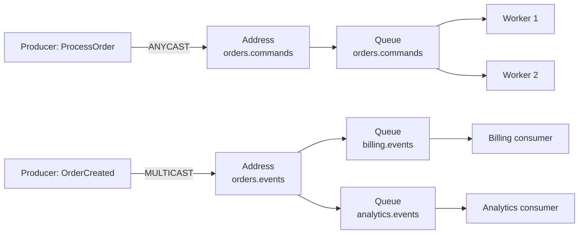
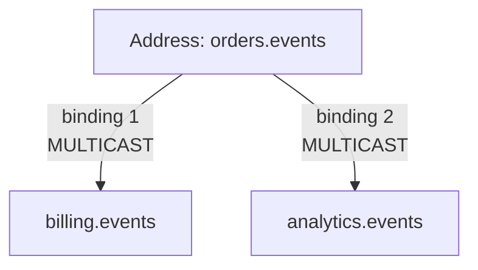
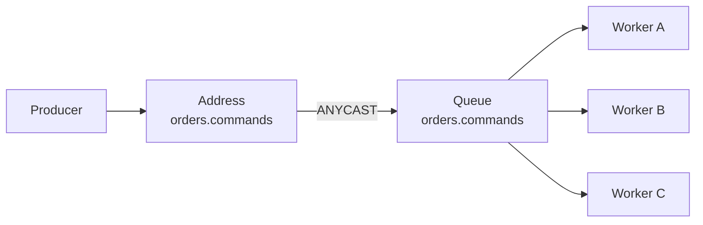
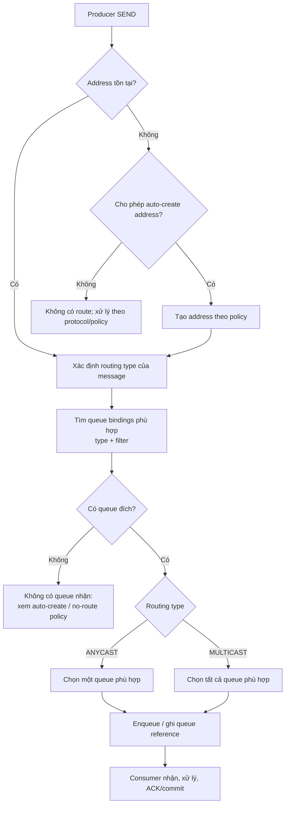
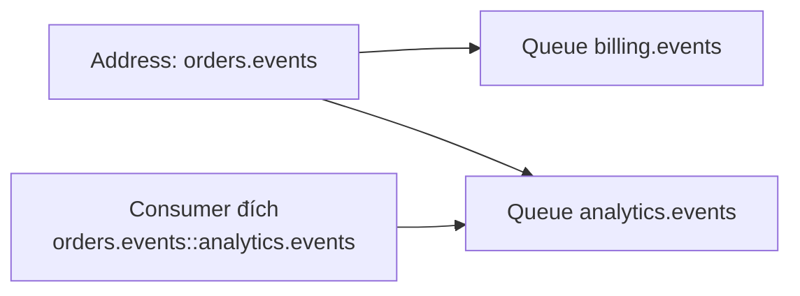

# Address, queue, binding và routing type trong mô hình Artemis

> **Chương:** Định tuyến Artemis  
> **Phạm vi:** Apache ActiveMQ Artemis, sử dụng trong hệ thống Java/JMS bất đồng bộ với queue, topic, producer/consumer và vận hành broker.

## 1. Mục tiêu: hiểu chính xác broker gửi message tới queue nào

Giả sử hệ thống đơn hàng có hai yêu cầu:

- **Lệnh xử lý đơn hàng** `ProcessOrder` phải được **một nhóm worker** đảm nhiệm; mỗi lệnh chỉ cần được giao tới một queue công việc.
- **Sự kiện đơn hàng** `OrderCreated` phải đến **cả hai nhóm** billing và analytics, kể cả khi một nhóm tạm thời không có consumer.

Trong Artemis, hai yêu cầu trên không được quyết định chỉ bởi tên `Queue` hay `Topic` của JMS. Chúng phụ thuộc trực tiếp vào **address**, **queue binding** và **routing type**.



Sau bài này, bạn cần trả lời được: **Một message gửi tới address X sẽ được đưa vào queue nào, được nhân bản logic mấy lần, được lưu ở đâu khi consumer offline và vì sao một queue không nhận được message?**

## 2. Bốn thành phần và ranh giới trách nhiệm

| Thành phần | Trách nhiệm | Điểm cần nhớ |
|---|---|---|
| **Address** | Điểm đến logic mà producer gửi message tới; broker tìm các binding ứng với address | Address không đồng nghĩa một queue vật lý |
| **Queue** | Tài nguyên lưu các message/reference để consumer lấy và ACK | Queue giữ backlog ngay cả khi tạm thời không có consumer, nếu queue vẫn tồn tại và policy cho phép |
| **Binding** | Quan hệ liên kết một queue với một address; broker dùng binding để xác định đích có thể định tuyến tới | Một address có thể bind nhiều queue; không phải một consumer |
| **Routing type** | Xác định cách message đi từ address tới các queue phù hợp | Chủ yếu là `ANYCAST` hoặc `MULTICAST` |

### 2.1. Address: nơi producer gửi

Producer thường **gửi vào address**. Broker không nhất thiết đưa message trực tiếp cho một consumer đang kết nối.

```text
Producer --send("orders.events")--> Address "orders.events"
                                      |
                                      +--> queue billing.events
                                      +--> queue analytics.events
```

Tên address có thể trùng tên queue, ví dụ `orders.commands` ở cả hai vị trí, nhưng đây chỉ là **cách đặt tên tiện lợi**, không phải quy tắc bắt buộc.

Một address có thể tồn tại trước khi có consumer, có nhiều queue hoặc thậm chí chưa có queue. Việc **address tồn tại** chưa chứng minh message sẽ được lưu giữ: cần có queue binding phù hợp và kiểm tra cấu hình tự tạo tài nguyên, xử lý message không có route, expiry, dead-letter và các chính sách liên quan.

### 2.2. Queue: nơi giữ message chờ xử lý

Mỗi queue thuộc một address và có **routing type** tương ứng. Sau khi message được định tuyến vào queue, queue quản lý việc dispatch cho consumer, trạng thái chưa ACK, rollback/redelivery và backlog theo các policy áp dụng.

Ví dụ:

```text
Address: orders.events
    +-- queue: billing.events    (MULTICAST, 4 messages pending)
    +-- queue: analytics.events  (MULTICAST, 17 messages pending)
```

Billing đã ACK 13 sự kiện không làm Analytics tự động ACK 13 sự kiện đó. Hai queue có trạng thái giao nhận độc lập.

**Queue và consumer khác nhau:** Một queue có thể chứa nhiều message nhưng không có consumer; ngược lại, nhiều consumer có thể cùng đọc **một queue** để chia tải. Số consumer không tự quyết định số bản sao được định tuyến từ address.

### 2.3. Binding: liên kết địa chỉ với queue

Một **queue binding** đưa queue vào tập đích định tuyến của một address. Nó không có nghĩa “đang kết nối tới consumer” và không tự nói rằng queue sẽ nhận mọi message.

Ví dụ cấu hình:

```xml
<address name="orders.events">
  <multicast>
    <queue name="billing.events"/>
    <queue name="analytics.events"/>
  </multicast>
</address>
```

Sơ đồ tương ứng:



Khi một message MULTICAST gửi tới `orders.events`, broker kiểm tra các binding phù hợp; thông thường message được thêm vào **cả hai queue**. Đây là **hai bản sao logic của lượt phân phối**, không khẳng định broker sao chép toàn bộ payload thành hai file riêng trên đĩa.

Một queue được tạo từ JMS durable topic subscription cũng là một queue bound vào address multicast, dù tên queue có thể do broker/client tạo tự động theo quy tắc phiên bản.

### 2.4. Routing type: quy tắc từ address sang queue

Artemis dùng hai routing type phổ biến:

- `ANYCAST`: một message được định tuyến tới **một queue phù hợp** trong số các anycast queue bound vào address.
- `MULTICAST`: một message được định tuyến tới **từng multicast queue phù hợp** bound vào address.

Từ “phù hợp” bao gồm routing type và các filter/điều kiện cấu hình khác. Quy tắc này diễn ra **trước** bước các consumer cạnh tranh nhận message trong một queue.

## 3. ANYCAST: một lượt định tuyến đến một queue

### 3.1. Một address, một anycast queue, nhiều consumer

Đây là kiểu phổ biến của JMS Queue và các tác vụ worker:



Với mỗi lần enqueue thành công, message nằm ở **một queue**; các worker A/B/C cạnh tranh lấy message từ queue đó. Một message được dispatch cho một consumer trong mỗi lượt giao. Nếu consumer chưa ACK và bị lỗi, message có thể được redeliver sang consumer khác.

**Hệ quả:** Scale từ một worker lên ba worker **không** làm mỗi lệnh được nhân thành ba bản. Bạn tăng năng lực tiêu thụ của **cùng một queue**.

Ví dụ cấu hình đặt trong phần `<addresses>` của `etc/broker.xml`:

```xml
<addresses>
  <address name="orders.commands">
    <anycast>
      <queue name="orders.commands"/>
    </anycast>
  </address>
</addresses>
```

### 3.2. Một address, hai anycast queue: không phải fan-out

Giả sử:

```xml
<address name="orders.jobs">
  <anycast>
    <queue name="orders.jobs.blue"/>
    <queue name="orders.jobs.green"/>
  </anycast>
</address>
```

Hai binding cùng kiểu ANYCAST **không** có nghĩa mỗi message được sao chép vào cả Blue và Green.

```text
Producer gửi M1, M2, M3, M4 vào orders.jobs với ANYCAST
   |
   +--> orders.jobs.blue   nhận một phần các message
   |
   +--> orders.jobs.green  nhận phần message còn lại
```

Artemis chọn **một queue anycast phù hợp cho mỗi message** theo cơ chế định tuyến của broker. Không cam kết mỗi queue nhận số lượng bằng nhau cho mọi tải, nhất là khi có filter, nhiều producer, cluster hoặc queue khác trạng thái. Nếu cần hai bộ phận đều thấy mỗi event, hãy dùng MULTICAST với hai queue phù hợp.

**Lựa chọn kiến trúc thực dụng:** Để chia tải một loại công việc cho nhiều instance, **một queue + nhiều consumer** thường dễ giám sát và kiểm soát hơn việc tự tạo nhiều anycast queue.

### 3.3. ANYCAST không bảo đảm exactly-once nghiệp vụ

Một message thường chỉ được giao cho một consumer **trong một lượt**, nhưng nếu consumer xử lý xong mà ACK/commit bị mất, broker có thể giao lại. Handler cần idempotency theo `eventId` hoặc business key. Routing type không thay thế acknowledgment/transaction.

## 4. MULTICAST: mỗi queue phù hợp nhận một bản sao logic

Giả sử billing và analytics đều cần cùng một sự kiện:

```xml
<address name="orders.events">
  <multicast>
    <queue name="billing.events"/>
    <queue name="analytics.events"/>
  </multicast>
</address>
```

Khi một message `E42` được gửi tới address này với MULTICAST:

| Đích | Kết quả |
|---|---|
| Queue `billing.events` | Có một reference/bản sao logic của `E42` |
| Queue `analytics.events` | Có một reference/bản sao logic của `E42` |
| Consumer billing ACK | `E42` được xác nhận **trên billing.events** |
| Consumer analytics chưa chạy | `E42` vẫn có thể đang chờ **trên analytics.events** |

MULTICAST là cơ chế fan-out **theo queue binding**, không mặc định theo số process đang kết nối. Nếu `analytics.events` có năm consumer cùng đọc queue đó, năm consumer không đương nhiên nhận năm bản sao. Chúng chia tải trên **một bản sao của queue**.

### 4.1. Khi queue không có consumer

Nếu `analytics.events` đã tồn tại, được bind với routing type MULTICAST và message không bị filter/expiry/policy loại bỏ, broker vẫn có thể giữ sự kiện chờ Analytics. Consumer offline **không phải điều kiện khiến route bị bỏ qua**.

Ngược lại, nếu **không có queue multicast nào** được bind tại lúc publish, broker không có queue đích để duy trì backlog của event đó theo định tuyến thông thường. Việc tạo subscription mới **sau khi publish** không tự khôi phục event quá khứ.

Đây là một lý do durable topic subscription phải được tạo **trước** khi cần bảo đảm lưu message trong thời gian consumer offline.

### 4.2. Filter ở queue binding làm fan-out có điều kiện

Giả sử Analytics chỉ nhận event của tenant A:

```xml
<address name="orders.events">
  <multicast>
    <queue name="billing.events"/>
    <queue name="analytics.events">
      <filter string="tenant = 'A'"/>
    </queue>
  </multicast>
</address>
```

Với hai event:

| Event | Thuộc tính | `billing.events` | `analytics.events` |
|---|---|---|---|
| `E1` | `tenant = 'A'` | Nhận | Nhận |
| `E2` | `tenant = 'B'` | Nhận | Không nhận |

Bộ lọc áp dụng tại queue giúp ngăn message không phù hợp được đưa vào queue đó. Cần phân biệt với **JMS consumer selector**, vốn là bộ lọc áp vào consumer/subscription theo quy tắc provider; trong các ứng dụng dùng shared queue và selector, vị trí filter ảnh hưởng backlog và việc phân phối. Không giả định filter trên queue và selector của từng consumer luôn cho cùng kết quả vận hành.

**Quy ước thuộc tính:** `tenant` trong ví dụ là một JMS message property; nó **không** phải chuỗi được broker tự đọc từ body `TextMessage`.

## 5. Mô hình hỗn hợp: address có cả ANYCAST lẫn MULTICAST

Artemis cho phép cấu hình hai routing type dưới cùng một address:

```xml
<address name="orders.bus">
  <anycast>
    <queue name="orders.work"/>
  </anycast>
  <multicast>
    <queue name="orders.audit"/>
    <queue name="orders.metrics"/>
  </multicast>
</address>
```

Điểm quan trọng: **kết quả phụ thuộc routing type của message khi gửi và quy tắc ánh xạ của protocol**.

| Message gửi với | Nhóm queue có thể được route | Ý nghĩa |
|---|---|---|
| `ANYCAST` | Một queue anycast phù hợp, ví dụ `orders.work` | Gửi một lệnh cần xử lý một lần ở mức routing |
| `MULTICAST` | Các queue multicast phù hợp: `orders.audit` và `orders.metrics` | Phát tán một sự kiện tới nhiều nhóm |
| Không chỉ rõ type | Phụ thuộc cơ chế mặc định/protocol và cấu hình broker; cần xác minh thực tế | Không được mặc định coi như ANYCAST hoặc MULTICAST |

Với **JMS trên Artemis**, đối tượng destination `Queue` thông thường được ánh xạ theo semantics **anycast**, còn `Topic` được ánh xạ theo **multicast**. Tuy vậy, với OpenWire, AMQP, Core hoặc tên destination đặc biệt, hãy kiểm tra cách protocol manager gán routing type và quy tắc tự tạo tài nguyên của phiên bản broker đang chạy.

**Khuyến nghị:** Trong hệ thống có hai nhóm semantics, đặt address riêng `orders.commands` và `orders.events` thường giúp tránh việc gửi sai type. Nếu cố ý dùng chung address mixed-routing, luôn kiểm thử type thực tế tại điểm vào của từng protocol.

## 6. Quá trình định tuyến diễn ra theo thứ tự nào?

Một mô hình xử lý hữu ích:



Đây là sơ đồ khái niệm. Artemis còn có **đường xử lý đặc thù** như diverts, cluster routing, queue filters, expiry, security, paging và transaction; thứ tự chi tiết có thể khác theo protocol và phiên bản. Nhưng ranh giới trách nhiệm rất rõ:

1. **Address** cho broker biết không gian định tuyến.
2. **Binding + routing type + filter** xác định queue đích.
3. **Queue** giữ message/reference cho tới khi xử lý/ACK hoặc policy khác có hiệu lực.
4. **Consumer** nhận từ queue, không trực tiếp quyết định Artemis nhân bản message ra bao nhiêu queue.

Đừng dùng số consumer để suy ra số bản sao tại bước 2.

### 6.1. Binding không tồn tại và hành vi tự tạo

Một số môi trường Artemis bật `auto-create-addresses`, `auto-create-queues`: khi client tạo một JMS destination hoặc đăng ký, broker có thể tự tạo tài nguyên. Điều này thuận tiện cho phát triển nhưng dễ che lỗi cấu hình.

Ví dụ, producer tưởng gửi tới `orders.events` ở chế độ multicast nhưng một client hoặc bộ mặc định lại tạo queue anycast cùng tên. Broker có thể kết nối thành công mà hành vi không đáp ứng yêu cầu fan-out.

Khi cần topology ổn định:

- Khai báo tường minh address và queue quan trọng.
- Chỉ định routing type đúng ở phía producer và destination.
- Kiểm tra queue thật sự bind vào address nào, type nào và filter nào.
- Cân nhắc tắt auto-create ở môi trường production để phát hiện tên destination sai; đồng thời phải cung cấp cơ chế tạo subscription queues hợp lệ.
- Gán quyền `createAddress`/`createDurableQueue`/`createNonDurableQueue` có kiểm soát thay vì cho phép tất cả ứng dụng tạo tuỳ ý.

### 6.2. Gửi thành công không đồng nghĩa có queue nhận

Một producer có thể nhận được xác nhận gửi thành công ở tầng protocol/transaction dù thiết kế routing chưa tạo ra backlog như kỳ vọng, tùy cấu hình không có route và chính sách broker. Khi đánh giá đúng đắn nghiệp vụ, kiểm tra **message count / messages added** ở **queue đích**, không chỉ log “send successful” phía producer.

## 7. FQQN: chỉ đích queue cụ thể trong một address

Artemis hỗ trợ cú pháp **Fully Qualified Queue Name**:

```text
address::queue
```

Ví dụ:

```text
orders.events::billing.events
orders.events::analytics.events
```

Ở đây:

- `orders.events` là **address** có routing type MULTICAST.
- `billing.events` và `analytics.events` là **hai queue bound vào address đó**.
- FQQN cho client xác định **queue cụ thể** để consume hoặc thao tác quản trị phù hợp với protocol.



**FQQN không tạo ra một bản sao mới** và không tự biến queue multicast thành một queue anycast khác. Nó là cách viết tham chiếu tới queue đã có (hoặc queue được quản lý theo quy tắc client/broker). Khi gửi vào address, vẫn phải xác định **routing type**; khi tiêu thụ bằng FQQN, client chỉ rõ queue nhận.

Đừng nhầm `orders.events::analytics.events` là **tên một topic mới**, cũng đừng kỳ vọng rằng chỉ cần dùng FQQN là broker sẽ tự dựng mọi queue theo ý muốn.

## 8. Cấu hình ví dụ hoàn chỉnh trong `broker.xml`

Thiết kế sau phục vụ hai loại giao tiếp:

- `orders.commands`: command queue anycast, nhiều worker cùng đọc.
- `orders.events`: sự kiện multicast, hai queue subscription cố định; analytics chỉ nhận tenant A.

Đặt phần sau trong **phần tử `<addresses>` hiện có** của `etc/broker.xml`; không tạo một `<addresses>` thứ hai nếu file cấu hình đã có:

```xml
<addresses>
  <address name="orders.commands">
    <anycast>
      <queue name="orders.commands"/>
    </anycast>
  </address>

  <address name="orders.events">
    <multicast>
      <queue name="billing.events"/>
      <queue name="analytics.events">
        <filter string="tenant = 'A'"/>
      </queue>
    </multicast>
  </address>
</addresses>
```

### 8.1. Phân tích chính xác từng binding

| Address | Queue binding | Routing type | Filter | Tác dụng |
|---|---|---|---|---|
| `orders.commands` | `orders.commands` | `ANYCAST` | Không | Mỗi command vào queue công việc |
| `orders.events` | `billing.events` | `MULTICAST` | Không | Nhận mọi event phù hợp với address |
| `orders.events` | `analytics.events` | `MULTICAST` | `tenant='A'` | Chỉ nhận event tenant A |

Đặt tên queue khác tên address ở multicast cho thấy mô hình Artemis **không ép** quan hệ 1 address = 1 queue. Mỗi queue có backlog, consumer và ACK riêng.

### 8.2. Phiên bản thử nghiệm dùng Core/JMS protocol

Đối với Artemis Core, broker cần acceptor có hỗ trợ `CORE`. Ví dụ trong phần `<acceptors>` của `broker.xml`:

```xml
<acceptors>
  <acceptor name="core">
    tcp://0.0.0.0:61616?protocols=CORE
  </acceptor>
</acceptors>
```

Đây là cấu hình minh họa. **Không khai báo thêm một listener trùng cổng** nếu Artemis đã có acceptor `61616`. Khi broker đang phục vụ nhiều protocol, có thể sử dụng acceptor hiện có được cấu hình phù hợp. Trong production cần kiểm tra TLS, tài khoản, role và network binding; không xem ví dụ thử nghiệm như cấu hình bảo mật mặc định.

### 8.3. Auto-create và routing defaults

Artemis có các thiết lập trong `address-settings` để điều chỉnh `auto-create-addresses`, `auto-create-queues`, `default-address-routing-type` và `default-queue-routing-type`. Giá trị mặc định có thể ảnh hưởng tài nguyên được tạo **khi chưa được khai báo tường minh**; nó không thay thế việc kiểm tra queue routing type thực tế.

Ví dụ một môi trường muốn chỉ cho phép sử dụng các tài nguyên `orders.commands` đã chuẩn bị trước có thể đặt policy tương ứng cho address pattern, nhưng phải tránh vô tình chặn tạo durable subscription cần thiết trên `orders.events`. Vì vậy, bài thực hành bên dưới dựa vào **queue đã khai báo tường minh**, không phụ thuộc auto-create.

## 9. Thực hành Java JMS: chứng minh ANYCAST và MULTICAST

Dùng **Artemis JMS client** với `javax.jms` để gửi command vào JMS Queue, publish event vào JMS Topic và nhận trực tiếp từ hai queue multicast thông qua FQQN.

Mục tiêu quan sát:

1. Message `C1` vào `orders.commands` và được một consumer của queue xử lý.
2. Event `E1` có `tenant='A'` xuất hiện **trên cả** `billing.events` và `analytics.events`.
3. Consumer billing commit không làm mất event đang chờ tại analytics.
4. Nếu đổi `tenant` thành `B`, filter sẽ khiến analytics không nhận event đó.

### 9.1. Maven

```xml
<dependency>
  <groupId>org.apache.activemq</groupId>
  <artifactId>artemis-jms-client</artifactId>
  <version>2.33.0</version>
</dependency>
```

Phiên bản ở đây là **ví dụ cố định** thuộc nhánh client hỗ trợ `javax.jms`. Khi triển khai thực, chọn phiên bản tương thích với Java, JMS API và broker đang chạy. Artemis cũng có client cho `jakarta.jms`; hai namespace API không thể thay thế nhau bằng cách chỉ đổi imports.

### 9.2. Chương trình Java

Tạo `ArtemisRoutingDemo.java`:

```java
import javax.jms.Connection;
import javax.jms.JMSException;
import javax.jms.Message;
import javax.jms.MessageConsumer;
import javax.jms.MessageProducer;
import javax.jms.Queue;
import javax.jms.Session;
import javax.jms.TextMessage;
import javax.jms.Topic;

import org.apache.activemq.artemis.jms.client.ActiveMQConnectionFactory;

public final class ArtemisRoutingDemo {

    public static void main(String[] args) throws JMSException {
        String url = args.length > 0
                ? args[0]
                : "tcp://localhost:61616";

        try (ActiveMQConnectionFactory factory =
                     new ActiveMQConnectionFactory(url)) {

            String username = System.getenv("BROKER_USER");
            String password = System.getenv("BROKER_PASSWORD");

            Connection connection =
                    username == null || username.isEmpty()
                            ? factory.createConnection()
                            : factory.createConnection(username, password);

            try {
                publish(connection);
                consumeQueues(connection);
            } finally {
                connection.close();
            }
        }
    }

    private static void publish(Connection connection)
            throws JMSException {

        // Một JMS session transacted để commit cả hai lần gửi.
        Session s = connection.createSession(
                true, Session.SESSION_TRANSACTED);
        try {
            Queue commandQueue = s.createQueue("orders.commands");
            Topic eventTopic = s.createTopic("orders.events");

            MessageProducer commands = s.createProducer(commandQueue);
            MessageProducer events = s.createProducer(eventTopic);
            try {
                TextMessage command =
                        s.createTextMessage("ProcessOrder: O-100");
                command.setStringProperty("eventId", "C1");
                commands.send(command);

                TextMessage event =
                        s.createTextMessage("OrderCreated: O-100");
                event.setStringProperty("eventId", "E1");
                event.setStringProperty("tenant", "A");
                events.send(event);

                s.commit();
                System.out.println("Đã commit command C1 và event E1");
            } catch (JMSException | RuntimeException ex) {
                s.rollback();
                throw ex;
            } finally {
                try {
                    commands.close();
                } finally {
                    events.close();
                }
            }
        } finally {
            s.close();
        }
    }

    private static void consumeQueues(Connection connection)
            throws JMSException {

        Session s = connection.createSession(
                true, Session.SESSION_TRANSACTED);

        try {
            // Cùng address và queue name cho command ANYCAST.
            MessageConsumer commandConsumer =
                    s.createConsumer(s.createQueue("orders.commands"));

            // Hai FQQN chỉ thẳng đến hai queue MULTICAST đã bind.
            MessageConsumer billing =
                    s.createConsumer(
                            s.createQueue("orders.events::billing.events"));
            MessageConsumer analytics =
                    s.createConsumer(
                            s.createQueue("orders.events::analytics.events"));

            try {
                connection.start();

                receiveAndCommit(s, commandConsumer, "commands");
                receiveAndCommit(s, billing, "billing");
                receiveAndCommit(s, analytics, "analytics");
            } finally {
                try {
                    commandConsumer.close();
                } finally {
                    try {
                        billing.close();
                    } finally {
                        analytics.close();
                    }
                }
            }
        } finally {
            s.close();
        }
    }

    private static void receiveAndCommit(
            Session s, MessageConsumer consumer, String label)
            throws JMSException {

        Message received = consumer.receive(10_000L);
        if (!(received instanceof TextMessage)) {
            s.rollback();
            throw new IllegalStateException(
                    "Không có TextMessage trên queue: " + label);
        }

        TextMessage text = (TextMessage) received;
        System.out.printf(
                "%s <- eventId=%s, tenant=%s, payload=%s%n",
                label,
                text.getStringProperty("eventId"),
                text.getStringProperty("tenant"),
                text.getText());

        // Commit nhận trên queue hiện tại. Không ACK hộ queue khác.
        s.commit();
    }
}
```

**Các tiền điều kiện:** Broker Artemis đang chạy, đúng ba queue như cấu hình `broker.xml`, Core acceptor hoạt động, user có quyền send/consume và quyền tương tác cần thiết với destinations. Thực hành nên chạy trên broker riêng không có consumer cạnh tranh hoặc dữ liệu cũ.

Kết quả minh họa:

```text
Đã commit command C1 và event E1
commands <- eventId=C1, tenant=null, payload=ProcessOrder: O-100
billing <- eventId=E1, tenant=A, payload=OrderCreated: O-100
analytics <- eventId=E1, tenant=A, payload=OrderCreated: O-100
```

Kết quả xác nhận rằng **một lần publish E1** đã được route tới **hai queue multicast** và hai consumer có thể commit độc lập. Một consumer khác đọc `orders.commands` có thể cạnh tranh nhận command; để demo ổn định, chỉ chạy một consumer lệnh.

**Lưu ý quan trọng về session:** Ví dụ tạo ba consumer trong **một transacted session**, nhưng lần lượt nhận và commit nên quan sát rõ ranh giới. Trong ứng dụng đồng thời thật, thường dùng session riêng cho từng luồng xử lý, vì JMS Session thường không được sử dụng đồng thời bởi nhiều thread.

### 9.3. Thử nghiệm thay đổi routing

Sau khi chạy thành công, sửa **giá trị message property** tại producer và quan sát từng queue:

```java
event.setStringProperty("tenant", "B");
```

Dự kiến event vẫn đến `billing.events`; `analytics.events` không có event tenant B vì filter `tenant = 'A'`.

Nếu muốn thử nhiều message trong cùng một lần chạy, **đừng quên** dữ liệu còn từ lần trước hoặc các consumer khác; hãy dùng queue thử nghiệm sạch và `eventId` mới, đồng thời đo `MessagesAdded` của từng queue. Tên queue có thể trùng nhưng routing/filter không tự đổi theo dữ liệu cũ.

## 10. Các lỗi cấu hình thường gặp và cách chẩn đoán

| Triệu chứng | Nguyên nhân có thể | Cách xác minh/sửa |
|---|---|---|
| Producer gửi thành công nhưng consumer không nhận | Address đúng nhưng chưa có queue binding phù hợp | Xem danh sách queue trên address, routing type và policy no-route |
| Chỉ một trong hai nhóm nhận event | Dùng ANYCAST với hai queue thay vì MULTICAST | Kiểm tra `<anycast>`/`<multicast>` của queue |
| Queue A nhận message tenant A, queue B không nhận | Filter ở queue B loại message | Kiểm tra `filter string` và JMS properties |
| Có message ở queue nhưng không consumer nào xử lý | Queue không có consumer hoặc consumer selector/prefetch/permission khác | Kiểm tra consumer count, delivering count, selector và lỗi connect |
| Client nhận queue name không đúng | Nhầm address với queue; FQQN sai | Xác minh đúng `address::queue`, queue đã tồn tại và binding đúng |
| Sử dụng JMS Topic nhưng message đi vào queue lệnh | Cấu hình mixed-routing, client/destination chọn sai type hoặc auto-create không đúng | Kiểm tra routing type message, protocol và queue definitions |
| Event mất khi subscriber tạo mới sau publish | Chưa có subscription queue phù hợp tại thời điểm publish | Tạo durable subscription trước hoặc khai báo queue multicast lâu dài |
| Thêm worker khiến mỗi event không được nhân cho tất cả worker | Tất cả worker cùng đọc một queue/shared subscription | Nếu cần fan-out, tạo queue/subscription riêng cho từng nhóm |
| Backlog một nhóm tăng khi nhóm khác xử lý bình thường | Nhiều queue multicast có trạng thái ACK độc lập | Theo dõi `MessageCount`, `DeliveringCount`, ACK và DLQ từng queue |
| Resource được tạo bất ngờ | `auto-create-addresses/queues` cho phép client tự tạo | Rà soát address settings, quyền tạo resource và tên destination |

### 10.1. Quy trình điều tra một message “đi sai nơi”

Với `eventId=E42` không tới Analytics:

1. Xác minh producer gửi **tới address nào**, qua protocol nào và dùng JMS Queue hay Topic.
2. Kiểm tra message có **routing type** dự kiến không; ở mixed address càng cần thiết.
3. Kiểm tra `analytics.events` **thật sự là queue binding** dưới address `orders.events` với MULTICAST.
4. Kiểm tra queue filter `tenant='A'` và giá trị property trên message; phân biệt chữ hoa/thường và kiểu dữ liệu.
5. Xem **message count, messages added, delivering, acknowledged** của queue đích, cùng log lỗi và DLQ/expiry.
6. Kiểm tra consumer thực sự đọc **đúng queue**; với FQQN, tránh nhầm sang queue tự động tạo có tên tương tự.
7. Cuối cùng mới phân tích listener, transaction, rollback, prefetch hoặc database transaction ở ứng dụng.

Trình tự này giúp xác định lỗi nằm ở **routing tới queue** hay **delivery/ACK từ queue tới consumer**.

## 11. Bài tập vận dụng

**Bài 1 — Chọn routing type:** Hai dịch vụ `billing` và `reporting` phải cùng nhận mọi sự kiện `PaymentCompleted`. Chọn cấu hình một address và hai queue như thế nào? Hai queue có thể dùng cùng tên không?

**Bài 2 — Scale worker:** Một queue `image.jobs` có ba worker. Muốn tăng gấp đôi tốc độ xử lý, thêm ba worker cùng subscribe queue hay thêm ba queue anycast? Phân tích ảnh hưởng tới backlog và điều phối.

**Bài 3 — Filter:** Một address có hai queue multicast; queue A không filter, queue B lọc `region='VN'`. Producer gửi `M1(region='VN')` và `M2(region='SG')`. Hãy tính số message đi vào mỗi queue, rồi thử đổi message property thành giá trị thiếu/null.

**Bài 4 — FQQN:** Một multicast address `inventory.events` có queue `stock.audit`. Viết tên FQQN để consumer đọc đúng queue. Giải thích vì sao FQQN không làm phát sinh thêm bản sao.

**Bài 5 — Mixed routing:** Address `business.bus` có một queue anycast và hai queue multicast. Hai producer dùng các protocol khác nhau nhưng cùng gửi vào address này. Nêu tối thiểu bốn kiểm thử để xác minh chúng không gửi sai routing type.

### Gợi ý đáp án ngắn

1. Một multicast address, hai queue với **hai tên khác nhau**, mỗi queue bind MULTICAST.
2. Với mô hình competing consumers thông thường, thêm worker cùng queue; sau đó đo throughput, lock contention và downstream capacity.
3. Queue A nhận 2, queue B nhận 1 với hai message trên; property thiếu hoặc null thường không thỏa điều kiện so sánh bằng một chuỗi cụ thể.
4. `inventory.events::stock.audit`; đây là định danh queue đã tồn tại dưới address.
5. So sánh queue đích thực tế, message count từng queue, behavior khi không nêu type, auto-create và selector/filter theo từng protocol.

## 12. Tài liệu tham khảo

- [Apache ActiveMQ Artemis — Address Model](https://artemis.apache.org/components/artemis/documentation/latest/address-model.html): khái niệm address, queue, routing type, anycast, multicast và FQQN.
- [Apache ActiveMQ Artemis — Configuring Routing](https://artemis.apache.org/components/artemis/documentation/latest/using-core.html): Core client và routing bằng API Artemis.
- [Apache ActiveMQ Artemis — Address Settings](https://artemis.apache.org/components/artemis/documentation/latest/address-settings.html): auto-create, default routing type, policy và quản trị address.
- [Apache ActiveMQ Artemis — Using JMS or Jakarta Messaging](https://artemis.apache.org/components/artemis/documentation/latest/using-jms.html): Queue/Topic và connection factory ở phía Java.
- [Apache ActiveMQ Artemis — Management](https://artemis.apache.org/components/artemis/documentation/latest/management.html): quan sát queue, address, binding và các metric.

**Ghi nhớ:** Trong Artemis, **producer gửi tới address**, **binding nối address với queue**, **routing type quyết định gửi vào một queue (ANYCAST) hay tất cả queue phù hợp (MULTICAST)**, và **consumer nhận từ queue rồi ACK**. Hiểu đúng các ranh giới này là nền tảng để tránh mất fan-out, tạo backlog sai chỗ và chẩn đoán hành vi JMS chính xác.
