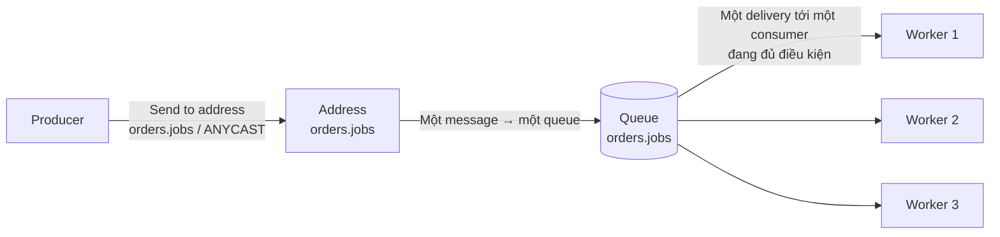
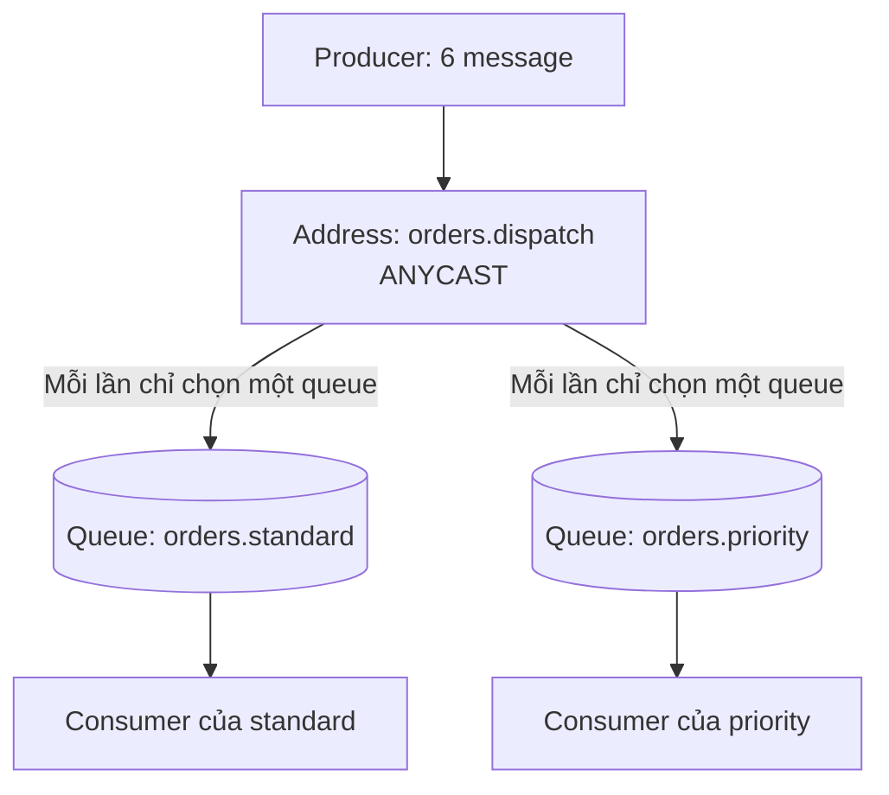
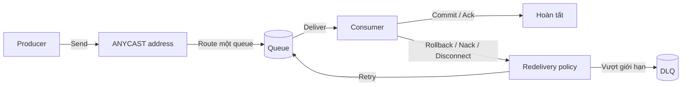

# Anycast và phân phối thông điệp đến queue

> **Chương:** Định tuyến Artemis  
> **Phạm vi:** Apache ActiveMQ Artemis; cách `ANYCAST` chọn queue, cách queue phân phối tới consumer, cấu hình `broker.xml` và ví dụ Java dùng Jakarta Messaging/JMS. Các phần về acknowledgment, transaction, redelivery và DLQ chỉ được bàn đến ở mức cần thiết để giải thích **đường đi của message**.

## 1. Anycast thực sự quyết định điều gì?

Giả sử dịch vụ đặt hàng đẩy công việc sang dịch vụ xử lý đơn. Mỗi thông điệp `OrderCreated` chỉ cần được một worker xử lý, thay vì tất cả worker đều phải nhận một bản sao. Trong Artemis, đây là bài toán điển hình của **anycast routing**.

Cần tách hai bước:

1. **Routing từ address tới queue:** Khi một message được gửi đến một *address* theo kiểu `ANYCAST`, broker định tuyến message đến **một** queue phù hợp thuộc address đó. Nếu address có nhiều queue anycast đủ điều kiện, broker chọn **một** queue để lưu message.
2. **Dispatch từ queue tới consumer:** Sau khi nằm trong queue, message được phân phối tới **một** consumer phù hợp của queue. Nếu có nhiều consumer trên cùng queue, chúng là các *competing consumers*.



**Câu cần nhớ:** `ANYCAST` không có nghĩa broker phát một bản sao cho *mọi* queue; cũng không có nghĩa luôn gửi cho *cùng một consumer*. Routing tới **queue** và dispatch tới **consumer** là hai tầng khác nhau.

Đối chiếu tối thiểu:

- `ANYCAST`: một message đi vào **một queue** trong các queue anycast phù hợp của address.
- `MULTICAST`: một message được đưa vào **mỗi queue multicast** phù hợp với address, tương ứng nhu cầu publish/subscribe.
- Trong mô hình JMS, **Queue** thường tương ứng routing `ANYCAST`, còn **Topic** thường tương ứng routing `MULTICAST`. Tuy vậy, Artemis có thể cấu hình một address hỗ trợ cả hai kiểu routing; cần hiểu loại destination và routing type thật sự khi kiểm thử.

## 2. Mô hình địa chỉ của Artemis: `address → queue → consumer`

Artemis dùng ba khái niệm khác nhau:

| Khái niệm | Nhiệm vụ | Ví dụ |
| --- | --- | --- |
| **Address** | Tên mà producer gửi tới; chứa một hoặc nhiều queue liên kết | `orders.jobs` |
| **Queue** | Nơi message thực sự xếp hàng, được lưu và chờ xử lý | `orders.jobs` hoặc `orders.fast` |
| **Consumer** | Kết nối đọc message từ một queue | `OrderWorker-1`, `OrderWorker-2` |
| **Routing type** | Quy tắc chọn queue của address | `ANYCAST` hoặc `MULTICAST` |

Tên address và queue **có thể giống nhau** nhưng không bắt buộc. Ứng dụng JMS dùng `session.createQueue("orders.jobs")` thường nhìn thấy một đối tượng `Queue`; ở bên trong Artemis, khi được cấu hình theo mô hình đơn giản, address `orders.jobs` và queue `orders.jobs` cùng tên, với routing type `ANYCAST`. Chính sự trùng tên này dễ khiến người học tưởng address và queue là một đối tượng.

Ví dụ một address với hai queue có tên **khác** nhau:

```text
Address: orders.dispatch
  Routing type: ANYCAST
  ├── Queue: orders.standard
  └── Queue: orders.priority
```

Nếu cả hai queue đủ điều kiện nhận message, khi gửi `N` message có thể có một phần nằm ở `orders.standard` và phần còn lại ở `orders.priority`. Đây là **cân bằng ở tầng queue**, không phải tạo ra hai bản sao. Với các điều kiện thông thường và không có filter, Artemis dùng cơ chế luân phiên giữa các queue anycast; không nên yêu cầu một tỷ lệ chính xác tuyệt đối dưới mọi điều kiện vận hành.

### Sơ đồ khi có hai queue anycast



**Không được suy ra** rằng queue `orders.priority` sẽ nhận tất cả đơn ưu tiên chỉ vì tên chứa “priority”. Nếu cần phân luồng theo dữ liệu, phải cấu hình **queue filter**, đặt địa chỉ riêng hoặc định tuyến có chủ đích. Routing `ANYCAST` thuần túy không phải rule engine dựa trên tên queue.

## 3. Cấu hình `broker.xml` cho một anycast queue

Ví dụ production cơ bản: tất cả worker đọc **cùng một queue**. Khai báo trong phần `<addresses>` của `broker.xml` (trích đoạn cấu hình; không phải toàn bộ file):

```xml
<addresses>
    <address name="orders.jobs">
        <anycast>
            <queue name="orders.jobs" durable="true"/>
        </anycast>
    </address>
</addresses>
```

Ý nghĩa từng dòng:

- `<address name="orders.jobs">` định nghĩa **địa chỉ** nhận message.
- `<anycast>` khai báo queue bên dưới nhận theo routing type `ANYCAST`.
- `<queue name="orders.jobs" durable="true"/>` định nghĩa **queue bền vững**. Queue không tự biến thành topic chỉ vì có nhiều consumer.
- Vì address chỉ có **một queue anycast**, mọi message anycast được route thành công đến address này sẽ đi vào **queue đó**; consumer nào nhận message tiếp theo là câu chuyện dispatch.

Nếu muốn broker **không âm thầm auto-create** một address/queue khác khi code gõ sai tên, có thể cấu hình `address-settings` khớp phạm vi:

```xml
<address-settings>
    <address-setting match="orders.#">
        <auto-create-addresses>false</auto-create-addresses>
        <auto-create-queues>false</auto-create-queues>
    </address-setting>
</address-settings>
```

Đây là trích đoạn đặt trong đúng phần `<address-settings>` của cấu hình broker. Khi tắt auto-create, operator cần khai báo sẵn các queue cần dùng. Ngược lại, trong broker dev có auto-create bật, thao tác JMS `createQueue()` hoặc gửi tới một địa chỉ mới có thể dẫn đến tài nguyên được tự tạo theo policy, làm che khuất lỗi cấu hình.

**Phân biệt độ bền:** `durable="true"` mô tả queue; message được giữ qua restart còn phụ thuộc **persistent delivery**, journal và cấu hình persistence/storage của broker. Đừng dùng chữ *anycast* như một bảo đảm “at-least-once” hay “không mất message”.

### 3.1. Khi nào nên chỉ có một queue?

Một queue `orders.jobs` với nhiều consumer phù hợp khi:

- Mỗi đơn chỉ cần một worker nhận xử lý tại một thời điểm.
- Worker là các replica của **cùng một trách nhiệm nghiệp vụ**.
- Muốn theo dõi backlog, redelivery và DLQ cho một luồng công việc chung.
- Tăng số consumer để tăng khả năng xử lý song song mà không tạo thêm queue hoặc thay đổi producer.

Ví dụ scale từ 2 lên 8 consumer không buộc phải chỉnh cấu hình `<anycast>`: thêm consumer trên queue sẵn có là đủ về mặt kiến trúc. Mức throughput thực tế còn phụ thuộc kích thước message, CPU, ack/commit, xử lý nghiệp vụ và tài nguyên broker.

## 4. Một address có nhiều anycast queue: chọn **một** queue, không nhân bản

Artemis cho phép nhiều queue anycast cùng liên kết với một address:

```xml
<addresses>
    <address name="orders.dispatch">
        <anycast>
            <queue name="orders.lane.a" durable="true"/>
            <queue name="orders.lane.b" durable="true"/>
        </anycast>
    </address>
</addresses>
```

Một producer gửi message đến **address** `orders.dispatch`. Nếu cả hai queue là đích hợp lệ và không có filter loại bỏ, broker phân phối message giữa chúng; **mỗi message được đưa vào một queue**, chẳng hạn:

| Message | Queue được chọn (ví dụ minh họa) | Có bản sao ở queue còn lại? |
| --- | --- | --- |
| `M1` | `orders.lane.a` | Không |
| `M2` | `orders.lane.b` | Không |
| `M3` | `orders.lane.a` | Không |
| `M4` | `orders.lane.b` | Không |
| `M5` | `orders.lane.a` | Không |
| `M6` | `orders.lane.b` | Không |

Bảng là **kịch bản lý tưởng không có filter hoặc thay đổi topology**, không phải cam kết broker sẽ luôn chia 50/50. Thứ tự thực tế còn liên quan đến queue có sẵn, cấu hình và tình trạng routing tại thời điểm gửi.

### Bẫy: queue không có consumer vẫn có thể nhận message

Giả sử chỉ có worker đang đọc `orders.lane.a`, còn `orders.lane.b` **không có consumer**. Đây không phải lý do tự động để message vốn được route vào B chuyển sang A. Broker có thể tiếp tục enqueue vào B, khiến B tích backlog trong khi A rảnh.

Vì vậy, nếu mục tiêu chỉ là *chia tải cho nhiều replica worker giống nhau*, mô hình **một queue + nhiều consumer** thường rõ ràng hơn **một address + nhiều anycast queue**. Chỉ dùng nhiều queue anycast khi bạn chủ động muốn tách backlog, chính sách, hoặc khi cách chọn queue thật sự phù hợp thiết kế.

### 4.1. Chỉ định một queue bằng FQQN

Artemis hỗ trợ **Fully Qualified Queue Name (FQQN)**:

```text
<address>::<queue>
```

Ví dụ:

```text
orders.dispatch::orders.lane.a
orders.dispatch::orders.lane.b
```

FQQN cho phép client Artemis định danh **queue cụ thể** nằm dưới một address, hữu ích khi cần tạo consumer cho từng queue mà tên queue không trùng tên address.

Ví dụ cách tạo JMS destination để **consumer** đọc từ lane A (cú pháp FQQN là đặc thù Artemis, không portable giữa mọi JMS provider):

```java
Queue laneA = context.createQueue("orders.dispatch::orders.lane.a");
JMSConsumer consumer = context.createConsumer(laneA);
Message message = consumer.receive(5000);
```

Đừng hiểu FQQN là một tên queue vật lý mới được auto-create. Nó chỉ rõ address và queue đã có theo quy tắc phân giải của Artemis. Khi cần **gửi đích danh** một queue, hãy kiểm thử khả năng dùng FQQN và routing option với đúng client/protocol/version, vì khác biệt với việc producer gửi đến **address chung** có thể làm thay đổi semantics cân bằng queue.

## 5. Java JMS: producer và các competing consumer của một queue

Ví dụ dùng **Jakarta Messaging** và Artemis client. Hai chương trình chạy ở hai process JVM khác nhau cùng kết nối đến broker Artemis đang lắng nghe trên `tcp://localhost:61616`. Broker đã cấu hình `orders.jobs` với **một anycast queue cùng tên** như mục 3.

Maven dependency minh họa ở dòng Artemis 2.50.x (đối chiếu phiên bản với BOM hoặc release đang dùng):

```xml
<dependency>
    <groupId>org.apache.artemis</groupId>
    <artifactId>artemis-jakarta-client</artifactId>
    <version>2.50.0</version>
</dependency>
```

Kể từ Artemis **2.50.0**, Maven `groupId` của các Artemis module chuyển sang `org.apache.artemis`. Với dự án dùng `javax.jms`, chọn phiên bản `artemis-jms-client` tương ứng và đổi imports; trong ví dụ này các interface JMS đều thuộc `jakarta.jms`.

Cấu hình môi trường cho cả hai chương trình:

```text
ARTEMIS_URL=tcp://localhost:61616
ARTEMIS_USER=orders_app
ARTEMIS_PASSWORD=<mật khẩu được quản lý bằng secret>
```

Dòng mật khẩu chỉ là placeholder cấu hình: cung cấp giá trị thực qua môi trường an toàn; không hardcode vào source code hoặc đưa vào repository.

### 5.1. Producer gửi vào **address/queue** `orders.jobs`

File `OrdersProducer.java`:

```java
import jakarta.jms.ConnectionFactory;
import jakarta.jms.DeliveryMode;
import jakarta.jms.JMSContext;
import jakarta.jms.Queue;

import org.apache.activemq.artemis.jms.client.ActiveMQConnectionFactory;

public class OrdersProducer {
    public static void main(String[] args) {
        String url = requiredEnv("ARTEMIS_URL");
        String user = requiredEnv("ARTEMIS_USER");
        String password = requiredEnv("ARTEMIS_PASSWORD");

        ConnectionFactory factory = new ActiveMQConnectionFactory(url);

        try (JMSContext context = factory.createContext(
                user, password, JMSContext.SESSION_TRANSACTED)) {

            // Broker đã khai báo address/queue orders.jobs theo ANYCAST.
            Queue jobs = context.createQueue("orders.jobs");

            for (int i = 1; i <= 10; i++) {
                String orderId = "O-" + i;
                context.createProducer()
                       .setDeliveryMode(DeliveryMode.PERSISTENT)
                       .send(jobs, orderId);
                System.out.println("Sent " + orderId);
            }

            // Chốt giao dịch gửi; message mới được broker xử lý như đã commit.
            context.commit();
        }
    }

    private static String requiredEnv(String key) {
        String value = System.getenv(key);
        if (value == null || value.trim().isEmpty()) {
            throw new IllegalStateException("Missing env: " + key);
        }
        return value;
    }
}
```

Lưu ý:

- `context.createQueue("orders.jobs")` là thao tác lấy **JMS destination object** ở client, không có nghĩa luôn tạo một queue vật lý dù broker đã tắt auto-create.
- Với một queue anycast tên `orders.jobs`, mỗi lần `send` hợp lệ sẽ route một message vào queue này. Mười message minh họa là **mười công việc**, không tạo mười bản sao cho từng worker.
- Dùng transacted context và gọi `commit()` để chốt việc gửi. Nếu method lỗi trước `commit()`, cần xử lý rollback và tái thử theo yêu cầu nghiệp vụ. Delivery mode persistent cần broker được cấu hình persistence đúng.
- Các cách tránh message trùng lặp khi producer retry (idempotency key, business ID) được xử lý ở tầng nghiệp vụ, không do routing type tự đảm nhận.

### 5.2. Worker tạo một consumer trên **cùng queue**

File `OrdersWorker.java`:

```java
import jakarta.jms.ConnectionFactory;
import jakarta.jms.JMSConsumer;
import jakarta.jms.JMSContext;
import jakarta.jms.Message;
import jakarta.jms.Queue;

import org.apache.activemq.artemis.jms.client.ActiveMQConnectionFactory;

public class OrdersWorker {
    public static void main(String[] args) throws Exception {
        String workerName = args.length > 0 ? args[0] : "worker";
        String url = requiredEnv("ARTEMIS_URL");
        String user = requiredEnv("ARTEMIS_USER");
        String password = requiredEnv("ARTEMIS_PASSWORD");

        ConnectionFactory factory = new ActiveMQConnectionFactory(url);

        try (JMSContext context = factory.createContext(
                user, password, JMSContext.SESSION_TRANSACTED)) {

            Queue jobs = context.createQueue("orders.jobs");
            JMSConsumer consumer = context.createConsumer(jobs);

            while (true) {
                Message message = consumer.receive(10_000);
                if (message == null) {
                    // Hết thời gian chờ; worker có thể tiếp tục polling.
                    System.out.println(workerName + " is idle");
                    continue;
                }

                try {
                    String orderId = message.getBody(String.class);
                    processOrder(workerName, orderId);
                    context.commit(); // Ack message trong transaction.
                } catch (Exception failure) {
                    context.rollback(); // Cho phép redelivery theo broker policy.
                    System.err.println(
                            workerName + " failed: " + failure.getMessage());
                }
            }
        }
    }

    private static void processOrder(String worker, String orderId) {
        // Thay bằng logic nghiệp vụ có idempotency theo orderId.
        System.out.println(worker + " processed " + orderId);
    }

    private static String requiredEnv(String key) {
        String value = System.getenv(key);
        if (value == null || value.trim().isEmpty()) {
            throw new IllegalStateException("Missing env: " + key);
        }
        return value;
    }
}
```

Chạy **hai instance** `OrdersWorker` (ví dụ argument `worker-a` và `worker-b`), sau đó chạy producer. Hai worker là competing consumers của **một queue** `orders.jobs`. Mỗi công việc được deliver cho một worker tại một thời điểm; việc worker nào nhận một message cụ thể phụ thuộc dispatch, consumer credit, thời gian xử lý, mức độ sẵn sàng và policy broker. **Không kỳ vọng luân phiên tuyệt đối 1–1**.

Ví dụ worker chạy vòng lặp vô hạn để mô phỏng daemon; dùng Ctrl+C để dừng test. Với service production, cần lifecycle shutdown rõ ràng, logging, metrics và xử lý lỗi nghiệp vụ phù hợp. Giao dịch JMS chỉ bảo vệ việc nhận và ack trong broker; cập nhật database ở `processOrder` không tự tham gia cùng transaction nếu chưa cấu hình cơ chế transaction/outbox tương ứng.

### 5.3. Kiểm chứng phân phối, không nhầm với retry

Nếu cả hai worker đang hoạt động, sau khi gửi mười đơn:

- Tổng số công việc được xử lý thành công cộng dồn ở hai worker có thể là mười, **nếu không có lỗi và không có gửi lại**.
- Một worker có thể nhận nhiều hơn worker còn lại; đây không nhất thiết là lỗi anycast.
- Nếu một worker `rollback()`, **cùng message** có thể được gửi lại. Đó là **redelivery**, không phải producer publish thêm bản sao do multicast.
- Nếu không có consumer, message ở queue chờ; policy về paging/quota/storage quyết định tài nguyên bị ảnh hưởng, không tự chuyển sang topic.

Điểm kiểm chứng đúng nhất là **đối chiếu message ID/business ID, queue metrics và transaction status**, không suy luận chỉ từ số dòng log trên terminal.

## 6. Lab nâng cao: kiểm tra hai anycast queue trên cùng address

Thay cấu hình `orders.jobs` ở ví dụ trước bằng mô hình một address **khác** để tránh nhầm destination:

```xml
<addresses>
    <address name="lab.dispatch">
        <anycast>
            <queue name="lab.queue.a" durable="true"/>
            <queue name="lab.queue.b" durable="true"/>
        </anycast>
    </address>
</addresses>
```

Trong Java, producer vẫn gửi tới **address** `lab.dispatch`:

```java
Queue addressDestination = context.createQueue("lab.dispatch");
for (int i = 1; i <= 12; i++) {
    context.createProducer().send(addressDestination, "TASK-" + i);
}
context.commit();
```

Lúc này hai queue vật lý khác nhau có thể nhận các phần của 12 message. Dùng hai consumer theo FQQN để kiểm chứng:

```java
Queue queueA = context.createQueue("lab.dispatch::lab.queue.a");
Queue queueB = context.createQueue("lab.dispatch::lab.queue.b");

JMSConsumer a = context.createConsumer(queueA);
JMSConsumer b = context.createConsumer(queueB);

// Mỗi consumer chỉ đọc queue được chỉ định bằng FQQN.
// Có thể dùng session/connection riêng cho từng consumer trong test thực.
```

**Đừng sử dụng một `JMSContext` duy nhất từ nhiều thread** để xử lý đồng thời. Chạy hai consumer bằng hai context/tiến trình riêng trong thử nghiệm tải thực tế.

### Kết quả cần quan sát

1. Tổng các message được thêm vào hai queue xấp xỉ bằng số message đã route thành công, không phải gấp đôi. Với 12 message hợp lệ, không có filter và không có message bổ sung, kỳ vọng mỗi message chỉ vào **một** trong hai queue.
2. Nếu chỉ chạy consumer của A, các message đã được route vào B **không tự động được consumer A lấy**.
3. Bật thêm consumer B, backlog B bắt đầu được xử lý.
4. Khi cần mọi consumer cùng một luồng công việc chia tải, đổi sang **một queue + nhiều consumer**; không thiết kế nhiều queue như cách thay thế mặc định.
5. Muốn chia theo thuộc tính `region`, `tenant` hoặc `priority`, phải chọn routing strategy rõ ràng (queue filter, phân chia address, gửi trực tiếp qua FQQN phù hợp, hoặc cơ chế routing khác). Tên queue `lab.queue.b` không quyết định tự động nội dung message.

### Khi queue có filter

Artemis cho phép gắn filter vào queue trong cấu hình. Ví dụ định tuyến message theo một property do producer cung cấp:

```xml
<addresses>
    <address name="orders.by-region">
        <anycast>
            <queue name="orders.vn" durable="true">
                <filter string="region = 'VN'"/>
            </queue>
            <queue name="orders.sg" durable="true">
                <filter string="region = 'SG'"/>
            </queue>
        </anycast>
    </address>
</addresses>
```

Producer gắn property trước khi gửi:

```java
import jakarta.jms.TextMessage;

Queue destination = context.createQueue("orders.by-region");
TextMessage order = context.createTextMessage("ORDER-1001");
order.setStringProperty("region", "VN");
context.createProducer().send(destination, order);
context.commit();
```

Với các filter **không giao nhau** như trên, chỉ queue tương ứng với `region` có thể là đích phù hợp. Trường hợp không queue nào khớp cần được xử lý bằng policy no-route/DLQ hoặc kiểm soát producer; đừng mặc nhiên coi broker sẽ tự tạo queue mới, cũng đừng mặc nhiên coi message được lưu lại ở address.

**Cảnh báo:** Nếu hai filter có thể đồng thời khớp, `ANYCAST` vẫn chọn **một queue phù hợp** thay vì gửi một bản sao tới cả hai. Nếu nghiệp vụ yêu cầu cả hai subscriber nhận sự kiện, dùng `MULTICAST` với queue riêng cho từng subscription.

## 7. Phân biệt routing type và JMS destination khi một address hỗ trợ cả hai

Artemis có thể cấu hình address chứa cả anycast và multicast. Đây là tình huống dễ sinh kết quả bất ngờ nếu producer gửi qua client/protocol không chỉ rõ routing type.

Ví dụ minh họa:

```xml
<addresses>
    <address name="events.orders">
        <anycast>
            <queue name="events.orders.work"/>
        </anycast>
        <multicast>
            <queue name="events.orders.audit"/>
        </multicast>
    </address>
</addresses>
```

- **Anycast path:** message kiểu `ANYCAST` được đưa vào một anycast queue, ví dụ `events.orders.work`.
- **Multicast path:** message kiểu `MULTICAST` được gửi đến các multicast queue phù hợp, ví dụ `events.orders.audit`.
- Với một số đường gửi **Core/AMQP** không đặt routing type rõ và address hỗ trợ cả hai, Artemis có thể áp dụng routing mặc định cho cả hai loại queue. Hãy kiểm tra chính xác client protocol và cấu hình thay vì giả định bất kỳ message nào cũng chỉ đi qua one-to-one.
- Với JMS, tạo destination `Queue` và `Topic` phản ánh ý định gửi của ứng dụng; cần chắc chắn tên destination và đường routing được map đúng trên Artemis.

Nếu dùng **Artemis Core API**, ứng dụng có thể chỉ định `RoutingType.ANYCAST` khi tạo message:

```java
// Đoạn minh họa trong mã dùng Artemis Core Client (không phải JMS).
import org.apache.activemq.artemis.api.core.RoutingType;

// Với Core ClientMessage đã được tạo bằng ClientSession:
coreMessage.setRoutingType(RoutingType.ANYCAST);
// Gửi coreMessage đến address dự định dùng ANYCAST.
```

Không chèn lệnh này vào code JMS `jakarta.jms.Message` vì đó là **hai API khác nhau**. Cấu hình routing ở broker và cách client đặt routing type phải khớp nếu muốn quan sát kết quả ổn định.

## 8. Anycast không thay thế acknowledgment, transaction và DLQ

Một message đã route vào queue không đồng nghĩa đã xử lý nghiệp vụ thành công. Vòng đời thường là:



Ví dụ một trích đoạn `address-settings` để điều khiển **hậu quả khi consumer xử lý lỗi**, không thay đổi bản chất `ANYCAST`:

```xml
<address-settings>
    <address-setting match="orders.#">
        <dead-letter-address>DLQ</dead-letter-address>
        <max-delivery-attempts>5</max-delivery-attempts>
        <redelivery-delay>1000</redelivery-delay>
    </address-setting>
</address-settings>
```

Để dead-letter hoạt động như mong đợi, operator cần bảo đảm address/queue của `DLQ` được khai báo hoặc broker được cấu hình tạo tài nguyên dead-letter tương ứng, có đủ quyền và storage. Đoạn trên **không** tự định nghĩa toàn bộ DLQ infrastructure.

Một vài trường hợp:

- **Consumer crash trước ack:** message có thể được redeliver cho consumer khác **cùng queue** khi broker phát hiện connection bị mất và điều kiện gửi lại thỏa mãn.
- **Một queue anycast không có consumer:** message tồn trong queue đó; không có quy tắc chung “đẩy sang queue anycast khác đang có consumer”.
- **Nghiệp vụ commit DB rồi chết trước JMS commit:** khả năng xử lý lại tồn tại; cần idempotency hoặc outbox/transaction strategy cho hệ thống ngoài broker.
- **Nhiều producer retry cùng business ID:** broker có thể nhận các message mới nếu không có duplicate detection/idempotency phù hợp; `ANYCAST` không loại trùng nghiệp vụ.
- **Message groups (`JMSXGroupID`):** giúp điều phối chuỗi message liên quan tới một consumer trong **phạm vi queue** theo cơ chế provider. Nếu chia vào **nhiều anycast queue**, đừng giả định mọi message cùng group luôn vào một queue chỉ vì property đó; cần thiết kế định tuyến bảo toàn affinity từ đầu.

## 9. Kiểm tra routing và vận hành

Trước khi điều tra logic Java, xác minh ba tầng độc lập:

| Tầng | Cần quan sát | Câu hỏi |
| --- | --- | --- |
| **Address** | Routing types, số queue liên kết, message sent/routed/unrouted | Producer gửi đúng address chưa, có queue ANYCAST phù hợp không? |
| **Queue** | Message count, messages added/acknowledged, delivering count, consumer count | Message vào queue nào, backlog ở đâu, có consumer không? |
| **Consumer** | Connection state, session/transaction, selector/filter, redelivery count | Consumer có đang nhận đúng queue và commit/ack đúng không? |

Nguồn quan sát gồm **Artemis web console/JMX**, management API và lệnh quản trị queue của Artemis theo phiên bản. Khi kiểm tra bằng số liệu, ghi cả thời điểm lấy metric vì message đang được deliver, acknowledged hoặc redelivered có thể thay đổi counters liên tục.

### Chẩn đoán một số lỗi điển hình

| Hiện tượng | Nguyên nhân cần nghĩ đến | Thao tác kiểm tra |
| --- | --- | --- |
| Producer gửi “thành công”, worker không thấy | Địa chỉ khác, queue chưa bind, routing type không khớp hoặc auto-create ngoài dự kiến | Xem binding `address → queue` và routing type thực tế |
| Một queue có nhiều consumer nhưng chỉ một worker bận | Consumer khác chưa start, thiếu credit, selector không khớp, worker xử lý nhanh hơn hoặc grouping | Xem consumer count, delivering count, selector và flow-control |
| Hai queue anycast mỗi queue chỉ nhận một phần message | Đây là hành vi chọn **một queue** của ANYCAST | Nếu mục tiêu là mọi subscriber đều nhận, xem MULTICAST |
| Queue B dồn backlog dù queue A có worker rảnh | Queue B không có consumer nhưng vẫn được route message | Bổ sung consumer B hoặc thiết kế lại một queue chung |
| Mỗi worker nhận cùng event như một bản sao | Có thể producer dùng MULTICAST, nhiều queue subscription, hoặc retry/duplicate gửi | Xem routing type, message ID/business ID và queue bindings |
| Queue tự xuất hiện với tên lạ | Auto-create address/queue bật và client gửi tới tên mới | Kiểm tra address-settings và tên JMS destination |
| Message đúng queue nhưng nhận lặp | Transaction rollback, consumer mất kết nối, redelivery hoặc producer retry | Xem delivery count, ack/commit, idempotency |
| Route tới queue không đúng vùng | Filter không khớp/không loại trừ nhau, producer thiếu property | Xem message properties và queue filter, kiểm tra no-route policy |
| Message bị chuyển vào DLQ | Vượt max delivery attempts hoặc policy lỗi | Xem original address/queue và redelivery history |

### Quota, security và naming

- **Security:** Phân biệt quyền `send` vào address và `consume` từ queue; cùng một address có nhiều queue có thể cần phân quyền phù hợp theo cấu trúc bảo mật Artemis. Đừng dùng tài khoản admin cho mọi ứng dụng.
- **Auto-create:** Trong môi trường cần quản trị chặt, cân nhắc tắt auto-create và khai báo binding rõ ràng để tránh queue sai tên sinh âm thầm.
- **Paging/storage:** Anycast chọn một queue không có nghĩa broker không thể đầy disk hoặc memory. Kiểm tra paging/flow-control và journal theo tải.
- **Tên địa chỉ:** Đặt tên gợi trách nhiệm, ví dụ `orders.jobs` cho tác vụ competing consumers, `orders.by-region` khi có filter; đừng đặt tên queue như một cơ chế routing thay cho config.

## 10. Bài thực hành có tiêu chí kiểm chứng

**Môi trường:** một broker Artemis test, có quyền cấu hình `broker.xml` và công cụ quan sát queue, hai Java process với Artemis client và credentials được cấp quyền. Không dùng queue production.

### Phần A — Một queue, nhiều consumer

1. Khai báo address và queue `orders.jobs` theo `ANYCAST` như mục 3.
2. Chạy hai instance `OrdersWorker` rồi chạy `OrdersProducer` gửi 10 message.
3. Ghi log `orderId` và tên worker. Đối chiếu tổng công việc xử lý, không giả định mỗi worker nhận đúng 5 message.
4. Dừng một worker, gửi thêm 10 message. Xác nhận worker còn lại có thể tiếp tục xử lý queue **chung**.
5. Giả lập một lần rollback trong worker, quan sát redelivery của **cùng message**. Giải thích vì sao đây không phải fan-out từ `MULTICAST`.

### Phần B — Hai queue trên cùng anycast address

1. Tạo `lab.dispatch` với `lab.queue.a` và `lab.queue.b` như mục 6.
2. Gửi 12 message vào `lab.dispatch` bằng producer JMS.
3. Quan sát `messagesAdded` của hai queue. Kiểm chứng tổng message được route là 12 (trong điều kiện không có gửi bổ sung, filter hoặc đường route khác).
4. Tắt consumer B, để A tiếp tục; kiểm tra backlog ở B có thể tăng dù A đang rảnh.
5. Dùng FQQN để tạo consumer đọc A và B riêng. Giải thích vì sao `lab.dispatch::lab.queue.a` khác với `lab.dispatch`.

### Phần C — Filter và routing type

1. Cấu hình `orders.by-region` với hai queue filter theo `region`.
2. Gửi các message gắn `region=VN` và `region=SG`; quan sát mỗi message vào queue tương ứng.
3. Gửi message thiếu property `region`. Xem kết quả theo no-route policy thực tế, đừng tự suy diễn queue đích.
4. Tạo một address hỗ trợ cả `ANYCAST` và `MULTICAST` để nhận biết client gửi routing type nào. So sánh đường routing của JMS Queue và JMS Topic.

### Câu hỏi tự kiểm tra

1. **Anycast gửi một message vào bao nhiêu queue phù hợp?** — Một.
2. **Một queue có ba consumer thì một message sẽ được xử lý bởi cả ba?** — Không; thông thường message được deliver cho một consumer tại một thời điểm, và có thể được redeliver khi chưa ack thành công.
3. **Một address có hai anycast queue thì mỗi queue đều nhận toàn bộ message?** — Không; đó là mô hình chia message giữa các queue.
4. **Queue B không có consumer, A có hai consumer: B có tự đẩy message sang A không?** — Không có bảo đảm như vậy; message có thể backlog tại B.
5. **`address::queue` có ý nghĩa gì?** — FQQN của Artemis để chỉ rõ một queue trong một address.
6. **Muốn các subscriber độc lập đều nhận mỗi event thì nên dùng routing type gì?** — `MULTICAST` và queue/subscription tương ứng.
7. **`ANYCAST` có tự động bảo đảm “exactly once” không?** — Không. Phải xét ack, transaction, retry, duplicate detection và idempotency.
8. **Tăng worker nên thêm anycast queue hay consumer?** — Với một luồng công việc chia tải thông thường, thêm **consumer trên một queue**.

## 11. Checklist khi thiết kế anycast routing

- [ ] Đã xác định address và queue khác nhau ở vai trò, dù có thể cùng tên.
- [ ] Đã chọn `ANYCAST` vì mong muốn **mỗi message vào một queue**, không phải broadcast.
- [ ] Đã xác định rõ đang cân bằng **giữa queue** hay **giữa consumer của một queue**.
- [ ] Nếu chỉ muốn worker replica chia tải, đã cân nhắc **một queue + nhiều consumer**.
- [ ] Đã khai báo queue bindings trong `broker.xml` hoặc hiểu rõ auto-create policy.
- [ ] Nếu dùng nhiều queue, đã xác định queue filter, FQQN, handling queue idle và no-route.
- [ ] Nếu address hỗ trợ cả anycast/multicast, đã kiểm tra routing type thật sự từ client.
- [ ] Đã kiểm thử message delivery, ack/commit, redelivery, DLQ và idempotency.
- [ ] Đã giám sát address routed/unrouted, queue message count và consumer count.
- [ ] Đã cấu hình security, persistence, quota và paging phù hợp tải thực tế.

## Tài liệu tham khảo

- [Apache ActiveMQ Artemis — Address Model](https://artemis.apache.org/components/artemis/documentation/latest/address-model.html): mô hình address/queue và kiểu routing.
- [Apache ActiveMQ Artemis — Configuring the Broker](https://artemis.apache.org/components/artemis/documentation/latest/configuration-index.html): tổ chức `broker.xml`.
- [Apache ActiveMQ Artemis — Queue Attributes](https://artemis.apache.org/components/artemis/documentation/latest/queue-attributes.html): queue properties và filter.
- [Apache ActiveMQ Artemis — Address Settings](https://artemis.apache.org/components/artemis/documentation/latest/address-settings.html): auto-create, redelivery, DLQ và policy.
- [Apache ActiveMQ Artemis — JMS API](https://artemis.apache.org/components/artemis/documentation/latest/using-jms.html): mapping JMS và client usage.
- [Apache ActiveMQ Artemis — Management](https://artemis.apache.org/components/artemis/documentation/latest/management.html): quản trị và quan sát queue/address.
