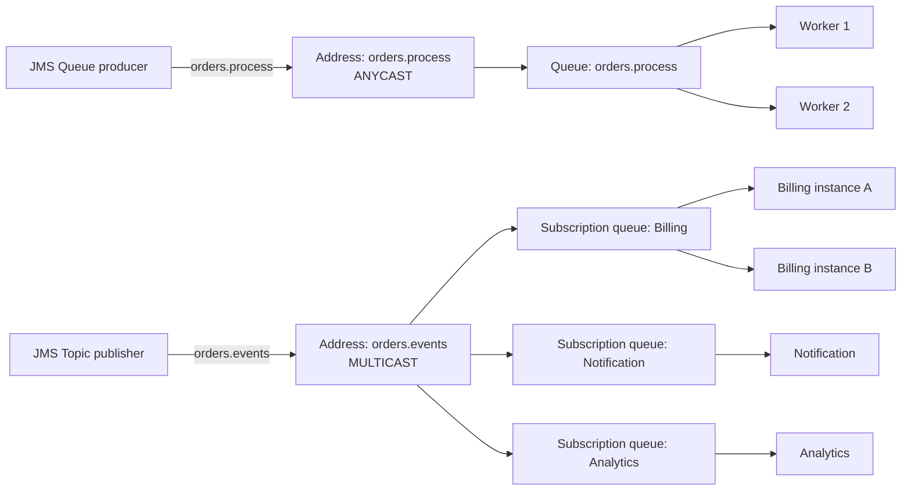
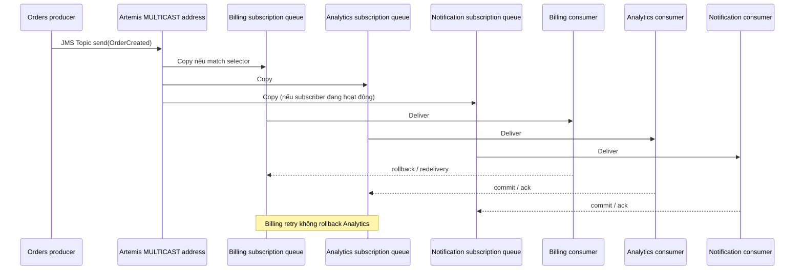

# Ánh xạ JMS Queue, Topic và subscription sang address và queue

> **Chương:** Định tuyến Artemis  
> **Trọng tâm:** Apache ActiveMQ Artemis, Java JMS/Jakarta Messaging, `ANYCAST`, `MULTICAST`, subscription queue, cấu hình `broker.xml` và kiểm thử đường đi của message.  
> **Mục tiêu:** Từ một hợp đồng JMS, xác định chính xác **address nào nhận message**, **queue nào lưu message** và **consumer nào có quyền nhận**, kể cả khi subscriber tạm ngừng hoạt động.

## 1. Vấn đề thực tế: một topic, nhiều nhóm nhận, nhiều instance

Ứng dụng bán hàng gửi hai loại message:

- **Lệnh xử lý:** `orders.process` phải được một worker nhận; ba worker có thể cạnh tranh trên cùng một queue.
- **Sự kiện phát rộng:** `orders.events` được phát đến Billing, Analytics và Notification. Mỗi dịch vụ cần bản sao của riêng mình; hai instance Billing phải cùng xử lý **một backlog chung**, thay vì cả hai đều xử lý mỗi event.

Trong JMS, ta thường gọi hai đích này là **Queue** và **Topic**. Trên Artemis, cách triển khai bên trong không chỉ có “queue hoặc topic”, mà gồm **address**, **routing type** và **queue được bind với address**.



Ở nhánh queue, message được lưu vào **một queue**, các worker cạnh tranh xử lý. Ở nhánh topic, broker route **một bản sao phù hợp cho mỗi subscription queue**. Một hoặc nhiều consumer đọc **cùng** subscription queue có thể cạnh tranh xử lý backlog của nhóm đó, tùy API và chế độ subscription.

**Quy tắc nền tảng của bài:** Trong Artemis, **address nhận và định tuyến**, còn **queue lưu message đang chờ hoặc đang được giao**. `JMS Topic` ánh xạ tới *multicast address*, còn **mỗi subscription** được triển khai qua một queue gắn với address đó.

## 2. Bốn khái niệm cần phân biệt ngay

| Khái niệm | Trả lời câu hỏi | Ví dụ | Sai lầm cần tránh |
|---|---|---|---|
| **JMS Queue** | Ứng dụng Java gửi/nhận theo kiểu point-to-point thế nào? | `session.createQueue("orders.process")` | Xem JMS Queue chỉ là tên address mà quên queue phía broker |
| **JMS Topic** | Publisher phát sự kiện cho các subscription thế nào? | `session.createTopic("orders.events")` | Nghĩ topic tự giữ lịch sử khi chưa có subscription |
| **Artemis address** | Message được gửi vào đâu và định tuyến theo kiểu nào? | `orders.events`, `MULTICAST` | Tưởng mỗi address chỉ có đúng một queue |
| **Artemis queue** | Bản message nào đang chờ consumer/ack? | Queue của Billing gắn với `orders.events` | Nghĩ mọi queue đều là JMS Queue mà application dùng `createQueue` |

Hai kiểu routing chính:

- **`ANYCAST`:** message được route tới **một queue phù hợp** của address; những consumer cùng queue cạnh tranh nhận message. Khi address có nhiều anycast queues, Artemis chọn một queue thích hợp theo cơ chế routing của broker; **không** phát một bản cho từng anycast queue.
- **`MULTICAST`:** message được route tới **tất cả các multicast queues phù hợp** gắn với address. Mỗi queue có backlog, acknowledgment, redelivery và trạng thái consumer riêng.

Từ đó, một queue `billing.orders` nằm dưới multicast address `orders.events` vẫn là **queue thực của broker**, dù ứng dụng xem nó là “subscription của Topic”. Ngược lại, `orders.process` là cả tên address lẫn tên queue trong quy ước JMS Queue phổ biến; việc hai tên bằng nhau **không** có nghĩa address và queue là cùng một thực thể.

### 2.1. Định tuyến và giao nhận là hai pha khác nhau

```text
Pha 1 — routing:
  producer -> address -> anycast/multicast -> queue(s)

Pha 2 — delivery:
  queue -> consumer -> xử lý -> acknowledgment/commit
```

Với Billing lỗi nghiệp vụ và rollback, message tại subscription queue của Billing có thể được giao lại; message **ở queue của Analytics** không bị rollback theo Billing. Đây là tính độc lập quan trọng của mô hình fan-out.

### 2.2. Đừng dùng một tên cho hai hợp đồng khác nhau

Artemis cho phép address có cả `ANYCAST` và `MULTICAST`. Tuy nhiên, nếu ứng dụng dùng lẫn JMS Queue, JMS Topic hoặc nhiều protocol trên **cùng một tên**, khả năng route sai kỳ vọng sẽ tăng, nhất là khi client không đặt routing type tường minh.

Quy ước dễ vận hành:

```text
orders.commands       -> JMS Queue / ANYCAST
orders.events         -> JMS Topic / MULTICAST
payments.commands     -> JMS Queue / ANYCAST
payments.events       -> JMS Topic / MULTICAST
```

Nếu thực sự cần một address hỗn hợp, phải xác định routing type của từng producer/protocol và viết kiểm thử rõ ràng; không dựa vào tên để suy đoán.

## 3. Ánh xạ JMS Queue: address ANYCAST và queue xử lý công việc

Giả sử:

```java
Queue queue = session.createQueue("orders.process");
MessageProducer producer = session.createProducer(queue);
```

Trong mô hình phổ biến, Artemis ánh xạ JMS Queue `orders.process` thành:

```text
JMS Queue "orders.process"
           |
           v
address: orders.process      routing type: ANYCAST
           |
           v
queue:   orders.process      (bound to the address)
           |
      +----+----+
      |         |
   Worker A  Worker B          cạnh tranh lấy message
```

Khi bật auto-create phù hợp, broker có thể tạo address ANYCAST và queue tương ứng theo nhu cầu. Trong production, có thể cấu hình tĩnh rõ ràng để tránh tên sai.

### 3.1. Cấu hình tĩnh trong `broker.xml`

Đặt đoạn sau **trong phần `<addresses>`** của cấu hình Artemis:

```xml
<addresses>
  <address name="orders.process">
    <anycast>
      <queue name="orders.process" durable="true"/>
    </anycast>
  </address>
</addresses>
```

**Đọc cấu hình theo từng tầng:**

1. `<address name="orders.process">` là nơi message gửi tới.
2. `<anycast>` cho biết routing kiểu cạnh tranh.
3. `<queue name="orders.process">` là nơi lưu message chờ consumer.
4. `durable="true"` nói về **độ bền của queue definition**, không tự làm mọi message thành persistent. Producer vẫn cần `DeliveryMode.PERSISTENT` cùng cấu hình lưu trữ/transaction phù hợp.

**Mô hình này khác “một bản sao cho mỗi worker”.** Khi Worker A và Worker B đều đọc queue `orders.process`, mỗi message đang chờ được giao cho một consumer tại một thời điểm; sau lỗi/rollback có thể redeliver. Không hứa exactly-once ở mức side effect database: consumer phải idempotent.

### 3.2. Khi queue name khác address name

Trong Core API/management, Artemis cho phép:

```xml
<address name="orders.process">
  <anycast>
    <queue name="orders.workers"/>
  </anycast>
</address>
```

Đây là một address có queue được bind với tên riêng. Nhưng Java JMS:

```java
Queue q = session.createQueue("orders.process");
```

không nên được giả định sẽ tự tìm và đọc `orders.workers` theo mọi phiên bản/cấu hình. Trong hợp đồng JMS Queue thông thường, dùng queue cùng tên address; khi cần truy cập một queue cụ thể với tên khác, cân nhắc **Fully Qualified Queue Name (FQQN)** hoặc API/core config đúng trường hợp, rồi kiểm thử thực tế.

## 4. Ánh xạ JMS Topic: MULTICAST address và queue của từng subscription

Với JMS:

```java
Topic topic = session.createTopic("orders.events");
MessageProducer publisher = session.createProducer(topic);
```

Artemis định tuyến tới **multicast address** `orders.events`. Broker không cần một queue toàn cục tên `orders.events` để “giữ tất cả event”; thay vào đó, **subscription mới là thực thể có queue**.

### 4.1. Đăng ký subscription sẽ tạo queue phía broker

Xét ba subscriber:

| Subscriber | Subscription cần nhận | Queue lưu backlog | Trạng thái cần quản lý |
|---|---|---|---|
| Billing | Mọi event hợp đồng Billing | Queue cho subscription Billing, gắn `orders.events` | Pending, delivering, retry/DLQ, durable identity |
| Analytics | Mọi event hoặc selector riêng | Queue cho subscription Analytics | Pending, selector, throughput, backlog |
| Notification | Chỉ `eventType='OrderCreated'` | Queue cho subscription Notification | Filter/selector, expiration, retry |

Mỗi queue nhận message theo routing và bộ lọc phù hợp. Một publisher gửi event có thể làm **message count tăng ở nhiều queue**. Đây là fan-out theo **subscription**, không phải broker phát message một lần rồi chờ ba service cùng xác nhận trên một queue chung.

Ví dụ cấu hình chỉ tạo address topic:

```xml
<addresses>
  <address name="orders.events">
    <multicast/>
  </address>
</addresses>
```

Broker có address multicast, **nhưng chưa có queue subscription nếu chưa có subscriber hoặc queue được cấu hình trước**.

Khi publisher phát event lúc chưa có subscription phù hợp, message **thông thường không được lưu để người đăng ký sau đọc lại**. Muốn giữ event cho một dịch vụ trong lúc offline, dịch vụ phải tạo durable subscription trước khi offline (hoặc có một queue multicast đã được provision). Artemis là message broker, không mặc nhiên cung cấp khả năng replay toàn bộ lịch sử như một commit log.

### 4.2. Tự tạo queue multicast để có luồng riêng

Nếu cần một queue tồn tại từ lúc broker start, có thể cấu hình tường minh:

```xml
<addresses>
  <address name="orders.events">
    <multicast>
      <queue name="billing.orders.events" durable="true"/>
      <queue name="analytics.orders.events" durable="true"/>
    </multicast>
  </address>
</addresses>
```

Các queue `billing.orders.events` và `analytics.orders.events` đều nhận **một bản sao của message** phù hợp khi producer gửi tới address `orders.events` với routing `MULTICAST`.

**Nhưng:** hai queue này là **multicast queues được quản trị đặt tên**, chưa tự động đồng nhất với subscription được tạo bằng JMS `createDurableSubscriber(topic, subscriptionName)`. JMS provider dùng quy ước identity và tên queue riêng cho durable subscription. Nếu tạo đồng thời queue tĩnh `billing.orders.events` rồi lại dùng `createDurableSubscriber`, có thể sinh **hai queue khác nhau** và hai bản sao event ngoài ý muốn.

Vì vậy phải chọn rõ một trong hai đường:

- **JMS subscription lifecycle:** tạo durable/shared durable subscription bằng JMS API; dùng JMS identity để quản lý.
- **Broker-managed multicast queue:** tạo queue trong broker rồi cho một queue consumer truy cập đúng queue đó, ví dụ dùng FQQN; quản lý backlog/ownership bằng broker config.

Không trộn hai cách nếu chưa đối chiếu queue thực sự xuất hiện trên broker.

## 5. Bản đồ subscription: non-durable, durable và shared

Một JMS Topic có thể có nhiều kiểu subscription. Các kiểu này chủ yếu khác ở **lifecycle queue** và **số consumer chia sẻ một subscription**.

| Hợp đồng | API điển hình | Queue phía Artemis | Khi subscriber offline | Nhiều instance cùng subscription? |
|---|---|---|---|---|
| Non-durable | `session.createConsumer(topic)` | Queue subscription tạm, non-durable | Subscription/queue thường được dọn khi đóng; không giữ các event gửi sau khi đóng cho subscriber đó | Mỗi `createConsumer` thường là subscription riêng |
| Durable không shared | `session.createDurableSubscriber(topic, "orders-v1")` | Queue bền vững theo identity subscriber | Backlog phù hợp có thể tiếp tục được giữ | Không mở đồng thời nhiều consumer cho cùng non-shared durable subscription |
| Shared non-durable (JMS 2.0) | `session.createSharedConsumer(topic, "orders-v1")` | Một queue subscription non-durable dùng chung | Không có bảo đảm tồn tại khi không còn consumer như durable | Có, consumer chia nhau message |
| Shared durable (JMS 2.0) | `session.createSharedDurableConsumer(topic, "orders-v1")` | Một durable subscription queue dùng chung | Tiếp tục giữ các message phù hợp theo semantics bền vững | Có, các consumer của cùng shared durable subscription chia tải |

**Cần phân biệt hai nghĩa của “shared”:**

- **Giữa các subscription khác nhau:** multicast **sao chép** event, mỗi nhóm nhận một bản.
- **Giữa các consumer trong cùng một shared subscription:** cùng một queue, các instance **cạnh tranh** tiêu thụ, không nhận mỗi instance một bản.

Tính năng shared subscription yêu cầu JMS 2.0 hoặc API Jakarta Messaging tương ứng và client/provider hỗ trợ; không tự áp API này cho client JMS 1.1.

### 5.1. Durable subscription identity

Với cách tạo truyền thống bằng JMS:

```java
connection.setClientID("billing-service");
Topic topic = session.createTopic("orders.events");
MessageConsumer sub =
        session.createDurableSubscriber(topic, "billing-orders-v1");
```

Subscription được định danh bởi hợp đồng JMS, bao gồm `clientID` và **subscription name** theo loại subscription. Artemis ánh xạ identity đó tới một durable queue của broker. **Tên queue thực tế** là chi tiết provider/version, nên xem trong management console/JMX trước khi viết automation hoặc mapping migration.

- Dùng `clientID` **ổn định** khi reconnect để lấy lại cùng backlog durable.
- Không tạo `clientID` ngẫu nhiên mỗi lần deploy nếu mục tiêu là tiếp tục cùng subscription.
- Không cấp cùng `clientID` cho nhiều connection đang hoạt động theo kiểu non-shared; sẽ gặp lỗi identity hoặc không đạt mục đích scale.
- Thay tên subscription, `clientID` hoặc selector/noLocal có thể tạo identity khác hoặc cần unsubscribe/recreate; phải có kế hoạch xử lý backlog cũ.
- Durable subscription **không** đọc được message được phát *trước lần subscription đầu tiên được tạo*, trừ khi hệ thống có cơ chế lưu/chuyển riêng.

### 5.2. Trường hợp hai Billing instances

**Sai kỳ vọng:** Mỗi instance Billing tự tạo durable subscription tên `orders-v1` với `clientID` = hostname riêng; hệ thống tưởng có một nhóm Billing. Thực tế đó là **hai identity**, có thể tạo hai queues và xử lý **hai bản sao của mỗi event**.

Để hai instances cùng xử lý một backlog:

1. Dùng **shared durable subscription** phù hợp API JMS 2.0/Jakarta, hoặc
2. Provision **một multicast queue** rồi dùng các consumer queue/FQQN cùng queue đó, nếu kiến trúc cho phép.

Ngược lại, nếu thực sự muốn mỗi instance nhận mọi event, hãy dùng **subscription riêng** và chấp nhận fan-out cũng như chi phí lưu trữ tăng.

### 5.3. Đặt tên và filter theo hợp đồng

Với topic `orders.events`, đặt tên subscription theo **dịch vụ và version hợp đồng**:

```text
clientID:          billing-service
subscriptionName: billing-orders-v1
topic:            orders.events
selector:         eventType IN ('OrderCreated', 'OrderCancelled')
```

Khi schema/selector đổi lớn, cần quyết định backlog cũ xử lý thế nào. Không đổi `clientID` hay `subscriptionName` tùy tiện rồi để durable queue cũ tồn đọng mãi.

## 6. Sơ đồ chi tiết: một publish và ba kết quả độc lập

Giả sử subscription đã tồn tại trước khi publish:

- Billing dùng durable subscription, selector `eventType='OrderCreated'`.
- Analytics dùng durable subscription, không selector.
- Notification dùng non-durable consumer đang kết nối.
- Event có `eventType='OrderCreated'`.



Nếu `Notification` offline trước lúc publish và subscription **non-durable đã đóng**, queue tạm của nó không còn giữ event để đọc lại. Nếu Billing offline nhưng durable queue vẫn tồn tại, broker tiếp tục lưu các message được route tới queue của Billing theo delivery/persistence semantics.

**Lưu ý độ bền:** “durable subscription” là độ bền **của subscription/queue**, còn mức tồn tại sau broker crash của một message phụ thuộc cả `DeliveryMode.PERSISTENT`, transaction, store/journal và cấu hình đồng bộ ghi.

## 7. Cấu hình `broker.xml` theo hợp đồng JMS

Ví dụ một bộ đích gồm:

- `orders.process`: JMS Queue ANYCAST, khai báo queue tĩnh.
- `orders.events`: JMS Topic MULTICAST, khai báo address; subscription queues được client tạo khi đăng ký.
- `DLQ`: queue nhận message lỗi theo chính sách vận hành.

### 7.1. Khai báo address và routing

```xml
<!-- Đặt trong phần <addresses> của broker.xml Artemis -->
<addresses>
  <address name="orders.process">
    <anycast>
      <queue name="orders.process" durable="true"/>
    </anycast>
  </address>

  <address name="orders.events">
    <multicast/>
  </address>

  <address name="DLQ">
    <anycast>
      <queue name="DLQ" durable="true"/>
    </anycast>
  </address>
</addresses>
```

Ở cấu hình này, **queue xử lý lệnh tồn tại từ startup**, nhưng **queue của từng JMS topic subscription chưa chắc tồn tại** nếu chưa có subscriber tạo nó.

### 7.2. Auto-create: tắt ở Queue cố định, giữ quyền tạo subscription cho Topic

Trong Artemis, `auto-create-addresses` và `auto-create-queues` thuộc **address settings**. Không nên vô hiệu hóa tất cả auto-create rồi kỳ vọng JMS client vẫn tự đăng ký durable subscription, bởi mỗi subscription cần một queue.

Một chiến lược minh họa:

```xml
<!-- Đặt trong phần <address-settings> của broker.xml -->
<address-settings>
  <!-- Queue cố định: không chấp nhận typo làm mọc address/queue mới -->
  <address-setting match="orders.process">
    <auto-create-addresses>false</auto-create-addresses>
    <auto-create-queues>false</auto-create-queues>
  </address-setting>

  <!-- Topic đã provision address; cho phép tạo subscription queue -->
  <address-setting match="orders.events">
    <auto-create-addresses>false</auto-create-addresses>
    <auto-create-queues>true</auto-create-queues>
    <dead-letter-address>DLQ</dead-letter-address>
    <max-delivery-attempts>5</max-delivery-attempts>
    <redelivery-delay>2000</redelivery-delay>
  </address-setting>
</address-settings>
```

**Không sao chép cấu hình này như whitelist bảo mật hoàn chỉnh.** Chỉ có hai matcher cụ thể; `orders.proces` (typo) **không khớp** `orders.process`, nên có thể rơi vào `address-setting match="#"` hoặc policy mặc định và vẫn được auto-create. Để chặn tên ngoài danh mục, kết hợp **authorization, các matchers bao phủ namespace và test với tài khoản ứng dụng**.

Cũng cần nhớ:

- `auto-create-addresses=false` yêu cầu address tồn tại trước khi client dùng.
- `auto-create-queues=false` yêu cầu queue đã được provision; điều này phù hợp queue cố định nhưng có thể ngăn JMS Topic tạo subscription queue mới.
- `auto-delete-queues`, `auto-delete-addresses` và các điều kiện cleanup cần được thiết kế riêng theo loại queue; đừng bật cleanup chung rồi xóa mất durable backlog.
- Tên `orders.events` có thể được cấu hình với MULTICAST, nhưng một JMS client/provider không hỗ trợ routing type phù hợp vẫn có thể bị lỗi hoặc gửi sai loại đích.

### 7.3. Security cho việc tạo queue subscription

Cấp quyền gửi topic và quyền tạo queue subscription là **hai quyết định độc lập**. Một publisher không cần được quyền tạo durable subscription, còn service đọc topic có thể cần quyền tạo durable/non-durable queue.

Đây là đoạn chính sách **minh họa** đặt trong `<security-settings>`; cần ghép với authentication, roles, TLS và quyền quản trị thực tế:

```xml
<security-settings>
  <security-setting match="orders.events">
    <permission type="send" roles="orders-publishers"/>
    <permission type="consume" roles="billing,analytics,notifications"/>
    <permission type="createDurableQueue" roles="billing,analytics"/>
    <permission type="deleteDurableQueue" roles="billing,analytics"/>
    <permission type="createNonDurableQueue"
                roles="billing,analytics,notifications"/>
    <permission type="deleteNonDurableQueue"
                roles="billing,analytics,notifications"/>
    <permission type="createAddress" roles="broker-admins"/>
    <permission type="deleteAddress" roles="broker-admins"/>
  </security-setting>
</security-settings>
```

Các role ở trên chỉ mang tính ví dụ. Broker có thể cần quyền khác cho queue ứng dụng, management, temporary queues hoặc các destination hệ thống. **Kiểm thử cả trường hợp được phép lẫn bị từ chối**, đặc biệt khi consumer lần đầu tạo durable subscription rồi reconnect sau khi queue đã tồn tại.

### 7.4. Cấu hình queue multicast tĩnh với selector ở queue

Nếu không dùng subscription do JMS tạo mà muốn một queue riêng được broker quản trị:

```xml
<addresses>
  <address name="orders.events">
    <multicast>
      <queue name="billing.orders.created" durable="true">
        <filter string="eventType = 'OrderCreated'"/>
      </queue>
      <queue name="analytics.orders.all" durable="true"/>
    </multicast>
  </address>
</addresses>
```

Khi gửi topic `orders.events`:

- `billing.orders.created` chỉ nhận message có property `eventType` thỏa selector.
- `analytics.orders.all` nhận message theo tất cả các event phù hợp với routing.
- Queue filter áp dụng **trước khi message được thêm vào queue**. Message không match không nằm trong backlog của queue đó; không thể “đổi selector sau rồi đọc lại” những event chưa từng được enqueued.

Không thêm hai cấu hình `<address name="orders.events">` cùng lúc: các ví dụ `7.1` và `7.4` là **hai phương án cấu hình thay thế**.

## 8. FQQN: truy cập queue cụ thể dưới một address

Artemis hỗ trợ **Fully Qualified Queue Name (FQQN)** với cú pháp:

```text
address::queue
```

Ví dụ một queue đã được cấu hình trong `<multicast>`:

```text
orders.events::billing.orders.created
```

Ý nghĩa là: “truy cập queue `billing.orders.created` được bind với address `orders.events`”. Điều này hữu ích khi address có nhiều queues cùng routing type hoặc khi consumer cần **một queue xác định**.

Một JMS Queue consumer dùng Artemis client có thể tham chiếu FQQN:

```java
Queue billingQueue =
    session.createQueue("orders.events::billing.orders.created");
MessageConsumer consumer = session.createConsumer(billingQueue);
```

Khi publisher phát JMS Topic `orders.events` với routing MULTICAST, queue `billing.orders.created` nhận bản sao đã match filter; consumer đọc đúng queue đó.

**Phân biệt FQQN với JMS Topic subscription:**

| Cách truy cập | Ai quản lý identity? | Đường dữ liệu |
|---|---|---|
| `createDurableSubscriber(topic, name)` | JMS provider quản lý durable subscription theo identity | Topic → subscription queue của provider |
| `createSharedDurableConsumer(topic, name)` | JMS 2.0 shared subscription | Topic → một queue chung của shared subscription |
| `createConsumer(createQueue("address::queue"))` | Ứng dụng/broker quản lý queue được chỉ định | Address → queue định danh rõ bằng FQQN |

Đường FQQN **không tự tạo ra cùng durable subscription identity** như `createDurableSubscriber` và không phải cú pháp JMS tiêu chuẩn có thể đem nguyên sang mọi vendor. Dùng khi đã chấp nhận phụ thuộc Artemis và đã kiểm chứng tên queue, routing và quyền consume.

**Cảnh báo:** không xây tên FQQN từ đầu vào người dùng mà chưa kiểm tra; nếu ứng dụng có quyền rộng, điều này có thể cho phép truy cập queue ngoài phạm vi dự kiến.

## 9. Java JMS: kiểm thử đúng tuyến queue và topic

Ví dụ sử dụng `javax.jms` với client Artemis tương thích JMS 2.0; nếu dự án dùng `jakarta.jms` thì cần artifact và import Jakarta tương ứng. Trong các đoạn này, `ConnectionFactory` là:

```java
import javax.jms.ConnectionFactory;
import org.apache.activemq.artemis.jms.client.ActiveMQConnectionFactory;

// Broker Artemis với Core acceptor tại cổng minh họa.
ConnectionFactory factory =
    new ActiveMQConnectionFactory("tcp://127.0.0.1:61616");
```

Trong Maven, chọn `artemis-jms-client` (namespace `javax.jms`) hoặc client Jakarta tương ứng theo **đúng phiên bản Artemis**. Không sao chép dependency từ ứng dụng Classic khi đã chuyển sang Artemis Core client. Các mẫu sau bỏ qua framework pooling và credential để tập trung vào routing; production phải quản lý TLS, authentication và connection lifecycle.

### 9.1. Gửi lệnh qua JMS Queue hoặc publish qua JMS Topic

```java
import javax.jms.Connection;
import javax.jms.ConnectionFactory;
import javax.jms.DeliveryMode;
import javax.jms.Destination;
import javax.jms.JMSException;
import javax.jms.MessageProducer;
import javax.jms.Session;
import javax.jms.TextMessage;

public final class RoutingProducer {
    public static void send(ConnectionFactory factory, boolean asTopic,
                            String orderId) throws JMSException {
        Connection connection = factory.createConnection();
        try {
            Session session = connection.createSession(
                    true, Session.SESSION_TRANSACTED);
            try {
                Destination destination = asTopic
                        ? session.createTopic("orders.events")
                        : session.createQueue("orders.process");

                MessageProducer producer = session.createProducer(destination);
                try {
                    producer.setDeliveryMode(DeliveryMode.PERSISTENT);

                    TextMessage message = session.createTextMessage(
                            "{\"orderId\":\"" + orderId + "\"}");
                    message.setStringProperty(
                            "eventType", asTopic ? "OrderCreated" : "ProcessOrder");
                    message.setStringProperty("eventId", "order:" + orderId);

                    try {
                        producer.send(message);
                        session.commit();
                    } catch (JMSException | RuntimeException error) {
                        session.rollback();
                        throw error;
                    }
                } finally {
                    producer.close();
                }
            } finally {
                session.close();
            }
        } finally {
            connection.close();
        }
    }
}
```

Đoạn ví dụ ghép chuỗi JSON cho dễ đọc; ứng dụng thật nên dùng serializer và validate input. Khi `asTopic=false`, message tới `orders.process` theo JMS Queue/ANYCAST. Khi `asTopic=true`, message tới `orders.events` theo JMS Topic/MULTICAST.

**Điểm quan trọng:** `session.createQueue(...)` và `session.createTopic(...)` biểu diễn **hai loại JMS destination khác nhau**. Đừng cố gửi topic bằng cách tạo JMS Queue cùng tên rồi trông đợi Artemis tự fan-out.

### 9.2. Consumer queue: hai worker trên cùng một queue

```java
import javax.jms.Connection;
import javax.jms.ConnectionFactory;
import javax.jms.JMSException;
import javax.jms.Message;
import javax.jms.MessageConsumer;
import javax.jms.Queue;
import javax.jms.Session;
import javax.jms.TextMessage;

public final class WorkQueueConsumer {
    public static void receiveOne(ConnectionFactory factory)
            throws JMSException {
        Connection connection = factory.createConnection();
        try {
            Session session = connection.createSession(
                    true, Session.SESSION_TRANSACTED);
            try {
                Queue queue = session.createQueue("orders.process");
                MessageConsumer consumer = session.createConsumer(queue);
                try {
                    connection.start();
                    Message message = consumer.receive(5_000L);

                    if (message == null) {
                        return;
                    }
                    try {
                        if (!(message instanceof TextMessage)) {
                            throw new IllegalArgumentException("Expected text");
                        }
                        String eventId = message.getStringProperty("eventId");

                        // Production: xử lý idempotent theo eventId trong DB.
                        System.out.println(eventId + " received by worker");
                        session.commit();
                    } catch (JMSException | RuntimeException error) {
                        session.rollback();
                        throw error;
                    }
                } finally {
                    consumer.close();
                }
            } finally {
                session.close();
            }
        } finally {
            connection.close();
        }
    }
}
```

Chạy hai instance `WorkQueueConsumer` cùng queue. Tổng số xử lý thành công cho mỗi `eventId` phải đúng một lần ở tầng nghiệp vụ, nhưng **delivery có thể lặp** khi rollback/crash. Dựa vào idempotency khi quyết định side effect.

### 9.3. Tạo durable topic subscription trước khi publish

```java
import javax.jms.Connection;
import javax.jms.ConnectionFactory;
import javax.jms.JMSException;
import javax.jms.Message;
import javax.jms.MessageConsumer;
import javax.jms.Session;
import javax.jms.Topic;

public final class BillingSubscriber {
    public static void receiveOne(ConnectionFactory factory)
            throws JMSException {
        Connection connection = factory.createConnection();
        try {
            // Cố định identity để có thể reconnect cùng backlog.
            connection.setClientID("billing-service");

            Session session = connection.createSession(
                    true, Session.SESSION_TRANSACTED);
            try {
                Topic topic = session.createTopic("orders.events");
                MessageConsumer subscriber =
                        session.createDurableSubscriber(
                            topic, "billing-orders-v1");
                try {
                    connection.start();
                    Message message = subscriber.receive(5_000L);
                    if (message == null) {
                        return;
                    }
                    try {
                        System.out.println("Billing received: " +
                                message.getStringProperty("eventId"));

                        // Production: commit logic DB idempotent trước JMS commit.
                        session.commit();
                    } catch (JMSException | RuntimeException error) {
                        session.rollback();
                        throw error;
                    }
                } finally {
                    subscriber.close();
                }
            } finally {
                session.close();
            }
        } finally {
            connection.close();
        }
    }
}
```

Để chứng minh queue durable tồn tại trong lúc subscriber offline:

1. Chạy `BillingSubscriber` một lần để tạo durable subscription, sau đó đóng connection.
2. Dùng `RoutingProducer.send(factory, true, "ORD-42")` phát event khi Billing offline.
3. Mở lại `BillingSubscriber` với **cùng** `clientID` và subscription name, quan sát message.
4. Kiểm tra Artemis management console: queue subscription gắn với `orders.events` có backlog khi client offline.

Nếu lần đầu đăng ký subscription diễn ra **sau** bước publish, không mong chờ event cũ được phát lại tự động.

### 9.4. Chia tải nhiều Billing instances qua shared durable subscription

Với JMS 2.0:

```java
Topic topic = session.createTopic("orders.events");

// API JMS 2.0: các consumer cùng shared subscription chia một backlog.
// Dùng identity nhất quán theo contract của provider.
MessageConsumer shared =
        session.createSharedDurableConsumer(
                topic, "billing-orders-shared-v1");
```

Trên hai process, dùng **cùng subscription identity có chủ ý**, kiểm tra các consumer thực sự cùng đọc **một queue**, không phát sinh hai queue. Phân biệt `createDurableSubscriber` truyền thống (không shared) với `createSharedDurableConsumer`. Với Jakarta Messaging, dùng API/namespace tương ứng.

Một số framework tự quản lý `clientID`, tên subscription hoặc chọn loại shared/durable qua cấu hình. Hãy xem **đầu ra broker** (queue bindings, durable flag, consumers) thay vì suy luận từ tên bean Spring hay annotation.

## 10. Selector, filter và routing ảnh hưởng thế nào đến backlog?

Trong JMS, có thể lọc message theo properties:

```java
Topic events = session.createTopic("orders.events");

MessageConsumer billing = session.createDurableSubscriber(
        events,
        "billing-created-v1",
        "eventType = 'OrderCreated'",
        false
);
```

Với Artemis, durable subscription dùng một queue tương ứng; broker có thể gắn/filter và chỉ lưu những message phù hợp với selector. **Queue filter** và **consumer selector** không phải lúc nào cũng tương đương về vị trí áp dụng, nên cần thử:

- Queue filter: message không match **không được đưa vào queue đó**.
- Consumer selector trên một queue dùng chung: message không match có thể vẫn tồn tại trong queue để consumer khác phù hợp xử lý; tùy cách provider triển khai selector.
- JMS Topic subscription selector: được gắn với hợp đồng subscription, giới hạn những event subscriber muốn nhận; thay selector của durable subscription đang có cần quản lý lifecycle và backlog.

**Ví dụ:** Billing chỉ xử lý `eventType='OrderCreated'`, Analytics xử lý mọi event. Phát 100 `OrderCreated` và 100 `OrderCancelled` thì kết quả kỳ vọng:

| Queue/subscription | Nhận bản sao được route |
|---|---:|
| Billing selector chỉ `OrderCreated` | 100 |
| Analytics không selector | 200 |
| Queue `orders.process` | 0 từ các lần **publish topic** |

Đó là số message **được route** theo cấu hình/filter giả định, không phải số business transaction đã xử lý thành công. Nếu đã ack hết thì queue pending có thể bằng 0.

### 10.1. Routing và ordering

- Trong **một queue**, xử lý song song, redelivery, priority, selector, consumer window và failover có thể làm kết quả hoàn tất **không theo đúng thứ tự business event**.
- Hai subscription queues có tốc độ và thứ tự hoàn tất khác nhau; không có atomic commit chung giữa Billing và Analytics chỉ vì publisher gửi một event.
- Nếu nghiệp vụ cần thứ tự theo `orderId`, cân nhắc `JMSXGroupID`/message grouping phù hợp và kiểm thử group rebalance khi consumer failover.

Đừng biến `MULTICAST` thành lời hứa “mọi dịch vụ sẽ xử lý event đồng thời, theo cùng thứ tự và chỉ một lần”.

## 11. Acknowledgment, transaction, retry và DLQ nằm ở queue subscription

Đối với message gửi vào `orders.events`:

1. Artemis định tuyến bản sao tới các multicast queues phù hợp.
2. Consumer từng queue nhận và xử lý riêng.
3. `session.commit()` hoặc acknowledgment được broker ghi nhận **theo việc delivery của queue đó**.
4. Nếu một consumer rollback, chỉ bản sao đang xử lý ở queue của subscriber đó được redeliver theo policy.
5. Khi vượt số lần giao lại, message có thể bị gửi đến dead-letter address/queue được cấu hình cho nguồn phù hợp.

Ví dụ phần `<address-settings>` đã nêu:

```xml
<address-setting match="orders.events">
  <dead-letter-address>DLQ</dead-letter-address>
  <max-delivery-attempts>5</max-delivery-attempts>
  <redelivery-delay>2000</redelivery-delay>
</address-setting>
```

Đoạn này không thể tự chạy độc lập; cần có DLQ address/queue, routing, security và storage phù hợp. Tùy cấu hình Artemis, DLQ/expiry có thể phân loại thêm theo queue gốc. Hãy giữ các thông tin nguồn để điều tra và redrive có kiểm soát.

**Một ví dụ:** Billing liên tục lỗi, event tại queue Billing đi DLQ; Analytics đã xử lý và commit bình thường. Khi redrive Billing, cần chống trùng theo `eventId` vì event có thể đã được Billing xử lý một phần (ví dụ DB commit thành công nhưng JMS commit thất bại).

## 12. Vận hành: phải xem address và queue cùng lúc

Console/management/JMX của Artemis thường có hai lớp quan sát:

- **Address:** tên, routing types, tổng quan routing, policy áp dụng.
- **Queue:** address đang bind, routing type (`ANYCAST`/`MULTICAST`), durable, filter, message count, delivering count, consumer count, số message ack/added, scheduled/expiry, DLQ.

### 12.1. Checklist điều tra khi publish topic “thành công” nhưng subscriber không nhận

1. Producer đang tạo **JMS Topic** `orders.events` hay nhầm `JMS Queue` cùng tên?
2. Address `orders.events` có `MULTICAST` không?
3. Queue subscription cho Billing đã tồn tại **trước khi event được publish** chưa?
4. Queue subscription đang bind đúng address và có routing type `MULTICAST` không?
5. Selector trên subscription/queue có loại message khỏi queue không?
6. Durable identity (`clientID`, subscription name, shared flag) có bị thay khi deploy không?
7. Consumer đang đọc đúng queue hay đang tạo thêm queue mới?
8. Message đang pending, delivering, scheduled, expired hay đã đi DLQ?
9. Broker có tạo queue mới bị chặn bởi `auto-create-queues` hoặc security role?
10. Producer gửi qua protocol nào, có chỉ rõ routing type phù hợp không?

Ví dụ nếu queue của Billing có `messageCount=100` và `consumerCount=0` thì vấn đề có thể là Billing offline hoặc sai identity. Nếu queue **không tồn tại**, phải điều tra bước đăng ký subscription/permission, chưa kết luận message bị thất lạc.

### 12.2. Chi phí storage khi fan-out

Một event 20 KiB gửi tới 10 multicast subscription queues có thể tạo nhiều queue references/bản giao nhận độc lập. Broker có thể tối ưu lưu trữ body chung, nhưng **không được giả định tài nguyên và chi phí fan-out bằng đúng một queue**. Backlog/durable subscription tăng thì metadata, paging, dispatch, storage và thời gian dọn dẹp cũng tăng.

Trong sizing, cần đo số subscription thực tế, tỷ lệ offline, P95/P99 payload, retry, durable backlog và giới hạn lưu trữ; tránh nhân cứng dung lượng payload mà bỏ qua broker storage optimization hoặc overhead.

### 12.3. Dọn durable subscription không sử dụng

Khi xóa một consumer service hoặc đổi subscription name, durable queue cũ có thể tiếp tục tích lũy message. Cần:

- Xác định identity JMS và queue được bind thật.
- Kiểm kê pending/in-flight/DLQ và lịch sử nghiệp vụ.
- Có quyết định drain/export/retire.
- Dùng `Session.unsubscribe("subscriptionName")` theo đúng identity và quy tắc JMS/provider, thường khi subscription không đang active, hoặc thao tác quản trị được kiểm soát.
- Xác nhận queue không bị client cũ tạo lại.

Không xóa trực tiếp queue durable chỉ vì `ConsumerCount=0`. Với durable subscription, **consumer offline là trạng thái có chủ đích**.

## 13. Bài tập thực hành: chứng minh từng phép ánh xạ

### Bài A — JMS Queue anycast và competing consumers

**Chuẩn bị:** khai báo `orders.process` tĩnh như phần 7.1, tạo hai worker dùng `WorkQueueConsumer`.

1. Gửi 20 lệnh vào JMS Queue `orders.process` với `eventId` khác nhau.
2. Cho hai worker cùng đọc queue đến khi xử lý hết.
3. Trên console, xác nhận có đúng một anycast queue, số consumer là 2 khi đang hoạt động.
4. So sánh số lần nhận, ack, duplicate theo `eventId` ở tầng app.

**Đạt:** không có fan-out một message cho từng worker; tổng số **business effects** bằng 20. Nếu có redelivery, vẫn không tạo hai side effects.

### Bài B — JMS Topic fan-out tới hai durable subscriptions

1. Tạo hai durable subscriptions **khác identity**: Billing và Analytics.
2. Đóng cả hai consumer, giữ broker chạy.
3. Publish 10 `OrderCreated` messages tới JMS Topic `orders.events`.
4. Quan sát hai queues ở dưới multicast address, mỗi queue có backlog phù hợp.
5. Bật lại hai subscriber và xác nhận mỗi nhóm xử lý 10 event.

**Đạt:** broker lưu hai backlog độc lập theo subscription; không có một shared queue chung cho cả Billing và Analytics.

### Bài C — Shared durable subscription: hai instances, một queue

1. Tạo hai consumers `createSharedDurableConsumer` với cùng subscription name/identity.
2. Publish 50 event vào `orders.events`.
3. Kiểm tra có **một queue shared subscription** với 2 consumers, không có hai queues Billing.
4. Đối chiếu 50 `eventId` unique trong DB sau commit.

**Đạt:** mỗi event có một kết quả nghiệp vụ cho nhóm Billing, không phải 50 kết quả trên từng instance. Tỷ lệ phân phối giữa hai instance không cần 50/50.

### Bài D — Không có subscription khi publish

1. Dùng một topic test mới, chưa có durable subscription và không có multicast queue tĩnh.
2. Publish 10 persistent messages.
3. **Sau đó** mới tạo durable subscriber.
4. Ghi lại số message nhận, rồi publish thêm 10 event khi subscriber đang hoặc đã đăng ký.
5. Reconnect và so sánh.

**Đạt:** giải thích vì sao durable subscription không replay event phát trước lúc nó được tạo; bền vững và lịch sử message là hai tính chất khác nhau.

### Bài E — FQQN và manual multicast queue

1. Provision queue `billing.orders.created` dưới `orders.events` như phần 7.4.
2. Publish 4 `OrderCreated` và 4 `OrderCancelled`.
3. Dùng `session.createQueue("orders.events::billing.orders.created")` và `createConsumer`.
4. Xác minh queue chỉ giữ 4 event match filter.
5. So sánh với một JMS durable subscriber được tạo riêng để phát hiện hai queue độc lập.

**Đạt:** phân biệt broker-managed queue với subscription do JMS provider tạo.

### Bài F — Permission, rollback và DLQ

1. Tạo consumer topic với tài khoản chỉ có quyền `consume` mà không có `createDurableQueue`.
2. Thử lần đầu đăng ký durable subscription trên topic, ghi nhận lỗi tạo queue nếu chính sách chặn.
3. Cấp quyền phù hợp, đăng ký lại và xác nhận queue xuất hiện.
4. Cố tình rollback cùng một message ở Billing tới ngưỡng redelivery.
5. Quan sát queue Billing/DLQ và kiểm tra Analytics vẫn xử lý được message tương ứng.

**Đạt:** phép thử phân biệt **quyền đăng ký queue**, **quyền consume**, **routing** và **retry**; rollback một subscription không rollback subscription khác.

### Bảng ghi nhận bằng chứng

| Case | Address | Routing | Queue thực | Durable | Consumers | Messages routed/acked | PASS/FAIL |
|---|---|---|---|---|---|---|---|
| Queue lệnh | `orders.process` | ANYCAST | `orders.process` | Có | 2 | Theo 20 lệnh | |
| Topic Billing | `orders.events` | MULTICAST | Tên queue theo identity Billing | Có | 0→1 | Theo 10 events | |
| Topic Analytics | `orders.events` | MULTICAST | Tên queue theo identity Analytics | Có | 0→1 | Theo 10 events | |
| Shared Billing | `orders.events` | MULTICAST | Một shared subscription queue | Có | 2 | Theo 50 events | |
| Manual filtered queue | `orders.events` | MULTICAST | `billing.orders.created` | Có | 1 | 4/8 events | |

**Nhớ phân biệt:** số **được route**, số **đã nhận**, số **ack/commit** và số **business effects** không nhất thiết bằng nhau tại mọi thời điểm.

## 14. Các lỗi thường gặp và cách chẩn đoán

| Triệu chứng | Sai khái niệm hoặc cấu hình | Phép kiểm tra trực tiếp |
|---|---|---|
| Gửi topic thành công nhưng subscriber mới không thấy event cũ | Topic được tạo sau publish hoặc durable subscription chưa tồn tại | Xem thời điểm queue subscription được tạo |
| Hai instance Billing mỗi instance nhận cùng một event | Hai durable identities độc lập | So sánh `clientID`, name, queue count, shared flag |
| Hai nhóm Billing/Analytics đang giành message của nhau | Cùng đọc **một queue** thay vì có hai subscription queues | Xem address bindings và tên queue thực |
| Queue consumer nhận sai hoặc không nhận | JMS Queue name khác queue name, hoặc nhầm FQQN | Kiểm tra `address::queue`, routing type và matching |
| Topic phát event nhưng queue commands lại tăng | Producer gửi JMS Queue cùng tên/mapping sai | Log loại JMS Destination và routing type ở message |
| Không tạo được durable subscription | `auto-create-queues=false`, thiếu quyền `createDurableQueue` | Đọc exception và kiểm tra settings/security |
| Consumer cũ reconnect thành subscription mới | Thay `clientID`/subscription name | So sánh queue bindings và tồn đọng durable queues |
| Billing bị retry nhưng Analytics đã xong | Mỗi subscription queue có ack độc lập | Xem delivering/redelivery/DLQ theo queue |
| Selector mới không thấy event cũ | Event không match filter nên chưa từng được enqueue | Kiểm tra filter/selector tại thời điểm publish |
| FQQN tạo thêm queue ngoài dự kiến | Sai queue name/auto-create config | So sánh inventory trước/sau connect, disable auto-create phù hợp |
| Có nhiều queue trùng công dụng sau migration | Tạo manual queue và JMS durable subscription riêng | Chốt một cơ chế quản lý subscription, đối soát backlog |

## 15. Checklist trước khi triển khai

- [ ] Hợp đồng mỗi destination nói rõ **JMS Queue hay JMS Topic**.
- [ ] Với JMS Queue, xác định **ANYCAST address** và **queue bind** dùng chung cho các worker.
- [ ] Với JMS Topic, xác định **MULTICAST address** và nhóm subscription có queue riêng.
- [ ] Với durable subscription, `clientID`/subscription name (và shared flag) ổn định qua deploy.
- [ ] Nhiều instances của cùng nhóm được thiết kế dùng **shared subscription hoặc cùng một queue**, không tự sinh identity cho mỗi pod.
- [ ] Chọn dứt khoát **JMS-managed durable subscription** hay **broker-managed multicast queue + FQQN** khi cần quản lý queue tĩnh.
- [ ] Auto-create address/queue, auto-delete và ACL phù hợp với lifecycle subscription.
- [ ] Topic selector/queue filter được thử với message properties thật.
- [ ] Broker management xác nhận đúng số queues, routing type, durable flag và backlog.
- [ ] Có chính sách acknowledgment, redelivery, DLQ, TTL/expiry và consumer idempotency cho mỗi luồng.
- [ ] Test sự cố consumer offline, broker restart, selector change, failover và scaling.
- [ ] Không nhầm “publish đã thành công” với “mọi dịch vụ đã xử lý xong”.

## 16. Nguồn tham khảo chính thức

1. [Apache ActiveMQ Artemis — Address Model](https://artemis.apache.org/components/artemis/documentation/latest/address-model.html): address, queue và routing type.
2. [Apache ActiveMQ Artemis — Fully Qualified Queue Names](https://artemis.apache.org/components/artemis/documentation/latest/address-model.html#fully-qualified-queue-names): cách chỉ định `address::queue`.
3. [Apache ActiveMQ Artemis — Using JMS](https://artemis.apache.org/components/artemis/documentation/latest/using-jms.html): JMS destinations, connection, topic subscriptions.
4. [Apache ActiveMQ Artemis — Configuring Routing](https://artemis.apache.org/components/artemis/documentation/latest/configuring-addresses.html): khai báo `<addresses>`, ANYCAST/MULTICAST và auto-create.
5. [Apache ActiveMQ Artemis — Security](https://artemis.apache.org/components/artemis/documentation/latest/security.html): permissions `send`, `consume`, `createDurableQueue`.
6. [Apache ActiveMQ Artemis — Undelivered Messages](https://artemis.apache.org/components/artemis/documentation/latest/undelivered-messages.html): redelivery, dead-letter address và xử lý lỗi.

> **Ghi nhớ:** Với Artemis, **JMS Queue → ANYCAST address + queue tiêu thụ**, còn **JMS Topic → MULTICAST address → các queue subscription**. Muốn biết message thực sự đi đâu, luôn kiểm tra **routing type, queue binding, subscription identity và filter**, rồi mới điều tra acknowledgment, DLQ hoặc persistence. Cú pháp/API và auto-create mặc định cần được đối chiếu trên đúng phiên bản Artemis/JMS client đang triển khai.
