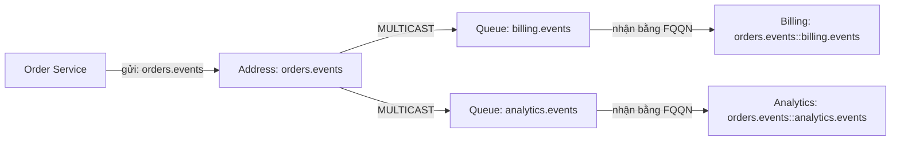
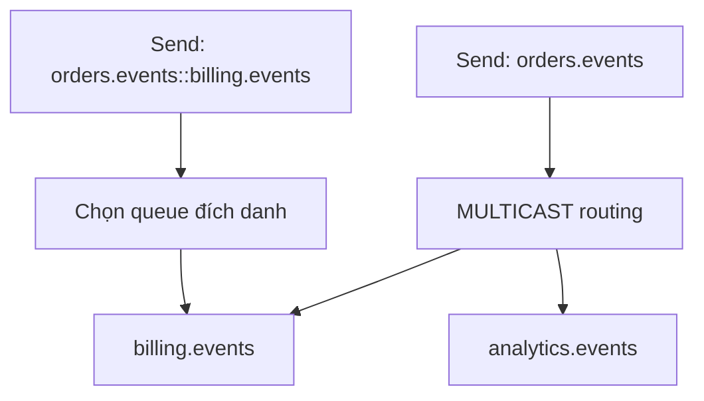

# Fully Qualified Queue Name để chỉ rõ address::queue

> **Chương:** Định tuyến Artemis  
> **Phạm vi:** Apache ActiveMQ **Artemis**, trọng tâm là **Fully Qualified Queue Name (FQQN)** để chỉ đích danh queue thuộc một address. Ví dụ dùng `broker.xml` và Java 17 với Jakarta Messaging (`jakarta.jms`).  
> **Mục tiêu:** Biết khi nào dùng `address` và khi nào dùng `address::queue`; đọc được định tuyến ANYCAST/MULTICAST, tạo consumer hoặc producer trỏ đúng queue, kiểm tra quyền truy cập và tránh mất/nhân đôi thông điệp do chọn sai đích.

## 1. Vấn đề: gửi vào address nhưng phải đọc từ queue nào?

Trong Apache ActiveMQ Artemis, **address** là điểm nhận thông điệp và **queue** là nơi broker lưu trạng thái message để consumer lấy ra. Một address có thể liên kết với nhiều queue. Ví dụ dịch vụ đơn hàng publish sự kiện vào `orders.events`, nhưng nhóm billing chỉ được đọc queue `billing.events`, còn nhóm analytics chỉ được đọc `analytics.events`:



Với **MULTICAST**, một message gửi **vào address** được route đến mọi queue multicast đủ điều kiện. Nhưng khi tạo một JMS consumer chỉ biết chuỗi `orders.events`, người lập trình chưa chỉ ra queue cụ thể. **FQQN giải quyết chính xác điểm đó:** nó ghép tên address và tên queue bằng hai dấu hai chấm.

```text
address::queue

orders.events::billing.events
└── address ─┘ └── queue ──┘
```

Đây là cú pháp riêng của Artemis, hữu ích khi ứng dụng dùng API hoặc giao thức như JMS/AMQP vốn thường biểu diễn đích bằng một chuỗi, trong khi broker có mô hình tách address và queue.

## 2. Chính xác FQQN là gì?

### 2.1. Cú pháp và ý nghĩa

```text
FQQN = <tên-address>::<tên-queue>
```

| Chuỗi | Diễn giải |
| --- | --- |
| `orders.events` | Chỉ **address**; broker chọn queue theo routing type khi gửi |
| `orders.events::billing.events` | Chỉ **queue billing.events** được bind vào **address orders.events** |
| `orders.events::analytics.events` | Chỉ **queue analytics.events** được bind vào **address orders.events** |
| `billing.events` | Chỉ một tên đơn lẻ, không chứng minh đây là queue dưới `orders.events` |
| `orders.events:billing.events` | Sai dấu phân cách; không phải FQQN |
| `orders.events::billing.events::x` | Không phải một FQQN hợp lệ theo quy ước tên ở bài này |

Một FQQN **không tạo thêm một message queue có tên chứa `::`**. Nó là cách *tham chiếu* một queue đã gắn với address cụ thể. Ví dụ:

```text
Address: orders.events
  Queue: billing.events
  Queue: analytics.events
```

Khi ứng dụng gọi `session.createQueue("orders.events::billing.events")`, JMS API tạo một **đối tượng Destination ở phía ứng dụng**; việc queue vật lý đã tồn tại hay được tự tạo hay không là chuyện của broker và chính sách auto-create. Trong bài thực hành, ta **tạo queue tường minh trong broker.xml** để tránh khác biệt cấu hình auto-create.

### 2.2. Bốn quy tắc cần nhớ

1. **`::` là dấu phân cách được dành riêng cho FQQN.** Không đặt `::` trong tên address hoặc tên queue thông thường.
2. **Queue name phải duy nhất trong một broker Artemis.** Không thể tạo queue cùng tên `billing.events` dưới hai address khác nhau trong cùng broker; FQQN vẫn hữu ích để diễn đạt rõ quan hệ address/queue ở phía client.
3. **FQQN là chỉ định chính xác**, không phải wildcard như `orders.#`, và không tự tạo một subscription độc lập. Mọi consumer trỏ đến cùng FQQN đều đang dùng **cùng một queue**.
4. **FQQN không phải URI transport.** `tcp://localhost:61616` xác định broker; `orders.events::billing.events` xác định destination. Hai chuỗi nằm ở hai lớp cấu hình khác nhau.

### 2.3. ANYCAST/MULTICAST vẫn có vai trò

FQQN **không thay thế routing type**. Routing type quyết định message gửi vào address được phân phối thế nào:

- **ANYCAST:** message đi đến một queue anycast thích hợp trong address; các consumer của queue đó cạnh tranh nhận message.
- **MULTICAST:** message gửi vào address được phân phối đến **từng queue multicast** thích hợp, phù hợp pub/sub. Mỗi queue lưu backlog/ACK riêng.
- **FQQN ở consumer:** buộc consumer lấy message từ **một queue xác định** đã thuộc address, bất kể address có nhiều queue.
- **FQQN ở producer:** trên Artemis phiên bản hiện đại hỗ trợ, producer có thể chỉ đích danh queue thay vì cho broker route một message tới các queue theo logic gửi vào address. Đây là thao tác có chủ đích, khác với broadcast qua multicast address.



**Cẩn trọng khi chuyển phiên bản:** các bản Artemis cũ từng chỉ hỗ trợ FQQN khi *nhận*; lịch sử phiên bản ghi nhận **hỗ trợ producer FQQN từ 2.7.0**. Bài này sử dụng bản Artemis mới hơn mốc đó. Với hệ thống cũ hoặc client/giao thức đặc biệt, luôn kiểm thử lại trước khi dùng FQQN để gửi.

## 3. Cấu hình broker.xml: một address, hai queue bền vững

Để bài thực hành có kết quả có thể dự đoán, dùng **MULTICAST address** `orders.events` với hai queue tạo sẵn. Tại `<ARTEMIS_INSTANCE>/etc/broker.xml`, đặt đoạn sau **trong `<core>` hiện có**, bên trong phần `<addresses>` (nếu đã có `<addresses>` thì chỉ thêm `<address>`):

```xml
<addresses>
    <address name="orders.events">
        <multicast>
            <queue name="billing.events" max-consumers="10">
                <durable>true</durable>
            </queue>
            <queue name="analytics.events">
                <durable>true</durable>
            </queue>
        </multicast>
    </address>
</addresses>
```

Ý nghĩa từng phần:

| Cấu hình | Tác dụng |
| --- | --- |
| `<address name="orders.events">` | Định nghĩa tên address gửi sự kiện |
| `<multicast>` | Khi producer gửi **tới address**, message được phân phối tới hai queue multicast |
| `<queue name="billing.events">` | Queue vật lý dành cho billing |
| `<queue name="analytics.events">` | Queue vật lý dành cho analytics |
| `<durable>true</durable>` | Queue được định nghĩa bền vững; để nội dung tồn tại qua restart theo bảo đảm phù hợp, message còn cần persistent delivery và broker bật persistence |
| `max-consumers="10"` | Giới hạn tối đa mười consumer đồng thời trên queue billing; **không phải** mười bản sao message |

**Đừng nhầm hai chữ “durable”:** `<durable>true</durable>` ở queue điều khiển vòng đời/durability của queue; `DeliveryMode.PERSISTENT` ở producer liên quan đến lưu thông điệp. Queue durable không làm mọi message `NON_PERSISTENT` tự trở thành persistent.

Có thể thêm một cấu hình `address-setting` **cùng cấp với các address settings hiện có** để tránh Artemis âm thầm tạo một queue khác do gõ sai tên:

```xml
<address-settings>
    <address-setting match="orders.events">
        <auto-create-addresses>false</auto-create-addresses>
        <auto-create-queues>false</auto-create-queues>
    </address-setting>
</address-settings>
```

Đây là trích đoạn minh họa, **không chép thành một `<address-settings>` trùng lặp** nếu file đã có section này. Với chính sách trên, một consumer dùng FQQN sai tên queue sẽ không được broker tự tạo queue ngoài dự kiến theo đường tự tạo thông thường. Một số API/protocol vẫn có hành vi tạo subscription queue đặc thù; trong kiểm thử nên xác minh thực tế broker state.

Sau chỉnh sửa, khởi động lại broker theo cơ chế vận hành của bạn (hoặc dùng quy trình reload được version hỗ trợ), kiểm tra log và Artemis Console để xác nhận **một address, hai queue**, queue names và routing type là `MULTICAST`.

### 3.1. Vì sao không tạo hai queue cùng tên trên hai address?

Một mẫu cấu hình tưởng hợp lý nhưng **không hợp lệ** trong cùng Artemis broker:

```xml
<!-- SAI: hai queue cùng tên q1 trên hai address khác nhau -->
<addresses>
    <address name="orders.eu"><anycast><queue name="q1"/></anycast></address>
    <address name="orders.us"><anycast><queue name="q1"/></anycast></address>
</addresses>
```

Artemis yêu cầu queue name duy nhất trên broker. Hãy dùng tên khác, ví dụ `orders.eu.processing` và `orders.us.processing`, rồi tham chiếu chúng bằng FQQN chính xác. Sự tồn tại của `address::queue` **không** biến queue name thành namespace riêng theo từng address.

## 4. Thực hành Java/Jakarta Messaging: publish vào address, consume bằng FQQN

Ta sẽ thực hiện bốn thao tác:

1. `publish`: gửi **một** message vào topic/address `orders.events`.
2. `billing`: consumer lấy message từ `orders.events::billing.events`.
3. `analytics`: consumer lấy message từ `orders.events::analytics.events`.
4. `direct-billing`: gửi message **trực tiếp** vào queue `billing.events` thông qua FQQN; quan sát queue analytics **không** nhận bản mới đó.

### 4.1. Maven dependency

Ví dụ dùng Java 17, broker Artemis 2.38.x đã cài và client `artemis-jakarta-client:2.38.0`. Đây là **phiên bản ví dụ cụ thể**, không có ý khẳng định là bản phát hành mới nhất; với production cần chọn version thích hợp và kiểm thử tương thích client/broker.

```xml
<project xmlns="http://maven.apache.org/POM/4.0.0"
         xmlns:xsi="http://www.w3.org/2001/XMLSchema-instance"
         xsi:schemaLocation="http://maven.apache.org/POM/4.0.0
                             https://maven.apache.org/xsd/maven-4.0.0.xsd">
    <modelVersion>4.0.0</modelVersion>
    <groupId>example.messaging</groupId>
    <artifactId>artemis-fqqn-demo</artifactId>
    <version>1.0.0</version>
    <properties>
        <maven.compiler.release>17</maven.compiler.release>
    </properties>
    <dependencies>
        <dependency>
            <groupId>org.apache.activemq</groupId>
            <artifactId>artemis-jakarta-client</artifactId>
            <version>2.38.0</version>
        </dependency>
    </dependencies>
    <build>
        <plugins>
            <plugin>
                <groupId>org.apache.maven.plugins</groupId>
                <artifactId>maven-compiler-plugin</artifactId>
                <version>3.13.0</version>
            </plugin>
            <plugin>
                <groupId>org.codehaus.mojo</groupId>
                <artifactId>exec-maven-plugin</artifactId>
                <version>3.5.0</version>
            </plugin>
        </plugins>
    </build>
</project>
```

Ứng dụng ví dụ dùng `jakarta.jms.*`; không trộn với `javax.jms.*` trong cùng tầng mã. Cổng `61616` bên dưới giả định acceptor Artemis Core qua TCP đang hoạt động. Nếu broker dùng cổng khác, thay `BROKER_URL` cho đúng.

### 4.2. File Java chạy cả producer và consumer

Tạo `src/main/java/example/messaging/FqqnDemo.java`:

```java
package example.messaging;

import jakarta.jms.ConnectionFactory;
import jakarta.jms.DeliveryMode;
import jakarta.jms.Destination;
import jakarta.jms.JMSConsumer;
import jakarta.jms.JMSContext;
import jakarta.jms.JMSException;
import jakarta.jms.Message;
import jakarta.jms.Queue;
import jakarta.jms.TextMessage;

import org.apache.activemq.artemis.jms.client.ActiveMQConnectionFactory;

import java.util.UUID;

public final class FqqnDemo {
    private static final String ADDRESS = "orders.events";
    private static final String BILLING = "billing.events";
    private static final String ANALYTICS = "analytics.events";

    private FqqnDemo() {}

    public static void main(String[] args) throws JMSException {
        if (args.length != 1) {
            throw new IllegalArgumentException(
                    "Usage: FqqnDemo publish|billing|analytics|direct-billing");
        }

        String url = System.getenv().getOrDefault(
                "BROKER_URL", "tcp://127.0.0.1:61616");
        String user = requireEnv("BROKER_USER");
        String password = requireEnv("BROKER_PASSWORD");

        ConnectionFactory cf = new ActiveMQConnectionFactory(url);

        switch (args[0]) {
            case "publish":
                send(cf, user, password, false);
                break;
            case "direct-billing":
                send(cf, user, password, true);
                break;
            case "billing":
                receive(cf, user, password, BILLING);
                break;
            case "analytics":
                receive(cf, user, password, ANALYTICS);
                break;
            default:
                throw new IllegalArgumentException(
                        "Unknown command: " + args[0]);
        }
    }

    private static String requireEnv(String key) {
        String value = System.getenv(key);
        if (value == null || value.isBlank()) {
            throw new IllegalStateException("Missing env: " + key);
        }
        return value;
    }

    private static void send(ConnectionFactory cf, String user,
                             String password, boolean direct)
            throws JMSException {
        try (JMSContext context = cf.createContext(
                user, password, JMSContext.SESSION_TRANSACTED)) {

            // Publish đến MULTICAST address: cả hai queue nhận bản.
            // Direct send: chỉ chỉ định một queue bằng address::queue.
            Destination destination = direct
                    ? context.createQueue(ADDRESS + "::" + BILLING)
                    : context.createTopic(ADDRESS);

            String eventId = UUID.randomUUID().toString();
            TextMessage message = context.createTextMessage(
                    "{\"eventId\":\"" + eventId
                    + "\",\"orderId\":\"ORD-1001\"}");
            message.setStringProperty("eventId", eventId);
            message.setStringProperty(
                    "origin", direct ? "direct-billing" : "publish");

            context.createProducer()
                    .setDeliveryMode(DeliveryMode.PERSISTENT)
                    .send(destination, message);

            // send() trong transacted session chưa là ranh giới commit.
            context.commit();
            System.out.printf("Committed %s -> %s%n",
                    eventId, direct ? ADDRESS + "::" + BILLING : ADDRESS);
        }
    }

    private static void receive(ConnectionFactory cf, String user,
                                String password, String queueName)
            throws JMSException {
        try (JMSContext context = cf.createContext(
                user, password, JMSContext.SESSION_TRANSACTED)) {

            // Điểm quan trọng: JMS Queue trỏ đến QUEUE cụ thể.
            String fqqn = ADDRESS + "::" + queueName;
            Queue queue = context.createQueue(fqqn);
            JMSConsumer consumer = context.createConsumer(queue);

            Message received = consumer.receive(5_000);
            if (received == null) {
                System.out.println(fqqn + " -> no message in 5 seconds");
                return;
            }

            try {
                if (!(received instanceof TextMessage)) {
                    throw new IllegalStateException(
                            "Expected TextMessage, got "
                            + received.getClass().getName());
                }

                TextMessage text = (TextMessage) received;
                System.out.printf("%s -> %s, id=%s, redelivered=%s%n",
                        fqqn,
                        text.getText(),
                        text.getStringProperty("eventId"),
                        text.getJMSRedelivered());

                // Nghiệp vụ thành công thì commit JMS để ACK message.
                context.commit();
            } catch (JMSException | RuntimeException failure) {
                context.rollback();
                throw failure;
            }
        }
    }
}
```

Các điểm cần chú ý trong code:

- `context.createTopic(ADDRESS)` biểu diễn publish vào **multicast address**. Broker dựa vào các queue multicast đã cấu hình để fan-out.
- `context.createQueue(ADDRESS + "::" + BILLING)` là một **JMS Queue object dùng cú pháp FQQN**. Nó cho phép đọc hoặc gửi thẳng vào queue tương ứng ngay cả khi queue là một subscription queue dưới multicast address.
- `JMSContext.SESSION_TRANSACTED` khiến `context.commit()` là ranh giới xác nhận gửi hoặc ACK JMS. Giao dịch này không tự bao gồm thao tác ghi DB/email ở consumer.
- `eventId` là property nghiệp vụ để quan sát và làm khóa idempotency. Trong demo nó sinh ở mỗi lần gửi; trong ứng dụng có retry, ID phải được cấp/giữ ổn định từ bản ghi nghiệp vụ.
- Chương trình xử lý **một message cho mỗi lần chạy consumer**; nếu broker đã có backlog từ các lần thử trước, hãy dọn/ghi nhận message ID trước khi so sánh.

### 4.3. Chạy theo thứ tự và kiểm tra kết quả

Yêu cầu broker đã nạp `broker.xml`, có địa chỉ và queue tĩnh như ở mục 3. Thiết lập `BROKER_USER` / `BROKER_PASSWORD` trong môi trường chạy, ví dụ PowerShell:

```powershell
$env:BROKER_USER = "training-user"
$env:BROKER_PASSWORD = "<mat-khau-tu-secret-manager>"
$env:BROKER_URL = "tcp://127.0.0.1:61616"
```

Hai giá trị trong dấu ngoặc kép là **placeholder**, thay bằng tài khoản được cấp trên broker. Sau đó:

```bash
# 1. Producer gửi vào MULTICAST address
mvn -q compile exec:java -Dexec.mainClass=example.messaging.FqqnDemo -Dexec.args=publish

# 2. Billing nhận bản ở queue của billing
mvn -q compile exec:java -Dexec.mainClass=example.messaging.FqqnDemo -Dexec.args=billing

# 3. Analytics nhận bản ở queue của analytics
mvn -q compile exec:java -Dexec.mainClass=example.messaging.FqqnDemo -Dexec.args=analytics
```

Kỳ vọng **sau một lần `publish`**: mỗi queue có một bản logic với **cùng `eventId`**. Sau khi hai consumer commit thành công, pending count của cả hai queue có thể về 0. Nếu dùng cùng demo nhiều lần, kiểm tra `eventId` thay vì chỉ đếm message.

Chạy tiếp:

```bash
# 4. Chỉ gửi vào billing.events bằng FQQN
mvn -q compile exec:java -Dexec.mainClass=example.messaging.FqqnDemo -Dexec.args=direct-billing

# 5. Billing nhận event direct
mvn -q compile exec:java -Dexec.mainClass=example.messaging.FqqnDemo -Dexec.args=billing

# 6. Analytics không thấy event direct vừa gửi
mvn -q compile exec:java -Dexec.mainClass=example.messaging.FqqnDemo -Dexec.args=analytics
```

Kỳ vọng **bước 6 timeout** khi đã tiêu thụ sạch backlog và không có producer khác: direct send chỉ vào queue billing, không broadcast sang analytics. Nếu analytics vẫn nhận message, trước khi kết luận sai phải kiểm tra có message cũ, producer song song, duplicate send hoặc routing rule khác (divert/bridge/mirror) hay không.

### 4.4. Vì sao code đọc FQQN bằng `Queue` nhưng publish bằng `Topic`?

Đây là ranh giới giữa **API JMS** và **mô hình lõi Artemis**:

- JMS `Topic` cho publish/subscribe, tương ứng với **MULTICAST address** trong cách thiết kế của ví dụ.
- Artemis lưu mỗi subscription dưới dạng một **queue**. Khi biết rõ queue đã tạo tĩnh, JMS consumer có thể dùng `Queue` mang FQQN để gắn chính xác vào đó.
- Nhiều consumer cùng `orders.events::billing.events` dùng chung một queue; chúng **chia** message theo cơ chế competing consumers. Nếu muốn mỗi nhóm nhận một bản riêng, cần **queue riêng** ở cùng multicast address.

`createQueue("address::queue")` không làm cho address đang dùng MULTICAST tự chuyển thành ANYCAST. Kiểu `Queue` ở phía JMS là cách client yêu cầu một queue cụ thể; broker vẫn giữ routing type đã cấu hình trên queue.

## 5. Chỉ đích danh queue khi address có nhiều queue: những tình huống quan trọng

### 5.1. Hai ANYCAST queue cùng address

```xml
<addresses>
    <address name="jobs">
        <anycast>
            <queue name="jobs.normal"/>
            <queue name="jobs.priority"/>
        </anycast>
    </address>
</addresses>
```

Nếu producer gửi đến `jobs` (không FQQN), broker áp dụng ANYCAST để chọn **một queue** thích hợp. Nếu consumer cần đọc chính xác queue ưu tiên, dùng:

```java
Queue priority = session.createQueue("jobs::jobs.priority");
MessageConsumer consumer = session.createConsumer(priority);
```

Nếu producer cần gửi **đúng** queue ưu tiên trên broker/client hỗ trợ direct FQQN send:

```java
Queue priority = session.createQueue("jobs::jobs.priority");
producer.send(priority, session.createTextMessage("urgent"));
```

**Đừng suy luận sai:** FQQN không phải cách khai báo “priority cao” cho message. Nó chọn hẳn **một queue**. Việc ưu tiên ở bên trong một queue là cơ chế priority khác.

### 5.2. Durable subscription queue trên MULTICAST address

Khi tích hợp hệ thống có subscription queue đã tạo tĩnh, FQQN giúp consumer truy cập **đúng subscription** mà không phải đi qua quy ước tên subscription của API hoặc tạo một subscription mới.

Ví dụ:

```xml
<addresses>
    <address name="payment.events">
        <multicast>
            <queue name="payment.audit" max-consumers="1">
                <durable>true</durable>
            </queue>
        </multicast>
    </address>
</addresses>
```

Ứng dụng:

```java
Queue auditQueue = session.createQueue("payment.events::payment.audit");
MessageConsumer audit = session.createConsumer(auditQueue);
```

- `max-consumers="1"` giới hạn một consumer đồng thời, hữu ích khi cần tránh cạnh tranh trên queue này.
- Nếu đổi thành `max-consumers="10"`, nhiều consumer có thể cùng đọc **một** queue; **không** sinh ra mười bản cho mười consumer.
- Queue có thể tích lũy message khi consumer offline nếu queue durable, broker persistence và delivery mode đáp ứng.
- Đừng coi `createConsumer(auditQueue)` là `createDurableSubscriber(...)` tạo một subscription mới: ta **kết nối vào queue đã tồn tại**.

### 5.3. Khi nào **không** cần FQQN?

Nếu hệ thống chỉ có address `orders.queue` và queue **cũng tên `orders.queue`** theo mô hình ANYCAST thông dụng, producer và consumer JMS có thể chỉ dùng `createQueue("orders.queue")`. FQQN trở nên cần thiết khi **queue name khác address**, hoặc muốn chọn chính xác một queue giữa nhiều queue, hoặc khi quản trị cần phân biệt các subscription queue rõ ràng.

Việc thêm FQQN khắp nơi mà không có nhu cầu dễ tạo coupling với tên queue nội bộ. Nếu đội vận hành đổi tên queue/subscription, mọi client dùng FQQN liên quan phải được cập nhật.

## 6. Lọc và bảo mật theo FQQN

### 6.1. Consumer selector khác queue filter

Giả sử `billing.events` chỉ lưu thông điệp có JMS property `region='HN'`. Có thể cấu hình queue filter:

```xml
<addresses>
    <address name="orders.filtered">
        <multicast>
            <queue name="billing.hn">
                <filter string="region = 'HN'"/>
            </queue>
            <queue name="analytics.all"/>
        </multicast>
    </address>
</addresses>
```

Khi message gửi vào **address** `orders.filtered`:

- `billing.hn` chỉ nhận message có property `region` khớp.
- `analytics.all` nhận mọi message đủ điều kiện routing.
- Consumer có thể chọn thẳng `orders.filtered::billing.hn`.

**Queue filter** quyết định message có được route vào queue hay không. **Consumer selector** lọc lúc consumer chọn message đã nằm trong queue. Đây là hai lớp khác nhau; FQQN là **định danh queue**, không phải biểu thức lọc.

Với direct FQQN send, **queue filter vẫn cần được áp dụng theo broker/version**. Không xem gửi thẳng queue là cách bypass các rule filter/authorization của queue; hãy kiểm thử message bị từ chối/không route và metrics unrouted trên version đang dùng.

### 6.2. Phân quyền `consume` ở mức queue cụ thể

Artemis hỗ trợ `security-setting` dùng FQQN để giới hạn ai được **consume** từng queue dưới một address. Ví dụ trích đoạn **trong phần `<security-settings>`** của `broker.xml`:

```xml
<security-settings>
    <security-setting match="orders.events">
        <permission type="send" roles="eventPublisher"/>
    </security-setting>

    <security-setting match="orders.events::billing.events">
        <permission type="consume" roles="billingWorker"/>
    </security-setting>

    <security-setting match="orders.events::analytics.events">
        <permission type="consume" roles="analyticsWorker"/>
    </security-setting>
</security-settings>
```

Các role chỉ là **ví dụ**, phải được định nghĩa trong cấu hình xác thực/phân quyền thực tế. Khi thêm vào broker đã chạy, cần gộp với security-settings hiện có và kiểm tra cả các permission như `browse`, `createDurableQueue`, `deleteDurableQueue` nếu ứng dụng cần. Mẫu trên giả định queues đã tạo tĩnh, nên consumer thường không cần quyền tạo queue.

**Giới hạn bảo mật dễ bỏ qua:** Một user có quyền `send` trên **address** `orders.events` có thể gửi một message bình thường vào address và được broker route tới mọi queue multicast tương ứng. Quyền `send` đặt riêng tại `orders.events::billing.events` **không** cấm message gửi vào address chung đi tới billing. Kiểm tra quyền **gửi vào address** và quyền **consume từng queue** như hai chính sách khác nhau.

Nếu muốn cho phép một producer **gửi trực tiếp bằng FQQN**, cần cấu hình quyền `send` tương ứng cho FQQN đó. Ví dụ role `eventPublisher` trong trích đoạn trên có quyền send vào address; điều này **không tự bảo đảm** producer của ví dụ `direct-billing` có quyền gửi vào FQQN. Vì thế áp dụng security fragment nên thực hiện **sau demo gửi/nhận cơ bản**, rồi bổ sung rule quyền mục tiêu và kiểm thử tường minh.

**Chú ý:** Wildcard matching không hoạt động cùng FQQN theo tài liệu bảo mật Artemis; cú pháp FQQN được thiết kế để match queue cụ thể. Không dùng `orders.events::*` như một chính sách ACL chung và kỳ vọng broker hiểu đó là wildcard queue.

## 7. Các vấn đề thường gặp khi dùng `address::queue`

| Triệu chứng | Khả năng nguyên nhân | Cách xác minh và sửa |
| --- | --- | --- |
| Consumer dùng `orders.events` nhận khác kỳ vọng | Client đang nhắm address/một queue ngầm, chưa chọn queue mong muốn | Dùng FQQN đúng `orders.events::billing.events` |
| `Queue does not exist` hoặc lỗi tạo consumer | Queue chưa tồn tại, tên gõ sai, auto-create tắt hoặc thiếu quyền | Kiểm tra Console: queue name, bound address, quyền CONSUME/CREATE |
| Broker khởi động lỗi khi cấu hình hai queue cùng tên | Queue name không duy nhất toàn broker | Đổi queue names cho duy nhất |
| Publish vào address nhưng một queue không có message | Queue filter không match, queue disabled, routing type không khớp hoặc subscription chưa có | Kiểm tra routing type, filter, enabled, queue metrics |
| Direct send bằng FQQN chỉ có một queue nhận | Đây là hành vi đúng của gửi đích danh | Gửi vào address `orders.events` để fan-out MULTICAST |
| Nhiều consumer cùng FQQN không nhận mỗi người một bản | Consumer đang cạnh tranh trên **cùng queue** | Tạo queue riêng cho nhóm độc lập hoặc dùng subscription phù hợp |
| `SecurityException` khi consume FQQN | Role `consume` không được cấp tại FQQN | Kiểm tra security-setting có match chính xác FQQN |
| Producer gửi vào address được nhưng gửi FQQN bị từ chối | Quyền `send` trên address khác quyền `send` vào đích FQQN | Cấp quyền đúng vị trí hoặc gửi theo address nếu muốn broadcast |
| Một consumer thấy message cũ không liên quan lần chạy mới | Queue durable còn backlog | Dùng eventId, theo dõi queue message count, chỉ purge nếu đã xác minh dữ liệu |
| Message xử lý lại sau consumer rollback/crash | Delivery được phát lại vì chưa ACK/commit | Idempotency theo business ID, redelivery policy và DLQ |

### 7.1. Quy trình debug tối thiểu

1. Xác nhận **đúng broker endpoint và protocol**: `tcp://...` không phải tên queue.
2. Trên Artemis Console, xem **Addresses** và **Queues**, đọc chính xác cột `Name`, `Address`, `Routing Type`.
3. So sánh `address` và `queue` từ giao diện quản trị với chuỗi FQQN trong code, chú ý phân biệt hoa/thường.
4. Xem queue filter, `max-consumers`, `enabled`, quyền send/consume và auto-create.
5. Gửi một message với `eventId` duy nhất, xem enqueue count từng queue rồi consume bằng FQQN.
6. Khi consumer rollback, theo dõi `JMSRedelivered`, message delivering count, redelivery và DLQ thay vì kết luận route sai.

**Không dùng `::` trong broker URL:** `tcp://127.0.0.1:61616/orders.events::billing.events` không phải URI chuẩn để chỉ JMS queue trong ví dụ. Broker URL nằm ở `ConnectionFactory`, tên FQQN nằm trong `createQueue(...)` hoặc trường destination theo giao thức.

## 8. FQQN không tự thay đổi acknowledgment, retry hoặc DLQ

FQQN chỉ chọn **đích queue**. Nó không thay đổi các semantics của việc xử lý:

- **ACK:** Một consumer đã đọc message bằng FQQN vẫn phải ACK/commit theo JMS session mode. Nếu chưa commit và connection chết, broker có thể redeliver.
- **Transaction:** `JMSContext.SESSION_TRANSACTED` chỉ quản lý JMS transaction. Nếu consumer ghi DB xong nhưng chết trước `context.commit()`, message có thể được giao lại; dùng eventId/inbox/unique constraint để xử lý lặp an toàn.
- **Redelivery/DLQ:** Message xử lý lỗi theo policy của address/queue. Không có “DLQ dành riêng cho FQQN” tự xuất hiện vì client dùng chuỗi `address::queue`; cần cấu hình dead-letter-address, max-delivery-attempts và quan sát queue thích hợp.
- **Routing:** Direct FQQN send không phải “replay cho mọi subscriber”. Khi cần phát lại cho tất cả các nhánh, thiết kế replay vào address (và kiểm soát duplicate). Khi cần cứu riêng một consumer bị kẹt, xem xét replay có kiểm soát vào đúng queue để tránh làm lại công việc ở nhóm khác.
- **Persistence:** Queue durable cùng producer `PERSISTENT` và broker storage thích hợp giúp khôi phục backlog sau restart theo bảo đảm cấu hình; FQQN tự nó không làm message bền hơn.

Ví dụ consumer xử lý thanh toán đã cập nhật DB, nhưng `commit()` JMS thất bại vì kết nối rớt. Nếu broker phát lại message của `orders.events::billing.events`, consumer phải dùng `eventId` để kiểm tra bản ghi đã xử lý trước khi thực hiện side effect lần nữa.

## 9. Bài tập thực hành

### Bài tập A — Phân biệt address và FQQN

Broker khai báo:

```xml
<addresses>
    <address name="report.events">
        <multicast>
            <queue name="report.audit"/>
            <queue name="report.search"/>
        </multicast>
    </address>
</addresses>
```

**Yêu cầu:** Viết chuỗi destination cho (1) producer gửi để **cả hai** queue có message, (2) consumer chỉ lấy `report.audit`, (3) producer gửi trực tiếp `report.search`. Giải thích vì sao (3) không làm audit có thêm bản.

**Đáp án định hướng:** (1) `report.events` dưới dạng Topic/multicast sender; (2) `report.events::report.audit`; (3) `report.events::report.search` với client/broker hỗ trợ direct FQQN send.

### Bài tập B — Hai consumer cùng một FQQN

Khởi chạy hai worker với `session.createQueue("orders.events::billing.events")`, sau đó gửi 10 message vào `orders.events`.

**Yêu cầu:** Mỗi worker có nhất thiết nhận 10 message không? Muốn hai nhóm xử lý độc lập đều nhận đủ 10 message phải thay đổi gì?

**Đáp án định hướng:** Không. Hai worker cạnh tranh trên **một** queue nên số message mỗi worker nhận phụ thuộc dispatch/prefetch và tốc độ ACK. Muốn mỗi nhóm nhận một bản của mỗi event, tạo **hai queue multicast riêng** và cho mỗi nhóm dùng FQQN tương ứng.

### Bài tập C — Consumer không đọc được queue

Ứng dụng dùng `orders.events::billing.events` nhưng broker lại có queue `billing-events` dưới address `orders.events` và đã tắt auto-create.

**Yêu cầu:** Xác định nguyên nhân và sửa **một bên** có kiểm soát. Có nên bật auto-create như cách chữa nhanh trong production không?

**Đáp án định hướng:** Tên queue không khớp; đổi client sang `orders.events::billing-events` hoặc cập nhật broker và migration queue có kế hoạch. Bật auto-create có thể che giấu lỗi cấu hình và tạo tài nguyên ngoài ý muốn.

### Bài tập D — Bảo mật consume riêng từng queue

Hai role `billingWorker`, `analyticsWorker`. Cùng một multicast address, nhưng mỗi role chỉ được consume queue riêng. Producer dùng role `eventPublisher` và gửi vào address.

**Yêu cầu:** Viết các rule `security-setting` trỏ FQQN cho `consume`. Giải thích vì sao quyền send vào address vẫn có thể route message tới cả hai queue.

**Đáp án định hướng:** Dùng `match="orders.events::billing.events"` cho billing và `match="orders.events::analytics.events"` cho analytics; send vào `orders.events` được kiểm tra theo quyền tại address và định tuyến multicast.

### Bài tập E — Gửi trực tiếp rồi so sánh backlog

Chạy các mode `publish`, `billing`, `analytics`, sau đó `direct-billing` và chạy consumer hai queue lần nữa. Ghi lại `eventId`, enqueue/dequeue count và kết quả timeout.

**Yêu cầu:** Chứng minh sự khác nhau giữa gửi vào address và gửi vào FQQN. Nếu thấy analytics vẫn nhận message sau `direct-billing`, hãy liệt kê ba khả năng cần loại trừ trước.

**Đáp án định hướng:** Đầu tiên publish vào multicast address tạo mỗi queue một bản; direct-billing chỉ vào billing. Nếu analytics nhận, kiểm tra backlog cũ, producer khác và các routing rule ngoài demo (bridge/divert/mirror).

## 10. Tài liệu tham khảo và giới hạn phiên bản

1. Apache ActiveMQ Artemis — [Address Model, Fully Qualified Queue Names](https://artemis.apache.org/components/artemis/documentation/latest/address-model.html): cú pháp `address::queue`, queue name duy nhất, cấu hình multicast queue và hạn chế dùng `::` trong tên.
2. Apache ActiveMQ Artemis — [Using JMS or Jakarta Messaging](https://artemis.apache.org/components/artemis/documentation/latest/using-jms.html): `ConnectionFactory`, `createQueue`/`createTopic`, tạo JMS resources không cần JNDI.
3. Apache ActiveMQ Artemis — [Authentication & Authorization](https://artemis.apache.org/components/artemis/documentation/latest/security.html): phân quyền `consume` theo FQQN, giới hạn của quyền `send` tại address/FQQN và wildcard.
4. Apache ActiveMQ Artemis — [Version History](https://artemis.apache.org/components/artemis/documentation/latest/versions.html): Artemis 2.7.0 bổ sung support FQQN cho producer và các thay đổi qua từng phiên bản.
5. Apache ActiveMQ Artemis — [Address Model, Queue Filters](https://artemis.apache.org/components/artemis/documentation/latest/address-model.html#how-to-filter-messages): phân biệt queue filter với consumer filter.
6. Apache ActiveMQ Artemis — [Migration: Virtual Topics](https://artemis.apache.org/components/artemis/migration-documentation/VirtualTopics.html): cách dùng FQQN truy cập trực tiếp subscription queue khi chuyển các mô hình virtual topic từ Classic.

> **Kết luận kỹ thuật:** Dùng **`address`** khi muốn broker route theo ANYCAST/MULTICAST; dùng **`address::queue`** khi cần nhắm **đúng một queue đã gắn với address**. FQQN rất hữu ích với durable subscription queue và phân quyền consume theo nhóm. Để hệ thống tin cậy, luôn kiểm tra tên queue thực tế, routing type, quyền, filter và ranh giới ACK/transaction; FQQN không thay thế các cơ chế đó.
