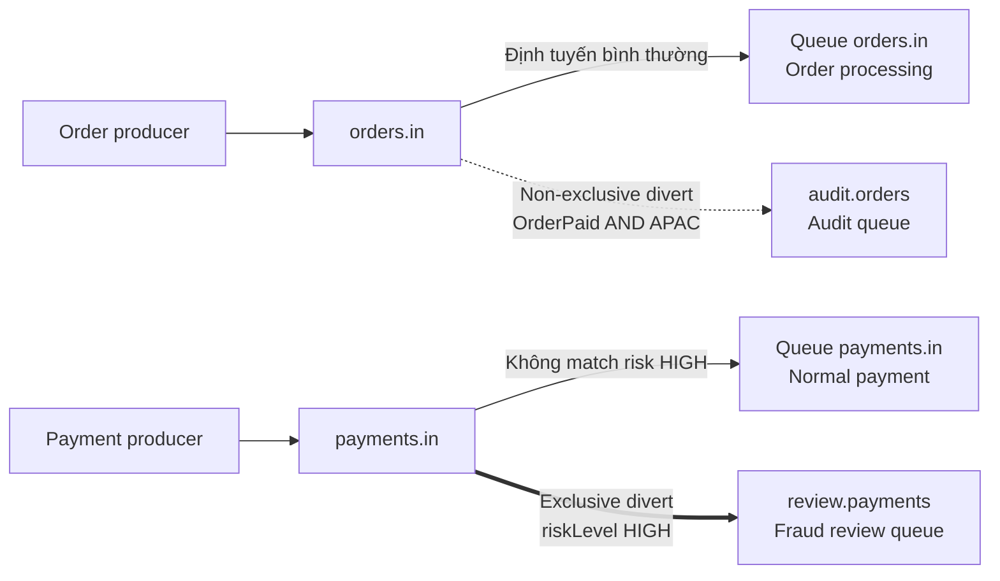
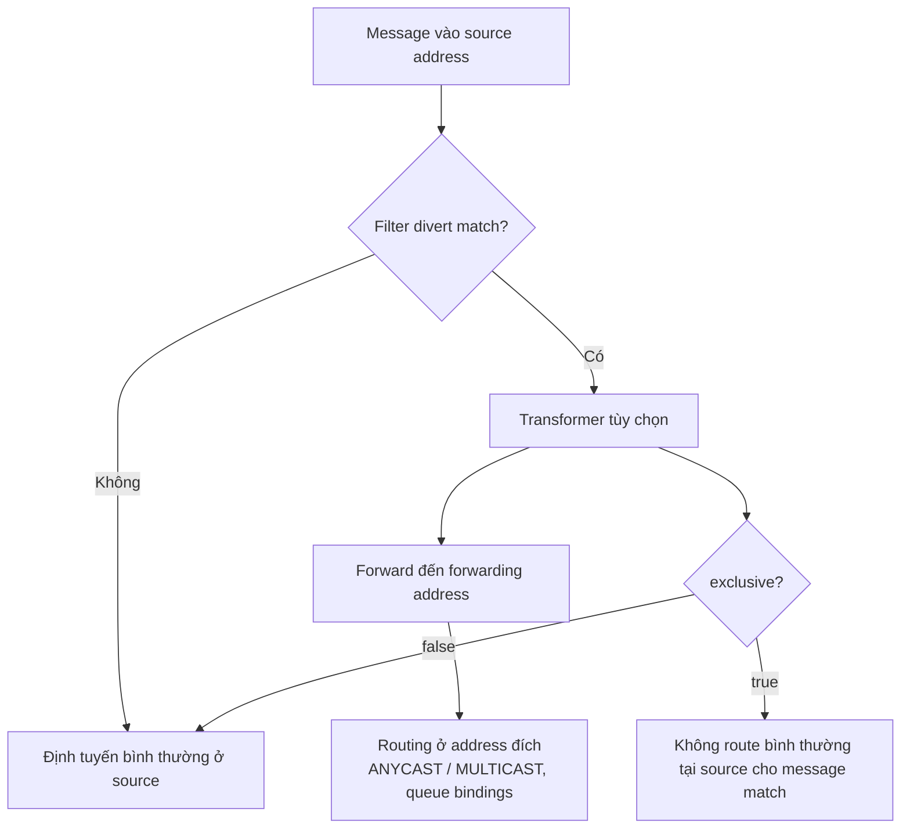

# Divert, transformer và phân luồng thông điệp

> **Chương:** Định tuyến Artemis  
> **Trọng tâm:** Cấu hình `divert` trong Apache ActiveMQ Artemis để chuyển hoặc sao chép thông điệp giữa các address, dùng filter chọn thông điệp và transformer chỉnh bản chuyển tiếp. Ví dụ sử dụng Java/Jakarta Messaging, broker Artemis và cách kiểm chứng đường đi của message.

## 1. Tình huống áp dụng: một lần gửi, nhiều đường xử lý có chủ đích

Một hệ thống thương mại điện tử nhận sự kiện thanh toán. Với message `OrderPaid` có vùng xử lý `APAC`, nhóm Audit muốn có **một bản riêng** để ghi nhật ký tuân thủ nhưng quy trình xử lý đơn hàng vẫn phải nhận message như bình thường. Ở luồng khác, giao dịch có `riskLevel = 'HIGH'` phải đến consumer rà soát gian lận **thay vì** consumer thanh toán thông thường.

Ta muốn giữ producer đơn giản: producer chỉ biết address đích của nghiệp vụ, không phải viết code “gửi thêm cho Audit” hoặc “chọn queue Fraud Review”. Artemis có thể áp dụng **divert** ở broker để định tuyến theo các thuộc tính message đã được producer công bố.



Hai yêu cầu trên có ngữ nghĩa khác nhau:

- **Non-exclusive divert**: khi filter match, message tiếp tục đến address ban đầu **và** được chuyển đến forwarding address. Phù hợp cho audit, giám sát, sao chép một nhánh sự kiện.
- **Exclusive divert**: khi filter match, message được chuyển đến forwarding address **thay cho** đường định tuyến bình thường ở source address. Phù hợp cho tách luồng ưu tiên, kiểm duyệt, phân loại nghiệp vụ.

Vì divert xử lý ngay trong broker, nó không cần một consumer Java lấy message rồi gửi lại qua producer thứ hai. Tuy vậy, broker chỉ làm **routing**, không tự quyết định nghiệp vụ đã xử lý thành công, không thay thế ack/transaction/idempotency.

## 2. Divert hoạt động tại address, trước khi message đến queue

Trong Artemis, producer gửi message tới một **address**. Address có thể có queue với routing type `ANYCAST` hoặc `MULTICAST`. Divert được gắn vào **source address** và có thể áp dụng **filter** cho những message đi qua address đó.

Các phần cấu hình quan trọng:

| Thuộc tính divert | Ý nghĩa | Ví dụ |
|---|---|---|
| `name` | Tên duy nhất của divert trong broker, dùng để quản trị | `copy-paid-apac-to-audit` |
| `address` | Source address nơi divert theo dõi message | `orders.in` |
| `forwarding-address` | Address nhận message đã được divert | `audit.orders` |
| `exclusive` | `false`: forward thêm một nhánh; `true`: message match không đi đường bình thường ở source | `false` / `true` |
| `filter string` | Biểu thức chọn message theo property/header mà bộ lọc core hỗ trợ | `eventType = 'OrderPaid' AND region = 'APAC'` |
| `transformer` | Class chạy trong broker để sửa message được divert trước khi đưa đến forwarding address | `lab.routing.AuditStampTransformer` |

**Chỗ đứng chính xác của divert:** filter được đánh giá trên message ở source address; nếu match, broker forward đến address đã cấu hình và sau đó các queue nhận ở đích theo routing của đích. Divert không định danh consumer cụ thể, không tự tạo một consumer và không đồng nghĩa với việc gọi `MessageConsumer`.

### 2.1. Exclusive và non-exclusive theo từng message

Giả sử một source address `events.in` có queue bình thường `events.in` và forwarding address `events.archive`, divert lọc `type = 'IMPORTANT'`:

| Message đến source | `exclusive=false` | `exclusive=true` |
|---|---|---|
| `type='IMPORTANT'`, filter match | Định tuyến tại source **và** forward đến archive | Chỉ forward đến archive; không định tuyến bình thường tại source do divert này |
| `type='NORMAL'`, filter không match | Chỉ định tuyến tại source | Chỉ định tuyến tại source |
| Không có filter | Áp dụng với mọi message đi qua address được cấu hình | Áp dụng với mọi message đi qua address được cấu hình |

Điều này chỉ mô tả **một divert và routing thông thường của source**. Khi cấu hình **nhiều diverts chồng lấp**, nhiều forwarding address, nhiều queue, hoặc thêm bridge/cluster, cần kiểm tra thực tế tổng số route và các bản message; không nên giả định một bảng giản lược đủ mô tả mọi tổ hợp.

### 2.2. Divert không phải queue filter hay application router

| Cơ chế | Phạm vi tác động | Điểm khác đáng chú ý |
|---|---|---|
| **Divert** | Route từ một **address** sang **address khác** trên cùng broker | Có thể non-exclusive/exclusive; có filter, transformer; sender không cần biết route phụ |
| **Queue filter** | Quyết định message nào đi vào **queue cụ thể** | Không tự tạo bản forward sang address khác |
| **Consumer selector (JMS)** | Lọc message mà consumer muốn nhận từ destination | Thuộc consumer/session; không thay thế provisioning/định tuyến broker |
| **Bridge** | Chuyển message giữa các queue/broker theo cấu hình bridge | Dành cho kịch bản kết nối broker/transport, khác với divert nội bộ |
| **Producer-side routing** | Producer tự quyết định gửi tới destination nào | Dễ phụ thuộc nghiệp vụ vào topology broker; có thể phù hợp nếu logic routing thuộc ứng dụng |

Divert phù hợp khi một quy tắc định tuyến cần được **quản lý tập trung trong broker**. Nếu yêu cầu làm phép tính nghiệp vụ phức tạp, truy vấn database, đánh giá machine-learning hay gọi dịch vụ ngoài, nên tính trước thuộc tính định tuyến ở ứng dụng/service chuyên trách rồi gửi property cho broker; không biến transformer đồng bộ của broker thành một business service.

## 3. Lab A — Sao chép sự kiện OrderPaid vùng APAC cho Audit

Mục tiêu: producer chỉ gửi đến `orders.in`. Artemis đưa message vào queue xử lý bình thường `orders.in`; nếu đồng thời `eventType='OrderPaid'` và `region='APAC'` thì **thêm một bản** vào queue `audit.orders`.

### 3.1. Cấu hình address và divert

Chèn các phần tử dưới đây vào **phần `<core>` tương ứng trong `broker.xml`** của instance Artemis. Đoạn này mô tả **nội dung bên trong** `<core>`, không phải một file XML độc lập hoàn chỉnh. Nếu đã có `<addresses>` hoặc `<diverts>`, hãy bổ sung node vào **khối hiện có**; đừng tạo khối trùng ở vị trí sai.

```xml
<addresses>
    <address name="orders.in">
        <anycast>
            <queue name="orders.in"/>
        </anycast>
    </address>
    <address name="audit.orders">
        <anycast>
            <queue name="audit.orders"/>
        </anycast>
    </address>
</addresses>

<diverts>
    <divert name="copy-paid-apac-to-audit">
        <address>orders.in</address>
        <forwarding-address>audit.orders</forwarding-address>
        <filter string="eventType = 'OrderPaid' AND region = 'APAC'"/>
        <exclusive>false</exclusive>
    </divert>
</diverts>
```

Ở đây queue đặt **cùng tên với address** để dễ dùng API `context.createQueue("orders.in")` và `context.createQueue("audit.orders")`. Trong dự án thật, queue có thể có tên khác address; khi đó client Artemis có thể cần chỉ rõ **fully qualified queue name (FQQN)** `address::queue` để tiêu thụ đúng queue.

Điểm cần kiểm chứng:

1. `orders.in` là **source address** có anycast queue cho consumer nghiệp vụ.
2. `audit.orders` là **forwarding address** có queue riêng; nó **không** tự xuất hiện chỉ nhờ `<forwarding-address>` nếu hệ thống tắt auto-create và chưa provision.
3. Bộ lọc kiểm tra **message properties**, không tự phân tích trường JSON `eventType` hay `region` trong body.
4. `exclusive=false` giữ đường xử lý đơn hàng nguyên trạng khi filter match.
5. Hai queue được cấu hình trước giúp kết quả test ổn định, không phụ thuộc cơ chế auto-create của broker.

### 3.2. Kết quả dự kiến

| Message gửi vào `orders.in` | Queue `orders.in` | Queue `audit.orders` | Vì sao |
|---|---|---|---|
| `OrderPaid`, `APAC` | +1 | +1 | Match cả hai điều kiện; divert non-exclusive |
| `OrderPaid`, `EU` | +1 | +0 | Sai điều kiện vùng |
| `OrderCancelled`, `APAC` | +1 | +0 | Sai điều kiện loại sự kiện |
| `OrderPaid`, thiếu property `region` | +1 | +0 | Bộ lọc không match property thiếu |

Nếu muốn Audit nhận *mọi* `OrderPaid`, chỉ cần filter `eventType = 'OrderPaid'`. Nếu muốn mọi message từ source được sao chép, bỏ filter. Tuy nhiên cần cân nhắc chi phí storage/throughput và bảo mật trước khi sao chép dữ liệu nhạy cảm cho một consumer khác.

## 4. Lab B — Exclusive divert giao dịch rủi ro cao

Mục tiêu: producer luôn gửi giao dịch đến `payments.in`. Message có `riskLevel='HIGH'` phải được **chuyển sang** queue `review.payments`. Các message còn lại tiếp tục vào queue `payments.in` để consumer bình thường xử lý.

Thêm address và divert dưới đây vào các khối `<addresses>`, `<diverts>` **đang tồn tại** trong `broker.xml` (khác với Lab A; không nhân đôi wrapper):

```xml
<!-- Them vao <addresses> hien co -->
<address name="payments.in">
    <anycast>
        <queue name="payments.in"/>
    </anycast>
</address>
<address name="review.payments">
    <anycast>
        <queue name="review.payments"/>
    </anycast>
</address>

<!-- Them vao <diverts> hien co -->
<divert name="route-high-risk-to-review">
    <address>payments.in</address>
    <forwarding-address>review.payments</forwarding-address>
    <filter string="riskLevel = 'HIGH'"/>
    <exclusive>true</exclusive>
</divert>
```

Với config này:

| Message gửi `payments.in` | Queue `payments.in` | Queue `review.payments` |
|---|---|---|
| `riskLevel='HIGH'` | +0 | +1 |
| `riskLevel='LOW'` | +1 | +0 |
| Không có `riskLevel` | +1 | +0 |

Vì đây là **exclusive divert**, nếu `review.payments` chưa được tạo, sai routing type, không có queue phù hợp, hoặc không có quyền/config phù hợp, message match có thể **không đến nơi mong đợi**. Không triển khai exclusive divert trên luồng nghiệp vụ quan trọng trước khi kiểm tra đầy đủ đường đích và monitoring.

**Phân biệt với hai consumer cùng đọc một queue:** nếu chỉ đặt một consumer bình thường và một consumer fraud cùng đọc `payments.in`, hai consumer **cạnh tranh** nhận message, không bảo đảm consumer fraud nhận mọi giao dịch rủi ro cao. Exclusive divert định tuyến ở **broker**, trước khi consumer tranh message.

## 5. Java producer: gửi property để divert quyết định tuyến

Ví dụ dùng **Jakarta Messaging** `jakarta.jms` và **Artemis Jakarta client**; producer giao tiếp bằng client Artemis tới broker phù hợp (thường qua Artemis Core trên TCP). Chương trình chỉ gửi vào source address, hoàn toàn **không gửi trực tiếp** tới Audit hoặc Review.

### 5.1. Dependency Maven

Tối thiểu project Java 17 sử dụng dependency sau; đặt `artemis.version` thành **một phiên bản Artemis đã chọn và tương thích với broker/JDK** (ví dụ phiên bản client cùng dòng đã được kiểm thử trong lab). Đừng trộn artifact `javax.jms` với import `jakarta.jms`.

```xml
<properties>
    <maven.compiler.release>17</maven.compiler.release>
    <artemis.version>2.38.0</artemis.version>
</properties>
<dependencies>
    <dependency>
        <groupId>org.apache.activemq</groupId>
        <artifactId>artemis-jakarta-client</artifactId>
        <version>${artemis.version}</version>
    </dependency>
</dependencies>
```

### 5.2. Chương trình chạy độc lập

Đặt file tên `DivertRoutingProbe.java`:

```java
import jakarta.jms.ConnectionFactory;
import jakarta.jms.DeliveryMode;
import jakarta.jms.JMSContext;
import jakarta.jms.JMSConsumer;
import jakarta.jms.Message;
import jakarta.jms.Queue;
import jakarta.jms.TextMessage;
import org.apache.activemq.artemis.jms.client.ActiveMQConnectionFactory;

import java.util.UUID;

public class DivertRoutingProbe {
    private static String env(String key, String fallback) {
        String value = System.getenv(key);
        return value == null || value.isBlank() ? fallback : value;
    }

    public static void main(String[] args) throws Exception {
        if (args.length < 2) {
            throw new IllegalArgumentException(
                "Usage: send paid-apac|paid-eu|cancel-apac|risk-high|risk-low "
                + "OR receive orders.in|audit.orders|payments.in|review.payments");
        }

        String user = env("BROKER_USER", "lab");
        String password = System.getenv("BROKER_PASSWORD");
        if (password == null || password.isBlank()) {
            throw new IllegalStateException("Set BROKER_PASSWORD");
        }
        String brokerUrl = env("BROKER_URL", "tcp://localhost:61616");

        ConnectionFactory factory = new ActiveMQConnectionFactory(brokerUrl);
        try (JMSContext context = factory.createContext(
                user, password, JMSContext.SESSION_TRANSACTED)) {
            if ("send".equals(args[0])) {
                switch (args[1]) {
                    case "paid-apac":
                        send(context, "orders.in", "OrderPaid", "APAC", "LOW");
                        break;
                    case "paid-eu":
                        send(context, "orders.in", "OrderPaid", "EU", "LOW");
                        break;
                    case "cancel-apac":
                        send(context, "orders.in", "OrderCancelled", "APAC", "LOW");
                        break;
                    case "risk-high":
                        send(context, "payments.in", "PaymentSubmitted", "APAC",
                             "HIGH");
                        break;
                    case "risk-low":
                        send(context, "payments.in", "PaymentSubmitted", "APAC",
                             "LOW");
                        break;
                    default:
                        throw new IllegalArgumentException("Unknown case: " + args[1]);
                }
            } else if ("receive".equals(args[0])) {
                receiveOne(context, args[1]);
            } else {
                throw new IllegalArgumentException("Unknown action: " + args[0]);
            }
        }
    }

    private static void send(JMSContext context, String address,
                             String eventType, String region, String riskLevel) {
        String traceId = UUID.randomUUID().toString();
        Queue target = context.createQueue(address);
        TextMessage message = context.createTextMessage(
                "traceId=" + traceId + ";type=" + eventType);

        // CORE FILTER kiem tra message property, KHONG doc JSON body.
        message.setStringProperty("traceId", traceId);
        message.setStringProperty("eventType", eventType);
        message.setStringProperty("region", region);
        message.setStringProperty("riskLevel", riskLevel);

        context.createProducer()
               .setDeliveryMode(DeliveryMode.PERSISTENT)
               .send(target, message);
        context.commit(); // Transaction cua lan gui message.
        System.out.printf("SENT to=%s type=%s region=%s risk=%s traceId=%s%n",
                address, eventType, region, riskLevel, traceId);
    }

    private static void receiveOne(JMSContext context, String queueName)
            throws Exception {
        Queue queue = context.createQueue(queueName);
        try (JMSConsumer consumer = context.createConsumer(queue)) {
            Message message = consumer.receive(2000L);
            if (message == null) {
                System.out.println("NO_MESSAGE in=" + queueName);
                return;
            }
            try {
                String payload = message instanceof TextMessage
                        ? ((TextMessage) message).getText()
                        : "<non-text-message>";
                System.out.printf(
                    "RECEIVED from=%s traceId=%s type=%s region=%s risk=%s "
                    + "redelivered=%s payload=%s%n",
                    queueName,
                    message.getStringProperty("traceId"),
                    message.getStringProperty("eventType"),
                    message.getStringProperty("region"),
                    message.getStringProperty("riskLevel"),
                    message.getJMSRedelivered(), payload);
                context.commit(); // Co y consume va ACK message trong lab.
            } catch (Exception e) {
                context.rollback();
                throw e;
            }
        }
    }
}
```

Ở chế độ `receive`, chương trình **thực sự tiêu thụ message** và `commit()`, nên số message còn chờ trong queue sẽ giảm. Để quan sát route trước khi tiêu thụ, ưu tiên xem broker management console hoặc dùng management API; đừng chạy consumer để “xem thử” rồi kỳ vọng queue vẫn giữ nguyên.

Thực hành khi broker vừa triển khai cấu hình và các queue đang trống:

```text
# Bước 1: gửi 5 message vào 2 source address.
send paid-apac
send paid-eu
send cancel-apac
send risk-high
send risk-low

# Bước 2: đối chiếu số message ĐANG CHỜ trong các queue (khi chưa có consumer):
orders.in        = 3
audit.orders     = 1
payments.in      = 1
review.payments  = 1

# Bước 3: receive từng queue và đối chiếu traceId trước khi commit.
receive audit.orders       # Nhận đúng traceId của paid-apac.
receive review.payments    # Nhận đúng traceId của risk-high.
receive payments.in        # Nhận traceId của risk-low.
receive orders.in          # Nhận một trong ba event nguồn; lặp 3 lần để đọc đủ.
```

Có thể chạy bằng Maven `exec:java` hoặc IDE. Ví dụ project đã có `exec-maven-plugin` và source nằm trong `src/main/java`:

```bash
export BROKER_URL='tcp://localhost:61616'
export BROKER_USER='lab'
export BROKER_PASSWORD='set-your-local-secret'

mvn -q compile exec:java -Dexec.mainClass=DivertRoutingProbe -Dexec.args="send paid-apac"
mvn -q compile exec:java -Dexec.mainClass=DivertRoutingProbe -Dexec.args="send paid-eu"
mvn -q compile exec:java -Dexec.mainClass=DivertRoutingProbe -Dexec.args="send cancel-apac"
mvn -q compile exec:java -Dexec.mainClass=DivertRoutingProbe -Dexec.args="send risk-high"
mvn -q compile exec:java -Dexec.mainClass=DivertRoutingProbe -Dexec.args="send risk-low"
mvn -q compile exec:java -Dexec.mainClass=DivertRoutingProbe -Dexec.args="receive audit.orders"
```

Nếu Maven project chưa có exec plugin, thêm `org.codehaus.mojo:exec-maven-plugin` ở phần build plugins hoặc chạy class từ IDE. Client kết nối port mà broker lắng nghe; giá trị cổng chỉ là endpoint, không quyết định chính sách divert. Với môi trường production, dùng TLS và cơ chế quản lý secret đúng chuẩn của hệ thống.

**Kết quả quan trọng nhất:** message `paid-apac` xuất hiện tại cả `orders.in` và `audit.orders`, với **cùng giá trị property `traceId`** do producer đặt; message `risk-high` xuất hiện tại `review.payments` và **không** xuất hiện tại queue gốc `payments.in` do exclusive divert. Không dùng `JMSMessageID` làm bằng chứng duy nhất về cùng một sự kiện khi có copy/transform/protocol mapping; hãy dùng `traceId` hoặc business event ID do ứng dụng quản lý.

## 6. Transformer: thay đổi bản message được divert ngay trong broker

Divert thường chỉ cần filter và forwarding address. Khi Audit muốn biết message được chuyển qua quy tắc nào, có thể thêm một **transformer** vào divert để gắn property `auditRoute` và thời điểm forward. Transformer hoạt động trong tiến trình **broker**, khác với `MessageConverter` chạy phía Java client.

### 6.1. Transformer dùng trong trường hợp nào?

Các mục đích hợp lý:

- Bổ sung property truy vết: `auditRoute=copy-paid-apac-to-audit`.
- Chuẩn hóa một metadata đơn giản cần cho đích downstream, chẳng hạn cờ phân loại luồng.
- Đánh dấu thời điểm message đi qua route để quan sát latency.

**Không phù hợp:** gọi HTTP/database đồng bộ, giải mã/ghi dữ liệu bí mật ra log, chạy xử lý CPU nặng hoặc quyết định nghiệp vụ dựa trên external service. Transformer nằm trên tuyến xử lý message của broker nên độ trễ và exception của nó có thể ảnh hưởng trực tiếp tới throughput/độ ổn định.

### 6.2. Class Java transformer của Artemis

Ví dụ với API Artemis 2.x, biên dịch class theo **đúng dependency/version phù hợp broker**, không theo riêng version của JMS client:

```java
package lab.routing;

import org.apache.activemq.artemis.api.core.Message;
import org.apache.activemq.artemis.api.core.SimpleString;
import org.apache.activemq.artemis.core.server.transformer.Transformer;

public final class AuditStampTransformer implements Transformer {
    @Override
    public Message transform(Message message) {
        // Phan loai tren forwarded message; khong thay payload nghiep vu.
        message.putStringProperty(
                SimpleString.of("auditRoute"),
                SimpleString.of("copy-paid-apac-to-audit"));
        message.putLongProperty(
                SimpleString.of("auditForwardedAtEpochMs"),
                System.currentTimeMillis());
        return message;
    }
}
```

Đây là class thuộc **broker-side Artemis API**, không phải `jakarta.jms.Message` hoặc API chạy trong ứng dụng producer. Nếu một bản Artemis khác dùng tên phương thức `SimpleString` hoặc signature `Message` khác, chọn API của phiên bản server đó và biên dịch lại; không đưa JAR chỉ chứa JMS client vào broker rồi kỳ vọng triển khai được `Transformer`.

Dependency build (đặt `artemis.version` trùng version broker sẽ chạy, và dùng phạm vi `provided` để tránh đóng gói trùng các thư viện server):

```xml
<dependency>
    <groupId>org.apache.activemq</groupId>
    <artifactId>artemis-server</artifactId>
    <version>${artemis.version}</version>
    <scope>provided</scope>
</dependency>
```

Điều chỉnh divert của Lab A để gọi class:

```xml
<divert name="copy-paid-apac-to-audit">
    <address>orders.in</address>
    <forwarding-address>audit.orders</forwarding-address>
    <filter string="eventType = 'OrderPaid' AND region = 'APAC'"/>
    <transformer>
        <class-name>lab.routing.AuditStampTransformer</class-name>
    </transformer>
    <exclusive>false</exclusive>
</divert>
```

Trong một số cấu hình/phiên bản Artemis cũ có dạng `<transformer-class-name>...`; ví dụ ở đây dùng cấu trúc `<transformer>`/`<class-name>` của cấu hình Artemis 2.x hỗ trợ kiểu khai báo này. **Không đặt đồng thời hai cách khai báo transformer** cho cùng divert.

### 6.3. Triển khai và kiểm thử transformer

1. Biên dịch `AuditStampTransformer` thành JAR. Đảm bảo class implement đúng interface `org.apache.activemq.artemis.core.server.transformer.Transformer` của **server version**, và không tự đóng gói bản thứ hai của Artemis server API vào JAR.
2. Cung cấp JAR trên **broker runtime classpath** theo cách đóng gói instance đang dùng. Với broker instance độc lập có thể dùng cơ chế thư viện bổ sung của instance; với Docker cần mount/copy JAR vào nơi được classloader của image nạp và giữ thay đổi qua lần tạo lại container. **Xác minh quy tắc classpath của chính bản phân phối/image**; chỉ đặt JAR vào thư mục bất kỳ không bảo đảm broker nhìn thấy.
3. Khai báo `<transformer>` trong divert và khởi động lại/reload cấu hình theo cơ chế broker version hỗ trợ. Kiểm tra log không có lỗi parse XML, `ClassNotFoundException` hoặc `NoClassDefFoundError`.
4. Gửi `paid-apac`, quan sát queue `audit.orders`; consumer audit phải đọc được `auditRoute` và `auditForwardedAtEpochMs`.
5. Quan sát **bản ở `orders.in`** để kiểm chứng nó vẫn dùng payload/property như mong đợi cho xử lý nghiệp vụ. Đặc biệt kiểm tra behavior nếu transformer chỉnh body hoặc thay header: không suy đoán mọi extension có cùng copy semantics ở mọi phiên bản/protocol.

Trong ví dụ client ở mục 5, có thể mở rộng `receiveOne` để in metadata:

```java
String auditRoute = message.getStringProperty("auditRoute");
long auditTime = message.propertyExists("auditForwardedAtEpochMs")
        ? message.getLongProperty("auditForwardedAtEpochMs")
        : -1L;
System.out.printf("auditRoute=%s forwardedAt=%d%n",
        auditRoute, auditTime);
```

**Điểm an toàn:** transformer nên được viết sao cho khi một message bị redeliver hoặc một test gửi lại, việc gắn property không tạo side effect ngoài broker. Không tính cước, gửi email hay tạo đơn thật từ transformer; các việc đó thuộc consumer có retry/idempotency rõ ràng.

## 7. Thứ tự xử lý filter, transformer và chính sách queue

Với một divert điển hình, tư duy kiểm tra:



Sơ đồ mô tả **một divert** và các nhánh quyết định logic; nó không biểu diễn tất cả trường hợp nhiều divert tương tác.

Các sai lầm dễ mắc:

**1. Dùng JSON body làm điều kiện filter mà không đặt property.**

```java
// Body co "region":"APAC" nhung broker filter khong tu parse JSON:
TextMessage message = context.createTextMessage(
        "{\"eventType\":\"OrderPaid\",\"region\":\"APAC\"}");

// Can them cac typed message properties khi muon dung core filter:
message.setStringProperty("eventType", "OrderPaid");
message.setStringProperty("region", "APAC");
```

**2. Dùng số dưới dạng chuỗi rồi so sánh số.** Nếu cần ngưỡng rủi ro `riskScore >= 80`, producer nên đặt property kiểu số như `setIntProperty("riskScore", 95)`, và filter phải dùng ngữ nghĩa số `riskScore >= 80`. Đừng mặc nhiên coi chuỗi `"95"` và số nguyên 95 như nhau trong filter.

**3. Quên filter thuộc divert, không phải filter tự động cho queue đích.** Nếu producer khác gửi thẳng tới `audit.orders`, nó có thể vào audit queue mà không đi qua divert từ `orders.in`. Hãy kết hợp quyền `send`, quy ước route và queue filter nếu cần để hạn chế nguồn.

**4. Để forwarding address không có binding phù hợp.** Một divert đã match không đảm bảo message được lưu nếu đích không có queue hợp lệ. Với `exclusive=true`, nguy cơ không còn bản tại source càng cần được kiểm thử.

**5. Tạo vòng chuyển tiếp.** Tránh divert `A → B` rồi tiếp tục cấu hình `B → A` hoặc chuyển tiếp qua chuỗi address quay lại điểm đầu. Vòng route gây rủi ro không dự đoán được về tải và phân phối; hãy thiết kế đồ thị address **không chu trình** cho bài lab.

## 8. Phân luồng nhiều nhánh: chọn thiết kế nào?

Ví dụ dịch vụ Payment muốn chia thành Normal, Manual Review và Audit:

| Yêu cầu | Cấu hình đề xuất | Tác động |
|---|---|---|
| Mọi payment vẫn vào normal, nhưng payment APAC được audit | Non-exclusive divert với filter phù hợp | Bản bình thường vẫn có; audit nhận một bản match |
| Payment rủi ro cao **không được xử lý tự động** | Exclusive divert `riskLevel='HIGH'` đến `review.payments` | Message match bị chuyển khỏi route gốc |
| Dịch vụ Fraud và Accounting đều cần độc lập nhận mọi sự kiện | Dùng address multicast/queues subscription phù hợp hoặc thiết kế các divert rõ ràng | Mỗi consumer group có backlog riêng |
| Chỉ consumer nào nhận message trong một queue cần lọc khác nhau | Cân nhắc queue filter hoặc tách queue ở broker | Tránh nhầm message selector với sao chép event |
| Gửi message giữa hai broker | Xem xét bridge/cluster/federation theo phiên bản và topology | Divert trên một broker không tự thay thế kết nối liên broker |
| Gắn nhãn audit đơn giản | Transformer broker-side | Không nhúng side effect nghiệp vụ hoặc I/O chậm |

### 8.1. Hai divert cùng nguồn có thể gây bất ngờ

Giả sử cùng address `payments.in` vừa có một **non-exclusive audit divert**, vừa có **exclusive high-risk divert**. Lúc này message `HIGH` có thể match **cả hai rule**. Đừng suy luận “exclusive nghĩa là không còn bản audit”: exclusive chặn đường định tuyến bình thường ở source cho phần message nó xử lý, còn các rule divert khác có thể vẫn được đánh giá theo semantics/cấu hình của broker. Để phân tích đúng, hãy kiểm tra bằng integration test với **mọi tổ hợp** property:

| eventType | riskLevel | Đầu ra cần xác minh |
|---|---|---|
| `PaymentSubmitted` | `LOW` | Normal, và audit nếu audit rule match |
| `PaymentSubmitted` | `HIGH` | Review, và audit nếu thiết kế muốn; **không được tự chạy xử lý tự động** |
| `PaymentCancelled` | `HIGH` | Chỉ những queue do rule đã định nghĩa; kiểm tra có cần review loại này không |
| Thiếu property | Không rõ | Có fallback an toàn không; message không match phải đi đâu |

Trong hệ thống thanh toán thật, ưu tiên tạo **một ma trận routing được chấp thuận** và test tích hợp, rồi mới triển khai nhiều divert chồng lấp. Nếu cần phân loại độc quyền phức tạp với thứ tự ưu tiên, có thể cho ứng dụng/router service xác định trường `routeClass` trước hoặc bố trí các address trung gian rõ ràng, thay vì dựa vào một thứ tự thực thi không được kiểm chứng.

### 8.2. Luồng gợi ý cho dữ liệu nhạy cảm

Audit thường muốn lưu ít trường hơn đường xử lý chính. Tuy nhiên **thêm transformer không tự làm dữ liệu trở nên an toàn**: nếu message body vẫn chứa thông tin nhạy cảm, sao chép nguyên body sang queue audit có thể tăng phạm vi dữ liệu. Khi cần giảm thiểu dữ liệu, nên cân nhắc **publish audit event riêng** chỉ chứa trường được phép hoặc transformer đã được kiểm thử kỹ về body, encoding, integrity, header và policy trước khi đưa vào production. Phân quyền consumer audit, TLS, retention và DLQ phải được cấu hình riêng cho queue audit.

## 9. Bảo toàn delivery, transaction và xử lý lỗi ở nhánh đích

Divert quyết định **tuyến**, không quyết định **xử lý thành công**. Đối với message persistent, broker dùng persistence theo cấu hình; nếu producer gửi trong transaction JMS, route liên quan đến message tuân theo xử lý transaction của broker. Khi consumer Audit hoặc Fraud nhận message, mỗi queue có acknowledgment và backlog riêng.

Ví dụ một message `paid-apac` đã đến cả:

```text
orders.in        -> Order consumer: commit thành công
audit.orders     -> Audit consumer: rollback vì lỗi database
```

Hệ quả: message ở queue xử lý đơn có thể đã được ack, còn bản ở audit có thể **redeliver** và cuối cùng tới **DLQ** theo chính sách. Không dùng việc queue `orders.in` trống để kết luận audit cũng đã xử lý thành công.

Các điểm cần kiểm tra:

- **Delivery mode:** producer dùng `PERSISTENT` nếu cần giữ message qua broker restart theo khả năng store; không xem `NON_PERSISTENT` như bảo đảm bền vững.
- **Ack/transaction:** commit/rollback nằm ở consumer/session; transaction JMS không tự gộp database bên ngoài.
- **Redelivery & DLQ:** chính sách có thể khác giữa queue gốc, audit và review; poison message ở Audit không nên chặn quy trình đơn hàng chính.
- **TTL/expiry:** một message bị quá hạn có thể không đến consumer dù divert đã route thành công; kiểm tra expiry address và policy.
- **Duplicate processing:** nếu retry hoặc crash gần thời điểm commit, consumer phải dùng `traceId`/business event ID để idempotent. Nhánh audit và nhánh nghiệp vụ đều phải chống tác dụng lặp.
- **Backpressure:** thêm nhánh copy tăng số message phải lưu; một Audit consumer chậm có thể làm backlog và dung lượng broker tăng, ảnh hưởng toàn instance.

Không tự kết luận “cùng một lần gửi thì cả hai consumer đều xử lý nguyên tử”. Divert bảo đảm routing theo cơ chế broker, nhưng mỗi consumer có vòng đời xử lý, ack và failure riêng.

## 10. Triển khai, giám sát và chẩn đoán

### 10.1. Các bước triển khai thay đổi cấu hình

1. **Chụp cấu hình đang chạy:** xác định đúng instance Artemis, `broker.xml` đang được nạp, source address, queue đích và các diverts đã tồn tại. Giữ bản rollback cấu hình/JAR transformer cũ.
2. **Provision destination:** tạo address và queue trước, xác minh routing type phù hợp. Với production, tránh phụ thuộc ngẫu nhiên vào auto-create.
3. **Áp dụng divert:** đặt tên nhất quán, filter theo typed property, chỉ dùng `exclusive=true` sau khi chứng minh đường đích có consumer và cơ chế xử lý lỗi phù hợp.
4. **Triển khai transformer nếu có:** JAR đúng server version trên broker classpath; kiểm tra signature/classloader trong môi trường gần production.
5. **Kích hoạt thay đổi:** reload/restart theo khả năng áp dụng cấu hình của phiên bản broker, đọc log startup để loại trừ lỗi XML/classloading; đừng suy đoán mọi thay đổi `broker.xml` đều reload nóng.
6. **Test negative và positive:** gửi message match, không match, thiếu property, sai type, và xác minh counts ở **tất cả queue liên quan** khi consumer tạm dừng.
7. **Bật quan sát dài hạn:** message added, ready/delivering count, consumer count, redelivery, expiry/DLQ, disk/paging, memory và lỗi transformer.
8. **Có đường lui:** nếu thấy route sai, khôi phục cấu hình divert cũ; kiểm tra backlog đã phát sinh ở nhánh mới trước khi xóa queue. Đổi config không tự đưa message đã chuyển về source.

### 10.2. Bảng chẩn đoán thực tế

| Hiện tượng | Nguyên nhân khả dĩ | Cách kiểm tra |
|---|---|---|
| Audit queue luôn bằng 0 | Filter sai tên/type; producer không đặt property; divert chưa được nạp; destination không có queue; consumer audit nhận quá nhanh | Kiểm tra property thực tế, log broker, config đang nạp, queue bindings và consumer count |
| Message HIGH vẫn vào normal | `exclusive` bị đặt `false`; filter không match; gửi vào source khác; message property bị thiếu/sai | Test message HIGH đã xác định traceId, kiểm tra source và filter |
| Message HIGH biến mất khỏi normal mà review cũng trống | Exclusive route match nhưng không có đích hợp lệ, expiry/DLQ, hoặc consumer review đã ack | Xem address/queue bindings, logs, delivering, DLQ, expiry, audit trail |
| Audit thấy hai bản cùng event | Producer gửi lặp; hai divert match; client replay; thêm route chồng lấp | Đối chiếu business `traceId`, policy idempotency và tất cả divert trên address |
| Broker báo lỗi khởi tạo transformer | JAR không nằm trong classpath; class name sai; API version mismatch | Xem `ClassNotFoundException`/`NoClassDefFoundError`, version và build artifact |
| Route đúng nhưng queue review tăng không ngừng | Review consumer offline/chậm, transaction rollback, DLQ chưa phù hợp | Kiểm tra consumer count, delivering/ready, redelivery delay và capacity |
| Restart xong route khác trước | Sửa nhầm config file/instance; thay image; auto-create, XML không áp dụng | Xác định broker instance và `broker.xml` thực tế, đọc startup log, lặp ma trận test |

### 10.3. Tối thiểu phải quan sát gì?

Đối với mỗi route, ghi lại:

```text
Route: copy-paid-apac-to-audit
Source address: orders.in
Forwarding address: audit.orders
Rule: eventType = 'OrderPaid' AND region = 'APAC'
Exclusive: false
Message traceId: <ID thuc te>
Queue orders.in: <ready/delivering truoc/sau>
Queue audit.orders: <ready/delivering truoc/sau>
DLQ/expiry: <ket qua>
Transformer loaded: <ten class / server version>
Expected: 1 normal + 1 audit
Observed: <gia tri do duoc>
```

Đặc biệt, dùng **số liệu trước/sau khi tạm dừng consumers** hoặc dùng công cụ duyệt message không ack để tránh việc consumer xử lý nhanh làm queue depth về 0 rồi hiểu nhầm divert không chạy.

## 11. Bài tập thực hành có thể kiểm chứng

**Bài 1 — Sao chép có điều kiện.** Bắt đầu với Lab A, publish `OrderPaid/APAC`, `OrderPaid/EU` và `OrderCancelled/APAC`. Tạo bảng `traceId → các queue xuất hiện`. Giải thích vì sao chỉ một event được forward đến Audit, trong khi ba event vẫn đi vào queue gốc.

**Bài 2 — Chuyển hướng độc quyền.** Bật Lab B. Publish `PaymentSubmitted` với `riskLevel=HIGH`, `LOW` và thiếu property `riskLevel`. Chứng minh chỉ event HIGH đến `review.payments`; hai event còn lại ở `payments.in`. Kiểm tra cả trường hợp không có consumer nào hoạt động.

**Bài 3 — Filter kiểu số.** Thêm property Java `message.setIntProperty("riskScore", 91)`; thay đổi quy tắc thành `riskScore >= 80`. Gửi score 79, 80 và 91 để xác minh các giá trị ranh giới. Dùng một message gửi property `riskScore` kiểu `String` để chứng minh lý do phải dùng đúng type.

**Bài 4 — Transformer.** Đóng gói `AuditStampTransformer` vào broker, bật transformer cho Lab A. Kiểm tra `auditRoute` và `auditForwardedAtEpochMs` tại audit queue, rồi so sánh bản xử lý bình thường cùng `traceId`. Giải thích vì sao không dùng transformer để gọi payment gateway.

**Bài 5 — Xử lý lỗi độc lập.** Với message đã được divert non-exclusive, cho Order consumer commit còn Audit consumer rollback. Quan sát redelivery, DLQ, và xác minh việc audit thất bại không tạo lại tác dụng nghiệp vụ phía Order.

**Bài 6 — Ma trận route chồng lấp.** Thêm một non-exclusive audit divert cho `payments.in`, sau đó gửi HIGH/LOW. Tự ghi **giá trị kỳ vọng** trước, so với kết quả broker và điều chỉnh thiết kế nếu hệ thống yêu cầu HIGH chỉ được Review nhận mà Audit không được nhận. Không dựa vào thứ tự khai báo diverts nếu chưa có bằng chứng rõ ràng từ phiên bản sử dụng.

## 12. Tổng kết kỹ thuật

Điều cốt lõi của chủ đề **Divert, transformer và phân luồng thông điệp** nằm ở việc định nghĩa rõ:

- **Source address** nào kích hoạt divert, **filter** nào match đúng typed properties, và **forwarding address** có queue binding phù hợp hay chưa.
- **Non-exclusive** để giữ đường gốc và thêm nhánh; **exclusive** để tách message match khỏi đường gốc. Non-matching message tiếp tục theo định tuyến thông thường.
- **Transformer** chạy **trong broker** trên luồng divert; nên nhẹ, có thể kiểm thử, không làm việc I/O nghiệp vụ và tương thích server API.
- **TraceId** của ứng dụng cho phép đối chiếu các bản qua nhiều queue; ack, redelivery, DLQ và idempotency phải được xử lý độc lập tại từng nhánh consumer.
- **Kiểm thử ma trận route và quan sát thực tế** trước khi triển khai, nhất là với exclusive divert hoặc nhiều quy tắc chồng lấp.

Khi dùng đúng cách, divert giúp Artemis phân luồng thông điệp tập trung tại broker mà producer vẫn chỉ phát tới destination nghiệp vụ ban đầu. Điều kiện để đáng tin cậy là cấu hình source–filter–destination chính xác, transformer có kiểm soát và đầy đủ kiểm chứng cho cả trường hợp match lẫn không match.
