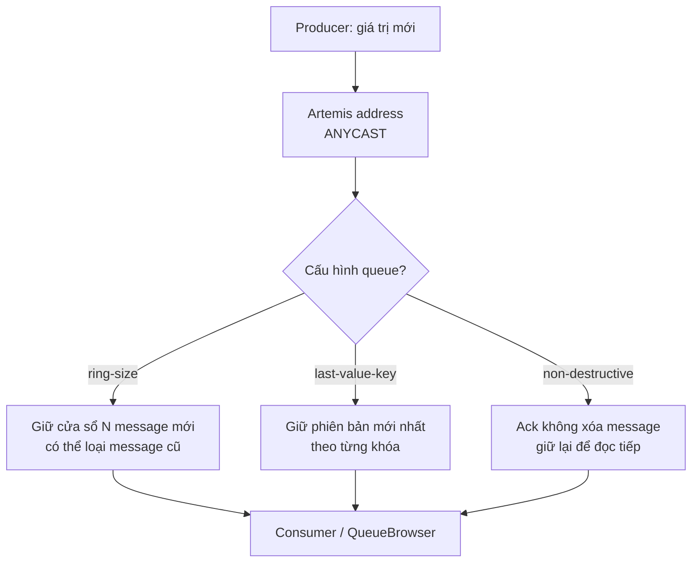
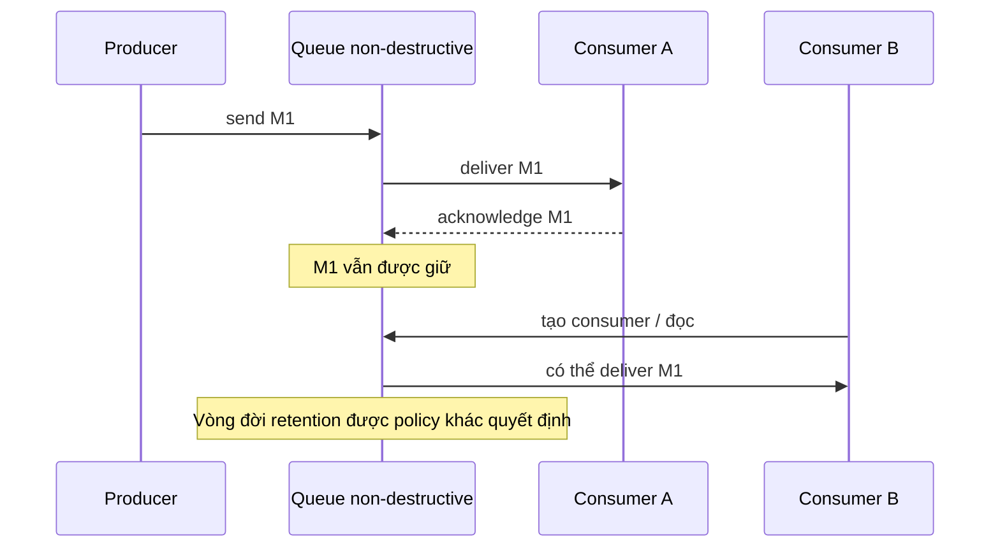

# Ring queue, last-value queue và non-destructive queue: mục đích và giới hạn

> **Chương:** Định tuyến Artemis  
> **Phạm vi:** Apache ActiveMQ **Artemis**, tập trung vào hành vi giữ, thay thế và tiêu thụ message **bên trong queue**. Ví dụ sử dụng broker Artemis với một address `ANYCAST` cho mỗi queue và Java/Jakarta Messaging client. Những thuộc tính này không phải cú pháp cấu hình của ActiveMQ Classic.

Trong Artemis, sau khi broker đã định tuyến một message vào một queue, ba cấu hình **`ring-size`**, **`last-value-key`** và **`non-destructive`** quyết định điều gì xảy ra với những message đang nằm trong queue:

- **Ring queue:** chỉ giữ một cửa sổ các message mới hơn; khi vượt giới hạn số lượng, message cũ có thể bị loại.
- **Last-value queue (LVQ):** giữ phiên bản mới nhất cho **mỗi khóa**; các phiên bản cũ cùng khóa đang chờ có thể bị thay thế.
- **Non-destructive queue:** việc consumer nhận/acknowledge message không tự xóa message khỏi queue; message có thể được đọc lại khi còn được giữ.

Đây là ba cơ chế có **mục tiêu khác nhau**. Ring và LVQ chủ động đánh đổi dữ liệu cũ để ưu tiên dữ liệu mới. Non-destructive thay đổi quy tắc xóa message khi tiêu thụ. Cả ba đều cần xem xét kỹ nếu nghiệp vụ yêu cầu xử lý **từng message đúng đủ**.

## 1. Một ví dụ làm rõ sự khác biệt

Giả sử broker nhận sáu giá trị nhiệt độ của cùng thiết bị `sensor-17`:

```text
Thời gian:    t1   t2   t3   t4   t5   t6
Nhiệt độ:     21   22   23   24   25   26
```

Trong điều kiện minh họa **không có consumer**, không có TTL/expiry, queue rỗng ban đầu và mọi message đã vào queue:

| Kiểu queue | Quy tắc giữ | Dữ liệu mong đợi còn chờ |
|---|---|---|
| Queue thông thường | Giữ các message chưa được tiêu thụ theo chính sách chung. | `21, 22, 23, 24, 25, 26` |
| Ring, `ring-size=3` | Khi cần chỗ cho message mới, loại message cũ nhất trong phần có thể loại. | `24, 25, 26` |
| LVQ, khóa `sensorId=sensor-17` | Các giá trị có cùng khóa thay thế phiên bản cũ chưa được giao/xử lý. | `26` |
| Non-destructive | Consumer có nhận và ack thì thông điệp vẫn nằm lại. | Trước khi đọc: cả sáu; sau một lượt đọc/ack, các message được giữ lại nếu không có cơ chế loại bỏ khác. |

Đối với ring và LVQ, bảng mô tả trạng thái ổn định của một bài test đơn giản, **không phải cam kết rằng số message trong mọi thời điểm và mọi trạng thái in-flight/paging luôn đúng bằng con số đó**. Message đã được giao cho consumer, message đang trong transaction và chính sách broker có thể ảnh hưởng quan sát thực tế.



Điểm cần nhớ ở tầng routing: **`ANYCAST`/`MULTICAST` quyết định queue nào nhận bản sao của message; ba thuộc tính trên quyết định hành vi của *từng queue sau khi đã nhận*.** Một address `MULTICAST` có thể định tuyến đến nhiều queue khác nhau, mỗi queue áp dụng chính sách riêng. Trong lab này dùng `ANYCAST` để kết quả dễ kiểm chứng.

## 2. Ring queue: cửa sổ message gần đây nhất

### 2.1. Cơ chế

Thuộc tính `ring-size` đặt số lượng message được giữ theo cơ chế vòng. Ví dụ `ring-size="3"` cho queue `lab.telemetry.recent`: mỗi khi có message mới và queue phải nhường chỗ, broker có thể loại bỏ message cũ nhất để ưu tiên các message mới. Giá trị `-1` thường biểu thị **không giới hạn theo ring-size**; nên xác minh cách cấu hình mặc định của phiên bản Artemis đang chạy.

Ring queue phù hợp với những dữ liệu chỉ cần **cửa sổ gần đây**, không cần xử lý đầy đủ lịch sử:

- Các thông báo hoạt động gần đây trong giao diện vận hành.
- Bản ghi telemetry lấy mẫu để debug nhanh.
- Danh sách vài sự kiện cuối cùng phục vụ màn hình trạng thái.
- Kho lưu ngắn hạn nhằm trả lời “N sự kiện gần đây nhất là gì?”.

**Không phù hợp** cho queue lệnh thanh toán, tạo hóa đơn, xuất kho hoặc những công việc cần mỗi message phải được xử lý một lần về mặt nghiệp vụ. Message cũ bị ring loại để nhường chỗ không có nghĩa consumer đã xử lý thành công.

### 2.2. Ring không phải backpressure và không phải DLQ

Ba cơ chế rất dễ bị nhầm:

| Cơ chế | Lý do message biến mất/chuyển đi | Ý nghĩa |
|---|---|---|
| **Ring eviction** | Đưa message mới vào cửa sổ đã đạt giới hạn. | Chủ động bỏ dữ liệu cũ để giữ dữ liệu mới. |
| **Expiry/TTL** | Message hết thời gian hợp lệ. | Message không còn dùng được theo hạn sử dụng; có thể route tới expiry address. |
| **Redelivery/DLQ** | Xử lý không thành công đủ số lần hoặc khớp chính sách lỗi. | Cách ly một message gây lỗi để xem xét/tái xử lý. |

Ring **không bảo đảm** message bị loại sẽ đến DLQ, bởi đây không phải kết quả “giao nhận thất bại” theo nghĩa thông thường. Nếu hệ thống cần khả năng kiểm toán các message bị loại, phải thiết kế cơ chế ghi nhận riêng, thay vì trông chờ DLQ mặc định.

`ring-size` giới hạn theo **số message**, không phải dung lượng byte hay thời gian. Một ring có 1.000 message lớn vẫn có thể chiếm nhiều bộ nhớ và đĩa; tiếp tục áp dụng giới hạn tài nguyên, paging và expiry phù hợp.

### 2.3. Giới hạn quan sát khi có consumer đồng thời

Trong mô hình đơn giản không consumer, gửi 1…6 rồi browse ring-size=3 thường thấy 4…6. Nhưng trong hệ thống có consumer:

- Message **đang được giao** hoặc nằm trong transaction có thể không thể bị loại như một message pending thông thường.
- Một số message cũ có thể đã được consumer nhận trước khi bản mới đến; ring không “thu hồi” tác dụng phụ mà consumer đã thực hiện.
- Consumer chậm có thể bỏ lỡ các message khi tốc độ ghi vượt khả năng đọc; đây là hành vi chủ đích của ring, không phải lỗi thiếu ack.
- Số đếm ở console có thể bao gồm hoặc tách riêng **pending**, **delivering** và **scheduled** tùy cách metric hiển thị.

Do đó, **không dùng ring-size như một hợp đồng chính xác về số message chưa xử lý ở mọi thời điểm**. Nó là chính sách giữ cửa sổ dữ liệu.

## 3. Last-value queue: giữ trạng thái mới nhất theo khóa

### 3.1. Cơ chế thay thế

Một LVQ dựa trên thuộc tính cấu hình `last-value-key`. Ví dụ queue `lab.prices.latest` được cấu hình `last-value-key="symbol"`. Producer gửi message có property `symbol`:

| Thứ tự gửi | `symbol` | `price` | Trạng thái LVQ khi chưa có consumer |
|---|---|---|---|
| 1 | `AAPL` | `190.0` | AAPL=190.0 |
| 2 | `MSFT` | `420.0` | AAPL=190.0, MSFT=420.0 |
| 3 | `AAPL` | `191.5` | AAPL=191.5, MSFT=420.0 |
| 4 | `NVDA` | `115.0` | AAPL=191.5, MSFT=420.0, NVDA=115.0 |
| 5 | `MSFT` | `421.0` | AAPL=191.5, MSFT=421.0, NVDA=115.0 |

Đối với mỗi khóa được chọn, broker ưu tiên giữ **phiên bản mới nhất** trong phần message thích hợp để thay thế. Khi queue chưa có consumer, thông thường chỉ còn một message mỗi khóa ở thời điểm ổn định. Đây là **compaction theo khóa ở tầng queue**, không phải group-by, tính tổng hay lưu lịch sử giá.

Property chỉ đóng vai trò khóa khi **message thực sự mang đúng tên property mà queue cấu hình**, ví dụ:

```java
TextMessage value = session.createTextMessage("price=191.5");
value.setStringProperty("symbol", "AAPL");
producer.send(value);
```

Nếu cấu hình đợi `symbol` nhưng producer chỉ đặt `assetId`, broker không tự đoán hai property tương đương. Message **không có property khóa** sẽ không tham gia thay thế theo khóa đó và có thể tiếp tục xếp hàng theo quy tắc thông thường.

### 3.2. LVQ không bảo đảm consumer chỉ thấy giá trị cuối cùng

Giả sử consumer A đã nhận `AAPL=190.0` và đang cập nhật cache. Trong lúc đó, publisher gửi `AAPL=191.5`. LVQ có thể loại bản cũ **còn pending**, nhưng không thể hoàn tác việc ứng dụng A đã nhận và đang xử lý giá trị 190.0. Khi nhiều consumer đồng thời, phiên bản cũ và mới còn có thể được xử lý trùng thời gian.

Nếu ứng dụng cần “trạng thái không được đi lùi”, bổ sung **sequence/version** theo entity:

```json
{
  "symbol": "AAPL",
  "version": 2048,
  "price": 191.5,
  "observedAt": "2026-11-17T07:00:00Z"
}
```

Consumer chỉ cập nhật trạng thái nếu `version` mới lớn hơn phiên bản đã lưu. Điều này đặc biệt quan trọng khi có nhiều producer, reconnect, redelivery hoặc đồng hồ không đồng bộ. `last-value-key` **không xác minh tính đơn điệu của giá trị nghiệp vụ**; broker thường coi message đến sau là phiên bản mới hơn, dù nội dung có timestamp/version cũ hơn.

### 3.3. Khi nào nên và không nên dùng LVQ?

**Phù hợp:** Giá hiện tại theo `symbol`, cấu hình mới nhất theo `deviceId`, nhiệt độ mới nhất theo `sensorId`, vị trí mới nhất của xe theo `vehicleId` — tức là consumer chỉ cần *current state*.

**Không phù hợp:** Dòng giao dịch cần tính tiền, sự kiện kiểm toán, các bước chuyển trạng thái phải thực thi đủ và theo thứ tự, hay một pipeline mà mỗi bản cập nhật đều tạo side effect. Nếu bỏ phiên bản trung gian gây mất nghiệp vụ, LVQ là sai lựa chọn.

LVQ chỉ giữ bản mới nhất **trong hàng đợi tương ứng**; nếu một address multicast có nhiều subscription queue, mỗi queue có quy tắc riêng. Nó không bảo đảm toàn hệ thống có đúng một snapshot duy nhất, cũng không tự đồng bộ state với database bên ngoài.

## 4. Non-destructive queue: đọc không xóa khi ack

### 4.1. Khác biệt ở bước xác nhận

Trong queue thông thường, một consumer nhận message rồi ack/commit thành công thì reference của message có thể được loại khỏi queue. Với `non-destructive="true"`, **acknowledgment không khiến message biến mất chỉ vì đã được consumer đọc**. Điều này cho phép dữ liệu được giữ lại để các lượt đọc hoặc consumer khác tiếp cận.



Việc giữ message **không đồng nghĩa** cùng một consumer đang kết nối sẽ liên tục bị gửi lặp M1 không ngừng. Broker quản lý trạng thái phân phối/cursor của consumer; một consumer mới hoặc lượt đọc mới có thể nhìn lại các message đang được giữ. Không nên giả định “mỗi consumer nhận đúng một lần” nếu chưa kiểm tra hành vi của đúng kiểu client, filter và phiên bản broker.

**Mục đích thực tế:**

- Tạo tập message làm **snapshot đọc lại** cho consumer mới.
- Duy trì cấu hình gần nhất trong queue để service mới khởi động có thể nhận ngay.
- Kết hợp với LVQ hoặc ring nhằm giữ **một số lượng hữu hạn trạng thái/sự kiện gần đây** để đọc lại.

### 4.2. Non-destructive không phải topic hay event log

Non-destructive chỉ thay đổi **hành vi xóa message của một queue**. Nó không tự:

- Biến address `ANYCAST` thành `MULTICAST`.
- Tạo những durable subscription riêng biệt cho từng dịch vụ.
- Cung cấp offset, partition hay công cụ replay theo khoảng thời gian như một hệ thống event streaming.
- Bảo đảm toàn bộ consumer đều thấy chính xác cùng tập message dưới mọi cạnh tranh, selector và trạng thái reconnect.

Khi cần fan-out ổn định với backlog/ack độc lập cho Billing và Audit, mô hình chuẩn vẫn là **multicast address với các queue/subscription riêng**. Non-destructive queue có thể hữu ích cho mô hình đọc lại snapshot, nhưng không thay thế ranh giới sở hữu backlog độc lập của hai dịch vụ.

### 4.3. Giới hạn lưu trữ

Trong non-destructive queue thuần túy, ack **không giải phóng message reference** theo cách queue thông thường làm. Nếu producer tiếp tục gửi và không có cơ chế loại bỏ, backlog có thể lớn dần, kéo theo tăng dung lượng journal/page store, bộ nhớ, thời gian browse và chi phí phục hồi.

Cần thiết kế chính sách giữ dữ liệu: **ring-size**, **last-value-key**, TTL/expiry, thao tác dọn dữ liệu có kiểm soát hoặc cách bố trí khác theo nhu cầu. Nếu dùng non-destructive cho hàng đợi lệnh cần xử lý xong và biến mất, việc giữ lại có thể làm khó xác định “pending work” và gây đọc lại ngoài ý muốn.

## 5. So sánh trực tiếp và kết hợp các thuộc tính

| Thuộc tính | Ring queue | Last-value queue | Non-destructive queue |
|---|---|---|---|
| Câu hỏi giải quyết | Cần giữ **N message gần đây nhất**? | Cần giữ **phiên bản mới nhất theo khóa**? | Có cần **đọc lại sau khi đã ack**? |
| Cấu hình trọng tâm | `ring-size="N"` | `last-value-key="propertyName"` | `non-destructive="true"` |
| Điều kiện loại message | Khi vòng đầy và message mới cần được giữ. | Khi có phiên bản mới hơn cùng khóa, đối với message có thể thay thế. | Ack **không** loại message; cần cơ chế khác để xóa. |
| Kiểm soát dung lượng | Theo số message trong cửa sổ, có ngoại lệ in-flight. | Theo số khóa đang được giữ **cộng message không có khóa và các trạng thái đặc biệt**. | Không tự giới hạn số lượng. |
| Phù hợp | Recent activity, telemetry window. | Trạng thái hiện tại theo device/symbol. | Snapshot cho consumer mới, dữ liệu cần đọc lại. |
| Rủi ro chính | Mất công việc chưa xử lý khi bị loại do ring. | Mất các bản cập nhật trung gian; race với consumer. | Backlog tăng, consumer đọc lại dữ liệu cũ. |

### Kết hợp với nhau như thế nào?

1. **Ring + non-destructive:** Giữ tối đa một cửa sổ message mới hơn và cho nhiều lượt đọc lại cửa sổ đó. Thích hợp màn hình “20 hoạt động gần đây”. Tuy vậy việc giữ số lượng trong thời điểm có in-flight/paging và việc các client nhận được bao nhiêu cần được kiểm tra thực tế.
2. **LVQ + non-destructive:** Tạo một bộ **current state theo khóa**. Consumer mới có thể đọc giá trị mới nhất của các khóa còn được giữ; một consumer đã ack không làm xóa giá trị đó. Đây là trường hợp kết hợp đặc biệt hữu ích.
3. **Ring + LVQ:** Áp đồng thời giới hạn cửa sổ và thay thế theo khóa; có thể hữu ích khi muốn một số trạng thái mới nhất nhưng giới hạn số khóa/message. Cần nhớ ring có thể loại **cả giá trị cuối cùng của một khóa ít cập nhật** khi có các khóa khác liên tục xuất hiện.
4. **Cả ba:** Có thể là lựa chọn chủ đích cho một snapshot ngắn hạn, nhưng mỗi quy tắc loại bỏ sẽ ảnh hưởng dữ liệu được phép giữ; đừng mặc định “last value của tất cả khóa” còn mãi nếu ring-size nhỏ hơn số khóa.

**Nguyên tắc chọn:** Đầu tiên xác định dữ liệu nào **được phép mất**; tiếp theo xác định dữ liệu nào **cần đọc lại**; cuối cùng mới chọn cấu hình queue. Đối với command queue xử lý tiền/đơn hàng, thường tránh cả ring và LVQ nếu mọi message đều có side effect phải thực hiện.

## 6. Cấu hình Artemis broker: bốn queue để quan sát riêng từng hành vi

Ví dụ dành cho **một Artemis broker instance đã tạo và đang chạy được**. Với bản cài đặt Artemis thông thường, tệp cấu hình runtime là `<instance>/etc/broker.xml`. Xác minh đúng instance và đường dẫn trước khi sửa; **đây không phải `conf/activemq.xml` của Classic**.

Trong `broker.xml`, tìm phần tử `<addresses>` thuộc cấu hình core của broker và **thêm các address dưới đây vào bên trong nó**. Không tạo thêm một `<addresses>` trùng cấp và không sao chép lại toàn bộ cấu trúc `<configuration>` chỉ để thêm snippet:

```xml
<!-- Ví dụ các phần tử con đặt trong <addresses> của broker.xml -->
<address name="lab.telemetry.recent">
   <anycast>
      <queue name="lab.telemetry.recent"
             durable="true"
             ring-size="3"/>
   </anycast>
</address>

<address name="lab.prices.latest">
   <anycast>
      <queue name="lab.prices.latest"
             durable="true"
             last-value-key="symbol"/>
   </anycast>
</address>

<address name="lab.audit.replay">
   <anycast>
      <queue name="lab.audit.replay"
             durable="true"
             non-destructive="true"/>
   </anycast>
</address>

<!-- Một ví dụ kết hợp: trạng thái mới nhất vẫn đọc lại được -->
<address name="lab.state.snapshot">
   <anycast>
      <queue name="lab.state.snapshot"
             durable="true"
             last-value-key="symbol"
             non-destructive="true"/>
   </anycast>
</address>
```

**Lưu ý về cấu hình:**

- `durable="true"` ở đây là thuộc tính **queue binding**. Nó không biến message gửi ở mode `NON_PERSISTENT` thành persistent, và cũng không có nghĩa message sẽ giữ mãi sau TTL/expiry.
- `ring-size`, `last-value-key` và `non-destructive` được áp dụng ở **cấp queue**, không phải property tùy chọn mà producer JMS có thể bật cho toàn broker.
- `ANYCAST` làm bài lab đơn giản: mỗi address có một queue tương ứng. Trong mô hình `MULTICAST`, phải xét queue nào đã được tạo và gắn với address; policy vẫn thuộc từng queue.
- Những queue này được khai báo **tĩnh** để tránh việc auto-create tạo queue thường trước khi cấu hình đặc biệt có hiệu lực. Nếu queue cùng tên đã tồn tại với thuộc tính khác, chỉ sửa XML có thể chưa biến ngay runtime queue cũ thành queue mong muốn; kiểm tra binding thực tế trên console/management.
- Sau khi sửa `broker.xml`, dừng và khởi động lại **instance lab** bằng cách được hỗ trợ trong môi trường đó; đừng giả định tất cả thuộc tính queue sẽ được hot-reload. Nếu startup lỗi, kiểm tra log và phiên bản cấu hình XML của broker hiện tại.

### 6.1. Khi không muốn khai báo từng queue tĩnh

Artemis còn hỗ trợ một số giá trị mặc định ở `<address-settings>` cho queue được tạo sau đó, chẳng hạn `default-ring-size`, `default-last-value-key` và `default-non-destructive` (theo khả năng của phiên bản broker). Tuy nhiên **giá trị mặc định của address-setting** khác với **thuộc tính hiệu lực của một queue đã tồn tại**; việc đổi default không bảo đảm queue cũ được chuyển kiểu.

Trong một lab cần kết quả có thể tái lập, khai báo từng queue như ví dụ và kiểm tra các thuộc tính tại runtime dễ kiểm soát hơn dùng một pattern wildcard rộng áp lên nhiều destination khác nhau.

### 6.2. Tránh trộn các phép thử

Mỗi queue trong ví dụ có một mục tiêu quan sát:

| Queue | Cấu hình đặc thù | Điều cần quan sát |
|---|---|---|
| `lab.telemetry.recent` | `ring-size=3` | Sau sáu lần gửi không consumer, còn cửa sổ ba message gần đây. |
| `lab.prices.latest` | `last-value-key=symbol` | Hai bản giá cùng `symbol` được thu gọn về bản mới hơn. |
| `lab.audit.replay` | `non-destructive=true` | Message vừa được consumer ack vẫn có thể được browse/đọc lại. |
| `lab.state.snapshot` | `last-value-key=symbol` và `non-destructive=true` | Giá trị mới nhất của mỗi symbol được giữ để consumer mới đọc. |

Tên queue trong bài được chọn riêng cho môi trường học tập. Không áp trực tiếp các cơ chế loại bỏ dữ liệu vào queue nghiệp vụ hiện hữu; việc đổi loại queue có thể ảnh hưởng các message đã được lưu trước đó.

## 7. Java/JMS: gửi message và quan sát trạng thái queue mà không làm biến dạng kết quả

Để minh họa đúng Artemis hiện đại, dùng **Jakarta Messaging** với artifact `artemis-jakarta-client`; ví dụ minh họa một release **Artemis 2.38.0**, JDK 17 và Maven 3.x. Trên triển khai thật, chọn client cùng nhánh tương thích với broker và kiểm tra yêu cầu Java của đúng release. Với Artemis client dùng `javax.jms` đời cũ, dependency và toàn bộ import phải đồng bộ sang namespace đó.

Sử dụng JMS `QueueBrowser` để xem message **không consume/ack**. Điều này quan trọng: nếu thử `ring-size` bằng cách chạy một consumer bình thường, chính consumer sẽ xóa message khỏi queue và làm sai phép đo.

### 7.1. Maven

Một `pom.xml` tối thiểu:

```xml
<project xmlns="http://maven.apache.org/POM/4.0.0"
         xmlns:xsi="http://www.w3.org/2001/XMLSchema-instance"
         xsi:schemaLocation="http://maven.apache.org/POM/4.0.0
                             https://maven.apache.org/xsd/maven-4.0.0.xsd">
  <modelVersion>4.0.0</modelVersion>
  <groupId>lab.artemis</groupId>
  <artifactId>queue-modes-lab</artifactId>
  <version>1.0-SNAPSHOT</version>

  <properties>
    <maven.compiler.release>17</maven.compiler.release>
    <project.build.sourceEncoding>UTF-8</project.build.sourceEncoding>
  </properties>

  <dependencies>
    <dependency>
      <groupId>org.apache.activemq</groupId>
      <artifactId>artemis-jakarta-client</artifactId>
      <version>2.38.0</version>
    </dependency>
  </dependencies>

  <build>
    <plugins>
      <plugin>
        <groupId>org.apache.maven.plugins</groupId>
        <artifactId>maven-compiler-plugin</artifactId>
        <version>3.13.0</version>
      </plugin>
      <plugin>
        <groupId>org.codehaus.mojo</groupId>
        <artifactId>exec-maven-plugin</artifactId>
        <version>3.3.0</version>
      </plugin>
    </plugins>
  </build>
</project>
```

Tạo file `src/main/java/lab/ArtemisQueueModesLab.java`. Chương trình gồm những lệnh con rõ ràng để không vô tình ack dữ liệu trong lúc quan sát ring hoặc LVQ. User/password có thể được lấy từ biến môi trường khi broker bật bảo mật; không hardcode credential.

### 7.2. Chương trình Java

```java
package lab;

import java.util.Enumeration;
import jakarta.jms.Connection;
import jakarta.jms.DeliveryMode;
import jakarta.jms.JMSException;
import jakarta.jms.Message;
import jakarta.jms.MessageConsumer;
import jakarta.jms.MessageProducer;
import jakarta.jms.Queue;
import jakarta.jms.QueueBrowser;
import jakarta.jms.Session;
import jakarta.jms.TextMessage;
import org.apache.activemq.artemis.jms.client.ActiveMQConnectionFactory;

public final class ArtemisQueueModesLab {
    private static final String RING = "lab.telemetry.recent";
    private static final String LVQ = "lab.prices.latest";
    private static final String ND = "lab.audit.replay";
    private static final String SNAPSHOT = "lab.state.snapshot";

    private ArtemisQueueModesLab() { }

    public static void main(String[] args) throws Exception {
        if (args.length != 1) {
            throw new IllegalArgumentException(
                "Chọn send-ring | send-lvq | send-nd | send-snapshot "
                + "| browse-ring | browse-lvq | browse-nd "
                + "| browse-snapshot | ack-nd");
        }

        String url = System.getenv("ARTEMIS_BROKER_URL");
        if (url == null || url.isBlank()) {
            url = "tcp://127.0.0.1:61616";
        }

        ActiveMQConnectionFactory factory =
                new ActiveMQConnectionFactory(url);
        String user = System.getenv("ARTEMIS_USER");
        String password = System.getenv("ARTEMIS_PASSWORD");

        Connection connection = null;
        try {
            connection = (user == null || user.isBlank())
                    ? factory.createConnection()
                    : factory.createConnection(user, password);
            Session session = connection.createSession(
                    false, Session.CLIENT_ACKNOWLEDGE);
            try {
                // Khởi động cả khi dùng QueueBrowser để bảo đảm
                // connection sẵn sàng cho luồng quan sát/nhận.
                connection.start();
                String command = args[0];
                switch (command) {
                    case "send-ring":
                        sendRing(session);
                        break;
                    case "send-lvq":
                        sendLastValues(session, LVQ);
                        break;
                    case "send-nd":
                        sendNonDestructive(session);
                        break;
                    case "send-snapshot":
                        sendLastValues(session, SNAPSHOT);
                        break;
                    case "browse-ring":
                        browse(session, RING);
                        break;
                    case "browse-lvq":
                        browse(session, LVQ);
                        break;
                    case "browse-nd":
                        browse(session, ND);
                        break;
                    case "browse-snapshot":
                        browse(session, SNAPSHOT);
                        break;
                    case "ack-nd":
                        acknowledgeOneNonDestructive(session);
                        break;
                    default:
                        throw new IllegalArgumentException(
                            "Chế độ không hợp lệ: " + command);
                }
            } finally {
                session.close();
            }
        } finally {
            if (connection != null) {
                connection.close();
            }
        }
    }

    private static void sendRing(Session session) throws JMSException {
        Queue queue = session.createQueue(RING);
        MessageProducer producer = session.createProducer(queue);
        producer.setDeliveryMode(DeliveryMode.PERSISTENT);
        try {
            for (int i = 1; i <= 6; i++) {
                TextMessage message = session.createTextMessage(
                        "sensor-17 reading #" + i);
                producer.send(message);
                System.out.println("SENT ring #" + i);
            }
        } finally {
            producer.close();
        }
    }

    private static void sendLastValues(
            Session session, String queueName) throws JMSException {
        Queue queue = session.createQueue(queueName);
        MessageProducer producer = session.createProducer(queue);
        producer.setDeliveryMode(DeliveryMode.PERSISTENT);
        try {
            sendPrice(session, producer, "AAPL", 190.0);
            sendPrice(session, producer, "MSFT", 420.0);
            sendPrice(session, producer, "AAPL", 191.5);
            sendPrice(session, producer, "NVDA", 115.0);
            sendPrice(session, producer, "MSFT", 421.0);
        } finally {
            producer.close();
        }
    }

    private static void sendPrice(
            Session session, MessageProducer producer,
            String symbol, double price) throws JMSException {
        TextMessage message = session.createTextMessage(
                symbol + "=" + price);
        // Phải khớp last-value-key="symbol" trong broker.xml.
        message.setStringProperty("symbol", symbol);
        producer.send(message);
        System.out.println("SENT " + message.getText());
    }

    private static void sendNonDestructive(Session session)
            throws JMSException {
        Queue queue = session.createQueue(ND);
        MessageProducer producer = session.createProducer(queue);
        producer.setDeliveryMode(DeliveryMode.PERSISTENT);
        try {
            for (int i = 1; i <= 3; i++) {
                TextMessage message = session.createTextMessage(
                        "audit-sample-" + i);
                producer.send(message);
                System.out.println("SENT " + message.getText());
            }
        } finally {
            producer.close();
        }
    }

    private static void browse(Session session, String queueName)
            throws JMSException {
        Queue queue = session.createQueue(queueName);
        QueueBrowser browser = session.createBrowser(queue);
        int count = 0;
        try {
            Enumeration<?> messages = browser.getEnumeration();
            while (messages.hasMoreElements()) {
                Message message = (Message) messages.nextElement();
                String body = message instanceof TextMessage
                        ? ((TextMessage) message).getText()
                        : "<not TextMessage>";
                count++;
                System.out.println("[" + count + "] " + body
                        + " | symbol=" + message.getStringProperty("symbol")
                        + " | id=" + message.getJMSMessageID());
            }
        } finally {
            browser.close();
        }
        System.out.println("BROWSED " + queueName + ": " + count);
    }

    private static void acknowledgeOneNonDestructive(Session session)
            throws JMSException {
        Queue queue = session.createQueue(ND);
        MessageConsumer consumer = session.createConsumer(queue);
        String consumedId;
        try {
            Message message = consumer.receive(5000);
            if (message == null) {
                throw new IllegalStateException(
                        "Queue rỗng hoặc chưa nhận được message");
            }
            consumedId = message.getJMSMessageID();
            String body = message instanceof TextMessage
                    ? ((TextMessage) message).getText()
                    : "<not TextMessage>";
            System.out.println("RECEIVED: " + body
                    + " | id=" + consumedId);
            message.acknowledge();
            System.out.println("ACKED message " + consumedId);
        } finally {
            consumer.close();
        }

        // Sau ack, kiểm tra message có còn trong queue không.
        QueueBrowser browser = session.createBrowser(queue);
        boolean retained = false;
        try {
            Enumeration<?> messages = browser.getEnumeration();
            while (messages.hasMoreElements()) {
                Message message = (Message) messages.nextElement();
                if (consumedId.equals(message.getJMSMessageID())) {
                    retained = true;
                    break;
                }
            }
        } finally {
            browser.close();
        }
        System.out.println("RETAINED_AFTER_ACK=" + retained);
    }
}
```

**Những điểm kỹ thuật cần đọc từ mã:**

- Factory là **`org.apache.activemq.artemis.jms.client.ActiveMQConnectionFactory`**, khác factory của Classic; package JMS là **`jakarta.jms`** phù hợp dependency minh họa.
- `Session.createQueue(name)` tạo đối tượng destination phía client; nó **không dùng để bật ring/LVQ/non-destructive**. Các thuộc tính đã được khai báo ở broker.
- `message.setStringProperty("symbol", symbol)` là phần thiết yếu của phép thử LVQ; nếu thiếu, broker không có khóa thay thế tương ứng.
- `DeliveryMode.PERSISTENT` được dùng nhất quán để không trộn phép thử về queue type với phép thử mất message khi broker crash. Mode này không ngăn broker loại message theo chính sách ring/LVQ.
- `QueueBrowser` duyệt các message quan sát được mà không thực hiện ack. Việc duyệt không bảo đảm một snapshot bất biến nếu có gửi/nhận đồng thời; nó cũng không tự biến queue thông thường thành non-destructive.
- `ack-nd` nhận và ack **một** message bằng `CLIENT_ACKNOWLEDGE` rồi tìm lại **đúng `JMSMessageID`** qua browser. Thí nghiệm cụ thể hơn việc chỉ nhìn “queue count” có thể bị ảnh hưởng bởi dữ liệu từ những lần chạy trước.
- Chương trình không được thiết kế cho throughput test, HA benchmark hay kiểm thử race với hàng trăm consumer; những kết luận của lab áp dụng khi broker không có tác vụ khác can thiệp.

## 8. Chạy ba phép thử và giải thích kết quả

Mỗi lệnh dưới đây chạy từ thư mục Maven chứa `pom.xml`, với Artemis broker đã nạp cấu hình ở mục 6. Dấu nháy kép quanh tham số `-D` giúp dùng được trên PowerShell; cú pháp này cũng chạy được trong Bash.

**Điều kiện trước khi thử:** Dùng các queue dành riêng cho lab, không có consumer khác đang tranh nhận, không đặt TTL ngắn và không có job quản trị dọn message. Nếu queue đã có dữ liệu từ lần thử trước, hãy dùng console/management để **kiểm tra rồi làm sạch đúng queue lab mà bạn sở hữu**, hoặc chọn tên lab mới và cập nhật đồng bộ broker/client. Đừng purge destination dùng chung.

### 8.1. Phép thử ring: gửi 6, giữ cửa sổ 3

Gửi:

```bash
mvn -q compile exec:java "-Dexec.mainClass=lab.ArtemisQueueModesLab" "-Dexec.args=send-ring"
```

Kiểm tra queue bằng browser:

```bash
mvn -q compile exec:java "-Dexec.mainClass=lab.ArtemisQueueModesLab" "-Dexec.args=browse-ring"
```

Kết quả đầu ra kỳ vọng ở bài lab rỗng ban đầu, không consumer:

```text
SENT ring #1
SENT ring #2
...
SENT ring #6

[1] sensor-17 reading #4 | symbol=null | id=ID:...
[2] sensor-17 reading #5 | symbol=null | id=ID:...
[3] sensor-17 reading #6 | symbol=null | id=ID:...
BROWSED lab.telemetry.recent: 3
```

**Giải thích:** `#1`–`#3` bị loại khỏi cửa sổ khi các message mới đến. `DeliveryMode.PERSISTENT` không ngăn việc broker loại message theo `ring-size`, vì đây là **chính sách giữ có chủ đích**. Nếu vẫn thấy nhiều hơn ba message, hãy kiểm tra queue runtime có `ring-size=3` thật không, có dữ liệu in-flight/scheduled không và hành vi cụ thể của phiên bản broker. Nếu chỉ thấy một hoặc hai, kiểm tra consumer khác, expiry, selector hoặc code gửi.

**Phép thử phản chứng:** Nếu gửi cả sáu message đến một **queue thường** không có ring và không consumer, thường còn cả sáu. Sự khác biệt do thuộc tính queue, không do phương thức `producer.send()`.

### 8.2. Phép thử LVQ: hai mã chứng khoán cập nhật nhiều lần

Gửi theo thứ tự:

```bash
mvn -q compile exec:java "-Dexec.mainClass=lab.ArtemisQueueModesLab" "-Dexec.args=send-lvq"
```

Browse:

```bash
mvn -q compile exec:java "-Dexec.mainClass=lab.ArtemisQueueModesLab" "-Dexec.args=browse-lvq"
```

Khi queue ban đầu rỗng và chưa có consumer, trạng thái mong đợi là **ba giá trị**:

```text
AAPL=191.5 | symbol=AAPL
MSFT=421.0 | symbol=MSFT
NVDA=115.0 | symbol=NVDA
```

Thứ tự hiển thị ở browser có thể khác bảng trên: đừng giả định LVQ vẫn giữ vị trí của message đầu tiên có cùng khóa trong mọi trường hợp. Ý nghĩa quan trọng là **AAPL=190.0** và **MSFT=420.0** không còn là các bản pending cần quan sát ở điều kiện thử, vì đã có bản mới hơn cùng property `symbol`.

Nếu thấy đủ năm message, kiểm tra:

1. Queue runtime có thật sự mang thuộc tính `last-value-key="symbol"` hay bị auto-create như queue thường?
2. Producer có đặt **String property** `symbol` vào từng message hay chỉ nhúng mã chứng khoán trong body?
3. Có đang browse một queue khác với queue được cấu hình, hoặc queue có nhiều message không mang property khóa từ lần thử trước?
4. Có message cũ đang delivering/in-flight hoặc tác động giao nhận đồng thời không?

**Phép thử bổ sung để hiểu ranh giới:** Gửi hai message có body `AAPL=100` và `AAPL=101` **nhưng không có property `symbol`**. Chúng không được gộp theo khóa `AAPL` chỉ vì body giống cấu trúc giá. LVQ không parse body.

### 8.3. Phép thử non-destructive: ack rồi kiểm tra message vẫn tồn tại

Gửi ba message vào queue non-destructive:

```bash
mvn -q compile exec:java "-Dexec.mainClass=lab.ArtemisQueueModesLab" "-Dexec.args=send-nd"
```

Xem trạng thái trước ack:

```bash
mvn -q compile exec:java "-Dexec.mainClass=lab.ArtemisQueueModesLab" "-Dexec.args=browse-nd"
```

Sau đó nhận và ack **một** message:

```bash
mvn -q compile exec:java "-Dexec.mainClass=lab.ArtemisQueueModesLab" "-Dexec.args=ack-nd"
```

Kết quả minh họa:

```text
RECEIVED: audit-sample-1 | id=ID:...
ACKED message ID:...
RETAINED_AFTER_ACK=true
```

Chạy `browse-nd` lần nữa. Message vừa ack vẫn có thể được liệt kê vì `non-destructive=true`. Mã demo đối chiếu **`JMSMessageID`**, tránh kết luận dựa trên việc có một message khác cùng body.

Để thấy rõ khác biệt, thử thao tác tương tự trên **queue thông thường** được sở hữu trong lab: sau ack hợp lệ, message đã tiêu thụ thường không còn được browse. Nếu ở queue non-destructive mà `RETAINED_AFTER_ACK=false`, hãy kiểm tra queue runtime, chính sách expiry/ring, message bị quản trị xóa, hoặc kết nối nhầm broker. Phép thử này chỉ có ý nghĩa khi không có cơ chế xóa khác chạy đồng thời.

### 8.4. Phép thử LVQ + non-destructive: snapshot cho service mới

Sử dụng queue `lab.state.snapshot` với cả hai thuộc tính:

```bash
mvn -q compile exec:java "-Dexec.mainClass=lab.ArtemisQueueModesLab" "-Dexec.args=send-snapshot"
mvn -q compile exec:java "-Dexec.mainClass=lab.ArtemisQueueModesLab" "-Dexec.args=browse-snapshot"
```

Kết quả ổn định mong đợi là giá trị mới nhất của ba `symbol`. Nếu một service mới kết nối để đọc snapshot hiện có, broker có thể giao các message đang được giữ ngay cả khi những consumer trước đã đọc chúng. Việc thực hiện bằng `QueueBrowser` trong ví dụ **không chứng minh riêng thuộc tính non-destructive**, bởi browser không xóa message trên mọi queue; thuộc tính này đã được kiểm chứng riêng bằng `ack-nd`.

Để làm phép thử mạnh hơn, mở rộng code theo mẫu `acknowledgeOneNonDestructive` cho `lab.state.snapshot`, ack một bản ghi và browse lại **cùng message ID**. Đồng thời cập nhật tiếp `AAPL` với giá trị mới để quan sát LVQ có thể thay thế bản cũ, dù bản đó từng được consumer ack. Đây là điểm khác biệt giữa “ack không xóa” và “message bất tử”: **bản mới cùng khóa vẫn có thể thay thế bản cũ**.

## 9. Khi nào dùng từng cơ chế trong một thiết kế thực tế?

### 9.1. Dòng telemetry có giá trị liên tục

Một nhà máy có 5.000 sensor, mỗi sensor gửi nhiều bản đo trong một phút. Dashboard chỉ cần nhiệt độ **hiện tại**:

- Chọn **LVQ** với `last-value-key="sensorId"` nếu yêu cầu là một trạng thái gần nhất cho mỗi sensor.
- Chọn thêm **non-destructive** nếu mỗi dashboard mới mở cần lấy lại snapshot đang có thay vì đợi sensor gửi lần nữa.
- Nếu thêm `ring-size=1000` trong khi có 5.000 sensor, **không thể bảo đảm** có trạng thái cuối cùng của mọi sensor; các khóa ít cập nhật có thể bị evict. Đây là một quyết định retention, phải được chủ sản phẩm chấp nhận.
- Nếu cần biểu đồ **lịch sử 24 giờ** hoặc phân tích xu hướng, dùng hệ thống lưu chuỗi thời gian phù hợp; LVQ không thay thế kho lịch sử.

### 9.2. Hoạt động gần đây của một ứng dụng

Một UI vận hành cần hiển thị 30 lệnh điều khiển mới nhất, không cần xử lý lại:

- **Ring queue, `ring-size=30`** là một cơ chế giữ cửa sổ ngắn.
- Có thể kết hợp **non-destructive** để người vận hành mở tab mới vẫn xem các message còn giữ.
- Để giữ **cửa sổ theo thời gian 15 phút** thay vì đúng 30 message, cần dùng TTL/expiry hoặc store khác; ring-size chỉ nói về **số lượng**.
- Nếu sự kiện có yêu cầu kiểm toán, ghi **một nhánh audit riêng** được lưu đầy đủ; đừng dựa vào ring để chứng minh mọi hành động đã được ghi nhận.

### 9.3. Hàng đợi điều khiển thiết bị

Giả sử ứng dụng gửi lệnh `setFanSpeed(10%)`, tiếp theo `setFanSpeed(20%)`, rồi `setFanSpeed(30%)`. Nếu thiết bị chỉ cần **trạng thái mục tiêu hiện tại**, LVQ với khóa `deviceId` có thể giảm các lần áp dụng trạng thái trung gian.

Nhưng nếu lệnh là `openValve()`, `flushPipeline()` rồi `closeValve()` và **cả ba bước bắt buộc xảy ra**, LVQ sẽ gây nguy hiểm vì có thể bỏ qua lệnh trung gian. Cùng từ “command” nhưng điều quyết định là **các cập nhật có thể thay thế nhau về mặt nghiệp vụ hay không**.

### 9.4. Sự kiện thanh toán và audit

Luồng payment có yêu cầu mỗi lệnh đều phải được xử lý, retry và kiểm toán:

- Queue thực thi lệnh: **queue thường**, persistent delivery, ack/transaction, idempotency và DLQ.
- Nhánh giám sát realtime: có thể dùng **ring** để hiển thị sự kiện gần đây.
- Nhánh hiển thị số dư mới nhất: có thể dùng **LVQ** theo `accountId`.
- Nhánh audit: cần **log/sự kiện đầy đủ** có retention rõ ràng, không dùng ring/LVQ để cắt bỏ sự kiện bắt buộc.

Ví dụ này cho thấy ba loại queue Artemis là **các mô hình đọc dữ liệu khác nhau**; không nên cố dùng một queue duy nhất để đồng thời giải quyết xử lý lệnh, cache trạng thái và kiểm toán.

## 10. Trường hợp kết hợp với routing MULTICAST

Ba thuộc tính queue vẫn áp dụng khi queue gắn với một address **MULTICAST**. Điểm này quan trọng khi một publisher phát event cho nhiều mục đích khác nhau: **mỗi subscription queue có thể có chính sách giữ riêng**.

Ví dụ cấu hình minh họa **thay thế riêng một đoạn address** của hệ thống, không phải phần bổ sung vào bốn queue lab ở mục 6:

```xml
<address name="prices.updates">
  <multicast>
    <!-- Cache trạng thái gần nhất; có thể đọc lại sau ack -->
    <queue name="prices.snapshot"
           durable="true"
           last-value-key="symbol"
           non-destructive="true"/>

    <!-- Luồng sự kiện đầy đủ của dịch vụ audit -->
    <queue name="prices.audit"
           durable="true"/>
  </multicast>
</address>
```

Một message gửi đến `prices.updates` theo routing MULTICAST có thể được định tuyến thành **bản sao vào mỗi queue multicast phù hợp**:

- `prices.snapshot` giữ current value theo `symbol` và cho phép đọc lại message còn giữ.
- `prices.audit` là queue thường; nếu consumer offline, các message phù hợp có thể tích backlog cho đến khi được xử lý/ack, tùy persistence, TTL, chính sách và dung lượng.

Đây là cách kết hợp **routing fan-out** với **chính sách retention độc lập**. Không có lý do để bật LVQ trên queue audit nếu yêu cầu audit phải thấy mọi bản cập nhật.

**Đừng nhầm:** `non-destructive` trên `prices.snapshot` không có nghĩa Artemis tự tạo thêm bản sao vào `prices.audit`. Việc tạo nhiều bản sao ở đây do **MULTICAST routing và hai queue binding**; non-destructive chỉ ảnh hưởng bước giữ/xóa message trong một queue.

## 11. Kiểm chứng từ console/management và xử lý sự cố

Đối với các queue đặc thù, nhìn mỗi **message count** không đủ. Cần biết một message còn **pending**, đang **delivering**, đã bị thay thế/evict hay đã được ack mà vẫn tồn tại do non-destructive.

### 11.1. Những dữ kiện nên đối chiếu

| Dữ kiện | Lý do cần xem | Đặc biệt hữu ích với |
|---|---|---|
| **Tên address, routing type, queue name** | Xác minh message thực sự đi tới queue đang quan sát, không phải queue khác do auto-create. | Cả ba. |
| **Thuộc tính runtime `ring-size`** | Xác nhận broker đang dùng giới hạn mong muốn. | Ring. |
| **Thuộc tính runtime `last-value-key`** | Xác nhận tên property mà queue dùng để so sánh khóa. | LVQ. |
| **Thuộc tính runtime `non-destructive`** | Xác nhận ack được cấu hình không loại message. | Non-destructive. |
| **Message count / delivering count** | Phân biệt dữ liệu đang giữ với dữ liệu đã giao cho consumer hoặc đang trong transaction. | Ring và LVQ có consumer đồng thời. |
| **Message properties và ID** | Biết message có `symbol` đúng kiểu, phân biệt hai bản cùng nội dung. | LVQ và thí nghiệm ack non-destructive. |
| **Expiry/TTL, DLQ, paging, address full policy** | Tránh kết luận một queue type làm mất dữ liệu khi thực tế là policy khác. | Cả ba. |
| **Log broker và lỗi storage** | Xác định queue có được khởi tạo theo XML mới và store còn hoạt động. | Cả ba, nhất là sau restart. |

**Cách kiểm tra có thể lặp lại:**

1. Ghi nhận tên broker instance và địa chỉ kết nối Java client.
2. Xem queue runtime trên Artemis console/management để xác nhận thuộc tính thật, không chỉ snippet trong file `broker.xml`.
3. Chạy **một** producer, giữ các consumer khác offline; browse queue sau khi gửi.
4. Khi kiểm thử non-destructive, so sánh `JMSMessageID` trước/ sau ack, không chỉ count tổng.
5. Với ring và LVQ có consumer, kiểm tra thêm delivering/in-flight rồi mới diễn giải queue count.

**Thận trọng với browser:** JMS `QueueBrowser` không hứa tạo một snapshot bất biến trong lúc người khác đang gửi/nhận. Nếu có concurrency, enumeration có thể cho thấy một trạng thái thay đổi giữa các lần đọc. Lab tạm ngừng producer/consumer trước khi browse chính là để hạn chế sai lệch đó.

### 11.2. Dấu hiệu lỗi và nguyên nhân thường gặp

| Triệu chứng | Kiểm tra trước |
|---|---|
| Gửi sáu message nhưng ring còn đủ sáu | Queue thực tế chưa bật `ring-size`; sai instance; queue do auto-create tạo trước config; đang browse sai queue; có message in-flight không? |
| Ring xóa cả message chưa được xử lý | Đó có thể chính là hành vi eviction của ring; kiểm tra yêu cầu nghiệp vụ có cho phép bỏ các bản cũ không. |
| LVQ không gộp các message cùng symbol | `last-value-key` của queue có khớp tên **message property** và giá trị không? Có message không mang property không? |
| LVQ vẫn xuất hiện hai phiên bản cùng khóa khi consumer chạy | Có bản cũ đã delivering/in-flight và bản mới đến sau không? Có nhiều consumer/transaction không? |
| LVQ cập nhật giá từ 191.5 về 190.0 | Producer đến sau có gửi giá trị nghiệp vụ cũ hơn không? Cần version check ở consumer/database, không chỉ dựa vào arrival order. |
| Đã ack nhưng message non-destructive vẫn có trong queue | **Hành vi đúng** nếu `non-destructive=true` và không có policy khác loại message. |
| Non-destructive tăng message count mãi | Ack không xóa; cần retention bằng ring, LVQ, expiry hoặc cơ chế làm sạch được thiết kế. |
| Consumer mới không đọc được dữ liệu “đã giữ” | Kiểm tra message đã bị ring/LVQ/TTL thay thế, selector, quyền, routing, queue binding và hành vi phân phối/cursor của client. |
| Đổi `broker.xml` nhưng queue vẫn như cũ | Đúng instance chưa? Queue đã tồn tại từ trước không? Thuộc tính có cần recreate/redeploy hoặc restart không? |
| Message biến mất sau broker failure | Kiểm tra persistence broker, `JMSDeliveryMode`, durable queue, TTL, journal và lỗi storage; queue mode không thay cho persistence. |

Không nên “sửa cho count giảm” bằng cách purge một queue non-destructive khi chưa xác định nó được dùng như snapshot cho các service mới; xóa hàng loạt có thể làm mất dữ liệu mà producer chưa phát lại.

## 12. Những giới hạn thiết kế cần đánh giá trước khi dùng production

### 12.1. Độ bền của message không bảo vệ message khỏi policy loại bỏ

Trong tất cả các ví dụ Java, producer đặt `DeliveryMode.PERSISTENT`. Điều đó giúp cung cấp yêu cầu lưu bền theo ngữ nghĩa JMS khi broker có persistence thích hợp. Nhưng **persistent không vô hiệu hóa ring eviction, LVQ replacement, TTL hay thao tác purge**. Nếu dùng một queue ring cho lệnh bắt buộc xử lý, message persistent vẫn có thể bị bỏ trước khi xử lý.

Ngược lại, `non-destructive=true` không tự biến message `NON_PERSISTENT` thành có khả năng phục hồi đáng tin cậy sau broker crash. **Retention khi broker đang sống** và **durability qua failure** là hai yêu cầu khác nhau.

### 12.2. Ring giới hạn số lượng, không giới hạn ý nghĩa nghiệp vụ

Với `ring-size=100`, producer có thể gửi 100 message từ cùng một sensor, đẩy các giá trị cuối của 99 sensor khác ra khỏi cửa sổ. Ring không hiểu khóa hay ưu tiên nghiệp vụ trừ khi có thêm thiết kế khác. Nếu cần “mỗi sensor một giá trị”, dùng LVQ phù hợp hơn; nếu cần “100 event cuối toàn hệ thống”, ring phù hợp hơn.

Ngoài ra, ring-size không đặt giới hạn byte. Broker còn cần chính sách tài nguyên/paging/đĩa, theo dõi kích thước message và tốc độ gửi thực tế.

### 12.3. LVQ là tối ưu dữ liệu đầu vào, không phải khóa đồng bộ

Khi có nhiều producer, message đến broker sau chưa chắc mang trạng thái nghiệp vụ mới hơn. Một publisher chậm hoặc retry muộn có thể đẩy giá trị cũ vào LVQ sau một bản mới. Nếu “không được đi lùi” là ràng buộc:

- Gắn `sequence` hoặc `version` tăng theo từng entity.
- Thiết kế nguồn phát có thứ tự nhất quán hoặc kiểm tra version ở consumer/cache/database.
- Cho phép consumer bỏ qua update có version không mới hơn; xử lý redelivery idempotent.

LVQ giúp **giảm số bản pending theo khóa**, nhưng không thay được optimistic locking, compare-and-set hay cơ chế phân xử phiên bản của dữ liệu nghiệp vụ.

### 12.4. Non-destructive cần quy tắc chấm dứt vòng đời

Vì ack không tự xóa, phải trả lời:

1. Message được giữ **trong bao lâu** hoặc đến khi điều kiện gì xảy ra?
2. Ai có quyền xóa hoặc cập nhật snapshot?
3. Consumer mới có cần đọc toàn bộ backlog hay chỉ một tập trạng thái?
4. Khi dữ liệu nhạy cảm không còn cần thiết, cơ chế expiry/purge nào bảo đảm không giữ quá hạn?
5. Việc bảo trì, backup, restore và restart ảnh hưởng đến thời gian browser đọc lại ra sao?

Nếu không trả lời được, queue non-destructive có thể trở thành kho dữ liệu tăng trưởng vô hạn mà team vận hành khó kiểm soát. Với dữ liệu lịch sử dài hạn cần truy vấn theo thời gian, database/event store chuyên dụng thường phù hợp hơn.

### 12.5. Cẩn thận khi thay đổi cấu hình của queue đang có dữ liệu

Thay đổi `ring-size` nhỏ hơn backlog hiện hữu, thêm `last-value-key`, bật non-destructive hoặc đổi kiểu routing trên một queue đang hoạt động có thể làm biến đổi hành vi dữ liệu và cần quy trình chuyển đổi. Nên:

1. Kiểm tra thuộc tính runtime cùng message count/delivering count.
2. Định nghĩa rõ message nào được phép loại và message nào phải chuyển đi trước.
3. Kiểm thử trên một broker instance tách biệt với dữ liệu mô phỏng thực tế.
4. Triển khai theo cách được Artemis phiên bản đó hỗ trợ; không giả định mọi field trong XML có thể đổi động mà không restart/recreate.
5. Quan sát queue/consumer sau thay đổi và giữ phương án phục hồi phù hợp.

Đặc biệt, việc **xóa queue rồi tạo lại** để áp config mới có thể xóa backlog. Đây không phải thao tác chỉnh cấu hình vô hại.

## 13. Câu hỏi kiểm tra theo tình huống

**1. Đơn hàng cần xử lý đủ mọi bước, nhưng đội vận hành muốn “giảm backlog” bằng `ring-size=1000`. Có hợp lý không?**

Không, nếu các bước đều bắt buộc. Khi có message thứ 1001 trong điều kiện vòng đầy, message cũ có thể bị loại dù chưa được xử lý. Nên giải quyết tải bằng scaling consumer, backpressure, quota, paging, retry/DLQ hoặc thay đổi kiến trúc; ring chỉ phù hợp khi được phép mất các bản cũ.

**2. Queue giá cổ phiếu có `last-value-key=symbol`. Producer gửi body `{"symbol":"AAPL","price":191.5}` nhưng không đặt JMS property `symbol`. Có tự gộp được không?**

Không. Broker không mặc định trích xuất khóa từ JSON body. Cần gắn JMS property `symbol` (hoặc cơ chế property thích hợp của API đang dùng) theo cấu hình queue.

**3. Hai message AAPL v1 và v2 cùng gửi vào LVQ. Consumer A đang xử lý v1 trong khi v2 đến. LVQ có bảo đảm database chỉ được ghi v2?**

Không. v1 có thể đã được consumer nhận và đang gây side effect. Cần kiểm tra version tại nơi cập nhật trạng thái để không ghi đè dữ liệu mới bằng dữ liệu cũ.

**4. Với non-destructive, consumer gọi `acknowledge()` thành công và console vẫn hiển thị message. Có phải JMS ack thất bại?**

Không nhất thiết. Ack hoàn tất ở tầng giao nhận, nhưng `non-destructive=true` chủ đích giữ reference. Kiểm tra queue config và `JMSMessageID` trước/sau ack.

**5. Có 5.000 device, LVQ giữ latest theo `deviceId`. Thêm ring-size=500 để giảm tài nguyên. Hệ thống có còn bảo đảm snapshot cho mọi device không?**

Không. Ring có thể đẩy bản cuối của những device ít cập nhật ra khỏi queue. Muốn snapshot đủ 5.000 device, phải thiết kế retention đủ và cân nhắc store trạng thái chuyên dụng.

**6. Producer multicast một event vào hai queue: `audit.full` là queue thường và `dashboard.recent` là ring. Event bị đẩy khỏi ring thì có đồng thời biến mất khỏi audit không?**

Không tự động. Hai queue có các message reference và chính sách giữ riêng. Event có thể bị loại khỏi ring nhưng vẫn nằm chờ audit nếu chưa ack, chưa hết hạn và không có policy khác xóa.

**7. `QueueBrowser` thấy message sau khi consumer bình thường đã ack. Điều này chứng minh queue non-destructive chứ?**

Chưa đủ nếu không đối chiếu **cùng `JMSMessageID`** và loại trừ producer gửi message tương tự, khác queue, race hoặc transaction chưa commit. Cần kiểm tra thuộc tính queue runtime và lặp lại phép thử cô lập như mục 8.3.

## 14. Tổng kết lựa chọn

Đối với Artemis:

- **Ring queue** trả lời “giữ **bao nhiêu** message gần đây?” và có thể bỏ message cũ chưa tiêu thụ khi cần chỗ.
- **Last-value queue** trả lời “giữ **giá trị nào** cho mỗi khóa?” và có thể thay thế phiên bản đang pending khi bản mới cùng khóa đến.
- **Non-destructive queue** trả lời “sau khi đã **đọc/ack**, message còn được giữ không?” và cần có cơ chế retention để tránh tích lũy vô hạn.

Ba thuộc tính nằm trên **queue của Artemis**, độc lập với lựa chọn **ANYCAST/MULTICAST** ở address và độc lập với delivery mode của producer. Chọn chúng theo đặc tính nghiệp vụ của dữ liệu: **cửa sổ sự kiện**, **trạng thái mới nhất** hay **snapshot có thể đọc lại**. Khi cần xử lý đầy đủ từng công việc hoặc lưu lịch sử kiểm toán, dùng queue/retention phù hợp thay vì áp một trong ba cơ chế loại bỏ bản cũ chỉ để giảm backlog.
