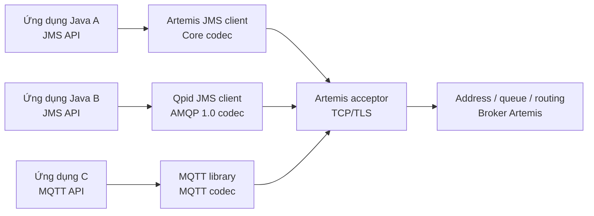

# Phân biệt API phía ứng dụng và giao thức trên đường truyền

> **Chương:** Giao thức kết nối  
> **Phạm vi:** Apache ActiveMQ Artemis là broker chính trong ví dụ; ActiveMQ Classic được đối chiếu khi sử dụng OpenWire.  
> **Mục tiêu:** Phân biệt **giao diện lập trình** của ứng dụng, **client provider** triển khai giao diện đó, **giao thức trao đổi byte** với broker và **transport** mang dữ liệu; từ đó chọn đúng thư viện, cổng, cấu hình acceptor và cách kiểm thử.

## 1. Cùng viết JMS nhưng có thể đi qua hai giao thức khác nhau

Giả sử hai ứng dụng Java cùng dùng `javax.jms.JMSProducer`:

- Ứng dụng A sử dụng `org.apache.activemq.artemis.jms.client.ActiveMQConnectionFactory`, kết nối Artemis bằng **Artemis Core protocol**.
- Ứng dụng B sử dụng `org.apache.qpid.jms.JmsConnectionFactory`, kết nối cùng Artemis bằng **AMQP 1.0**.

Cả hai có thể viết logic gửi tương tự:

```java
try (JMSContext context = factory.createContext()) {
    Queue queue = context.createQueue("demo.orders");
    context.createProducer().send(queue, "order-1001");
}
```

Ở đây kiểu `factory` là **`javax.jms.ConnectionFactory`**, còn nội dung đi trên mạng phụ thuộc **implementation được gán cho biến đó** và cấu hình broker. JMS **không** bắt buộc gói dữ liệu phải được mã hóa thành cùng một định dạng nhị phân.



Ngược lại, một ứng dụng dùng **API khác JMS** vẫn có thể trao đổi message với cùng broker: MQTT client phát `PUBLISH`, STOMP client gửi `SEND`, hoặc Artemis Core API gửi message bằng đối tượng riêng của Core.

**Ý chính:** **API = cách lập trình viên gọi hàm**; **wire protocol = định dạng và quy tắc trao đổi message trên đường truyền**. Client library nối hai thế giới này với nhau.

## 2. Bốn tầng cần phân biệt

| Tầng | Câu hỏi nó trả lời | Ví dụ | Vai trò |
| --- | --- | --- | --- |
| **Application API / programming model** | Code tạo message, gửi, nhận, ack và transaction bằng kiểu gì? | `javax.jms.*`, `jakarta.jms.*`, Artemis Core API, MQTT Paho API | Contract trong mã nguồn |
| **Provider/client implementation** | Thư viện nào thực hiện API và mã hóa message? | Artemis JMS client, Qpid JMS client, ActiveMQ Classic client | Chuyển lời gọi hàm thành frame của protocol |
| **Wire protocol** | Hai đầu trao đổi frame, header, settlement, heartbeats ra sao? | Artemis Core, OpenWire, AMQP 1.0, STOMP, MQTT | Contract giữa client và broker qua mạng |
| **Network transport / bảo mật kênh** | Byte chạy qua kết nối nào? | TCP, TCP + TLS, WebSocket (nếu protocol hỗ trợ/cấu hình) | Truyền byte, mã hóa kênh và quản lý kết nối |

Ví dụ một đường truyền hoàn chỉnh:

```text
Java method
  JMSProducer.send(queue, "hello")
       |
       v
javax.jms provider implementation
  Artemis JMS client
       |
       v
Artemis Core wire protocol
  handshake / session / send frames
       |
       v
TCP 10.0.0.20:61616 (hoặc TLS)
       |
       v
Artemis acceptor -> address -> anycast queue
```

**Các từ dễ gây ngộ nhận:**

- `JMS` **không phải** một wire protocol.
- `AMQP 1.0` **là** một wire protocol, không phải một thư viện API Java duy nhất.
- `tcp://host:61616` thường biểu thị **transport/endpoint**; chỉ nhìn scheme `tcp` và port không đủ biết client đang nói Core hay OpenWire.
- `sslEnabled=true` thay đổi **bảo mật transport**, không biến Core thành AMQP hoặc thay đổi JMS thành MQTT.
- `ConnectionFactory` là **interface JMS**; tên lớp triển khai và dependency thực tế mới cho biết cách giao tiếp với broker.

## 3. Nhìn từ API: JMS có nhiều provider

### 3.1. JMS / Jakarta Messaging cung cấp những gì?

JMS (Java Message Service), hiện được duy trì trong hệ Jakarta Messaging, chuẩn hóa các khái niệm phía ứng dụng:

- `ConnectionFactory`, `JMSContext` / `Connection` và `Session`.
- `Queue` và `Topic`, `Message` và `TextMessage`.
- `JMSProducer` / `MessageProducer`, `JMSConsumer` / `MessageConsumer`.
- Delivery mode, acknowledgment, transaction local, selector và một số thuộc tính message.

Các interface này **không chỉ định** packet trên dây là AMQP hay Core. Provider chịu trách nhiệm ánh xạ API sang broker protocol; mức tương thích của từng tính năng vẫn phụ thuộc cả **phiên bản client** và **phiên bản broker**.

**Phân biệt namespace:** JMS 2.0 truyền thống dùng `javax.jms`, còn Jakarta Messaging 3.x dùng `jakarta.jms`. Chúng không phải hai kiểu import có thể trộn trực tiếp. Chọn **cùng namespace** cho application API và provider jar:

| Application API | Ví dụ client thích hợp | Điểm cần kiểm tra |
| --- | --- | --- |
| `javax.jms` (JMS 2.0) | Artemis `artemis-jms-client`, Qpid `qpid-jms-client`, Classic 5.x `activemq-client` | Jar phải implement `javax.jms.ConnectionFactory` |
| `jakarta.jms` (Jakarta Messaging 3.x) | Artemis `artemis-jakarta-client`, provider Qpid tương ứng với Jakarta, Classic 6.x `activemq-client` | Jar phải implement `jakarta.jms.ConnectionFactory` |

Trong các ví dụ dưới đây, cả hai client Java đều dùng **`javax.jms`** để chứng minh thay provider mà không phải viết lại logic JMS. Không đưa hai client `javax`/`jakarta` vào cùng ví dụ để rồi ép kiểu bất hợp lệ.

### 3.2. Artemis JMS API và Artemis Core API là hai thứ khác nhau

Artemis cung cấp:

- **Artemis JMS client:** lớp `ActiveMQConnectionFactory` implement JMS interface, mã hóa message bằng **Artemis Core wire protocol**.
- **Artemis Core client API:** các kiểu `ServerLocator`, `ClientSessionFactory`, `ClientSession`, `ClientProducer`, `ClientConsumer` trong gói `org.apache.activemq.artemis.api.core.client`. API này **không** phải JMS nhưng cũng dùng Core protocol.

Vì thế:

- “**Core API**” = cách lập trình trực tiếp theo Artemis.
- “**Core protocol**” = ngôn ngữ byte Artemis client và broker trao đổi.
- **Artemis JMS client** dùng API JMS ở phía trên, đồng thời dùng **Core protocol** ở phía dưới.

Chỉ dựa vào tên “Core” để quyết định API hay protocol thường dẫn đến lựa chọn dependency sai.

### 3.3. Cùng một API không bảo đảm mọi provider giống hệt

Ngay cả khi hai client đều hỗ trợ `JMSContext`, việc chuyển từ Core sang AMQP 1.0 có thể cần kiểm tra lại:

- Nơi message đến: ánh xạ `Queue`/`Topic` sang Artemis **address + queue + routing type**.
- Giá trị JMS header/property khi chuyển giữa protocol.
- Delivery settlement, acknowledgment, redelivery và transaction.
- TTL, priority, scheduled delivery, large messages và đặc tính mở rộng riêng provider.
- Failover/reconnection URL, topology discovery và client-side buffering.
- Mức hỗ trợ tính năng JMS 2.0/Jakarta Messaging của **đúng client version**.

Ứng dụng nên có compatibility test cho các hành vi thật sự sử dụng, thay vì chỉ chứng minh hai thư viện đều biên dịch được code JMS.

## 4. Những wire protocol thường gặp tại ActiveMQ Artemis

| Wire protocol | Đặc điểm chính | Client điển hình | Khi nào phù hợp? |
| --- | --- | --- | --- |
| **Artemis Core** | Protocol nhị phân gắn với Artemis; các tính năng và tối ưu riêng broker | Artemis JMS client, Artemis Core client | Java/JMS dùng Artemis native client |
| **AMQP 1.0** | Protocol chuẩn mở, có cơ chế link, message transfer, settlement và flow control | Apache Qpid JMS, AMQP SDK từ các ngôn ngữ khác | Hệ đa ngôn ngữ; muốn nói cùng protocol AMQP 1.0 |
| **OpenWire** | Protocol nhị phân gắn với ActiveMQ Classic | `org.apache.activemq.ActiveMQConnectionFactory` của Classic | Ứng dụng Classic cần kết nối Artemis tương thích, có kiểm thử |
| **STOMP** | Protocol text frame `CONNECT`, `SEND`, `SUBSCRIBE`, `ACK` | STOMP clients cho Java/JS/Python... | Tích hợp đơn giản, debug frame dễ |
| **MQTT** | Protocol publish/subscribe, topic filter, QoS, session | MQTT clients như Eclipse Paho | IoT/thiết bị, mạng hoặc runtime hạn chế |

Artemis còn có lựa chọn transport và cấu hình giao thức khác theo phiên bản. Bảng nhằm phân biệt **những con đường giao tiếp tiêu biểu**, không có nghĩa mọi client và mọi bản Artemis đều hỗ trợ đầy đủ mọi tính năng giao thức trên mọi connector.

### 4.1. Artemis Core so với OpenWire

Hai protocol này đều dùng trong hệ ActiveMQ nhưng **không đồng nhất**:

```text
org.apache.activemq.artemis.jms.client.ActiveMQConnectionFactory
    -> Artemis JMS provider
    -> Artemis Core frames

org.apache.activemq.ActiveMQConnectionFactory
    -> ActiveMQ Classic JMS provider
    -> OpenWire frames
```

Cả hai lớp có tên ngắn là `ActiveMQConnectionFactory`. **Kiểm tra full package name** và dependency trước khi đọc cấu hình. Một broker Artemis có thể bật cả CORE và OPENWIRE trên cùng một acceptor; client nào kết nối sẽ nói protocol mà **thư viện của nó** triển khai.

Classic broker hỗ trợ OpenWire cùng các transport connector/protocol riêng theo phiên bản; nó **không tự hiểu Artemis Core** chỉ vì cả hai sản phẩm đều tên ActiveMQ. Khi chuyển Classic client sang Artemis broker qua OpenWire, cần thử thực tế các tính năng broker/client cũ (advisory, destinations, transactions, failover, redelivery), không mặc định hành vi y hệt.

### 4.2. AMQP 1.0 không đồng nghĩa AMQP 0-9-1

Một client ghi “AMQP” chưa đủ:

- **AMQP 1.0** là protocol mà Artemis hỗ trợ qua AMQP acceptor.
- **AMQP 0-9-1** là phiên bản phổ biến trong một số hệ messaging khác; handshake, framing và mô hình giao thức khác.

Ví dụ library thiết kế cho AMQP 0-9-1 **không** tự kết nối Artemis AMQP 1.0 chỉ bằng đổi hostname/port. Phải xác nhận **major protocol version** và SDK tương ứng.

### 4.3. STOMP, MQTT mang semantics riêng

STOMP message được gửi bằng frame như `SEND`, `SUBSCRIBE` và có chế độ `ack:auto`, `ack:client` hoặc `ack:client-individual` tùy version. MQTT dùng `PUBLISH`/`SUBSCRIBE`, topic filter `+`/`#` và QoS 0/1/2.

Những khái niệm này **không khớp một-một** với JMS `AUTO_ACKNOWLEDGE`, `CLIENT_ACKNOWLEDGE`, JMS local transaction hoặc durable topic subscription. Nếu một message đi qua nhiều protocol, cần xác định rõ điều gì còn được giữ lại (payload, properties, độ bền, thứ tự, duplicate/redelivery) qua thử nghiệm end-to-end.

## 5. Phía broker: acceptor nào đang lắng nghe protocol nào?

### 5.1. `acceptor` và `connector` không phải một thứ

Trong `broker.xml` của Artemis:

- **Acceptor:** broker **lắng nghe** kết nối từ client hoặc broker khác trên một địa chỉ/cổng, kèm protocol và tùy chọn transport.
- **Connector:** mô tả endpoint mà Artemis dùng để **kết nối ra** (ví dụ cluster, HA hoặc connection factory được truyền tới client), tùy phần cấu hình.
- **ConnectionFactory ở ứng dụng:** object của **client library** chọn endpoint và cách mã hóa frame khi kết nối.

Đừng nhìn thấy một `connector` rồi kết luận có server socket đang listen. Thực tế listener phải được khai báo bởi **acceptor**.

### 5.2. Ví dụ `broker.xml` với các cổng tách riêng

Phần dưới là **fragment** để đặt trong `<acceptors>` của broker Artemis, không phải toàn bộ cấu hình:

```xml
<acceptors>
    <!-- Artemis Core cho Artemis JMS/Core client -->
    <acceptor name="core">
        tcp://0.0.0.0:61616?protocols=CORE
    </acceptor>

    <!-- AMQP 1.0 cho Qpid JMS và AMQP 1.0 clients -->
    <acceptor name="amqp">
        tcp://0.0.0.0:5672?protocols=AMQP
    </acceptor>

    <!-- OpenWire cho ActiveMQ Classic JMS client -->
    <acceptor name="openwire">
        tcp://0.0.0.0:61617?protocols=OPENWIRE
    </acceptor>

    <!-- STOMP -->
    <acceptor name="stomp">
        tcp://0.0.0.0:61613?protocols=STOMP
    </acceptor>

    <!-- MQTT -->
    <acceptor name="mqtt">
        tcp://0.0.0.0:1883?protocols=MQTT
    </acceptor>
</acceptors>
```

Trong XML thật nên viết URI liền một dòng trong mỗi `<acceptor>` để tránh khoảng trắng xuống dòng không cần thiết. Các cổng trên là **quy ước minh họa**: 5672 thường dùng AMQP, 61613 STOMP, 1883 MQTT, nhưng **số cổng tự nó không xác định protocol**. Điều quyết định là protocol được bật tại listener và codec của client.

Nếu chỉ dùng local lab, có thể thay `0.0.0.0` bằng `127.0.0.1` để giới hạn listener trên máy. Trong production cần cấu hình firewall, authentication, TLS và network binding theo từng kênh.

### 5.3. Một acceptor có thể hỗ trợ nhiều protocol

Artemis hỗ trợ **multi-protocol acceptor**, ví dụ:

```xml
<acceptor name="multi">
    tcp://0.0.0.0:61616?protocols=CORE,AMQP,STOMP,MQTT,OPENWIRE
</acceptor>
```

Client gửi handshake/frame tương ứng; broker nhận diện protocol trong tập đã bật. Vì thế trên **cùng port 61616**, có thể tồn tại Artemis Core client và Qpid JMS AMQP client nếu cấu hình chấp nhận cả hai.

Để ví dụ phía Java dưới đây dùng hai cổng khác nhau cho dễ quan sát; nếu dùng multi-protocol acceptor thì chỉ cần chọn **endpoint thực tế đang mở**, không phải thay API.

**Cân nhắc vận hành:** tách cổng có thể giúp giới hạn quyền, network policy, giám sát và TLS theo từng nhóm client. Một acceptor chung đơn giản hơn khi cần ít listener. Cả hai lựa chọn đều cần xác thực và kiểm thử.

### 5.4. Routing mới quyết định message đi đâu sau khi giải mã

Protocol đưa message **vào broker**, còn Artemis dùng **address / queue / routing type** để route:

- **ANYCAST:** một message được định tuyến đến một queue phù hợp cho competing consumers.
- **MULTICAST:** message được phân phối tới các queue subscription phù hợp theo mô hình topic.
- **BOTH:** address có thể cho phép cả hai kiểu, nhưng sender/consumer cần chỉ rõ intent hoặc chịu quy tắc mặc định.

Ví dụ chuẩn bị queue dùng cho lab:

```xml
<!-- Fragment trong <addresses> của broker.xml -->
<address name="demo.orders">
    <anycast>
        <queue name="demo.orders" durable="true"/>
    </anycast>
</address>
```

Đặt queue `demo.orders` rõ ràng giúp hai ứng dụng JMS (Core provider và Qpid AMQP provider) dễ thử chung destination. Cần tránh dựa vào **auto-create** nếu đang đo compatibility hoặc bảo mật vì mỗi broker/version có thể có policy tự tạo khác nhau.

**Lưu ý:** Tên JMS Queue/Topic là một **abstraction của API**. Trong AMQP 1.0 là source/target address của link; trong STOMP có `destination` string; trong MQTT có topic name/filter. Artemis ánh xạ các dạng này vào address/queue theo cấu hình và prefix. **Trùng chuỗi tên chưa đủ** để chứng minh hai protocol đang đọc chung một physical queue.

## 6. Thực hành 1: Một JMS logic, hai protocol đến cùng Artemis

Mục tiêu: thay **JMS ConnectionFactory implementation**, giữ nguyên hàm `sendAndReceive`. Đây là cách trực tiếp nhất để thấy API và wire protocol độc lập.

### 6.1. Broker lab

Dùng một Artemis broker hỗ trợ CORE và AMQP 1.0; ví dụ khởi tạo broker từ Artemis **2.50.0** và thêm các `acceptor` CORE 61616, AMQP 5672 như trên. Tạo trước queue ANYCAST `demo.orders` trong `broker.xml` hoặc bằng công cụ quản trị.

Mẫu dependency Maven dùng **JMS 2.0 / `javax.jms`** cho cả hai provider:

```xml
<dependencies>
    <!-- Artemis native JMS client: phát frame CORE -->
    <dependency>
        <groupId>org.apache.artemis</groupId>
        <artifactId>artemis-jms-client</artifactId>
        <version>2.50.0</version>
    </dependency>

    <!-- Apache Qpid JMS client: phát frame AMQP 1.0 -->
    <dependency>
        <groupId>org.apache.qpid</groupId>
        <artifactId>qpid-jms-client</artifactId>
        <version>2.5.0</version>
    </dependency>
</dependencies>
```

Từ Artemis **2.50.0**, các Artemis Maven artifact chuyển sang groupId `org.apache.artemis`; với phiên bản Artemis cũ, đối chiếu groupId cũ `org.apache.activemq`. Với dự án `jakarta.jms`, chọn `artemis-jakarta-client` và một AMQP JMS provider **tương thích Jakarta**, rồi đổi import thống nhất; không ép `javax.jms.ConnectionFactory` sang `jakarta.jms.ConnectionFactory`.

Để chạy trên broker bật authentication, truyền username/password qua cấu hình an toàn của ứng dụng hoặc gọi `createContext(user, password)`; ví dụ tập trung vào protocol nên giả định broker lab cho phép tài khoản của môi trường thử nghiệm. Không dùng tài khoản mẫu làm bí mật production.

### 6.2. Java code so sánh provider

```java
import javax.jms.ConnectionFactory;
import javax.jms.JMSConsumer;
import javax.jms.JMSContext;
import javax.jms.Message;
import javax.jms.Queue;
import javax.jms.TextMessage;

import java.util.UUID;

public final class JmsOverTwoProtocols {

    private static void sendAndReceive(ConnectionFactory factory,
                                       String label)
            throws Exception {
        String payload = "event-" + UUID.randomUUID();

        try (JMSContext ctx = factory.createContext(
                JMSContext.AUTO_ACKNOWLEDGE)) {

            Queue queue = ctx.createQueue("demo.orders");
            JMSConsumer consumer = ctx.createConsumer(queue);
            ctx.createProducer().send(queue, payload);

            Message received = consumer.receive(5_000);

            if (!(received instanceof TextMessage)) {
                throw new IllegalStateException(
                        label + ": chưa nhận TextMessage");
            }

            String body = ((TextMessage) received).getText();
            if (!payload.equals(body)) {
                throw new IllegalStateException(
                        label + ": nhận payload khác: " + body);
            }

            System.out.println(label + " PASS: " + body);
        }
    }

    public static void main(String[] args) throws Exception {
        // Cùng interface javax.jms.ConnectionFactory, khác client/codec.
        ConnectionFactory coreFactory =
                new org.apache.activemq.artemis.jms.client
                    .ActiveMQConnectionFactory("tcp://localhost:61616");

        ConnectionFactory amqpFactory =
                new org.apache.qpid.jms
                    .JmsConnectionFactory("amqp://localhost:5672");

        sendAndReceive(coreFactory, "JMS qua Artemis Core");
        sendAndReceive(amqpFactory, "JMS qua AMQP 1.0");
    }
}
```

**Điều cần quan sát:**

- Cùng một API `ConnectionFactory`, `JMSContext`, `JMSProducer`, `JMSConsumer`, `Queue` và `TextMessage`.
- Client `org.apache.activemq.artemis.jms.client.ActiveMQConnectionFactory` nói **Core**.
- Client `org.apache.qpid.jms.JmsConnectionFactory` nói **AMQP 1.0**.
- Cùng queue ANYCAST `demo.orders` có thể phục vụ cả hai nếu broker đã cấu hình routing đúng.
- `tcp://` ở Core provider và `amqp://` ở Qpid provider là **URI scheme do từng client hiểu**, không phải cách thay đổi protocol chỉ bằng đổi chữ trong URL.

**Giới hạn demo:** logic nhận lại message trên một queue chỉ ổn định trong môi trường lab **không có consumer khác**. Trong production, message có thể được một worker khác lấy trước; khi kiểm tra chéo protocol, dùng queue riêng theo bài thử hoặc correlation ID/temporary destinations phù hợp.

### 6.3. Bài thử chéo protocol cần làm thêm

Để kiểm tra **interoperability** thật, không dừng ở hai lần tự gửi–tự nhận:

1. Dùng **Artemis Core JMS producer** gửi message có `eventId` vào `demo.orders`.
2. Dùng **Qpid JMS consumer** nhận từ queue đó và xác minh body + các property chuẩn.
3. Đảo chiều: Qpid producer gửi, Core JMS consumer nhận.
4. Gửi persistent message; restart broker; xác nhận queue tồn tại và message chưa ack vẫn có thể nhận lại.
5. Thử selector, TTL, priority, transaction, rollback/redelivery và message lớn nếu ứng dụng cần.
6. Kiểm tra behavior khi failover/reconnect của **từng provider**, vì API giống nhau nhưng URL failover và reconnect không nhất thiết giống.

Ở mỗi bước, đối chiếu `JMSMessageID`, business `eventId` và DLQ để tránh nhầm message trùng với message mất.

## 7. Thực hành 2: Cùng broker, nhưng API hoàn toàn khác JMS

### 7.1. STOMP là text protocol, không phải JMS Java API

Nếu Artemis có `STOMP` acceptor trên 61613, một client STOMP gửi frame văn bản kiểu sau (kết thúc mỗi frame bằng **byte NULL 0x00**, ở ví dụ biểu diễn bằng `\0`):

```text
CONNECT
accept-version:1.2
host:localhost

\0
```

Sau khi broker trả `CONNECTED`, client gửi:

```text
SEND
destination:demo.stomp
content-type:text/plain

Xin chao tu STOMP\0
```

Trong thực tế, frame cần đúng quy tắc LF, content-length nếu dùng body nhị phân, receipt và xác thực theo version STOMP. Hai đoạn trên để nhận diện **wire frame** chứ không phải một lệnh shell tự chạy. Với chương trình thật, dùng STOMP client library tương thích, không tự xây parser từ chuỗi.

Ở broker Artemis, cần xác định `destination` được ánh xạ đến address/routing type nào. Nếu muốn minh họa phân biệt queue và topic rõ ràng, có thể cấu hình prefix trên STOMP acceptor, ví dụ:

```xml
<acceptor name="stomp">
    tcp://0.0.0.0:61613?protocols=STOMP;anycastPrefix=queue/;multicastPrefix=topic/
</acceptor>
```

Khi đó thử `queue/demo.orders` hay `topic/demo.events` theo prefix đã khai báo, đồng thời xác minh address/queue đích trong Artemis console. Prefix và auto-create phải được kiểm tra trên **bản Artemis đang dùng**; đừng suy từ broker khác rằng mọi STOMP client đều hiểu `/queue/...` giống nhau.

### 7.2. MQTT dùng một bộ API và semantics khác

Một thiết bị IoT có thể dùng Eclipse Paho (hoặc client MQTT khác) để `PUBLISH` tới topic `devices/room1/temperature` qua MQTT, ví dụ broker Artemis có MQTT acceptor port 1883.

Lệnh CLI tương đương khi có bộ công cụ MQTT (ví dụ Mosquitto clients) và tài khoản được cấp quyền:

```bash
# Terminal 1: nghe topic qua MQTT
mosquitto_sub -h localhost -p 1883 \
  -t 'devices/room1/temperature' -q 1

# Terminal 2: gửi từ thiết bị mô phỏng
mosquitto_pub -h localhost -p 1883 \
  -t 'devices/room1/temperature' -m '27.5' -q 1
```

Ví dụ là **MQTT command/API**, không có `JMSContext`. `-q 1` là **MQTT QoS 1**, không đồng nhất với JMS `CLIENT_ACKNOWLEDGE` hay `DeliveryMode.PERSISTENT`. MQTT subscription dùng ký tự `+` và `#` để khớp topic filter; không nhầm với ký tự wildcard trong destination syntax của ActiveMQ Classic.

Nếu muốn ứng dụng JMS trên Artemis cũng đọc dữ liệu từ MQTT topic, cần xác minh mapping **MQTT topic → Artemis address/queue và routing MULTICAST**, cách thiết lập subscription và kiểm tra giao message chéo protocol. Chỉ vì cùng broker không có nghĩa MQTT subscription tương đương JMS queue consumer.

## 8. Transport, TLS và security là một lớp khác nữa

### 8.1. Phân biệt bảo vệ kênh với protocol

Một JMS client có thể dùng **Core qua TCP**, **Core qua TLS**, **AMQP 1.0 qua TCP**, hoặc **AMQP 1.0 qua TLS**. TLS mã hóa và xác thực kênh vận chuyển; nó không thay đổi contract JMS hoặc protocol frame ở phía trên TLS.

Ví dụ fragment acceptor Artemis cho **CORE có TLS**:

```xml
<acceptor name="core-tls">
    tcp://0.0.0.0:61618?protocols=CORE;sslEnabled=true;keyStorePath=/etc/artemis/tls/broker.p12;keyStorePassword=REPLACE_FOR_LAB
</acceptor>
```

Đây chỉ là fragment lab: production cần quản lý secret bên ngoài file công khai, chọn store type/truststore, trust chain, hostname verification và TLS versions theo chính sách của tổ chức. Client cũng phải bật TLS và tin cậy chứng chỉ broker theo cú pháp của **client provider**; không thể bảo toàn `tcp://...` plaintext rồi kỳ vọng broker listener TLS bắt tay thành công.

AMQP 1.0 có thể dùng cơ chế authentication như SASL, MQTT/STOMP có cách truyền credential riêng. Authentication/authorization broker mới quyết định client được phép làm gì với address/queue. TLS bảo vệ đường truyền, nhưng **không tự cấp quyền JMS gửi/nhận**.

### 8.2. WebSocket cũng không đồng nghĩa protocol ứng dụng

Nếu triển khai một protocol qua WebSocket, đường đi có thể là:

```text
Browser / client
  -> WebSocket handshake (HTTP Upgrade)
  -> STOMP hoặc MQTT frames trong WebSocket
  -> Artemis acceptor thích hợp
```

WebSocket là lớp vận chuyển/bao frame cho ứng dụng; STOMP/MQTT vẫn có semantics riêng. Không thể kết nối browser bằng WebSocket tùy ý đến cổng CORE TCP và kỳ vọng broker tự chuyển đổi thành JMS.

### 8.3. URL trông giống nhau có thể hành xử khác nhau

| Client | Ví dụ URL | Protocol được mã hóa | Ghi chú |
| --- | --- | --- | --- |
| Artemis JMS client | `tcp://localhost:61616` | **Artemis Core** | `tcp` là transport URI của provider |
| ActiveMQ Classic JMS client | `tcp://localhost:61617` | **OpenWire** | Lớp `org.apache.activemq.ActiveMQConnectionFactory` |
| Qpid JMS client | `amqp://localhost:5672` | **AMQP 1.0** | URI scheme của Qpid; bảo đảm đúng port/protocol broker |
| STOMP client | `localhost:61613` / client URI tùy thư viện | **STOMP** | Thư viện STOMP tạo frame `CONNECT`/`SEND` |
| MQTT client | `tcp://localhost:1883` theo MQTT SDK | **MQTT** | Không phải Artemis JMS client dù cũng bắt đầu `tcp://` |

Khi dùng cùng **multi-protocol port**, các hàng có thể trỏ tới cùng host/port nhưng vẫn nói protocol khác nhau. Vì vậy **đừng đọc số port hoặc chuỗi `tcp://` như “loại client”**.

## 9. Chọn API và protocol theo yêu cầu thực tế

| Tình huống | Chọn API phía ứng dụng | Client + wire protocol phù hợp | Điều phải xác nhận |
| --- | --- | --- | --- |
| Java Spring/JMS đang dùng Artemis native | JMS/Jakarta Messaging | Artemis JMS client → Core | Namespace `javax`/`jakarta`, phiên bản Artemis |
| Muốn viết Java JMS nhưng dùng AMQP 1.0 chuẩn mở | JMS/Jakarta Messaging | Qpid JMS tương thích API → AMQP 1.0 | Tính năng JMS được ánh xạ qua AMQP, security, transaction |
| Ứng dụng Classic hiện hữu kết nối broker Artemis | JMS của nhánh Classic client | Classic client → OpenWire trên Artemis | Tính năng Classic-specific và hành vi migration |
| Thiết bị IoT chỉ hỗ trợ MQTT | MQTT API | MQTT client → MQTT | QoS, topic mapping, retained/session behavior theo Artemis |
| Tool tích hợp cần frame text đơn giản | STOMP client API | STOMP client → STOMP | Destination mapping, ack mode, receipt |
| Thành phần Artemis nội bộ cần API native | Artemis Core API | Artemis Core client → Core | Khác biệt với JMS, dependency và khả năng portable |

**Điểm quyết định:** Nếu bài toán nói “phải dùng JMS” thì lựa chọn API mới chỉ giải quyết **mặt mã nguồn**. Nếu hợp đồng tích hợp nói “bắt buộc AMQP 1.0”, phải chọn provider có **AMQP 1.0 codec**, không thể cứ lấy Artemis JMS client mặc định rồi đổi URI.

### 9.1. Khi nào cần đổi cả API?

Chuyển từ Artemis JMS client sang Qpid JMS client (cùng `javax.jms`) là **đổi implementation và wire protocol**, thường giữ nguyên phần lớn nghiệp vụ JMS. Chuyển từ JMS sang MQTT client thường phải viết lại cả mô hình lập trình, error handling, ack/QoS và cách subscribe.

Nếu ứng dụng đang dùng **đặc tính riêng Core API** hoặc extension của provider, việc đổi thư viện JMS hoặc sang AMQP cũng có thể cần refactor để thay semantics chưa có chuẩn tương ứng.

## 10. Chẩn đoán lỗi đúng tầng

| Triệu chứng | Tầng cần kiểm tra trước | Ví dụ nguyên nhân |
| --- | --- | --- |
| `ClassNotFoundException: javax.jms.*` hoặc `jakarta.jms.*` | **API/classpath** | Thiếu API jar, trộn namespace |
| `ClassCastException` khi ép `ConnectionFactory` | **API/provider** | Provider implement `javax.jms` nhưng code dùng `jakarta.jms` |
| `Unknown protocol`, lỗi handshake, kết nối bị đóng ngay | **Wire protocol** | Client Core tới port chỉ bật AMQP; Qpid AMQP 1.0 tới OpenWire-only acceptor |
| `Connection refused` hoặc timeout TCP | **Transport/network** | Sai port, firewall, broker chưa listen, bind localhost |
| TLS handshake failure | **TLS/trust** | Broker yêu cầu TLS nhưng client gửi plaintext; truststore/hostname sai |
| `JMSSecurityException` / STOMP `ERROR` do quyền | **Authentication/authorization** | Sai credential hoặc thiếu quyền send/consume/create |
| Gửi thành công nhưng không thấy message tại queue mong muốn | **Address / routing** | ANYCAST vs MULTICAST, prefix, auto-create khác dự tính |
| Message đổi header/property hoặc redelivery khác | **Mapping semantics** | Provider/protocol translation, transaction, selector hoặc settlement |
| Reconnect thất bại sau failover | **Client + topology** | Qpid và Artemis Core có cấu hình failover khác nhau |

Các công cụ quan sát hữu ích:

- **Artemis console / JMX / CLI:** kiểm tra acceptor hoạt động, connection protocol, address, queue, routing type, consumer count, message count.
- **Log broker/client:** protocol handshake, authentication, security exception, connection drop.
- **TCP connect test:** chỉ cho biết port có mở; **không** xác nhận đúng wire protocol.
- **Wireshark hoặc packet capture trong lab:** nhìn handshake/protocol (với TLS chỉ thấy lớp mã hóa nếu không có điều kiện giải mã); tuyệt đối không ghi credentials ra log.
- **Compatibility test:** phát qua provider A, nhận bằng provider B, đối chiếu event ID + properties + ack/transaction.

### 10.1. Một lỗi cấu hình điển hình

Cấu hình broker:

```xml
<acceptor name="amqp">tcp://0.0.0.0:5672?protocols=AMQP</acceptor>
```

Ứng dụng tạo:

```java
new org.apache.activemq.artemis.jms.client
        .ActiveMQConnectionFactory("tcp://localhost:5672");
```

Ứng dụng Java vẫn **đúng API JMS**, port 5672 vẫn **mở**, nhưng client trên gửi **Core frames** trong khi listener chỉ hiểu **AMQP 1.0**. Giải pháp là dùng **Qpid JMS provider** với `amqp://localhost:5672` hoặc mở đúng CORE acceptor và kết nối client Core tới đó.

Đổi đơn thuần `tcp://localhost:5672` thành một URL có chữ “amqp” trên Artemis Core client **không phải** cách hợp lệ để đổi codec. Protocol được quyết định bởi thư viện client.

## 11. Bài thực hành kiểm chứng độc lập API/wire/transport

Thiết lập ba phép thử trên **cùng Artemis broker lab**:

1. **API giữ nguyên, wire thay đổi:** chạy `JmsOverTwoProtocols` bằng Artemis JMS Core và Qpid JMS AMQP, cùng queue ANYCAST. Cả hai phải PASS; theo dõi broker để xác nhận hai protocol kết nối khác nhau.
2. **Wire giữ nguyên, API thay đổi:** so sánh Artemis JMS client với chương trình Artemis Core API (cả hai nói Core protocol), gửi cùng queue theo semantics đã cấu hình; xác nhận body và ack.
3. **Wire giữ nguyên, transport thay đổi:** thử Artemis Core client trên TCP lab và Core+TLS listener; API JMS giữ nguyên, nhưng client phải dùng cấu hình SSL/trust đúng. Không gửi credential plaintext trong bài thử production.

Sau đó cố ý gây lỗi:

- Trỏ Artemis Core client tới port AMQP-only: quan sát lỗi handshake.
- Trỏ Qpid JMS tới port không mở: quan sát lỗi kết nối TCP.
- Đổi sang `jakarta.jms.*` nhưng giữ `javax.jms` provider: quan sát lỗi compile/classpath.
- Gửi vào address có cấu hình routing không khớp: quan sát destination/queue metrics.
- Cắt mạng giữa lúc producer gửi persistent message: kiểm tra trạng thái không chắc chắn và idempotency.

Lưu bảng kết quả:

| Test | API | Provider | Wire | Transport | Kết quả cần đạt |
| --- | --- | --- | --- | --- | --- |
| T1 | `javax.jms` | Artemis JMS | CORE | TCP 61616 | Send/receive PASS |
| T2 | `javax.jms` | Qpid JMS | AMQP 1.0 | TCP 5672 | Send/receive PASS |
| T3 | Artemis Core API | Artemis Core client | CORE | TCP 61616 | Giao message PASS |
| T4 | `javax.jms` | Artemis JMS | CORE | TLS 61618 | Kết nối xác thực TLS, send/receive PASS |
| T5 (âm) | `javax.jms` | Artemis JMS | CORE | TCP 5672, chỉ AMQP | Handshake bị từ chối, không có message giả |

**Tiêu chí hoàn thành:** nêu được **đúng bốn tầng** trong từng phép thử; xác minh loại protocol kết nối trên broker; phân biệt lỗi ở client classpath, handshake, transport, TLS và routing.

## 12. Checklist đưa cấu hình vào môi trường thật

- [ ] Ghi rõ application API: `javax.jms` / `jakarta.jms` / Core / STOMP / MQTT.
- [ ] Ghi rõ tên **class ConnectionFactory** và Maven dependency; không chỉ ghi “JMS client”.
- [ ] Ghi rõ **wire protocol**: CORE / AMQP 1.0 / OPENWIRE / STOMP / MQTT.
- [ ] Broker `acceptor` bật đúng protocol và bind đúng interface/port; không nhầm `connector` với listener.
- [ ] Xác nhận TCP/TLS/WebSocket thực tế và chứng chỉ, trust, hostname verification theo client.
- [ ] Xác nhận mapping destination sang Artemis address, queue và routing ANYCAST/MULTICAST.
- [ ] Kiểm tra feature thực tế: header, selector, ack/transaction, redelivery, durable subscription, TTL, DLQ, failover.
- [ ] Giới hạn protocol/port không sử dụng, cấp quyền broker tối thiểu, không đưa credential production vào mã.
- [ ] Test cả chiều producer A → consumer B và producer B → consumer A khi cần interoperability.
- [ ] Ghi nhận client/broker **version cụ thể**, đặc biệt khi nâng từ Classic sang Artemis hoặc đổi từ `javax.jms` sang `jakarta.jms`.

## 13. Câu hỏi tự kiểm tra

1. Hai ứng dụng cùng gọi `JMSProducer.send`, vì sao một ứng dụng có thể gửi Core frame còn ứng dụng kia gửi AMQP 1.0 frame?
2. `org.apache.activemq.ActiveMQConnectionFactory` và `org.apache.activemq.artemis.jms.client.ActiveMQConnectionFactory` khác nhau ở đâu?
3. Broker có acceptor 5672 chỉ bật AMQP. Tại sao Artemis JMS Core client dùng URL `tcp://localhost:5672` vẫn không gửi được?
4. Nếu một thiết bị dùng MQTT QoS 1, có thể coi nó tương đương JMS `CLIENT_ACKNOWLEDGE` không? Vì sao?
5. Đã test TCP port mở có chứng minh client chọn đúng protocol không?
6. Tại sao hai client có cùng Queue name vẫn có thể không nhận cùng message khi cấu hình routing khác nhau?
7. Đổi từ CORE/TCP sang CORE/TLS thay đổi tầng nào? Có yêu cầu viết lại nghiệp vụ JMS không?

**Gợi ý:** (1) provider/codec khác nhau; (2) Classic OpenWire so với Artemis Core; (3) codec không khớp acceptor; (4) không, contract khác; (5) không; (6) address/queue/routing/prefix quyết định; (7) transport và cấu hình TLS thay đổi, còn API JMS có thể giữ nguyên.

## 14. Tài liệu chính thức để kiểm tra theo phiên bản

- [Apache ActiveMQ Artemis — Protocols and Interoperability](https://artemis.apache.org/components/artemis/documentation/latest/protocols-interoperability.html): protocol, semantics và trao đổi message giữa client.
- [Apache ActiveMQ Artemis — Configuring Transports](https://artemis.apache.org/components/artemis/documentation/latest/configuring-transports.html): acceptor/connector, TCP và TLS.
- [Apache ActiveMQ Artemis — AMQP](https://artemis.apache.org/components/artemis/documentation/latest/amqp.html): cấu hình AMQP 1.0.
- [Apache ActiveMQ Artemis — STOMP](https://artemis.apache.org/components/artemis/documentation/latest/stomp.html): acceptor và destination mapping của STOMP.
- [Apache ActiveMQ Artemis — MQTT](https://artemis.apache.org/components/artemis/documentation/latest/mqtt.html): topic, QoS và MQTT session trên Artemis.
- [Apache ActiveMQ Artemis — OpenWire](https://artemis.apache.org/components/artemis/documentation/latest/openwire.html): hỗ trợ ActiveMQ Classic client bằng OpenWire.
- [Apache ActiveMQ Artemis — Address Model](https://artemis.apache.org/components/artemis/documentation/latest/address-model.html): cách ánh xạ address, queue, ANYCAST và MULTICAST.
- [Apache ActiveMQ Artemis — Client Classpath](https://artemis.apache.org/components/artemis/documentation/latest/client-classpath.html): chọn Artemis JMS/Jakarta client và dependencies phù hợp.
- [Apache Qpid JMS](https://qpid.apache.org/components/jms/): Java JMS provider dùng AMQP 1.0.

> **Ghi nhớ:** Chọn **API** quyết định ứng dụng gọi những hàm nào; chọn **provider** quyết định lời gọi đó thành frame của **wire protocol** nào; **acceptor** quyết định broker hiểu những frame nào; **transport/TLS** quyết định frame đi trên kênh nào. Sau khi giải mã, chính **address/queue/routing** mới quyết định message tới consumer nào.
