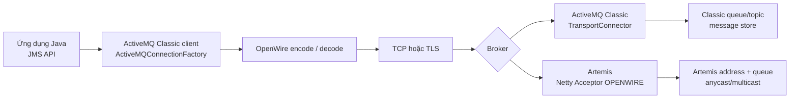

# OpenWire trong ActiveMQ Classic và khả năng tương thích của Artemis

> **Chương:** Giao thức kết nối  
> **Module:** `INTEGRATION_MESSAGING_MESSAGE_BROKER_ACTIVEMQ` — học Apache ActiveMQ Classic và Artemis trong giao tiếp bất đồng bộ bằng queue, topic, routing và JMS; thực hành producer/consumer Java, acknowledgment, transaction, redelivery, DLQ, bảo mật và vận hành broker đáng tin cậy.  
> **Trọng tâm bài:** Hiểu OpenWire là giao thức gì, client Classic dùng OpenWire để giao tiếp với broker ra sao, Artemis nhận OpenWire bằng cách nào, và giới hạn của việc **giữ nguyên client nhưng đổi broker**. Ví dụ Java sử dụng `javax.jms` của ActiveMQ Classic 5.x và một Artemis broker hỗ trợ OpenWire.

## 1. Kết quả mong đợi

Sau bài này, bạn có thể:

1. Giải thích **JMS API**, **OpenWire wire protocol**, **TCP/TLS transport**, **broker** là những tầng riêng; không đồng nhất cổng 61616 với mọi giao thức.
2. Cấu hình cổng OpenWire trên ActiveMQ Classic bằng `transportConnector` và trên Artemis bằng Netty `acceptor` có `protocols=OPENWIRE`.
3. Dùng nguyên `org.apache.activemq.ActiveMQConnectionFactory` và `javax.jms` để gửi/nhận một queue trên Classic **hoặc** Artemis, đổi địa chỉ broker qua cấu hình.
4. Phân biệt **tương thích giao thức kết nối** với **tương đương đầy đủ về hành vi broker**: queue/topic, route, Virtual Topic, advisory, durable subscription, selector, failover và cấu hình lưu trữ có thể cần thay đổi.
5. Tự kiểm chứng kết nối, giao nhận message bền vững, transaction, rollback/redelivery và cách chẩn đoán lỗi sau khi đổi broker.
6. Xác định những yêu cầu bảo mật và vận hành cần kiểm thử lại trước khi chuyển ứng dụng thật sang Artemis.

## 2. OpenWire là gì — chính xác ở tầng nào?

**OpenWire** là giao thức truyền thông điệp **trên đường truyền mạng** (*wire protocol*) do ActiveMQ phát triển. ActiveMQ Classic dùng OpenWire cho các client native (đặc biệt là client JMS Java); dữ liệu được mã hóa thành các lệnh/khung giao tiếp để gửi qua transport như TCP. Ngoài Java, các thư viện client tương ứng cho .NET/C++ cũng có thể triển khai OpenWire.

Hình dung luồng gọi API của một chương trình Java:



Bốn khái niệm cần tách riêng:

| Khái niệm | Ví dụ | Vai trò |
|---|---|---|
| **API ứng dụng** | `javax.jms.Connection`, `Session`, `MessageProducer` | Cách code Java biểu đạt kết nối, gửi/nhận, ack, transaction |
| **Client library** | `org.apache.activemq:activemq-client:5.19.12` | Hiện thực JMS API và OpenWire cho ứng dụng Classic |
| **Wire protocol** | `OpenWire` | Định dạng lệnh, message metadata, trao đổi phiên và dữ liệu giữa client/broker |
| **Transport** | `tcp://host:61616`, `ssl://host:61617` | Cách chuyển bytes qua mạng; TLS thêm bảo mật kênh |
| **Broker/server** | Classic hoặc Artemis | Giải nghĩa lệnh, xác thực, định tuyến, journal/store, giao message tới consumer |

**JMS không quy định wire protocol.** Hai ứng dụng đều dùng JMS không có nghĩa các gói tin mạng của chúng tương thích. Client Artemis native dùng **Artemis Core protocol** (dù cũng có JMS/Jakarta Messaging API); client Classic dùng **OpenWire**. Artemis có module xử lý cả OpenWire nên **client Classic** có thể kết nối đến **broker Artemis** mà vẫn gửi các lệnh OpenWire. Điều này không đồng nghĩa broker Artemis “chạy Classic bên trong”.

Tài liệu chính thức Artemis 2.57.0 xác nhận OpenWire có thể nhận các phiên kết nối từ thư viện OpenWire JMS client của ActiveMQ **5.12.x trở lên**. Khi thay đổi broker, hãy pin và kiểm thử **phiên bản client thực tế** bạn đang sử dụng; không tự mặc định client quá cũ hoặc extension riêng của Classic sẽ tương thích hoàn toàn.

### 2.1. Điều diễn ra khi một client Classic kết nối

Một kết nối điển hình có thể được mô tả ở mức khái niệm:

```text
Java application          Classic JMS client           Classic / Artemis broker
       |                          |                              |
       | createConnection()       |                              |
       |------------------------->| TCP connection               |
       |                          |----------------------------->|
       |                          | OpenWire WireFormatInfo      |
       |                          |<---------------------------->|
       |                          | thương lượng phiên bản/capabilities
       |                          | ConnectionInfo, session ...  |
       |                          |----------------------------->|
       | start(), send(), receive | OpenWire Message/Command     |
       |------------------------->|<---------------------------->|
       | commit()/rollback()/ack  | protocol commands/response   |
       |------------------------->|<---------------------------->|
```

Trong OpenWire, client và broker trao đổi thông tin wire format (chẳng hạn `WireFormatInfo`) để thương lượng các khả năng tương ứng và phiên bản giao thức mà cả hai phía hỗ trợ. Sau đó những lệnh mở kết nối, tạo session, tạo producer/consumer, gửi message hoặc acknowledge được mã hóa/giải mã tương ứng.

**Bắt tay OpenWire khác bắt tay TCP/TLS.** “Kết nối TCP thành công” chỉ chứng minh có một socket tới host/port. Nó chưa chứng minh peer chấp nhận OpenWire, đã xác thực hoặc JMS producer có quyền gửi vào destination.

OpenWire có các tham số liên quan **inactivity monitoring** và keepalive để phát hiện kết nối không còn trao đổi dữ liệu. Các giá trị có thể được thương lượng giữa hai phía; đừng tắt monitor chỉ để che lỗi timeout mà không kiểm tra mạng, GC pause, broker load và thời gian xử lý.

### 2.2. Port 61616 có bắt buộc là OpenWire không?

Không. **61616 là một cổng thường dùng, không phải tên giao thức**.

- Trên một cấu hình ActiveMQ Classic phổ biến, `transportConnector` `tcp://...:61616` mang OpenWire.
- Trên Artemis, một Netty acceptor `tcp://...:61616` có thể chấp nhận **nhiều giao thức trên cùng cổng** bằng nhận diện protocol. Nếu cần giới hạn chỉ OpenWire, thêm `protocols=OPENWIRE`.
- Port `8161` thường phục vụ quản trị/web console; đó không phải endpoint TCP OpenWire để `ActiveMQConnectionFactory` gửi message.
- Cổng TCP mở trong firewall vẫn có thể là sai broker, sai protocol hoặc sai TLS mode.

## 3. ActiveMQ Classic: transportConnector phục vụ OpenWire

Trong Classic, connector nhận client thường được cấu hình trong `conf/activemq.xml`. Ví dụ **fragment** trong phần tử `<broker>`:

```xml
<transportConnectors>
  <transportConnector
      name="openwire"
      uri="tcp://0.0.0.0:61616" />
</transportConnectors>
```

Giải thích:

- `name="openwire"` là tên quản trị của connector; tính tương thích đến từ transport/wire format thực tế, không chỉ tên.
- `tcp://0.0.0.0:61616` lắng nghe trên mọi interface. Trong lab cá nhân, có thể dùng `127.0.0.1` để hạn chế truy cập trực tiếp hoặc giới hạn publish port ở Docker/network.
- Client từ máy khác dùng **IP/DNS có thể đến được** (ví dụ `tcp://broker.example.internal:61616`), **không** dùng `0.0.0.0` làm host kết nối.
- Nếu Classic đã có `transportConnectors`, thay/sửa connector hiện tại; không khai báo trùng port.
- Trong file XML, các query parameter nối bằng `&` phải được XML-escape thành `&amp;`; đây là lỗi cấu hình hay gặp nếu copy nguyên URI nhiều tham số.

Client Java thường khởi tạo:

```java
import org.apache.activemq.ActiveMQConnectionFactory;

ActiveMQConnectionFactory factory =
    new ActiveMQConnectionFactory("tcp://127.0.0.1:61616");
```

URI `tcp://` là **transport URI** mà client Classic hiểu. Không có cú pháp riêng như `openwire://` trong ví dụ mặc định. Có thể cấu hình transport failover trên client với `failover:(tcp://...,... )` (xem phần 9).

**Không nhầm với VM transport:** `vm://` của Classic dùng để kết nối broker embedded/in-JVM theo cơ chế riêng. `vm://localhost` không phải URI TCP OpenWire thay thế để kết nối broker Artemis ở máy khác.

## 4. Artemis: chấp nhận OpenWire qua Netty acceptor

Artemis không dùng `transportConnector` của Classic. Broker Artemis có `<acceptors>` trong `etc/broker.xml` của broker instance. Mỗi acceptor cấu hình transport và danh sách giao thức được phép.

### 4.1. Cho phép OpenWire trên một port riêng

Fragment **trong `<core>` / `<acceptors>` của `broker.xml` hiện có**:

```xml
<acceptors>
  <acceptor name="openwire-only">tcp://0.0.0.0:61616?protocols=OPENWIRE</acceptor>
</acceptors>
```

`protocols=OPENWIRE` yêu cầu acceptor này nhận OpenWire. Nếu bạn đã có acceptor lắng nghe 61616, hãy **sửa acceptor hiện tại hoặc chọn port khác**, không thêm hai acceptor cùng port.

**Bẫy:** Thêm URI nhận OpenWire vào phần `<connectors>` của Artemis sẽ sai mục đích. `Acceptor` nhận kết nối **inbound**; `connector` mô tả endpoint để Artemis hay thành phần khác tạo kết nối **outbound**.

### 4.2. Artemis có thể nhận nhiều giao thức trên một cổng

Ví dụ một acceptor nhận cả OpenWire và Core:

```xml
<acceptor name="messaging">tcp://0.0.0.0:61616?protocols=CORE,OPENWIRE</acceptor>
```

Nếu **bỏ** tham số `protocols`, các protocol module được Artemis cài trong broker có thể được chấp nhận trên acceptor đó theo cấu hình chung.

```xml
<acceptor name="multi-protocol">tcp://0.0.0.0:61616</acceptor>
```

Đây là lý do hai client cùng kết nối `tcp://host:61616` có thể dùng **wire protocol khác nhau**:

```text
Classic javax.jms client ── OpenWire ──┐
                                      ├─ Artemis acceptor :61616
Artemis Core/JMS client ── Core ───────┘
```

Broker nhận diện và xử lý giao thức phù hợp; **Artemis Core không biến thành OpenWire** chỉ vì đi cùng TCP/port.

### 4.3. Cấu hình tối thiểu để thử với queue và topic

Artemis dùng mô hình **address, queue, routing type**: `anycast` cho kiểu competing consumers, `multicast` cho kiểu pub/sub. Trên broker Classic, chương trình JMS thường chỉ cần biết tên `Queue` hoặc `Topic`; khi chuyển sang Artemis, phải đảm bảo address/queue thực tế tương ứng.

Fragment cấu hình `broker.xml` đặt **bên trong phần tử `<addresses>` hiện có**:

```xml
<address name="lab.openwire.orders">
  <anycast>
    <queue name="lab.openwire.orders" />
  </anycast>
</address>

<address name="lab.openwire.events">
  <multicast />
</address>
```

- `lab.openwire.orders` là JMS Queue ở ví dụ Java bên dưới. Queue `lab.openwire.orders` nhận message theo **anycast**.
- `lab.openwire.events` là JMS Topic (address multicast); broker có thể tạo các queue subscription khi consumer topic kết nối.
- Cấu hình thủ công giúp lab có hành vi rõ ràng **ngay cả khi auto-create bị tắt**. Nếu môi trường đã có address/queue cùng tên, kiểm tra routing type và không tạo trùng.
- Không nên trộn queue JMS và topic JMS dùng **cùng một string name** trừ khi bạn đã thiết kế/kiểm thử rõ tác động của routing.

Artemis cũng có cơ chế tự tạo address/queue khi nhận yêu cầu client tùy `address-settings`, nhưng không nên coi đó là bảo đảm chung cho mọi môi trường.

### 4.4. So sánh cấu hình ngắn gọn

| Vấn đề | Classic | Artemis |
|---|---|---|
| Endpoint OpenWire | `<transportConnector uri="tcp://..."/>` | `<acceptor>tcp://...?protocols=OPENWIRE</acceptor>` |
| Vị trí thường gặp | `conf/activemq.xml` | `etc/broker.xml` của instance |
| Nhận nhiều protocol trên cổng | Classic có chế độ `auto://` trên version hỗ trợ | Multi-protocol Netty acceptor |
| JMS Queue | Destination queue của Classic | Address và queue, thường anycast |
| JMS Topic | Destination topic của Classic | Multicast address và queue subscription |
| Native Java client | `org.apache.activemq.ActiveMQConnectionFactory`, OpenWire | `org.apache.activemq.artemis.jms.client.ActiveMQConnectionFactory`, Core |
| Giữ nguyên Classic JMS client kết nối broker mới | Dùng Classic client | **Có thể** dùng chính Classic client qua Artemis OpenWire acceptor |
| Message store | Classic KahaDB/JDBC tùy config | Artemis journal/JDBC tùy config |

**Tương thích client không phải tương thích file lưu trữ.** Không copy thẳng KahaDB của Classic sang thư mục journal Artemis rồi trông đợi Artemis khôi phục queue. Các broker có cơ chế lưu trữ khác nhau; chuyển dữ liệu cần công cụ/quy trình migration hoặc bridge/application forwarding được kiểm chứng.

## 5. Chọn client library: giữ OpenWire hay chuyển sang Core?

Ba phương án thường gặp:

| Ứng dụng Java | Dependency/API | Wire protocol thực tế | Khi nên chọn |
|---|---|---|---|
| Classic JMS client → Classic broker | `activemq-client`, `javax.jms` | OpenWire | Hệ thống Classic hiện tại |
| **Classic JMS client → Artemis broker** | **Giữ `activemq-client` và `javax.jms`** | **OpenWire** | Chuyển broker từng bước, giảm thay đổi code client |
| Artemis native JMS client → Artemis broker | `artemis-jms-client` hoặc `artemis-jakarta-client` theo thế hệ API | Artemis Core | Chủ động chuyển sang client native và tính năng/chu kỳ phát hành Artemis |

**Giữ cùng source Java khi chuyển broker** chỉ đúng trong phạm vi chương trình sử dụng API JMS và các tính năng được broker Artemis OpenWire handler hỗ trợ. Nếu ứng dụng dùng nhiều tính năng đặc thù Classic (advisories, Virtual Topic, network-of-brokers, chính sách riêng, plugin, cấu hình JMX, transport URI lạ), phải kiểm tra từng tính năng.

**Namespace đặc biệt dễ nhầm:**

- Classic 5.x Java client trong bài dùng `javax.jms.*`.
- Thư viện Artemis `artemis-jakarta-client` dùng `jakarta.jms.*`; đây là tuyến code/client khác.
- Không thay dependency Classic bằng Artemis Jakarta rồi giữ nguyên `javax.jms` import và kỳ vọng Maven compile. Thay cả API namespace và connection factory theo dependency thực tế nếu quyết định chuyển client.
- Java/JMS code có thể trông giống nhau nhưng **wire protocol** không giống nhau.

## 6. Lab Java JMS: cùng một client, hai broker

Thí nghiệm dùng **một file Java duy nhất**. Đầu tiên kết nối một broker Classic có connector OpenWire; sau đó **đổi giá trị môi trường `BROKER_URL` và credentials** để kết nối broker Artemis đã bật `OPENWIRE`. Mục đích là kiểm tra wire compatibility thực tế mà không viết lại producer/consumer.

**Điều kiện chuẩn bị:**

- JDK 17, Maven 3.9+.
- Một broker ActiveMQ Classic (phiên bản tương thích client) và/hoặc Artemis có OpenWire acceptor đã khởi chạy; nếu cả hai dùng host port 61616, chỉ chạy một broker ở thời điểm test hoặc cấp port riêng cho từng broker.
- Queue `lab.openwire.orders` tồn tại/được auto-create và policy cho phép send/consume.
- Username/password (nếu broker yêu cầu) được cấp qua biến môi trường, không hardcode.
- Đây là lab đơn giản, không có consumer khác đang chạy trên cùng queue để tránh nhiễu kết quả.

### 6.1. Maven project

Dùng `pom.xml` dưới đây trong một project Java Maven thử nghiệm **bên ngoài các file nội dung bài học**:

```xml
<project xmlns="http://maven.apache.org/POM/4.0.0"
         xmlns:xsi="http://www.w3.org/2001/XMLSchema-instance"
         xsi:schemaLocation="http://maven.apache.org/POM/4.0.0
              https://maven.apache.org/xsd/maven-4.0.0.xsd">
  <modelVersion>4.0.0</modelVersion>
  <groupId>demo.messaging</groupId>
  <artifactId>openwire-compatibility-lab</artifactId>
  <version>1.0-SNAPSHOT</version>

  <properties>
    <maven.compiler.release>17</maven.compiler.release>
    <project.build.sourceEncoding>UTF-8</project.build.sourceEncoding>
  </properties>

  <dependencies>
    <dependency>
      <groupId>org.apache.activemq</groupId>
      <artifactId>activemq-client</artifactId>
      <version>5.19.12</version>
    </dependency>
  </dependencies>

  <build>
    <plugins>
      <plugin>
        <groupId>org.apache.maven.plugins</groupId>
        <artifactId>maven-compiler-plugin</artifactId>
        <version>3.14.1</version>
      </plugin>
      <plugin>
        <groupId>org.codehaus.mojo</groupId>
        <artifactId>exec-maven-plugin</artifactId>
        <version>3.5.1</version>
      </plugin>
    </plugins>
  </build>
</project>
```

Chọn một phiên bản `activemq-client` **đã xác minh tương thích** với môi trường của bạn; `5.19.12` là ví dụ pin cụ thể. Không tự đổi Maven coordinates chỉ vì broker từ Classic chuyển sang Artemis: đó chính là điều cần kiểm chứng trong lab này.

### 6.2. Producer + QueueBrowser + consumer transaction

Tạo `src/main/java/demo/OpenWireProbe.java`:

```java
package demo;

import javax.jms.Connection;
import javax.jms.DeliveryMode;
import javax.jms.JMSException;
import javax.jms.Message;
import javax.jms.MessageConsumer;
import javax.jms.MessageProducer;
import javax.jms.Queue;
import javax.jms.QueueBrowser;
import javax.jms.Session;
import javax.jms.TextMessage;

import org.apache.activemq.ActiveMQConnectionFactory;

import java.util.Enumeration;

public final class OpenWireProbe {
    private static final String QUEUE = "lab.openwire.orders";

    public static void main(String[] args) throws Exception {
        if (args.length == 0) {
            usage();
            return;
        }

        String url = System.getenv().getOrDefault(
                "BROKER_URL", "tcp://127.0.0.1:61616");
        String user = System.getenv("BROKER_USER");
        String password = System.getenv("BROKER_PASSWORD");

        ActiveMQConnectionFactory factory =
                new ActiveMQConnectionFactory(url);

        Connection connection =
                user == null || user.isBlank()
                        ? factory.createConnection()
                        : factory.createConnection(user, password);

        try {
            connection.start();

            switch (args[0]) {
                case "send" -> {
                    if (args.length != 2) {
                        usage();
                        return;
                    }
                    send(connection, args[1]);
                }
                case "browse" -> browse(connection);
                case "receive-commit" -> receive(connection, true);
                case "receive-rollback" -> receive(connection, false);
                default -> usage();
            }
        } finally {
            connection.close();
        }
    }

    private static void send(Connection connection, String orderId)
            throws JMSException {
        Session session = connection.createSession(
                true, Session.SESSION_TRANSACTED);
        try {
            Queue queue = session.createQueue(QUEUE);
            MessageProducer producer = session.createProducer(queue);

            try {
                producer.setDeliveryMode(DeliveryMode.PERSISTENT);
                producer.setTimeToLive(0L);

                TextMessage message =
                        session.createTextMessage("OrderPlaced:" + orderId);
                message.setStringProperty("eventType", "OrderPlaced");
                message.setStringProperty("orderId", orderId);
                message.setJMSCorrelationID("flow-" + orderId);

                producer.send(message);
                session.commit();

                System.out.println("SENT orderId=" + orderId);
                System.out.println(
                        "JMSMessageID=" + message.getJMSMessageID());
            } finally {
                producer.close();
            }
        } catch (JMSException | RuntimeException failure) {
            session.rollback();
            throw failure;
        } finally {
            session.close();
        }
    }

    private static void browse(Connection connection) throws JMSException {
        Session session = connection.createSession(
                false, Session.AUTO_ACKNOWLEDGE);
        try {
            Queue queue = session.createQueue(QUEUE);
            QueueBrowser browser = session.createBrowser(queue);

            try {
                Enumeration<?> cursor = browser.getEnumeration();
                int count = 0;

                while (cursor.hasMoreElements()) {
                    Message message = (Message) cursor.nextElement();
                    System.out.println("QUEUED orderId="
                            + message.getStringProperty("orderId")
                            + ", id=" + message.getJMSMessageID()
                            + ", persistent="
                            + (message.getJMSDeliveryMode()
                               == DeliveryMode.PERSISTENT));
                    count++;
                }

                System.out.println("BROWSED count=" + count);
            } finally {
                browser.close();
            }
        } finally {
            session.close();
        }
    }

    private static void receive(Connection connection, boolean commit)
            throws JMSException {
        Session session = connection.createSession(
                true, Session.SESSION_TRANSACTED);

        try {
            Queue queue = session.createQueue(QUEUE);
            MessageConsumer consumer = session.createConsumer(queue);

            try {
                Message message = consumer.receive(5000L);
                if (message == null) {
                    System.out.println("NO_MESSAGE");
                    session.rollback();
                    return;
                }

                System.out.println("RECEIVED orderId="
                        + message.getStringProperty("orderId")
                        + ", redelivered=" + message.getJMSRedelivered());

                if (commit) {
                    // Demo: nghiệp vụ thật phải xử lý idempotency
                    // và ghi kết quả bền vững trước khi commit.
                    session.commit();
                    System.out.println("COMMITTED");
                } else {
                    session.rollback();
                    System.out.println("ROLLED_BACK");
                }
            } finally {
                consumer.close();
            }
        } catch (JMSException | RuntimeException failure) {
            session.rollback();
            throw failure;
        } finally {
            session.close();
        }
    }

    private static void usage() {
        System.out.println("send <orderId>");
        System.out.println("browse");
        System.out.println("receive-commit");
        System.out.println("receive-rollback");
    }
}
```

**Tính năng quan trọng:**

- `ConnectionFactory` là **Classic client**, nên vẫn phát OpenWire dù server là Classic hay Artemis.
- `Session.SESSION_TRANSACTED` với `session.commit()` chốt việc gửi/tiêu thụ **trong JMS session**. SQL transaction bên ngoài không tự động commit cùng JMS.
- `DeliveryMode.PERSISTENT` yêu cầu message bền vững, nhưng muốn phục hồi qua restart còn phụ thuộc persistence, store, queue durability và cấu hình broker.
- `QueueBrowser` giúp quan sát message mà không ack, hữu ích để thử lại mà không tiêu thụ.
- `receive-rollback` chủ động rollback, cho phép broker redeliver; thời gian và số lần nhận lại tùy client/broker redelivery policy.
- `JMSCorrelationID` dùng để truy vết một luồng; không thay `orderId`/idempotency key cần để tránh tác dụng phụ lặp.

Đây là chương trình minh họa **giao nhận trong cùng một broker mỗi lần chạy**, không làm cầu nối chuyển message giữa hai broker. Một message đã gửi vào Classic sẽ không tự xuất hiện trong Artemis chỉ vì đổi `BROKER_URL`.

### 6.3. Chạy trên ActiveMQ Classic

Trên Linux/macOS:

```bash
export BROKER_URL='tcp://127.0.0.1:61616'
export BROKER_USER='labuser'
export BROKER_PASSWORD='lab-password'

mvn -q compile exec:java '-Dexec.mainClass=demo.OpenWireProbe' '-Dexec.args=send classic-001'
mvn -q compile exec:java '-Dexec.mainClass=demo.OpenWireProbe' '-Dexec.args=browse'
mvn -q compile exec:java '-Dexec.mainClass=demo.OpenWireProbe' '-Dexec.args=receive-rollback'
mvn -q compile exec:java '-Dexec.mainClass=demo.OpenWireProbe' '-Dexec.args=receive-commit'
mvn -q compile exec:java '-Dexec.mainClass=demo.OpenWireProbe' '-Dexec.args=browse'
```

Chỉ thay `labuser`/`lab-password` bằng tài khoản thật của **broker thử nghiệm**. Nếu broker Classic hiện tại cho phép anonymous, có thể bỏ biến `BROKER_USER` để chương trình gọi `createConnection()` không đối số.

Kỳ vọng với queue trống và không có consumer khác:

1. `send` in `SENT orderId=classic-001`.
2. `browse` in `BROWSED count=1` và `persistent=true`.
3. `receive-rollback` nhận nhưng không ack; có thể bị trì hoãn redelivery trong chính sách đã cấu hình.
4. `receive-commit` nhận và commit (đợi message sẵn sàng; nếu redelivery delay lớn, chạy lại sau thời gian phù hợp).
5. `browse` cuối in `BROWSED count=0` nếu không còn backlog nào khác.

**Tại sao rollback không đồng nghĩa “message lập tức nhận lại trong 5 giây”?** Broker/client có thể áp dụng redelivery delay, maximum redeliveries hoặc DLQ. Nếu thấy `NO_MESSAGE` sau rollback, kiểm tra thời gian trì hoãn, queue depth, DLQ và nhật ký; đừng tự kết luận giao thức không tương thích.

### 6.4. Chạy trên Artemis với cùng JAR và source

Cấu hình Artemis nhận `protocols=OPENWIRE` trên port được chọn và có queue anycast `lab.openwire.orders` như phần 4. Nếu Classic và Artemis cùng chạy trên máy, hãy map Artemis ra **host port khác** (ví dụ `61626`) nhưng container/broker vẫn có thể lắng nghe 61616 nội bộ. Thay biến môi trường:

```bash
export BROKER_URL='tcp://127.0.0.1:61626'
export BROKER_USER='artemis-lab-user'
export BROKER_PASSWORD='artemis-lab-password'

mvn -q compile exec:java '-Dexec.mainClass=demo.OpenWireProbe' '-Dexec.args=send artemis-001'
mvn -q compile exec:java '-Dexec.mainClass=demo.OpenWireProbe' '-Dexec.args=browse'
mvn -q compile exec:java '-Dexec.mainClass=demo.OpenWireProbe' '-Dexec.args=receive-commit'
mvn -q compile exec:java '-Dexec.mainClass=demo.OpenWireProbe' '-Dexec.args=browse'
```

Không phải đổi dòng `new ActiveMQConnectionFactory(url)`, import `javax.jms` hoặc dependency `activemq-client`. Đây là **bằng chứng thực hành của tương thích OpenWire tại tầng client**.

Nếu chỉ có **một** broker chạy tại port 61616, dùng `BROKER_URL=tcp://127.0.0.1:61616`. Đừng tạo ảo giác “cùng queue” giữa hai broker: hãy phân biệt qua tên máy, port, credentials, broker name/node ID và management console.

### 6.5. Bảng kết quả lab cần điền

| Thử nghiệm | Classic | Artemis nhận OpenWire | Kết luận |
|---|---|---|---|
| `createConnection()` thành công | Ghi PASS/FAIL | Ghi PASS/FAIL | Kiểm tra network, protocol, auth |
| `send` persistent + commit | Ghi kết quả | Ghi kết quả | Client gọi API giống nhau |
| `browse` thấy đúng `orderId` | Ghi kết quả | Ghi kết quả | Routing queue được cấu hình đúng |
| `receive-commit` loại message khỏi queue | Ghi kết quả | Ghi kết quả | JMS transaction tiêu thụ hoạt động |
| `receive-rollback` tạo điều kiện redelivery | Ghi thời gian | Ghi thời gian | Policy broker/client có thể khác |
| Restart broker, kiểm tra message chưa ack | Ghi kết quả | Ghi kết quả | Durability phụ thuộc broker store |
| Tắt quyền send/consume | Ghi lỗi chính xác | Ghi lỗi chính xác | ACL khác nhau nhưng phải cưỡng chế thực |
| Sai `protocols` hoặc TLS | Ghi lỗi | Ghi lỗi | TCP reachable không đủ để JMS hoạt động |

**Kết quả phải ghi từ môi trường thật**, không kết luận PASS chỉ vì sample compile hoặc console mở được.

### 6.6. Ví dụ tương đương trên PowerShell

Trên Windows PowerShell, có thể thiết lập biến môi trường theo cách tương đương:

```powershell
$env:BROKER_URL = 'tcp://127.0.0.1:61616'
$env:BROKER_USER = 'labuser'
$env:BROKER_PASSWORD = 'lab-password'

mvn -q compile exec:java '-Dexec.mainClass=demo.OpenWireProbe' '-Dexec.args=send PS-001'
mvn -q compile exec:java '-Dexec.mainClass=demo.OpenWireProbe' '-Dexec.args=browse'
```

Không lưu mật khẩu production vào code, `pom.xml`, log hoặc ảnh chụp terminal. Đối với hệ thống thật, dùng secret management và kiểm soát khả năng truy cập shell/log.

## 7. JMS Topic và durable subscription khi broker đổi từ Classic sang Artemis

Khả năng kết nối không chỉ là queue. Một ứng dụng dùng JMS Topic cần kiểm tra **subscription lifetime** khi chuyển broker.

- **Non-durable subscriber:** chỉ nhận khi subscription hoạt động; message publish lúc offline có thể không được giữ.
- **Durable subscriber:** subscription đã tạo trước đó có thể nhận message phù hợp khi client offline sau khi reconnect, theo chính sách persistence, expiration và broker config.
- **Client ID + subscription name:** là định danh quan trọng với durable subscription truyền thống; đổi tên/ID có thể tạo subscription logic khác, dẫn tới backlog cũ không được đọc.
- **Artemis:** topic thường được ánh xạ thành multicast address cùng các queue subscription; queue durable và tên subscription phải được kiểm chứng bằng management khi đổi broker.

Ví dụ fragment Java **javax.jms** dùng trong một chương trình khác, giả sử đã có `connection` Classic JMS, với ID mới chưa được client khác dùng đồng thời:

```java
// Client ID phải được cấu hình trước khi connection.start().
connection.setClientID("billing-app");
connection.start();

Session session =
    connection.createSession(false, Session.CLIENT_ACKNOWLEDGE);
Topic topic = session.createTopic("lab.openwire.events");

MessageConsumer subscriber =
    session.createDurableSubscriber(topic, "billing-subscription");

try {
    Message event = subscriber.receive(5000);
    if (event != null) {
        // Chỉ ack khi đã hoàn tất công việc cần thiết.
        event.acknowledge();
    }
} finally {
    subscriber.close();
    session.close();
}
```

Để thử backlog offline, **khởi tạo durable subscription trước**, ngắt kết nối consumer, publish persistent message vào topic bằng publisher khác, rồi kết nối lại bằng **cùng client ID và subscription name**. Kiểm tra từng broker có giữ/replay đúng bản message tương ứng.

**Lưu ý về `CLIENT_ACKNOWLEDGE`:** `acknowledge()` có thể xác nhận **mọi message đã tiêu thụ trong session**, không chỉ một message riêng lẻ. Ví dụ chỉ nhận một message để tránh gây hiểu nhầm; ứng dụng thật cần quản lý session và điểm ack rõ ràng. Nếu cần quản lý chặt rollback/commit từng nhóm, dùng transacted session.

Trong Artemis có thể xem các queue subscription nằm dưới multicast address `lab.openwire.events`. Không tự suy tên queue từ tên subscriber mà chưa xem mapping giao thức và broker version.

## 8. Khi “chạy được OpenWire” vẫn chưa tương đương Classic: kiểm tra theo tính năng

OpenWire cho phép Classic client gửi/nhận; các ứng dụng có thể còn phụ thuộc behavior ngoài JMS cơ bản:

| Nhóm tính năng | Điều cần kiểm tra khi đổi sang Artemis |
|---|---|
| Queue và competing consumers | Anycast address/queue được cấu hình đúng; auto-create, prefetch, dispatch, thứ tự hoàn tất |
| Topic và durable subscription | Multicast address, queue subscription, client ID, selector, offline backlog, expiration |
| JMS selector | Lọc ở consumer hay queue; thay đổi thời điểm lọc có thể làm số message khác |
| Persistent message | Store/journal, sync, TTL, ack/transaction, volume/DB, recovery sau restart |
| Client-side redelivery | Redelivery delay, max attempts, poison ack, DLQ mapping và kết quả thực tế |
| Advisory topics | Artemis tạo/hỗ trợ advisory theo OpenWire configuration; visibility/khả năng giám sát có khác |
| Virtual Topic Classic | Cần **dịch destination** sang Artemis FQQN/multicast queue hoặc sửa tên consumer |
| Temporary destinations | Quyền tạo/xóa temporary queues, reply-to, request/reply và vòng đời connection |
| Failover URI | Classic client reconnect được hay không, broker nào chứa queue/backlog, in-flight send/ack |
| Classic-only extension | KahaDB config, transport-specific options, Network of Brokers, JMX/plugins, composite destination; không suy là hỗ trợ 1:1 |

Đây là checklist **để kiểm thử theo hành vi**, không phải danh sách khẳng định Artemis thiếu các tính năng trên. Artemis có những cơ chế khác có thể giải quyết cùng nhu cầu, nhưng cần cấu hình và kiểm chứng.

### 8.1. Điểm khó nhất: Virtual Topic Classic

Ứng dụng Classic có thể:

```text
producer gửi Topic:   VirtualTopic.Orders
consumer đọc Queue:   Consumer.Billing.VirtualTopic.Orders
```

Trong Classic, Virtual Topic interceptor tạo bản copy tới queue nhóm theo naming convention. Artemis dùng address `VirtualTopic.Orders` kiểu multicast và một queue subscription `Consumer.Billing.VirtualTopic.Orders` dưới address đó. Để consumer Classic **giữ nguyên queue name**, Artemis có thể cấu hình OpenWire option `virtualTopicConsumerWildcards`.

Ví dụ **acceptor fragment** (URL đã encode các ký tự đặc biệt):

```xml
<acceptor name="openwire">tcp://0.0.0.0:61616?protocols=OPENWIRE;virtualTopicConsumerWildcards=Consumer.*.%3E%3B2</acceptor>
```

Ý nghĩa option:

- Biểu thức trước encode: `Consumer.*.>;2`.
- `%3E` là `>` và `%3B` là `;`, được encode để truyền bên trong URI acceptor đúng cú pháp.
- `2` cho biết số segment đầu để nhận diện queue consumer trong quy tắc dịch.
- Ví dụ consumer yêu cầu `Consumer.Billing.VirtualTopic.Orders` được chuyển thành **FQQN**:

```text
VirtualTopic.Orders::Consumer.Billing.VirtualTopic.Orders
```

Trong Artemis, `address::queue` là cú pháp Fully Qualified Queue Name (FQQN). Đây là **dịch tên destination** để tương thích client cũ; broker vẫn cần có cấu trúc address/queue và multicast phù hợp, có thể tạo tự động theo policy hoặc tạo thủ công:

```xml
<address name="VirtualTopic.Orders">
  <multicast>
    <queue name="Consumer.Billing.VirtualTopic.Orders" />
  </multicast>
</address>
```

Trong cấu hình thật, fragment address này nằm **trong `<addresses>`**, còn option `virtualTopicConsumerWildcards` nằm ở OpenWire acceptor. Hai vị trí khác nhau.

Nếu có thể sửa client, một cách khác là để consumer dùng thẳng FQQN `VirtualTopic.Orders::Consumer.Billing.VirtualTopic.Orders`; không cần translation từ tên queue Classic ở phía server.

**Cảnh báo thay đổi semantics:** `selectorAware` trong Virtual Topic Classic và `selectorAware` trong mapping của Artemis có thể hoạt động tại **giai đoạn lọc khác nhau**. Tài liệu Artemis ghi rằng option mapping `selectorAware=true` chuyển selector của OpenWire consumer sang **queue filter** khi auto-create subscription queue, nên filter được lưu với queue binding. Đây không đơn thuần là bật cùng một boolean rồi kỳ vọng behavior khi consumer offline giống Classic. Cần thử message khi consumer online/offline, selector đổi và queue đã tồn tại.

Tài liệu chuyên môn: [Artemis — Virtual Topics migration](https://artemis.apache.org/components/artemis/migration-documentation/VirtualTopics.html), [Artemis — OpenWire](https://artemis.apache.org/components/artemis/documentation/latest/openwire.html).

### 8.2. Advisory topics: thấy nhiều address lạ không có nghĩa app tạo ra

ActiveMQ Classic sử dụng advisory topics cho những thông tin như connection, destination, consumer và producer. Khi Artemis nhận OpenWire, tùy cấu hình nó có thể hỗ trợ advisory để phù hợp client cũ; điều đó khiến management console có thêm advisory address/queue.

Artemis OpenWire acceptor có các option được tài liệu mô tả:

```xml
<acceptor name="openwire">tcp://0.0.0.0:61616?protocols=OPENWIRE;supportAdvisory=true;suppressInternalManagementObjects=true</acceptor>
```

- `supportAdvisory=true` (mặc định) cho phép tạo/hỗ trợ advisory theo protocol handler.
- `supportAdvisory=false` tắt advisory, có thể làm ứng dụng/tool phụ thuộc advisory mất chức năng.
- `suppressInternalManagementObjects=true` (mặc định) giúp không đăng ký advisory object nội bộ vào management service dù có hỗ trợ advisory; tắt sẽ làm chúng dễ thấy hơn.

Nếu ứng dụng dùng `AdvisorySupport` hay theo dõi advisory topic để điều phối, **test nội dung, tần suất và quyền subscribe** thay vì chỉ xác minh có một destination tương tự tên.

### 8.3. Destination cache và inactivity monitor

OpenWire handler của Artemis có option `openWireDestinationCacheSize` (mặc định 16, giá trị nên là lũy thừa của 2) dùng để cache destination hay được truy cập:

```xml
<acceptor name="openwire">tcp://0.0.0.0:61616?protocols=OPENWIRE;openWireDestinationCacheSize=64</acceptor>
```

Không chỉnh lên cao khi chưa có số liệu: đây là cache tối ưu lookup, **không tăng retention/queue durability** và không chữa producer timeout vì broker chậm do store/disk.

OpenWire inactivity monitoring trao đổi cấu hình phát hiện kết nối không hoạt động, chẳng hạn thời lượng `maxInactivityDuration` và initial delay. Nếu ứng dụng mất kết nối trong khi GC pause hoặc broker nghẽn, đo thời gian liên quan từ log/tracing, rà soát network/TLS keepalive và cấu hình tương ứng của **cả client lẫn acceptor**. Tắt keepalive/monitor để “ổn định” có thể khiến lỗi đứt mạng không được nhận biết sớm, làm treo phiên hoặc chậm failover.

## 9. Failover: reconnect transport không thay thế khôi phục nghiệp vụ

Client Classic có URI `failover:`:

```text
failover:(tcp://broker-a.internal:61616,tcp://broker-b.internal:61616)?randomize=false&maxReconnectAttempts=10
```

URI này được client Classic hiểu. Nó cho phép thử các địa chỉ broker và reconnect khi transport lỗi; **không có phép màu tự đồng bộ journal/queue** giữa hai server không chia sẻ/replicate state. Nếu A và B là hai broker độc lập, reconnect sang B có thể dẫn tới queue trống hoặc message xử lý khác trạng thái ở A.

Với Artemis, kiến trúc HA/replication/shared store được quản lý bằng cơ chế Artemis. Khi dùng **Classic OpenWire client**, hãy thử trực tiếp failover URI mà ứng dụng đang dùng, và kiểm tra:

1. Client có phát hiện disconnect và reconnect không?
2. Kết nối mới tới đúng active broker có state mong đợi không?
3. Consumer, durable subscription và selector có được khôi phục như app cần không?
4. Send/commit/ack đang thực hiện khi mất kết nối có thể cho kết quả **không xác định** hay không?
5. Idempotency key và đối chiếu trạng thái có ngăn double charge, duplicate invoice, double notification không?

**Tình huống:** producer gọi `send()`, broker nhận/ghi message, nhưng ACK/response mạng mất. Client có thể thấy exception hoặc kết quả không rõ. Nếu gửi lại bằng business ID mới, ứng dụng có thể tạo tác dụng phụ hai lần. Giữ **business idempotency key** và có khả năng tra cứu kết quả theo key.

Không dùng retry vô hạn cho mọi trường hợp: phân biệt lỗi auth, protocol mismatch, address không tồn tại, hết quota, broker stop và lỗi transient. Retry không sửa được những lỗi cấu hình cố định.

## 10. TLS, authentication và authorization của OpenWire

**OpenWire tự nó không làm kênh mạng được mã hóa.** Với kết nối ra ngoài mạng riêng tin cậy, dùng TLS cùng xác thực broker/client đúng yêu cầu.

Khác nhau ở cấu hình:

- **Classic:** có SSL transport connector trên broker; Classic client thường dùng `ssl://host:port` và cấu hình truststore/keystore thích hợp.
- **Artemis:** Netty acceptor cần bật TLS với setting `sslEnabled` và cấu hình key material; một OpenWire client vẫn gửi OpenWire **bên trong** kênh TLS đó. Client phải dùng TLS transport tương ứng.
- Kết nối một client **plain TCP** vào cổng chỉ chấp nhận TLS (hoặc ngược lại) sẽ lỗi trước khi hoàn tất handshake OpenWire.
- TLS kiểm soát mã hóa và danh tính peer; **quyền send/consume** vẫn phải được định nghĩa riêng ở broker.

Mô hình phân quyền trong lab queue:

| Principal/service | Quyền cần thiết | Quyền nên tránh |
|---|---|---|
| Order producer | Send tới `lab.openwire.orders` | Đọc/delete queue, quản trị broker |
| Order worker | Consume queue tương ứng, tạo subscription nếu được yêu cầu | Send tới mọi destination không liên quan |
| Monitoring | Read-only metrics và trạng thái nếu dùng management API | Đọc toàn bộ message payload không cần thiết |
| Administrator | Thay broker settings, role và policy có kiểm soát | Dùng tài khoản quản trị cho mọi application |

Trong Artemis, ACL áp dụng theo address/queue và operation như `send`, `consume`, `createDurableQueue`, `createNonDurableQueue`; trong Classic, mô hình authorization riêng với các thao tác read/write/admin của destination. **Không sao chép nguyên file bảo mật Classic sang Artemis rồi coi là tương đương.**

**Chú ý serialized payload:** Nếu Classic client dùng `ObjectMessage` để truyền serialized Java objects, cần đánh giá rủi ro deserialization và cơ chế allowlist/trusted packages; ưu tiên `TextMessage`/`BytesMessage` với schema có kiểm soát. Việc Artemis nhận OpenWire không biến dữ liệu Java serialization nguy hiểm thành an toàn.

## 11. Chẩn đoán theo tầng khi không kết nối được

Chẩn đoán từ dưới lên để xác định sai ở đâu thay vì chỉnh ngẫu nhiên nhiều tham số:

| Triệu chứng | Tầng cần kiểm tra | Cách kiểm tra |
|---|---|---|
| `Connection refused` | Socket/port/process | Đúng IP, port mapping, process broker, firewall, listener bind address |
| Kết nối socket được nhưng JMS không mở | Wire protocol/TLS | Acceptor có `OPENWIRE` không? Client `tcp://` hay `ssl://`? Cổng này có phải web console không? |
| `JMSSecurityException` / auth failure | Authentication/authorization | Broker user, password, roles, quyền address/queue, TLS identity |
| Gửi được nhưng consumer không thấy | Routing | Classic Queue vs Topic, Artemis anycast vs multicast, queue tồn tại, selector, subscription |
| Producer commit rồi message mất sau restart | Persistence/expiry | `PERSISTENT`, journal/store, disk/volume, TTL, consumer ack, DLQ |
| Rollback nhưng không nhận ngay | Redelivery policy | Backoff, max attempts, DLQ, queue delivering count |
| Advisory destination xuất hiện nhiều | OpenWire advisory | `supportAdvisory`, `suppressInternalManagementObjects`, client advisory usage |
| Chạy Classic VirtualTopic consumer nhưng queue rỗng | Destination translation | `virtualTopicConsumerWildcards`, FQQN, multicast queue binding |
| Chuyển broker nhưng lỗi `ClassNotFoundException` | JVM dependency | `activemq-client`, `javax.jms`, thiếu JAR/logging dependency hoặc trộn `jakarta.jms` |
| Kết nối lại rồi message bị xử lý trùng | In-flight send/ack + retry | `JMSMessageID`, business ID, idempotency table, producer/consumer log |
| Core client hoạt động, Classic client lỗi trên cùng port | Protocol list | Acceptor có `protocols=CORE` mà quên `OPENWIRE` |
| Nhiều client bị drop cùng lúc | Resource/inactivity monitor | Broker load, GC, TCP keepalive, OpenWire inactivity configuration |

### 11.1. Ba phép kiểm tra độc lập

**Kiểm tra mạng**, ví dụ PowerShell:

```powershell
Test-NetConnection 127.0.0.1 -Port 61616
```

hoặc Linux:

```bash
nc -vz 127.0.0.1 61616
```

Chúng chỉ xác minh **TCP reachable**.

**Kiểm tra protocol và xác thực** bằng chương trình Java `OpenWireProbe` đã đưa. `createConnection()` và `send` thành công cho bằng chứng ở tầng ứng dụng rõ hơn một TCP port scan.

**Kiểm tra routing và persistence** bằng `browse`/`receive-commit`, management console, queue metrics và log broker. Nếu log báo auth fail, tiếp tục chỉnh journal là sai hướng.

### 11.2. Logging khi cần truy OpenWire commands

Tài liệu Artemis cho biết có thể bật log mức `TRACE` cho:

```text
org.apache.activemq.artemis.core.protocol.openwire.OpenWireConnection
```

Lưu ý: OpenWire command log có thể chứa metadata nhạy cảm, tăng I/O, CPU và dung lượng log. Chỉ bật có thời hạn, giới hạn quyền đọc và tắt sau khi thu thập đủ dữ liệu. Với Classic, cấu hình logging, wire-format tracing và transport options là các cơ chế khác; không bê nguyên logging category Artemis vào Classic.

## 12. Kế hoạch chuyển Classic client sang Artemis có kiểm soát

Nếu mục tiêu là **đổi broker trước**, giữ nguyên client OpenWire giúp giảm phần code phải đổi. Nhưng quyết định go-live cần được dựa vào bằng chứng cụ thể:

1. **Thống kê cách ứng dụng sử dụng JMS/OpenWire:** queues, topics, durable subscriptions, transaction/XA, selectors, advisory, temporary queues/reply-to, Virtual Topic, client failover URI, redelivery và message payload.
2. **Dựng Artemis staging:** pin broker version, mở `OPENWIRE` acceptor, cấu hình anycast/multicast/queues, security, persistence, DLQ, paging, journal, disk quota, metrics.
3. **Giữ nguyên Classic client/JAR trong giai đoạn đầu:** chạy producer/consumer smoke test và kịch bản lỗi; đừng đồng thời đổi broker, client API namespace, payload schema và topology vì sẽ khó xác định nguyên nhân.
4. **Đối chiếu contract và hành vi:** message properties, selectors, headers, correlation ID, durable subscriptions, TTL, redelivery, dead letter, queue depth, order/reprocessing và delay.
5. **Thử sự cố có chủ đích:** restart broker khi còn persistent message; consumer crash trước ack; cắt kết nối khi producer commit; failover; disk full/throttle trong môi trường cô lập; xác nhận idempotency.
6. **Lập phương án di chuyển backlog:** OpenWire compatibility **không tự di chuyển dữ liệu KahaDB**; dùng bridge/migration procedure được hỗ trợ hoặc drain có kiểm soát theo thứ tự nghiệp vụ, với dedup và rollback plan.
7. **Chuyển traffic từng phần:** theo dõi message age, queue depth, DLQ, số kết nối OpenWire, error rate/latency, chi phí disk, duplicate side effect; có tiêu chí dừng/rollback rõ.
8. **Chỉ khi muốn**, mới tách công việc chuyển sang client native Artemis/Core hoặc Jakarta Messaging để tối ưu kiến trúc; đó là bước migration khác.

### 12.1. Phạm vi “tương thích” cần ghi trong quyết định kỹ thuật

| Tuyên bố | Đánh giá |
|---|---|
| “Artemis nhận kết nối từ Classic OpenWire JMS client 5.12.x+” | **Được tài liệu Artemis hỗ trợ**, nếu acceptor bật đúng |
| “Tôi giữ `ActiveMQConnectionFactory`, `javax.jms` và thử queue send/receive” | **Khả thi**, phải test version/broker config thực |
| “Tôi chỉ đổi URL là mọi message KahaDB của Classic tự hiện ở Artemis” | **Sai**: storage/data không tự di chuyển |
| “Cùng TCP port 61616 nghĩa là cùng wire protocol” | **Sai**: có multi-protocol acceptor |
| “Artemis hỗ trợ OpenWire nên mọi plugin, advisory, Virtual Topic và network connector giống Classic” | **Không được suy ra**; từng feature cần mapping và test |
| “JMS transaction bảo đảm SQL + broker exactly once” | **Sai** với transaction cục bộ; cần idempotency/outbox hoặc transaction architecture có chủ đích |
| “Failover URI đồng nghĩa failover message state” | **Sai** nếu broker đích không có state tương ứng |

## 13. Bài tập và câu hỏi tự kiểm tra

**Bài 1 — Giải thích trường hợp hai client dùng cùng cổng.** Một Classic JMS client kết nối `tcp://artemis:61616`, một Artemis JMS client cũng kết nối `tcp://artemis:61616`. Tại sao cả hai có thể hoạt động khi acceptor là multi-protocol?

**Đáp án:** Mỗi client gửi protocol framing của mình (OpenWire hoặc Core); Artemis có module nhận diện protocol trên cùng TCP acceptor. JMS API của chúng có thể tương tự nhưng wire protocol khác nhau.

**Bài 2 — Cấu hình sai acceptor.** Broker Artemis có `protocols=CORE` ở cổng 61616. Classic client báo lỗi trong handshake. Nên sửa gì?

**Đáp án:** Thêm `OPENWIRE` vào danh sách protocol được chấp nhận (ví dụ `protocols=CORE,OPENWIRE`) hoặc mở acceptor riêng chỉ nhận OpenWire. Xác minh cổng/bind/TLS sau khi cấu hình; không thay `ActiveMQConnectionFactory` sang Core nếu mục đích là giữ Classic client.

**Bài 3 — Queue có dữ liệu trước khi đổi broker.** Classic chứa 500 persistent messages chưa xử lý trong KahaDB. Đổi `BROKER_URL` sang Artemis cùng tên queue nhưng browse thấy 0. Vì sao?

**Đáp án:** OpenWire compatibility chỉ giải quyết tương thích **client↔broker**; Artemis mới không tự có 500 message Classic. Cần lập kế hoạch chuyển backlog và kiểm chứng trạng thái xử lý.

**Bài 4 — Virtual Topic Classic.** Consumer cũ dùng `Consumer.Billing.VirtualTopic.Orders`. Cho biết ví dụ FQQN mà Artemis nên nhận sau translation, và tên address/queue.

**Đáp án:** `VirtualTopic.Orders::Consumer.Billing.VirtualTopic.Orders`, trong đó address là `VirtualTopic.Orders` kiểu multicast, queue subscription là `Consumer.Billing.VirtualTopic.Orders`. Có thể dùng `virtualTopicConsumerWildcards=Consumer.*.%3E%3B2` hoặc sửa client dùng FQQN.

**Bài 5 — Rollback và retry.** Consumer ghi đơn thành công vào DB rồi mất kết nối trước JMS commit. Khi reconnect, message có thể đến lại không? OpenWire có tự ngăn cập nhật DB hai lần không?

**Đáp án:** Có thể redeliver. Không. JMS local transaction bảo vệ thao tác JMS trong session; DB bên ngoài không tự được commit cùng. Phải dùng idempotency key, unique constraint/inbox và thiết kế giao dịch phù hợp.

**Bài 6 — Kiểm tra an toàn giao thức.** Port TCP 61616 mở, nhưng client vẫn không gửi được. Nêu ít nhất bốn nguyên nhân ở các tầng khác nhau.

**Đáp án:** Sai wire protocol list; TLS mismatch; sai username/password; thiếu permission send; queue/address hoặc routing type sai; policy reject do resource limit.

**Bài 7 — Chọn thay đổi ít rủi ro cho migration.** Nếu mục tiêu là thay Classic broker bằng Artemis nhưng giữ dịch vụ Java đang chạy, nên làm bước nào đầu tiên?

**Đáp án:** Giữ dependency Classic OpenWire client và code `javax.jms`, cấu hình Artemis nhận OpenWire, xác nhận queue/topic contract và thử workload/error behavior trong staging; tách quyết định đổi sang Artemis native client thành một bước khác.

## 14. Những điều cần nhớ

- **OpenWire là giao thức trên đường truyền** của ActiveMQ Classic; nó khác **JMS API**, TCP và TLS.
- **Artemis nhận OpenWire** qua Netty acceptor, ví dụ `tcp://...:61616?protocols=OPENWIRE`; client Classic Java vẫn dùng `org.apache.activemq.ActiveMQConnectionFactory`.
- **Artemis routing khác Classic:** queue thường map sang anycast, topic sang multicast; destination như Virtual Topic cần translation/FQQN hoặc thay client/cấu hình.
- **Kết nối thành công chưa đủ:** phải test send, receive, commit, rollback, durable subscription, selector, advisory, failover, security, persistence, DLQ và backlog theo nhu cầu thực tế.
- **Đổi broker không tự chuyển store/dữ liệu.** Message durability, idempotency và migration backlog là vấn đề độc lập với wire compatibility.

## 15. Tài liệu tham khảo

1. [Apache ActiveMQ Classic — OpenWire](https://activemq.apache.org/components/classic/documentation/openwire) — tổng quan giao thức.
2. [Apache ActiveMQ Classic — Connection URIs](https://activemq.apache.org/components/classic/documentation/activemq-classic-connection-uris) — transport, URI và failover của client Classic.
3. [Apache ActiveMQ Classic — Failover Transport](https://activemq.apache.org/components/classic/documentation/failover-transport-reference) — chính sách reconnect.
4. [Apache Artemis 2.57.0 — Protocols and Interoperability](https://artemis.apache.org/components/artemis/documentation/latest/protocols-interoperability.html) — OpenWire và Netty acceptor.
5. [Apache Artemis 2.57.0 — OpenWire](https://artemis.apache.org/components/artemis/documentation/latest/openwire.html) — advisory, inactivity, destination cache và Virtual Topic mapping.
6. [Apache Artemis — Address Model](https://artemis.apache.org/components/artemis/documentation/latest/address-model.html) — address/queue, anycast/multicast và FQQN.
7. [Apache Artemis Migration — Connectors](https://artemis.apache.org/components/artemis/migration-documentation/connectors.html) — Classic connector so với Artemis acceptor.
8. [Apache Artemis Migration — Virtual Topics](https://artemis.apache.org/components/artemis/migration-documentation/VirtualTopics.html) — FQQN và translation của consumer destination.
