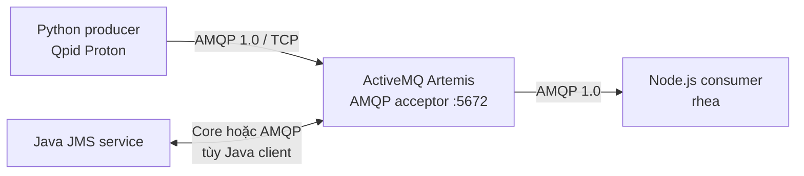
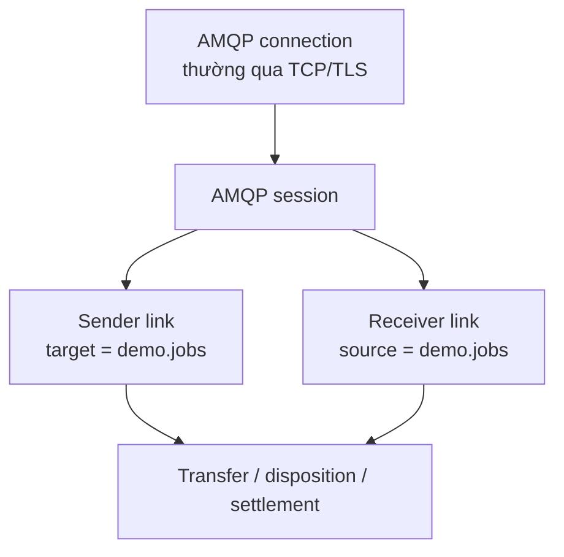
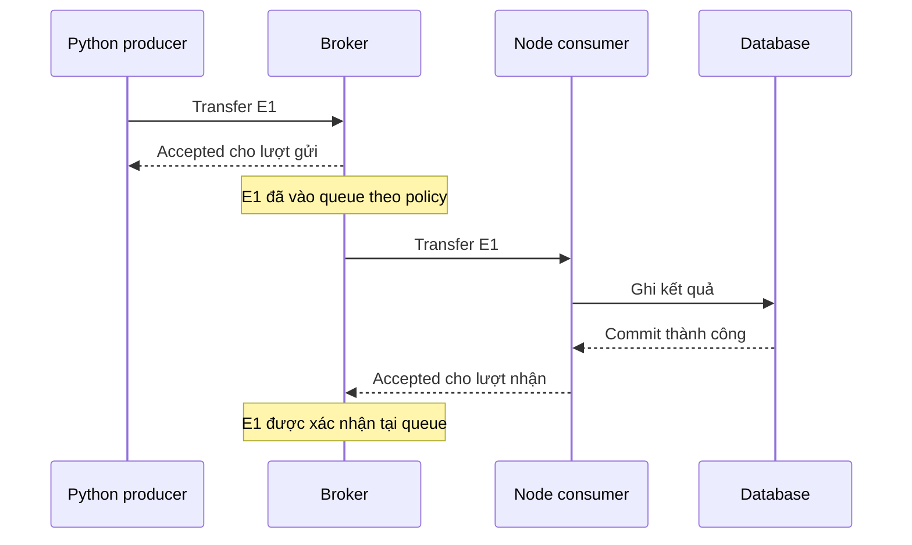

# AMQP 1.0 và tích hợp client ngoài Java

> **Chương:** Giao thức kết nối  
> **Phạm vi:** ActiveMQ Artemis/Classic, AMQP 1.0, ứng dụng Python và Node.js cùng giao tiếp qua message broker. Tập trung vào tương thích thực sự trên wire, schema, định tuyến, settlement và độ tin cậy.

## 1. Tình huống tích hợp: Python publish, Node.js consume

Ứng dụng Java đã gửi tác vụ lên ActiveMQ Artemis. Một nhóm xây worker bằng Python, nhóm khác dùng Node.js. Họ cần trao đổi sự kiện qua broker mà không muốn viết thêm một REST gateway hoặc phụ thuộc vào JMS API Java.

**AMQP 1.0** là giao thức trao đổi message trên mạng, có client bằng nhiều ngôn ngữ. Ta sẽ dùng **Apache Qpid Proton Python** để gửi, **rhea Node.js** để nhận và **Artemis** làm broker.



Bài này giải quyết ba câu hỏi: (1) client đã kết nối đúng **AMQP 1.0** chưa, (2) message có đến **đúng queue hoặc subscription** không, và (3) sau khi nhận, **broker đã xác nhận và lưu trạng thái** như kỳ vọng chưa?

Đầu ra thực hành gồm queue lệnh `demo.jobs` (ANYCAST) và address sự kiện `demo.events` (MULTICAST) với hai queue nhận riêng. Đây là topology cố định, giúp kiểm chứng liên ngôn ngữ mà không phụ thuộc vào broker tự tạo destination.

## 2. AMQP 1.0 không phải JMS và cũng không phải AMQP 0-9-1

| Khái niệm | Bản chất | Hệ quả khi chọn client |
|---|---|---|
| **AMQP 1.0** | Wire protocol: frame, link, message format, credit, disposition, settlement | Client Python, Node.js, .NET hoặc Java triển khai cùng chuẩn có thể tương tác với broker hỗ trợ 1.0 |
| **JMS / Jakarta Messaging** | API Java: `Connection`, `Session`, `MessageProducer`, `MessageConsumer` | Cùng JMS API không bắt buộc cùng wire protocol |
| **OpenWire** | Giao thức gắn với ActiveMQ Classic JMS client | Client OpenWire không tự trở thành AMQP chỉ vì đổi URL |
| **Artemis Core** | Giao thức native của Artemis client | Một Java Artemis JMS client thường sử dụng Core |
| **AMQP 0-9-1** | Phiên bản giao thức khác AMQP 1.0 | Không dùng trực tiếp `pika` hoặc `amqplib` thông thường để kết nối acceptor AMQP 1.0 |

Trong thực tế, thư viện Python `pika` và Node.js `amqplib` thường nói **AMQP 0-9-1**. Những thư viện này không tương thích trực tiếp với listener chỉ bật AMQP 1.0 của Artemis. Cần chọn client triển khai **đúng phiên bản giao thức**, như `python-qpid-proton` và `rhea`.

| Ngôn ngữ | Client AMQP 1.0 ví dụ | Vai trò |
|---|---|---|
| Python | Apache Qpid Proton (`python-qpid-proton`) | Producer, consumer, TLS |
| Node.js | rhea | Sender/receiver link, disposition |
| .NET | AMQPNetLite hoặc client AMQP 1.0 phù hợp | Tích hợp .NET |
| Java | Apache Qpid JMS | Dùng JMS API nhưng truyền trên AMQP 1.0 |

Kiểm tra phiên bản thư viện và cách ánh xạ message sang AMQP trước khi đưa vào production; bảng này là định hướng công nghệ, không phải bảo đảm mọi phiên bản đã đạt mọi feature của broker.

## 3. Cấu trúc AMQP 1.0 ảnh hưởng trực tiếp đến vận hành

### 3.1. Connection → Session → Link



- **Connection:** kết nối protocol giữa hai peer, có thể đi qua TLS và SASL.
- **Session:** ngữ cảnh điều phối link và frame, một connection có thể có nhiều session.
- **Sender link:** gửi message tới **target**.
- **Receiver link:** nhận message từ **source**.
- **Source/target address:** chuỗi định danh tài nguyên; broker diễn giải thành address/queue theo cách của nó.

Vì vậy, **TCP connect thành công chưa đủ**. Broker có thể chấp nhận connection nhưng từ chối link attach vì source/target không tồn tại, sai routing type hoặc user thiếu quyền consume.

### 3.2. Link credit là flow control, không phải acknowledgment

Receiver cấp **credit** để cho phép bên gửi transfer một số delivery. Khi hết credit, sender dừng gửi cho tới khi nhận thêm credit.

```text
Receiver cấp credit = 3
Broker dispatch M1, M2, M3
Credit còn 0, broker chờ cấp thêm

M1, M2, M3 có thể vẫn chưa được ACK.
```

Client có credit lớn có thể giữ nhiều message **in-flight/unsettled** dù business handler chỉ đang xử lý một message. Cần giám sát credit, unsettled, độ trễ xử lý và số message đang giao; không suy luận “queue ready giảm” thành “worker đã xử lý xong”.

### 3.3. Delivery outcome và settlement

| Khái niệm | Ý nghĩa |
|---|---|
| **Transfer** | Chuyển một delivery trên link |
| **Unsettled** | Delivery còn cần hai peer xử lý trạng thái/settlement |
| **Accepted** | Bên nhận chấp nhận delivery, thường dùng để xác nhận một lượt giao |
| **Rejected** | Bên nhận từ chối delivery và có thể báo lý do |
| **Released** | Bên nhận trả delivery, không xác nhận hoàn tất |
| **Modified** | Bên nhận thông báo trạng thái delivery sửa đổi theo AMQP |
| **Settled** | Không còn theo dõi trạng thái delivery đó trên link |

Một producer nhận outcome **Accepted từ broker** chỉ biết broker đã chấp nhận việc gửi theo protocol. **Consumer chưa chắc nhận được hoặc xử lý nghiệp vụ thành công**. Consumer gửi Accepted sau xử lý là sự kiện độc lập.

Không phải mọi trạng thái `Rejected`, `Released`, `Modified` đều tự động dẫn tới cùng số lần retry, delay hoặc DLQ: đó còn là chính sách cụ thể của Artemis/Classic và cách client cấu hình settlement.

### 3.4. AMQP message có nhiều section

| Section | Công dụng | Lưu ý liên ngôn ngữ |
|---|---|---|
| Header | `durable`, priority, TTL… | Durable không thay thế ACK của consumer |
| Properties | `message-id`, `correlation-id`, `reply-to`, `content-type` | ID/UUID/string có thể là các kiểu AMQP khác nhau |
| Application-properties | Key/value nghiệp vụ như `eventId`, `tenant` | Dùng key, kiểu dữ liệu thống nhất |
| Body | `amqp-value`, `data`, `amqp-sequence` | JSON string khác bytes JSON về kiểu body |
| Annotations | Metadata message/delivery | Một số annotation mang tính broker-specific |

**Không mặc định `content-type: application/json` khiến client tự chuyển body thành object JavaScript/Python.** Hai phía phải thống nhất serialization và kiểm tra body section thật.

## 4. Cấu hình ActiveMQ Artemis nhận AMQP 1.0

### 4.1. Acceptor

Trong `etc/broker.xml`, dùng một acceptor AMQP trong **phần `<acceptors>` hiện có**:

```xml
<acceptors>
  <acceptor name="amqp">
    tcp://0.0.0.0:5672?protocols=AMQP
  </acceptor>
</acceptors>
```

Không khai báo hai listener trên cùng port nếu cấu hình broker đã có cổng `5672`. Artemis có thể hỗ trợ nhiều protocol trong cùng acceptor nếu được thiết lập cho chúng; khi kiểm thử AMQP nên xác nhận rõ `protocols=AMQP` hoặc danh sách protocol có chứa `AMQP`.

Đây là ví dụ plaintext trên mạng thử nghiệm. Với production, giới hạn địa chỉ bind, bật TLS khi cần và kiểm tra chính sách chứng chỉ/xác thực.

### 4.2. Topology cố định cho thí nghiệm

Đặt dưới phần `<addresses>` trong `broker.xml`:

```xml
<addresses>
  <address name="demo.jobs">
    <anycast>
      <queue name="demo.jobs"/>
    </anycast>
  </address>

  <address name="demo.events">
    <multicast>
      <queue name="demo.events.audit"/>
      <queue name="demo.events.metrics"/>
    </multicast>
  </address>
</addresses>
```

| Address | Binding | Routing type | Ý nghĩa |
|---|---|---|---|
| `demo.jobs` | `demo.jobs` | ANYCAST | Message được đưa vào một queue công việc; nhiều worker tranh nhau xử lý |
| `demo.events` | `demo.events.audit` | MULTICAST | Audit có backlog và ACK riêng |
| `demo.events` | `demo.events.metrics` | MULTICAST | Metrics có backlog và ACK riêng |

Lưu ý: producer gửi vào **address**; consumer nhận từ **queue**. Nếu có nhiều queue multicast phù hợp, mỗi queue được thêm một reference/bản sao logic của message; không có nghĩa broker phải ghi N bản full payload vật lý.

**Phân định phạm vi:** Nhiều sender AMQP thuần chỉ đặt target string, không chọn “JMS Topic” bằng kiểu đối tượng. Đối với address có cả ANYCAST và MULTICAST, kết quả còn phụ thuộc AMQP terminus capabilities, default routing type và cấu hình broker. Để chứng minh fan-out, ưu tiên multicast address riêng và kiểm tra metric của **hai queue đích**.

### 4.3. ActiveMQ Classic có hỗ trợ AMQP, nhưng cấu hình khác

ActiveMQ Classic có **AMQP transport connector**; ví dụ cấu hình `activemq.xml`:

```xml
<transportConnectors>
  <transportConnector
      name="amqp"
      uri="amqp://0.0.0.0:5672"/>
</transportConnectors>
```

Connector AMQP này khác OpenWire connector. Classic không dùng định nghĩa `<address><anycast>...` của Artemis. Khi chuyển cùng client AMQP 1.0 giữa Classic và Artemis, phải thử lại cách source/target được ánh xạ tới queue/topic, durable subscription và chính sách redelivery/DLQ. Tương thích **wire protocol** không đồng nghĩa hai broker có **mô hình đích và hành vi vận hành** giống nhau.

## 5. Thực hành xuyên ngôn ngữ: Python producer và Node.js consumer

### 5.1. Chuẩn bị

Broker Artemis cần mở cổng AMQP, tồn tại queue `demo.jobs` và user có quyền send/consume. Nếu môi trường yêu cầu xác thực, đặt biến `BROKER_USER` và `BROKER_PASSWORD`. Đảm bảo không có consumer khác đang tranh queue thử nghiệm.

Cài thư viện:

```bash
python -m pip install python-qpid-proton
npm install rhea
```

Khóa version dependency phù hợp sau khi chạy thử. Cài `python-qpid-proton` có thể cần wheel/binary hoặc toolchain tương ứng; lỗi cài package không phải lỗi broker protocol.

### 5.2. Producer Python: `send_amqp.py`

```python
import json
import os
import sys
import uuid

from proton import Message
from proton.utils import BlockingConnection

url = os.getenv("AMQP_URL", "amqp://127.0.0.1:5672")
address = sys.argv[1] if len(sys.argv) > 1 else "demo.jobs"
event_id = str(uuid.uuid4())

options = {"timeout": 10}
user = os.getenv("BROKER_USER")
if user:
    options["user"] = user
    options["password"] = os.getenv("BROKER_PASSWORD", "")

connection = BlockingConnection(url, **options)
try:
    sender = connection.create_sender(address)

    payload = {
        "schemaVersion": 1,
        "eventId": event_id,
        "eventType": "ProcessOrder",
        "orderId": "O-1001",
    }

    message = Message(
        body=json.dumps(payload, ensure_ascii=False),
        durable=True,
        content_type="application/json",
        properties={
            "eventId": event_id,
            "eventType": "ProcessOrder",
        },
    )

    sender.send(message, timeout=10)
    print("Sent to", address, "eventId=", event_id)
finally:
    connection.close()
```

Ý nghĩa kỹ thuật:

- `create_sender(address)` attach sender link với target `demo.jobs`.
- `Message.properties` của Proton là **AMQP application-properties**, dùng được ở client Node qua `message.application_properties`.
- `body=json.dumps(...)` tạo **JSON string**, thường được encode thành `amqp-value` kiểu string; nó **không** tự thành `data` section chứa bytes JSON.
- `durable=True` biểu thị mong muốn lưu bền vững khi broker nhận; việc sống qua crash còn phụ thuộc persistence và cấu hình broker.
- `sender.send` thành công không xác nhận logic nghiệp vụ phía Node đã hoàn tất. Nếu không chắc lần gửi trước đã được broker nhận sau sự cố mạng, không retry vô hạn mà không có `eventId` idempotent.

### 5.3. Consumer Node.js: `receive_amqp.js`

```javascript
"use strict";

const rhea = require("rhea");
const address = process.argv[2] || "demo.jobs";

const options = {
  host: process.env.AMQP_HOST || "127.0.0.1",
  port: Number(process.env.AMQP_PORT || "5672"),
  reconnect: false,
};

if (process.env.BROKER_USER) {
  options.username = process.env.BROKER_USER;
  options.password = process.env.BROKER_PASSWORD || "";
}

const connection = rhea.connect(options);
const receiver = connection.open_receiver({
  source: { address: address },
  autoaccept: false,
});

const timer = setTimeout(() => {
  console.error("Timeout waiting for message from " + address);
  process.exitCode = 1;
  receiver.close();
  connection.close();
}, 15000);

receiver.on("message", (context) => {
  const incoming = context.message;
  const props = incoming.application_properties || {};

  try {
    const body = JSON.parse(String(incoming.body));
    if (body.eventId !== props.eventId) {
      throw new Error("eventId mismatch between body and properties");
    }

    console.log(
      "Received from " + address +
      " eventId=" + body.eventId +
      " orderId=" + body.orderId
    );

    // Trong service thật, chỉ accept sau khi business transaction thành công.
    context.delivery.accept();
    clearTimeout(timer);
    receiver.close();
    connection.close();
  } catch (error) {
    console.error("Processing failure: " + error.message);
    context.delivery.release(); // Chưa ACK, tùy broker policy có thể retry
    clearTimeout(timer);
    process.exitCode = 1;
    receiver.close();
    connection.close();
  }
});

receiver.on("receiver_error", (context) => {
  console.error("AMQP receiver error:", context.receiver.error);
});
```

Mẫu này cố tình **chỉ nhận một message rồi đóng** để dễ đo. Service thực tế giữ connection/link lâu dài, giới hạn xử lý đồng thời, đặt credit hợp lý và có reconnect/graceful shutdown; không tạo một connection mới cho mỗi message.

Ở đây `autoaccept: false` giúp code chọn thời điểm gửi `Accepted` sau bước xử lý. Trong đoạn demo, “xử lý” chỉ là parse và kiểm tra event ID; nếu có database, cần commit database thành công trước khi gửi `Accepted`, đồng thời thiết kế idempotency cho trường hợp crash giữa hai bước.

### 5.4. Chạy và đối chiếu

Terminal A:

```bash
node receive_amqp.js demo.jobs
```

Terminal B:

```bash
python send_amqp.py demo.jobs
```

Ví dụ kết quả:

```text
Python: Sent to demo.jobs eventId= 6db8...
Node:   Received from demo.jobs eventId=6db8... orderId=O-1001
```

Hai bên sử dụng **hai runtime/ngôn ngữ**, cùng wire protocol AMQP 1.0 và không cần JMS Java client. Lần thử thành công chứng minh kết nối, route queue, truyền `amqp-value` JSON string, application-properties và consumer Accepted trong kịch bản này; chưa khẳng định mọi message format, crash recovery, high availability hoặc subscription đều tương đương.

Để thử redelivery trên broker test, thay `context.delivery.accept()` bằng `context.delivery.release()` và chạy consumer tiếp theo. Điều tra broker có gửi lại hay không và số lần, khoảng trễ, DLQ theo policy. **Released không phải lệnh “bắt buộc đưa vào DLQ”.**

## 6. Mở rộng: một producer AMQP phát vào hai queue MULTICAST

Với topology `demo.events` đã khai báo, chạy hai consumer Node.js (mỗi consumer nhắm một queue cụ thể):

```bash
node receive_amqp.js demo.events::demo.events.audit
node receive_amqp.js demo.events::demo.events.metrics
```

Cú pháp `address::queue` là **Fully Qualified Queue Name (FQQN)** của Artemis, cho phép receiver link đọc đúng một queue dưới address. Sau đó gửi:

```bash
python send_amqp.py demo.events
```

Khi broker route event vào MULTICAST, audit và metrics sẽ mỗi bên nhận một bản sao logic; ACK audit **không** ACK metrics.

| Thời điểm | Queue `demo.events.audit` | Queue `demo.events.metrics` |
|---|---|---|
| Trước publish | Không có event thử nghiệm | Không có event thử nghiệm |
| Publish `E42` theo MULTICAST | Có reference `E42` | Có reference `E42` |
| Audit accept | `E42` đã ACK tại audit | `E42` còn ở metrics |
| Metrics accept | Đã hoàn tất | `E42` đã ACK tại metrics |

**Kiểm tra thực tế:** target `demo.events` trong một AMQP sender thuần không tự biểu thị mọi semantics JMS Topic. Nếu thấy chỉ một queue nhận message hoặc cả hai không nhận, kiểm tra kiểu routing thực tế, queue bindings, filter, auto-create và protocol manager; đừng suy luận từ log “send successful”. Kiểm tra `MessagesAdded` trên từng queue và log `eventId` ở hai consumer.

### 6.1. Queue cố định và durable AMQP subscription không giống nhau

Thí nghiệm dùng **queue multicast được định nghĩa trước** và vẫn tồn tại khi consumer offline. Cách này giữ backlog theo tuổi thọ/policy của queue.

Một AMQP receiver attach vào address multicast rồi disconnect **không tự trở thành durable subscription**. Muốn dùng durable subscription qua AMQP link, cần thống nhất các thuộc tính source/terminus durability, link identity, cách broker đặt tên subscription queue, lifetime khi detach và hành vi reconnect. Cần kiểm thử thư viện, broker version, filter và quyền tạo durable queue.

Nếu yêu cầu nghiệp vụ là “dịch vụ Analytics offline vẫn nhận được mọi sự kiện phù hợp”, một queue durable cố định do vận hành quản lý có thể dễ quan sát hơn dynamic subscription; lựa chọn nào cũng phải được kiểm chứng bằng thử nghiệm offline/reconnect và persistence.

## 7. Thiết kế message schema liên ngôn ngữ

Ví dụ message body cho dịch vụ Python, Node và Java:

```json
{
  "schemaVersion": 1,
  "eventId": "evt-42",
  "eventType": "OrderCreated",
  "occurredAt": "2026-11-17T07:00:00Z",
  "orderId": "O-1001",
  "tenant": "vn"
}
```

Cùng với AMQP `content-type=application/json` và application-properties `eventId`, `eventType`, giao ước cần quy định:

1. **Encoding:** UTF-8 JSON; chỉ rõ body section là `amqp-value` chứa string hay `data` chứa bytes. Code receiver phải xử lý đúng kiểu.
2. **ID:** `eventId` là ID nghiệp vụ ổn định qua retry; không dùng ngẫu nhiên lại mỗi lần retry cùng event. AMQP `message-id` có thể mang ID khác.
3. **Version:** `schemaVersion` giúp mở rộng field theo backward compatibility.
4. **Thời gian:** timestamp UTC có timezone rõ ràng.
5. **Kiểu số:** JSON integer lớn hơn giới hạn số nguyên an toàn của JavaScript phải được truyền dưới dạng string/decimal schema phù hợp.
6. **Binary và UUID:** AMQP có kiểu binary/UUID, JSON string UUID không tự trở thành kiểu UUID; selector/filter phải so khớp đúng kiểu.
7. **Null:** property thiếu khác với property tồn tại nhưng có giá trị null trong quá trình kiểm tra điều kiện.

Nếu dùng Qpid JMS Java để nói AMQP 1.0 với broker, `TextMessage`, `BytesMessage`, `MapMessage` và các header JMS được ánh xạ thành AMQP sections theo provider. Không tự suy luận mọi AMQP `data` section sẽ thành JMS TextMessage hoặc mọi header Artemis được giữ nguyên. Với schema có yêu cầu chặt, dùng contract test từ **cả hai phía**.

### 7.1. Kiểm thử serialization tối thiểu

| Dữ liệu | Producer Python | Điều Node phải xác minh |
|---|---|---|
| Unicode tiếng Việt | `"Đã thanh toán"` | Giữ nguyên ký tự sau decode |
| Integer rất lớn | `"9007199254740993"` dạng string | Không mất chữ số vì `Number` |
| Thuộc tính tùy chọn | `tenant` thiếu | Không nhầm với `tenant="vn"` |
| Date | ISO 8601 UTC | Parse đúng timezone |
| Body bytes | Binary JSON/Protobuf | Chọn decoder bytes, không `String(body)` tùy tiện |
| Unknown schema version | `schemaVersion=99` | Có hành vi reject/quarantine theo policy, không xử lý sai âm thầm |

## 8. Settlement, transaction và độ tin cậy nghiệp vụ

Đường đi của message qua broker:



**Hai kết quả Accepted khác nhau:** Broker accepted phía sender không bảo đảm DB phía consumer đã commit; consumer accepted không phải một phần nguyên tử của DB transaction chỉ bởi cách viết code.

### 8.1. Trường hợp cần chống duplicate

```text
1. Node nhận E1.
2. Node commit DB thành công.
3. Node crash trước khi Accepted được broker ghi nhận.
4. Broker redeliver E1 cho một consumer khác.
5. Consumer mới có thể lặp side effect nếu không kiểm tra eventId.
```

Một cách phòng vệ: lưu `eventId` với unique constraint trong **cùng DB transaction** với cập nhật nghiệp vụ; nếu event đã xử lý thì bỏ qua side effect và xác nhận delivery hiện tại. Nếu gọi API thanh toán/email bên ngoài, cần thêm idempotency ở dịch vụ đích hoặc workflow điều phối thích hợp.

### 8.2. Retry và DLQ

Với Artemis, redelivery delay, số lượt giao tối đa và DLQ thường thuộc `address-settings`:

```xml
<address-settings>
  <address-setting match="demo.jobs">
    <redelivery-delay>1000</redelivery-delay>
    <max-delivery-attempts>5</max-delivery-attempts>
    <dead-letter-address>DLQ</dead-letter-address>
  </address-setting>
</address-settings>
```

Đặt đoạn này vào phần `<address-settings>` tương ứng của `broker.xml`. **Phải có queue/binding DLQ phù hợp** hoặc bật cơ chế auto-create dead-letter resources; một mình `dead-letter-address` không đủ để bảo đảm quan sát được message lỗi.

Khi test bằng rhea `release()`, cần kiểm tra broker thực sự tính retry/delivery count thế nào. AMQP dispositions `Released`/`Modified`, đóng kết nối chưa ACK và ứng dụng cố ý reject không bắt buộc đều đi qua cùng một nhánh xử lý. Đừng tuyên bố “cứ release đủ 5 lần sẽ vào DLQ” nếu chưa kiểm chứng bằng broker metrics và log.

### 8.3. Producer retry khi outcome không chắc chắn

Nếu broker nhận message rồi socket đứt trước khi producer nhìn thấy Accepted, client có thể không biết message đã được enqueue hay chưa. Gửi lại mù có thể tạo duplicate business event. Thiết kế producer nên có **eventId ổn định**, outbox khi cần nhất quán với database và theo dõi accepted/unsettled state sau reconnect.

AMQP 1.0 có khả năng transaction trong giao thức, nhưng hỗ trợ thực tế và mức tích hợp với database/XA tùy client/broker. Không tự coi mọi `sender.send` hoặc `delivery.accept` là một distributed transaction.

## 9. TLS, SASL và phân quyền broker

AMQP 1.0 hỗ trợ trao đổi xác thực thông qua **SASL** và bảo mật transport bằng **TLS**; hai lớp này có trách nhiệm khác nhau:

| Lớp | Chức năng | Điều cần kiểm tra |
|---|---|---|
| TLS | Mã hóa traffic, xác minh certificate/hostname | CA, SAN, expiry, cấu hình client truststore |
| SASL | Xác thực danh tính client | Mechanism như PLAIN/EXTERNAL tùy broker, credential |
| Authorization | Quyền send, consume, create address/queue | Role ACL trên address/queue tương ứng |

SASL **PLAIN không tự mã hóa mật khẩu**; cần dùng trên kênh TLS khi đi qua mạng không đáng tin. Không tắt xác minh CA/hostname chỉ để làm pass một thử nghiệm production.

Ví dụ **minh họa** acceptor TLS của Artemis, với placeholder cho secret:

```xml
<acceptor name="amqps">
  tcp://0.0.0.0:5671?protocols=AMQP;sslEnabled=true;keyStorePath=/etc/artemis/broker.p12;keyStoreType=PKCS12;keyStorePassword=CHANGE_ME
</acceptor>
```

Không lưu mật khẩu thật trong source; dùng secret-management/credential-store phù hợp môi trường. Chứng chỉ broker cần khớp hostname mà client sử dụng.

Ví dụ thiết lập Proton Python xác minh CA và hostname:

```python
from proton import SSLDomain
from proton.utils import BlockingConnection

tls = SSLDomain(SSLDomain.MODE_CLIENT)
tls.set_trusted_ca_db("/etc/app/certs/company-ca.pem")
tls.set_peer_authentication(SSLDomain.VERIFY_PEER_NAME)

connection = BlockingConnection(
    "amqps://broker.example.com:5671",
    ssl_domain=tls,
    user="orders-producer",
    password="READ_FROM_SECRET_MANAGER",
    timeout=10,
)
```

`READ_FROM_SECRET_MANAGER` biểu thị nơi giá trị cần được cấp từ secret manager, không phải mật khẩu dùng thật. Client/broker phải tương thích với cấu hình TLS và phiên bản thư viện. Với Node.js, kiểm tra cách rhea nhận các tùy chọn TLS và CA theo version đang triển khai.

**Phân quyền tối thiểu:** Producer Python cần `send` trên address; worker Node cần `consume` đúng queue; chỉ service được phép tạo subscription động mới có quyền create queue/address. Với demo queue pre-created, có thể loại bỏ quyền tạo queue của client để giảm nguy cơ typo khiến broker tạo resource không mong muốn.

## 10. Chẩn đoán lỗi AMQP 1.0 đa ngôn ngữ

| Triệu chứng | Nguyên nhân thường gặp | Cách kiểm tra |
|---|---|---|
| Handshake/framing fail | Dùng client AMQP 0-9-1 với listener AMQP 1.0 | Kiểm tra thư viện `pika/amqplib` vs Proton/rhea |
| TCP connect nhưng link attach lỗi | Source/target sai, không tồn tại hoặc thiếu quyền | Kiểm tra address, FQQN, ACL, auto-create policy |
| TLS handshake fail | CA, hostname, TLS version hoặc chứng chỉ client không phù hợp | Xem SAN, CA, handshake logs |
| Python send thành công, Node không nhận | Message không route vào queue đích hoặc consumer khác nhận | Xem queue binding, routing type, MessagesAdded |
| Một trong hai nhóm không nhận event | Multicast binding thiếu/filter loại event | Đối chiếu routing type, queue list và filter |
| Body không parse được | AMQP `data` khác `amqp-value`, schema không thống nhất | Ghi log body section/type và content type |
| Consumer “treo” | Không có credit, link bị detach, thiếu event hoặc handler block | Credit, unsettled, consumer count, log link |
| Message lặp sau reconnect | ACK chưa áp dụng hoặc producer retry không rõ outcome | Event ID, delivery state, application idempotency |
| Message lỗi không xuất hiện ở DLQ | Chính sách address không khớp hoặc thiếu DLQ binding | Xem address-settings, retry count, DLQ queue |
| Đổi broker Classic ↔ Artemis bị khác | Protocol giống nhưng destination semantics khác | Kiểm thử source/target, durable subscription, routing, DLQ |

**Log hữu ích**, không cần lộ payload/credential: timestamp, AMQP protocol, broker endpoint, connection/link ID, source/target, eventId, schema version, outcome, duration, redelivered, error class. Kết hợp broker metrics như `MessagesAdded`, `MessageCount`, `DeliveringCount`, `MessagesAcknowledged` và DLQ **theo từng queue**.

## 11. Bộ kiểm thử tích hợp đề xuất

| Ca thử | Thao tác | Tiêu chí đạt |
|---|---|---|
| Queue cơ bản | Python gửi `E1`, Node nhận ở `demo.jobs` | Đúng body và application-properties, accept thành công |
| Interop kiểu dữ liệu | JSON Unicode, integer lớn, body bytes | Decoder đúng schema, không làm sai dữ liệu |
| Fan-out | Python gửi một event vào `demo.events` | Cả audit và metrics queue nhận khi routing MULTICAST |
| Subscriber offline | Dừng Node, publish rồi kết nối lại queue cố định | Backlog còn theo storage/TTL policy |
| Crash trước Accepted | Dừng process khi message đang xử lý | Message có thể được redeliver, handler idempotent |
| Retry và DLQ | Tạo message lỗi liên tục | Quan sát đúng retry delay, đích dead-letter |
| Permission | Client chỉ có quyền send thử consume | Broker từ chối tiêu thụ |
| TLS | Client dùng CA/hostname không đúng | Kết nối bị từ chối |
| Flow control | Giảm tốc độ handler, tăng message | Unsettled/credit và bộ nhớ vẫn trong giới hạn |
| Broker restart | Gửi durable message rồi restart | Message được giữ theo kỳ vọng cấu hình persistence |

Không chỉ đo tốc độ gửi/nhận. Để đánh giá vận hành đáng tin, đo **ACK rate**, latency p95/p99, độ dài backlog, redelivery rate, message vào DLQ, duplicate `eventId` và thời gian reconnect/failover.

## 12. Câu hỏi vận dụng

1. Vì sao Python `pika` không thể trực tiếp nói chuyện với một Artemis acceptor chỉ bật AMQP 1.0, dù cả hai đều ghi “AMQP”?
2. Nếu Qpid Proton gửi JSON string còn Node receiver mong binary `data` section, bạn sẽ thống nhất schema và viết decoder như thế nào?
3. Artemis có hai queue multicast dưới một address. Tại sao một AMQP sender chỉ dùng tên address chưa đủ để kết luận cả hai queue đều nhận message?
4. Consumer Node đã commit database nhưng crash trước `delivery.accept()`. Điều gì có thể xảy ra và ngăn duplicate bằng cách nào?
5. Broker trả Accepted cho Python producer. Có thể suy ra Node đã xử lý xong không? Nêu hai thời điểm xác nhận khác nhau.
6. Khi một receiver AMQP tạm thời offline, vì sao link đó không tự tương đương durable subscription? Nêu cách dùng queue cố định và cách cần kiểm thử durable link.
7. Bạn sẽ chọn những metric/log nào để phân biệt lỗi “message chưa route vào queue” với “message đã dispatch nhưng chưa ACK”?

## 13. Tài liệu tham khảo

- [OASIS AMQP 1.0 Specification](https://docs.oasis-open.org/amqp/core/v1.0/os/amqp-core-overview-v1.0-os.html) — mô hình link, transfer, delivery và settlement.
- [Apache ActiveMQ Artemis — AMQP](https://artemis.apache.org/components/artemis/documentation/latest/amqp.html) — cấu hình acceptor, tính năng AMQP.
- [Apache ActiveMQ Artemis — Protocols and Interoperability](https://artemis.apache.org/components/artemis/documentation/latest/protocols-interoperability.html) — nhiều giao thức trên broker.
- [Apache ActiveMQ Artemis — Address Model](https://artemis.apache.org/components/artemis/documentation/latest/address-model.html) — anycast, multicast, queue và FQQN.
- [Apache ActiveMQ Classic — AMQP](https://activemq.apache.org/components/classic/documentation/amqp) — AMQP transport trong Classic.
- [Apache Qpid Proton Python](https://qpid.apache.org/proton/) — thư viện AMQP 1.0 và tài liệu API.
- [rhea Node.js AMQP 1.0 client](https://github.com/amqp/rhea) — API connection, link và message disposition.

**Ghi nhớ:** AMQP 1.0 giúp ứng dụng **Python, Node.js và Java tương tác qua cùng broker**, nhưng tính đúng đắn còn phụ thuộc vào **đúng phiên bản protocol, đúng address/routing, thống nhất message schema và ACK/settlement theo nghiệp vụ**. Bắt đầu bằng queue được khai báo tường minh, kiểm chứng xuyên ngôn ngữ, rồi mới mở rộng multicast, durable subscription, TLS và HA.
