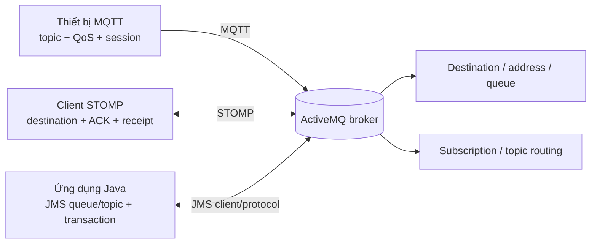
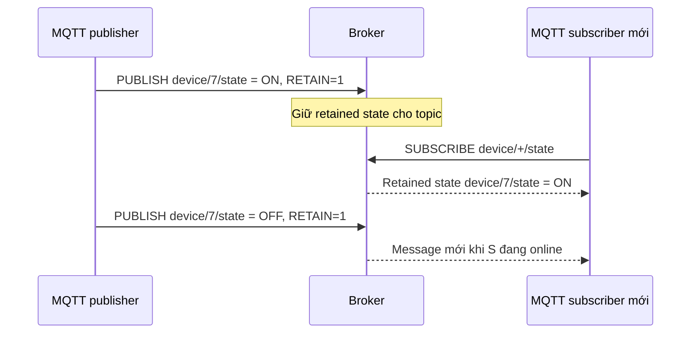
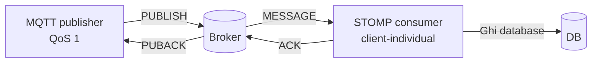
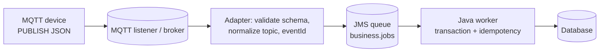

# STOMP, MQTT và giới hạn ánh xạ ngữ nghĩa theo giao thức

> **Chương:** Giao thức kết nối  
> **Phạm vi:** ActiveMQ Classic và ActiveMQ Artemis khi nhận kết nối **STOMP** và **MQTT**, với trọng tâm là **ngữ nghĩa giao message**, quy tắc định tuyến và giới hạn chuyển đổi giữa hai giao thức hoặc sang JMS. Ví dụ minh họa sử dụng **STOMP 1.2** và **MQTT 3.1.1**; các phiên bản MQTT/STOMP khác phải được đối chiếu riêng theo broker đang triển khai.

## 1. Bài toán: cùng một broker, các client có thực sự giao tiếp tương đương?

Một hệ thống thu dữ liệu thiết bị có ba nhóm client:

- Thiết bị cảm biến gửi trạng thái qua **MQTT**, ví dụ `factory/line-1/sensor-7/state`.
- Dashboard hoặc dịch vụ trung gian gửi/nhận lệnh qua **STOMP**, ví dụ destination `/topic/factory.alerts`.
- Dịch vụ Java xử lý nghiệp vụ sử dụng **JMS** để ghi dữ liệu và xác nhận các công việc cần độ tin cậy cao.

ActiveMQ Classic và Artemis có thể tiếp nhận nhiều giao thức, nhưng **chấp nhận kết nối nhiều giao thức không đồng nghĩa mọi ngữ nghĩa đều ánh xạ 1–1**. MQTT có QoS, session, retained message, Last Will; STOMP có ACK/NACK, receipt và giao dịch STOMP; JMS có Session, message headers/properties, queue/topic, acknowledgment và local transaction. Broker phải dịch **destination**, **header**, **kiểu dữ liệu**, **cách xác nhận**, **trạng thái subscription** và **chính sách lưu giữ** theo khả năng của từng giao thức.



Mục tiêu của bài là phân biệt **điều giao thức thực sự bảo đảm** với **điều ứng dụng mong muốn**, rồi thiết kế và kiểm thử các điểm chuyển tiếp. Bài không lặp lại hướng dẫn cài JDK, Docker hay khái niệm queue/topic cơ bản.

Sau bài này, bạn có thể đọc frame STOMP, giải thích packet và QoS MQTT, cấu hình listener STOMP/MQTT của Classic và Artemis, xây dựng phép thử gửi/nhận, và lập bảng kiểm tra các tính chất bị mất hoặc biến đổi khi bắc cầu giao thức.

## 2. Phân biệt giao thức trên dây, API và mô hình broker

Ba tầng thường bị nhầm:

| Tầng | Ví dụ | Tầng này mô tả điều gì? |
|---|---|---|
| **Wire protocol** | STOMP 1.2, MQTT 3.1.1, AMQP 1.0, OpenWire, Artemis Core | Cách client và broker trao đổi byte, packet/frame, xác thực và tín hiệu điều khiển. |
| **Client API** | JMS/Jakarta Messaging, thư viện MQTT Paho, STOMP library | Phương thức lập trình: `send`, `publish`, `subscribe`, `receive`, `acknowledge`… |
| **Broker routing/storage** | Classic destination queue/topic; Artemis address + ANYCAST/MULTICAST queues | Nơi message được lưu, ánh xạ tên, phân phối tới nhóm consumer và áp policy. |

**JMS là API**, không phải một định dạng packet mạng bắt buộc. Một ứng dụng Java dùng JMS có thể kết nối bằng client triển khai riêng của broker. STOMP và MQTT là **wire protocol**; chúng có client ở nhiều ngôn ngữ và không cần JMS API. Khi nói “chuyển MQTT sang JMS”, cần xác định đang chuyển **đích đến**, **payload** và **ngữ nghĩa tiêu thụ** ở đâu trong broker/application.

### 2.1 Vì sao không nên nói “cả hai đều có topic nên tương đương”?

MQTT định nghĩa **topic name** và **topic filter** với ký tự phân cấp `/` và wildcard `+`, `#`. STOMP chỉ truyền một **chuỗi destination**, cú pháp và ý nghĩa như `/queue/orders` hoặc `/topic/events` do broker quy định. JMS có destination kiểu `Queue` hoặc `Topic` nhưng không chuẩn hóa quy tắc đổi tên MQTT `plant/a/temp` thành JMS `plant.a.temp`.

Chẳng hạn:

```text
MQTT PUBLISH topic:       plant/line1/temperature
MQTT SUBSCRIBE filter:    plant/+/temperature
STOMP SEND destination:   /topic/plant.line1.temperature
JMS Topic:                plant.line1.temperature
```

**Không thể kết luận** ba chuỗi trên đang chỉ cùng một destination nếu chưa kiểm chứng bộ **protocol converter**, tên address/destination, wildcard syntax và cấu hình broker. Ứng dụng có thể tự quy định convention đặt tên, hoặc dùng bridge/adapter chuyên dụng để ánh xạ tường minh.

## 3. STOMP 1.2: frame, destination và cơ chế xác nhận

**STOMP (Simple/Streaming Text Oriented Messaging Protocol)** dùng frame văn bản với dòng lệnh, header và body. Một frame điển hình:

```text
COMMAND
header-1:value-1
header-2:value-2

body<NUL>
```

Phần `<NUL>` biểu diễn **byte `0x00`**, không phải sáu ký tự văn bản. Sau dòng header rỗng là body; nếu có `content-length` thì độ dài được tính **theo byte**, rất quan trọng với UTF-8 và body chứa byte `0x00`. Ở STOMP 1.1/1.2, một số ký tự đặc biệt trong header được escape theo quy tắc protocol; không ghép header từ dữ liệu người dùng mà bỏ qua escape.

### 3.1 Kết nối và gửi message

Client STOMP 1.2 có thể bắt đầu bằng:

```text
CONNECT
accept-version:1.2
host:localhost
login:labuser
passcode:labpass123
heart-beat:10000,10000

<NUL>
```

Broker trả lời `CONNECTED` nếu chấp nhận kết nối, hoặc `ERROR` khi gặp lỗi tương ứng. `host` là header bắt buộc trong STOMP 1.1/1.2; việc broker có sử dụng virtual host hay không là câu chuyện cấu hình riêng. Ví dụ này minh họa credential lab, **không** an toàn khi gửi thẳng qua mạng công cộng không có TLS.

Producer gửi vào một queue theo convention của **ActiveMQ Classic**:

```text
SEND
destination:/queue/lab.protocol.orders
content-type:text/plain;charset=utf-8
receipt:send-001

create-order:ORD-101<NUL>
```

`/queue/...` là **quy ước destination của Classic STOMP**, không được STOMP chuẩn hóa cho mọi provider. Header `receipt` yêu cầu broker hồi đáp `RECEIPT` khi broker xử lý frame liên quan; nó **không khẳng định đã có consumer xử lý nghiệp vụ hoặc database đã commit**. Cũng không nên suy từ một `RECEIPT` ra cam kết an toàn dữ liệu sau mất điện trong mọi cấu hình persistence/failover.

### 3.2 Subscribe và ACK ở phiên bản 1.2

Consumer đăng ký:

```text
SUBSCRIBE
id:orders-sub
destination:/queue/lab.protocol.orders
ack:client-individual

<NUL>
```

Broker phân phối một message có thể trông như sau:

```text
MESSAGE
subscription:orders-sub
message-id:ID:broker-123
ack:ack-token-456
destination:/queue/lab.protocol.orders
content-type:text/plain

create-order:ORD-101<NUL>
```

Với **STOMP 1.2**, client ACK bằng giá trị của **header `ack` trong frame MESSAGE**:

```text
ACK
id:ack-token-456

<NUL>
```

**Không nhầm** `MESSAGE message-id` với **`ACK id`**. Tài liệu và client của STOMP 1.0/1.1 có thể biểu diễn khác; đừng chép lệnh ACK từ phiên bản cũ sang STOMP 1.2 mà không kiểm tra header/phiên bản đã thương lượng.

| `ack` khi SUBSCRIBE | Cơ chế | Hệ quả cần lưu ý |
|---|---|---|
| `auto` | Broker không chờ ACK riêng cho từng message ở tầng STOMP. | Không phù hợp khi ứng dụng cần tự xác nhận sau khi xử lý nghiệp vụ. |
| `client` | ACK **cumulative** trong phạm vi subscription theo ngữ nghĩa STOMP. | Một ACK có thể bao gồm các message giao trước đó; xử lý không theo thứ tự dễ gây sai giả định. |
| `client-individual` | ACK riêng cho một message. | Phù hợp xử lý độc lập, nhưng vẫn phải chống trùng khi message giao lại. |

Nếu không xử lý được, STOMP 1.1/1.2 hỗ trợ `NACK`. **NACK không đồng nghĩa broker sẽ retry vô hạn hoặc lập tức đưa vào DLQ**; cách giao lại, delay và DLQ chịu ảnh hưởng của ActiveMQ broker và policy đang chạy. Để kiểm soát kết quả, cần kiểm thử các tình huống disconnect, rollback/transaction và message độc trên chính broker.

### 3.3 STOMP transaction và receipt có giới hạn gì?

STOMP cho phép:

```text
BEGIN
transaction:tx-1

<NUL>
```

Sau đó các frame `SEND` hoặc `ACK` có thể mang `transaction:tx-1`; `COMMIT` hoặc `ABORT` kết thúc transaction. Ví dụ gửi message trong giao dịch:

```text
SEND
destination:/queue/lab.protocol.orders
transaction:tx-1

job-202<NUL>
```

```text
COMMIT
transaction:tx-1
receipt:commit-1

<NUL>
```

Đây là **transaction trong kết nối STOMP được broker hỗ trợ**, không phải XA hay một giao dịch tự động bao gồm PostgreSQL, REST API hoặc consumer viết bằng MQTT. Receipt của `COMMIT` xác nhận thao tác broker theo protocol; không chứng minh rằng dịch vụ downstream đã hoàn tất tác vụ.

**Heartbeat** trong STOMP là trao đổi nhịp sống được thương lượng bằng `heart-beat:cx,cy` và phía broker; nó giúp nhận biết kết nối chết sớm hơn trong điều kiện thích hợp. Không dùng heartbeat như ACK cho message. Bản lab đơn giản có thể tắt heartbeat `0,0`, nhưng triển khai thực cần chọn timeout phù hợp với mạng/chi phí reconnect.

## 4. MQTT 3.1.1: QoS, session, retained message và Will

**MQTT** phổ biến ở thiết bị IoT hoặc client mạng không ổn định. MQTT dùng **topic name** khi publish và **topic filter** khi subscribe; một client có thể subscribe nhiều filter và nhận message có topic name phù hợp.

Ví dụ:

```text
PUBLISH topic:           factory/line1/sensor7/state
SUBSCRIBE filter:        factory/+/sensor7/state
SUBSCRIBE filter:        factory/#
```

`+` khớp một cấp của đường topic, `#` khớp nhiều cấp và phải nằm ở cuối topic filter theo quy tắc MQTT. Ký tự `+`/`#` là wildcard của **subscription filter**; publisher không gửi đến wildcard thay cho một topic name cụ thể. Topic MQTT phân biệt chữ hoa/chữ thường và dấu `/`.

### 4.1 QoS là bảo đảm giao message ở protocol, không phải business transaction

| MQTT QoS | Trao đổi ở protocol | Ngữ nghĩa chính | Giới hạn nghiệp vụ |
|---|---|---|---|
| **0 — At most once** | PUBLISH, không có ACK bắt buộc ở protocol | Có thể mất message khi lỗi; ít overhead. | Không phù hợp với công việc bắt buộc có bằng chứng giao. |
| **1 — At least once** | PUBLISH → PUBACK | Client/broker có thể phát lại nếu không chắc lần trước đã hoàn tất. | Có thể có **duplicate**; consumer phải idempotent khi cần. |
| **2 — Exactly once (protocol flow)** | PUBLISH → PUBREC → PUBREL → PUBCOMP | Handshake tránh việc một lần giao QoS 2 bị xử lý lặp ở phạm vi giao thức/phiên tương ứng. | **Không đảm bảo một lần cập nhật database** hay ngữ nghĩa exactly-once qua bridge, JMS hoặc ứng dụng khác. |

QoS được xác định theo **từng chặng truyền**: publisher → broker và broker → subscriber. Subscription có mức QoS yêu cầu; mức giao đến subscriber do thỏa thuận/quy tắc protocol và khả năng broker quyết định, không thể chỉ nhìn QoS của publisher rồi suy ra cùng bảo đảm ở mọi consumer phía sau.

Kịch bản dễ gặp: publisher gửi `eventId=E7` ở QoS 1, broker đã nhận nhưng PUBACK bị mất; publisher gửi lại. Nếu consumer STOMP/JMS ghi nghiệp vụ khi nhận từng lần mà không dùng `eventId` chống trùng, cơ chế MQTT QoS 1 **không** bảo vệ dữ liệu khỏi cập nhật kép.

### 4.2 Clean Session và client ID (MQTT 3.1.1)

Trong MQTT 3.1.1, **Client Identifier** xác định phiên MQTT; cờ **Clean Session** quyết định việc broker có cố giữ trạng thái phiên hay không:

- `cleanSession=true`: phiên bắt đầu sạch, không kỳ vọng giữ subscription và backlog của phiên cũ khi client ngắt.
- `cleanSession=false`: broker có thể duy trì subscription và các trạng thái giao QoS phù hợp, nhận và lưu message offline thuộc phạm vi được hỗ trợ và cấu hình, với điều kiện **client ID ổn định** và session đã được tạo.
- Hai kết nối đồng thời dùng cùng client ID có thể khiến broker ngắt kết nối trước đó; không dùng client ID chung cho một đội thiết bị độc lập.

Đừng hiểu `cleanSession=false` là “lưu tất cả message vô hạn”. Khả năng nhận khi reconnect phụ thuộc đã subscribe trước đó hay chưa, QoS, session store, giới hạn tài nguyên, expiration nếu áp dụng và hành vi cụ thể của broker/phiên bản. Với **MQTT 5**, `Clean Start` và `Session Expiry Interval` thay đổi cách diễn đạt; không coi chúng giống hệt một boolean Clean Session của 3.1.1.

### 4.3 Retained message hoàn toàn khác backlog offline

Publisher có thể đặt cờ **RETAIN** cho một MQTT PUBLISH. Broker duy trì message retained gần nhất **theo topic** và có thể gửi đến client **mới subscribe** filter tương ứng. Một bản publish retained mới cho cùng topic thay thế retained cũ. Với MQTT 3.1.1, publish retained có payload độ dài **0** thường dùng để xóa retained message của topic.



**Retained không phải lịch sử:** broker thường giữ giá trị retained **cuối** của mỗi topic, không giữ mọi lần thay đổi. **Retained không phải persistent session:** một client mới vẫn có thể nhận retained snapshot mà chưa từng tạo session trước đó; một offline persistent session có thể nhận backlog QoS phù hợp ngoài retained message.

Khi message MQTT được chuyển sang STOMP/JMS, đừng mặc định cờ retained trở thành header JMS/STOMP chuẩn, hoặc một message STOMP gửi vào cùng topic sẽ tự cập nhật retained store. Cách broker ánh xạ tính năng riêng này cần kiểm tra trên phiên bản cụ thể.

### 4.4 Last Will and Testament (Will)

Client MQTT có thể cấu hình **Will** tại CONNECT: topic, payload, QoS và có thể cờ retained. Broker công bố Will khi phát hiện kết nối bị mất **không theo đường ngắt kết nối bình thường** theo điều kiện protocol, ví dụ thiết bị tắt nguồn hoặc mạng rớt. DISCONNECT bình thường không phải tín hiệu để broker phát Will.

Ví dụ ứng dụng giám sát dùng `device/7/availability = offline` làm Will và publish `online` retained sau khi kết nối. Khi thiết bị mất kết nối đột ngột, broker có thể phát `offline`. Độ trễ phụ thuộc keepalive và việc broker phát hiện mất kết nối; đây **không phải đồng hồ phát hiện sự cố tức thời**. Bên nhận phải chịu được trạng thái cập nhật chậm, trùng và trường hợp reconnect nhanh.

## 5. Cấu hình listener STOMP/MQTT trên Classic và Artemis

Hai broker có lớp cấu hình riêng. Các đoạn dưới đây là **snippet dành cho môi trường lab**, cần đặt vào đúng phần tử có sẵn trong cấu hình bản phát hành đang sử dụng. Không thay thế nguyên file cấu hình và không mở listener plaintext ra Internet.

### 5.1 ActiveMQ Classic: transport connectors

Trong broker Classic, cấu hình listener thường nằm trong `<transportConnectors>` của `activemq.xml`:

```xml
<!-- Các connector trong cấu hình broker Classic 5.x -->
<transportConnectors>
    <transportConnector name="stomp" uri="stomp://0.0.0.0:61613"/>
    <transportConnector name="mqtt" uri="mqtt://0.0.0.0:1883"/>
</transportConnectors>
```

- `61613` là cổng STOMP TCP minh họa; `1883` là cổng MQTT TCP phổ biến.
- `0.0.0.0` làm broker lắng nghe trên nhiều interface; trong Docker cần publish host port có kiểm soát, chẳng hạn chỉ bind `127.0.0.1` ở máy phát triển. Trên server production, giới hạn mạng và dùng TLS.
- Nếu Classic đã có các connector khác như OpenWire, **thêm hai connector vào danh sách hiện có**, không xóa cấu hình transport đang phục vụ các ứng dụng khác.
- Địa chỉ `stomp://` và `mqtt://` là scheme giao thức của **Classic**; cơ chế hỗ trợ SSL/TLS, auth và transport options cần đọc theo đúng bản Classic, không suy từ chuỗi URI minh họa.

**Destination của Classic STOMP:** convention thường là `/queue/<name>` và `/topic/<name>`. Một frame `SEND destination:/queue/lab.protocol.orders` nhắm vào **queue**, còn `/topic/lab.protocol.events` nhắm vào **topic**. Tên topic MQTT và cách converter của Classic biểu diễn destination nội bộ phải được **kiểm tra thực nghiệm**, nhất là dấu `/`, `.`, filter wildcard và bridge tới JMS.

### 5.2 ActiveMQ Artemis: protocol acceptors

Với Artemis, một cấu hình `broker.xml` minh họa:

```xml
<!-- Các acceptor trong phần <acceptors> đang tồn tại của Artemis -->
<acceptor name="stomp-lab">tcp://0.0.0.0:61613?protocols=STOMP</acceptor>
<acceptor name="mqtt-lab">tcp://0.0.0.0:1883?protocols=MQTT</acceptor>
```

Đây là **nội dung của phần `<acceptors>`**, không phải một file XML hoàn chỉnh. Artemis hỗ trợ mô hình **address** + **queue** và routing type ANYCAST/MULTICAST; STOMP/MQTT client giao tiếp qua các lớp chuyển đổi đến mô hình đó. **Không gắn nhãn JMS Queue, MQTT topic và STOMP destination là một loại đối tượng duy nhất**; khi test phải xem address, queue, filter/routing và plugin protocol manager đã tạo gì.

Tùy phiên bản, một cổng Artemis có thể hỗ trợ nhiều protocol theo cấu hình `protocols`. Ví dụ dùng **cổng riêng** giúp debug dễ hơn. Cấu hình auto-create address/queue, quyền truy cập, wildcard routing và mặc định MQTT phải kiểm tra trong môi trường đang triển khai.

### 5.3 Kiểm chứng listener trước khi so sánh ngữ nghĩa

Không có listener thì mọi phép thử cross-protocol đều thất bại ở tầng kết nối. Trình tự kiểm tra:

1. Broker khởi động thành công sau khi thêm connector/acceptor; không có lỗi XML hoặc trùng cổng.
2. Cổng TCP `61613` và `1883` có listener; kết nối tới đúng host/port từ nơi chạy client.
3. Client vượt qua authentication và được phép send/subscribe đến destination tương ứng.
4. STOMP thương lượng được version; MQTT CONNECT nhận CONNACK với kết quả chấp nhận.
5. Quan sát được destination/address, consumer/session và message metrics tại console/management API của broker.

Nếu chạy broker trong container, `localhost` của máy host và `localhost` trong container **không phải cùng namespace mạng**. Host phải dùng cổng đã được publish; container khác cùng network thường phải gọi theo DNS service/container thay vì `localhost`.

## 6. Bảng giới hạn ánh xạ ngữ nghĩa giữa STOMP, MQTT và JMS

Đây là phần quan trọng nhất khi tích hợp hai loại client trên cùng broker.

| Tính chất | STOMP 1.2 | MQTT 3.1.1 | JMS / broker | Rủi ro nếu coi là tương đương |
|---|---|---|---|---|
| **Destination** | Header chuỗi `destination`; quy ước do broker định nghĩa. | Topic name/filter phân cấp bằng `/`. | JMS Queue/Topic; Artemis address/queue và routing. | Sai tên/routing: không ai nhận, hoặc nhiều consumer đều nhận thay vì chia việc. |
| **Phân phối queue** | Classic convention `/queue/X`. | Subscribe thường là pub/sub theo topic. | Competing consumers trên một queue. | MQTT topic subscriber thông thường **không mặc nhiên** là worker chia tải của JMS queue. |
| **Xác nhận** | `ACK`/`NACK`, có mode auto/client/client-individual. | QoS 0/1/2, handshake packet. | JMS acknowledgment hoặc transacted session. | MQTT PUBACK không chứng minh consumer STOMP đã ACK; STOMP ACK không đồng nghĩa commit DB. |
| **Giao dịch** | BEGIN/COMMIT/ABORT cho hoạt động STOMP được hỗ trợ. | MQTT 3.1.1 không có transaction bao nhiều PUBLISH theo kiểu STOMP. | JMS session transaction, có thể có XA ở cấu hình riêng. | Không suy từ QoS 2 ra rollback atomic cho nhiều message hoặc database. |
| **Offline session** | Durable subscription bằng extension broker khi hỗ trợ. | Client ID + Clean Session false + state/QoS phù hợp. | Durable JMS topic subscription. | Khác danh tính, phạm vi backlog và lifecycle; không chuyển trạng thái bền vững 1–1. |
| **Retained / last value** | Không có retained message chuẩn STOMP. | Retained message theo topic. | Header/store riêng của broker hoặc ứng dụng. | Gửi STOMP không tự biến thành retained MQTT; MQTT retained không phải lịch sử JMS. |
| **Last Will** | Không có Will tương đương trong STOMP core. | Will cấu hình lúc CONNECT. | Có thể dùng nghiệp vụ phát status riêng. | Không giả định STOMP disconnect sinh ra MQTT Will. |
| **Wildcard** | Không được STOMP chuẩn hóa; broker có destination pattern riêng. | `+` một cấp, `#` nhiều cấp. | Classic wildcard `*`/`>`; Artemis wildcard config. | Filter `a/+/b` không chuyển thành `a.*.b` chỉ bằng thay chuỗi nếu không có mapping rõ. |
| **Headers/properties** | Header dạng text, escape/encoding theo STOMP. | Payload bytes, MQTT 3.1.1 không có generic application header set như JMS. | JMS headers và typed properties. | Mất kiểu dữ liệu, priority, correlation ID, selector hoặc metadata khi đổi protocol. |
| **TTL/expiration** | Không có một TTL tương đương chung cho mọi broker; có thể dùng header extension. | MQTT 3.1.1 không có Message Expiry Interval chuẩn như MQTT 5. | JMS expiration và broker policy. | TTL không được giữ nguyên qua chuyển đổi nếu không có hợp đồng và converter cụ thể. |
| **Ordering** | Phụ thuộc dispatch, subscription, transaction và ACK. | Có quy tắc ordering theo QoS/luồng nhưng chịu retry và session. | Phụ thuộc producer/consumer, redelivery, priority, prefetch. | Không coi thứ tự xử lý cuối cùng là giống nhau qua nhiều giao thức/worker. |
| **Encoding payload** | Text/binary qua body, `content-type` tùy client. | Payload bytes; app tự định nghĩa JSON, Protobuf, v.v. | TextMessage/BytesMessage/MapMessage… | Byte array chưa chắc giải mã thành JMS TextMessage hoặc text UTF-8 một cách nhất quán. |

**Nguyên tắc thiết kế:** mỗi khi đi qua protocol converter hoặc bridge, hãy liệt kê **cái được giữ**, **cái bị biến đổi**, **cái bị loại**, và **cái phải thiết kế thêm trong ứng dụng**. Không phê duyệt tích hợp chỉ bằng bài test “message đến được consumer”.

### 6.1 Queue, MQTT topic và shared subscription

Ví dụ nghiệp vụ: 10 worker cần chia 1.000 job. Với Classic JMS queue hoặc STOMP destination `/queue/jobs`, nhiều consumer trên **cùng queue** cạnh tranh nhận. Với MQTT 3.1.1, nếu 10 client subscribe **cùng topic filter**, về bản chất mỗi subscription có thể nhận bản sao message phù hợp: **không tự chia 1.000 job cho 10 người**.

Một số broker hỗ trợ **shared subscription** bằng cú pháp mở rộng hoặc MQTT 5, nhưng mức hỗ trợ và hành vi với MQTT 3.1.1 **không thể mặc định**. Nếu muốn dùng MQTT làm job dispatch, phải xác nhận broker/version có cơ chế shared subscription phù hợp hoặc tạo adapter nhận MQTT rồi enqueue vào queue nghiệp vụ; đừng dựa vào topic thường để tạo competing consumers.

### 6.2 ACK STOMP không tương ứng với QoS 1/2 MQTT



**PUBACK** chứng tỏ một chặng MQTT đã được xác nhận theo QoS; **STOMP ACK** liên quan một message được giao đến consumer STOMP. Hai thời điểm này có thể cách nhau rất lâu, và lỗi database có thể xảy ra sau một trong hai mốc. Để có nghiệp vụ **at-least-once + idempotency**, cần định danh message/event ổn định, transaction database và cơ chế xác nhận message đúng thời điểm.

Nếu hai message cùng `eventId` đi tới STOMP consumer sau producer retry, ACK trên cả hai lần nhận **không biến chúng thành một lần ghi DB**. Ràng buộc unique theo `eventId` trong transaction nghiệp vụ vẫn là cách bảo vệ cần thiết.

### 6.3 Retained, durable và recovery cache là ba cơ chế khác

Giả sử client đến muộn cần biết thiết bị `sensor7` đang `ON`:

1. **MQTT retained:** có thể cấp ngay message retained mới nhất của **đúng topic**, nếu broker đã lưu và client subscribe phù hợp.
2. **MQTT persistent session:** có thể giao các message QoS phù hợp tồn trong **session đã tạo trước khi offline**; không có nghĩa tự tìm lịch sử từ khi chưa đăng ký.
3. **STOMP/JMS durable topic subscription:** backlog gắn với **subscription có danh tính và vòng đời riêng**.
4. **Classic retroactive subscription recovery:** extension riêng cho subscriber đến muộn nhận một cửa sổ replay do broker policy giữ; không giống retained store MQTT.

Không gọi cả bốn là “message retention” rồi giả định giống nhau. Từng cơ chế có **điểm bắt đầu lưu**, **phạm vi theo topic hay subscription**, **điều kiện tồn tại qua restart** và **chính sách loại bỏ** khác nhau.

**Ví dụ durable STOMP riêng của Classic:** trên kết nối `STOMP` (header `CONNECT`), client có thể gửi `client-id:dashboard-7`; khi `SUBSCRIBE` topic, dùng thêm `activemq.subscriptionName:status-sub`. Broker Classic dùng danh tính này để quản lý durable subscription theo extension của nó. Khi reconnect cần giữ ổn định client ID, subscription name và topic; `activemq.subscriptionName` **không phải header chuẩn chung của mọi STOMP broker**, đồng thời không đồng nghĩa với MQTT `cleanSession=false`. Khi thử nghiệm, hãy kiểm tra số durable subscribers và backlog thực tế bằng công cụ quản trị của Classic.

### 6.4 Headers, trace và message identity

Trong một thiết kế nhiều giao thức, nên định nghĩa **envelope nghiệp vụ trong payload**, không chỉ dựa vào header của một protocol:

```json
{
  "eventId": "evt-00192",
  "eventType": "DeviceStateChanged",
  "schemaVersion": 1,
  "deviceId": "sensor-7",
  "occurredAt": "2026-11-17T07:20:00Z",
  "state": "ON"
}
```

Kèm theo quy ước: UTF-8 JSON, thời gian UTC ISO-8601, `eventId` giữ nguyên qua retry, rule de-duplication và cách cập nhật schema. MQTT 3.1.1 không có generic typed properties như JMS; nếu dùng duy nhất JMSCorrelationID hay STOMP header `correlation-id`, client MQTT có thể không nhận metadata đó theo ý định. Thực hiện **integration contract test** để xác định mã hóa payload và metadata nào có thể phục hồi sau converter.

## 7. Thực hành 1 — kiểm tra STOMP 1.2 bằng Java Socket

Mục đích là **quan sát frame STOMP và ACK token thật**, không phụ thuộc vào API JMS. Dùng JDK 17, broker Classic có STOMP listener TCP `127.0.0.1:61613` và tài khoản lab `labuser/labpass123` (đổi theo môi trường của bạn). Nếu dùng Artemis, xác nhận acceptor STOMP và destination routing phù hợp trước khi chạy thử; `/queue/...` trong mã là convention nhắm vào **Classic**.

Tạo file **`StompProbe.java`**:

```java
import java.io.ByteArrayOutputStream;
import java.io.EOFException;
import java.io.InputStream;
import java.io.OutputStream;
import java.net.Socket;
import java.nio.charset.StandardCharsets;

public final class StompProbe {
    private static final String DEST = "/queue/lab.protocol.orders";

    public static void main(String[] args) throws Exception {
        String host = env("STOMP_HOST", "127.0.0.1");
        int port = Integer.parseInt(env("STOMP_PORT", "61613"));
        String user = env("STOMP_USER", "labuser");
        String password = env("STOMP_PASSWORD", "labpass123");

        try (Socket socket = new Socket(host, port)) {
            socket.setSoTimeout(10_000);
            InputStream input = socket.getInputStream();
            OutputStream output = socket.getOutputStream();

            // Chỉ dùng trong lab qua TCP nội bộ. Trên mạng thật dùng TLS.
            writeFrame(output, "CONNECT\n"
                    + "accept-version:1.2\n"
                    + "host:localhost\n"
                    + "login:" + user + "\n"
                    + "passcode:" + password + "\n"
                    + "heart-beat:0,0\n\n");

            String connected = readTextFrame(input);
            if (!connected.startsWith("CONNECTED")) {
                throw new IllegalStateException("CONNECT failed: " + connected);
            }
            System.out.println("STOMP session established");

            writeFrame(output, "SUBSCRIBE\n"
                    + "id:sub-1\n"
                    + "destination:" + DEST + "\n"
                    + "ack:client-individual\n\n");

            writeFrame(output, "SEND\n"
                    + "destination:" + DEST + "\n"
                    + "receipt:send-1\n"
                    + "content-type:text/plain\n\n"
                    + "message-for-stomp-lab");

            boolean messageSeen = false;
            boolean sendReceiptSeen = false;
            boolean ackReceiptSeen = false;
            while (!(messageSeen && sendReceiptSeen && ackReceiptSeen)) {
                String frame = readTextFrame(input);
                if (frame.startsWith("ERROR")) {
                    throw new IllegalStateException(frame);
                }
                if (frame.startsWith("MESSAGE")) {
                    String ackToken = header(frame, "ack");
                    if (ackToken == null) {
                        throw new IllegalStateException(
                                "Missing STOMP 1.2 MESSAGE ack header");
                    }
                    messageSeen = true;
                    String normalized = frame.replace("\r\n", "\n");
                    int bodyOffset = normalized.indexOf("\n\n");
                    if (bodyOffset < 0) {
                        throw new IllegalStateException("Malformed MESSAGE frame");
                    }
                    System.out.println("MESSAGE body: "
                            + normalized.substring(bodyOffset + 2));
                    writeFrame(output, "ACK\n"
                            + "id:" + ackToken + "\n"
                            + "receipt:ack-1\n\n");
                } else if (frame.startsWith("RECEIPT")) {
                    String id = header(frame, "receipt-id");
                    if ("send-1".equals(id)) {
                        sendReceiptSeen = true;
                    } else if ("ack-1".equals(id)) {
                        ackReceiptSeen = true;
                    }
                    System.out.println("RECEIPT: " + id);
                }
            }
            writeFrame(output, "DISCONNECT\n\n");
            System.out.println("SEND, MESSAGE, ACK confirmed");
        }
    }

    private static void writeFrame(OutputStream out, String frame)
            throws Exception {
        out.write(frame.getBytes(StandardCharsets.UTF_8));
        out.write(0); // Terminator NUL của STOMP.
        out.flush();
    }

    private static String readTextFrame(InputStream in) throws Exception {
        ByteArrayOutputStream buffer = new ByteArrayOutputStream();
        int c;
        do {
            c = in.read();
            if (c < 0) throw new EOFException("Connection closed");
        } while (c == '\n' || c == '\r'); // Bỏ qua heartbeat đầu frame.
        buffer.write(c);
        while ((c = in.read()) >= 0) {
            if (c == 0) {
                return buffer.toString(StandardCharsets.UTF_8);
            }
            buffer.write(c);
        }
        throw new EOFException("Incomplete STOMP frame");
    }

    private static String header(String frame, String key) {
        for (String line : frame.split("\n")) {
            if (line.isEmpty()) break;
            if (line.startsWith(key + ":")) {
                return line.substring(key.length() + 1).trim();
            }
        }
        return null;
    }

    private static String env(String key, String fallback) {
        String value = System.getenv(key);
        return value == null || value.isBlank() ? fallback : value;
    }
}
```

Chạy tại thư mục chứa file:

```bash
javac StompProbe.java
java StompProbe
```

Kết quả kỳ vọng là chương trình in `STOMP session established`, `MESSAGE body`, hai `RECEIPT` cho gửi và ACK, rồi `SEND, MESSAGE, ACK confirmed`. Vòng nhận **không giả định thứ tự** frame `MESSAGE` và `RECEIPT`, vì broker có thể dispatch message và xử lý receipt theo lịch khác nhau.

**Giới hạn của probe:** đây là parser tối giản cho **body văn bản không chứa byte NUL** để người học nhìn rõ frame. Nó không hỗ trợ đầy đủ quy tắc `content-length`, escape header, heartbeat, reconnect hoặc TLS; không dùng làm STOMP client production. Với payload nhị phân hoặc text có byte `0x00`, phải đọc chính xác số byte theo `content-length` trước khi xử lý NUL kết thúc frame.

Nếu bị `Connection refused`, kiểm tra listener `61613`; nếu nhận frame `ERROR`, xem authentication, quyền subscribe/send và convention destination; nếu timeout, kiểm tra version STOMP, broker log và message routing.

## 8. Thực hành 2 — MQTT QoS, retained và persistent session

Thực hành dùng **mosquitto-clients** (`mosquitto_pub`, `mosquitto_sub`) kết nối vào listener MQTT `127.0.0.1:1883` của Classic hoặc Artemis. Cài client theo hệ điều hành; đây chỉ là công cụ thử **MQTT protocol**, không bắt buộc triển khai thêm Mosquitto broker riêng khi đang muốn kiểm chứng ActiveMQ. Thay user/password theo cấu hình broker lab.

### 8.1 MQTT QoS 1 và topic filter

Mở terminal A trước:

```bash
mosquitto_sub -h 127.0.0.1 -p 1883 -u labuser -P labpass123 \
  -t 'lab/devices/+/state' -q 1 -v
```

Terminal B phát message:

```bash
mosquitto_pub -h 127.0.0.1 -p 1883 -u labuser -P labpass123 \
  -t 'lab/devices/sensor7/state' -q 1 -m 'ON'
```

Terminal A thường in `lab/devices/sensor7/state ON`. Đây là **test pub/sub MQTT**, không tự chứng minh topic này tương ứng với STOMP `/topic/lab.devices.sensor7.state`. Để kiểm tra cross-protocol, phải xem destination/address được broker tạo và lập phép thử mapping tường minh.

### 8.2 Retained message với subscriber đến sau

Gửi một retained message:

```bash
mosquitto_pub -h 127.0.0.1 -p 1883 -u labuser -P labpass123 \
  -t 'lab/devices/sensor7/state' -q 1 -r -m 'READY'
```

Sau khi producer kết thúc, mở một subscriber **mới**:

```bash
mosquitto_sub -h 127.0.0.1 -p 1883 -u labuser -P labpass123 \
  -t 'lab/devices/sensor7/state' -q 1 -v -C 1
```

Trong cấu hình broker có hỗ trợ retained store như kỳ vọng, subscriber mới có thể nhận ngay `READY` dù không hiện diện lúc publisher gửi. `-r` đặt retained flag ở publisher, `-C 1` giúp subscriber tự thoát sau một message, còn `-v` in topic kèm payload.

Để **xóa retained value của riêng topic lab**:

```bash
mosquitto_pub -h 127.0.0.1 -p 1883 -u labuser -P labpass123 \
  -t 'lab/devices/sensor7/state' -q 1 -r -n
```

`-n` gửi payload rỗng. Chỉ chạy lệnh xóa trên topic lab do bạn quản lý. Nếu broker không trả kết quả mong đợi, kiểm tra phiên bản/feature retained của ActiveMQ, authorization, topic mapping và trạng thái persistence thay vì mặc định lỗi nằm ở CLI.

### 8.3 Session bền qua disconnect trong MQTT 3.1.1

Đặt client ID ổn định, subscribe với **Clean Session false** theo tùy chọn `-c` của mosquitto client:

```bash
mosquitto_sub -h 127.0.0.1 -p 1883 -u labuser -P labpass123 \
  -c -i lab-stable-subscriber-7 -q 1 -t 'lab/offline/jobs/#' -v
```

Sau khi nhận SUBACK và subscription đã được tạo, ngắt client bằng cách kết thúc lệnh. Khi client offline, gửi vài message QoS 1:

```bash
mosquitto_pub -h 127.0.0.1 -p 1883 -u labuser -P labpass123 \
  -t 'lab/offline/jobs/a' -q 1 -m 'job-A'
```

Kết nối lại với **cùng `-c -i lab-stable-subscriber-7`** và cùng topic filter. Nếu broker còn giữ session/subscription và message chưa bị loại theo chính sách, client có thể nhận message gửi trong lúc offline. Kết quả phụ thuộc persistence, QoS, giới hạn broker và cách tool xử lý SUBSCRIBE khi reconnect; đó là **session-state test**, không phải retained-message test. Không chạy hai client cùng ID đồng thời.

### 8.4 Java MQTT publisher bằng Eclipse Paho

Nếu ứng dụng Java cần nói MQTT trực tiếp, dùng **MQTT client library** thay vì `javax.jms`/`jakarta.jms`. Ví dụ Gradle dependency cho MQTT 3.1.1:

```groovy
dependencies {
    implementation 'org.eclipse.paho:org.eclipse.paho.client.mqttv3:1.2.5'
}
```

Một phương thức Java đơn giản gửi retained status QoS 1:

```java
import java.nio.charset.StandardCharsets;
import java.util.UUID;
import org.eclipse.paho.client.mqttv3.MqttClient;
import org.eclipse.paho.client.mqttv3.MqttConnectOptions;
import org.eclipse.paho.client.mqttv3.MqttMessage;

public final class MqttStatusPublisher {
    public static void main(String[] args) throws Exception {
        String clientId = "lab-pub-" + UUID.randomUUID();
        MqttClient client = new MqttClient(
                "tcp://127.0.0.1:1883", clientId);
        MqttConnectOptions options = new MqttConnectOptions();
        options.setCleanSession(true);
        options.setUserName("labuser");
        options.setPassword("labpass123".toCharArray());
        try {
            client.connect(options);
            MqttMessage message = new MqttMessage(
                    "READY".getBytes(StandardCharsets.UTF_8));
            message.setQos(1);
            message.setRetained(true);
            client.publish("lab/devices/sensor7/state", message);
        } finally {
            if (client.isConnected()) {
                client.disconnect();
            }
            client.close();
        }
    }
}
```

Mã này dùng credential **lab** để dễ đối chiếu CLI. Trong production, lấy secret từ cấu hình an toàn và dùng TLS; quản lý reconnect, publish completion, timeout và client ID theo vòng đời ứng dụng. Phiên bản thư viện là mốc minh họa, cần được rà soát tương thích/bảo mật trước triển khai.

## 9. Kiểm thử tích hợp chéo giao thức: cần chứng minh những gì?

Để đánh giá broker hoặc bridge trước khi kết nối hệ thống thật, tạo một **ma trận kiểm thử**, ghi rõ bản ActiveMQ Classic/Artemis, STOMP/MQTT version, địa chỉ listener, cấu hình converter, destination mapping và message properties.

| Test | Phép thử | Kết quả phải ghi nhận |
|---|---|---|
| P1 — STOMP basic | STOMP SEND vào Classic `/queue/lab.protocol.orders`; STOMP SUBSCRIBE cùng queue. | Frame MESSAGE, ACK token và receipt có hoạt động đúng STOMP 1.2 không? |
| P2 — MQTT basic | MQTT PUBLISH `lab/devices/sensor7/state`; subscribe filter `lab/devices/+/state`. | Topic/filter match, QoS, payload bytes và metadata nào xuất hiện? |
| P3 — MQTT → JMS/STOMP | Gửi payload có `eventId` bằng MQTT, nhận qua consumer khác nếu broker hỗ trợ mapping. | Message đến destination nào? Body type, encoding, headers, delivery mode, duplicates ra sao? |
| P4 — STOMP/JMS → MQTT | Gửi message sang destination được map đến MQTT topic. | Có đến MQTT subscriber không? QoS được chọn thế nào? Có được giữ retained không? |
| P5 — ACK vs QoS | Ngắt STOMP consumer trước ACK, hoặc mất PUBACK QoS 1 ở MQTT. | Message có thể giao lại ở đâu? `eventId` có giữ nguyên sau retry? |
| P6 — offline semantics | Ngắt MQTT persistent subscriber, durable JMS subscriber và non-durable STOMP subscriber. | Broker giữ state/backlog cho đối tượng nào và theo policy nào? |
| P7 — retained | MQTT retained publish, subscribe mới; so với STOMP/JMS subscriber mới. | Retained có hiện qua giao thức kia không? Nếu có, mapping có ổn định qua restart không? |
| P8 — TTL/priority | Gửi từ JMS có expiration/priority, nhận qua MQTT/STOMP. | Trường nào được giữ, mất hay thay đổi theo converter? |
| P9 — wildcard và ACL | Subscribe filter rộng như `lab/#`; đối chiếu với quyền topic/queue. | Broker có giới hạn quyền đúng theo destination/address sau mapping không? |
| P10 — load/failover | Ngắt mạng hoặc restart broker khi có inflight QoS 1/2, STOMP ACK và backlog. | Trùng, mất, delay, reorder, session recovery và nguồn dữ liệu chuẩn được xử lý thế nào? |

**Không coi P3/P4 là bắt buộc phải PASS bằng mọi cách**. Có những cặp giao thức/destination không được hỗ trợ chuyển đổi tự động, hoặc cần cấu hình bridge chuyên biệt. Kết luận hợp lệ cũng có thể là “không hỗ trợ mapping trực tiếp; phải dùng adapter chuyển đổi có kiểm soát”.

### 9.1 Một hợp đồng tích hợp an toàn hơn giả định converter tự hiểu

Đối với một luồng IoT cần xử lý nghiệp vụ bằng JMS:



Adapter có trách nhiệm rõ ràng: kiểm tra topic filter và quyền, giải mã payload, gắn `eventId` và `schemaVersion`, chọn queue đích, quyết định xử lý duplicate, retry, DLQ và đo độ trễ. Khi producer chỉ phát fire-and-forget, cần xác định thời điểm adapter ACK phía MQTT, cách bảo đảm không mất message giữa **nhận MQTT** và **ghi JMS queue**, cũng như cơ chế khôi phục khi broker/adapter crash. Nếu không có transaction xuyên hai chặng, dùng outbox/inbox, idempotency và at-least-once với contract rõ ràng thay vì tuyên bố exactly-once.

## 10. Bảo mật và vận hành khi mở nhiều protocol listener

STOMP và MQTT thêm các **bề mặt kết nối** cho broker. Một listener mới có thể tạo lỗ hổng nếu trước đây chỉ cho JMS nội bộ truy cập:

1. **Transport security:** TCP plaintext `61613` và `1883` chỉ phù hợp lab mạng tin cậy. Production dùng TLS và xác thực server; có thể áp mutual TLS khi môi trường yêu cầu. MQTT over TLS thường dùng port `8883` theo convention, nhưng port thực tế do cấu hình broker quyết định.
2. **Authentication/authorization:** xác thực user/device và phân quyền destination/address sau khi converter ánh xạ. Kiểm thử quyền subscribe wildcard rộng, không chỉ quyền publish topic đơn lẻ.
3. **Resource limits:** giới hạn số connection, frame/message size, session backlog, queue/address memory, timeout và nhịp reconnect; một client MQTT session lâu ngày hoặc STOMP subscriber chậm có thể gây áp lực lớn.
4. **Observability:** log client ID/user, protocol, listener, destination sau chuyển đổi, `eventId`, publish/consume latency, unacked/inflight, redelivery/DLQ, retained/session count khi broker cung cấp metric.
5. **Upgrade/migration:** khi thay đổi phiên bản Classic/Artemis hoặc MQTT 3.1.1 → MQTT 5, chạy lại ma trận P1–P10 vì hỗ trợ property, wildcard, routing và persistence có thể thay đổi.

**Tránh trộn lẫn security identity:** MQTT `Client Identifier` định danh session, không tự là user đủ quyền; STOMP `login` là thông tin xác thực, không tự tạo durable subscription; JMS `clientID` phục vụ subscription/lifecycle. Cách broker gắn danh tính này với security role phải được kiểm tra.

### 10.1 Các triệu chứng dễ bị chẩn đoán sai

| Triệu chứng | Hướng xác minh |
|---|---|
| TCP kết nối được nhưng STOMP không nhận CONNECTED | Kiểm tra STOMP version, `host`, credential, frame NUL, broker log và TLS/plaintext có khớp không. |
| MQTT CONNECT thành công nhưng không nhận publish | Kiểm tra topic name/filter, QoS, subscription state, ACL, retained và cách ánh xạ vào broker. |
| Message STOMP vào queue nhưng MQTT subscriber không nhận | Kiểm tra MQTT topic **không phải JMS queue**, converter/routing và có adapter hoặc shared-subscription phù hợp hay chưa. |
| MQTT QoS 1 bị xử lý trùng trong database | Bổ sung `eventId` và idempotency nghiệp vụ; kiểm tra retry, ACK của các chặng và thời điểm commit DB. |
| MQTT retained có trên MQTT nhưng STOMP mới subscribe không thấy | Đây có thể là giới hạn mapping retained; không suy STOMP có retained semantics. |
| Đổi client ID làm “mất” offline backlog MQTT | Persistent session gắn với ID cũ; kiểm tra Clean Session và session store trước khi kết luận broker mất dữ liệu. |
| Consumer STOMP ACK bằng message-id nhưng broker báo lỗi | STOMP 1.2 dùng `ACK id` từ `MESSAGE ack`; đối chiếu negotiated version. |
| Broker đầy memory sau hàng nghìn thiết bị mất kết nối | Kiểm tra persistent sessions/subscription backlog, inflight, quota, expiry, reconnect storm và producer flow control. |

## 11. Quy tắc chọn giao thức theo nhu cầu

| Trường hợp | Lựa chọn đáng cân nhắc | Điều cần kiểm chứng |
|---|---|---|
| Cảm biến gửi telemetry nhỏ qua mạng bất ổn | MQTT QoS 0/1 tùy mức chấp nhận mất và trùng | Session, retained/Will, auth device, quota và idempotency. |
| Dashboard cần trạng thái thiết bị gần nhất | MQTT retained theo topic hoặc snapshot service | Retained store và timestamp/version để tránh trạng thái cũ. |
| Ứng dụng đa ngôn ngữ muốn text-based messaging dễ quan sát | STOMP | Header, destination broker-specific, receipt, ACK và TLS. |
| Nhiều worker xử lý **một job một lần nghiệp vụ** | JMS/STOMP queue + idempotent worker | Queue routing, transaction/ACK, redelivery, DLQ. |
| Consumer Java cần local JMS transaction và typed properties | JMS client phù hợp Classic/Artemis | Namespace `javax.jms`/`jakarta.jms`, provider behavior. |
| Cần chuyển MQTT sự kiện thành công việc nghiệp vụ | Adapter có contract + queue | Mapping topic, payload, event ID, ACK boundary, retry và crash consistency. |
| Cần lịch sử dài có replay theo offset/timestamp | Event store/log hoặc database thích hợp | Độ bền, retention, dữ liệu chuẩn và giao thức truy cập. |

Đừng chọn giao thức chỉ vì “broker hỗ trợ”. Hãy chọn **kiểu client**, **bảo đảm cần thiết** và **khả năng broker thực sự cung cấp**, rồi kiểm chứng trên đúng phiên bản và topology sẽ vận hành.

## 12. Câu hỏi tự kiểm tra và bài tập

1. Một STOMP consumer gửi `ACK id=...`, trong khi MQTT publisher trước đó đã nhận PUBACK. Hai ACK này chứng minh điều gì, và điều gì vẫn chưa được bảo đảm về việc ghi database?
2. Tại sao hai client MQTT 3.1.1 subscribe cùng `factory/#` không tự tạo thành hai competing consumers của một JMS queue?
3. Một MQTT retained message mang trạng thái `ON`. Sau đó một STOMP producer gửi `OFF` vào một destination có tên “na ná” topic MQTT. Có đủ cơ sở kết luận retained value thành `OFF` không?
4. So sánh `ack:client` và `ack:client-individual` trong STOMP 1.2; tại sao không nên ACK bằng `message-id`?
5. Một client MQTT reconnect với client ID mới và `cleanSession=false`. Nó có tự lấy backlog của client ID cũ không?
6. Nêu một tình huống MQTT QoS 2 vẫn dẫn đến **hai tác động nghiệp vụ** ở hệ thống downstream nếu không có idempotency.
7. Bạn sẽ kiểm thử những gì trước khi chấp nhận một mapping từ `factory/line1/temperature` (MQTT) sang JMS Topic hoặc STOMP destination?
8. Vì sao chỉ mở TCP 61613/1883 thành công chưa đủ để công bố tích hợp production sẵn sàng?

**Kết luận:** STOMP và MQTT đưa message tới ActiveMQ bằng hai mô hình packet/frame khác nhau. **STOMP ACK/NACK, receipt và transaction**; **MQTT QoS, persistent session, retained message và Will**; cùng **JMS acknowledgment/transaction** không phải các khái niệm đổi tên là tương đương. Với ActiveMQ Classic hoặc Artemis, cần xác nhận chính xác destination/address mapping, vòng đời subscription, chính sách lưu giữ và những metadata còn tồn tại sau chuyển đổi. Một tích hợp đáng tin cậy dựa vào **contract được kiểm thử**, **event ID/idempotency**, **ACK đúng ranh giới** và **quan sát từng chặng**, không chỉ vào việc hai client có thể kết nối tới cùng broker.
