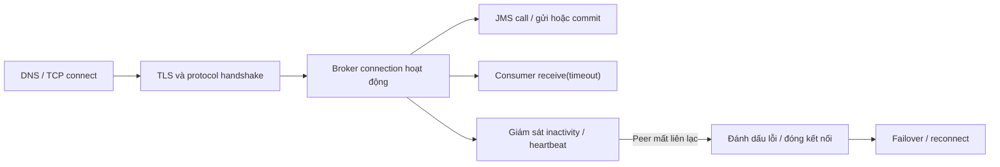
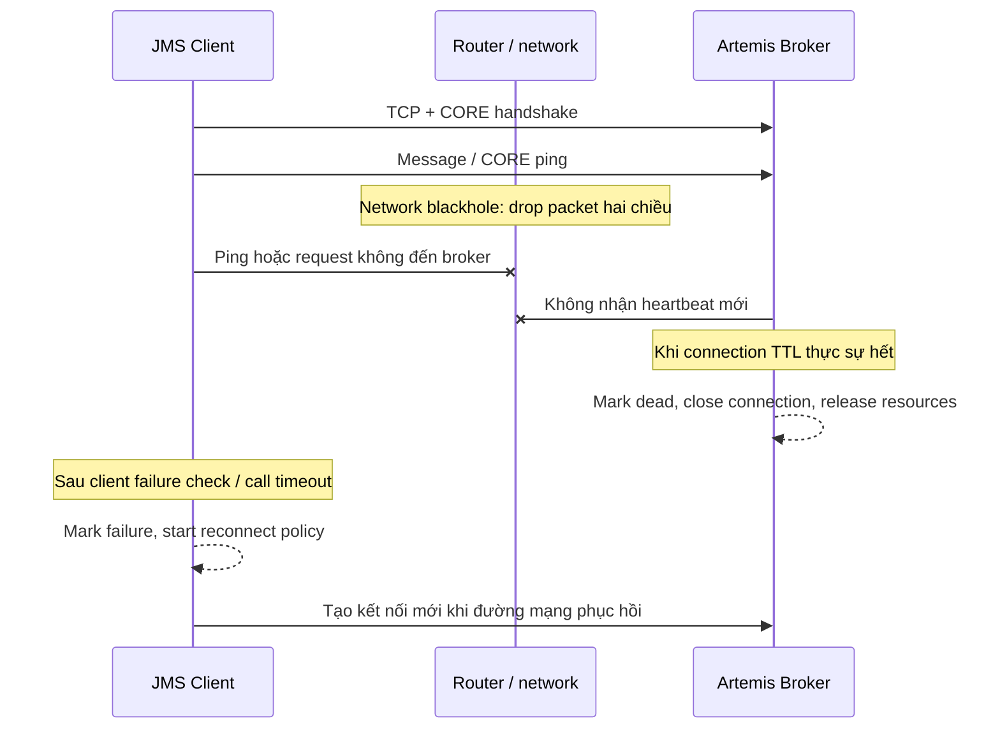

# Cấu hình URI, cổng, timeout và phát hiện kết nối chết

> **Chương:** Giao thức kết nối  
> **Phạm vi:** Apache ActiveMQ Classic và Apache ActiveMQ Artemis; kết nối Java JMS/Jakarta Messaging tới broker qua TCP, các tham số URI, timeout, heartbeat, phát hiện kết nối chết và hành vi khi reconnect.

## 1. Tình huống: kết nối TCP còn hiện diện nhưng broker đã không phản hồi

Dịch vụ `OrderWorker` sử dụng JMS để nhận từ queue `orders.jobs`. Một lần đường mạng giữa container ứng dụng và broker bị ngắt theo kiểu **drop packet**: socket không nhận gói `FIN` hoặc `RST`. Worker nhìn thấy kết nối cũ trong bộ nhớ, nhưng không còn truyền thông tin qua mạng. Nếu không có cơ chế phát hiện kết nối chết, consumer có thể đứng chờ, message đang giao có thể chưa được giải phóng kịp thời, và logic reconnect không được kích hoạt như mong đợi.

Để phân tích đúng, phải trả lời **bốn câu hỏi khác nhau**:

1. **Kết nối tới đâu?** URI của client, hostname, port và protocol phải khớp với listener của broker.
2. **Đợi bao lâu khi kết nối hoặc gọi broker?** TCP connect timeout, thời hạn chờ phản hồi cho thao tác đồng bộ và timeout nhận message **không phải một**.
3. **Làm sao phát hiện peer đã chết khi không có lưu lượng?** Dùng heartbeat/inactivity monitor/connection TTL theo **giao thức**; TCP keepalive ở hệ điều hành không phải cơ chế duy nhất.
4. **Sau khi phát hiện thì làm gì?** Reconnect, tạo lại consumer/session nếu cần, kiểm tra trạng thái transaction và xử lý nguy cơ message được gửi hoặc nhận trùng.

Bài học này tập trung vào kết nối. Cấu hình queue/topic, routing, transaction, redelivery và DLQ chỉ được đưa vào khi chúng ảnh hưởng đến hậu quả của disconnect.

## 2. Cú pháp URI: phân biệt đầu **broker bind** và đầu **client connect**

Một URI cơ bản:

```text
tcp://broker.internal:61616
│     │               │
│     │               └── port lắng nghe
│     └────────────────── hostname/IP client phân giải và truy cập được
└──────────────────────── transport scheme
```

Với Artemis và Classic, URI có thể chứa tham số transport/client ở phần query. Tuy nhiên, **cùng một tên tham số không nhất thiết có trên cả hai provider** và cú pháp phân cách option có thể khác theo vị trí cấu hình:

```text
# Ví dụ URI kết nối Java client:
tcp://broker.internal:61616

# Ví dụ Artemis acceptor trong broker.xml:
tcp://0.0.0.0:61616?protocols=CORE,AMQP;tcpNoDelay=true

# Ví dụ Classic transportConnector trong XML:
tcp://0.0.0.0:61616?wireFormat.maxInactivityDuration=30000
```

Các ví dụ phía trên mô tả **ngữ cảnh khác nhau**:

- **Bind/listen URI** đặt trong cấu hình server. `0.0.0.0` nghĩa là lắng nghe trên các giao diện IPv4 khả dụng. Đây không phải địa chỉ để client ở máy khác kết nối.
- **Connect URI** dùng ở client. Host phải là địa chỉ **có thể định tuyến được từ nơi ứng dụng chạy**, ví dụ DNS nội bộ hoặc IP có route phù hợp.
- **Transport scheme** như `tcp://`, `ssl://` hoặc `amqp://` phản ánh thư viện/giao thức client cụ thể. Cùng dùng TCP ở tầng mạng không có nghĩa payload protocol giống nhau.
- Các tham số sau dấu `?` chỉ có hiệu lực khi **đúng thư viện, đúng phía cấu hình** hiểu tham số đó. Không copy nguyên query của Artemis sang client Classic và ngược lại.

### 2.1. Những lỗi URL phổ biến trong container, VM và Kubernetes

| Nơi chạy client | URI ví dụ phù hợp | Sai lầm thường gặp |
| --- | --- | --- |
| Ứng dụng chạy **trên cùng host** với broker TCP | `tcp://127.0.0.1:61616`, nếu broker bind vào interface tương ứng | Dùng `localhost` dù broker nằm máy khác |
| Container ứng dụng và broker trong cùng network có DNS `artemis` | `tcp://artemis:61616` | Dùng `localhost:61616`, trỏ về **chính container ứng dụng** |
| Ứng dụng ngoài host Docker có published port | `tcp://broker-host.example:61616` nếu port được publish và firewall cho phép | Dùng tên container chỉ phân giải được trong network nội bộ |
| Pod Kubernetes kết nối Service `mq` trong cùng namespace | `tcp://mq:61616` khi Service expose port đó | Dùng Pod IP cố định, hoặc gửi tới cổng không tồn tại trên Service |
| Client nằm sau NAT/load balancer | DNS/port của listener mà client truy cập được | Đưa địa chỉ bind `0.0.0.0` vào cấu hình client |

**Ví dụ:** Docker map port host `16161` tới container `61616`. Client bên ngoài host dùng `broker-host:16161`, còn container khác cùng Docker network có thể dùng `broker-container:61616`. Đừng đoán port của client từ số port bên trong container; phải xem đường kết nối thực tế.

Cần kiểm tra cả **DNS**, route, listener, firewall, network policy, proxy và chứng chỉ TLS. Ping thành công không bảo đảm cổng messaging mở; TCP connect thành công cũng chưa bảo đảm handshake JMS/protocol và authentication thành công.

## 3. Port là thuộc tính của listener, không phải bản thân chuẩn JMS

Những giá trị dưới đây là **cổng thường gặp**, không phải quy định bắt buộc của giao thức. Operator có thể đổi port, tắt acceptor hoặc gộp nhiều giao thức vào cùng acceptor.

| Giao thức/endpoint | Cổng thường gặp | Client tương ứng | Điều cần xác minh |
| --- | ---: | --- | --- |
| OpenWire trên ActiveMQ Classic | `61616` | `org.apache.activemq.ActiveMQConnectionFactory` (Classic) | Classic transport connector có mở `tcp://...` hoặc TLS không |
| Artemis CORE | `61616` | `org.apache.activemq.artemis.jms.client.ActiveMQConnectionFactory` | Artemis acceptor có bật `CORE` không |
| AMQP 1.0 trên Artemis | `5672` hoặc `61616` | AMQP 1.0 client, chẳng hạn Apache Qpid JMS | Listener có bật `AMQP` và hỗ trợ TLS như yêu cầu không |
| STOMP trên Artemis | `61613` hoặc một port chung | STOMP client | Acceptor có bật `STOMP`, heartbeat STOMP được thương lượng thế nào |
| MQTT trên Artemis | `1883` hoặc một port chung | MQTT client | Acceptor có bật `MQTT` và MQTT keepalive thế nào |
| Web console/HTTP management | Thường `8161` | Browser/HTTP management client | **Không** phải JMS messaging endpoint |

Ví dụ Artemis có thể bật nhiều protocol cùng trên `61616`. Client OpenWire và client CORE có thể kết nối cùng cổng đó **nếu acceptor cho phép cả hai**; việc chia sẻ port không khiến một CORE client tự hiểu OpenWire. Tương tự, client Qpid JMS dùng AMQP vẫn cần đúng scheme và AMQP handshake.

**Không nhầm Java API với wire protocol:**

- JMS/Jakarta Messaging là **API** của ứng dụng Java.
- ActiveMQ Classic JMS client thường dùng **OpenWire**.
- Artemis JMS/Jakarta client thường dùng **Artemis CORE**.
- Qpid JMS cung cấp API JMS qua **AMQP 1.0**.
- Một broker Artemis có thể nhận nhiều protocol, nhưng từng client vẫn phải nói đúng protocol.

Do đó `tcp://host:61616` chỉ đủ cho cấu hình kết nối khi bạn đã xác định loại client, protocol acceptor và chính sách TLS/authentication.

## 4. Cấu hình listener của broker

### 4.1. Artemis: `<acceptor>` trong `broker.xml`

Trích đoạn đặt bên trong phần cấu hình `<core>` của Artemis (không phải một `broker.xml` hoàn chỉnh):

```xml
<acceptors>
    <!-- Listener CORE dành cho Artemis JMS/Core client -->
    <acceptor name="core">
        tcp://0.0.0.0:61616?protocols=CORE;tcpNoDelay=true
    </acceptor>

    <!-- AMQP 1.0 dành cho Qpid JMS hoặc AMQP client -->
    <acceptor name="amqp">
        tcp://0.0.0.0:5672?protocols=AMQP
    </acceptor>
</acceptors>
```

Ý nghĩa:

- `name` phân biệt acceptor trong cấu hình.
- `tcp://0.0.0.0:61616` là địa chỉ **server bind**; có thể thay `0.0.0.0` bằng IP/interface được phép nhận kết nối.
- `protocols=CORE` giới hạn giao thức được xử lý tại acceptor đó. Để mở nhiều protocol tại một listener, dùng danh sách phù hợp, ví dụ `protocols=CORE,AMQP`.
- Artemis dùng dấu `;` để phân tách nhiều tham số transport trong những URI acceptor như ví dụ. Kiểm tra cú pháp theo **phiên bản Artemis** và vị trí sử dụng (broker, client hoặc connector).

Trong môi trường an toàn, không nên tự động bind mọi listener lên mọi interface. Nếu acceptor lắng nghe trên `0.0.0.0`, hãy kiểm soát ingress, TLS, authentication và quyền gửi/nhận queue/address từ xa.

Để tránh xung đột, hai acceptor không thể cùng bind **một IP:port** với các transport thông thường chỉ bằng cách đổi `name`. Nếu muốn nhiều protocol chung một port, cấu hình chúng **trên cùng acceptor**.

### 4.2. ActiveMQ Classic: `<transportConnector>`

Trích đoạn trong cấu hình broker Classic:

```xml
<transportConnectors>
    <transportConnector
        name="openwire"
        uri="tcp://0.0.0.0:61616?wireFormat.maxInactivityDuration=30000"/>
</transportConnectors>
```

`wireFormat.maxInactivityDuration=30000` đặt thời lượng kiểm tra inactivity của OpenWire theo đơn vị mili giây; giá trị hiệu dụng có thể được **thương lượng với peer**. Đây là tham số khác với client-side `connectionTimeout` (thời gian chờ TCP connect).

Khi nối nhiều option trong thuộc tính XML bằng dấu `&`, phải escape thành `&amp;`:

```xml
<transportConnector
    name="openwire"
    uri="tcp://0.0.0.0:61616?wireFormat.maxInactivityDuration=30000&amp;maximumConnections=1000"/>
```

Phải chắc chắn chính phiên bản transport bạn dùng hỗ trợ từng option. Không chuyển tên option từ Artemis sang Classic chỉ vì hai URI đều bắt đầu bằng `tcp://`.

### 4.3. TLS làm thay đổi handshake, không chỉ số port

Có hai cấu hình thường gặp:

```text
# Classic: SSL transport, nếu broker có SSL connector tương ứng
ssl://broker.example:61617

# Artemis CORE: TCP transport có TLS, khi cả acceptor/client cấu hình TLS
tcp://broker.example:61616?sslEnabled=true
```

Cách bật TLS, cung cấp keystore/truststore và xác minh chứng chỉ phụ thuộc provider. **Không đưa mật khẩu, private key hoặc URI chứa credentials vào source control.** Một cổng không hỗ trợ TLS sẽ không hiểu TLS handshake dù bạn đổi `tcp://` thành `ssl://`. Ngược lại, client plain TCP sẽ lỗi khi kết nối nhầm tới listener chỉ nhận TLS.

TLS certificate có tên máy chủ (SAN) cần khớp DNS client sử dụng; khi đi qua DNS nội bộ hoặc proxy, đừng vô hiệu hóa hostname verification chỉ để che lỗi cấu hình.

## 5. Bốn loại timeout khác nhau

Cùng là “timeout 5 giây” nhưng ý nghĩa rất khác. Sơ đồ giúp phân biệt thời điểm tác động:



| Loại thời hạn | Bắt đầu tính khi nào | Dùng để làm gì | Không được nhầm với |
| --- | --- | --- | --- |
| **TCP connect timeout** | Mở socket mới tới broker | Tránh treo lâu khi IP/cổng không phản hồi SYN | Phát hiện connection đã tồn tại chết sau đó |
| **TLS/handshake timeout** | Bắt tay TLS hoặc protocol/authentication | Tránh chờ vô hạn ở pha xác lập kết nối | TCP connect đã thành công |
| **Call/request timeout** | Client chờ một broker response cho thao tác đồng bộ | Giới hạn thời gian chờ lệnh gửi, tạo consumer, commit… theo cơ chế provider | `receive(timeout)` hoặc heartbeat |
| **`MessageConsumer.receive(timeout)`** | Consumer bắt đầu chờ message | Trả về `null` nếu **chưa có message** đúng hạn | Kết luận rằng socket/broker đã chết |
| **Heartbeat/inactivity interval** | Connection đã thiết lập; theo dõi lưu lượng và ping | Phát hiện peer không còn trao đổi dữ liệu | Business response timeout |
| **Connection TTL / idle timeout** | Sau lần hoạt động/keepalive cuối hợp lệ theo protocol | Broker/client xác định connection quá lâu không phản hồi | TTL của **message** (`JMSExpiration`) |
| **Reconnect retry interval / budget** | Sau lần connect/reconnect thất bại | Điều phối lần thử tiếp theo và giới hạn thời gian phục hồi | Chống gửi trùng nghiệp vụ |

### 5.1. Cạm bẫy `receive(5000)`

```java
Message message = consumer.receive(5_000);

if (message == null) {
    // Không có message phù hợp được trả về trong 5 giây.
    // KHÔNG đủ chứng minh broker đã chết hoặc TCP connection đã hỏng.
}
```

Một queue trống, message selector không khớp, một consumer khác nhận message, connection chưa `start()` hoặc message bị chặn bởi policy đều có thể khiến `receive(timeout)` trả về `null`. Nếu code cứ dùng timeout của `receive` như tín hiệu broker chết, ứng dụng có thể tự reconnect vô ích hoặc sinh nhiều connection.

### 5.2. Call timeout khác kết quả giao dịch

Giả sử một lệnh `session.commit()` tới broker bị timeout ngay khi mất mạng. Ứng dụng **chưa chắc biết được** broker đã commit hay chưa. Một timeout của client chỉ nói rằng client **không nhận được kết quả xác nhận đúng hạn**, không phải bằng chứng giao dịch chắc chắn thất bại.

Nếu producer retry một message sau sự cố này, cần business ID, idempotent consumer hoặc duplicate-detection phù hợp. Nếu consumer đã gọi dịch vụ ngoài rồi mất kết nối trước khi ack, message có thể được redeliver. Những việc này liên quan đến độ tin cậy JMS, nhưng căn nguyên là **timeout và ranh giới xác nhận**, không phải routing queue/topic.

## 6. Artemis CORE: `clientFailureCheckPeriod` và `connectionTTL`

Artemis CORE có cơ chế kiểm tra connection sống bằng lưu lượng và ping ở tầng protocol. Hai tham số dễ bị đánh đồng:

- **`clientFailureCheckPeriod`:** chu kỳ phía **client** kiểm tra có còn nhận packet từ **server** hay không. Nếu server không phát packet hợp lệ trong ngưỡng tương ứng, client có thể phát hiện lỗi và chuyển sang xử lý reconnect/failure.
- **`connectionTTL`:** khoảng thời gian mà **server** cho phép một connection im lặng trước khi coi client không còn sống và giải phóng tài nguyên. Client CORE có thể gửi packet ping để duy trì connection khi không có message nghiệp vụ.
- **`connection-ttl-override`:** tùy chọn **phía Artemis broker** để ép TTL cho connection ở mức server, thay vì dựa hoàn toàn vào thời hạn mà client đề xuất. Áp dụng có chủ đích vì có thể ảnh hưởng nhiều client.

Các giá trị ví dụ sau được chọn để minh họa, **không phải cấu hình mặc định hoặc khuyến nghị cố định**:

```text
clientFailureCheckPeriod = 10_000 ms (10 s)
connectionTTL            = 30_000 ms (30 s)
callTimeout              =  8_000 ms ( 8 s)
retryInterval            =  1_000 ms ( 1 s)
reconnectAttempts        =  5 lần
```

Mục đích của việc để connection TTL dài hơn chu kỳ kiểm tra là cho phép truyền heartbeat và chịu một mức dao động mạng nhất định. Giá trị vận hành cần được chọn dựa trên GC pause, network jitter, firewall/NAT idle timeout, tải và SLO phát hiện sự cố. Không ép TTL quá thấp nếu có khả năng JVM dừng lâu do GC, CPU starvation hoặc network congestion.

### 6.1. Cấu hình phía broker Artemis

Ví dụ chỉ trích cấu hình `<core>` trong `broker.xml`:

```xml
<!-- Chỉ đặt khi muốn broker chủ động override TTL của client. -->
<connection-ttl-override>60000</connection-ttl-override>
```

Giá trị `60000` là **60 giây**. Thiết lập này không tự quy định thời gian retry của client, cũng không đảm bảo client phát hiện server chết sau đúng 60 giây. Bên nào phát hiện và khi nào còn tùy dòng packet, protocol, thiết lập của peer và nhịp kiểm tra của broker.

Với **AMQP 1.0**, nhịp kiểm tra sống dùng cơ chế AMQP idle-timeout; **STOMP** dùng thương lượng header `heart-beat`; **MQTT** có Keep Alive trong gói CONNECT. Không coi `clientFailureCheckPeriod` của Artemis CORE là một “tham số chung” chạy được y hệt cho client AMQP/STOMP/MQTT.

### 6.2. Cấu hình Java Jakarta JMS với Artemis client

Maven dependency minh họa (chọn phiên bản thực tế theo BOM của dự án):

```xml
<dependency>
    <groupId>org.apache.artemis</groupId>
    <artifactId>artemis-jakarta-client</artifactId>
    <version>2.50.0</version>
</dependency>
```

Ví dụ tạo connection bằng provider Artemis, cấu hình giới hạn chờ và kiểm tra sống:

```java
import jakarta.jms.Connection;
import jakarta.jms.JMSException;
import jakarta.jms.MessageProducer;
import jakarta.jms.Queue;
import jakarta.jms.Session;

import org.apache.activemq.artemis.jms.client.ActiveMQConnectionFactory;

public final class ArtemisConnectionProbe {
    public static void main(String[] args) throws JMSException {
        String url = requiredEnv("BROKER_URL");
        String user = requiredEnv("BROKER_USER");
        String password = requiredEnv("BROKER_PASSWORD");

        ActiveMQConnectionFactory factory =
                new ActiveMQConnectionFactory(url);

        // Giá trị lab minh họa; cần kiểm thử với broker thật.
        factory.setClientFailureCheckPeriod(10_000L);
        factory.setConnectionTTL(30_000L);
        factory.setCallTimeout(8_000L);
        factory.setRetryInterval(1_000L);
        factory.setReconnectAttempts(5);

        Connection connection = factory.createConnection(user, password);
        try {
            connection.setExceptionListener(error ->
                    System.err.println("JMS connection error: "
                            + error.getMessage()));
            connection.start();

            Session session = connection.createSession(
                    true, Session.SESSION_TRANSACTED);
            try {
                // Queue ops.probe cần có sẵn hoặc được phép auto-create.
                Queue queue = session.createQueue("ops.probe");
                MessageProducer producer = session.createProducer(queue);
                try {
                    producer.send(
                            session.createTextMessage("connection-check"));
                    session.commit();
                    System.out.println("Probe committed");
                } finally {
                    producer.close();
                }
            } catch (JMSException failure) {
                try {
                    session.rollback();
                } catch (JMSException rollbackError) {
                    failure.addSuppressed(rollbackError);
                }
                throw failure;
            } finally {
                session.close();
            }
        } finally {
            connection.close();
        }
    }

    private static String requiredEnv(String key) {
        String value = System.getenv(key);
        if (value == null || value.trim().isEmpty()) {
            throw new IllegalStateException("Missing " + key);
        }
        return value;
    }
}
```

Thiết lập `BROKER_URL` ví dụ `tcp://broker.internal:61616` và các biến credential tương ứng. Code sử dụng **Artemis Jakarta client** và interface `jakarta.jms`, không dùng `org.apache.activemq.ActiveMQConnectionFactory` của Classic.

**Giải thích các thời gian trong code:**

- `setClientFailureCheckPeriod(10_000L)` và `setConnectionTTL(30_000L)` liên quan đến kiểm tra sức sống của **connection CORE**.
- `setCallTimeout(8_000L)` liên quan đến việc chờ phản hồi các thao tác đồng bộ của client Artemis. Đây không phải timeout nhận message.
- `setRetryInterval(1_000L)` và `setReconnectAttempts(5)` điều khiển hành vi thử lại khi client đã vào giai đoạn reconnect. Chúng không nhất thiết chi phối mọi lỗi khởi tạo connection ban đầu; cần kiểm tra thêm cấu hình initial-connect theo phiên bản nếu yêu cầu.
- `ExceptionListener` dùng để quan sát lỗi bất đồng bộ, nhưng không thay thế logging của provider, health probe và thông tin failover. Không nên coi listener này được gọi đúng một lần cho **mọi** sự kiện mạng.
- `session.commit()` có thể thất bại với trạng thái không rõ ràng khi kết nối mất đúng thời điểm commit. Trong hệ thống thật, dùng ID nghiệp vụ và cơ chế chống trùng.

Trong một số ứng dụng, không cần set từng thuộc tính bằng Java nếu framework/BOM đã quản lý `ConnectionFactory`. Quan trọng là xác nhận cấu hình cuối cùng của **physical connection** thực sự được tạo.

## 7. ActiveMQ Classic OpenWire: InactivityMonitor và Failover Transport

Classic sử dụng **OpenWire InactivityMonitor** để phát hiện khoảng thời gian kết nối không có dữ liệu hợp lệ. Khi một peer lâu không gửi packet, transport có thể gửi `KeepAliveInfo` và/hoặc đánh dấu connection không còn hoạt động theo cấu hình đã thương lượng.

Một cấu hình broker mẫu:

```xml
<transportConnectors>
    <transportConnector name="openwire"
        uri="tcp://0.0.0.0:61616?wireFormat.maxInactivityDuration=30000"/>
</transportConnectors>
```

Ở đây `30000` là **30 giây**, nhưng đừng suy rằng crash sẽ luôn bị phát hiện chính xác ở mốc 30 giây. Có thể còn thời gian handshake, initial delay, scheduling, độ trễ OS và chính sách từ phía client.

### 7.1. URI `failover:(...)` là cơ chế reconnect, không phải heartbeat

Ví dụ client Classic:

```text
failover:(tcp://broker-a:61616,tcp://broker-b:61616)?randomize=false&initialReconnectDelay=1000&maxReconnectAttempts=10&timeout=10000
```

Các tùy chọn minh họa:

| Thành phần | Ý nghĩa |
| --- | --- |
| `tcp://broker-a:61616`, `tcp://broker-b:61616` | Các endpoint client có thể thử kết nối |
| `randomize=false` | Thử URI theo thứ tự thay vì chọn ngẫu nhiên |
| `initialReconnectDelay=1000` | Thời gian chờ ban đầu trước các lần thử lại theo cấu hình |
| `maxReconnectAttempts=10` | Giới hạn lần reconnect; giá trị âm thường dùng để cho phép thử không giới hạn, kiểm tra theo version |
| `timeout=10000` | Giới hạn thời gian chờ của **send operations** khi failover đang phục hồi, không có nghĩa tắt cơ chế reconnect sau 10 giây |

**Phân biệt:** InactivityMonitor giúp **nhận ra** connection gặp lỗi; Failover Transport giúp **thử nối lại** hoặc chuyển sang endpoint khác. Cấu hình failover không tự cấp bản sao dữ liệu trên broker B. Nếu A và B là hai broker độc lập không có topology HA/shared store/replication tương thích, chuyển endpoint có thể khiến client tới một nơi **không chứa queue state mong đợi**.

### 7.2. Ví dụ client Java dùng Classic Failover Transport

Maven dependency:

```xml
<dependency>
    <groupId>org.apache.activemq</groupId>
    <artifactId>activemq-client</artifactId>
    <version>5.19.12</version>
</dependency>
```

Code minh họa:

```java
import javax.jms.Connection;
import javax.jms.ConnectionFactory;
import javax.jms.JMSException;
import org.apache.activemq.ActiveMQConnectionFactory;

public final class ClassicFailoverProbe {
    public static void main(String[] args) throws JMSException {
        String brokerUrl =
                "failover:(tcp://broker-a:61616,tcp://broker-b:61616)"
                + "?randomize=false"
                + "&initialReconnectDelay=1000"
                + "&maxReconnectAttempts=10"
                + "&timeout=10000";

        ConnectionFactory factory = new ActiveMQConnectionFactory(brokerUrl);
        Connection connection = factory.createConnection();
        try {
            connection.setExceptionListener(error ->
                    System.err.println("Classic JMS error: "
                            + error.getMessage()));
            connection.start();
            // Tạo session/consumer hoặc producer sau khi kết nối sẵn sàng.
        } finally {
            connection.close();
        }
    }
}
```

Trong môi trường production, đưa URL và credentials vào cấu hình/secret thay vì hardcode, đồng thời quan sát log của failover transport để biết client đang nối tới endpoint nào. Cần định nghĩa số lần retry và mức chờ phù hợp SLO: retry vô hạn có thể khiến luồng xử lý chờ rất lâu, còn retry quá ít khiến ứng dụng dễ mất kết nối trước khi broker phục hồi.

**Không áp dụng URI `failover:(...)` của Classic cho Artemis CORE client một cách máy móc.** Artemis cung cấp cơ chế reconnect/HA và URI client riêng. Dùng đúng provider và cú pháp được hỗ trợ.

## 8. Heartbeat, TCP keepalive và các trường hợp “nửa mở”

Khi broker tắt bình thường, socket thường đóng có trật tự; peer phát hiện sớm qua EOF hoặc error. Nhưng nếu router/firewall âm thầm chặn mọi packet, connection có thể ở trạng thái **half-open**: một bên vẫn coi socket đang hoạt động dù bên kia không còn liên lạc được.

### 8.1. Ba mức kiểm tra sống

| Lớp | Ví dụ | Ưu điểm | Giới hạn |
| --- | --- | --- | --- |
| **TCP của hệ điều hành** | `SO_KEEPALIVE` / hệ thống TCP keepalive | Phát hiện một số kết nối không còn hoạt động ở tầng socket | Mặc định có thể rất lâu; phụ thuộc OS, NAT và proxy |
| **Messaging protocol** | Artemis CORE ping/connection TTL, OpenWire InactivityMonitor, AMQP idle-timeout, STOMP heart-beat, MQTT Keep Alive | Thiết kế cho liveness của broker-client; điều chỉnh gần SLO | Không thể ngăn mọi false positive khi mạng/GC bị nghẽn |
| **Ứng dụng nghiệp vụ** | Timeout request–reply, health check, probe có ack, latency SLO | Kiểm tra luồng nghiệp vụ thực tế | Timeout nghiệp vụ không cho biết ngay nguyên nhân mạng |

**Không dựa riêng vào TCP keepalive của hệ điều hành** để đảm bảo phát hiện sự cố trong vài giây. Giá trị mặc định OS thường không phù hợp cho dịch vụ cần khôi phục nhanh, và load balancer/NAT có thể ngắt kết nối idle theo chính sách riêng.

### 8.2. Timeline khi mất kết nối



Đây là **diễn tiến khái niệm**. Broker và client có thể phát hiện ở thời điểm khác nhau; không có cơ chế bảo đảm hai bên cùng chuyển trạng thái đồng thời. Trong một network partition, client có thể tưởng broker chết trong khi broker vẫn đang xử lý request trước đó. Chính vì vậy cần thiết kế retry và idempotency cho đường gửi message.

### 8.3. Đặt timeout phù hợp với hạ tầng

Giả sử policy của load balancer đóng connection hoàn toàn idle sau 5 phút. Nếu heartbeat của protocol được gửi thường xuyên và được LB coi là activity, connection có thể giữ được; nếu không, sẽ bị cắt dù ứng dụng không gửi message nghiệp vụ.

Một hướng thiết kế:

1. Xác định tất cả điểm có **idle timeout**: NAT, firewall, proxy, load balancer, service mesh và broker.
2. Chọn heartbeat phù hợp sao cho packet thực sự đi qua các thiết bị trung gian trước khi đạt idle timeout; kiểm tra hành vi với TLS và proxy.
3. Đặt connection TTL đủ lớn cho GC pause, jitter và packet loss ngắn hạn; quá nhỏ dễ false disconnect, quá lớn làm chậm cleanup.
4. Chọn connect/call timeout theo latency và yêu cầu nghiệp vụ. Tách giới hạn thời gian **khởi tạo**, **gọi lệnh**, **phát hiện chết** và **reconnect**.
5. Dùng metric và thử nghiệm gây lỗi để đo thời gian phát hiện thực tế, không tự suy diễn từ một con số trong cấu hình.

## 9. Sau khi connection chết: trạng thái JMS không còn chắc chắn

Khi client nhận một `JMSException` hoặc broker báo disconnect, cần phân biệt hai trường hợp:

- **Lỗi trước khi broker nhận yêu cầu:** broker có thể chưa thấy message hoặc chưa tạo consumer.
- **Lỗi sau khi broker xử lý nhưng trước khi client nhận xác nhận:** client **không biết chắc** kết quả của thao tác đồng bộ.

Ví dụ:

```text
Producer             Broker
   |--- send M -------->|
   |                    | accepted M
   |<--- confirm --X    | ACK/response bị mất trên mạng
   |
   |  Timeout: client không biết M đã được broker nhận hay chưa.
   |  Retry M có thể tạo duplicate nếu không có chính sách loại trùng.
```

Một số lưu ý triển khai:

- Với producer, gắn **business ID duy nhất**, dùng outbox/deduplication hoặc cơ chế duplicate detection của broker khi thích hợp.
- Với consumer dùng `SESSION_TRANSACTED`, khi chết trước `commit()`, message chưa ack có thể được giao lại; xử lý phải **idempotent**.
- Với message đang xử lý khi reconnect, **không giả định** session, transaction và consumer cũ vẫn giữ nguyên ngữ nghĩa. Provider/framework có thể phục hồi một phần; kiểm tra hành vi với phiên bản và chế độ HA đang triển khai.
- Nếu connection đã chết và cần temporary queue/topic, đừng giữ nguyên địa chỉ reply-to cũ như một queue thường; lifetime của temporary destination gắn với connection sở hữu.
- Khi sử dụng connection pooling, kiểm tra **physical connection** thực sự được pool quản lý; đóng logical wrapper không nhất thiết đóng socket hoặc xóa broker resource ngay.

### 9.1. Reconnect không thay thế broker HA

Giả sử client được cấu hình hai URI `broker-a` và `broker-b`. Client **có thể** kết nối đến B sau khi A chết, nhưng để tiếp tục đọc backlog và xử lý message cũ một cách chính xác, broker topology cần cơ chế lưu trữ/replication/failover phù hợp. Hai broker không chia sẻ state không tự trở thành một hệ thống HA chỉ vì client có hai URL.

### 9.2. Tham số nên điều chỉnh cùng nhau

| Tham số / giới hạn | Khi quá thấp | Khi quá cao |
| --- | --- | --- |
| TCP connect timeout | Đường mạng chậm bị báo lỗi sớm | Kéo dài startup hoặc một lần reconnect |
| Call timeout | Lệnh hợp lệ bị timeout khi tải cao | Thread có thể chờ lâu khi peer không phản hồi |
| Heartbeat interval / failure check | Tăng ping, có thể false positive khi GC/network giật | Chậm phát hiện half-open |
| Connection TTL / idle-timeout | Broker dọn connection còn sống khi im lặng tạm thời | Consumer chết bị giữ tài nguyên lâu |
| Reconnect attempts / backoff | Bỏ cuộc trước khi broker phục hồi | Tạo đợt retry dài, có thể che lỗi hệ thống |
| Business request timeout | User request bị fail dù broker vẫn đang xử lý | Giữ tài nguyên ứng dụng lâu, khó kiểm soát SLA |

Một bộ số liệu `connectionTTL=30s`, `clientFailureCheckPeriod=10s`, `callTimeout=8s` là **điểm bắt đầu để thử nghiệm**, không phải công thức cho mọi ứng dụng. Với workload có GC pause dài hoặc đường WAN nhiễu, có thể cần thời gian lớn hơn và backoff phù hợp.

## 10. Kiểm tra URI, cổng và liveness theo từng tầng

### 10.1. Trước tiên kiểm tra reachability

Trên máy chạy broker Linux:

```bash
# Quan sát listener; chỉ là ví dụ, cần chạy với quyền phù hợp.
ss -lnt | grep ':61616'
```

Trên máy client Linux:

```bash
# TCP reachability: chưa phải kiểm chứng JMS handshake.
nc -vz broker.internal 61616
```

Trên Windows PowerShell:

```powershell
Test-NetConnection broker.internal -Port 61616
```

Các lệnh trên không xác minh được protocol, TLS, authentication hoặc khả năng tạo consumer. Để kiểm tra thực sự, dùng **đúng client** và chạy một thao tác ngắn, ví dụ mở connection và gửi/nhận message trên queue test có quyền phù hợp.

### 10.2. Phân loại lỗi theo vị trí xảy ra

| Triệu chứng | Vị trí nghi ngờ | Bước kiểm tra |
| --- | --- | --- |
| `UnknownHostException` | DNS | Service name, tên miền, network namespace |
| `Connection refused` | TCP/port | Broker có listen đúng IP:port không; mapping port có đúng không |
| Connect timeout | Route/firewall/drop packet | Kết nối TCP từ **chính vị trí client**, kiểm tra LB/network policy |
| TLS handshake failure | Cấu hình TLS/chứng chỉ | Scheme, truststore, server cert SAN, TLS versions |
| Protocol handshake thất bại | Sai protocol trên cùng port | Artemis `protocols`, loại JMS client và URI scheme |
| Authentication/authorization failure | User/password/quyền | Broker security settings, ACL send/consume |
| Java `receive(timeout)` trả `null` | Queue trống, selector không khớp, consumer chưa nhận | Xem queue/consumer/selector trước khi nghi connection chết |
| Client log reconnect liên tục | Heartbeat, jitter, timeout, route hoặc broker overload | Đối chiếu timestamp ở client, broker, LB, GC log |
| Broker giữ connection/consumer “ma” | TTL quá cao hoặc chưa phát hiện socket chết | Kiểm tra connection TTL và trạng thái socket/heartbeat |
| Chuyển sang URI dự phòng rồi mất backlog | Hai broker không chia sẻ state | Kiểm tra topology HA/shared store/replication |

### 10.3. Lab kiểm chứng phát hiện kết nối chết

**Giả định:** Có broker Artemis hoặc Classic phục vụ queue `lab.connection`, một producer và consumer Java chạy từ process riêng. Dùng môi trường test; ghi đồng hồ cùng timezone cho client và broker.

1. **Baseline:** Mở client, gửi một message và nhận/commit thành công. Ghi timestamp của connect, `receive`, commit và close.
2. **Tắt broker có trật tự:** Dừng dịch vụ broker bằng cơ chế quản trị. Xem client mất bao lâu để phát hiện socket close; so với hiện tượng timeout.
3. **Mô phỏng blackhole:** Chặn packet theo một chiều hoặc hai chiều trên môi trường test (không đóng socket có trật tự). Đo khoảng từ packet hợp lệ cuối cùng đến khi client và broker **tự phát hiện** failure. Đừng kỳ vọng hai mốc giống nhau.
4. **Thử heartbeat/TTL:** Tăng giảm một tham số trong phạm vi hợp lý, lặp lại test và ghi cả false disconnect khi tải cao. Đổi `receive(5000)` **không** phải đổi liveness detection.
5. **Thử failover:** Khôi phục broker hoặc chuyển endpoint theo topology HA có sẵn; đo thời gian client kết nối lại, đồng thời kiểm tra session, consumer và outstanding transaction.
6. **Kiểm tra dữ liệu:** Dùng message ID/business ID để phát hiện gửi trùng và xử lý lại. Kiểm tra backlog, redelivery và DLQ; không chỉ đo thời điểm client in “reconnected”.
7. **Kiểm tra cổng sai protocol:** Dùng CORE client tới listener chỉ bật AMQP (hoặc ngược lại). Kết nối TCP có thể thành công, nhưng handshake messaging không hợp lệ; xác nhận qua broker logs.

Ví dụ bảng ghi kết quả sau lab:

| Tình huống | Thời điểm ngắt | Client phát hiện | Broker phát hiện | Reconnect | Tác động message |
| --- | --- | --- | --- | --- | --- |
| Broker stop sạch | `T0` | `T1` | N/A | `T2` | Xem ack/transaction |
| Network blackhole | `T0` | `T1` | `T3` | `T2` | Đo redelivery/duplicate |
| Sai protocol URI | Khi mở connection | `T1` | Log handshake | Không thành công | Chưa đi đến bước gửi |
| Timeout `receive` | Không ngắt | Không kết luận dead | Không đổi | Không yêu cầu | Có thể queue đơn giản đang trống |

**Yêu cầu thực nghiệm:** ghi mốc thời gian thật và log; không tự điền các thời gian bằng đúng giá trị timeout cấu hình. Scheduler, packet loss, GC và thiết bị trung gian làm kết quả khác với con số lý thuyết.

## 11. Các tình huống kết nối thường gặp trong thực tế

### Một service gửi/nhận bên trong Docker Compose

```text
app container                broker container
BROKER_URL=tcp://artemis:61616
       │                           │
       └──── Docker network ──────►│ acceptor :61616
```

Nếu service broker chỉ expose trong mạng nội bộ, client ngoài host không thể kết nối bằng tên `artemis`. Cần publish port hoặc dùng một endpoint hạ tầng có đường đi hợp lệ. Không cấu hình `localhost` trong container ứng dụng với hy vọng nó trỏ tới container broker.

### Một cluster Kubernetes có nhiều broker node

`BROKER_URL=tcp://mq:61616` có thể trỏ tới Service. Nhưng **TCP load balancing không phải Artemis HA**: kết nối được gửi tới một backend, state của queue/session tồn tại trên backend nào còn tùy cấu hình cluster/replication. Khi một Pod được thay thế, connection cũ phải reconnect; không có bảo đảm TCP session được “chuyển nguyên trạng” sang Pod khác.

Tùy topology có thể dùng danh sách endpoint, connector discovery, broker-specific HA hoặc Service phù hợp. Quan sát redirect/advertised address nếu provider cung cấp danh sách node khác cho client: các địa chỉ **broker công bố** phải được client resolve và truy cập được, đặc biệt khi NAT hoặc Pod DNS không public.

### Một ứng dụng có connection pool

Nếu pool giữ connection lâu, nên kiểm tra broker idle timeout, TTL và trạng thái physical connection qua các lần deploy. Đặt pool max-idle rất dài trong khi NAT cắt session sớm có thể khiến ứng dụng mượn phải connection cũ; cần liveness validation hoặc cơ chế reconnect của provider, không chỉ tăng `receive(timeout)`.

### Mạng WAN có độ trễ cao

Tăng timeout phù hợp với RTT, TLS handshake và jitter. Nhưng việc tăng tất cả timeout không phải biện pháp duy nhất: cần backpressure, retry backoff, bounded concurrency, circuit breaker ở tầng ứng dụng nếu cần và khả năng xử lý message trùng. Kiểm thử khi packet loss và broker GC pause trước khi chọn giá trị cuối.

## 12. Câu hỏi kiểm tra hiểu đúng

1. **URI `tcp://0.0.0.0:61616` có phù hợp làm địa chỉ client không?** — Thường không; `0.0.0.0` dành cho bind listener, client phải dùng IP/DNS định tuyến được.
2. **Thấy port 61616 thì có biết chắc đang dùng CORE hay OpenWire không?** — Không; phải xem broker, acceptor/connector và client protocol.
3. **`MessageConsumer.receive(5000)` trả `null` có nghĩa broker chết?** — Không; có thể chỉ không có message đủ điều kiện trong 5 giây.
4. **Artemis `connectionTTL` có phải message TTL không?** — Không; nó liên quan tới vòng đời connection, còn message TTL liên quan đến expiration.
5. **`clientFailureCheckPeriod` và `connectionTTL` có vai trò giống nhau?** — Không; một bên kiểm tra trạng thái server từ phía client, bên kia giúp server phát hiện client chết.
6. **Classic `failover:(...)` tự tạo cluster HA không?** — Không; cần broker topology và dữ liệu phù hợp.
7. **TCP connect thành công đã đủ chứng minh JMS handshake thành công chưa?** — Chưa; còn TLS, protocol, authentication và quyền.
8. **Mất mạng khi `commit()` có chắc message chưa được broker chấp nhận không?** — Không; trạng thái có thể không xác định với client.
9. **Vì sao TCP keepalive OS không nên là cơ chế duy nhất?** — Thời gian phát hiện mặc định thường dài và không bảo đảm đáp ứng SLO nghiệp vụ.
10. **Sau reconnect phải kiểm tra gì?** — Connection/session/consumer mới, transaction chưa rõ kết quả, consumer redelivery, producer duplicate và các temporary destination đã gắn connection cũ.

## 13. Checklist cấu hình trước khi đưa vào vận hành

- [ ] Xác định đúng **client library + wire protocol** (Artemis CORE, Classic OpenWire, AMQP, STOMP hoặc MQTT).
- [ ] Kiểm tra URI client, DNS, IP, bind interface, Service/load balancer và mapping port.
- [ ] Không dùng port quản trị HTTP như một JMS endpoint.
- [ ] Chỉ mở listener cần thiết; cấu hình TLS, truststore, auth và ACL phù hợp.
- [ ] Phân biệt TCP connect timeout, handshake/call timeout, consumer receive timeout và connection liveness.
- [ ] Với Artemis CORE, kiểm tra `clientFailureCheckPeriod`, `connectionTTL` và broker `connection-ttl-override` nếu có.
- [ ] Với Classic OpenWire, kiểm tra InactivityMonitor và Failover Transport riêng biệt.
- [ ] Đối chiếu timeout với NAT/LB idle timeout, GC pause và packet loss thực tế.
- [ ] Định nghĩa retry/backoff, số lần reconnect, readiness và khi nào ứng dụng báo lỗi cho caller.
- [ ] Kiểm thử kết nối chết theo cách graceful stop **và** network blackhole.
- [ ] Kiểm tra tính đúng đắn của message sau mất kết nối: ack, transaction, redelivery, DLQ, idempotency.
- [ ] Theo dõi connection count, reconnect count, thời gian detect, queue backlog và broker/client logs.

## Tài liệu tham khảo

1. [Apache ActiveMQ Artemis — Configuring the Transport](https://artemis.apache.org/components/artemis/documentation/latest/configuring-transports.html): acceptor/connector, transport URI và tham số TCP.
2. [Apache ActiveMQ Artemis — Detecting Dead Connections](https://artemis.apache.org/components/artemis/documentation/latest/connection-ttl.html): Core `connectionTTL`, failure checks và broker override.
3. [Apache ActiveMQ Artemis — High Availability and Failover](https://artemis.apache.org/components/artemis/documentation/latest/ha.html): kết nối lại, HA và điều kiện phục hồi.
4. [Apache ActiveMQ Classic — TCP Transport Reference](https://activemq.apache.org/components/classic/documentation/tcp-transport-reference): TCP URI, timeout và transport options.
5. [Apache ActiveMQ Classic — Failover Transport Reference](https://activemq.apache.org/components/classic/documentation/failover-transport-reference): nhiều URI, retry, send timeout.
6. [Jakarta Messaging 3.1 Specification](https://jakarta.ee/specifications/messaging/3.1/jakarta-messaging-spec-3.1.html): API `Connection`, `ExceptionListener`, `receive(timeout)` và transaction.
