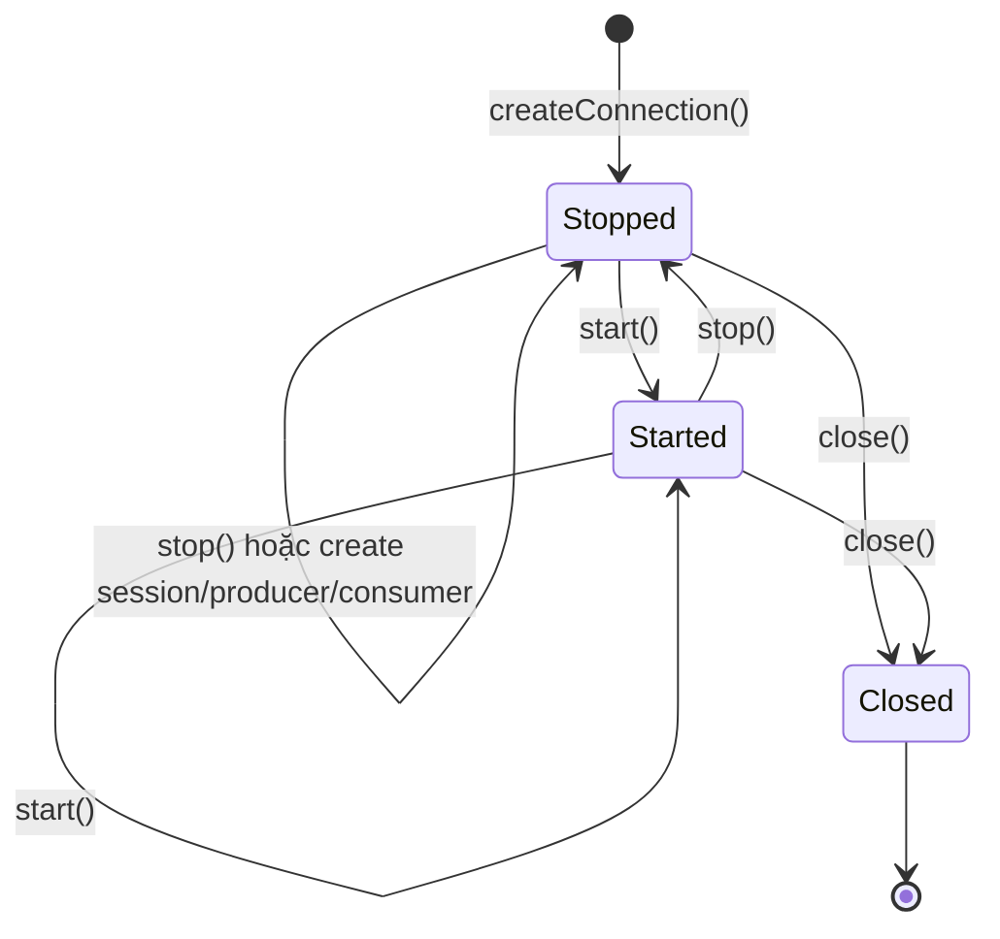

# Vòng đời create, start, stop, close của kết nối

> **Chương:** Lập trình JMS  
> **Phạm vi:** Vòng đời kết nối của JMS/Jakarta Messaging khi ứng dụng Java giao tiếp với Apache ActiveMQ Artemis hoặc ActiveMQ Classic.  
> **Trọng tâm:** Ý nghĩa chính xác của `createConnection()`, `start()`, `stop()`, `close()`; tác động tới producer, consumer, message đang xử lý, transaction và giải phóng tài nguyên.

## 1. Tình huống: kết nối đã tạo nhưng consumer chưa nhận message

Một ứng dụng Java khởi tạo kết nối JMS tới Artemis, đăng ký consumer và bắt đầu gửi message thử nghiệm:

```java
Connection connection = factory.createConnection();
Session session = connection.createSession(
        false, Session.AUTO_ACKNOWLEDGE);

Queue queue = session.createQueue("orders.tasks");
MessageConsumer consumer = session.createConsumer(queue);
MessageProducer producer = session.createProducer(queue);

producer.send(session.createTextMessage("order-1001"));
Message message = consumer.receive(1000);
```

Đoạn code có thể nhận `null` ở bước cuối dù broker đang hoạt động và message đã vào queue: **kết nối JMS tạo mới ban đầu đang ở trạng thái stopped**. Để broker/provider giao message cho consumer, ứng dụng phải gọi:

```java
connection.start();
Message message = consumer.receive(1000);
```

Lời gọi `start()` không phải “khởi động broker” hoặc “mở TCP lần đầu” theo một bảo đảm tuyệt đối. Đây là thao tác **cho phép delivery tới consumer của connection**. Một JMS provider có thể mở socket ngay trong `createConnection()` hoặc trì hoãn một số hoạt động mạng; ứng dụng không được dựa vào thời điểm socket được mở để suy đoán trạng thái nhận message.

Vì vậy hãy phân biệt bốn thao tác theo **ngữ nghĩa JMS**, thay vì nhìn vào tên hàm:

| Thao tác | Ý nghĩa theo hợp đồng JMS | Producer gửi message? | Consumer được nhận message mới? |
| --- | --- | --- | --- |
| `createConnection()` | Tạo một `Connection`, **ban đầu stopped**, dùng để tạo `Session` | Có thể tạo session/producer và gửi | **Chưa** cho phép delivery |
| `connection.start()` | Cho phép provider bắt đầu/tiếp tục delivery trên connection | Có | **Có** |
| `connection.stop()` | Tạm dừng delivery trên connection; đợi những listener đang chạy hoàn tất trước khi trả về | **Vẫn có thể gửi** | **Không giao thêm** cho consumer tới khi `start()` lại |
| `connection.close()` | Đóng connection và các tài nguyên con, kết thúc vòng đời | Không dùng connection đã đóng để gửi | Không; cần tạo connection mới |

**Nguyên tắc cốt lõi:** `start/stop` điều khiển **nhận message của một connection phía client**; `close` kết thúc **toàn bộ vòng đời connection**. Không thao tác nào trong số này là lệnh “tạm dừng broker”.

## 2. Mô hình trạng thái của một JMS `Connection`



Bảng trạng thái dễ nhớ:

| Trạng thái | Điều gì được phép? | Điều cần tránh |
| --- | --- | --- |
| **Created / stopped** | Tạo session, queue/topic object, producer, consumer, đăng ký listener, gửi message | Chờ `receive()` thành công mà quên `start()` |
| **Started** | Gửi và nhận message; listener được provider gọi | Dùng cùng `Session` từ nhiều thread hoặc gọi `stop()` ngay trong `onMessage` |
| **Stopped sau khi đã start** | Vẫn duy trì connection, session, subscription/consumer; có thể gửi; sau đó `start()` để tiếp tục | Coi `stop()` như rollback, unsubscribe hoặc giải phóng socket |
| **Closed** | Có thể bỏ tham chiếu, tạo connection **mới** bằng factory | Dùng lại session/consumer của connection đã đóng hoặc gọi `start()` để “mở lại” |

`start()` lặp lại khi connection đã started, cũng như `stop()` lặp lại khi connection đã stopped, không phải cách tạo thêm delivery hoặc sinh thêm kết nối. `close()` là trạng thái cuối; muốn giao tiếp tiếp thì gọi `ConnectionFactory.createConnection(...)` để tạo connection mới.

### 2.1. Phạm vi trạng thái là **một connection**, không phải một session

Một `Connection` có thể sở hữu nhiều `Session` và consumer:

```text
Connection (start / stop / close)
    |
    +-- Session A -- Consumer orders.tasks
    |
    +-- Session B -- Consumer payments.tasks
    |
    +-- Session C -- Producer audit.events
```

Khi gọi `connection.stop()`, việc delivery tới consumer của **cả session A và B** bị tạm dừng. Producer của session C không bị “cấm gửi” chỉ vì connection stopped. Muốn tạm dừng **một worker** nhưng các worker khác vẫn tiếp tục, không nên gộp tất cả vào một connection rồi dùng `stop()`. Có thể dùng connection riêng, dừng listener container tương ứng hoặc điều khiển consumer theo cơ chế của framework.

**Threading:** JMS `Connection` được thiết kế để có thể chứa nhiều session; bản thân `Session` có mô hình xử lý tuần tự. Không biến một `Session` thành shared object giữa nhiều luồng worker đang đồng thời gửi/nhận/commit.

## 3. `createConnection()`: chuẩn bị tài nguyên nhưng chưa giao message

### 3.1. Những gì thường xảy ra khi tạo connection

```java
Connection connection = factory.createConnection();
// Nếu cần đặt clientID, đặt sớm trước các thao tác bị ràng buộc.
connection.setClientID("billing-worker-a");

Session session = connection.createSession(
        false, Session.CLIENT_ACKNOWLEDGE);

Queue queue = session.createQueue("billing.tasks");
MessageConsumer consumer = session.createConsumer(queue);
connection.start();
```

Thứ tự phổ biến:

1. Lấy `ConnectionFactory` đã cấu hình broker URL, credential, TLS/failover.
2. `createConnection()` (hoặc `createConnection(user, password)`) tạo đối tượng connection.
3. Nếu cần `clientID` cho mô hình subscription phù hợp, đặt ở giai đoạn hợp lệ theo JMS/provider, **trước khi bắt đầu dùng connection theo cách giới hạn việc thay clientID**.
4. Tạo `Session`, tạo producer/consumer, gắn `MessageListener` hoặc chuẩn bị synchronous receiver.
5. `start()` khi muốn bắt đầu nhận.

Thực tế client provider có thể xác thực và kết nối socket sớm hoặc muộn khác nhau. Lỗi broker URL, credential và TLS có thể được phát hiện ở `createConnection()` hoặc khi thao tác kế tiếp; chương trình phải xử lý `JMSException` ở các điểm liên quan.

### 3.2. Tạo consumer trước `start()` thường có ích

Với một **non-durable topic subscriber**, message chỉ được giao theo thời điểm subscription tồn tại và quy tắc broker. Thiết lập subscriber/listener trước `start()` giúp tránh bật delivery quá sớm khi handler chưa sẵn sàng:

```java
Connection connection = factory.createConnection();
try {
    Session session = connection.createSession(
            false, Session.AUTO_ACKNOWLEDGE);

    Topic events = session.createTopic("orders.events");
    MessageConsumer consumer = session.createConsumer(events);

    consumer.setMessageListener(message -> {
        // Handler đã đăng ký trước khi connection bắt đầu delivery.
        System.out.println("Nhận: " + message);
    });

    connection.start();

    // Ứng dụng tiếp tục phục vụ; vòng đời do thành phần sở hữu quản lý.
} finally {
    connection.close();
}
```

Ví dụ chỉ minh họa **thứ tự gọi API**: code thực tế phải giữ connection tồn tại trong suốt thời gian listener cần phục vụ. Khối `finally` chạy ngay sau thân `try` sẽ đóng connection; không sao chép nguyên ví dụ này rồi kỳ vọng listener chạy mãi. Với Spring hoặc Jakarta EE, framework thường quản lý vòng đời listener container và connection.

### 3.3. Đừng nhầm `createQueue()` với tạo physical queue trên broker

`session.createQueue("orders.tasks")` trước hết tạo **đối tượng destination của JMS**. Queue vật lý có sẵn, được auto-create hoặc bị từ chối tùy broker/configuration/quyền. `Connection.start()` không thay thế bước cấp quyền hay tạo queue trên Artemis.

Nếu muốn học riêng lifecycle mà không cần đặt trước queue cố định, có thể dùng `TemporaryQueue` của JMS trong **lab** (ví dụ đầy đủ ở phần 7). Đây là queue tạm gắn với connection, sẽ mất khi connection bị đóng; không dùng nó để đánh giá lưu giữ message qua restart broker.

## 4. `start()`: bật delivery, không phải điều kiện để producer gửi

### 4.1. Producer có thể gửi khi connection vẫn stopped

```java
Connection connection = factory.createConnection();
try {
    Session session = connection.createSession(
            false, Session.AUTO_ACKNOWLEDGE);
    Queue queue = session.createQueue("orders.tasks");

    MessageProducer producer = session.createProducer(queue);
    MessageConsumer consumer = session.createConsumer(queue);

    producer.send(session.createTextMessage("order-1001"));

    // Connection đang stopped: consumer chưa nhận delivery.
    Message beforeStart = consumer.receiveNoWait();  // dự kiến null

    connection.start();

    Message afterStart = consumer.receive(5_000);    // có thể nhận message
} finally {
    connection.close();
}
```

**Vì sao đúng?** Trong JMS, `start/stop` quản lý **message delivery tới client consumer**, không điều khiển quyền phát của producer. `send()` còn chịu ảnh hưởng của destination, broker persistence, transaction, flow control và mạng; nhưng việc connection đang stopped **không phải lệnh cấm producer**.

`receiveNoWait()` trên connection stopped trả về `null`. Với `receive(timeout)`, không nên suy luận timeout là lỗi mạng nếu chưa gọi `start()`. Với `receive()` vô hạn, việc quên `start()` có thể khiến thread chờ rất lâu; các ứng dụng sản xuất nên có timeout, log lifecycle và khả năng shutdown.

### 4.2. Phân biệt bật delivery và acknowledgment

`start()` **không** có nghĩa “commit” hoặc “acknowledge” một message:

- `AUTO_ACKNOWLEDGE`: provider ack theo quy tắc JMS khi `receive` thành công hoặc listener xử lý xong.
- `CLIENT_ACKNOWLEDGE`: ứng dụng gọi `message.acknowledge()`; chú ý phạm vi acknowledgment theo session.
- `SESSION_TRANSACTED`: consumer commit hoặc rollback session. `start()` không commit, `stop()` không rollback.
- Với message đang ở trạng thái delivered/unacknowledged, việc tạm dừng rồi tiếp tục không thay thế logic xử lý idempotent.

Một số message có thể đã nằm trong **prefetch/client buffer** khi provider tạm dừng delivery. Điều quan trọng theo API là nó **không được giao mới cho consumer ở trạng thái stopped**, còn thời điểm broker chuyển byte, trừ credit hay dự trữ message phụ thuộc provider.

### 4.3. Đừng dùng `start()` làm cơ chế khắc phục mọi lỗi

Nếu `start()` đã gọi nhưng không nhận message, hãy phân biệt:

- Destination sai tên hoặc queue khác địa chỉ/routing dự kiến.
- Consumer chưa tạo, thiếu quyền read/consume.
- Topic non-durable tạo sau khi message đã được gửi.
- Message selector không khớp.
- Queue còn message nhưng đã bị worker khác nhận hoặc đang inflight.
- Transaction chưa commit, message đã hết hạn, DLQ hoặc broker đang failover.
- Broker connection mất, client đang reconnect.

`start()` chỉ mở cửa delivery ở **connection này**; các điều kiện trên vẫn phải được kiểm tra riêng.

## 5. `stop()`: tạm dừng delivery có kiểm soát

### 5.1. Điều gì vẫn tồn tại sau `stop()`?

```java
connection.start();
// Consumer đang nhận bình thường.

connection.stop();
// Connection, Session, MessageProducer, MessageConsumer vẫn là tài nguyên sống.

producer.send(session.createTextMessage("sent-while-stopped"));
// Producer vẫn được phép gửi.

connection.start();
// Consumer tiếp tục nhận theo quy tắc JMS/broker.
```

`stop()` **không**:

- Đóng TCP connection theo hợp đồng API.
- Xóa queue/topic trên broker.
- Hủy durable subscription.
- Unsubscribe non-durable consumer (consumer vẫn đang tồn tại trên connection).
- Tự động commit/rollback transaction.
- Thu hồi mọi message đã prefetch hoặc đang được xử lý.
- Tạm dừng tất cả producer khác kết nối cùng broker.

Nó hữu ích để tạo một **ranh giới tạm ngưng giao message** ở cấp client connection, ví dụ bảo trì một nhóm consumer, phối hợp shutdown hoặc tạm dừng kiểm thử.

### 5.2. Điều quan trọng với `MessageListener` đang chạy

JMS yêu cầu `stop()` **không trả về trước khi các listener delivery đang thực thi kết thúc**. Hình dung:

```text
Thread provider:  onMessage(M1) -----------------> return
Thread quản lý:          stop() ------------------> return
                        | chờ M1 kết thúc |
Sau khi stop trả về: không bắt đầu thêm delivery mới trên connection.
```

Điều này không tự giải quyết bài toán transaction:

- Listener dùng `AUTO_ACKNOWLEDGE` thường chỉ ack sau khi trả về thành công.
- Listener dùng session transacted vẫn cần `commit()`/`rollback()` hợp lệ.
- Nếu listener đang đợi API/DB vô hạn, `stop()` có thể **chờ lâu**; cần thiết kế timeout/interrupt/giới hạn thời gian handler phù hợp với mô hình thực thi.
- Không gọi `connection.stop()` ngay bên trong `onMessage()` của một listener trên cùng connection: thao tác này cần chờ chính listener đang chạy và bị JMS cấm/đẩy vào tình huống lỗi hoặc deadlock tùy provider. Hãy gửi tín hiệu ra **thread sở hữu lifecycle** để dừng.

**Cũng không dùng `close()` trực tiếp trong `onMessage()` để tự hủy connection**. Tách logic xử lý message khỏi controller quản lý vòng đời để tránh xung đột callback/cleanup.

### 5.3. Mẫu dừng listener an toàn

Một mẫu quản lý trong Java SE:

```text
1. Đánh dấu ứng dụng đang shutdown, ngừng nhận công việc mới từ bên ngoài.
2. Thread quản lý gọi connection.stop().
3. Đợi stop() hoàn tất: không còn onMessage nào đang chạy.
4. Hoàn tất/kiểm tra trạng thái transaction, commit/rollback khi cần.
5. Đóng consumer/session và cuối cùng connection.close().
6. Dừng executor, giải phóng tài nguyên ứng dụng.
```

Nếu đang dùng session transacted với nhiều message trong một transaction, cần cân nhắc điểm commit **trước khi** shutdown. `stop()` không ngắt một listener đang chạy để tự rollback thay bạn.

**Điều kiện cạnh tranh:** Nếu một thread gọi `stop()` đồng thời thread khác đang `start()` hoặc `close()`, kết quả dễ khó dự đoán ở mức ứng dụng. Có **một lifecycle owner** điều phối các chuyển trạng thái, và cho các handler gửi tín hiệu yêu cầu dừng thay vì tự điều khiển connection.

## 6. `close()`: kết thúc vòng đời và xử lý tài nguyên

### 6.1. `close()` đóng những gì?

Một `Connection` sở hữu các `Session`; mỗi session sở hữu producer, consumer và tài nguyên liên quan. Gọi `connection.close()` giải phóng **tài nguyên JMS thuộc connection** (kể cả session/consumer chưa gọi `close()` riêng).

```java
Connection connection = factory.createConnection();
try {
    Session session = connection.createSession(
            false, Session.AUTO_ACKNOWLEDGE);
    MessageConsumer consumer =
            session.createConsumer(session.createQueue("orders.tasks"));

    connection.start();
    // Sử dụng connection...
} finally {
    connection.close();
}
```

Dù đóng trực tiếp connection là đủ để giải phóng các JMS object con, việc đóng từng producer/consumer/session có thể cần thiết để **chủ động giải phóng theo phạm vi ngắn hơn** khi connection vẫn còn phục vụ các session khác.

Theo JMS, gọi `close()` trên connection đã đóng nên không tạo ra một connection mới. Nhưng **không** được dùng connection đã đóng để gọi `start()` hoặc khởi tạo lại session. Sau khi đóng, tạo một connection mới từ factory.

### 6.2. Tác động đến subscription và message

| Tài nguyên/trạng thái | Khi đóng connection |
| --- | --- |
| TCP, session, producer, consumer thuộc connection | Được giải phóng/đóng theo provider |
| **TemporaryQueue/TemporaryTopic** tạo trên connection | Bị xóa theo vòng đời của connection |
| Consumer **non-durable topic** | Subscription của consumer không còn hoạt động; message đến sau đó không dành cho consumer vừa đóng |
| **Durable topic subscription** | Vẫn tồn tại cho tới khi được unsubscribe đúng quy tắc; queue/backlog chịu cấu hình retention/persistence |
| Queue **durable, vật lý** | Không tự bị xóa chỉ vì client đóng connection |
| Message đã được ack/commit thành công | Không “un-ack” hoặc rollback do gọi close sau đó |
| Transaction còn mở/chưa commit | Không được dựa vào `close()` để commit; message chưa commit có thể được rollback/redeliver theo provider/contract |

**Ranh giới quan trọng:** `close()` của **JMS connection** không tương đương “xóa queue”, “xóa durable subscription”, “xóa message trên broker” hay “tắt broker”.

### 6.3. Khi nào `close()` có thể chặn thread?

Giống `stop()`, `close()` cần điều phối việc giao message đang diễn ra và thu hồi tài nguyên. Nếu một listener chạy lâu, cleanup có thể không hoàn tất ngay; nếu provider đang failover hoặc network đang lỗi, thời gian close cũng phụ thuộc cấu hình timeout và phiên bản client.

Đừng gọi close trên UI thread hoặc thread yêu cầu có SLA rất ngắn rồi giả định luôn kết thúc tức thì. Thiết kế **thời hạn shutdown**, hạn xử lý mỗi message và giám sát trạng thái các listener; tránh tắt tiến trình đột ngột ngay sau lệnh close khi còn transaction chưa xử lý.

### 6.4. Ví dụ xử lý lỗi và đóng trong `finally`

```java
Connection connection = null;
try {
    connection = factory.createConnection();
    Session session = connection.createSession(
            false, Session.AUTO_ACKNOWLEDGE);
    MessageConsumer consumer =
            session.createConsumer(session.createQueue("orders.tasks"));

    connection.start();

    Message message = consumer.receive(5_000);
    if (message != null) {
        // Xử lý nghiệp vụ / ghi nhận event ID.
    }
} catch (JMSException ex) {
    // Phân biệt broker/network/auth/transaction theo mã và linked exception.
    throw ex;
} finally {
    if (connection != null) {
        try {
            connection.close();
        } catch (JMSException closeError) {
            // Log cùng ngữ cảnh; tránh che mất lỗi nghiệp vụ ban đầu.
            System.err.println("Không đóng được connection: " + closeError);
        }
    }
}
```

Với code sử dụng JMS 2.0, `Connection` cũng hỗ trợ `AutoCloseable` và có thể dùng `try-with-resources`. Trong Java SE hoặc thư viện tự quản lý connection, cách này giảm nguy cơ rò rỉ; trong container/framework, **người sở hữu connection** phải là nơi quyết định đóng nó.

## 7. Bài chạy được trên Artemis: kiểm chứng tuần tự create → start → stop → start → close

Đây là bài lab tập trung đúng **vòng đời kết nối**, không đo throughput hay HA. Dùng **Apache ActiveMQ Artemis** hỗ trợ JMS 2.0 qua `javax.jms`. Ví dụ dependency sau tương thích mô hình client `artemis-jms-client` của Artemis 2.50.0; chọn phiên bản broker/client đã kiểm tra trong dự án nếu thay đổi.

### 7.1. Maven dependency

```xml
<properties>
    <maven.compiler.release>17</maven.compiler.release>
</properties>

<dependencies>
    <dependency>
        <groupId>org.apache.artemis</groupId>
        <artifactId>artemis-jms-client</artifactId>
        <version>2.50.0</version>
    </dependency>
</dependencies>
```

Artemis client **gói `org.apache.activemq.artemis.jms.client`** dùng Artemis **Core wire protocol** phía dưới. Từ Artemis 2.50.0, Maven groupId chính thức của Artemis chuyển sang `org.apache.artemis`; với bản cũ kiểm tra lại dependency và API tương ứng. Ví dụ này dùng `javax.jms`; dự án `jakarta.jms` phải chọn `artemis-jakarta-client` và đổi toàn bộ import.

Broker lab cần listener Core tại `tcp://localhost:61616`, cho phép kết nối và tạo temporary destination. Nếu broker yêu cầu xác thực, thay `createConnection()` bằng `createConnection(username, password)`; lấy credential từ nguồn cấu hình an toàn thay vì hard-code.

### 7.2. Java hoàn chỉnh

```java
import javax.jms.Connection;
import javax.jms.JMSException;
import javax.jms.Message;
import javax.jms.MessageConsumer;
import javax.jms.MessageProducer;
import javax.jms.Session;
import javax.jms.TemporaryQueue;
import javax.jms.TextMessage;

import org.apache.activemq.artemis.jms.client.ActiveMQConnectionFactory;

public final class ConnectionLifecycleProbe {

    private static String body(Message message) throws JMSException {
        if (!(message instanceof TextMessage)) {
            throw new IllegalStateException(
                    "Expected TextMessage but got: " + message);
        }
        return ((TextMessage) message).getText();
    }

    private static void require(boolean condition, String explanation) {
        if (!condition) {
            throw new IllegalStateException(explanation);
        }
    }

    public static void main(String[] args) throws Exception {
        String brokerUrl = args.length == 0
                ? "tcp://localhost:61616"
                : args[0];

        ActiveMQConnectionFactory factory =
                new ActiveMQConnectionFactory(brokerUrl);

        // (1) createConnection(): connection ban đầu ở trạng thái stopped.
        Connection connection = factory.createConnection();
        System.out.println("1. Connection created; delivery stopped");

        try {
            // Mọi thao tác đều nằm trên main thread: một Session tuần tự.
            Session session = connection.createSession(
                    false, Session.AUTO_ACKNOWLEDGE);

            // Temp queue cô lập với các lần test khác; tự mất khi close().
            TemporaryQueue queue = session.createTemporaryQueue();
            MessageProducer producer = session.createProducer(queue);
            MessageConsumer consumer = session.createConsumer(queue);

            // (2) Chưa start: producer vẫn có thể gửi.
            producer.send(session.createTextMessage("M1"));
            require(consumer.receiveNoWait() == null,
                    "Stopped connection unexpectedly delivered M1");
            System.out.println("2. Sent M1, no consumer delivery before start");

            // (3) start: cho phép nhận M1.
            connection.start();
            Message first = consumer.receive(5_000);
            require(first != null, "Timed out waiting for M1");
            require("M1".equals(body(first)), "Wrong message: M1");
            System.out.println("3. Started -> received M1");

            // (4) stop: tạm dừng nhận; producer vẫn gửi được.
            connection.stop();
            producer.send(session.createTextMessage("M2"));
            require(consumer.receiveNoWait() == null,
                    "Stopped connection unexpectedly delivered M2");
            System.out.println("4. Stopped -> M2 sent, not delivered");

            // (5) start lần nữa: nhận M2.
            connection.start();
            Message second = consumer.receive(5_000);
            require(second != null, "Timed out waiting for M2");
            require("M2".equals(body(second)), "Wrong message: M2");
            System.out.println("5. Restarted delivery -> received M2");

            // Không bắt buộc stop trước close; ở đây làm rõ trạng thái.
            connection.stop();
        } finally {
            // (6) close kết thúc vòng đời, đóng session/consumer/temporary queue.
            connection.close();
            System.out.println("6. Connection closed");
        }

        System.out.println("PASS: create/start/stop/start/close");
    }
}
```

**Kết quả kỳ vọng:**

```text
1. Connection created; delivery stopped
2. Sent M1, no consumer delivery before start
3. Started -> received M1
4. Stopped -> M2 sent, not delivered
5. Restarted delivery -> received M2
6. Connection closed
PASS: create/start/stop/start/close
```

Điểm có thể kiểm chứng: **producer gửi thành công M1/M2 trong lúc connection stopped**, nhưng `receiveNoWait()` chưa giao chúng cho consumer; sau `start()`, `receive(5000)` nhận được. Queue tạm chỉ tồn tại trong vòng đời connection nên phép thử không đụng dữ liệu nghiệp vụ.

**Lưu ý kiểm chứng:** Ví dụ giả định không có lỗi kết nối/bảo mật và broker cho phép temporary destination. Một message có thể được broker chuyển byte/prefetch ở thời điểm khác với lúc `receive()` trả về; kết quả bài test chứng minh **delivery qua JMS consumer**, không đo frame mạng.

## 8. `JMSContext`: dễ bỏ sót vì mặc định auto-start

Với JMS 2.0/Jakarta Messaging, `JMSContext` gộp lifecycle của `Connection` và `Session` ở mức API. Đặc biệt, **mặc định `autoStart=true`**: khi tạo consumer, provider sẽ tự động start connection bên dưới.

```java
try (JMSContext context = factory.createContext()) {
    Queue queue = context.createQueue("orders.tasks");
    JMSConsumer consumer = context.createConsumer(queue);
    // Mặc định autoStart=true: có thể đã start delivery tại đây.
}
```

Vì vậy không được áp kết luận “tạo `JMSContext` rồi `createConsumer()` luôn stopped” như cách dùng `ConnectionFactory.createConnection()` cổ điển.

### 8.1. Điều khiển lifecycle thủ công với `setAutoStart(false)`

```java
import javax.jms.JMSConsumer;
import javax.jms.JMSContext;
import javax.jms.Message;
import javax.jms.Queue;

try (JMSContext context =
             factory.createContext(JMSContext.AUTO_ACKNOWLEDGE)) {

    // Phải đặt trước khi tạo JMSConsumer.
    context.setAutoStart(false);

    Queue queue = context.createQueue("orders.tasks");
    JMSConsumer consumer = context.createConsumer(queue);

    // Có thể chuẩn bị producer/consumer khi delivery chưa được bật.
    context.createProducer().send(queue, "order-1001");

    Message beforeStart = consumer.receiveNoWait(); // null
    context.start();

    Message afterStart = consumer.receive(5_000);  // nhận message
    context.stop();                                // tạm dừng delivery
}  // close() tự động
```

`context.setAutoStart(false)` chỉ tắt **cơ chế tự start** khi tạo consumer; không cấm gọi `context.start()` thủ công. Đặt tùy chọn này **sớm**, trước khi tạo consumer, để tránh consumer được cấp delivery ngoài ý muốn.

**Cảnh báo khi thử trong môi trường thật:** Nếu dùng queue chung với worker khác, không thể bảo đảm consumer ví dụ nhận chính message do producer ví dụ gửi. Dùng queue riêng hoặc `TemporaryQueue` để phép thử xác định.

### 8.2. So sánh API cổ điển và Simplified API

| Câu hỏi | `Connection` + `Session` (JMS 1.1/2.0) | `JMSContext` (JMS 2.0/Jakarta) |
| --- | --- | --- |
| Trạng thái nhận sau khi khởi tạo? | `Connection` mặc định **stopped** | Tự động start khi tạo consumer, **mặc định** `autoStart=true` |
| Muốn chuẩn bị consumer rồi mới nhận? | Tạo consumer trước, gọi `connection.start()` sau | Gọi `context.setAutoStart(false)` **trước** khi tạo consumer; gọi `context.start()` sau |
| Tạm dừng? | `connection.stop()` | `context.stop()` |
| Kết thúc? | `connection.close()` (đóng tài nguyên con) | `context.close()` hoặc `try-with-resources` |
| Có thể dùng chung context/session giữa nhiều worker? | Session có quy tắc sử dụng tuần tự | Vẫn phải tôn trọng quy tắc sử dụng tuần tự của session/context |

Đừng nhầm `autoStart` của JMSContext với **auto-reconnect/failover** của client: một cái quyết định **khi nào bật delivery**, cái kia quyết định **khi nào kết nối lại sau sự cố mạng/broker**.

## 9. Giao dịch, acknowledgment và redelivery trong lúc stop/close

Bài này tập trung **vòng đời connection**, nhưng ranh giới ack/transaction là điểm dễ gây mất hoặc nhân đôi hiệu ứng nghiệp vụ nhất.

### 9.1. `stop()` không commit transaction

Với session transacted:

```java
Session txSession = connection.createSession(
        true, Session.SESSION_TRANSACTED);

Queue queue = txSession.createQueue("orders.tasks");
MessageConsumer consumer = txSession.createConsumer(queue);

connection.start();
Message message = consumer.receive(5_000);

if (message != null) {
    try {
        // Xử lý nghiệp vụ idempotent trước khi xác nhận JMS.
        processOrder(message);
        txSession.commit();
    } catch (Exception ex) {
        txSession.rollback();
        throw ex;
    }
}

connection.stop();
// Không làm transaction đã commit "mở" lại.
```

`processOrder` ở đây là hàm nghiệp vụ **minh họa**, không thuộc JMS API. Nếu cần transaction đồng nhất với DB thì phải chọn mẫu thiết kế phù hợp (ví dụ outbox, inbox, XA khi được hỗ trợ và có lý do rõ ràng); chỉ dùng `Session.SESSION_TRANSACTED` không tự đưa database vào cùng transaction.

### 9.2. Nếu lỗi xảy ra ngay khi chuyển trạng thái

Xét trình tự:

```text
t0  Consumer nhận message M
t1  Handler cập nhật database thành công
t2  Broker/network gián đoạn trước khi ack/commit JMS thành công
t3  Ứng dụng stop/close hoặc provider reconnect
t4  Broker có thể redeliver M
```

`stop()`/`close()` không bảo đảm nghiệp vụ `M` đã được xử lý đúng một lần. Khi ack/commit chưa chắc chắn, broker có thể giao lại message. Xử lý an toàn cần:

- **Idempotency key** ổn định (ví dụ `eventId`, `orderId + version`) và lưu dấu đã xử lý.
- Transaction/commit rõ ràng; log kết quả ack, rollback và lỗi.
- Redelivery policy và DLQ để tránh retry vô hạn.
- Phân biệt **message đã nhận** với **nghiệp vụ đã commit** và **JMS đã ack** trong metrics.

### 9.3. `close()` và message inflight

Nếu đóng connection khi có message đang xử lý, broker/provider có thể chuyển message chưa ack về trạng thái sẵn sàng giao lại theo chính sách delivery và transaction. Việc đóng không đồng nghĩa “message đã xử lý thành công”; cũng không được tự ý đánh dấu hoàn tất chỉ vì Java đã đi qua `finally`.

Trong ứng dụng cần shutdown êm, nên hoàn thành handler và commit/ack hợp lệ **trước** khi đóng. Nếu buộc phải tắt khẩn cấp, chấp nhận redelivery và dựa vào idempotency thay vì cố suy đoán trạng thái.

## 10. Lỗi vòng đời thường gặp và cách nhận biết

| Hiện tượng | Nguyên nhân dễ gặp | Cách chẩn đoán |
| --- | --- | --- |
| `receiveNoWait()` luôn `null` | Chưa gọi `start()`; message không có; selector sai; consumer khác lấy | Log trạng thái connection, queue depth, selector và consumer count |
| `receive()` chờ mãi | Quên `start()` hoặc không có message | Sử dụng timeout, kiểm tra trước sau `start()` |
| Listener không được gọi dù đã `setMessageListener` | Connection vẫn stopped hoặc chưa có message | Gọi `start()` từ lifecycle owner; kiểm tra subscribe/destination |
| Producer gửi được nhưng consumer không nhận | Producer không bị chặn bởi stopped; hoặc sai queue/routing | Xác minh send, `JMSDestination` và trạng thái nhận |
| `stop()` mất nhiều thời gian | `onMessage` đang chạy và chưa trả về | Trace handler, đo p99 thời gian xử lý, timeout downstream |
| Gọi `stop()`/`close()` trong `onMessage` gây lỗi hoặc treo | Callback tự cố dừng connection đang giao chính message của nó | Báo tín hiệu cho thread quản lý lifecycle |
| Message được giao lại sau restart/close | Chưa ack/commit, transaction rollback hoặc kết nối rơi | Kiểm tra `JMSRedelivered`, delivery count, DB idempotency |
| `IllegalStateException`/`JMSException` khi `start()` lại | Connection đã `close()`, provider đang lỗi hoặc client object không còn hợp lệ | Tạo connection mới; phân tích linked exception |
| Số connection trên broker tăng mãi | Thiếu `finally`/`close` hoặc lifecycle owner quản lý sai | Theo dõi JMX/console và stack trace tạo connection |
| `JMSContext` nhận message “quá sớm” | Mặc định `autoStart=true` | `setAutoStart(false)` trước `createConsumer()` |

**Chú ý:** `JMSException` có thể chứa `getLinkedException()`. Log nguyên nhân lồng nhau giúp phân biệt lỗi state, authentication, broker failover, TLS và không nên quy mọi lỗi thành “chưa start”.

## 11. Vận hành an toàn trong service, Spring và container

### 11.1. Lifecycle owner rõ ràng

Một service có thể có ba dạng sở hữu tài nguyên:

1. **Java SE tự quản:** tạo connection một lần khi start service; tạo session/consumer theo worker; điều khiển `start/stop/close` từ thành phần quản lý; cleanup trong `finally`.
2. **Spring JMS listener container:** container quản lý connection, session, consumer, start/stop và recovery. Không tự đóng connection mà container đang sử dụng trong một `@JmsListener`; điều khiển vòng đời qua API container/framework.
3. **Jakarta EE managed JMS/Jakarta Messaging:** connection/context có thể do container quản lý, transaction và vòng đời chịu hạn chế của môi trường. Ưu tiên cơ chế tiêm/managed context thay vì tự gọi start/stop/close tùy ý bên trong component.

### 11.2. Có nên gọi `stop()` trước mọi `close()`?

**Không bắt buộc.** `close()` là thao tác kết thúc vòng đời và cũng phải điều phối delivery đang diễn ra. Gọi `stop()` trước `close()` hữu ích khi ứng dụng muốn **một điểm chặn nhận mới xác định**, sau đó đợi inflight hoàn tất và xử lý cleanup. Nếu connection không có listener đang chạy và tác vụ đã xong, `close()` trực tiếp là đủ.

Mô hình shutdown tham khảo:

```java
public void shutdown() {
    Connection current = this.connection; // do lifecycle owner sở hữu
    if (current == null) return;

    try {
        current.stop();   // Tạm dừng consumer delivery và đợi listener.
        // Xác nhận các transaction/handler đã hoàn tất.
    } catch (JMSException ex) {
        logLifecycleError("stop", ex);
    } finally {
        try {
            current.close(); // Giải phóng dù stop có lỗi.
        } catch (JMSException ex) {
            logLifecycleError("close", ex);
        } finally {
            this.connection = null;
        }
    }
}
```

`logLifecycleError` là hàm minh họa của service. Trong hệ thống đa luồng, phải đồng bộ quyền sở hữu để không có thread khác tiếp tục dùng `current` sau khi bắt đầu shutdown.

### 11.3. Lifecycle connection khác failover/reconnect

Nếu broker Artemis bị restart:

- Client provider có thể thử reconnect/failover theo URL, connection factory và tham số đã cấu hình.
- `Connection.start()` **không** có nghĩa “kết nối lại bằng mọi giá”, cũng không thiết lập HA.
- `Connection.stop()` **không** đóng TCP để kích hoạt cơ chế failover.
- `Connection.close()` là yêu cầu chủ động **chấm dứt** client connection.

Khi muốn kiểm tra HA, phải test failover/reconnect **riêng** với acknowledgement và transaction; không thay thế phép thử bằng vòng `stop/start`.

## 12. Bộ kiểm thử chấp nhận trên broker

Với bài lab phần 7, cần kiểm tra cả hành vi dương và âm:

| ID | Trình tự | Kỳ vọng | Ý nghĩa |
| --- | --- | --- | --- |
| L1 | `createConnection → createSession → createConsumer → send → receiveNoWait` | `null` | Delivery chưa bật |
| L2 | Từ L1 gọi `start → receive(timeout)` | Nhận M1 | `start` cho phép delivery |
| L3 | `stop → send(M2) → receiveNoWait` | `null` | `stop` không cấm producer nhưng ngăn delivery |
| L4 | Từ L3 gọi `start → receive(timeout)` | Nhận M2 | Có thể tiếp tục cùng connection |
| L5 | `stop` khi listener đang chạy | `stop` đợi listener trả về | Không cắt ngang một callback đang xử lý |
| L6 | `close` sau khi dùng xong | Consumer/session/temp queue được dọn; client connection biến mất khỏi broker | Cleanup có tác dụng |
| L7 | `start` trên connection đã `close` | Không phục hồi connection; xuất hiện lỗi trạng thái theo API/provider | `close` là terminal |
| L8 | `JMSContext` với `setAutoStart(false)` trước consumer | Không delivery cho tới `context.start()` | Tách autoStart và start thủ công |
| L9 | `JMSContext` mặc định autoStart | Có thể nhận sau khi consumer được tạo | Tránh nhầm hai API |
| L10 | Đang xử lý transaction chưa commit rồi đóng/mất kết nối | Có thể redeliver; không coi đã ack | Lifecycle không thay thế transaction |

### 12.1. Quan sát trên Artemis Console/JMX

Trước/sau mỗi bước, ghi:

- Số **connection** còn hoạt động và client ID nếu có.
- Số **consumer** gắn với queue/temporary queue.
- `messageCount` và `deliveringCount` của queue nếu broker cho phép quan sát.
- Ack/commit thành công, rollback và redelivery trong log/metrics.
- Sau `close()`, connection và temporary destination không còn tồn tại theo chính sách broker.

Lưu ý: broker metrics có thể phản ánh **prefetch/inflight** trước khi `receive()` của ứng dụng trả về; không dùng duy nhất một con số queue depth để khẳng định `start/stop` đã đúng. Bằng chứng tốt nhất là đối chiếu **thời điểm gọi API** với **message thực nhận** và trạng thái ack.

### 12.2. Tái hiện lỗi có chủ đích

Thực hiện ba ca trong lab độc lập:

- Bỏ `connection.start()` ở ví dụ phần 7: M1 vẫn gửi được nhưng consumer không được delivery.
- Bỏ `setAutoStart(false)` ở ví dụ `JMSContext`: consumer có thể bắt đầu nhận trước khi ứng dụng gọi `context.start()`.
- Đóng connection trước khi nhận M2, rồi cố gọi `start()` trên connection cũ: không thể tiếp tục; phải tạo connection mới.

Không thử trên queue nghiệp vụ đang có dữ liệu thật. Temporary destination phù hợp để cô lập bài test vòng đời, còn kiểm thử durability nên dùng queue cố định được cấu hình bền vững và message ID riêng.

## 13. Checklist cho code review

- [ ] Có **một nơi rõ ràng** sở hữu và đóng connection.
- [ ] Đã gọi `start()` khi dùng API `Connection` cổ điển để nhận message.
- [ ] Đã hiểu `JMSContext` mặc định `autoStart=true`; nếu cần trì hoãn delivery thì đặt false trước khi tạo consumer.
- [ ] Không dùng `stop()` để ngăn producer gửi hoặc để rollback session.
- [ ] Không gọi `stop()`/`close()` trực tiếp bên trong `onMessage()` trên connection đang giao message.
- [ ] Dùng `receive(timeout)`/`receiveNoWait()` phù hợp, không tạo vòng chờ vô hạn không có khả năng shutdown.
- [ ] Có chiến lược ack/transaction và idempotency cho message inflight khi đóng/failover.
- [ ] `close()` được gọi dù code thất bại; cleanup lỗi không che hoàn toàn lỗi gốc.
- [ ] Không dùng lại connection/session/consumer sau khi connection đã đóng.
- [ ] Nếu dùng framework/container quản lý JMS, không tự ý đóng tài nguyên của container.
- [ ] Có log trạng thái create/start/stop/close và metrics connection/consumer đủ để phát hiện rò rỉ.

## 14. Câu hỏi tự kiểm tra

1. Vừa gọi `createConnection()` rồi tạo consumer và `receiveNoWait()`, tại sao có thể luôn nhận `null` dù queue có message?
2. Producer được phép gọi `send()` khi connection đang stopped không? `stop()` làm thay đổi điều gì?
3. Nếu một connection có ba session/consumer, gọi `stop()` ảnh hưởng những consumer nào?
4. Vì sao không nên gọi `connection.stop()` ngay từ `onMessage()`?
5. `stop()` có commit transaction hay tự động trả message chưa ack về queue không?
6. `close()` có xóa queue durable hoặc durable subscription không?
7. JMSContext khác mô hình `Connection` cổ điển ở điểm nào khi tạo consumer?
8. Vì sao đã thấy `connection.close()` trong log vẫn có thể xuất hiện redelivery sau khi service khởi động lại?

**Định hướng đáp án:** (1) connection mới mặc định stopped; (2) gửi được, stop chỉ tạm dừng giao đến consumer; (3) tất cả consumer thuộc connection; (4) stop chờ listener đang chạy kết thúc; (5) không, commit/ack là cơ chế riêng; (6) không; (7) autoStart mặc định true; (8) còn transaction/ack chưa hoàn tất và kết quả xử lý có thể không chắc chắn.

## 15. Tài liệu đối chiếu

- [Java EE 7 API — javax.jms.Connection](https://docs.oracle.com/javaee/7/api/javax/jms/Connection.html): hợp đồng `start()`, `stop()`, `close()`, cách sử dụng connection.
- [Java EE 7 API — javax.jms.JMSContext](https://docs.oracle.com/javaee/7/api/javax/jms/JMSContext.html): `autoStart`, `setAutoStart`, `start/stop/close` trong Simplified API.
- [Jakarta Messaging Specification](https://jakarta.ee/specifications/messaging/): định nghĩa trạng thái connection, delivery, session và transaction; chọn edition phù hợp `javax` hoặc `jakarta`.
- [Apache ActiveMQ Artemis — Client Classpath](https://artemis.apache.org/components/artemis/documentation/latest/client-classpath.html): chọn JMS/Jakarta client phù hợp phiên bản.
- [Apache ActiveMQ Artemis — Using JMS](https://artemis.apache.org/components/artemis/documentation/latest/using-jms.html): tạo connection factory, JMS producer/consumer và kết nối broker.
- [Apache ActiveMQ Artemis — Address Model](https://artemis.apache.org/components/artemis/documentation/latest/address-model.html): queue/address và routing khi kiểm tra message trên broker.

> **Điểm nhớ chính:** `createConnection()` tạo một connection **ban đầu stopped**; `start()` bật nhận message; `stop()` tạm dừng nhận nhưng vẫn giữ tài nguyên và không ngăn producer; `close()` giải phóng connection cùng tài nguyên con. Với `JMSContext`, hãy nhớ **autoStart mặc định true**, nên phải gọi `setAutoStart(false)` trước khi tạo consumer nếu muốn kiểm soát thời điểm bắt đầu nhận.
