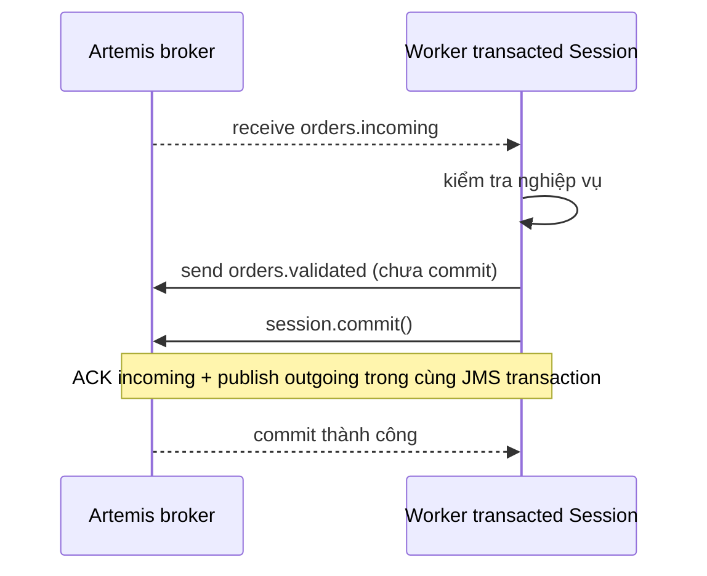

# Tạo Session theo chế độ giao dịch và xác nhận

> **Chương:** Lập trình JMS  
> **Mô-đun:** `INTEGRATION_MESSAGING_MESSAGE_BROKER_ACTIVEMQ` — thực hành Apache ActiveMQ Classic và Artemis qua JMS/Jakarta Messaging, đặt trọng tâm vào xác nhận message, giao dịch, redelivery và xử lý lỗi tin cậy.  
> **Mục tiêu:** Tạo đúng `Session` hoặc `JMSContext` theo nhu cầu, phân biệt `AUTO_ACKNOWLEDGE`, `CLIENT_ACKNOWLEDGE`, `DUPS_OK_ACKNOWLEDGE` và `SESSION_TRANSACTED`; hiểu chính xác thời điểm message được ACK, cách `commit()/rollback()/recover()` vận hành, rồi tự kiểm chứng với broker Artemis.

## 1. Session quyết định ranh giới xử lý message

Trong JMS, `Connection` quản lý kết nối tới broker, còn **`Session` là ngữ cảnh dùng để tạo producer/consumer, gửi, nhận, xác nhận message và thực hiện giao dịch cục bộ**. Cùng một queue có thể được tiêu thụ bởi nhiều Session độc lập; việc ACK một message thuộc Session nào phụ thuộc vào cách chính Session đó được tạo.

Giả sử worker thanh toán nhận thông điệp `PaymentRequested(eventId=evt-101)`:

```text
Broker queue                   Worker Java
    |                             |
    |-------- message ----------->| receive()
    |                             | ghi DB / gọi dịch vụ
    |<------- ACK / COMMIT -------| xác nhận xử lý
    |                             |
```

Câu hỏi quyết định là **khi nào** mũi tên ACK quay về broker. Nếu xác nhận trước khi xử lý nghiệp vụ, worker crash có thể khiến message **không được giao lại** dù tác vụ chưa hoàn tất. Nếu xác nhận sau khi xử lý, crash giữa hai bước lại có thể khiến message được giao **lần thứ hai**; khi đó cần idempotency.

Có hai API cần biết:

- **JMS classic API:** `Connection` → `Session` → `MessageProducer` / `MessageConsumer`. Ví dụ `connection.createSession(...)`; thao tác có thể ném `JMSException`.
- **Simplified API (JMS 2.0 / Jakarta Messaging):** `ConnectionFactory.createContext(...)` tạo `JMSContext` gộp kết nối và session; dùng `JMSProducer` / `JMSConsumer`, thuận tiện `try-with-resources` và thường sử dụng các ngoại lệ runtime.

Cả hai triển khai cùng **ngữ nghĩa session mode**. Đừng hiểu `JMSContext` là một loại broker hoặc một transaction manager mới.

## 2. Ma trận các chế độ: chọn chính xác trước khi lập trình

| Session mode | Tạo session/context | ACK xảy ra lúc nào? | Hoàn tác sau lỗi | Sử dụng khi |
| --- | --- | --- | --- | --- |
| `AUTO_ACKNOWLEDGE` | `createSession(false, Session.AUTO_ACKNOWLEDGE)` | Tự ACK khi `receive()` trả về thành công hoặc `onMessage()` trả về bình thường | Không có nút rollback của JMS transaction; không kiểm soát ACK riêng sau xử lý đồng bộ | Tác vụ nhận nhẹ, chấp nhận ranh giới auto-ACK |
| `CLIENT_ACKNOWLEDGE` | `createSession(false, Session.CLIENT_ACKNOWLEDGE)` | Gọi `message.acknowledge()` hoặc `context.acknowledge()` | `session.recover()` / `context.recover()` để yêu cầu phát lại các message chưa ACK | Chủ động ACK sau bước xử lý |
| `DUPS_OK_ACKNOWLEDGE` | `createSession(false, Session.DUPS_OK_ACKNOWLEDGE)` | Provider ACK *trễ/gom lô* | `recover()` trong non-transacted session; có thể giao trùng khi lỗi | Khối lượng lớn, chấp nhận duplicate |
| `SESSION_TRANSACTED` | `createSession(true, …)` hoặc `createSession(Session.SESSION_TRANSACTED)` | ACK của các message nhận được xảy ra cùng `commit()`; send trong cùng giao dịch cũng commit ở đây | `rollback()` để hủy gửi chưa commit và phục hồi message nhận chưa commit | Xử lý và forward message theo một JMS local transaction |

**Lưu ý:** `SESSION_TRANSACTED` là **chế độ giao dịch**, không phải một ACK mode thứ tư để dùng song song với `CLIENT_ACKNOWLEDGE`. Khi `transacted=true`, tham số `acknowledgeMode` **bị bỏ qua**. Mặt khác, `commit()/rollback()` chỉ hợp lệ với transacted Session; `recover()` dành cho non-transacted Session.

## 3. Tạo Session bằng API truyền thống

### 3.1. `createSession(boolean transacted, int acknowledgeMode)`

Ví dụ Java SE với Jakarta Messaging và một `ConnectionFactory` đã có:

```java
import jakarta.jms.Connection;
import jakarta.jms.ConnectionFactory;
import jakarta.jms.Session;

// Một Connection có thể có nhiều Session (trong Java SE).
Connection connection = factory.createConnection(user, password);
try {
    Session autoSession = connection.createSession(
            false, Session.AUTO_ACKNOWLEDGE);
    Session clientAckSession = connection.createSession(
            false, Session.CLIENT_ACKNOWLEDGE);
    Session dupsSession = connection.createSession(
            false, Session.DUPS_OK_ACKNOWLEDGE);
    Session txSession = connection.createSession(
            true, Session.AUTO_ACKNOWLEDGE); // ACK mode bị bỏ qua vì transacted=true

    try {
        // Tạo producer/consumer trên đúng Session phù hợp workload.
        // connection.start() trước khi gọi receive() hoặc dùng listener.
    } finally {
        txSession.close();
        dupsSession.close();
        clientAckSession.close();
        autoSession.close();
    }
} finally {
    connection.close();
}
```

**Ý nghĩa hai tham số:**

- `false`: Session **không** dùng local JMS transaction; tham số thứ hai quyết định cách ACK.
- `true`: Session **có** local transaction; tham số thứ hai bị bỏ qua. Toàn bộ input/output trong transaction được commit/rollback cùng nhau theo semantics JMS.
- Để viết tường minh hơn trong API JMS 2.0/Jakarta: `connection.createSession(Session.SESSION_TRANSACTED)`, `connection.createSession(Session.CLIENT_ACKNOWLEDGE)`. Overload một tham số thể hiện rõ chỉ có **một session mode**.

Các method hữu ích để xác minh cấu hình:

```java
System.out.println(txSession.getTransacted());      // true
System.out.println(autoSession.getAcknowledgeMode()); // AUTO_ACKNOWLEDGE
```

**Đừng nhầm `Connection.start()` với `Session.commit()`.** `start()` cho phép delivery tới consumer; nó **không** commit gửi message. Producer thường có thể gửi khi connection chưa được start, nhưng consumer `receive()` sẽ chờ cho đến khi delivery được bật hoặc timeout.

### 3.2. API `JMSContext` rút gọn

```java
import jakarta.jms.ConnectionFactory;
import jakarta.jms.JMSContext;

try (JMSContext autoContext = factory.createContext(
        user, password, JMSContext.AUTO_ACKNOWLEDGE)) {
    // Tạo consumer/producer; JMSContext thường auto-start khi cần nhận.
}

try (JMSContext transactionContext = factory.createContext(
        user, password, JMSContext.SESSION_TRANSACTED)) {
    // send/receive trong cùng một local transaction
    transactionContext.commit(); // ranh giới xác nhận của JMS transaction
}
```

`JMSContext` mặc định **auto-start** khi tạo consumer, trừ khi gọi `setAutoStart(false)`. Khi tắt auto-start, phải gọi `start()` trước khi mong nhận message. `JMSContext.close()` sẽ giải phóng resource; đóng một transacted context có giao dịch chưa commit khiến giao dịch đó **rollback**, không tự commit ngầm.

Ví dụ chạy trong bài sử dụng `JMSContext`; trước đó giải thích `Session` để có thể làm việc với hệ thống legacy, Spring hoặc các API tích hợp có trả về Session.

### 3.3. Quan trọng khi dùng container và nhiều thread

Các ví dụ `createSession(...)` và `commit()` trực tiếp dưới đây dành cho **Java SE/standalone application**.

- Trong Jakarta EE web/EJB container có JTA transaction đang hoạt động, tham số transacted/acknowledge mode có thể bị **container bỏ qua**; commit/rollback phải do transaction manager phù hợp thực hiện. Không copy local transaction code vào môi trường JTA mà chưa xác định ranh giới quản lý.
- Trong Spring `DefaultMessageListenerContainer` hoặc `@JmsListener`, framework có thể quản lý Session, transaction và acknowledgment. Xem `sessionTransacted` hoặc transaction manager thực tế; đừng tự commit một Session do container đang quản lý.
- Một JMS `Session` là **ngữ cảnh thực thi tuần tự**, không dùng đồng thời từ nhiều worker thread. Nếu xử lý song song, tạo Session/JMSContext riêng cho mỗi luồng hoặc dùng listener container/pool cấu hình đúng. Một Session có thể tạo nhiều consumer nhưng các thao tác trong Session không được xử lý song song tùy ý.

## 4. `AUTO_ACKNOWLEDGE`: tưởng đã xử lý vì receive trả về

Trong chế độ `AUTO_ACKNOWLEDGE` với **synchronous receive**, provider tự ACK khi `receive()` trả về thành công:

```java
Session session = connection.createSession(
        false, Session.AUTO_ACKNOWLEDGE);
MessageConsumer consumer = session.createConsumer(queue);
connection.start();

Message message = consumer.receive(5000); // khi trả về message, ACK đã diễn ra
if (message != null) {
    updateDatabase(message); // có thể lỗi SAU khi broker đã ACK
}
```

Nếu `updateDatabase()` ném lỗi hoặc JVM chết **sau** `receive()`, message có thể đã được broker xem là hoàn tất. Chạy lại ứng dụng không bảo đảm nhận lại message ấy.

Với **asynchronous message listener**, ACK theo tiêu chuẩn xảy ra sau khi `onMessage()` **trả về bình thường**:

```java
consumer.setMessageListener(message -> {
    process(message);
    // Trả về bình thường => provider có thể hoàn tất auto-ACK.
});
```

Điểm khác biệt này khiến việc “đổi code từ `receive()` sang listener” có thể làm thay đổi vị trí ACK tương đối với business logic. Nếu listener có lỗi, cách provider phản ứng còn phụ thuộc loại lỗi và quy tắc của session; tránh suy diễn một exception bất kỳ luôn có tác dụng rollback.

**Dùng AUTO_ACK khi**: công việc sau nhận rất nhẹ, mất khả năng retry ở ranh giới trên là chấp nhận được hoặc nghiệp vụ có cơ chế khôi phục riêng. Với thanh toán, giữ chỗ, trừ kho, thường nên chọn transaction/ack sau xử lý và có idempotency.

## 5. `CLIENT_ACKNOWLEDGE`: xác nhận thủ công nhưng phạm vi là toàn Session

Trong chế độ `CLIENT_ACKNOWLEDGE`, ứng dụng quyết định khi nào gọi ACK:

```java
Session session = connection.createSession(
        false, Session.CLIENT_ACKNOWLEDGE);
MessageConsumer consumer = session.createConsumer(queue);
connection.start();

Message message = consumer.receive(5000);
if (message != null) {
    updateDatabase(message);
    message.acknowledge(); // xác nhận sau khi xử lý thành công
}
```

**Bẫy quan trọng:** `message.acknowledge()` **không phải ACK riêng một message** theo chuẩn JMS. Nó xác nhận **mọi message đã được delivered/consumed trong cùng Session** kể từ lần ACK thích hợp, kể cả khi bạn gọi trên message nhận sau cùng.

Ví dụ có hai message được nhận trong cùng Session:

```java
Message first = consumer.receive(5000);  // evt-101
Message second = consumer.receive(5000); // evt-102

// Chỉ evt-102 xử lý thành công; evt-101 vẫn đang lỗi.
process(second);
second.acknowledge(); // ACK luôn cả first trong cùng Session!
```

Vì vậy, nếu logic muốn ACK độc lập, đừng gom nhiều task bất đồng bộ đang chờ hoàn thành trong một Session `CLIENT_ACKNOWLEDGE`. Hãy **xử lý rồi ACK từng message trước khi receive thêm**, hoặc dùng mỗi worker một Session, hoặc lựa chọn cơ chế acknowledgment riêng của provider với hiểu biết về tính tương thích.

### 5.1. `recover()` trong non-transacted Session

Nếu đang dùng `CLIENT_ACKNOWLEDGE` mà lỗi xảy ra trước ACK, gọi `session.recover()`:

```java
try {
    process(message);
    message.acknowledge();
} catch (Exception error) {
    session.recover(); // yêu cầu Session bắt đầu giao lại message chưa ACK
    throw error;
}
```

`recover()` khiến Session khởi động lại chuỗi delivery từ các message chưa ACK, theo chính sách provider. Redelivery có thể không giữ nguyên thứ tự tuyệt đối vì TTL, priority, delay hoặc message mới. Message phát lại sẽ có `JMSRedelivered=true` và `JMSXDeliveryCount` được tăng theo quy tắc JMS.

Với `JMSContext`, API tương ứng là `context.acknowledge()` và `context.recover()`. `context.acknowledge()` cũng ACK ở phạm vi Session ẩn trong context.

**Không gọi `recover()` trên transacted Session** để mô phỏng rollback: phải dùng `rollback()`. Nếu đóng Session/client connection khi còn message chưa ACK, việc đóng **không tự tạo ACK**. Broker có thể redeliver khi ứng dụng kết nối lại.

## 6. `DUPS_OK_ACKNOWLEDGE`: giảm overhead, chấp nhận giao trùng

`DUPS_OK_ACKNOWLEDGE` cho phép provider **gom ACK** thay vì xác nhận ngay mỗi message. Cơ chế thường giúp giảm traffic ACK trên đường mạng nhưng tăng khả năng một message đã được xử lý ở client vẫn **giao lại** khi xảy ra lỗi trước khi ACK batch được broker ghi nhận.

```java
Session batchSession = connection.createSession(
        false, Session.DUPS_OK_ACKNOWLEDGE);
MessageConsumer consumer = batchSession.createConsumer(queue);
connection.start();

Message message = consumer.receive(5000);
if (message != null) {
    processIdempotently(message);
}
```

Không dùng mode này nếu xử lý trùng gây hậu quả không thể chấp nhận mà chưa có idempotency. Ở Artemis có cấu hình client dành cho ACK batching như `dupsOkBatchSize`; kích thước batch, prefetch/consumer window và hành vi reconnect cần được đo trên version thực tế, không coi mode này như “exactly once”.

**Nhớ:** `DUPS_OK` là một mode **non-transacted**. Nó không tạo transaction, cũng không làm thay công việc xác nhận nghiệp vụ sau khi DB commit.

## 7. `SESSION_TRANSACTED`: commit/rollback gắn gửi và nhận trong cùng Session

### 7.1. Khi chỉ có consumer

```java
Session session = connection.createSession(
        true, Session.SESSION_TRANSACTED);
MessageConsumer consumer = session.createConsumer(queue);
connection.start();

Message message = consumer.receive(5000);
if (message != null) {
    try {
        process(message);   // công việc cần hoàn thành trước commit JMS
        session.commit();   // ACK toàn bộ input đã consume trong transaction
    } catch (Exception error) {
        session.rollback(); // input chưa commit trở lại trạng thái có thể redeliver
        throw error;
    }
}
```

Session transacted bắt đầu transaction mới theo cơ chế implicit; sau `commit()` hoặc `rollback()`, các thao tác gửi/nhận tiếp theo thuộc transaction tiếp theo. Ứng dụng **không gọi `begin()` thủ công** trên local JMS Session.

### 7.2. Consume một message rồi produce message khác: một JMS transaction

Tình huống `orders.incoming` → validate → `orders.validated`, đều thuộc cùng broker/session:



Đoạn code cốt lõi:

```java
Session tx = connection.createSession(true, Session.SESSION_TRANSACTED);
MessageConsumer input = tx.createConsumer(
        tx.createQueue("orders.incoming"));
MessageProducer output = tx.createProducer(
        tx.createQueue("orders.validated"));
connection.start();

Message in = input.receive(5000);
if (in != null) {
    try {
        validate(in);
        TextMessage result = tx.createTextMessage("validated");
        result.setStringProperty("eventId",
                in.getStringProperty("eventId"));
        output.send(result); // chưa làm output visible như message đã commit
        tx.commit();        // ACK input + xác nhận các send của transaction
    } catch (Exception e) {
        tx.rollback();      // input được redeliver; output chưa commit bị hủy
        throw e;
    }
}
```

Đây là **atomicity ở phạm vi local JMS Session/provider**. Nó **không** tự gộp một lệnh ghi PostgreSQL, gọi HTTP thanh toán hoặc email vào cùng transaction. Nếu DB commit thành công nhưng JMS commit bị mất kết nối, xử lý lại vẫn có thể xảy ra và cần **inbox/idempotency**, hoặc kiến trúc outbox và transaction coordination tương ứng.

### 7.3. Producer transacted phải commit

```java
Session tx = connection.createSession(true, Session.SESSION_TRANSACTED);
MessageProducer producer = tx.createProducer(
        tx.createQueue("orders.incoming"));

producer.send(tx.createTextMessage("OrderCreated"));
tx.commit(); // thiếu dòng này: message gửi trong transaction chưa được commit
```

Một `send()` trả về không phải bằng chứng transaction JMS đã commit. Nếu đóng transacted Session khi transaction còn mở, transaction chưa commit phải được rollback. Nếu producer bị timeout ngay lúc `commit()`, trạng thái có thể **không rõ ràng**: broker đã commit nhưng reply mất trên mạng. Retry phải tái sử dụng **business event ID ổn định** để chống tạo hiệu ứng nghiệp vụ hai lần.

### 7.4. ACK và transaction của nhiều message trong cùng Session

Trong một transaction, bạn có thể nhận hai message và gửi ba message. `commit()` xử lý **đơn vị công việc của transaction**, không từng message độc lập. Nếu một message xử lý lỗi, `rollback()` có thể khiến **toàn bộ input đã consume trong transaction** được redeliver, và mọi output chưa commit bị hủy.

Nếu muốn tách failure domain từng đơn hàng, thực hành thông dụng là một message/nhóm công việc nhỏ cho mỗi transaction, commit thường xuyên theo mức throughput và chi phí chấp nhận được. Đừng gộp hàng nghìn giao dịch nghiệp vụ độc lập vào một JMS transaction rồi kỳ vọng rollback chỉ ảnh hưởng message cuối.

## 8. Thực hành đầy đủ trên ActiveMQ Artemis: kiểm chứng ba ranh giới ACK

Ví dụ sau chạy trong **Java SE/JDK 17** với broker Artemis đã hoạt động. Ta sẽ chủ động tạo lỗi sau `receive()`, quan sát sự khác nhau giữa `AUTO_ACKNOWLEDGE`, `CLIENT_ACKNOWLEDGE` và `SESSION_TRANSACTED`, rồi kiểm tra việc nhận và forward trong một transaction.

### 8.1. Cấu hình broker tối thiểu

Đảm bảo broker Artemis có acceptor nhận Artemis Core tại `tcp://127.0.0.1:61616` và tài khoản được phép SEND/CONSUME. Nếu không sử dụng auto-create queue cho môi trường học, tạo sẵn hai queue trong **`<addresses>` hiện có của `broker.xml`**:

```xml
<addresses>
    <address name="demo.session.orders">
        <anycast>
            <queue name="demo.session.orders"/>
        </anycast>
    </address>
    <address name="demo.session.completed">
        <anycast>
            <queue name="demo.session.completed"/>
        </anycast>
    </address>
</addresses>
```

Đây là **trích đoạn**. Nếu `<addresses>` đã tồn tại, thêm các phần tử `<address>` tương ứng, không tạo trùng cả section. Với queue dùng để quan sát recovery, bật broker persistence và sử dụng message persistent. Không nên dùng queue production có dữ liệu thật để thử lỗi chủ động.

Maven `pom.xml` cho Jakarta Messaging:

```xml
<project xmlns="http://maven.apache.org/POM/4.0.0"
         xmlns:xsi="http://www.w3.org/2001/XMLSchema-instance"
         xsi:schemaLocation="http://maven.apache.org/POM/4.0.0
                             https://maven.apache.org/xsd/maven-4.0.0.xsd">
  <modelVersion>4.0.0</modelVersion>
  <groupId>example.messaging</groupId>
  <artifactId>artemis-session-modes</artifactId>
  <version>1.0.0</version>
  <properties>
    <maven.compiler.release>17</maven.compiler.release>
  </properties>
  <dependencies>
    <dependency>
      <groupId>org.apache.activemq</groupId>
      <artifactId>artemis-jakarta-client</artifactId>
      <version>2.38.0</version>
    </dependency>
  </dependencies>
  <build>
    <plugins>
      <plugin>
        <groupId>org.apache.maven.plugins</groupId>
        <artifactId>maven-compiler-plugin</artifactId>
        <version>3.13.0</version>
      </plugin>
      <plugin>
        <groupId>org.codehaus.mojo</groupId>
        <artifactId>exec-maven-plugin</artifactId>
        <version>3.5.0</version>
      </plugin>
    </plugins>
  </build>
</project>
```

`2.38.0` là một version minh họa nhất quán, **không phải khẳng định bản mới nhất**. Java code dùng `jakarta.jms`, phù hợp dependency trên; với ActiveMQ Classic 5.x dùng API `javax.jms` và client tương ứng, còn Classic 6.x cần chọn stack Jakarta thích hợp. Các nguyên tắc ACK/transaction theo JMS vẫn áp dụng nhưng URI và cấu hình provider có thể khác.

### 8.2. Một chương trình Java gồm send, receive, fail, forward

Tạo `src/main/java/example/messaging/SessionModesDemo.java`:

```java
package example.messaging;

import java.util.UUID;

import jakarta.jms.ConnectionFactory;
import jakarta.jms.DeliveryMode;
import jakarta.jms.JMSConsumer;
import jakarta.jms.JMSContext;
import jakarta.jms.JMSException;
import jakarta.jms.Message;
import jakarta.jms.Queue;
import jakarta.jms.TextMessage;

import org.apache.activemq.artemis.jms.client.ActiveMQConnectionFactory;

public final class SessionModesDemo {
    private static final String IN = "demo.session.orders";
    private static final String OUT = "demo.session.completed";

    private SessionModesDemo() {}

    public static void main(String[] args) throws JMSException {
        if (args.length != 1) {
            throw new IllegalArgumentException(
                "Usage: seed|tx|tx-fail|client|client-fail|auto|auto-fail|forward|out");
        }

        String url = System.getenv().getOrDefault(
                "BROKER_URL", "tcp://127.0.0.1:61616");
        String user = required("BROKER_USER");
        String password = required("BROKER_PASSWORD");
        ConnectionFactory factory = new ActiveMQConnectionFactory(url);

        switch (args[0]) {
            case "seed"       -> seed(factory, user, password);
            case "tx"         -> consumeTx(factory, user, password, IN, false);
            case "tx-fail"    -> consumeTx(factory, user, password, IN, true);
            case "client"     -> consumeClient(factory, user, password, false);
            case "client-fail"-> consumeClient(factory, user, password, true);
            case "auto"       -> consumeAuto(factory, user, password, false);
            case "auto-fail"  -> consumeAuto(factory, user, password, true);
            case "forward"    -> forwardTx(factory, user, password);
            case "out"        -> consumeTx(factory, user, password, OUT, false);
            default -> throw new IllegalArgumentException(
                    "Unknown mode: " + args[0]);
        }
    }

    private static String required(String envName) {
        String value = System.getenv(envName);
        if (value == null || value.isBlank()) {
            throw new IllegalStateException("Missing environment: " + envName);
        }
        return value;
    }

    private static void seed(ConnectionFactory factory,
                             String user, String password) {
        try (JMSContext context = factory.createContext(
                user, password, JMSContext.SESSION_TRANSACTED)) {

            String eventId = UUID.randomUUID().toString();
            TextMessage event = context.createTextMessage(
                    "OrderCreated eventId=" + eventId);
            event.setStringProperty("eventId", eventId);
            Queue queue = context.createQueue(IN);

            context.createProducer()
                    .setDeliveryMode(DeliveryMode.PERSISTENT)
                    .send(queue, event);
            context.commit(); // đây mới là mốc JMS transaction hoàn tất
            System.out.println("seed commit: " + eventId);
        }
    }

    private static void consumeTx(ConnectionFactory factory,
                                  String user, String password,
                                  String queueName, boolean fail)
            throws JMSException {
        try (JMSContext context = factory.createContext(
                user, password, JMSContext.SESSION_TRANSACTED)) {

            Queue queue = context.createQueue(queueName);
            Message message = context.createConsumer(queue).receive(5000);
            if (message == null) {
                System.out.println("No message from " + queueName);
                return;
            }

            try {
                inspect("tx", message);
                if (fail) {
                    throw new IllegalStateException(
                            "Simulated failure BEFORE JMS commit");
                }
                context.commit();
                System.out.println("TX COMMIT: input ACK completed");
            } catch (JMSException | RuntimeException error) {
                context.rollback();
                System.out.println("TX ROLLBACK: message can be redelivered");
                throw error;
            }
        }
    }

    private static void consumeClient(ConnectionFactory factory,
                                      String user, String password,
                                      boolean fail)
            throws JMSException {
        try (JMSContext context = factory.createContext(
                user, password, JMSContext.CLIENT_ACKNOWLEDGE)) {

            JMSConsumer consumer = context.createConsumer(
                    context.createQueue(IN));
            Message message = consumer.receive(5000);
            if (message == null) {
                System.out.println("No message for CLIENT_ACK");
                return;
            }

            inspect("client", message);
            if (fail) {
                context.recover(); // yêu cầu phát lại các message chưa ACK
                System.out.println("CLIENT recover() invoked");
                return;
            }

            // ACK các message đã delivered trong CÙNG JMSContext/Session.
            context.acknowledge();
            System.out.println("CLIENT ACK completed");
        }
    }

    private static void consumeAuto(ConnectionFactory factory,
                                    String user, String password,
                                    boolean fail)
            throws JMSException {
        try (JMSContext context = factory.createContext(
                user, password, JMSContext.AUTO_ACKNOWLEDGE)) {

            Message message = context.createConsumer(
                    context.createQueue(IN)).receive(5000);
            if (message == null) {
                System.out.println("No message for AUTO_ACK");
                return;
            }

            // AUTO_ACK của synchronous receive đã xảy ra khi receive trả về.
            inspect("auto", message);
            if (fail) {
                throw new IllegalStateException(
                        "Simulated DB failure AFTER auto-ACK");
            }
            System.out.println("AUTO: business simulation completed");
        }
    }

    private static void forwardTx(ConnectionFactory factory,
                                  String user, String password)
            throws JMSException {
        try (JMSContext context = factory.createContext(
                user, password, JMSContext.SESSION_TRANSACTED)) {

            Message source = context.createConsumer(
                    context.createQueue(IN)).receive(5000);
            if (source == null) {
                System.out.println("No input to forward");
                return;
            }

            try {
                inspect("forward-in", source);
                String eventId = source.getStringProperty("eventId");
                TextMessage output = context.createTextMessage(
                        "Processed eventId=" + eventId);
                output.setStringProperty("eventId", eventId);

                context.createProducer()
                        .setDeliveryMode(DeliveryMode.PERSISTENT)
                        .send(context.createQueue(OUT), output);

                // Một JMS transaction: ACK nguồn + commit output.
                context.commit();
                System.out.println("FORWARD COMMIT: " + eventId);
            } catch (JMSException | RuntimeException error) {
                context.rollback();
                throw error;
            }
        }
    }

    private static void inspect(String label, Message message)
            throws JMSException {
        if (!(message instanceof TextMessage text)) {
            throw new IllegalStateException(
                    "Expected TextMessage");
        }

        int deliveryCount = message.propertyExists("JMSXDeliveryCount")
                ? message.getIntProperty("JMSXDeliveryCount") : -1;

        System.out.printf("%s: eventId=%s, body=%s, redelivered=%s, "
                        + "deliveryCount=%d%n",
                label, message.getStringProperty("eventId"),
                text.getText(), message.getJMSRedelivered(), deliveryCount);
    }
}
```

Một số quyết định có chủ đích trong mã:

- `seed` dùng `PERSISTENT` + Session có giao dịch để thông điệp được commit rồi mới in “seed commit”.
- `tx-fail` chủ động lỗi **trước** commit; `rollback()` cho phép broker phát lại.
- `client-fail` gọi `recover()` thay vì `rollback()` vì đây là Session non-transacted.
- `auto-fail` cố ý lỗi **sau** `receive()`; nhờ vậy quan sát rủi ro auto-ACK nếu đặt công việc nghiệp vụ sau receive.
- `forward` dùng **chính một JMSContext transacted** cho cả receive và send; `commit()` xác nhận input và output trong cùng transaction JMS.
- `JMSXDeliveryCount` được kiểm tra `propertyExists` trước khi đọc. Giá trị `-1` trong log minh họa nghĩa là provider chưa cung cấp property tại thời điểm đọc, không phải một lần delivery hợp lệ.

Đoạn code dùng cú pháp Java 17 (switch arrow, instanceof pattern matching) và `jakarta.jms`. Java SE JMSContext tự khởi động delivery khi tạo consumer theo cấu hình mặc định.

### 8.3. Kiểm chứng bằng các chuỗi lệnh

Giả sử đã cấp `BROKER_USER`, `BROKER_PASSWORD` và broker chạy ở URL mặc định. Mỗi lệnh chạy trong thư mục Maven của ví dụ:

**Thử nghiệm A — rollback tạo redelivery:**

```bash
mvn -q compile exec:java -Dexec.mainClass=example.messaging.SessionModesDemo -Dexec.args=seed
mvn -q compile exec:java -Dexec.mainClass=example.messaging.SessionModesDemo -Dexec.args=tx-fail
mvn -q compile exec:java -Dexec.mainClass=example.messaging.SessionModesDemo -Dexec.args=tx
mvn -q compile exec:java -Dexec.mainClass=example.messaging.SessionModesDemo -Dexec.args=tx
```

Lệnh `tx-fail` **dự kiến kết thúc với mã lỗi khác 0** vì exception mô phỏng sau rollback. Lần gọi `tx` kế tiếp nhận lại message cùng `eventId` (theo redelivery policy; có thể phải chờ nếu broker đặt delay), thường có `JMSRedelivered=true` và `JMSXDeliveryCount` tăng. Sau khi `tx` commit, lần `tx` tiếp theo không còn message đó nếu không có backlog cũ hay producer khác.

**Thử nghiệm B — client ACK và recover:**

```bash
mvn -q compile exec:java -Dexec.mainClass=example.messaging.SessionModesDemo -Dexec.args=seed
mvn -q compile exec:java -Dexec.mainClass=example.messaging.SessionModesDemo -Dexec.args=client-fail
mvn -q compile exec:java -Dexec.mainClass=example.messaging.SessionModesDemo -Dexec.args=client
```

`client-fail` không ACK; `recover()` yêu cầu phát lại message chưa ACK. `client` nhận rồi gọi `context.acknowledge()`. Nếu queue có backlog, hãy so sánh `eventId` chứ không suy từ vị trí message đầu tiên.

**Thử nghiệm C — auto-ACK sau synchronous receive:**

```bash
mvn -q compile exec:java -Dexec.mainClass=example.messaging.SessionModesDemo -Dexec.args=seed
mvn -q compile exec:java -Dexec.mainClass=example.messaging.SessionModesDemo -Dexec.args=auto-fail
mvn -q compile exec:java -Dexec.mainClass=example.messaging.SessionModesDemo -Dexec.args=tx
```

`auto-fail` cũng kết thúc lỗi **có chủ đích**. Vì synchronous `receive()` đã auto-ACK, `tx` thường không nhận lại message vừa tiêu thụ trong thử nghiệm này. Điều đó minh họa tại sao auto-ACK không bảo đảm hoàn tất nghiệp vụ sau `receive()`. Nếu có backlog từ các lần thử khác thì `tx` có thể lấy message khác; phải đối chiếu `eventId`.

**Thử nghiệm D — consume và forward cùng một transaction:**

```bash
mvn -q compile exec:java -Dexec.mainClass=example.messaging.SessionModesDemo -Dexec.args=seed
mvn -q compile exec:java -Dexec.mainClass=example.messaging.SessionModesDemo -Dexec.args=forward
mvn -q compile exec:java -Dexec.mainClass=example.messaging.SessionModesDemo -Dexec.args=out
```

`forward` commit thành công khiến input không còn pending ở `demo.session.orders` và output có mặt ở `demo.session.completed`. Chạy `out` để consume output và ACK. Với thử nghiệm production-grade, thêm failure injection **trước `context.commit()`** và xác nhận output chưa được commit đồng thời input vẫn có thể redeliver.

## 9. Redelivery, DLQ và độ bền: điều ACK mode không giải quyết

Một Session được tạo đúng mode vẫn cần chính sách khi consumer xử lý lỗi liên tục. Trên Artemis, có thể cấu hình cho queue thử nghiệm:

```xml
<!-- Đặt trong các section address-settings/addresses hiện có của broker.xml -->
<address-settings>
    <address-setting match="demo.session.orders">
        <dead-letter-address>DLQ</dead-letter-address>
        <max-delivery-attempts>5</max-delivery-attempts>
        <redelivery-delay>1000</redelivery-delay>
    </address-setting>
</address-settings>

<addresses>
    <address name="DLQ">
        <anycast>
            <queue name="DLQ"/>
        </anycast>
    </address>
</addresses>
```

Không chép đè hoặc tạo trùng các section `<addresses>`, `<address-settings>`, queue `DLQ` đang có; đây chỉ là **phần cần ghép** vào cấu hình hợp lệ. Trong vận hành cần kiểm tra quy tắc wildcard address settings khác có thể match, storage bền và ACL của DLQ.

- `redelivery-delay` trì hoãn thử lại sau khi message bị cancel/rollback theo cơ chế broker. Ví dụ trên đặt 1 giây, nên nhận lại **không nhất thiết tức thì**.
- `max-delivery-attempts` giới hạn số lần giao không thành công trước khi chuyển message sang `dead-letter-address` theo hành vi Artemis. Điều kiện cụ thể phải được quan sát bằng delivery count trên queue.
- `DLQ` giữ thông điệp poison để điều tra hoặc replay có kiểm soát; không giải quyết lỗi logic nếu chỉ lấy message từ DLQ rồi đẩy lại vô hạn.
- Dù có transaction và persistence, lỗi mạng khi `commit()` xảy ra có thể khiến ứng dụng **không biết kết quả đã commit hay chưa**. Retry nghiệp vụ cần event ID bền vững, không phát sinh ID hoàn toàn mới cho cùng sự kiện gốc.

### 9.1. Tại sao ACK sau khi ghi DB vẫn có thể bị xử lý trùng?

```text
1. Worker nhận evt-101 từ broker
2. Database COMMIT thanh toán thành công
3. JVM chết trước JMS ACK/COMMIT
4. Broker redeliver evt-101
5. Worker chạy lại -> nguy cơ thanh toán hai lần
```

`SESSION_TRANSACTED` chỉ gộp những thao tác **JMS trong cùng Session**. Để làm an toàn với database, lưu `eventId` vào một bảng inbox có unique constraint **trong cùng DB transaction với thay đổi nghiệp vụ**. Nếu lần xử lý sau thấy eventId đã tồn tại, bỏ qua side effect và ACK/commit JMS tương ứng. Outbox được dùng ở phía producer để tránh mất sự kiện giữa DB commit và gửi message.

Đây là ranh giới giữa **message delivery semantics** và **exactly-once business effect**: cùng một message có thể redeliver, nhưng tác động nghiệp vụ phải được thiết kế idempotent.

## 10. Bảng quyết định và lỗi thường gặp

| Triệu chứng / yêu cầu | Chế độ hoặc nguyên nhân | Hướng xử lý |
| --- | --- | --- |
| Cần nhận một message rồi xử lý đơn giản, chấp nhận auto-ACK | `AUTO_ACKNOWLEDGE` | Nhớ synchronous receive có thể ACK trước logic sau receive |
| Cần ACK thủ công sau xử lý nhưng không gửi output trong cùng JMS transaction | `CLIENT_ACKNOWLEDGE` | ACK sau thành công, `recover()` khi lỗi, tránh nhận nhiều message chưa hoàn tất trong một Session |
| Throughput cao, có thể xử lý trùng | `DUPS_OK_ACKNOWLEDGE` | Idempotency và giám sát redelivery; đo hiệu quả batching |
| Cần receive + send output atomically trong cùng JMS provider/session | `SESSION_TRANSACTED` | Một Session, `commit()/rollback()` rõ ràng |
| `commit()` trên non-transacted Session | Gọi sai phương thức theo mode | Dùng transacted mode hoặc bỏ thao tác commit |
| `recover()` trên transacted Session | Nhầm recovery với transaction rollback | Dùng `rollback()` |
| Message biến mất sau `AUTO_ACK receive()` rồi code lỗi | ACK đã xảy ra | Chuyển sang CLIENT_ACK/transaction và thiết kế retry |
| `second.acknowledge()` khiến message đầu cũng mất | CLIENT_ACK là session-wide | Xử lý/ACK tuần tự hoặc tách Session |
| Message cứ nhận lại sau rollback | Chưa commit hoặc lỗi xử lý lặp | Sửa nghiệp vụ, cấu hình retry/backoff/DLQ |
| Broker còn message nhưng `receive()` timeout | Connection chưa `start()`, sai queue, chưa redelivery delay, hoặc thiếu quyền | Kiểm tra start/autoStart, đích, ACL, broker state |
| Ứng dụng Jakarta EE dùng JTA nhưng tự gọi `session.commit()` | Session do container quản lý | Để container/transaction manager điều phối; kiểm tra cấu hình framework |

**Khi debug**, nên log `eventId`, `JMSMessageID`, `JMSRedelivered`, `JMSXDeliveryCount`, session mode, điểm gọi commit/ACK, lỗi xử lý và kết quả DB. Không log credential hoặc payload bí mật. Với timeout khi commit, không suy từ việc method ném lỗi rằng broker **chắc chắn** chưa xử lý.

## 11. Bài tập tự đánh giá

**Bài tập A — xác định thời điểm ACK:** Đoạn code tạo `AUTO_ACKNOWLEDGE`, gọi `receive()` rồi cập nhật DB nhưng DB lỗi. Hỏi message có chắc sẽ redeliver không? Đổi mode và thứ tự gọi như thế nào nếu muốn có cơ hội xử lý lại?

*Hướng giải:* Không chắc, vì ACK đã diễn ra sau receive thành công. Chọn CLIENT_ACK hoặc transacted Session, ACK/commit JMS sau khi cập nhật DB thành công; vẫn cần idempotency do cửa sổ crash sau DB commit.

**Bài tập B — session-wide CLIENT_ACK:** Một Session nhận lần lượt `evt-101` và `evt-102`; xử lý `evt-102` thành công nên gọi `acknowledge()` trên message thứ hai, còn `evt-101` thất bại. Hỏi queue có còn giữ `evt-101` để redeliver?

*Hướng giải:* Không theo giả định thường gặp: ACK trên message thứ hai đã xác nhận mọi message consumed trong Session. Thiết kế một Session cho mỗi worker với xử lý rồi ACK tuần tự, hoặc dùng transaction phù hợp.

**Bài tập C — forward atomic:** Worker nhận từ `orders.incoming` và gửi sang `orders.validated`. Viết phần Session init, `send` và `commit/rollback` sao cho input ACK và output send trong cùng JMS local transaction.

*Hướng giải:* Tạo Session `SESSION_TRANSACTED`, tạo cả consumer và producer từ **cùng Session**, `send()` output trước `commit()`; nếu xử lý lỗi thì `rollback()`, output chưa commit không được công bố.

**Bài tập D — lỗi mạng lúc commit:** Producer gọi `commit()` nhưng timeout. Có được tạo `eventId` mới rồi gửi lại ngay không? Làm sao bảo đảm consumer không thực hiện nghiệp vụ hai lần?

*Hướng giải:* Không tự khẳng định transaction chưa commit. Retry với business eventId ổn định; consumer dùng inbox/unique key, producer có outbox nếu sự kiện phát sinh từ DB.

**Bài tập E — kiểm chứng trên Artemis:** Chạy lần lượt các chuỗi lệnh thử nghiệm A, B, C, D. Chụp log `eventId` / `JMSXDeliveryCount` và queue pending count trước/sau; giải thích mỗi sự khác biệt bằng đúng ACK mode.

*Hướng giải:* Với transaction rollback và CLIENT_ACK recover, message chưa ACK có thể redeliver. Với AUTO synchronous receive, message có thể đã được ACK trước khi lỗi nghiệp vụ. Với forward transaction, input ACK và output send commit cùng đơn vị JMS.

## 12. Tài liệu tham khảo

1. Jakarta EE — [Jakarta Messaging 3.1 Specification](https://jakarta.ee/specifications/messaging/3.1/jakarta-messaging-spec-3.1.html), các mục **Session**, **Transactions**, **Message acknowledgment**, **Session recovery**.
2. Jakarta EE — [`jakarta.jms.Connection` API](https://jakarta.ee/specifications/messaging/3.1/apidocs/jakarta.messaging/jakarta/jms/connection): overload `createSession(...)`, khác biệt Java SE và JTA-managed container.
3. Jakarta EE — [`jakarta.jms.Session` API](https://jakarta.ee/specifications/messaging/3.1/apidocs/jakarta.messaging/jakarta/jms/session): `commit()`, `rollback()`, `recover()`, `acknowledgeMode` và quy tắc một Session thực thi tuần tự.
4. Apache ActiveMQ Artemis — [Using JMS or Jakarta Messaging](https://artemis.apache.org/components/artemis/documentation/latest/using-jms): kết nối và client JMS, cấu hình batching cho DUPS_OK.
5. Apache ActiveMQ Artemis — [Message Redelivery and Undelivered Messages](https://artemis.apache.org/components/artemis/documentation/latest/undelivered-messages): backoff, `redelivery-delay`, `max-delivery-attempts` và DLQ.
6. Apache ActiveMQ Artemis — [High Availability and Failover](https://artemis.apache.org/components/artemis/documentation/latest/ha): ảnh hưởng của failover tới transaction và kết quả commit.

> **Ghi nhớ để lập trình đúng:** Chọn session mode ngay lúc tạo Session/JMSContext. `AUTO_ACKNOWLEDGE` có thể xác nhận trước logic nghiệp vụ sau synchronous receive; `CLIENT_ACKNOWLEDGE` xác nhận **toàn Session**, không riêng từng message; `DUPS_OK_ACKNOWLEDGE` có thể giao trùng; còn `SESSION_TRANSACTED` dùng `commit()/rollback()` để xác nhận/hủy **đơn vị công việc JMS**. Các thay đổi DB/hệ thống ngoài JMS vẫn cần idempotency và thiết kế recovery riêng.
