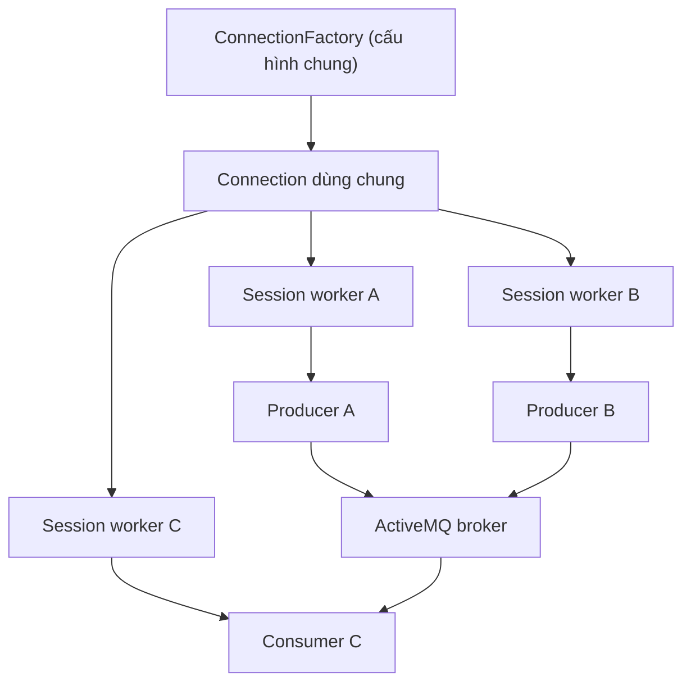
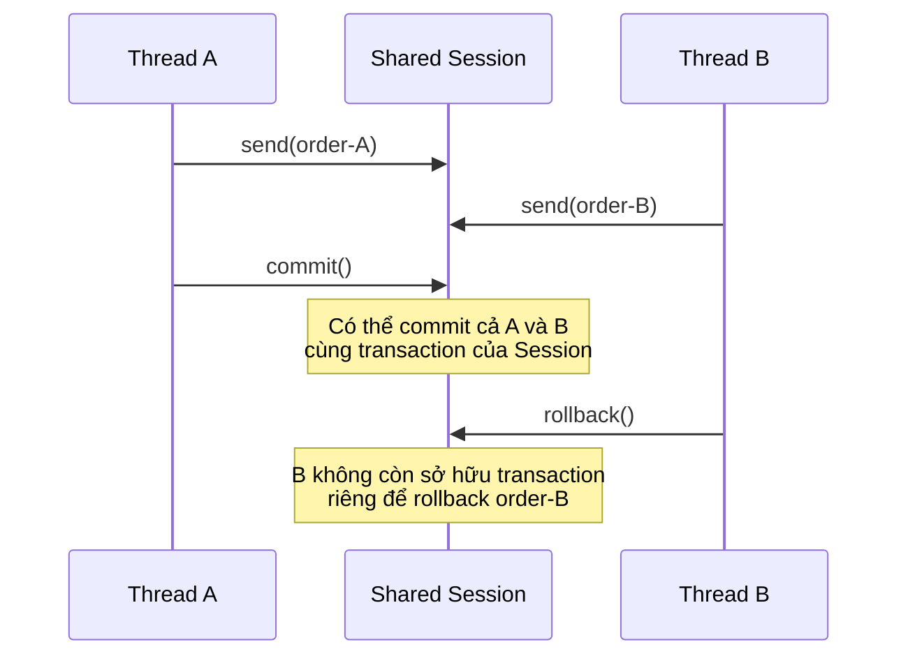
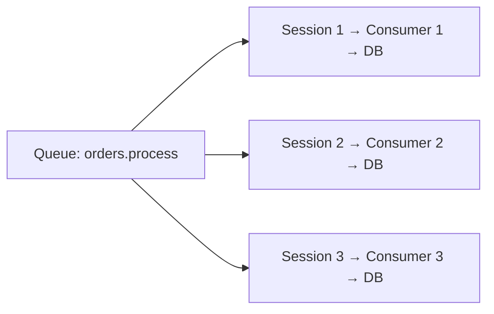

# Giới hạn chia sẻ Session, producer và consumer giữa các luồng

> **Chương:** Lập trình JMS  
> **Phạm vi:** Java Message Service (JMS) với Apache ActiveMQ Classic và Apache Artemis; các ví dụ chính dùng `javax.jms` (JMS 1.1-compatible API), đồng thời nêu khác biệt khi dùng `JMSContext`/Jakarta Messaging.  
> **Mục tiêu:** Thiết kế producer/consumer chạy nhiều luồng mà không dùng đồng thời một `Session`; hiểu ranh giới transaction, acknowledgment, listener callback và vòng đời tài nguyên; kiểm chứng được việc scale consumer bằng nhiều Session độc lập.

## 1. Một lỗi đồng thời khó phát hiện: hai luồng cùng gọi `Session.commit()`

Một dịch vụ Java có pool 8 luồng để gửi sự kiện đơn hàng vào ActiveMQ. Nhằm “tiết kiệm kết nối”, lập trình viên tạo **một `Session` và một `MessageProducer`** rồi lưu chúng trong singleton:

```java
// MINH HỌA LỖI — không dùng trong production.
Connection connection = factory.createConnection();
Session sharedSession = connection.createSession(
        true, Session.SESSION_TRANSACTED);
Queue orders = sharedSession.createQueue("orders.process");
MessageProducer sharedProducer =
        sharedSession.createProducer(orders);

// Nhiều thread gọi đồng thời:
pool.submit(() -> {
    try {
        sharedProducer.send(sharedSession.createTextMessage("A"));
        sharedSession.commit();
    } catch (JMSException e) {
        throw new RuntimeException(e);
    }
});
pool.submit(() -> {
    try {
        sharedProducer.send(sharedSession.createTextMessage("B"));
        sharedSession.commit();
    } catch (JMSException e) {
        throw new RuntimeException(e);
    }
});
```

Cách làm này vi phạm mô hình sử dụng `Session` của JMS. Một `Session` là **ngữ cảnh giao tiếp một luồng tại một thời điểm**. Nó chứa trạng thái transaction và acknowledgment; những đối tượng `MessageProducer` và `MessageConsumer` tạo từ nó cũng hoạt động trong ngữ cảnh đó.

Giả sử A gửi message rồi B gửi message trước khi A commit. Vì **transaction thuộc Session**, lần commit có thể bao gồm cả hai thao tác gửi thay vì độc lập theo request. Thực tế khi các lời gọi chạy đồng thời, hành vi còn có thể phụ thuộc provider và không được bảo đảm: sai thứ tự, lỗi bất thường, race hoặc đóng tài nguyên khi thread khác còn dùng.

**Giải pháp cơ bản:** dùng chung `ConnectionFactory`, có thể dùng chung `Connection` theo phạm vi và cấu hình cho phép, nhưng **mỗi luồng xử lý JMS đồng thời phải sở hữu `Session` riêng** cùng các producer/consumer được tạo từ chính Session đó.



Bài tập trung vào **quyền sở hữu Session và đồng thời hóa ở JVM client**. Broker có thể nhận nhiều connection/session và xử lý queue/topic, redelivery, DLQ như bình thường; những tính năng đó không làm Session phía Java trở thành thread-safe.

## 2. Quy tắc chia sẻ theo từng đối tượng JMS

| Đối tượng | Có thể dùng chung giữa nhiều luồng? | Quy tắc thực dụng |
|---|---|---|
| `ConnectionFactory` | Thông thường **có** khi được cấu hình xong; provider/pool có thể có quy định riêng | Dùng factory hoặc dependency-injected bean chung; không sửa cấu hình trong lúc nhiều thread sử dụng |
| `Connection` | JMS cho phép một Connection phục vụ nhiều Session và nhiều luồng | Có thể chia sẻ Connection; kiểm soát chung `start()`, `stop()`, `close()` và failover |
| `Session` | **Không dùng đồng thời từ nhiều luồng** | Mỗi luồng công việc đang chạy có một Session riêng; transaction/ack thuộc Session |
| `MessageProducer` | Không giả định thread-safe; nó thuộc Session | Dùng producer từ Session do luồng hiện tại sở hữu; không chia sẻ producer singleton qua các luồng |
| `MessageConsumer` | Không dùng một consumer để nhiều luồng cùng `receive()`/quản lý callback | Mỗi worker có consumer riêng gắn với Session riêng, hoặc dùng listener container |
| `MessageListener` | Callback chạy trong ngữ cảnh Session | Một Session không chạy song song nhiều callback `onMessage()` của chính nó; cần nhiều Session để xử lý song song |
| `Message` | Không giả định an toàn khi nhiều luồng đang sửa properties/body | Tạo message riêng cho từng send hoặc truyền payload bất biến; không sửa một Message khi thread khác dùng |
| `JMSContext` (JMS 2.0/Jakarta) | Cũng có mô hình một luồng sử dụng tại một thời điểm | Tạo `JMSContext` riêng theo task/worker; `JMSProducer`/`JMSConsumer` gắn với context đó |
| `Destination` (`Queue`/`Topic`) | Thường là đối tượng mô tả đích, có thể tái sử dụng khi provider cho phép | Có thể chia sẻ tên/config destination bất biến; **chia sẻ Destination không có nghĩa chia sẻ Session** |

**Đọc đúng câu “Session một luồng”:** điều bị cấm là **truy cập Session đồng thời**, không phải bắt buộc một đối tượng Session mãi mãi chỉ được một Java `Thread` vật lý chạm tới. Về lý thuyết, chuyển giao tuần tự với đồng bộ chặt chẽ có thể tồn tại; tuy nhiên Session còn chứa transaction state và callback bất đồng bộ nên cách đơn giản, dễ kiểm chứng là **mỗi worker giữ riêng Session trong toàn bộ vòng đời làm việc**.

### 2.1. Connection và Session có phạm vi trách nhiệm khác nhau

```text
Connection
  ├── Session A ── Producer A ── Transaction/ack state A
  ├── Session B ── Producer B ── Transaction/ack state B
  └── Session C ── Consumer C ── Transaction/ack state C
```

Một Connection có thể có nhiều Session, nhưng **không có nghĩa các Session chia sẻ một transaction**. Nếu Session A gửi rồi commit, Session B đang rollback thì A không bị rollback chỉ vì hai Session cùng thuộc một Connection.

Ngược lại, gọi `connection.stop()` có ảnh hưởng đến việc delivery trên các Session thuộc Connection đó; `connection.close()` đóng tài nguyên phụ thuộc. Vì vậy Connection có thể chia sẻ nhưng **lifecycle phải do một owner cấp ứng dụng/container quản lý**.

### 2.2. Broker Classic và Artemis có quy tắc tương tự

Cho dù dùng:

- ActiveMQ Classic client qua OpenWire,
- Artemis Core JMS client,
- Artemis nhận client OpenWire,
- hoặc một JMS provider khác,

**nguyên tắc Session single-threaded xuất phát từ hợp đồng JMS**, không phải tùy chọn tuning của broker. Classic `queuePrefetch` hay Artemis `consumerWindowSize` ảnh hưởng số message client giữ trước, nhưng **không cho phép nhiều thread cùng gọi vào một Session**.

## 3. Vì sao `Session` không thread-safe? Ba trạng thái bị chia sẻ

### 3.1. Một Session transacted chỉ có một transaction JMS đang hoạt động

```java
Session session = connection.createSession(
        true, Session.SESSION_TRANSACTED);
```

Khi `transacted=true`:

- Các thao tác send/receive hợp lệ trong cùng Session tham gia transaction JMS của Session đó.
- `session.commit()` hoàn tất **toàn bộ transaction hiện tại** của Session, không chỉ message của producer vừa gọi.
- `session.rollback()` rollback transaction hiện tại; message nhận chưa được commit đủ điều kiện redelivery theo policy.
- Sau commit/rollback, Session chuyển sang transaction tiếp theo theo semantics provider.

Một timeline minh họa khi dùng sai Session chung:



Timeline giúp hình dung **phạm vi transaction**, không phải cam kết một thứ tự cụ thể trong chương trình đã vi phạm thread-safety. Lỗi không thể được sửa bằng cách “thread nào gửi thì thread đó commit” nếu Session vẫn dùng chung.

### 3.2. `CLIENT_ACKNOWLEDGE` có phạm vi Session

Với `Session.CLIENT_ACKNOWLEDGE`, `message.acknowledge()` trong JMS 1.1 xác nhận **các message đã được Session đó tiêu thụ**, không chỉ message Java hiện tại.

Nếu hai luồng dùng chung Session để receive message A và B rồi thread A gọi `acknowledge()` khi A xong, message B có thể được đánh dấu đã ack **trước khi công việc của B hoàn tất**. Khi JVM crash, B có thể không được giao lại dù side effect chưa được ghi.

```text
Một Session (SAI):
  Thread A nhận A ─ xử lý xong ─ acknowledge()
  Thread B nhận B ─ đang ghi DB ...
  => ack scope thuộc Session, không thuộc từng Thread.

Hai Session (ĐÚNG):
  Thread A / Session A ─ nhận A ─ ack/commit A
  Thread B / Session B ─ nhận B ─ ack/commit B
```

Nếu yêu cầu “chỉ ack message đã xử lý”, cách dễ kiểm soát là **một Session transacted riêng cho mỗi consumer/worker**, commit ngay sau side effect thành công và thiết kế idempotency. Dù tách Session, vấn đề DB commit trước JMS commit vẫn có thể gây redelivery; tách Session **không** tạo exactly-once end-to-end.

### 3.3. Session điều phối thứ tự callback và `receive()`

Một Session có thể tạo nhiều consumer, nhưng listener callback trong cùng Session **được tuần tự hóa**. Tạo năm consumer với cùng Session không tự tạo năm lane xử lý song song.

```java
// MINH HỌA HIỂU SAI.
Session session = connection.createSession(
        false, Session.AUTO_ACKNOWLEDGE);

MessageConsumer a = session.createConsumer(
        session.createQueue("orders.process"));
MessageConsumer b = session.createConsumer(
        session.createQueue("payments.process"));

a.setMessageListener(message -> slowProcess(message));
b.setMessageListener(message -> slowProcess(message));

// Các callback thuộc cùng Session; đừng kỳ vọng chúng chạy song song.
```

Một callback chậm có thể trì hoãn các callback khác thuộc Session. Để xử lý song song: **mỗi consumer/listener có Session riêng**; nếu dùng framework, cho listener container tạo các Session/consumer theo concurrency cấu hình.

## 4. Mẫu sai phổ biến và điều gì sẽ hỏng

| Mẫu dùng sai | Dấu hiệu | Nguyên nhân |
|---|---|---|
| Singleton `Session` inject cho mọi request HTTP | Lỗi lẻ tẻ khi tăng tải; commit chéo request | Một transaction state bị nhiều thread dùng |
| Singleton `MessageProducer` từ Session chung | Send race, `JMSException` không ổn định | Producer dùng trạng thái Session không an toàn khi gọi đồng thời |
| Nhiều thread cùng `receive()` một `MessageConsumer` | Blocking khó đoán, lỗi cạnh tranh receive | Consumer không được thiết kế như queue nội bộ thread-safe |
| Một listener nhận rồi chuyển Message cho thread khác, ack ngay | Mất công việc khi worker phía sau chưa xong | Ack diễn ra trước business side effect |
| Một Session chứa 10 consumer/10 listener | Throughput vẫn chỉ như một worker | Callback serialization trong Session |
| Thread A đang receive, thread B gọi `session.close()` không phối hợp | Đóng tài nguyên trong lúc xử lý, exceptions | Lifecycle và in-flight work chồng chéo |
| Dùng `synchronized(session)` bọc từng `send` riêng lẻ nhưng commit bên ngoài | Chuyển ngữ cảnh chéo transaction | Lock không bao toàn bộ send→commit và không giải quyết callback |
| Gắn `Session` vào `ThreadLocal` không cleanup | Session leak, transaction cũ còn treo | Pool thread tái sử dụng lâu; Session không được đóng lúc task kết thúc |
| Scale bằng cách tăng prefetch mà giữ một Session | Heap client tăng, xử lý không song song | Prefetch là buffer; Session vẫn tuần tự |

### 4.1. Tại sao thêm `synchronized` chưa chắc giải quyết đúng vấn đề?

```java
synchronized (sharedSession) {
    producer.send(message);
}
sharedSession.commit(); // Vẫn có thể bị thread khác xen vào.
```

Khóa một lời gọi không bảo vệ **tập thao tác logic** gồm tạo message, send, xử lý, commit/rollback và cleanup. Kể cả khóa toàn bộ transaction, bạn đã biến các request thành **tuần tự**, làm mất lợi ích concurrency. Với asynchronous listener callback do provider gọi, các lock do ứng dụng tự đặt cũng có thể không bao phủ hoạt động của provider.

Thay vì chia sẻ Session có khóa, nên tạo **Session độc lập** và để broker xử lý concurrency ở mức nhiều producer/consumer.

## 5. Mẫu an toàn cho producer: chung Connection, Session riêng cho mỗi worker

Dưới đây là ví dụ dùng `javax.jms` tương thích JMS 1.1, hữu ích cho ActiveMQ Classic và Artemis client có namespace tương ứng.

### 5.1. Kiến trúc mong muốn

```text
                          +--> Worker 1: Session 1 -> Producer 1
ConnectionFactory -> Conn +--> Worker 2: Session 2 -> Producer 2 -> orders.process
                          +--> Worker 3: Session 3 -> Producer 3
```

Để tạo nhiều worker, ta có thể:

- Cấp mỗi worker một `Session` và một `MessageProducer`, rồi worker gửi tuần tự nhiều message.
- Tạo Session theo phạm vi request/task, đóng ngay khi hoàn tất (đơn giản nhưng tốn tạo/đóng hơn).
- Dùng **connection/session pooling** của thư viện/framework đã kiểm thử, bảo đảm mỗi Session đang mượn chỉ được một task dùng và được trả lại khi hoàn tất.

Một Connection có thể được dùng cho các Session của nhiều thread. Mỗi Session cần được tạo và đóng theo một owner duy nhất.

### 5.2. Ví dụ đầy đủ: bốn producer workers, mỗi worker một Session

```java
import javax.jms.Connection;
import javax.jms.ConnectionFactory;
import javax.jms.DeliveryMode;
import javax.jms.JMSException;
import javax.jms.MessageProducer;
import javax.jms.Queue;
import javax.jms.Session;
import javax.jms.TextMessage;

import java.util.ArrayList;
import java.util.List;
import java.util.concurrent.Callable;
import java.util.concurrent.ExecutorService;
import java.util.concurrent.Executors;
import java.util.concurrent.Future;
import java.util.concurrent.TimeUnit;

public final class ParallelOrderPublisher {

    public static void publish(
            ConnectionFactory factory, List<String> orderIds)
            throws Exception {

        final int workerCount = 4;
        Connection connection = factory.createConnection();
        ExecutorService executor =
                Executors.newFixedThreadPool(workerCount);

        try {
            List<Future<Integer>> results = new ArrayList<>();

            // Chia danh sách thành 4 nhóm độc lập.
            for (int i = 0; i < workerCount; i++) {
                final int workerIndex = i;

                Callable<Integer> task = () -> {
                    // Session được tạo, dùng và đóng trên worker này.
                    Session session = connection.createSession(
                            true, Session.SESSION_TRANSACTED);
                    try {
                        Queue queue = session.createQueue("orders.process");
                        MessageProducer producer =
                                session.createProducer(queue);
                        try {
                            producer.setDeliveryMode(
                                    DeliveryMode.PERSISTENT);
                            int completed = 0;

                            for (int j = workerIndex;
                                    j < orderIds.size();
                                    j += workerCount) {

                                String orderId = orderIds.get(j);
                                TextMessage message =
                                        session.createTextMessage(orderId);
                                message.setStringProperty(
                                        "eventId", "order:" + orderId);

                                try {
                                    producer.send(message);
                                    session.commit();
                                    completed++;
                                } catch (JMSException | RuntimeException e) {
                                    try {
                                        session.rollback();
                                    } catch (JMSException rollbackError) {
                                        e.addSuppressed(rollbackError);
                                    }
                                    throw e;
                                }
                            }
                            return completed;
                        } finally {
                            producer.close();
                        }
                    } finally {
                        session.close();
                    }
                };

                results.add(executor.submit(task));
            }

            int total = 0;
            for (Future<Integer> result : results) {
                total += result.get(); // Quan sát lỗi task, không nuốt exception.
            }
            System.out.println("Committed sends: " + total);

        } finally {
            executor.shutdown();
            if (!executor.awaitTermination(30, TimeUnit.SECONDS)) {
                executor.shutdownNow();
            }
            connection.close();
        }
    }
}
```

**Điểm cần kiểm tra trong ví dụ:**

1. `connection` được chia sẻ, còn mỗi `task` gọi `connection.createSession(...)` riêng.
2. `producer` chỉ tồn tại và được sử dụng trong thread của Session tương ứng.
3. `commit()` áp dụng **chính xác transaction của Session hiện tại**, không thể commit message của worker khác.
4. Lỗi `send/commit` đi vào `rollback` của **cùng Session**.
5. `Future.get()` trả lỗi của worker về thread điều phối, tránh trường hợp “background thread chết nhưng API vẫn báo success”.
6. Resource được đóng khi worker kết thúc; Connection được đóng sau lúc executor đã được yêu cầu dừng.

**Giới hạn của ví dụ:** tạo Session rồi giữ trong cả task là mô hình minh họa. Trong hệ thống chạy liên tục, cần quản lý graceful shutdown, stop accepting tasks, drain và timeouts; nếu một task lỗi, các task khác có thể vẫn đang làm việc trong lúc thread điều phối xử lý exception. Khi kết nối hỏng giữa `send` và `commit`, kết quả cuối cùng có thể không xác định từ phía producer: thiết kế retry với **idempotency key** (`eventId`), không suy ra “exception nghĩa là message chắc chắn chưa vào broker”.

### 5.3. Một producer/Session cho mỗi task hay mỗi worker?

| Chiến lược | Điểm mạnh | Chi phí và lưu ý |
|---|---|---|
| Session/producer mỗi message | Cô lập đơn giản, đóng tài nguyên sớm | Nhiều thao tác tạo/đóng, không hiệu quả với message rate cao |
| Session/producer mỗi worker chạy lâu | Tái sử dụng tốt; transaction độc lập theo worker | Cần xử lý connection loss và session recreation, shutdown |
| Session pool/container | Quản lý resource tập trung, có concurrency cap | Phải kiểm chứng mỗi lần lease độc quyền và cleanup đúng |
| Singleton Session/producer dùng chung | Ít đối tượng | **Không an toàn** khi nhiều thread đồng thời |

Số producer không nhất thiết phải bằng số HTTP requests. Nên giới hạn số worker theo throughput broker, số connection/session cho phép, memory, send latency và chiến lược backpressure.

### 5.4. Có cần gọi `connection.start()` ở producer?

`Connection.start()` bật quá trình **delivery message tới consumer** trên Connection. Producer chỉ gửi message thường không cần start để gửi. Khi cùng một Connection có cả consumer, owner của Connection phải gọi `start()` ở thời điểm phù hợp sau khi tạo consumer.

Không nên gọi `start()`/`stop()` tùy tiện từ từng producer task khi Connection được chia sẻ: các thao tác lifecycle đó ảnh hưởng các Session khác trên Connection.

## 6. Mẫu an toàn cho consumer: một Session và một consumer trên mỗi worker

Đối với queue `orders.process`, nhiều consumer ở các Session khác nhau là **competing consumers**. Broker giao mỗi message tới một consumer tại một thời điểm; khi transaction rollback/consumer crash có thể redeliver theo policy.



### 6.1. Consumer đồng bộ `receive(timeout)` trên thread của chính nó

```java
import javax.jms.Connection;
import javax.jms.JMSException;
import javax.jms.Message;
import javax.jms.MessageConsumer;
import javax.jms.Queue;
import javax.jms.Session;
import javax.jms.TextMessage;

public final class OrderWorker implements Runnable {

    private final Connection connection;

    public OrderWorker(Connection connection) {
        this.connection = connection;
    }

    @Override
    public void run() {
        Session session = null;
        MessageConsumer consumer = null;

        try {
            session = connection.createSession(
                    true, Session.SESSION_TRANSACTED);
            Queue queue = session.createQueue("orders.process");
            consumer = session.createConsumer(queue);

            while (!Thread.currentThread().isInterrupted()) {
                Message message = consumer.receive(1_000L);
                if (message == null) {
                    continue;
                }

                try {
                    if (!(message instanceof TextMessage)) {
                        throw new IllegalArgumentException("Expected text");
                    }

                    String eventId =
                            message.getStringProperty("eventId");
                    String orderId =
                            ((TextMessage) message).getText();

                    // Production: idempotent DB operation theo eventId.
                    handleOrder(eventId, orderId);
                    session.commit();

                } catch (JMSException | RuntimeException error) {
                    try {
                        session.rollback();
                    } catch (JMSException rollbackError) {
                        error.addSuppressed(rollbackError);
                        throw rollbackError;
                    }
                    // Log/metrics thực tế; message có thể redeliver.
                    System.err.println("Rolled back: " + error);
                }
            }
        } catch (JMSException error) {
            // Có thể cần reconnect và tạo Session mới.
            System.err.println("JMS worker stopped: " + error);
        } finally {
            if (consumer != null) {
                try { consumer.close(); }
                catch (JMSException error) {
                    System.err.println(error);
                }
            }
            if (session != null) {
                try { session.close(); }
                catch (JMSException error) {
                    System.err.println(error);
                }
            }
        }
    }

    private static void handleOrder(String eventId, String orderId) {
        if (eventId == null || eventId.isEmpty()) {
            throw new IllegalArgumentException("Missing eventId");
        }
        System.out.println(eventId + " / " + orderId);
        // Minh họa: triển khai thực tế phải commit DB một cách idempotent.
    }
}
```

Một coordinator khởi tạo các worker:

```java
Connection connection = factory.createConnection();
ExecutorService consumers = Executors.newFixedThreadPool(3);

for (int i = 0; i < 3; i++) {
    consumers.submit(new OrderWorker(connection));
}

connection.start(); // Bật delivery cho tất cả Session của Connection.

// Khi shutdown: yêu cầu workers dừng, đợi hoàn tất/rollback,
// rồi đóng Connection sau cùng; không close khi worker còn xử lý.
```

Trong chương trình thật, cần lưu `Future` hoặc mechanism quản lý worker để phát hiện worker chết, bổ sung health checks, retry/backoff và graceful shutdown. `receive(1000)` có timeout để vòng lặp thăm trạng thái interrupt; nó **không** tự đảm bảo mọi lỗi connection sẽ được phục hồi. Khi reconnect cần tạo Session và consumer mới theo hướng dẫn provider/framework.

### 6.2. Tại sao không chỉ tạo nhiều consumer từ một Session?

```java
Session oneSession = connection.createSession(
        false, Session.AUTO_ACKNOWLEDGE);

MessageConsumer first =
        oneSession.createConsumer(oneSession.createQueue("orders.process"));
MessageConsumer second =
        oneSession.createConsumer(oneSession.createQueue("orders.process"));

// Đặt hai listener không biến oneSession thành hai lane xử lý song song.
```

Hai consumer thuộc một Session vẫn cùng ngữ cảnh xử lý, acknowledgment và callback serial. Nếu handler mất 200 ms/message, một Session có thể là điểm nghẽn dù prefetch cao. Để xử lý nhiều message đồng thời, dùng **nhiều Session**, không chỉ nhiều consumer.

### 6.3. Nên dùng một Session cho consumer và producer phản hồi?

Có thể dùng cùng Session khi **cùng một worker/luồng** vừa nhận message vừa gửi message liên quan rồi commit chung transaction JMS:

```java
Session session = connection.createSession(
        true, Session.SESSION_TRANSACTED);

Queue inbound = session.createQueue("orders.process");
Topic outbound = session.createTopic("orders.events");

MessageConsumer consumer = session.createConsumer(inbound);
MessageProducer producer = session.createProducer(outbound);

// Trong worker duy nhất:
// receive(inbound) -> xử lý -> producer.send(outbound) -> session.commit()
```

Khi đó nhận lệnh và gửi event có thể tham gia **cùng local JMS transaction** của Session. Tuy nhiên cập nhật **database bên ngoài** không tự được kéo vào transaction này. Nếu cần tránh tình huống DB commit xong nhưng JMS rollback, dùng idempotency/outbox hoặc cơ chế phối hợp transaction được hỗ trợ và vận hành đúng.

## 7. Asynchronous `MessageListener`: luồng nào sở hữu Session?

Với callback:

```java
consumer.setMessageListener(message -> {
    // JMS provider/container gọi callback trong ngữ cảnh Session.
    process(message);
});
```

Lập trình viên có thể không tự tạo thread callback; **JMS provider hoặc listener container** điều phối thread thực thi. Nhưng nguyên tắc vẫn là:

- Không gọi `session.send/receive/commit/rollback/close` từ một luồng bên ngoài **đồng thời** với callback của Session, trừ những ngoại lệ/lifecycle mà provider/spec/framework cho phép một cách rõ ràng.
- Callback trên **một Session** được serialize. Muốn chạy song song nhiều `onMessage`, cấp nhiều Session độc lập.
- Không tự tạo `Thread` bên trong `onMessage` rồi chuyển tiếp `Message`/`Session` để worker khác ack. Khi callback trả về, provider có thể thực hiện ack theo mode; ứng dụng chưa xong business work.
- Nếu framework đang quản lý Session transaction, không tự ý gọi `commit()` từ callback nếu container đã chịu trách nhiệm commit/rollback.

### 7.1. Hai pattern dễ nhầm

**Pattern A — một callback xử lý xong rồi kết thúc:**

```text
Broker -> listener callback -> validate -> DB commit -> callback return
                                 (container/JMS ack theo chế độ đã cấu hình)
```

**Pattern B — callback chỉ xếp việc vào executor:**

```text
Broker -> listener callback -> executor.submit(work) -> callback return
                                        |
                                        +-- DB commit có thể xảy ra rất lâu sau
```

Pattern B nguy hiểm nếu callback return làm JMS auto-ack trước khi executor hoàn thành; worker crash sẽ làm mất công việc dù broker đã xóa trạng thái pending. Nếu cần xử lý nền, phải giữ hợp đồng xác nhận đúng, hoặc lưu **durable work** trước khi ack, hoặc để container xử lý đồng bộ với concurrency riêng.

### 7.2. Có thể gọi `commit()` trong `onMessage()` không?

Trong một số cấu hình JMS listener tự quản lý transacted Session, thao tác commit/rollback trong callback có thể được provider hỗ trợ. Nhưng với các container như Spring JMS, **container thường là bên sở hữu transaction và ack policy**. Trộn tự commit và container-managed commit có thể gây ack sớm hoặc lỗi lifecycle.

Quy tắc vận hành: **quyết định rõ chỉ một owner quản lý transaction**. Nếu đang dùng framework listener container, cấu hình transaction trên container và để callback trả kết quả/throw exception theo hợp đồng framework.

### 7.3. Không gọi `stop()` hoặc `close()` tùy tiện từ callback

Các thao tác Connection/Session lifecycle có thể đợi callback hoàn tất hoặc ảnh hưởng các consumer khác. Gọi `connection.stop()`/`close()` ngay bên trong `onMessage()` có thể gây chờ, deadlock hoặc behavior provider-specific. Nên gửi tín hiệu shutdown cho coordinator/container, để coordinator dừng nhận việc và đóng tài nguyên theo thứ tự.

## 8. JMS 2.0 `JMSContext` và `JMSProducer` có thay quy tắc không?

**Không.** JMS 2.0 cung cấp simplified API, nhưng `JMSContext` vẫn gắn một connection/session context và không được sử dụng đồng thời từ nhiều thread.

Ví dụ **mỗi task tạo context riêng** (JMS 2.0 `javax.jms`, không áp dụng nếu chỉ có JMS 1.1 API):

```java
import javax.jms.ConnectionFactory;
import javax.jms.JMSContext;
import javax.jms.JMSProducer;
import javax.jms.Queue;
import javax.jms.Session;

public final class ContextPublisher {

    public static void sendOne(
            ConnectionFactory factory, String orderId) {

        try (JMSContext context =
                 factory.createContext(Session.SESSION_TRANSACTED)) {

            Queue queue = context.createQueue("orders.process");
            JMSProducer producer = context.createProducer();

            try {
                producer.setProperty("eventId", "order:" + orderId)
                        .send(queue, orderId);
                context.commit();

            } catch (RuntimeException error) {
                context.rollback();
                throw error;
            }
        }
    }
}
```

Mỗi lời gọi `sendOne` có context riêng nên nhiều task có thể chạy song song, miễn provider và ConnectionFactory/connection pooling được cấu hình phù hợp. `JMSContext` implement `AutoCloseable` nên có thể dùng try-with-resources; **`Session`/`Connection` kiểu JMS 1.1 không có cùng hợp đồng AutoCloseable**.

**Cẩn trọng với phiên bản:**

- JMS 1.1 API: `javax.jms`, `Connection`/`Session`/`MessageProducer`/`MessageConsumer`.
- JMS 2.0: bổ sung `JMSContext`/`JMSProducer`/`JMSConsumer` cùng namespace `javax.jms`.
- Jakarta Messaging 3.x: các kiểu tương ứng thuộc `jakarta.jms`; chọn **artifact client** đúng namespace và framework.

Cấu hình broker Classic/Artemis không tự sửa import Java. Đừng lấy một đoạn `javax.jms` rồi ghép với `jakarta.jms.ConnectionFactory` trong cùng class.

## 9. Với Spring JMS: chia sẻ `JmsTemplate`, không chia sẻ raw `Session`

Trong ứng dụng Spring, một cách phổ biến để khỏi tự quản lý Session là dùng `JmsTemplate` cùng listener container.

### 9.1. Gửi từ nhiều request thread

`JmsTemplate` sau khi được cấu hình đầy đủ được thiết kế để tái sử dụng giữa các thread. Nó tạo/lấy connection/session theo `ConnectionFactory` và chính sách pooling/caching khi thực hiện thao tác:

```java
@Service
public class OrderPublisher {
    private final JmsTemplate jmsTemplate;

    public OrderPublisher(JmsTemplate jmsTemplate) {
        this.jmsTemplate = jmsTemplate;
    }

    public void publish(String orderId) {
        jmsTemplate.convertAndSend("orders.process", orderId);
    }
}
```

Bean singleton `OrderPublisher` có thể được gọi đồng thời từ nhiều HTTP request mà không cần lưu một raw `Session` trong field. **Không chỉnh cấu hình `JmsTemplate` trong lúc các thread đang gửi.** Điều kiện delivery mode/transaction phải được thiết kế theo `ConnectionFactory`, transaction manager và setup của ứng dụng.

Với Spring Boot 3/Jakarta, import JMS là `jakarta.jms`; code Spring class ở đây minh họa pattern, cần dependency/context tương ứng.

### 9.2. Song song hóa consumer qua listener container

Ví dụ Spring JMS annotation:

```java
@JmsListener(destination = "orders.process",
             concurrency = "3-8")
public void onOrder(String orderId) {
    processIdempotently(orderId);
}
```

Listener container quản lý các consumer/Session độc lập theo concurrency và cách cấu hình. Giá trị `"3-8"` là minh họa và phải được kiểm tra trên container tương ứng; không tự hiểu là mỗi callback tạo 8 Java threads ngay lập tức.

Để rollback/redelivery đáng tin cậy, cấu hình container transaction thích hợp, ví dụ `sessionTransacted=true` trên factory/container có hỗ trợ, hoặc dùng transaction manager phù hợp. Cần nhớ **local JMS transaction không bao gồm DB transaction** trừ khi có cơ chế điều phối; xử lý idempotent vẫn cần.

### 9.3. Pool Session cần tuân theo ownership

Một session pool tốt:

1. Chỉ cấp một Session cho **một borrower tại một thời điểm**.
2. Cùng session có thể được tái sử dụng tuần tự sau khi borrower trả về.
3. Reset/rollback trạng thái chưa commit và làm sạch producer/consumer/cache theo policy.
4. Giới hạn số Session/connections, xử lý invalid resource sau failover.
5. Không giữ `Session` đã mượn trong một singleton hoặc callback chạy sau khi đã return về pool.

**Không dùng `ThreadLocal<Session>` như một “pool tự chế”** nếu không quản lý cleanup, transaction recovery và lifecycle thread pool.

## 10. Khi scale consumer, tài nguyên nào thực sự tăng?

Tạo nhiều Session/consumer là cách mở concurrency nhưng không phải miễn phí.

| Tăng số lượng | Tác động tích cực | Chi phí/rủi ro cần đo |
|---|---|---|
| Connection | Cô lập transport, credential, failover | Socket, TLS handshake, reconnect storm, file descriptors |
| Session | Thêm lane xử lý JMS độc lập | Session state, transaction overhead, thread/container resources |
| Consumer | Đọc song song từ queue khi broker phân phối | Prefetch/window, unacked messages, fairness, memory client |
| Producer | Có thể publish song song | Send buffer, journal pressure, broker/disk throughput |
| Thread/worker | Tăng CPU parallelism khi handler độc lập | Context switching, DB pool contention, memory, lock contention |

### 10.1. Prefetch/window ảnh hưởng RAM client, không thay thế Session

ActiveMQ Classic thường dùng **prefetch theo số message** cho queue consumer; Artemis Core JMS có **consumer window theo byte**. Khi tăng số Session/consumer, số message in-flight trong client có thể tăng mạnh.

Ví dụ 8 consumer, mỗi consumer có prefetch 100 và payload trung bình 128 KiB:

```text
8 × 100 × 128 KiB = 102.400 KiB ≈ 100 MiB payload
```

Đó mới là payload ước lượng, chưa tính object, bộ đệm, processing queue và garbage collector. Kết quả là thêm consumer có thể tăng throughput nhưng làm JVM consumer OOM nếu window quá rộng hoặc handler chậm.

Với Artemis, giới hạn byte-window và semantics provider/version cần được đo thực tế. Giảm prefetch/window có thể giảm in-flight nhưng tăng round-trip. Không cố dùng một giá trị cho tất cả payload.

### 10.2. Chú ý message ordering và `JMSXGroupID`

Một queue có nhiều consumer/Session không bảo đảm **thời điểm hoàn tất nghiệp vụ** giữ nguyên thứ tự tuyệt đối khi xử lý song song, redelivery hoặc failover.

Nếu mỗi `orderId` cần xử lý tuần tự, cân nhắc message grouping (`JMSXGroupID`) theo broker/provider và idempotency ở database. Nhóm message thường được gắn tới một consumer trong từng giai đoạn, nhưng failover/rollback có thể gây redelivery; phải kiểm thử thực tế.

### 10.3. Shared topic subscription khác việc chia sẻ `MessageConsumer` Java

Nếu muốn nhiều instance Billing cùng chia tải một **JMS topic subscription**, dùng shared subscription theo JMS 2.0/provider hoặc một queue subscription được quản trị rõ. Mỗi instance vẫn nên có **Session/consumer riêng**. “Shared subscription” nghĩa là **chia sẻ backlog của một subscription trong broker**, không phải dùng chung **đối tượng `MessageConsumer`** trong JVM qua nhiều thread.

## 11. Error handling, restart và transaction khi mỗi worker có Session riêng

Tách Session giải quyết vấn đề thread safety, nhưng vẫn cần thiết kế lỗi phân tán:

| Tình huống | Hành vi cần dự trù | Cách xử lý |
|---|---|---|
| `send()` timeout hoặc `commit()` mất kết nối | Producer có thể không biết broker đã commit hay chưa | Retry theo `eventId`; downstream idempotent; log kết quả không xác định |
| Consumer DB commit rồi crash trước `session.commit()` | Broker có thể redeliver | Unique key/idempotency table trong DB |
| Consumer ném exception | Rollback và retry theo broker policy | Redelivery delay, max attempts, DLQ, poison-message handling |
| Worker thread chết | Session/consumer có thể leak nếu không cleanup | `try/finally`, supervisor, health checks |
| Broker failover | Session cũ có thể không còn hợp lệ; client tự reconnect tùy provider | Kiểm thử recovery/transaction state; recreate resource khi cần |
| App shutdown | Có message in-flight chưa commit | Dừng nhận việc, đợi handler, commit/rollback rồi đóng consumer/session/connection |
| Connection dùng chung bị đóng bởi một worker | Tất cả Session thuộc Connection bị ảnh hưởng | Chỉ owner cấp coordinator/container được close Connection |

### 11.1. Transaction JMS và transaction database vẫn khác nhau

Một worker có Session riêng:

```text
receive(JMS)
    -> xử lý và DB commit
    -> JMS session.commit()
```

Nếu process crash giữa hai bước commit, message có thể được giao lại. Để tránh thực hiện tác dụng phụ hai lần:

- Thiết kế khóa idempotency theo `eventId`/business key với unique constraint trong DB.
- Lưu trạng thái “đã xử lý” cùng DB transaction với cập nhật nghiệp vụ.
- Nếu producer phải phát event sau DB update, cân nhắc transactional outbox.
- Chỉ dùng XA/JTA khi hạ tầng và yêu cầu thực tế tương xứng với chi phí khôi phục transaction phân tán.

Không gộp nhiều đơn hàng không liên quan vào một Session transaction vô tình vì để Session dùng chung.

### 11.2. Ranh giới cleanup nên thuộc owner

Với Session do worker tạo, worker chịu trách nhiệm đóng `MessageConsumer`/`MessageProducer` và `Session` trong `finally`. Với Connection dùng chung, coordinator chịu trách nhiệm đóng Connection **sau khi** các worker ngừng sử dụng Session.

Nếu Session lấy từ pool/framework, không tự động gọi `connection.close()` từ worker trừ khi hợp đồng pooling nói rõ; việc “close” có thể có nghĩa **return resource** về pool thay vì đóng socket thực.

## 12. Thực hành và phép kiểm chứng cần có

Đừng chỉ chạy hai thread rồi kết luận thread-safe vì “không thấy exception”. Race có thể hiếm và phụ thuộc tải. Hãy lập các phép thử có kết quả đo được.

### Thử nghiệm A — Tái hiện Session dùng chung (chỉ trong test)

1. Tạo một transacted Session và một producer dùng chung.
2. Cho hai task gửi message có `eventId` riêng và có barrier để các lời gọi send/commit gần nhau.
3. Ghi lại thứ tự send, commit, rollback, kết quả callback và message ở queue.
4. So sánh với hai Session tách biệt.

**Mục đích:** quan sát rằng Session không cung cấp transaction độc lập theo task. **Không coi việc chương trình chạy không lỗi là bằng chứng hợp lệ**; mô hình dùng chung đã vi phạm quy tắc ngay cả khi test hiếm khi tái hiện race.

### Thử nghiệm B — Hai producer worker, hai transaction độc lập

1. Chạy hai worker, mỗi worker có Session riêng.
2. Worker A gửi 100 event và commit từng event.
3. Worker B gửi 100 event, cố ý rollback mỗi event thứ 10.
4. Đối chiếu các `eventId` được commit thật bằng consumer và DLQ nếu có.

**Đạt khi:** rollback B không làm mất message A; mỗi Session chỉ tác động transaction của chính nó. Để tránh kết quả mơ hồ, cấu hình mỗi test một queue sạch và kiểm soát thời điểm đọc.

### Thử nghiệm C — Concurrent consumers theo số Session

1. Cho 1 Session + 2 consumers/listeners, handler giả lập mất 200 ms.
2. Đo throughput và số callback cùng lúc.
3. Cho 2 Session + 2 consumers trên cùng queue, giữ workload tương tự.
4. So sánh throughput, số callback concurrent, broker delivering và CPU.

**Đạt khi:** chứng minh nhiều consumer chung Session không tương đương nhiều Session xử lý song song. Đo thay vì đoán rằng throughput sẽ tăng tuyến tính.

### Thử nghiệm D — CLIENT_ACKNOWLEDGE và phạm vi Session

1. Trong test tuần tự, dùng một `Session.CLIENT_ACKNOWLEDGE` nhận hai message A và B.
2. Gọi `acknowledge()` trên B, rồi restart consumer theo cách có kiểm soát.
3. Quan sát A và B có còn pending/redeliver hay không theo semantics Session.
4. Lặp lại với hai Session, mỗi Session nhận một message.

**Đạt khi:** hiểu `acknowledge()` theo phạm vi Session, không theo một Java variable/Thread. Đừng cần hai thread đồng thời để chứng minh đặc tính này.

### Thử nghiệm E — Callback offload có thể ack quá sớm

1. Dùng listener `AUTO_ACKNOWLEDGE` đưa việc vào executor rồi return ngay.
2. Tạm dừng executor trước DB write; quan sát callback đã return.
3. Kill ứng dụng trong test, kiểm tra có mất công việc không.
4. Chuyển sang container concurrency với transaction đúng và xử lý trước ack/commit; thử lại.

**Đạt khi:** listener không ack/return thành công trước khi công việc đã được hoàn thành hoặc được lưu bền vững ở nơi khác.

### Thử nghiệm F — Worker chết và resource recovery

1. Chạy 4 Sessions/4 consumers.
2. Kill hoặc ngắt kết nối một worker ở thời điểm đang xử lý message.
3. Kiểm tra redelivery, requeue/DLQ, in-flight counts và Session/consumer metrics sau reconnect.
4. Dừng ứng dụng có graceful shutdown và so sánh số message đang xử lý trước/sau.

**Đạt khi:** không có resource leak kéo dài; message chưa commit vẫn được xử lý theo policy; idempotency bảo vệ side effect.

### Mẫu bảng kết quả

| Case | Threads | Connections | Sessions | Producers/Consumers | Ack/transaction | Kỳ vọng | Kết quả |
|---|---:|---:|---:|---|---|---|---|
| Session chia sẻ (để tái hiện lỗi) | 2 | 1 | 1 | 1 producer | Transacted | Thiếu cô lập; không dùng | |
| Producer đúng | 4 | 1 | 4 | 4 producers | Commit riêng | Không commit chéo | |
| Consumer chung Session | 1 callback lane | 1 | 1 | 2 consumers | AUTO_ACK | Callback tuần tự | |
| Consumer đúng | 3 | 1 | 3 | 3 consumers | Transacted | Xử lý đồng thời; retry độc lập | |
| Spring listener container | Theo cấu hình | Theo factory | >= lane đồng thời | Container-managed | Cấu hình container | Concurrency có giới hạn | |

**Bằng chứng cần lưu:** test data/`eventId`, số producer/consumer trên broker, Session counts, enqueue/ack rates, message pending/delivering, lỗi send/rollback, log callback start/end, số business effects duy nhất trong DB, heap và GC client.

## 13. Cách chọn kiến trúc theo yêu cầu

| Hệ thống | Mẫu nên chọn | Lý do |
|---|---|---|
| Dịch vụ HTTP nhận nhiều request gửi JMS | `JmsTemplate`/pooled factory hoặc bounded publisher workers | Không lộ raw Session ra các request threads |
| Batch publisher tốc độ cao | Một Session/producer theo worker, commit theo batch phù hợp | Tái sử dụng tài nguyên, cô lập transaction theo worker |
| Consumer xử lý đơn hàng | N Session + N consumers trên cùng queue | Competing consumers, callback/ack độc lập |
| Topic Billing có nhiều instance | Shared subscription hoặc subscription queue chung, mỗi instance có Session riêng | Một backlog cho nhóm, phân phối cho nhiều worker |
| Consumer vừa nhận lệnh vừa phát event JMS | Một transacted Session **trong cùng worker** cho receive/send | Local JMS transaction chung, không chia sẻ cross-thread |
| App Java SE nhỏ, ít message | Một Session trong một thread tuần tự | Đơn giản, đúng hợp đồng; scale sau khi đo |
| App Spring Boot/Jakarta | Container-managed JMS resources và namespace phù hợp | Framework quản lý lifecycle/pooling và lỗi |

**Không có một số Session tối ưu mặc định.** Điểm cân bằng phụ thuộc throughput, handler time, database pool, transaction size, prefetch/window, payload, broker CPU/disk và network.

## 14. Checklist trước production

- [ ] Không có singleton/static `Session`, `MessageProducer` hoặc `MessageConsumer` bị nhiều thread dùng đồng thời.
- [ ] Mỗi worker/callback lane sở hữu Session độc lập hoặc do container quản lý độc quyền.
- [ ] Transaction và acknowledgment được xác định rõ ở **mức Session**.
- [ ] Không gọi `message.acknowledge()` từ một luồng khác khi Session đang có việc chưa hoàn tất.
- [ ] Callback `onMessage()` không return thành công trước khi xử lý/ghi bền vững công việc cần ack.
- [ ] `Connection.start/stop/close` có một owner lifecycle; worker không đóng Connection chung.
- [ ] Producer/consumer/Session được đóng hoặc return pool đúng cách khi fail/shutdown.
- [ ] Worker failures được quan sát qua `Future`/logs/metrics; không âm thầm mất task.
- [ ] Session pool, Spring listener container/JmsTemplate được cấu hình và kiểm thử đúng namespace JMS/Jakarta.
- [ ] Đã đo số Session/consumer, in-flight/prefetch, heap, throughput và backlog khi scale.
- [ ] Retry/rollback/DLQ và idempotency được thử khi crash giữa DB commit và JMS commit.
- [ ] Không dựa vào `synchronized` để che giấu thiết kế shared transaction state.
- [ ] Các phiên bản ActiveMQ Classic/Artemis/JMS client được thử với scenario concurrency thật.

## 15. Tài liệu tham khảo chính thức

1. [Java EE 7 JMS Session API](https://docs.oracle.com/javaee/7/api/javax/jms/Session.html): định nghĩa Session là single-threaded context, transaction, acknowledgment và callback.
2. [Jakarta Messaging 3.1 Specification](https://jakarta.ee/specifications/messaging/3.1/): hợp đồng Session/JMSContext, simplified API và các quy tắc concurrency.
3. [Apache ActiveMQ Classic — Prefetch Limit](https://activemq.apache.org/components/classic/documentation/what-is-the-prefetch-limit-for): vai trò prefetch trong consumer.
4. [Apache Artemis — Using JMS](https://artemis.apache.org/components/artemis/documentation/latest/using-jms.html): ứng dụng Java JMS với Artemis.
5. [Apache Artemis — Flow Control](https://artemis.apache.org/components/artemis/documentation/latest/flow-control.html): consumer window và producer flow control.
6. [Spring Framework — JMS Integration](https://docs.spring.io/spring-framework/reference/integration/jms.html): `JmsTemplate`, listener containers và transaction.

> **Ghi nhớ:** **Connection có thể phục vụ nhiều luồng qua nhiều Session; Session là ranh giới một luồng, một transaction/acknowledgment context tại một thời điểm.** Producer, consumer và listener phải tuân thủ ranh giới đó. Muốn scale throughput, tạo nhiều Session độc lập hoặc để framework/container quản lý; đừng biến một Session thành tài nguyên dùng chung cho cả thread pool.
