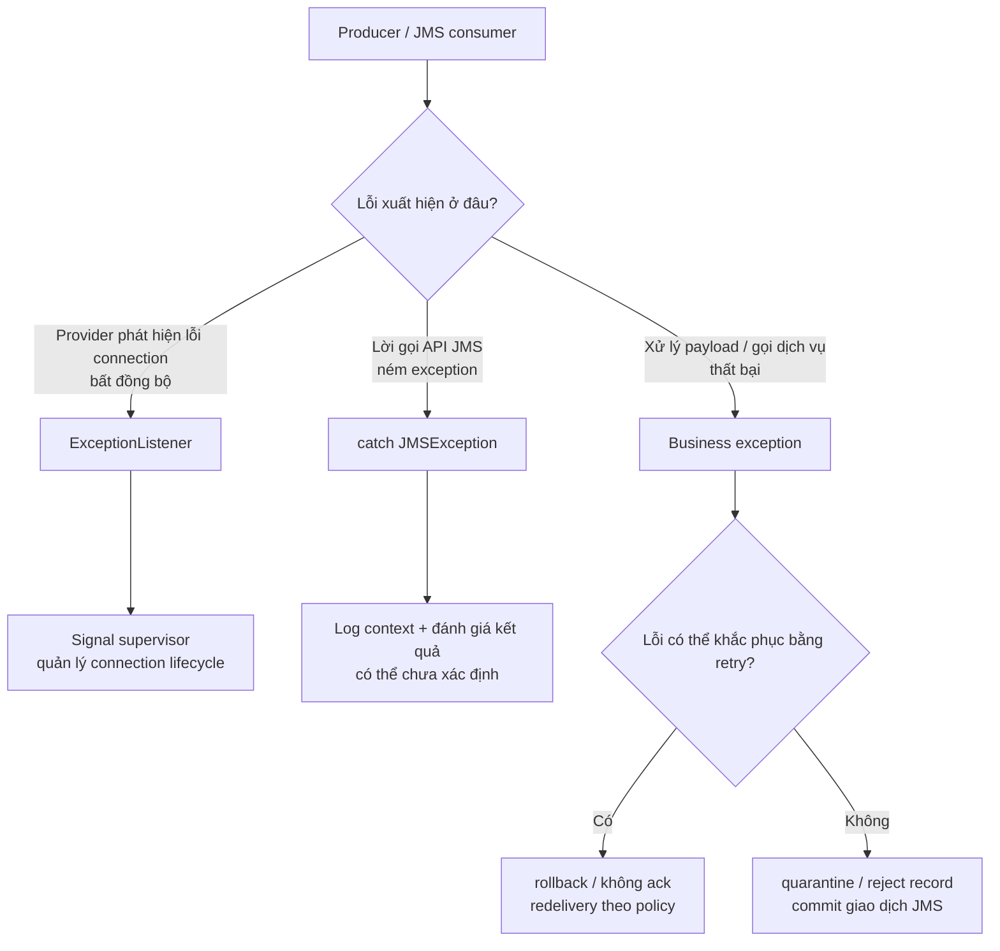
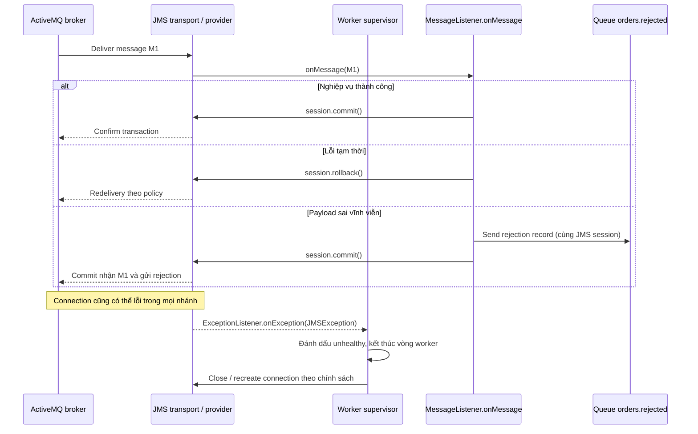

# ExceptionListener, JMSException và lỗi nghiệp vụ trong bộ xử lý

> **Chương:** Lập trình JMS  
> **Phạm vi:** Java/JMS với Apache ActiveMQ Classic và Artemis. Bài học tập trung vào **phát hiện, phân loại và phản ứng với lỗi khi gửi/nhận message**. Ví dụ chạy được sử dụng `javax.jms` với ActiveMQ Classic 5.x; phần đối chiếu Artemis dùng `jakarta.jms` và client tương ứng.

Khi một consumer không xử lý được message, người vận hành thường thấy cùng một triệu chứng là “job bị kẹt” hoặc “message xuất hiện trở lại”. Nhưng nguyên nhân có thể ở ba tầng hoàn toàn khác nhau: kết nối JMS hỏng bất đồng bộ, lời gọi JMS ném exception, hoặc logic nghiệp vụ không thể hoàn tất. **Tầng phát sinh quyết định nơi bắt lỗi và hành động phục hồi**. Nhầm lẫn giữa chúng dẫn đến hai lỗi nghiêm trọng: vô tình xác nhận một message chưa xử lý thành công, hoặc gửi lại mãi một message không bao giờ xử lý được.

## 1. Ba loại lỗi, ba cơ chế phản ứng

| Nhóm lỗi | Nơi phát hiện | Ví dụ | Cần làm gì? |
|---|---|---|---|
| **Lỗi kết nối bất đồng bộ** | `Connection.setExceptionListener(...)` khi provider phát hiện sự cố connection nghiêm trọng. | Broker mất kết nối đột ngột, transport của connection không còn dùng được. | Báo cho vòng đời worker/supervisor; dừng nhận công việc mới, đánh giá trạng thái kết nối và tái tạo tài nguyên theo chính sách. |
| **Lỗi thao tác JMS đồng bộ** | Lời gọi API ném `JMSException`: `createConnection`, `send`, `receive`, `commit`, `rollback`, `close`... | Authentication thất bại, transport lỗi khi send, commit transaction không có kết quả rõ ràng. | Bắt tại lời gọi liên quan, ghi nhận context, phân loại khả năng retry và **không khẳng định thao tác đã thất bại hoàn toàn nếu trạng thái chưa xác định**. |
| **Lỗi xử lý nghiệp vụ** | Mã bên trong `onMessage` hoặc hàm dịch vụ của ứng dụng. | Payload sai schema, hệ thống thanh toán ngoài không phản hồi, khóa nghiệp vụ đã tồn tại. | Quyết định lỗi có retry được không; **rollback** khi lỗi tạm thời, hoặc chuyển vào kênh từ chối có kiểm soát rồi **commit** khi lỗi vĩnh viễn. |

**`ExceptionListener` không phải là bộ bắt lỗi chung cho ứng dụng.** Nó không tự nhận exception từ `onMessage` của chính bạn, không thay cho `try/catch (JMSException)` và không phải callback cho mọi lần broker từ chối một message nghiệp vụ.



Sơ đồ minh họa luồng quyết định, không thể hiện đầy đủ các chính sách lưu bền, timeout và HA của broker. Một exception có thể đi qua nhiều tầng: chẳng hạn mất kết nối gây callback `ExceptionListener` **và** khiến `Session.commit()` ném `JMSException` gần cùng thời điểm. Không nên đếm hai dấu hiệu này như hai sự cố độc lập nếu chúng cùng một nguyên nhân.

## 2. `ExceptionListener`: tín hiệu lỗi nghiêm trọng ở cấp connection

### 2.1. Khi nào callback được gọi?

JMS định nghĩa interface:

```java
import javax.jms.ExceptionListener;
import javax.jms.JMSException;

ExceptionListener listener = new ExceptionListener() {
    @Override
    public void onException(JMSException problem) {
        System.err.println("JMS connection problem: "
                + problem.getMessage());
    }
};
connection.setExceptionListener(listener);
```

Provider sử dụng callback này để báo **vấn đề nghiêm trọng với connection được phát hiện bất đồng bộ**. Đặc trưng:

- Callback thuộc **`Connection`**, không gắn riêng với một queue, topic, message hay một nghiệp vụ.
- Một lỗi có thể biểu lộ ở lời gọi API đồng bộ trước khi callback chạy, hoặc callback có thể chạy khi worker đang rảnh. **Không có cam kết mọi lỗi đều đi qua callback**.
- Provider có thể gọi từ thread do chính provider quản lý; thứ tự callback so với log và exception từ các thread khác không nên dùng làm giao thức đồng bộ.
- **Không chờ callback để bắt lỗi từ `createConnection()`**: việc tạo connection đã có thể ném `JMSException` trước khi listener được đăng ký.
- Callback **không có giá trị trả về** để yêu cầu broker tự rollback một nghiệp vụ hoặc đánh dấu message là “invalid”.

Đăng ký listener sau khi tạo connection và trước `start()`:

```java
Connection connection = factory.createConnection();
connection.setExceptionListener(problem -> {
    logJms("ASYNC_CONNECTION_FAILURE", problem);
    unhealthy.set(true);  // AtomicBoolean của ứng dụng
    stopSignal.countDown(); // CountDownLatch báo cho thread quản lý
});

// Khởi tạo Session, Consumer, MessageListener...
connection.start();
```

Hai biến `unhealthy` và `stopSignal` trong đoạn ngắn này là đối tượng thread-safe do application tạo; ví dụ chạy đầy đủ phía dưới cho thấy cách khai báo. Đoạn mã tách riêng ở đây nhằm nhấn mạnh **callback chỉ phát tín hiệu**, không tự thực hiện toàn bộ quy trình reconnect.

### 2.2. Những việc nên tránh bên trong callback

Không thực hiện các thao tác sau một cách tùy tiện từ `onException`:

- Gọi `Session.commit()` hoặc `rollback()` trên session đang được thread `onMessage` sử dụng. `Session` không được thiết kế để nhiều thread gọi đồng thời.
- Tạo vòng lặp retry vô hạn ngay trong callback; một callback bị chặn lâu có thể giữ thread quan trọng của provider.
- Thực hiện network I/O chậm, truy vấn database, gửi email hoặc đồng bộ hóa blocking không cần thiết.
- Giả định mọi loại connection có thể được sử dụng tiếp chỉ vì một phương thức `isClosed()` nào đó chưa báo lỗi; trạng thái giao nhận có thể đã bất định.
- Xóa/ack một message cụ thể khi callback không hề chỉ ra message đó đã được xử lý đến đâu.

Mô hình thường an toàn hơn là **log tối thiểu → đánh dấu worker không khỏe → thông báo cho thread quản lý → đóng tài nguyên cũ theo quy trình → tạo connection/session/consumer mới**. Nếu dùng failover transport của provider, cần hiểu rõ cơ chế tự reconnect của client để tránh hai vòng reconnect tranh nhau.

### 2.3. `ExceptionListener` có thay cho health check không?

Không. Listener cho biết provider **phát hiện** một số sự cố connection; nó không bảo đảm phát hiện tức thì mọi tình trạng treo ứng dụng. Để quản lý thực tế, kết hợp:

- Timeout và chính sách transport phù hợp.
- Metric kết nối, message in-flight, độ trễ xử lý và backlog.
- Health/readiness check kiểm chứng worker còn có khả năng nhận việc và xử lý.
- Log theo correlation ID, message ID và connection/broker endpoint.

Một consumer vẫn kết nối nhưng mắc kẹt trong lời gọi HTTP của nghiệp vụ có thể **không tạo bất kỳ `ExceptionListener` callback nào**.

## 3. `JMSException`: lỗi ném trực tiếp từ API JMS

`JMSException` là checked exception của các API JMS cổ điển (`javax.jms` và các API tương ứng của `jakarta.jms`). Bạn cần bắt ở nơi gọi và bảo toàn dữ kiện phục vụ chẩn đoán:

```java
try {
    producer.send(message);
} catch (JMSException ex) {
    System.err.println("Send JMS failure: " + ex.getMessage());
    System.err.println("JMS errorCode: " + ex.getErrorCode());
    Exception linked = ex.getLinkedException();
    if (linked != null) {
        System.err.println("Linked exception: " + linked);
    }
    throw ex; // Cho tầng điều phối quyết định retry hoặc dừng.
}
```

`getErrorCode()` và `getLinkedException()` là nguồn thông tin chẩn đoán, có thể bằng `null`. Không phụ thuộc vào một chuỗi message hoặc error code riêng của vendor để quyết định “retry an toàn” nếu chưa biết ngữ nghĩa của lỗi đó. Các provider cũng có thể gắn nguyên nhân vào exception chain; hệ thống log nên lưu stack trace gốc.

### 3.1. Những câu hỏi phải đặt ra khi một API JMS thất bại

| Lời gọi | Điều gì có thể chưa biết khi ném `JMSException`? | Hành động thận trọng |
|---|---|---|
| `createConnection()` | Connection có thực sự được tạo/được broker chấp nhận không? | Đóng tài nguyên đã tạo được, kiểm tra endpoint/auth/TLS và thử kết nối lại có giới hạn. |
| `producer.send()` | Broker đã chấp nhận message trước khi đường truyền lỗi chưa? | **Không gửi lại mù quáng** nếu trùng message có side effect; dùng khóa yêu cầu/idempotency. |
| `consumer.receive()` | Connection/session đã lỗi hay chỉ timeout trả `null`? | Phân biệt `null` do timeout với exception; đánh giá sức khỏe connection. |
| `session.commit()` | Broker đã commit nhưng phản hồi bị mất, hay chưa commit? | Xem là **kết quả chưa xác định** cho đến khi có bằng chứng; giao nhận có thể bị lặp. |
| `session.rollback()` | Rollback đã được broker ghi nhận chưa? | Đánh dấu session không tin cậy khi lỗi, ngừng dùng session đó; để broker xử lý unacked/redelivery theo chính sách. |
| `connection.close()` | Việc đóng hoặc giải phóng tài nguyên có hoàn tất? | Ghi nhận lỗi cleanup nhưng không che mất exception gốc. |

**Phân biệt rất quan trọng:** `receive(timeout)` trả `null` vì không có message trong thời hạn đợi là kết quả hợp lệ, **không phải `JMSException`**. Còn exception từ `send` hay `commit` không chứng minh message chắc chắn chưa được broker chấp nhận.

### 3.2. Khi nào retry an toàn?

Thao tác **mở connection mới** thường có thể retry với backoff và giới hạn. Thao tác **gửi message nghiệp vụ** cần một khóa idempotency để việc gửi lặp không gây thực thi lặp. Thao tác **commit** có thể ở trạng thái chưa xác định nên không thể kết luận “chưa làm gì, cứ thực hiện lại”.

Ví dụ Order Service gửi `PaymentRequested(paymentRequestId=PAY-123)`. Nếu `send` ném lỗi sau khi broker đã chấp nhận, producer retry có thể tạo hai message. Consumer thanh toán phải chống side effect trùng bằng `paymentRequestId`, chẳng hạn unique constraint trong database hoặc một bảng idempotency được thiết kế cùng transaction nghiệp vụ. `JMSMessageID` không thay thế ổn định cho business key khi producer gửi lại tạo một message mới.

## 4. Lỗi nghiệp vụ trong `MessageListener.onMessage`

`MessageListener` có chữ ký:

```java
void onMessage(Message message);
```

Method **không khai báo `throws JMSException`**, và một lỗi trong code nghiệp vụ không tự trở thành `JMSException`. Khi code xử lý phát sinh vấn đề, ứng dụng phải phân loại và chọn cách kết thúc lượt nhận.

### 4.1. Lỗi tạm thời: rollback để được xử lý lại

Ví dụ gọi Payment Gateway gặp timeout hoặc database tạm thời không sẵn sàng. Nếu message còn hợp lệ và việc thử lại có khả năng thành công:

1. Ghi log `messageId`, `businessId`, loại lỗi.
2. Trong **transacted JMS session**, gọi `session.rollback()` khi session còn dùng được.
3. Broker/client áp dụng quy tắc redelivery và delay đã cấu hình.
4. Giới hạn số lần thử và chuyển tới **DLQ** hoặc kênh xử lý thủ công nếu vẫn không thành công.
5. Bảo đảm xử lý lặp không gây side effect trùng.

### 4.2. Lỗi vĩnh viễn: cách ly, rồi đánh dấu hoàn tất có chủ đích

Ví dụ JSON sai schema, currency không được hỗ trợ hoặc thiếu một trường bắt buộc. Gửi lại cùng payload hàng trăm lần sẽ không tự sửa được dữ liệu. Hai chiến lược phổ biến:

- **Broker-managed DLQ:** rollback/reject và để chính sách redelivery/maximum attempts đưa message vào DLQ sau giới hạn phù hợp. Hành vi chi tiết phụ thuộc Classic/Artemis và client/broker policy.
- **Application quarantine:** ứng dụng tạo một **rejection record** ở queue riêng (ví dụ `orders.rejected`), sau đó commit việc nhận message gốc **cùng transaction JMS**. Cách này hợp lý khi đã biết chắc lỗi không thể khắc phục bằng retry và cần ghi lý do chi tiết.

**Không vừa chuyển message sang quarantine rồi lại rollback bản gốc một cách vô ý**: khi đó cùng message có thể vừa nằm ở queue từ chối, vừa được giao lại gây trùng. Với một JMS transacted session, gửi record từ chối và acknowledge việc nhận bản gốc bằng cùng lần `commit()` giúp hai thao tác JMS là một transaction cục bộ.

### 4.3. Lỗi lập trình không đoán trước

`NullPointerException`, lỗi parse không được bắt hoặc các unchecked exception khác thường biểu thị bug. Đừng mặc nhiên nuốt lỗi rồi trả về bình thường, cũng đừng giả định cứ `throw RuntimeException` từ `onMessage` là broker luôn rollback theo cùng một cách trên mọi acknowledgment mode/provider. Với transacted session, nếu còn an toàn để thao tác, có thể rollback và báo lỗi để dừng worker sau khi ghi nhận. Với lỗi liên quan connection hoặc session bị hỏng, ngừng sử dụng session và để cơ chế phục hồi xử lý trạng thái chưa xác nhận.

### 4.4. Sự khác nhau theo acknowledgment mode

| Consumer mode | Nếu xử lý nghiệp vụ thất bại | Điều dễ làm sai |
|---|---|---|
| `AUTO_ACKNOWLEDGE` | Provider xác nhận theo ngữ nghĩa JMS của receive/return listener. Tùy cách handler kết thúc và provider, ứng dụng có thể không điều khiển được thời điểm retry như mong muốn. | Bắt exception rồi **return bình thường** có thể khiến message được xem là xử lý xong. |
| `CLIENT_ACKNOWLEDGE` | Ứng dụng chủ động gọi `message.acknowledge()` sau xử lý thành công; đóng/recover session có thể dẫn tới redelivery theo quy tắc JMS. | Một lần `acknowledge()` có thể xác nhận **mọi message đã tiêu thụ trong cùng session**, không chỉ message hiện tại. |
| **Transacted session** | `session.commit()` hoàn tất nhận/gửi JMS trong transaction; `session.rollback()` đưa lượt nhận về trạng thái có thể redeliver. | Trộn `message.acknowledge()` với transaction; tưởng commit JMS tự commit database/HTTP bên ngoài. |

Đối với ví dụ chuyên sâu dưới đây, dùng **transacted session** để quy tắc trả lời dễ quan sát: xử lý thành công thì `commit()`; tạm thời thất bại thì `rollback()`; payload vĩnh viễn không hợp lệ thì gửi rejection record và `commit()`. Trong transacted session, tham số acknowledgment mode không phải cơ chế quyết định xác nhận.

## 5. Mô hình vận hành: tách connection supervisor khỏi message handler

Một worker có hai luồng trách nhiệm:



**Connection supervisor** sở hữu vòng đời kết nối; **message handler** sở hữu quyết định commit/rollback cho một message trong phạm vi session của nó. Hai luồng chia sẻ tín hiệu thread-safe như `AtomicBoolean` hoặc `CountDownLatch`, **không chia sẻ cùng một `Session` để gọi đồng thời từ nhiều thread**.

Ba trạng thái cuối cần phân biệt:

- **Committed:** JMS transaction của việc nhận/gửi đã hoàn tất. Message gốc không còn pending ở queue đầu vào vì đã được xử lý hoặc cách ly theo lựa chọn nghiệp vụ.
- **Rolled back:** Lần nhận chưa hoàn tất; message có thể được broker redeliver, hết số lần thử hoặc đi DLQ theo policy.
- **Unknown:** `commit()` hoặc kết nối thất bại ở thời điểm không biết broker đã ghi nhận giao dịch chưa. Không tự gắn nhãn “committed” hay “rolled back”; đóng phiên không tin cậy, quan sát broker và dựa vào idempotency để chống trùng.

## 6. Ví dụ chạy được: worker JMS với ba nhánh lỗi

Ví dụ sau dùng **ActiveMQ Classic 5.x** và `javax.jms` để chạy trên một broker local, mặc định `tcp://127.0.0.1:61616`. Hai queue riêng cho lab là:

- `lab.orders.in`: queue đầu vào.
- `lab.orders.rejected`: nơi lưu rejection record cho message sai payload, được gửi **cùng JMS transaction** với việc hoàn tất nhận message gốc.

Chương trình có hai lệnh:

- `send` tạo ba message `ORDER|41|OK`, `ORDER|42|INVALID` và `ORDER|43|TEMP`.
- `work` chạy asynchronous message listener trong một khoảng quan sát, đăng ký `ExceptionListener` và xử lý lỗi theo ba nhánh.

`TEMP` được mô phỏng là lỗi tạm thời **liên tục** để quan sát rollback và redelivery; sau khi vượt giới hạn theo cấu hình Classic client/broker, message có thể được chuyển tới DLQ theo dead-letter strategy. Không dùng nó làm một ví dụ “retry tự chữa được”: lỗi chỉ tự hết khi hệ thống phụ thuộc phục hồi hoặc điều kiện nghiệp vụ thay đổi.

### 6.1. Cấu hình Maven

Tạo dự án Maven nhỏ với `pom.xml` và `src/main/java/lab/JmsFailureWorker.java`. Dependency minh họa dành cho Classic:

```xml
<project xmlns="http://maven.apache.org/POM/4.0.0"
         xmlns:xsi="http://www.w3.org/2001/XMLSchema-instance"
         xsi:schemaLocation="http://maven.apache.org/POM/4.0.0
                             https://maven.apache.org/xsd/maven-4.0.0.xsd">
  <modelVersion>4.0.0</modelVersion>
  <groupId>lab.activemq</groupId>
  <artifactId>jms-failure-worker</artifactId>
  <version>1.0-SNAPSHOT</version>
  <properties>
    <maven.compiler.release>11</maven.compiler.release>
    <project.build.sourceEncoding>UTF-8</project.build.sourceEncoding>
  </properties>
  <dependencies>
    <dependency>
      <groupId>org.apache.activemq</groupId>
      <artifactId>activemq-client</artifactId>
      <version>5.18.4</version>
    </dependency>
  </dependencies>
  <build>
    <plugins>
      <plugin>
        <groupId>org.apache.maven.plugins</groupId>
        <artifactId>maven-compiler-plugin</artifactId>
        <version>3.11.0</version>
      </plugin>
      <plugin>
        <groupId>org.codehaus.mojo</groupId>
        <artifactId>exec-maven-plugin</artifactId>
        <version>3.2.0</version>
      </plugin>
    </plugins>
  </build>
</project>
```

`5.18.4` là phiên bản ví dụ để tái lập bài lab, không phải khẳng định bản mới nhất. Cần chọn client/broker tương thích với môi trường và JDK thực tế. `javax.jms` thuộc ngữ cảnh này; khi đổi sang Artemis client `jakarta.jms`, dùng dependency và package khác như phần 9.

### 6.2. Mã nguồn Java hoàn chỉnh

```java
package lab;

import java.util.concurrent.CountDownLatch;
import java.util.concurrent.TimeUnit;
import javax.jms.Connection;
import javax.jms.DeliveryMode;
import javax.jms.JMSException;
import javax.jms.Message;
import javax.jms.MessageConsumer;
import javax.jms.MessageProducer;
import javax.jms.Queue;
import javax.jms.Session;
import javax.jms.TextMessage;
import org.apache.activemq.ActiveMQConnectionFactory;

public final class JmsFailureWorker {
    private static final String INPUT = "lab.orders.in";
    private static final String REJECTED = "lab.orders.rejected";

    private JmsFailureWorker() {
    }

    public static void main(String[] args) throws Exception {
        if (args.length != 1 ||
                (!"send".equals(args[0]) && !"work".equals(args[0]))) {
            throw new IllegalArgumentException("Dùng: send | work");
        }

        String brokerUrl = System.getenv("ACTIVEMQ_BROKER_URL");
        if (brokerUrl == null || brokerUrl.isBlank()) {
            brokerUrl = "tcp://127.0.0.1:61616";
        }
        ActiveMQConnectionFactory factory =
                new ActiveMQConnectionFactory(brokerUrl);

        // Chính sách redelivery riêng của ActiveMQ Classic client.
        // Đây không phải phương thức chuẩn của JMS API.
        factory.getRedeliveryPolicy().setInitialRedeliveryDelay(1000L);
        factory.getRedeliveryPolicy().setMaximumRedeliveries(3);

        try {
            if ("send".equals(args[0])) {
                sendSamples(factory);
            } else {
                runWorker(factory);
            }
        } catch (JMSException problem) {
            logJms("SYNCHRONOUS_API_FAILURE", problem);
            throw problem;  // Để process/supervisor biết startup thất bại.
        }
    }

    private static Connection openConnection(
            ActiveMQConnectionFactory factory) throws JMSException {
        String user = System.getenv("ACTIVEMQ_USER");
        String password = System.getenv("ACTIVEMQ_PASSWORD");
        return (user == null || user.isBlank())
                ? factory.createConnection()
                : factory.createConnection(user, password);
    }

    private static void sendSamples(ActiveMQConnectionFactory factory)
            throws JMSException {
        Connection connection = openConnection(factory);
        try {
            Session session = connection.createSession(
                    false, Session.AUTO_ACKNOWLEDGE);
            try {
                Queue queue = session.createQueue(INPUT);
                MessageProducer producer = session.createProducer(queue);
                try {
                    producer.setDeliveryMode(DeliveryMode.PERSISTENT);
                    String[] requests = {
                        "ORDER|41|OK",
                        "ORDER|42|INVALID",
                        "ORDER|43|TEMP"
                    };
                    for (String request : requests) {
                        TextMessage message =
                                session.createTextMessage(request);
                        producer.send(message);
                        System.out.println("SENT " + request
                                + " | " + message.getJMSMessageID());
                    }
                } finally {
                    producer.close();
                }
            } finally {
                session.close();
            }
        } finally {
            connection.close();
        }
    }

    private static void runWorker(ActiveMQConnectionFactory factory)
            throws Exception {
        CountDownLatch stop = new CountDownLatch(1);
        Connection connection = openConnection(factory);
        try {
            // Callback nhận tín hiệu từ provider; không dùng Session ở đây.
            connection.setExceptionListener(problem -> {
                logJms("ASYNC_CONNECTION_FAILURE", problem);
                stop.countDown();
            });

            Session session = connection.createSession(
                    true, Session.SESSION_TRANSACTED);
            Queue input = session.createQueue(INPUT);
            Queue rejected = session.createQueue(REJECTED);

            // Producer và Consumer cùng session => cùng local JMS transaction.
            MessageProducer rejectProducer =
                    session.createProducer(rejected);
            rejectProducer.setDeliveryMode(DeliveryMode.PERSISTENT);

            MessageConsumer consumer = session.createConsumer(input);
            consumer.setMessageListener(message ->
                    onDelivery(message, session, rejectProducer, stop));

            connection.start();
            System.out.println("WORKER READY; theo dõi tối đa 45 giây.");
            // Kết thúc sớm nếu transport lỗi nghiêm trọng.
            stop.await(45, TimeUnit.SECONDS);
            System.out.println("Worker kết thúc thời gian quan sát.");
        } finally {
            // Chỉ thread quản lý đóng connection; nó sở hữu session/consumer.
            connection.close();
        }
    }

    private static void onDelivery(
            Message message, Session session, MessageProducer rejectProducer,
            CountDownLatch stop) {
        try {
            int attempt = message.propertyExists("JMSXDeliveryCount")
                    ? message.getIntProperty("JMSXDeliveryCount") : -1;
            System.out.println("DELIVERY id="
                    + message.getJMSMessageID()
                    + " redelivered=" + message.getJMSRedelivered()
                    + " deliveryCount=" + attempt);

            processBusiness(message);
            session.commit();
            System.out.println("BUSINESS_OK; JMS COMMIT");

        } catch (PermanentBusinessException invalid) {
            try {
                // Hoàn tất nhận bản gốc + gửi rejection trong CÙNG session.
                TextMessage record = session.createTextMessage(
                        "INVALID_PAYLOAD: " + invalid.getMessage());
                String messageId = message.getJMSMessageID();
                if (messageId != null) {
                    record.setStringProperty(
                            "originalJmsMessageId", messageId);
                }
                record.setStringProperty("reasonCode", "VALIDATION_FAILED");
                rejectProducer.send(record);
                session.commit();
                System.out.println("REJECTED; JMS COMMIT");
            } catch (JMSException jmsFailure) {
                // Commit có thể đã xảy ra; không phán đoán kết quả.
                logJms("REJECT_OR_COMMIT_UNKNOWN", jmsFailure);
                stop.countDown();
            }

        } catch (RetryableBusinessException temporary) {
            System.err.println("BUSINESS_RETRYABLE: "
                    + temporary.getMessage());
            rollbackOrStop(session, stop);

        } catch (JMSException jmsFailure) {
            // Lỗi API JMS, gồm trường hợp commit thành công hay chưa chưa rõ.
            logJms("JMS_API_OR_COMMIT_UNKNOWN", jmsFailure);
            stop.countDown();

        } catch (RuntimeException unexpected) {
            System.err.println("UNEXPECTED_HANDLER_BUG: " + unexpected);
            rollbackOrStop(session, stop);
            // Trong hệ thống thật, cũng đánh dấu incident/đếm lỗi để giám sát.
        }
    }

    private static void rollbackOrStop(
            Session session, CountDownLatch stop) {
        try {
            session.rollback();
            System.out.println("JMS ROLLBACK; chờ redelivery policy");
        } catch (JMSException rollbackFailure) {
            logJms("ROLLBACK_FAILED", rollbackFailure);
            stop.countDown();
        }
    }

    private static void processBusiness(Message message)
            throws JMSException, PermanentBusinessException,
                   RetryableBusinessException {
        if (!(message instanceof TextMessage)) {
            throw new PermanentBusinessException(
                    "Chỉ chấp nhận TextMessage");
        }
        String body = ((TextMessage) message).getText();
        if (body == null || !body.startsWith("ORDER|")) {
            throw new PermanentBusinessException("Sai định dạng ORDER");
        }
        String[] fields = body.split("\\|", -1);
        if (fields.length != 3 || fields[1].isBlank()) {
            throw new PermanentBusinessException("Thiếu orderId/status");
        }
        if ("INVALID".equals(fields[2])) {
            throw new PermanentBusinessException(
                    "Payload hợp lệ về syntax nhưng sai quy tắc nghiệp vụ");
        }
        if ("TEMP".equals(fields[2])) {
            throw new RetryableBusinessException(
                    "Mô phỏng dịch vụ phụ thuộc chưa sẵn sàng");
        }
        if (!"OK".equals(fields[2])) {
            throw new PermanentBusinessException("Status không hỗ trợ");
        }
        // Demo chỉ in log; triển khai thật cần xử lý side effect idempotent.
        System.out.println("PROCESSED orderId=" + fields[1]);
    }

    private static void logJms(String stage, JMSException problem) {
        System.err.println(stage + ": " + problem.getMessage()
                + " | errorCode=" + problem.getErrorCode());
        Exception linked = problem.getLinkedException();
        if (linked != null) {
            System.err.println("linked: " + linked);
        }
    }

    private static final class PermanentBusinessException
            extends Exception {
        PermanentBusinessException(String message) {
            super(message);
        }
    }

    private static final class RetryableBusinessException
            extends Exception {
        RetryableBusinessException(String message) {
            super(message);
        }
    }
}
```

**Vì sao mẫu mã này kiểm soát được lỗi tốt hơn `try/catch` rồi chỉ in log?**

1. `onDelivery` phân loại lỗi đúng theo ngữ nghĩa thay vì gộp tất cả vào một `Exception`.
2. Lỗi nghiệp vụ **không thể sửa bằng retry** gửi rejection record và commit lượt nhận gốc trong cùng một **local JMS transaction**.
3. Lỗi tạm thời rollback để message có thể được redeliver theo policy; demo không tự viết vòng lặp tái gửi message.
4. Lỗi `JMSException` trong `commit` được ghi là **kết quả chưa xác định** và phát tín hiệu dừng; code không tiếp tục dùng session như thể vẫn bình thường.
5. `ExceptionListener` chỉ log và báo cho thread quản lý; không đụng `Session` trong callback của provider.
6. Toàn bộ JMS `Session`/producer/consumer của worker được thao tác từ logic listener tương ứng, không được chia sẻ để commit song song từ connection callback.

**Giới hạn cố ý của demo:** Chỉ có một consumer/session để minh họa rõ transaction; không có database bên ngoài, retry circuit breaker, readiness endpoint, JMX monitoring, graceful restart sau 45 giây hoặc hệ thống alert. Việc `close()` diễn ra trong thread quản lý có thể gặp lỗi khi connection đã hỏng; chương trình sẽ để exception đó xuất hiện, còn triển khai thật nên ghi nhận nhưng không dùng lỗi cleanup để thay thế thông tin lỗi gốc.

## 7. Chạy lab và đọc kết quả đúng cách

### 7.1. Điều kiện trước khi chạy

- ActiveMQ **Classic 5.x** đang chạy độc lập và chấp nhận client tại URL đã cấu hình; URL mặc định trong code là `tcp://127.0.0.1:61616`.
- Nếu broker bật authentication, đặt biến môi trường `ACTIVEMQ_USER` và `ACTIVEMQ_PASSWORD` cho terminal chạy Java. Không hardcode credential vào mã nguồn hoặc đẩy lên Git.
- Chỉ dùng queue `lab.orders.in` và `lab.orders.rejected` trong **broker lab**; kiểm tra chúng không có backlog từ những lần thực hành cũ. Cấu hình redelivery/DLQ phụ thuộc broker và client.
- Không có worker khác đang tiêu thụ `lab.orders.in`. Nếu có competing consumers, kết quả quan sát sẽ bị chia cho nhiều tiến trình.

Chạy worker trong terminal A:

```bash
mvn -q compile exec:java "-Dexec.mainClass=lab.JmsFailureWorker" "-Dexec.args=work"
```

Khi thấy dòng `WORKER READY`, mở terminal B tại cùng dự án và gửi mẫu:

```bash
mvn -q compile exec:java "-Dexec.mainClass=lab.JmsFailureWorker" "-Dexec.args=send"
```

Các tham số `-D` được đặt trong dấu nháy kép để dùng được với PowerShell và Bash. Worker minh họa chạy tối đa **45 giây** rồi đóng connection; muốn quan sát lại cần chạy lệnh `work` lần nữa. Nếu sender chạy trước consumer, message persistent có thể chờ sẵn trong queue, vì vậy không nhất thiết là lỗi nếu thấy các log nhận ngay khi worker khởi động.

### 7.2. Kết quả kỳ vọng và ý nghĩa

Log có thể gần như:

```text
WORKER READY; theo dõi tối đa 45 giây.
DELIVERY id=ID:... redelivered=false deliveryCount=1
PROCESSED orderId=41
BUSINESS_OK; JMS COMMIT

DELIVERY id=ID:... redelivered=false deliveryCount=1
REJECTED; JMS COMMIT

DELIVERY id=ID:... redelivered=false deliveryCount=1
BUSINESS_RETRYABLE: Mô phỏng dịch vụ phụ thuộc chưa sẵn sàng
JMS ROLLBACK; chờ redelivery policy
DELIVERY id=ID:... redelivered=true deliveryCount=2
BUSINESS_RETRYABLE: ...
JMS ROLLBACK; chờ redelivery policy
...
```

`JMSXDeliveryCount` là thuộc tính chuẩn hóa có thể được provider cung cấp; nếu không có, code in `-1`. Giá trị `JMSRedelivered` và thứ tự các dòng không phải một đồng hồ tuyệt đối; timeout, prefetched messages và chính sách client có thể làm kết quả thay đổi.

| Message | Logic ứng dụng | Phản ứng JMS | Nơi kiểm tra |
|---|---|---|---|
| `ORDER|41|OK` | Xử lý thành công. | `commit()`, message gốc được hoàn tất. | `lab.orders.in` không còn bản pending này. |
| `ORDER|42|INVALID` | Lỗi nghiệp vụ không thể sửa bằng retry. | Gửi rejection record rồi `commit()` **trong cùng session**. | `lab.orders.rejected` có record ghi lý do và JMSMessageID gốc. |
| `ORDER|43|TEMP` | Giả lập lỗi phụ thuộc kéo dài. | `rollback()`, có thể redelivery đến khi vượt policy. | Đếm redelivery trên client, backlog hoặc DLQ được cấu hình trên broker. |

**Quan sát DLQ:** Với ActiveMQ Classic, `RedeliveryPolicy` trong ví dụ đặt số lần redelivery tối đa là 3. Khi vượt giới hạn, cách client báo *poison message* và broker đưa vào dead-letter destination còn phụ thuộc policy/broker cụ thể. Không tự kết luận queue tên `ActiveMQ.DLQ` luôn tồn tại hoặc mọi lỗi đều chuyển đến đó; xác minh dead-letter strategy thực sự đang áp dụng.

**Quan sát quarantine:** `lab.orders.rejected` là queue do **ứng dụng** chủ động gửi record vào. Nó không tự động là DLQ do broker quản lý. Nguồn gốc, cấu trúc message và quy trình triage của hai loại queue cần được phân biệt trong metric và dashboard.

### 7.3. Cố tình tạo lỗi kết nối để thấy sự khác nhau

Trên **broker lab riêng**, sau khi worker đã kết nối, dừng broker bình thường hoặc dùng một môi trường kiểm thử lỗi đã chuẩn bị trước. Có thể xuất hiện callback:

```text
ASYNC_CONNECTION_FAILURE: ... | errorCode=...
```

Hoặc một lời gọi `session.commit()` / `producer.send()` có thể ném `JMSException` trước hay gần lúc callback chạy. **Không có thứ tự cố định giữa hai tín hiệu.** Worker trong ví dụ đánh dấu dừng để thread quản lý đóng tài nguyên; nó không cố dùng lại session hỏng trong callback.

Nếu client dùng failover transport với tự reconnect, bạn có thể quan sát hành vi khác với TCP connection trực tiếp. Cần đánh giá theo tài liệu và cấu hình của chính provider, đồng thời tránh để ứng dụng đóng/tạo connection lặp lại không cần thiết trong lúc provider đang tự phục hồi.

## 8. Các đoạn code dễ tạo lỗi mất message hoặc xử lý trùng

### 8.1. Nuốt lỗi nghiệp vụ dưới `AUTO_ACKNOWLEDGE`

```java
Session session = connection.createSession(
        false, Session.AUTO_ACKNOWLEDGE);
consumer.setMessageListener(message -> {
    try {
        chargePayment(message);
    } catch (PaymentUnavailableException problem) {
        logger.error("Không thể thanh toán", problem);
        // BUG: listener return bình thường dù nghiệp vụ đã thất bại.
    }
});
```

`chargePayment`, `PaymentUnavailableException` và `logger` là các đối tượng nghiệp vụ giả định để minh họa **lỗi thiết kế**, không phải một chương trình đầy đủ. Với asynchronous listener dùng `AUTO_ACKNOWLEDGE`, việc callback **trả về bình thường** có thể làm provider xem delivery đã hoàn tất, tùy chi tiết mode/provider. Một log lỗi tự nó **không yêu cầu redelivery**.

Khi nghiệp vụ cần quyền chủ động quyết định hoàn tất, dùng một chiến lược acknowledgment/transaction rõ ràng, thay vì trông đợi provider suy ra “lỗi” từ nội dung log.

### 8.2. Cứ ném unchecked exception rồi tin broker luôn retry

```java
consumer.setMessageListener(message -> {
    processBusiness(message);
    // Nếu processBusiness ném RuntimeException thì sao?
});
```

Không thể tuyên bố một hành vi retry thống nhất cho mọi acknowledgment mode, client, container và broker khi `onMessage` ném exception không được xử lý. Một số môi trường có cơ chế delivery lại; môi trường khác có cách xác nhận, log, đóng listener hoặc quản lý transaction riêng. **Kiểm soát rõ `commit()` / `rollback()` trong transacted session hoặc dùng transaction management của container** và kiểm thử lỗi trên stack đang sử dụng.

### 8.3. Dùng `CLIENT_ACKNOWLEDGE` như “ack từng message”

```java
Message m1 = consumer.receive(1000);
Message m2 = consumer.receive(1000);
if (m2 != null) {
    m2.acknowledge();
}
```

Trong `CLIENT_ACKNOWLEDGE`, thao tác `acknowledge()` có thể xác nhận **những message đã tiêu thụ trước đó trong cùng session**. Nếu `m1` chưa được xử lý nghiệp vụ thành công mà code đã ack `m2`, ứng dụng có thể mất cơ hội retry `m1`. Khi cần điều khiển xác nhận theo lô, hãy thiết kế ranh giới session/transaction rõ ràng.

### 8.4. Gửi message lỗi sang queue từ chối, rồi rollback bản gốc

```java
// Sai nếu producer này dùng session/transaction khác và không được phối hợp:
rejectedProducer.send(rejection);
inputSession.rollback();
```

Ở đây queue từ chối đã có bản sao trong khi message gốc có thể redeliver; ứng dụng có thể ghi từ chối nhiều lần. Trong ví dụ ở mục 6, `rejectProducer` và `consumer` **dùng cùng transacted `Session`**, rồi `commit()` một lần, nên hai thao tác JMS đi cùng nhau. Sự bảo đảm đó chỉ áp dụng trong phạm vi JMS transaction của broker; không tự mở rộng sang database ngoài.

### 8.5. Commit JMS và ghi database thành hai bước độc lập

```text
1. Cập nhật trạng thái ORDER-41 ở database: COMMITTED.
2. session.commit() trên broker: mất kết nối / kết quả UNKNOWN.
3. Broker giao lại message ORDER-41.
4. Consumer khác cố cập nhật lại ORDER-41.
```

Đây là lý do mã nhận message phải **idempotent** đối với khóa nghiệp vụ như `orderId` hoặc `paymentRequestId`. JMS transacted session đảm bảo ranh giới transaction JMS (các message nhận và gửi cùng session); nó không tự bảo đảm atomicity với transaction database không được phối hợp. Có thể dùng transactional outbox/inbox, trạng thái xử lý có unique constraint, hoặc một cơ chế transaction phân tán thực sự phù hợp khi cần. Đừng dựa vào `JMSMessageID` làm business key duy nhất nếu producer retry có thể tạo message mới.

## 9. Đối chiếu ActiveMQ Classic và Artemis: API giống, redelivery policy khác

Ba lớp lỗi có ý nghĩa tương tự trên Classic và Artemis khi dùng JMS, nhưng **client package**, **phiên bản JMS** và **nơi cấu hình redelivery/DLQ** cần được kiểm tra riêng.

| Khía cạnh | ActiveMQ Classic 5.x trong ví dụ | ActiveMQ Artemis với client Jakarta Messaging |
|---|---|---|
| Java API minh họa | `javax.jms.Connection`, `javax.jms.JMSException`, `javax.jms.MessageListener`. | `jakarta.jms.Connection`, `jakarta.jms.JMSException`, `jakarta.jms.MessageListener`. |
| Connection factory | `org.apache.activemq.ActiveMQConnectionFactory`. | `org.apache.activemq.artemis.jms.client.ActiveMQConnectionFactory`. |
| Maven client ví dụ | `org.apache.activemq:activemq-client:5.18.4`. | `org.apache.activemq:artemis-jakarta-client:2.38.0`. |
| `ExceptionListener` | Gắn vào JMS connection, nhận một số lỗi async của connection. | Cùng mục đích theo JMS; hành vi callback và failover cụ thể tùy client/transport. |
| `JMSException` | Lỗi từ API JMS đồng bộ. | Cùng kiểu checked exception trong `jakarta.jms` API tương ứng. |
| Redelivery/DLQ | `RedeliveryPolicy` của Classic client có thể giới hạn các lần delivery lại; broker dead-letter strategy quyết định đích cuối. | Thường cấu hình qua Artemis `address-setting` như `redelivery-delay`, `max-delivery-attempts`, `dead-letter-address`. |
| Transaction | `Session.commit()` / `rollback()` của JMS. | Cùng ngữ nghĩa local JMS transaction; không tự bao trùm DB ngoài broker. |

**Đừng thay mỗi dòng Maven dependency rồi giữ nguyên import:** `javax.jms.JMSException` và `jakarta.jms.JMSException` là các kiểu Java khác nhau. Các biến, exception handler, `MessageListener` và factory phải cùng hệ API.

### 9.1. Ví dụ khởi tạo listener trên Artemis

Đoạn Java tối thiểu dành cho Artemis/Jakarta:

```java
import jakarta.jms.Connection;
import jakarta.jms.JMSException;
import jakarta.jms.Session;
import org.apache.activemq.artemis.jms.client.ActiveMQConnectionFactory;

public final class ArtemisListenerSetup {
    public static void main(String[] args) throws JMSException {
        ActiveMQConnectionFactory factory =
                new ActiveMQConnectionFactory("tcp://127.0.0.1:61616");

        String username = System.getenv("ARTEMIS_USER");
        String password = System.getenv("ARTEMIS_PASSWORD");
        Connection connection =
                factory.createConnection(username, password);
        try {
            connection.setExceptionListener(problem -> {
                System.err.println("ARTEMIS ASYNC CONNECTION FAILURE: "
                        + problem.getMessage());
                // Báo lỗi cho supervisor thread-safe; không thao tác
                // Session từ callback này.
            });

            Session session = connection.createSession(
                    true, Session.SESSION_TRANSACTED);
            try {
                // Tạo consumer và MessageListener ở đây.
                // Sử dụng commit/rollback trong handler.
            } finally {
                session.close();
            }
        } finally {
            connection.close();
        }
    }
}
```

Đây là ví dụ **khởi tạo và dọn dẹp tài nguyên**, chưa phải worker nhận message. Khi dùng thực tế, thêm consumer, giữ connection hoạt động trong vòng đời worker và đóng sau khi dừng listener. Cấu hình URL `tcp://127.0.0.1:61616` giả định broker Artemis lab bật acceptor phù hợp; cổng thật và bảo mật phải lấy từ instance đang chạy.

Nếu broker local cho phép kết nối không xác thực và bạn không đặt biến môi trường, có thể thay `createConnection(username, password)` bằng `createConnection()`. Nếu authentication bật, cần cung cấp credential phù hợp. Không nhầm factory của Artemis với factory của Classic dù tên class cuối đều là `ActiveMQConnectionFactory`.

### 9.2. Artemis quản lý redelivery và DLQ ở broker

Một ví dụ **đoạn con** của phần `<address-settings>` trong `broker.xml`:

```xml
<address-setting match="lab.orders.in">
    <redelivery-delay>1000</redelivery-delay>
    <max-delivery-attempts>4</max-delivery-attempts>
    <dead-letter-address>DLQ</dead-letter-address>
</address-setting>
```

Đoạn này **không phải toàn bộ `broker.xml`**; phải đặt vào cấu trúc `<address-settings>` hiện hữu của đúng instance Artemis. Đồng thời cấu hình/kiểm tra **address và queue nhận DLQ** (hoặc cơ chế tự tạo dead-letter resources nếu phiên bản/cấu hình hỗ trợ). Giá trị `4` mô tả chính sách số lần giao thử của Artemis, **không được so sánh trực tiếp** với `maximumRedeliveries=3` của Classic client như hai trường có cùng phép đếm.

Ở ví dụ Classic, `factory.getRedeliveryPolicy()` là **extension của ActiveMQ Classic**, không tồn tại như một phương thức chuẩn trên `jakarta.jms.ConnectionFactory` nói chung. Trên Artemis, kiểm tra policy ở broker và đường đi của message đến DLQ trước khi kết luận rollback từ client sẽ có giới hạn như mong muốn.

**Một khác biệt vận hành:** Khi Artemis có một address `MULTICAST` và nhiều queue subscription, lỗi xử lý, backlog và DLQ của **từng queue nhận** có thể tiến triển độc lập. Phân loại business exception vẫn nằm ở handler; routing là cơ chế xác định queue nào nhận message, không biến lỗi payload thành lỗi connection.

### 9.3. Khi dùng `JMSContext` thay vì `Session` cổ điển

JMS 2.0/Jakarta Messaging còn có API đơn giản hóa `JMSContext`. Một số lỗi API kiểu này xuất hiện dưới dạng **`JMSRuntimeException`** (unchecked), thay vì `JMSException` checked ở các method cổ điển. Vì vậy:

- Không viết một `catch (JMSException)` duy nhất rồi cho rằng đã bao phủ mọi đường đi của `JMSContext`.
- Vẫn cần phân biệt exception do JMS provider với **exception của nghiệp vụ**.
- Dù dùng API tiện ích, ranh giới transaction và cơ chế tránh xử lý trùng vẫn phải được thiết kế và kiểm chứng.

Bài lab chọn `Connection`/`Session` để phân biệt chính xác `ExceptionListener`, checked `JMSException` và các business exception do ứng dụng định nghĩa.

## 10. Phân loại lỗi nghiệp vụ sao cho retry có ý nghĩa

Không phải mọi lỗi HTTP 5xx, lỗi database hoặc response bất thường đều có cùng chính sách retry. Quyết định phải dựa trên **khả năng việc thử lại cùng message tạo ra kết quả đúng**.

| Tình huống trong handler | Phân loại đề xuất | Lý do | Cách xử lý |
|---|---|---|---|
| Schema thiếu `orderId` hoặc enum không hợp lệ | Thường **permanent** | Lặp lại cùng payload không sửa được lỗi. | Rejection record/quarantine, commit nhận bản gốc hoặc chính sách DLQ có giới hạn. |
| Database tạm hết connection | **Retryable** | Phụ thuộc có thể sẵn sàng trở lại. | Rollback, backoff, giới hạn số lần thử, theo dõi DLQ. |
| HTTP 503 từ dịch vụ tồn kho | Có thể retry, cần deadline | Có khả năng hồi phục nhưng có thể gây backlog. | Retry có backoff, circuit breaker, idempotency. |
| HTTP timeout **sau khi gọi thanh toán** | **Kết quả nghiệp vụ chưa rõ** | Dịch vụ ngoài có thể đã thu tiền nhưng response bị mất. | Kiểm tra trạng thái theo paymentRequestId trước khi gọi lại; không retry mù quáng. |
| Bản ghi đã xử lý với cùng idempotency key | Thành công logic / duplicate | Side effect đã hoàn tất trong lần trước. | Xác minh kết quả, đánh dấu message là hoàn tất theo quy trình. |
| Thiếu quyền đối với resource cố định | Cần xác minh cấu hình | Có thể là lỗi triển khai lâu dài, không phải sự cố ngắn. | Alert vận hành; không retry vô hạn ở tốc độ cao. |
| `NullPointerException` do bug | Lỗi triển khai | Cùng input thường tiếp tục gây lỗi cho đến khi sửa code. | Theo dõi incident, rollback có giới hạn hoặc cách ly; phát hành bản sửa. |
| Broker connection mất trong lúc `commit()` | **JMS infrastructure / unknown** | Không biết transaction đã commit chưa. | Ngừng dùng session không tin cậy, phục hồi connection và đảm bảo idempotency. |

### 10.1. Lỗi “không thể retry” đôi khi là lỗi tạm thời của *hệ thống*

Ví dụ một enum mới đã được producer phát nhưng consumer chưa được nâng cấp. Handler cũ xem nó là “invalid”, nhưng sau khi triển khai bản mới payload sẽ xử lý được. Nếu loại ngay vào rejection queue, cần **quy trình reprocess** sau khi consumer được nâng cấp. Vì vậy mã lỗi/quarantine record nên lưu được dấu vết tối thiểu: lý do, schema version, business key, nguồn message, thời điểm, correlation ID và tham chiếu payload an toàn.

Không đưa nguyên payload nhạy cảm (thông tin thanh toán hoặc dữ liệu cá nhân) vào log, alert hay rejection record công khai. Quarantine cần ACL, retention và cơ chế truy cập phù hợp, giống một kho thông tin lỗi có thể chứa dữ liệu nhạy cảm.

### 10.2. Một message có thể thất bại ở nhiều tầng

Ví dụ handler gọi service ngoài:

1. Service ngoài xử lý thành công.
2. Handler bắt đầu `session.commit()`.
3. Broker ghi nhận commit, nhưng response về client bị mất.
4. `JMSException` xuất hiện; connection supervisor cũng nhận callback.
5. Worker tái tạo connection. Nếu broker chưa ghi nhận hoàn tất, message có thể được giao lại; nếu đã ghi nhận, message sẽ không còn pending.

Vấn đề không thể giải bằng `catch` rộng hơn: phải chấp nhận **trạng thái bất định giữa các hệ thống** và dùng idempotency/đối soát. Khi có log, luôn phân biệt “đã gửi yêu cầu”, “đã nhận response”, “đã commit JMS” và “đã xác minh side effect”.

## 11. Quy tắc tổ chức thread, tài nguyên và vòng đời

### 11.1. Một `Session` không phải công cụ dùng chung cho mọi thread

Trong JMS, session cung cấp một ngữ cảnh giao nhận có quy tắc single-threaded. Khi dùng `MessageListener` trên một consumer, broker/client tổ chức callback; **đừng để `ExceptionListener` hoặc thread HTTP request khác gọi `commit()` trên chính session đang xử lý**. Hãy dùng nhiều session độc lập nếu muốn các luồng xử lý độc lập, hoặc một cơ chế điều phối chỉ để thread sở hữu session thao tác trên nó.

Một connection có thể cung cấp nhiều session, nhưng lỗi nghiêm trọng ở connection ảnh hưởng các session bên dưới. Vì vậy nên quản lý connection ở tầng supervisor, từng handler/session ở tầng worker.

### 11.2. Đừng đóng connection ngay trong callback xử lý lỗi transport

Nếu provider gọi `ExceptionListener` khi một `MessageListener` đang thực hiện nghiệp vụ, việc đóng connection ngay trong callback có thể tranh chấp với commit/rollback đang diễn ra. Mô hình signal + supervisor trong lab giúp tách trách nhiệm, nhưng **đóng connection từ supervisor vẫn cần phối hợp với việc dừng nhận message và chờ handler kết thúc** trong hệ thống production.

Một quy trình thường dùng:

1. Đánh dấu instance **unhealthy/not ready** và ngừng nhận job mới.
2. Cho phép các handler đang chạy hoàn tất trong giới hạn thời gian nếu connection còn hoạt động; nếu không, ghi nhận trạng thái unknown.
3. Đóng tài nguyên theo thứ tự hợp lý và ghi lỗi cleanup.
4. Reconnect với exponential backoff và jitter **có giới hạn**, không tạo vòng lặp reconnect dồn dập.
5. Tạo session, consumer và listener mới; sau khi kiểm tra sẵn sàng mới bật readiness.

Nếu dùng cơ chế **failover/reconnect của provider**, cần phối hợp với nó, tránh đồng thời một vòng reconnect do ứng dụng viết và một vòng do provider điều khiển.

### 11.3. Định nghĩa rõ trách nhiệm của container hoặc framework

Trong ứng dụng dùng Spring JMS, Jakarta EE message-driven bean hoặc framework listener container, container có thể sở hữu session, transaction và recovery. Lúc đó **không tùy tiện gọi `session.commit()` hoặc tự đóng connection** nếu framework đã quản lý vòng đời. Hãy cấu hình transaction manager, error handler và retry/DLQ ở đúng lớp framework. Bài lab là ví dụ **JMS standalone** nơi ứng dụng trực tiếp sở hữu session.

## 12. Quan sát lỗi để biết nên sửa ở client, broker hay nghiệp vụ

Một dòng `JMSException: connection failed` không đủ để xác định mất message. Khi phát hiện lỗi, cần liên kết **message → lần xử lý → transaction → connection/broker** bằng các trường có nghĩa.

| Trường log/metric | Dùng để giải thích điều gì? |
|---|---|
| `stage`: `CONNECT` / `SEND` / `RECEIVE` / `COMMIT` / `ROLLBACK` / `BUSINESS` | Lỗi xuất hiện ở bước nào, có khả năng ảnh hưởng transaction nào? |
| `exceptionClass`, `message`, `errorCode`, `linkedException` | Phân biệt JMS provider exception với business exception; tìm nguyên nhân network/auth/storage. |
| `destination`, `brokerEndpoint`, `consumerInstance` | Client có đang kết nối đến đúng queue và broker không? |
| `JMSMessageID` và `JMSCorrelationID` | Liên kết lần giao nhận và các bước trace; không thay thế business idempotency key. |
| `businessKey`: `orderId`, `paymentRequestId` | Phát hiện yêu cầu được xử lý trùng xuyên qua nhiều JMS message ID. |
| `JMSRedelivered`, `JMSXDeliveryCount` nếu có | Message có được giao lại và số lần broker/client ghi nhận là bao nhiêu? |
| `transactionOutcome`: `COMMITTED` / `ROLLED_BACK` / `UNKNOWN` | Không ghi “ROLLBACK” khi thực tế chỉ thấy `commit()` ném lỗi. |
| `retryPolicy`, `backoff`, `DLQCount`, `queueBacklog` | Lỗi tạm thời có tạo retry storm hoặc tích backlog không? |

**Ví dụ log có cấu trúc (minh họa):**

```json
{
  "stage": "BUSINESS",
  "exceptionClass": "RetryableBusinessException",
  "destination": "lab.orders.in",
  "businessKey": "ORDER-43",
  "jmsMessageId": "ID:example",
  "redelivered": true,
  "deliveryCount": 2,
  "transactionOutcome": "ROLLED_BACK",
  "action": "RETRY_BY_BROKER_POLICY"
}
```

Với lỗi `commit()` do mất kết nối, giá trị đúng phải là `"transactionOutcome": "UNKNOWN"` cho đến khi có bằng chứng rõ. Không đặt một trạng thái thành công/thất bại chỉ để dashboard trông đơn giản. Đồng thời không log nguyên nội dung message nhạy cảm, mật khẩu, token hay số thẻ; sử dụng business key/correlation ID và mã lỗi được phép lưu.

### 12.1. Runbook chẩn đoán theo triệu chứng

| Triệu chứng | Kiểm tra ưu tiên | Hướng xử lý |
|---|---|---|
| Worker không khởi tạo được connection | Lỗi `createConnection`, host/port, TLS, credential, `JMSSecurityException` nếu có. | Sửa cấu hình, retry kết nối có backoff; listener chưa thể thay thế lỗi startup. |
| `ExceptionListener` được gọi, nhưng log handler không báo lỗi nghiệp vụ | Transport/broker, mạng, failover setting; kiểm tra các session đang hoạt động. | Coi connection unhealthy, thu thập log, phục hồi connection theo vòng đời worker. |
| `onMessage` báo lỗi schema liên tục | Body/schema version và validation rule; mã lỗi thuộc nghiệp vụ. | Cách ly payload có lý do, hoặc chính sách retry/DLQ có giới hạn. |
| Message được giao lại dù dịch vụ ngoài đã trả thành công | Mất ack/commit, crash sau side effect, hoặc transactionOutcome unknown. | Dùng idempotency key và đối soát side effect; xem lại transaction boundary. |
| Message “mất” sau khi handler chỉ log error rồi return | Ack mode đang dùng, handler có nuốt exception không? | Sửa contract commit/rollback/ack; viết test lỗi nghiệp vụ. |
| Một lệnh `acknowledge()` làm nhiều message biến mất | Nhiều message trong cùng `CLIENT_ACKNOWLEDGE` session. | Xác định ranh giới session, chọn transaction hoặc thiết kế batching rõ. |
| DLQ tăng nhanh sau khi API bên ngoài outage | Retry delay, max attempts, timeout, circuit breaker, khả năng xử lý trở lại. | Giảm retry storm, khôi phục dependency, chọn quy trình reprocess an toàn. |
| Sau broker restart xuất hiện duplicated business effect | Message redelivered hoặc producer retry tạo JMS ID mới. | Unique idempotency key ở tầng nghiệp vụ và đối soát kết quả. |

### 12.2. Metric nên có

Một worker JMS cần ít nhất các nhóm quan sát:

1. **Sức khỏe kết nối:** số lần callback async, số lần tái kết nối, thời gian từ mất kết nối đến ready.
2. **Lỗi API JMS:** số `JMSException` theo stage và broker endpoint, đặc biệt số lần `commit outcome unknown`.
3. **Lỗi nghiệp vụ:** số payload invalid, lỗi retryable, lỗi bất ngờ theo loại và schema version.
4. **Tiến độ xử lý:** consumer count, backlog, in-flight, throughput, processing latency và độ trễ message.
5. **Retry/quarantine/DLQ:** lần redelivery, tỉ lệ lỗi cuối, queue rejected và DLQ tồn đọng, thời gian reprocess.

Chỉ theo dõi “process vẫn chạy” là không đủ: connection có thể lỗi hoặc consumer có thể bị kẹt trong nghiệp vụ mà JVM vẫn sống.

## 13. Bảng kiểm thử lỗi thực hành

Bạn có thể dùng một broker lab riêng để kiểm tra các hành vi dưới đây. Các thao tác gây lỗi hạ tầng chỉ thực hiện trên instance thử nghiệm có quyền quản lý; tránh dùng broker chia sẻ.

| Kịch bản | Cách tạo tình huống | Dấu hiệu mong đợi | Tiêu chí đạt |
|---|---|---|---|
| Payload hợp lệ | Gửi `ORDER|41|OK`. | `BUSINESS_OK; JMS COMMIT`. | Message không còn pending sau commit. |
| Payload không thể sửa | Gửi `ORDER|42|INVALID`. | `REJECTED; JMS COMMIT`. | Có rejection record; bản gốc hoàn tất, không retry vô hạn. |
| Phụ thuộc tạm hỏng | Gửi `ORDER|43|TEMP`. | `ROLLBACK` và redelivery theo Classic policy. | Có giới hạn số lần thử/DLQ phù hợp, không tạo side effect trùng. |
| Không có message | `receive(timeout)` trong ví dụ consumer đồng bộ khác trên queue rỗng. | Trả `null` khi timeout. | Không ghi `JMSException` giả. |
| Broker dừng khi worker hoạt động | Dừng broker lab trong lúc worker kết nối. | Callback async và/hoặc lỗi JMS API tùy thời điểm. | Worker không tiếp tục coi session lỗi là healthy. |
| Authentication sai | Đặt credential sai khi tạo connection. | Exception từ API kết nối. | Không chờ `ExceptionListener` như cơ chế duy nhất báo lỗi. |
| Broker mất kết nối đúng lúc commit | Fault injection có kiểm soát tại boundary. | Có thể là outcome unknown. | Hệ thống không tự gắn “commit failed”; reprocess an toàn nhờ idempotency. |
| Crash sau side effect, trước ack | Trong một test tích hợp riêng, dừng worker ở điểm đó. | Message có thể redeliver. | Business state không bị thực thi lặp nhờ khóa idempotency. |

Không thể kiểm chứng mọi failure mode bằng một lần dừng broker thông thường. Lỗi mất phản hồi commit, timeout khi broker đã chấp nhận send, race với callback và mất điện thường cần fault injection có kiểm soát. Bài lab trên giúp quan sát chính sách xử lý theo nhánh; nó không phải bằng chứng hệ thống đạt exactly-once hoặc HA.

## 14. Câu hỏi tình huống có đáp án

**Câu 1.** Producer gọi `send()` và nhận `JMSException`. Nó có thể khẳng định broker chưa nhận message không?

**Trả lời:** Không. Broker có thể đã chấp nhận message trước khi phản hồi bị mất. Retry phải tính đến nguy cơ duplicate, dùng business idempotency key và kiểm tra kết quả nếu nghiệp vụ yêu cầu.

**Câu 2.** `onMessage` gọi một REST API rồi API trả 503. `ExceptionListener` có được gọi để ứng dụng retry không?

**Trả lời:** Không có cơ chế JMS chuẩn nào chuyển lỗi REST của nghiệp vụ thành `ExceptionListener` callback. Handler phân loại đây là lỗi có thể retry, rollback transaction hoặc dùng cơ chế retry được quản lý.

**Câu 3.** Consumer có `AUTO_ACKNOWLEDGE`; handler bắt `IllegalArgumentException`, log rồi return bình thường. Message có chắc được giao lại không?

**Trả lời:** Không. Returning normally có thể khiến provider coi delivery hoàn tất trong asynchronous AUTO_ACK flow. Phải chọn acknowledgment/transaction phù hợp và kiểm thử.

**Câu 4.** Một message lỗi định dạng được gửi đến `orders.rejected` rồi commit bản gốc trong cùng transacted session. Có giống broker DLQ không?

**Trả lời:** Về mục đích đều giúp cô lập message lỗi, nhưng **không giống cơ chế**. Queue rejected do ứng dụng chủ động gửi record theo classification; DLQ do broker/client redelivery policy và dead-letter strategy quản lý. Cần giám sát/retention/quy trình reprocess riêng.

**Câu 5.** `session.commit()` ném `JMSException`; nên gọi `rollback()` lập tức và coi message chưa xử lý?

**Trả lời:** Không thể kết luận chắc transaction chưa commit. Kết quả có thể đã được broker ghi nhận. Cần coi outcome chưa xác định, ngừng dùng session không tin cậy và dùng idempotency/đối soát để xử lý khả năng giao lại.

**Câu 6.** Chuyển worker Classic sang Artemis và chỉ thay URL broker có đủ không?

**Trả lời:** Chưa đủ. Cần chọn client factory và dependency phù hợp, thống nhất `javax.jms` hoặc `jakarta.jms`, đối chiếu redelivery/DLQ policy và kiểm chứng failover/transaction trên broker mới. Tên class `ActiveMQConnectionFactory` giống nhau không đồng nghĩa implementation tương đương.

## 15. Ghi nhớ

**`ExceptionListener`** là tín hiệu bất đồng bộ về vấn đề nghiêm trọng ở **connection** và nên báo cho supervisor. **`JMSException`** phát sinh trực tiếp từ thao tác **API JMS**; riêng lỗi khi `send` hoặc `commit` có thể để lại kết quả chưa xác định. **Lỗi nghiệp vụ trong `onMessage`** phải được phân loại rõ: thành công thì commit/ack; lỗi tạm thời thì rollback để retry có giới hạn; payload vĩnh viễn không hợp lệ thì cách ly có kiểm soát rồi hoàn tất bản gốc theo ranh giới transaction thích hợp.

Trong cả ActiveMQ Classic và Artemis, bảo vệ khỏi mất message và tránh side effect lặp cần phối hợp **acknowledgment/transaction, redelivery/DLQ, idempotency và giám sát trạng thái kết nối**. Một đoạn `try/catch` hoặc một callback lỗi riêng lẻ không đủ thay thế những ranh giới này.
