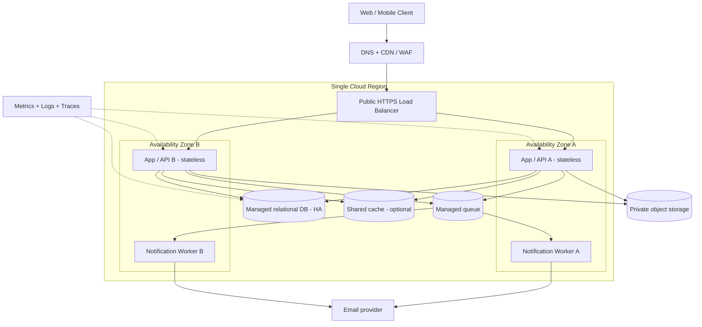
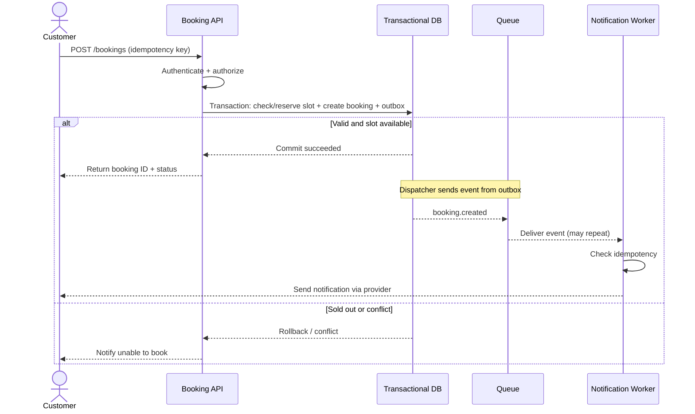

# What Is Cloud Architecture and What Architectural Decisions Must Be Solved?

> **Chapter:** Architecture Overview  
> **Scope:** CLOUD_ARCHITECTURE — designing application architecture on the cloud, from business requirements to networking, compute, data, and deployment models; evaluating trade-offs across reliability, security, scalability, cost, and operations using Well-Architected thinking.

## Learning Objectives

After this lesson, you can:

1. Explain how cloud architecture differs from a list of cloud services and why architecture starts from business requirements.
2. Translate desires such as “fast”, “stable”, and “secure” into measurable and verifiable requirements.
3. Identify key decisions regarding deployment regions, networking, compute, data, inter-component communication, security, reliability, cost, and operations.
4. Sketch a realistic application architecture, explicitly stating assumptions, alternatives, consequences, and remaining risks.
5. Perform a preliminary evaluation of a design using Well-Architected principles rather than relying solely on the number of technologies used.

## 1. What Is Cloud Architecture Really?

**Cloud architecture** is the way components of a system running on cloud infrastructure or services are organized, determining **how they communicate, store data, are protected, deployed, scaled, observed, and recovered** to meet business goals.

Architecture also includes decisions *not visible on a diagram*: who has access permissions, how fast data can be recovered, how software changes are released, what types of failures are accepted, what the operational budget is, and who is responsible for handling alerts.

For example, the sentence “the application runs on virtual machines and uses a database” only describes a few technologies. An architectural description needs to answer more:

- Where do users access from, and through which DNS, TLS, CDN, WAF, or load balancer?
- Which network does the application reside in? Which parts must be publicly accessible, and which parts are internal-only?
- When a machine or an availability zone fails, where does traffic go?
- Which data requires transactional consistency; which data can tolerate delayed updates?
- Who can read connection secrets, who can deploy, and who can view sensitive data?
- When load increases multiple times, which components scale, and which become bottlenecks?
- Through what process are incidents detected, mitigated, and recovered? Which variables drive cost growth?

The cloud provides on-demand resource provisioning and many managed services, but **the cloud does not automatically make a system secure, always available, or cost-effective**. The chosen services, how they are configured, and how they are operated are what create those properties.

### 1.1. Common Building Blocks

| Group | Example Components | Architectural Role |
|---|---|---|
| Entry point (edge) | DNS, CDN, WAF, API gateway, load balancer | Routing, protecting, and distributing traffic |
| Networking | Virtual network/VPC, subnet, route, firewall/security group, private endpoint | Trust segmentation and controlling traffic paths |
| Compute | VM, container, managed application platform, function/serverless | Executing business logic |
| Data | Relational DB, NoSQL, object storage, cache, search | Storing and retrieving data with appropriate characteristics |
| Integration | Queue, event bus, streaming, scheduler | Connecting synchronous and asynchronous tasks |
| Security | IAM, secret manager, KMS, audit log, policies | Managing identities, permissions, and keys |
| Operations | Metrics, logs, traces, CI/CD, Infrastructure as Code | Monitoring, deploying, and controlling changes |

Specific service names differ across AWS, Azure, Google Cloud, and other providers. What matters at the design stage is the **role, behavior, limits, and failure domain** of each component, not memorizing a single product name.

### 1.2. Architecture Is a Set of Trade-offs

Rarely does a single option simultaneously optimize latency, availability, consistency level, security, cost, and simplicity. For example:

- Running in a single availability zone is cheaper and simpler; distributing across multiple zones tolerates failures better but increases complexity and may raise data transfer costs.
- Synchronous processing makes business flows easy to trace; using a queue absorbs traffic spikes but introduces latency and duplicate-processing challenges.
- Caching reduces response times and DB load; caching also introduces expiration and stale data issues.
- Multiple microservices enable independent deployments; a well-structured monolith is often simpler when the product and team are still small.

**A good decision is one with clear reasoning, aligned with real constraints, and a way to validate assumptions**, not the decision that uses the most services.

## 2. From Business Requirements to Technical Criteria

Design should start with critical user flows, the impact when those flows break, and resource constraints. Do not start with the question “should we choose Kubernetes or serverless?”.

Suppose we are building a **service booking platform**. Users search for available time slots, book appointments, pay, and receive notifications. A requirement that “customers cannot double-book the same slot” may lead to transaction and data constraint decisions; “scaling during promotional campaigns” leads to compute scaling and overload protection decisions; “no leakage of personal information” leads to access control, encryption, and auditing decisions.

### 2.1. Classifying Requirements

**Functional requirements** describe what the system must do: sign in, search, book, pay, cancel bookings, send emails. **Non-functional requirements** describe how well the system must perform and under what conditions: speed, reliability, scalability, security, operability, cost, and compliance.

The example targets below are **lesson assumptions**, not universal thresholds for every system:

| Business Desire | Translated into Verifiable Requirement | Design Implications to Consider |
|---|---|---|
| Fast customer search | Search API p95 response time under 300 ms at target load | Data indexing, appropriate caching, measuring latency per tier |
| Handle peak hours | Sustain 300 requests/second in a defined load test | Stateless app, autoscaling, DB connection limits |
| Stable service | 99.9% availability SLO for core APIs over a 30-day window | Eliminating single points of failure, health checks, alerting |
| Minimize data loss on failure | Maximum RPO target of 15 minutes for an agreed failure scenario | Backups, transaction logs, replica strategy, and restore testing |
| Fast service recovery | Maximum RTO target of 60 minutes for the same scenario | Runbooks, recovery permissions, failover/restore drills |
| Protect customer data | Only authorized roles access personal data; audit trail for sensitive actions | IAM, network segmentation, encryption, audit logs |
| Control costs | Monthly spending limit and threshold alerts | Budget alerts, tagging, measuring cost per environment/feature |

These targets **must be confirmed with product owners, operations, security, and budget holders**. To define a useful SLO, specify which API is measured, from where it is measured, load conditions, how success is calculated, and the observation window. A 99.9% target over 30 days corresponds to roughly 43.2 minutes of unavailability assuming a 30-day month; exceptions and measurement definitions must be agreed upon.

### 2.2. Easily Confused Concepts

| Concept | Meaning | Design Question |
|---|---|---|
| **SLI** (Service Level Indicator) | Actual measured metric, e.g., request success rate or p95 latency | What is being measured and where? |
| **SLO** (Service Level Objective) | Internal target for an SLI over a specific window | What service level is sufficient for users? |
| **SLA** (Service Level Agreement) | Service commitment with agreed-upon terms | What are the consequences when violated? |
| **RTO** (Recovery Time Objective) | Target maximum time to restore operations after an incident | How long of an outage is acceptable? |
| **RPO** (Recovery Point Objective) | Maximum acceptable data loss measured in time | What is the maximum amount of recent data that can be lost? |

RTO and RPO **are always tied to a specific type of failure**. Surviving a machine failure, an availability zone outage, an entire region outage, accidental deletion, and a ransomware attack are different scenarios; a Multi-AZ configuration does not automatically guarantee recovery if an entire region goes down or if data is logically deleted.

### 2.3. Eliciting Requirements with the Right Questions

Before drawing a diagram, clarify: who are the users and in which regions are they located; current traffic and projected growth; peak load, data size, and read/write ratio; which transactions require strict accuracy; which third-party dependencies exist; whether data has residency or retention constraints; budget, team skills, and target release date; and the financial/business impact per hour of downtime.

If figures are unknown, record **assumptions to verify** and plan measurement tests. Never turn an estimate into an operational commitment.

## 3. Core Architectural Decision Groups

### 3.1. Choosing Cloud Model and Deployment Scope

At the foundational level, decide whether to use public cloud, private cloud, or hybrid; single provider or multi-provider; number of regions; and how availability zones are used.

- **Single region, single zone:** suitable for prototypes or workloads that can tolerate downtime; minimal redundant resources.
- **Single region, multi-zone:** multiple application replicas and zone-resilient data services, typically a reasonable starting point for production applications requiring high availability.
- **Multi-region:** expands the fault tolerance boundary or brings services closer to users, but requires solving routing, data synchronization, write conflicts, higher operational overhead, and higher cost.
- **Hybrid/multi-cloud:** may stem from integration requirements, data sovereignty, or vendor lock-in risk; they increase standardization demands and operational staffing needs.

A **Region** is a geographic area defined by the provider; an **availability zone** is an isolated infrastructure domain within a region as designed by the provider. Distributing across two zones is only valuable if every required dependency also has an appropriate fault-tolerance mechanism. Service availability must be checked in the target deployment region; naming and guarantees depend on the provider.

Region decisions are governed by latency to customers, legal/data residency requirements, service availability, cost, and disaster recovery (DR) plans.

### 3.2. Designing the Network and Request Path

A cloud network typically includes a virtual network (VPC/VNet), subnets, route tables, firewalls/security groups, ingress/egress points, and private connectivity to managed services or corporate networks.

Design principles:

1. Only components that truly need to accept connections from the Internet should sit on the public access path, such as a load balancer or API gateway.
2. Applications and DBs should restrict direct access; DBs typically reside in private subnets or allow access only via private endpoints.
3. Allow connectivity between components strictly by **source, destination, port, and required purpose**; deny unused paths by default.
4. Manage outbound Internet traffic (egress) deliberately: NAT, proxy, or private endpoints depending on need. Egress can generate significant costs.
5. Protect the application layer with TLS, authentication, and input validation; CDN/WAF can assist but do not replace in-application security.

Example path: `Browser → DNS/CDN/WAF → HTTPS load balancer → private application → private DB`. Each arrow must answer: is the connection encrypted, who is allowed to call it, are there timeouts or rate limits, and where are logs recorded?

### 3.3. Choosing Compute: VM, Container, PaaS, or Serverless?

| Option | Suitable When | Trade-offs / Caveats |
|---|---|---|
| **Virtual machine (VM)** | Need OS control, specialized runtimes, legacy software | Self-managed OS patching, capacity, images, replacing failed machines |
| **Containers on managed services** | Need consistent packaging, long-running workloads, resource and rollout control | Still must configure autoscaling, networking, health checks; complexity varies by platform |
| **PaaS/managed application runtime** | Want fast deployment for standard web/API apps | Reduced lower-layer control; runtime, configuration, and cost limits apply |
| **Function/serverless** | Event-driven tasks, variable load, bounded execution times that fit limits | Platform-dependent cold starts, time/resource limits, concurrency, and service dependencies |

Evaluate **baseline load**, peak load shape, execution duration, in-process state, scale-to-zero capability, startup latency, testability, team skills, and total cost of ownership. Never assume serverless is always cheaper or Kubernetes always scales better.

A cleanly modularized monolith running multiple **stateless** replicas is often easier to deploy and operate initially. Split into microservices only when business boundaries, independent scaling/deployment needs, team ownership, or fault-isolation needs are sufficiently clear. Splitting services increases network communication, distributed consistency complexity, and observability requirements.

**Stateless** means an instance does not hold critical session state solely in local memory; sessions or shared data must reside in an appropriate store. Statelessness allows load balancers to route flexibly, replace instances, and scale horizontally, though the underlying DB and dependencies still have limits.

### 3.4. Choosing Data Models and Ensuring Correctness

Selection should begin from **query patterns, data relationships, required consistency, volume, growth patterns, and recovery requirements**, not from a database's popularity.

- **Relational database:** fits relational business logic and ACID transactions, such as bookings, invoices, and payments. Requires indexing, transaction control, backups, and read/write scaling plans.
- **NoSQL/key-value/document:** useful for specific access patterns or scaling needs; must examine data constraints, consistency models, and per-service query limitations.
- **Object storage:** fits images, documents, backups, and large files; apply tight access permissions, lifecycle rules, and retention policies.
- **Cache:** serves read-heavy data where sync/expiration strategies are acceptable; cache is an optimization tier, never the system of record itself.
- **Search index/analytics store:** serves complex search and analytics; usually tolerates some update lag relative to primary transactional data.

Distinguish **data availability** from **data recovery**. Synchronous replicas/automatic failover reduce downtime from infrastructure faults; independent backups, protection against accidental deletion/modification, and verified restore procedures address other forms of data loss. Retention periods, backup access controls, and regular restore tests must be established.

Booking example: if two customers book the same resource/time slot, checking “availability” with a query and then writing in two unlocked/non-transactional operations can create duplicates. You must use **model-appropriate unique constraints, transactions, or concurrency synchronization mechanisms** where data is written. Caching or frontend logic cannot guarantee correctness under concurrent requests.

### 3.5. Choosing Synchronous vs. Asynchronous

**Synchronous calls** (e.g., HTTP/gRPC) fit when the user needs an immediate answer: “did the booking succeed or fail?”. However, if the API must wait for image processing, email sending, and multiple third-party calls, response time and cascading failure risk increase.

**Queues/events** fit work that can happen after the primary transaction completes, such as sending notifications or generating reports. Asynchronous design must answer:

- How durably are messages stored, and can they be redelivered or processed more than once?
- Is the consumer **idempotent** (repeated processing produces no unintended side effects)?
- When processing fails, how are retries with backoff handled, and when are messages moved to a dead-letter queue?
- How do you avoid a case where the DB write succeeds but the event is never published? A **transactional outbox** can be used when the two actions must be reliably linked.
- Where does the user observe the “processing/completed/failed” status?

Never assume a queue guarantees end-to-end exactly-once processing by default. Many systems operate with **at-least-once delivery**; therefore idempotency, business keys, and retry design are essential decisions.

### 3.6. Designing Reliability, Scalability, and Recovery

Distinguish three goals:

- **Scalability:** increasing processing capacity as demand grows (horizontal scaling across instances or vertical scaling by adding resources).
- **High availability (HA):** continuing to serve when a component or fault domain fails, via redundancy and failover.
- **Disaster recovery (DR):** recovering from severe incidents beyond standard HA capabilities, according to defined RTO/RPO.

Commonly combined techniques: multi-instance across zones, health checks, autoscaling on metrics that truly reflect load, connection pool limits, timeouts, bounded retries with jitter, circuit breakers, rate limiting, backpressure, queues, and intentional graceful degradation.

**Unbounded retries can cause an overloaded system to collapse faster.** Timeouts that are too short cause false failures; too long holds onto resources and increases latency. If a dependent service fails, returning a partial result or queuing for later processing is sometimes better than waiting indefinitely.

Identify **single points of failure** across the entire path: not just compute, but also DNS, load balancers, databases, caches, queues, secret services, network links, and deployment pipelines. For each failure domain, document: what happens, who gets alerted, how failover works, how rollback works, and test evidence.

### 3.7. Designing Security from the Start

In the **shared responsibility** model, the provider is typically responsible for security *of* the cloud infrastructure, while the customer is responsible—depending on service type—for data, identities, configuration, applications, and access permissions. The exact split differs among VMs, managed services, and serverless.

Foundational decisions include:

1. **Identity/IAM:** strong authentication, MFA for administrative access, job-based roles, least privilege, and workload identities instead of static keys whenever possible.
2. **Network segmentation and controls:** open only necessary entry paths, protect public endpoints, isolate data and internal components.
3. **Encryption:** TLS in transit, encryption at rest, key management and key lifecycle aligned with sensitivity.
4. **Secrets:** store passwords/API keys in a secret manager; never embed them in source code, container images, or logs.
5. **Data protection and auditing:** data classification, sensitive data minimization, retention/deletion policies, audit logs, and backup access controls.
6. **Supply chain and operations:** dependency/image scanning, vulnerability patching, restricting CI/CD permissions, monitoring anomalous actions, and having an incident response process.

Security controls must be verified via configuration, tests, and logs. Having TLS or a firewall does not mean object-level authorization flaws, SQL injection, or data leakage in logs have been solved.

### 3.8. Designing Observability, Delivery, and Cost

An architecture must be operable from day one:

- **Observability:** SLI-aligned metrics, structured logs, distributed tracing, correlation/request IDs, dashboards, and alerts based on user impact.
- **Delivery:** CI/CD, testing, incremental rollouts or blue-green/canary when appropriate, rollback, and environment-specific configuration management.
- **Infrastructure as Code (IaC):** versioned configuration, change reviews, drift reduction, and repeatable environment recovery.
- **Capacity/cost:** owner/environment tagging, budgets and alerts, tracking idle compute, databases, storage, logs, egress, cross-region traffic, managed services, and support fees.

**Cloud cost is not just server bills.** Account for total cost of ownership: development, operations, security, monitoring, recovery, training, and team time spent on incidents. Optimization means choosing an appropriate cost level to achieve **agreed service levels**, not cutting every line item regardless of impact.

## 4. Reference Architecture Example: Booking Application

Suppose the product has web/mobile clients, a booking API, a business DB, email notifications, and image storage. Given requirements to serve across multiple instances, avoid self-managing OS/databases, and prioritize availability during a single-zone outage, an initial architecture can be proposed as follows.



> The diagram is a **logical model** and does not depict all subnets, routes, private endpoints, IAM policies, backups, actual managed service topologies, or internal fault zones. Every HA service must be configured and verified per provider capabilities; drawing an “HA” box does not automatically create fault tolerance.

### 4.1. Explaining the Decisions

| Component / Decision | Rationale | Conditions to Verify |
|---|---|---|
| CDN/WAF at the edge | Offloads static content and filters some malicious traffic | Cache policy, dynamic authentication, false positives, origin protection |
| Load balancer + two stateless apps across two zones | Distributes load and reduces single-instance/zone dependency | Health checks, actual availability, min instances, autoscaling |
| Managed relational DB with HA configuration | Keeps booking transactions consistent and reduces DB ops work | Failover, write capacity, connection limits, backup/PITR, cost |
| Managed queue + worker | Sends email post-transaction without holding HTTP requests on the email provider | Idempotency, retries, DLQ, queue backlog, processing latency |
| Private object storage | Stores images/documents and controls access | Object permissions, signed URLs, lifecycle, encryption, upload size |
| Cache only when measured | Reduces load on repeated queries that tolerate staleness | TTL, invalidation, cache stampede, cache failure |
| Logs/metrics/traces | Detects incidents and traces across components | SLIs, alerts, PII protection, log retention and cost |

**Points to refine in the deployment design:** network boundaries must clearly define public load balancers, private apps/workers, and private DBs; connections to DB, queue, and object storage must use appropriate private/network policy mechanisms. If the customer requires *entire-region* fault tolerance, this single-region design is insufficient and a separate multi-region DR design is required.

### 4.2. Booking Flow Ensuring Correctness



The diagram emphasizes four principles: (1) the system of record decides availability; (2) a transaction or concurrency control mechanism protects the write; (3) notification is an asynchronous step that does not determine whether the booking succeeded; (4) duplicate processing must be safe. In real implementations, a **dispatcher** is a process that reads the outbox and emits events after commit; the notation DB → Queue represents flow via the dispatcher, not that the DB pushes to the queue itself.

If a payment gateway is called, design specifically for pending payment states, timeouts, duplicate callbacks, compensation/reservation release, and reconciliation. Never hold a DB transaction open while waiting on a slow network call to a payment provider.

### 4.3. Injecting Failures to Verify Fault Tolerance

An architecture is only trustworthy when expectations are tested under representative conditions:

| Simulated Scenario | Expectation to Verify | Signals to Observe |
|---|---|---|
| One app instance stops | LB removes unhealthy instance; other instances keep serving | Error rate, p95 latency, detection time |
| One zone becomes unavailable | Required components in the remaining zone continue or recover per target | DB failover outcome, queue backlog, API availability |
| Sudden traffic spike | Autoscaling and upstream limits prevent cascading collapse | CPU, RPS, DB connection count, 429/5xx, cost |
| Email provider is slow | Bookings still complete; worker retries within bounds | Queue age, DLQ, duplicate send count |
| Accidental data deletion or corruption | Restore from backup/PITR per defined scenario | Recovered data, measured RPO/RTO, audit logs |

These scenarios also expose limits: Multi-AZ does not solve losing an entire region; replicas can replicate logical deletion errors; compute autoscaling does not make a DB scale infinitely.

## 5. Evaluating with Well-Architected Thinking

**Well-Architected** is a systematic way of asking questions about architectural properties, risks, and continuous improvement. Cloud providers have frameworks with different pillar groupings. For example, the AWS Well-Architected Framework uses the six pillars below; when deploying on another provider, map to their corresponding guidance and service limits.

| Pillar | Evaluation Question | Expected Evidence |
|---|---|---|
| **Operational Excellence** | How are changes deployed, observed, remediated, and learned from after incidents? | CI/CD, runbooks, dashboards, drills, postmortems |
| **Security** | Who accesses which data? How are secrets, configs, and logs protected? | Least-privilege IAM, encryption, audits, config checks |
| **Reliability** | When a component or zone fails, how does the service recover? | RTO/RPO, backup restore tests, failover tests, SLO tracking |
| **Performance Efficiency** | Do resources and technologies fit load patterns, latency, and scale? | Load tests, profiling, autoscaling, capacity plans |
| **Cost Optimization** | Are costs measured and controlled relative to delivered value? | Budgets, allocation tags, cost dashboards, resource reviews |
| **Sustainability** | Are wasted resources minimized and utilization efficiency improved? | Demand-based scaling, unused resource cleanup, storage policies |

Never mark something “passing” merely because a tool exists. For example, enabling autoscaling when the DB supports only 50 concurrent connections can make the API fail faster; having backups that have never been restore-tested does not prove RTO/RPO compliance.

### 5.1. Short Evaluation Template for a Decision

For the **single region, multi-zone** option, you can record:

- **Goal:** maintain core APIs when losing an app instance or a zone; avoid multi-region operations until required.
- **Benefits:** isolates certain infrastructure faults, enables smoother instance replacement and maintenance.
- **Costs/risks:** additional replicas, cross-zone data transfer, failover and monitoring; region-wide outage risk remains.
- **Evidence:** instance termination tests, zone-loss simulations within test environment capabilities, measuring recovery time and failed requests.
- **Re-evaluation triggers:** unmet SLOs, shifts in user distribution, data residency regulations, or business requirements for full-region fault tolerance.

The key point of evaluation is **which decision increases risk, what the impact of that risk is, and what evidence confirms the option is good enough**.

## 6. A Repeatable Architecture Design Process

A practical cycle can follow this order:

1. **Understand the business and critical flows:** map actors, transactions, dependencies, and failure impact.
2. **Define measurable requirements:** SLIs/SLOs, peak traffic, data model, RTO/RPO per failure class, security, and budget.
3. **List constraints and assumptions:** data residency, existing services, team skills, release deadlines, mandatory tools; flag items needing measurement tests.
4. **Draw the logical architecture before binding services:** entry points, compute, data stores, integrations, security boundaries, fault domains, and data paths.
5. **Compare at least two major options:** complexity, reliability, operational cost, vendor lock-in risk, and future evolvability.
6. **Plan verification:** prototypes, benchmarks, load tests, security reviews, restore/failover rehearsals, cost estimates.
7. **Document decisions and iterate:** use Architecture Decision Records (ADRs), track actual metrics, and update when requirements or measurements change.

### 6.1. Short Architecture Decision Record (ADR) Template

```text
ADR-001: Use managed relational database for booking workloads

Context:
- Bookings must prevent double-booking of resources/time slots under concurrent requests.
- Small team; prioritize reducing database server operations overhead.

Options:
A. Managed relational DB supporting transactions and appropriate HA configuration.
B. Self-managed relational DB on VMs.
C. Document/NoSQL DB with service-specific constraint mechanisms.

Decision: A, assuming initial load remains within service limits.

Rationale:
- Transactions and unique constraints enforce business invariants.
- Backups, patching, and failover are supported by the managed service at the chosen tier.

Consequences:
- Baseline cost may exceed a small VM; dependent on provider features.
- Still must optimize queries, protect connections, and test restore/failover.

Verification:
- Test double-booking race conditions; run peak-hour load tests.
- Test backup restore, measure failover duration, and track actual cost.

Revisit when:
- Read/write load patterns, RTO/RPO requirements, or budget change significantly.
```

You do not need an ADR for every minor change. Record ADRs for decisions with long-term impact, high reversal cost, or cross-team impact, so future engineers understand **why**, not just **what was chosen**.

## 7. Common Pitfalls and How to Spot Them

| Inaccurate Claim | Better Thinking |
|---|---|
| “Moving to the cloud automatically gives high availability.” | HA must be designed across every dependency and tested against specific fault domains. |
| “Using microservices guarantees good scaling.” | Scaling depends on bottlenecks and data models; microservices add distributed complexity. |
| “Adding a cache always makes APIs fast.” | Caching helps only if read patterns fit, hit rates are sufficient, and stale data is handled properly. |
| “Having replicas means never losing data.” | Replicas can replicate erroneous operations; backups, PITR, and restore drills are required. |
| “Serverless requires no operations.” | Monitoring, permissions, error handling, concurrency limits, and cost management are still needed. |
| “Multi-region is the best choice for every app.” | Multi-region increases cost and complexity; choose it only when needed with a clear data strategy. |
| “A firewall and TLS are secure enough.” | Security includes IAM, application authorization, secret management, data protection, and monitoring. |
| “A good architecture is a diagram with many boxes.” | A good architecture can explain and prove how it meets requirements with reasonable complexity. |

## 8. Practice Exercise: Evaluate an Initial Design

**Scenario:** A booking system uses a single public VM running both web/API, a DB on the same VM, images stored on the server disk, and emails sent synchronously within HTTP requests. There are no recovery tests, no metrics collected, and peak-hour load is unknown.

Create a v1 architecture proposal with the following deliverables:

1. **Requirements table:** list at least three critical business flows; propose SLOs and RTO/RPO with incident scope, and explicitly note unverified assumptions.
2. **Logical diagram:** mark public entry points, private network segments, compute, DB, object storage, queue, access permissions, and at least one fault domain.
3. **Three ADRs:** choose (a) compute model, (b) transactional data storage, (c) synchronous/asynchronous for sending notifications; each ADR must include alternatives and trade-offs.
4. **Verification plan:** one load test, one instance/zone failure test, one backup restore test, and one least-privilege security check.
5. **Well-Architected review:** state one primary risk per pillar, priority level, and evidence needed to close that risk.

You may use the following decision table to self-check completeness:

| Decision | Driving Requirement | Accepted Trade-off | Measurement / Verification |
|---|---|---|---|
| Example: two app instances across two zones | Maintain API when one instance/zone fails | Redundancy and operational cost | Failover testing, error rate monitoring |
| Data residency and deployment region | … | … | … |
| Compute and scaling strategy | … | … | … |
| DB and consistency control | … | … | … |
| Backup/DR | … | … | … |
| IAM, encryption, secrets | … | … | … |
| Monitoring, CI/CD, and cost | … | … | … |

**Definition of done:** Another reader of your document can trace the request path, identify where data is written, explain how the system reacts to simulated failures, see who has operational access, know where major costs come from, and see which tests prove the stated goals. If a box on the diagram cannot answer these questions, record it as an open question instead of guessing.

## 9. Summary of the Thinking Framework

Cloud architecture does not start from a service catalog, but from **business requirements → measurable targets → decisions on networking, compute, data, and deployment → verification → operations and iteration**. Well-Architected pillars help ask comprehensive questions, while ADRs and testing turn subjective preferences into explainable, re-evaluable decisions.

As you move into deeper lessons on networking, compute, data, security, reliability, or cost, always trace each technology back to **which goal it serves, which risk it reduces, which cost it introduces, and which test proves its effectiveness**.
