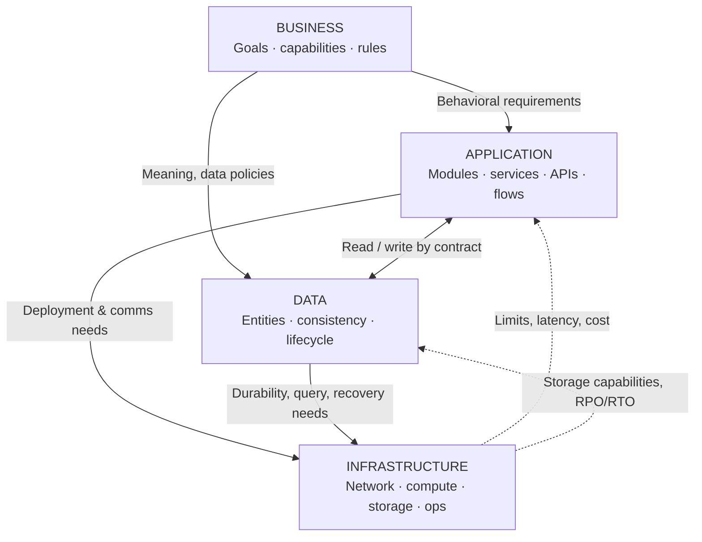

# Distinguishing Business, Application, Data, and Infrastructure Architecture

When designing a system on the cloud, the first question should not be “how many servers should we use?” but “what outcomes must the system deliver for the business?”. From that answer, the architect determines how software needs to coordinate, how data must be managed, and what requirements infrastructure must satisfy.

Four perspectives are commonly used to connect these decisions: **business architecture**, **application architecture**, **data architecture**, and **infrastructure architecture**. They describe the same system at different levels, so they are tightly linked yet cannot replace one another.

In the **CLOUD_ARCHITECTURE** module, distinguishing these four perspectives helps bridge from business requirements to choices in networking, compute, data, and deployment models—while explaining trade-offs across reliability, security, scalability, cost, and operations using Well-Architected thinking.

## 1. Four Perspectives Answer Four Groups of Questions

| Perspective | Core Question | Subject Described | Example Decision | Common Artifacts |
| --- | --- | --- | --- | --- |
| **Business** | **Why** does the system exist? **Who** does what, under which rules, to achieve what outcome? | Goals, business capabilities, processes, roles, policies, success metrics | Hold a rental item reservation for up to 10 minutes before payment | Capability maps, process diagrams, business rules, KPIs |
| **Application** | **Which software** owns which function and how do components **communicate**? | Applications, modules, services, APIs, processing flows, integration contracts | Reservation service calls Inventory service; payment results arrive via webhook | C4 container/component, component diagrams, sequence diagrams, API contracts |
| **Data** | **What information** must be stored, who owns it, what does it mean, and how consistent is it? | Entities, relationships, data flows, source of truth, lifecycle, access permissions, data quality | Each rental time slot may have only one active hold | Data models, ERDs, data flows, data catalogs, retention rules |
| **Infrastructure** | **Where does it run**, and how is it connected, protected, scaled, recovered, and operated? | Networking, compute, runtime, load balancing, physical storage, IAM, monitoring, deployment | Run the application on managed compute and a multi-zone highly available database in one region | Deployment diagrams, network diagrams, IaC, operational configs, runbooks |

A feature like “rental booking” appears in all four perspectives: business defines the booking conditions, application executes the workflow, data stores the state, and infrastructure operates the corresponding components. Therefore, **do not classify by feature name**; classify by *the question the decision is answering*.

## 2. Business Architecture: Goals, Rules, and Value Creation

Business architecture describes what **capabilities** an organization needs to achieve its goals, the **processes** that coordinate those capabilities, and the **business rules** governing decisions. It does not yet force choosing a programming language, database, or cloud provider.

Example for an equipment rental platform:

- **Goals:** customers book rentals quickly, reduce double-bookings, reduce failed payment orders.
- **Capabilities:** catalog management, availability lookup, reservation holding, payment, refunds, customer support.
- **Process:** search equipment → check available times → place hold → pay → confirm.
- **Rules:** a piece of equipment cannot be confirmed for two overlapping rentals; an unpaid hold expires after 10 minutes.
- **Metrics:** booking success rate, double-booking rate, order completion time, cost to serve per order.

Three concepts must be distinguished:

| Concept | Meaning | Example |
| --- | --- | --- |
| **Goal** | Desired outcome | Reduce orders canceled due to schedule conflicts |
| **Capability** | What the organization must do well, relatively stable over time | Manage equipment availability |
| **Process** | Sequence of activities to produce a specific result | Check schedule → hold slot → collect payment |

Changing a process does not necessarily change a capability; one capability can be used by multiple processes. Capability boundaries are useful inputs for defining business domains and partitioning software responsibilities, but **there is no rule that “one capability = one microservice”**.

**Useful outputs:** capability maps, business flows, user roles, verifiable rules, priority levels, and non-functional requirements derived from business impact.

## 3. Application Architecture: Software Responsibilities and Coordination

Application architecture translates business requirements into **software components** and **interaction flows**. This perspective answers who handles booking commands, who verifies payments, whether components communicate via APIs or events, and how failures are responded to and retried.

For example, responsibilities can be divided into logical modules:

| Component | Primary Responsibility | Communication |
| --- | --- | --- |
| Catalog | Provides equipment info and filters | Read-only API |
| Availability | Answers which slots are free; holds or releases rental slots | Concurrency-controlled calls |
| Reservation | Manages booking order lifecycle | Create/cancel APIs, consumes payment events |
| Payment integration | Submits payment requests, verifies callbacks/webhooks, handles retries | Provider APIs and authenticated webhooks |
| Notification | Sends confirmations or expiration reminders | Consumes events, processes asynchronously |

These responsibilities can be deployed as **modules within a monolith** or **multiple independent services**. Those are two implementation options for application architecture with different trade-offs. Do not choose microservices just because a diagram has many boxes: the more services there are, the more network communication, API versioning, distributed observability, and consistency challenges arise.

Key questions in application design:

1. Which component owns a specific business behavior?
2. Which operations need synchronous responses, and which can be processed asynchronously?
3. What happens if a call times out, a message is redelivered, or a component is temporarily unavailable?
4. How are APIs, events, access permissions, and contract versions managed?
5. Which components can be deployed, scaled, and tested independently without breaking the end-to-end flow?

For example, order creation should include an **idempotency key** so repeated requests do not create multiple holds. For payment webhooks, the application must **verify the sender and process idempotently** because the provider may redeliver notifications.

**Distinction point:** a service diagram showing *who handles what* belongs to application architecture; choosing to run services on VMs, containers, or serverless belongs primarily to infrastructure/deployment architecture.

## 4. Data Architecture: Meaning, Ownership, and Information Lifecycle

Data architecture ensures data is accurate enough, consistent, secure, and useful for processes. It covers both the **information model** and **how data is created, stored, shared, protected, recovered, and purged**.

Three common modeling levels:

- **Conceptual:** the business has Customers, Equipment, Rental Slots, Reservations, and Payments; how do they relate?
- **Logical:** what are the attributes, identifiers, relationships, constraints, and state lifecycles, independent of a specific storage technology?
- **Physical:** how are tables, indexes, partitions, storage formats, backup strategies, and specific queries organized?

In the rental example, key entities and rules might be:

| Entity / Data | Meaning and Responsibility | Critical Constraints |
| --- | --- | --- |
| Equipment | Rentable equipment | Stable identifier; clear maintenance status |
| RentalSlot | A bookable slot/time window | Two valid holds must never occupy the same slot |
| Reservation | Rental request and processing state | Valid state transitions; recorded expiration timestamp |
| PaymentAttempt | A single transaction attempt with the payment provider | Transaction ID and duplicate-processing lock |
| AuditEvent | Evidence of significant state changes | Records timestamp, actor, and reason for change |

The **source of truth** must be clear. For example, slot availability cannot rely solely on a cached value; hold decisions must rely on conditional updates or transactions against the authoritative data store. If time ranges can be chosen arbitrarily instead of fixed slots, the data model and conflict-prevention mechanism must also handle **overlapping intervals**, rather than relying only on a unique key on a slot ID.

Beyond storage, data architecture also determines:

- **Consistency:** which updates require atomicity, and which data can lag by a few seconds? Eventual consistency cannot be applied to every business invariant.
- **Ownership:** which component is allowed to write, and which only reads via APIs/events? Sharing tables directly across services easily creates hard-to-control coupling.
- **Security and governance:** classifying sensitive data, role-based access, encryption, retention/deletion, and access audit trails.
- **Recoverability:** backups, restore verification, **RPO** (maximum acceptable data loss, measured in time) and **RTO** (maximum time to restore service) targets.
- **Quality and analytics:** completeness, freshness, consistent identifiers, reporting metrics, and data lineage.

**Distinction point:** “What states does a booking have?” is a data question combined with business rules; “which module transitions states?” belongs to application; “which managed database service to use and in which network?” involves both physical storage and infrastructure decisions.

## 5. Infrastructure Architecture: Execution Environment and Operational Guarantees

Infrastructure architecture realizes application and data needs onto physical resources or cloud services. It describes how traffic enters the system, network segmentation, compute provisioning, identity protection, incident monitoring, and component failure recovery.

| Infrastructure Group | Architectural Question | Example Cloud Choices |
| --- | --- | --- |
| Network and entry points | How do users reach the system, and which components can connect? | DNS, CDN, load balancer/API gateway, virtual network, subnet, firewall |
| Compute and runtime | In what unit does the application run and scale? | VMs, managed containers, Kubernetes, functions/serverless |
| Physical storage | Where does data live, and what are its durability and throughput? | Managed relational database, object storage, block storage |
| Identity and secrets | Who is allowed to call, read, write, or deploy? | IAM/roles, workload identity, secret manager, managed encryption keys |
| Availability and recovery | If an instance or availability zone fails, what happens? | Health checks, multiple availability zones, backups and restore procedures |
| Operations and delivery | How are deployments, monitoring, alerting, and changes controlled? | IaC, CI/CD, logs, metrics, traces, alerts, runbooks |
| Cost and limits | Are resources efficient under normal and peak loads? | Autoscaling, quotas, budgets, cost allocation, lifecycle policies |

For example, an application without local session state can run across multiple instances behind a load balancer. However, **scaling compute does not automatically keep data consistent or allow the database to handle arbitrary load**; queries, connection pools, service limits, and write characteristics must also be evaluated.

Infrastructure choices can feed back into application architecture: serverless startup time, execution time limits, database connection limits, inter-region latency, or message delivery semantics all shape API design, error handling, and data design.

**Distinction point:** a network diagram shows *where components run and which security boundaries they communicate across*; it does not substitute for business process descriptions or data invariants.

## 6. Relationships Among the Four Architectures



The diagram above represents **four views of the same solution**, not four software layers forced to execute sequentially or map one-to-one. One business capability may require multiple applications; one application handles multiple data entities; multiple application components may share a compute cluster while obeying different access permissions.

Design typically flows from **business → application/data → infrastructure**, but in practice **feedback is bidirectional**: regulatory constraints, budgets, cloud service capabilities, or recovery targets can force the team to adjust application designs and business processes.

A quick boundary check:

| Statement | Primary Perspective | Rationale |
| --- | --- | --- |
| “Customers can cancel free of charge 24 hours before equipment pickup.” | Business | Policy determining customer outcome |
| “Reservation emits ReservationCancelled event for Notification to handle.” | Application | Component responsibility and interaction contract |
| “Reservation records cancellation timestamp and reason code; history cannot be overwritten.” | Data | Semantics, model, information lifecycle |
| “Event consumer worker runs on managed containers with autoscaling.” | Infrastructure | Execution environment and scaling capability |
| “Use managed PostgreSQL as the transactional data store.” | Data **and** infrastructure | Selects both storage model and deployment service |
| “Service must recover within 30 minutes during a major incident.” | Cross-cutting requirement | Business sets RTO target; application, data, and infrastructure jointly realize it |

## 7. End-to-End Example: Designing Equipment Rental Slot Holding

Suppose a rental platform must allow multiple users to view the same equipment while only one person can hold **a specific rental slot** at a time. The figures below are **assumptions for design practice**, not default requirements for all systems.

### Step 1 — Define Business Decisions

Requirement: a user can hold a rental slot for **10 minutes** to complete payment. If payment succeeds, the booking becomes confirmed; if it expires, the slot reopens. A slot must never be confirmed for two bookings.

Clarify with the business: is “success” counted when the customer submits payment or when the third party confirms settlement? Are late payments accepted after the hold expires? Is an automatic refund issued in that case? This decision directly shapes states and error handling.

### Step 2 — Design Application Behavior

A minimal design:

1. Client sends a hold request with a deduplication/idempotency key.
2. Reservation checks preconditions and requests Availability to claim the slot via an **atomic** operation; if already occupied, return a conflict result.
3. Upon successful hold, create a Reservation in **HELD** state with an expiration timestamp.
4. Payment integration executes payment; authenticated result webhooks are processed **idempotently** to avoid duplicate confirmations.
5. If valid payment arrives before expiration, Reservation transitions to **CONFIRMED**; expiration handling transitions to **EXPIRED** and releases the slot. All competing processes must check the latest state using safe concurrency controls.

This is a logical design. Modules can reside in a single application to keep transactions simple, then split into services if genuine independent deployment or scaling needs emerge.

### Step 3 — Design Data and Invariants

With a fixed rental-slot model, a transactional database can maintain the **AVAILABLE → HELD → CONFIRMED** state for each slot, or model hold records with equivalent constraints. The hold operation must lock/conditionally update inside a transaction so two concurrent requests cannot both succeed.

Conceptual SQL *illustrative example* (table names and syntax must be adapted to the actual DBMS):

```sql
BEGIN;

UPDATE rental_slot
SET state = 'HELD',
    hold_expires_at = :expires_at
WHERE id = :slot_id
  AND state = 'AVAILABLE';

-- Only create reservation if UPDATE affected exactly 1 row.
-- If 0 rows: rollback and return conflict / slot unavailable error.
INSERT INTO reservation (id, slot_id, status, expires_at)
VALUES (:reservation_id, :slot_id, 'HELD', :expires_at);

COMMIT;
```

The SQL snippet above **is not a complete implementation**: the application must verify the updated row count before INSERT; appropriate data constraints, accurate transaction/rollback handling, safe expiration handling, and late-payment transaction controls are all needed. With arbitrary overlapping rental intervals, the design must prevent interval overlaps rather than relying on a single slot ID.

Caching can speed up reading equipment listings, but it must never be the sole authority deciding slot claims. If emitting events after database updates, consider a **transactional outbox** to prevent committing data while losing events; consumers must tolerate duplicate delivery.

### Step 4 — Choose Infrastructure Supporting Behavior

Conceptual cloud approach:

- API traffic passes through a protected entry point (gateway/load balancer, TLS, access control, and rate limiting).
- Application components run on managed containers or an appropriate runtime with health checks and demand-based scaling.
- Managed transactional database with standby replicas/failover aligned to availability targets, backups, and restore testing.
- Queue or event service for notifications and asynchronous tasks; expiration tasks can use a scheduler/worker with conditional updates.
- Least-privilege IAM, secrets in a secret manager, end-to-end telemetry for the booking flow.

**Do not jump straight to Kubernetes, multi-region, or multiple database engines** if traffic, recovery targets, and operational capacity have not justified them. Conversely, if downtime risk is high, running a single instance without tested backups will fail to meet requirements.

### Step 5 — Trace Requirements Across Architectures

| Original Requirement | Business | Application | Data | Infrastructure / Operations |
| --- | --- | --- | --- | --- |
| No double-booked slots | One slot, one renter | Hold flow handles concurrency | Transactions, invariant constraints | Database supports transactional guarantees; conflict monitoring |
| 10-minute hold | Duration policy | Expiration scheduler/worker; late webhook handling | expires_at, valid state transitions | Scheduled job with retries; observe expired-order counts |
| Protect customer data | Access and retention policy | Auth, authorization, masking data in responses/logs | Classification, retention, encryption | IAM, secret manager, TLS, encryption at rest, auditing |
| Recover on failure | Set RTO/RPO by business impact | Retries, timeouts, idempotency, degraded modes | Backups, restores, integrity checks | Multi-AZ when needed, alerts, recovery drills |
| Reasonable cost/order | Economic target | Cut redundant calls; choose sensible module boundaries | Efficient indexes/queries, lifecycle | Autoscaling, right-sizing, per-component cost tracking |

If a requirement appears only in an infrastructure diagram with no way to verify it from business and system behavior perspectives, the design may be solving the wrong problem.

## 8. Quality Attributes Must Span All Four Perspectives

Attributes such as reliability, security, performance, cost, and operability **do not belong to a single architecture alone**. A Well-Architected approach evaluates the entire chain of decisions and trade-offs:

| Attribute | Business Defines | Application & Data Decide | Infrastructure Guarantees / Supports | Common Trade-offs |
| --- | --- | --- | --- | --- |
| **Reliability** | Acceptable downtime and allowable data loss | Retries, idempotency, transactions, partial-failure states | Multi-AZ when needed, backups, health checks, auto-recovery | Higher availability usually raises cost and complexity |
| **Security** | Risks to control, business authorization | Authentication, per-operation authorization, minimizing sensitive data | IAM, network segmentation, encryption, key and secret management | Stricter controls can slow release velocity |
| **Performance / Scaling** | Target response times and traffic | Hot-path decomposition, batching, caching, query strategy | Autoscaling, networking, service capacity | Caching lowers latency but introduces stale-data challenges |
| **Cost** | Budget, cost per transaction | Reducing redundant processing, choosing right-sized complexity | Service selection/sizing, lifecycle policies, billing monitoring | Over-provisioning wastes money; over-optimizing shrinks headroom |
| **Operations** | Desired support level and incident response time | Contextual logs, traces, clear error behaviors | Metrics, alerts, IaC, pipelines, runbooks | More independent components demand greater monitoring capacity |
| **Sustainability** | Efficient resource usage goals | Avoiding redundant compute and data transfers | Capacity tuning and resource lifecycles | Consumption optimization must balance performance and reliability |

For example, a **30-minute RTO** target is not solved by a load balancer alone: the application must restore valid state, data must have a restore or failover procedure, infrastructure must have sufficient capacity, and operations must rehearse it. **RPO** must be defined independently, because recovering within 30 minutes says nothing about how many minutes of data are lost.

Similarly, “99.9% availability” is a **target** requiring a defined measurement method and window; it is not guaranteed merely by using a service marketed as highly available. You must examine the entire transaction path, single points of failure, provider dependencies, and recovery procedures.

## 9. Decisions Frequently Misclassified

**“Business architecture is a list of UI screens.”** Insufficient. A screen list describes the UI; business architecture also covers capabilities, policies, roles, value streams, and UI-independent success criteria.

**“Application architecture is a microservices diagram.”** Not always true. A well-modularized monolith with clear responsibility boundaries, APIs, and controlled processing flows still has an application architecture.

**“Data architecture is drawing an ERD.”** An ERD is one artifact. Data architecture also requires semantics, ownership, movement, freshness, consistency, security, lifecycle, and recoverability.

**“Infrastructure architecture is choosing Kubernetes.”** Choosing a runtime is just one decision. Infrastructure also encompasses networking, identity, storage, deployment methods, recovery, monitoring, capacity limits, and cost.

**“Each layer must have a separate diagram unrelated to other layers.”** Diagrams serve different questions, yet they must remain traceable. If a business rule changes and nobody knows which APIs, schemas, and alerts are affected, the diagrams are failing to support decision-making.

**“Managed services automatically solve reliability and security.”** Providers manage part of the underlying infrastructure; development teams remain responsible for configuring permissions, handling data, designing application-level recovery, setting backup targets, and testing in practice under the shared responsibility model.

## 10. Design Process from Business to Cloud

You can follow this sequence when starting a feature or re-evaluating a system:

1. **State the problem:** who faces what issue, which business outcome needs improvement, and what are the regulatory and budget constraints?
2. **Describe the business:** map core processes, capability boundaries, roles, policies, and exception cases.
3. **Lock down measurable requirements:** expected load, response times, availability targets, RTO/RPO, security, data volume; clearly flag assumptions requiring verification.
4. **Sketch application and data together:** choose modules, API/event contracts, entities, sources of truth, invariants, transactions, and sync strategies.
5. **Map to infrastructure:** choose networking, compute, storage types, deployment, and observability; consider a simple option that meets targets first.
6. **Evaluate failure scenarios and cost:** test “payment sends webhook twice”, “database loses connectivity”, “sudden traffic spike”, “backup restore”; estimate costs and operational effort of each option.
7. **Record decisions and verify:** capture ADRs with context, options, decision, rationale, trade-offs, and validation methods; use load tests, recovery drills, and real measurements to update the design.

Short ADR example:

> **Decision:** initially deploy Reservation and Availability in the same application with a managed transactional database.  
> **Context:** small team, moderate transaction volume, double-booking prevention requires atomic operations.  
> **Rationale:** simpler data transactions, lower communication and operational overhead compared to splitting services prematurely.  
> **Trade-offs:** some components must deploy together; will evaluate module extraction when distinct scaling or release schedules emerge.  
> **Verification:** test concurrent holds, payment failures, recovery time, and peak load.

ADRs do not replace the four perspectives; they explain **why one option was chosen** when multiple reasonable choices existed.

## 11. Self-Check with a Requirement Change

Suppose the business adds a rule: **loyalty customers get a 15-minute hold, standard customers get 10 minutes**. Trace the impact:

| Perspective | What to Examine |
| --- | --- |
| Business | When is “loyalty” evaluated? If a customer's tier changes during the hold window, which rule applies? |
| Application | Who determines eligibility and passes the duration into the hold flow? Do APIs or expiration handlers need changes? |
| Data | Store the **specific expiration deadline per reservation** and the eligibility decision source for auditability, avoiding deriving the deadline solely from current customer tier |
| Infrastructure | Can the scheduler/worker handle the new volume of deadlines properly? Are additional metrics needed for expired orders, load, and cost? |

**Reasoning question:** if the team simply changes the scheduler from 10 to 15 minutes for all orders, what goes wrong? The answer is that they altered the policy for standard customers and could create invalid long-held slots. This illustrates that an infrastructure change alone cannot fully express business conditions.

## 12. Checklist When Reading or Reviewing an Architecture Diagram

- **Business:** can you identify goals, users, critical rules, exception cases, and evaluation metrics?
- **Application:** do you know which component owns behavior, the path of a transaction, integration contracts, and failure handling?
- **Data:** do you know the source of truth, consistency constraints, access permissions, retention, backups, and governance ownership?
- **Infrastructure:** can you see network flows, trust boundaries, compute, storage, scaling plans, monitoring, and recovery?
- **Cross-cutting:** does every reliability, security, performance, cost, and operations target have concrete technical decisions and verification methods?

A good cloud architecture does not require many services or many diagrams. What matters is **consistent, traceable decisions**: business goals explain how the application behaves, data preserves required invariants, and infrastructure delivers appropriate security, scalability, recovery, and cost.
